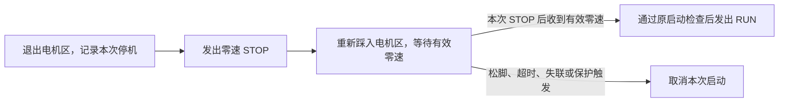
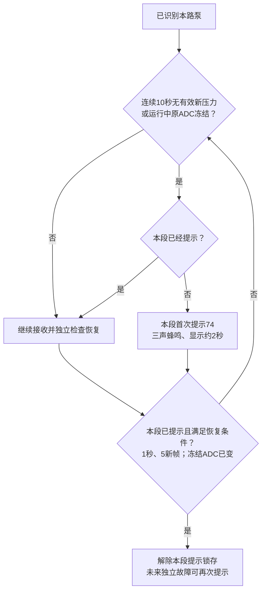
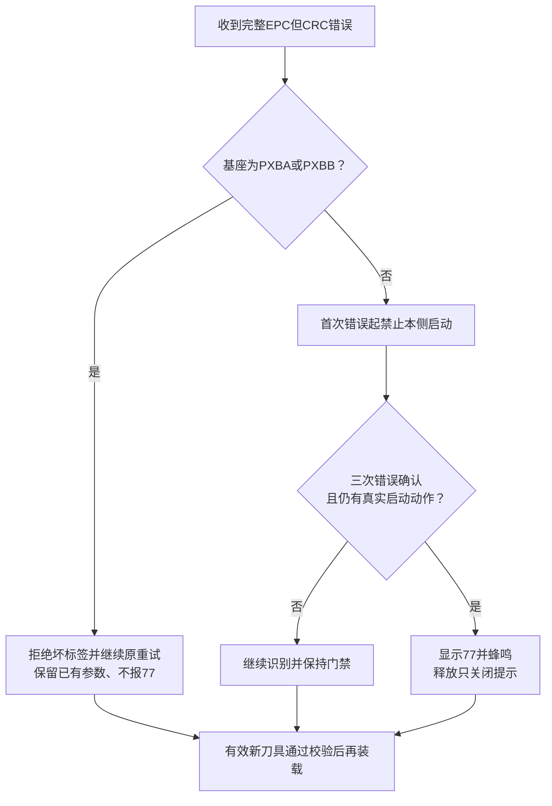
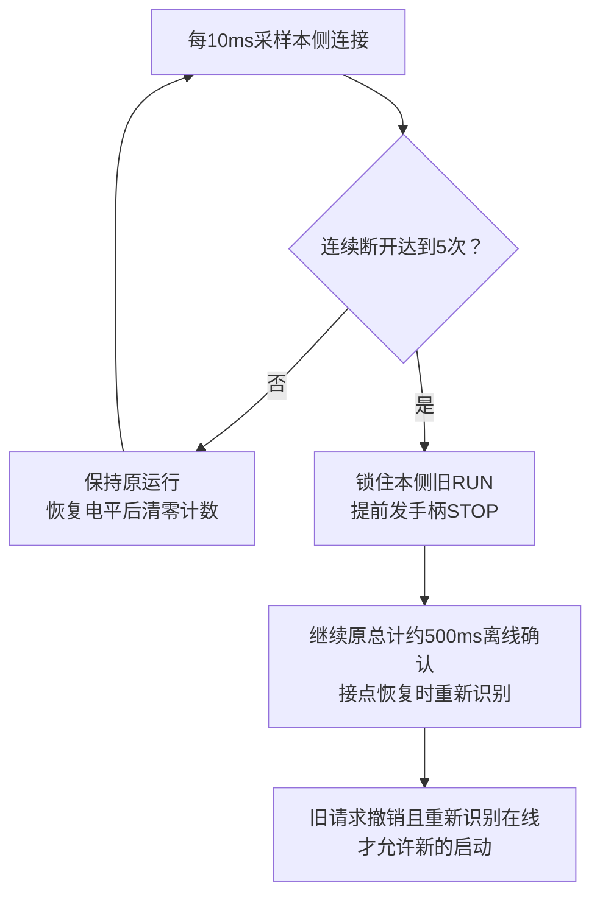
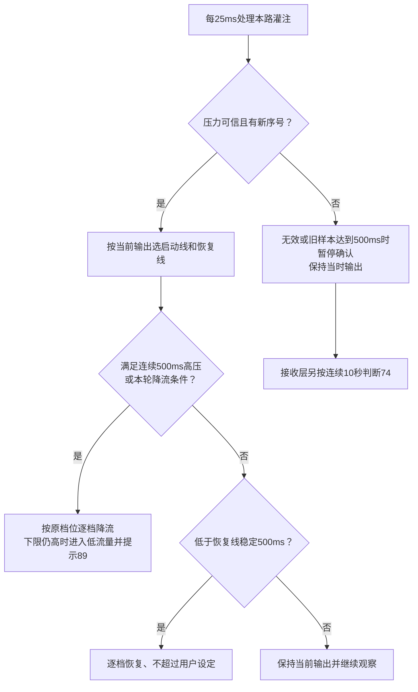

# 软件说明手册

本手册先介绍设备的整体架构，再按软件层次和功能模块说明。每个模块先看结构图或流程图，再读文字说明，最后按需展开源码和历史资料。

本地预览可使用同目录的 `manual-flowcharts`、`assets/motor-software` 和 `diagrams` 图示。Git 版本保留本 Markdown 的流程、文字对照和源码索引，图示目录按工程规则保留为本地资源。源码摘录注明整理时的函数、类型和路径；工程继续修改后以对应工作区源码为准。

原手册标为“2026-09-16完整软件资料”的 35 章已按主题归入各模块，并保留原章节编号。历史资料可能与后续实现不同；遇到差异，应先核对现行说明、源码及设备实际烧录版本。

复杂函数前附执行流程图及节点对照表。图中的节点编号对应紧随其后的源码判断或函数调用；所有流程图的可编辑源文件见 [软件控制流程图.drawio](<diagrams/software-control-flows.drawio>)。

## 1. 系统架构总览


系统由主控、手柄电机驱动、泵步进驱动和压力传感器板等独立部分组成。屏幕、脚踏、实体按键和外部设备提供操作；手柄存储器、RFID 与压力板提供识别或测量信息。主控检查运行条件并发送命令，各驱动板负责本板电机控制及保护。

| 部分 | 主要职责 | 主要工程 |
| --- | --- | --- |
| 主控 | 接收操作，识别设备，协调控制权和运行条件，生成手柄与泵命令，并处理显示和报警 | `D:\EH_main\soft\FinalSoft\EH-main-R1\EH-main-R1` |
| 手柄驱动 | 接收主控命令，执行手柄电机启动、换相或有刷调速及驱动保护 | `D:\EH_main\reference\EH-motor` |
| 泵步进驱动 | 执行泵电机定位、调速、电流控制、反馈与本板保护 | `D:\EH_main\reference\shima_waixie\small_2026_3_31\small_2026_3_31` |
| 压力传感器板 | 采集传感器、处理零点、换算重量并向主控上报 | `D:\EH_main\soft\Pressure_STM32F030F4` |

图中箭头表示信息或命令的方向，并不表示所有步骤在同一个线程中串行完成。运行请求、发送命令、驱动反馈和设备实际动作是不同阶段，需要分别确认。

### 主控软件分层


主控采用 STM32 外设、FreeRTOS 线程和周期业务回调。下表从阅读角度划分职责；各层是逻辑分组，不表示每层都有独立线程。

| 阅读顺序 | 层次 | 主要内容 |
| --- | --- | --- |
| [第 2 部分](#2-基础平台启动调度与共享数据) | 基础平台 | 上电准备、任务调度、共享状态和通道数据 |
| [第 3 部分](#3-操作与显示层输入控制权与提示) | 操作与显示 | 屏幕、脚踏、实体键、控制权、报警和提示 |
| [第 4 部分](#4-识别与参数层手柄eeprom-与-rfid) | 识别与参数 | 手柄接入、存储器认证、RFID 刀具及参数装载 |
| [第 5 部分](#5-主控执行层手柄与泵控制) | 主控执行 | 手柄命令、泵运行、压力调流及相关联锁 |
| [第 6 部分](#6-驱动与传感器固件独立设备工程) | 独立设备固件 | 手柄驱动、泵步进驱动和压力板的处理过程 |
| [第 7 部分](#7-通信与诊断层) | 通信与诊断 | 板间通信、外控、诊断和版本记录 |
| [第 8 部分](#8-工程配置构建与维护) | 工程与维护 | 构建入口、配置索引、验证和维护记录 |

例如，屏幕请求开泵后，主控先处理输入和泵请求，再由泵任务检查反馈、定位与故障，最后发送控制帧；设备实际动作还需结合驱动反馈与台架验证。

**历史资料：** 以下折叠内容保留原手册章节与编号，可能滞后于当前工作区；核对运行行为时，请结合本模块现行说明和相关源码。

<details>
<summary>历史资料 · 原第 1 章：主控软件架构</summary>

##### 1.1 系统的软件组成

| 工程 | 工程目录 | 控制职责 |
| --- | --- | --- |
| 主控 | `D:\EH_main\soft\FinalSoft\EH-main-R1\EH-main-R1` | 操作处理、手柄识别、控制权、运行条件、参数管理、报警和显示 |
| 无刷/有刷手柄驱动 | `D:\EH_main\reference\EH-motor` | 手柄电机启动、换相、调速、功率输出和驱动保护 |
| 步进驱动 | `D:\EH_main\reference\shima_waixie\small_2026_3_31\small_2026_3_31` | 泵电机定位、编码器反馈、速度与电流调节、通信及功率保护 |
| 压力传感器板 | `D:\EH_main\soft\Pressure_STM32F030F4` | 传感器采样、零点处理、重量换算、泵型识别和数据上传 |

主控负责“该不该运行、运行哪一路、设多少速度”。屏幕、脚踏、手柄按键、外部电脑都先向主控提出要求。主控检查手柄识别、控制方式和故障条件，然后发串口命令。

手柄驱动负责“怎样让电机按要求转动”。它接收目标速度，选择有刷、带霍尔无刷或无霍尔无刷的控制过程，再控制功率管。主控不会逐次替它安排每个 PWM 脉冲。

步进驱动负责泵电机的定位、速度调节、电流调节和功率保护。它有自己的编码器反馈和通信超时处理，不能只依赖主控发 STOP。

压力板负责采样、识别泵型、处理零点、换算重量并上报。它上传的是以 g 为尺度的换算读数，不是已经校准成 kPa 或 mmHg 的管路压力。

##### 1.2 主控的分层与目录

主控采用 STM32 外设驱动、FreeRTOS 线程和周期业务回调相结合的结构。外设中断先接收数据，协议程序判断报文是否完整有效，业务模块再修改状态、生成控制命令。屏幕显示和诊断记录读取这些状态，不直接代替运行条件检查。

| 层次 | 目录或主要文件 | 输入 | 输出与边界 |
| --- | --- | --- | --- |
| 启动和外设初始化 | `Src/main.c`、`Src/gpio.c`、`Src/usart.c`、`Src/dma.c`、`Inc` | 上电、复位原因、板级配置 | 建立时钟、引脚、串口与中断；不负责解释脚踏和刀具业务 |
| 任务调度 | `Src/app_task.c`、`Inc/app_task.h` | 静态任务对象、周期、回调函数 | 创建线程、等待周期、取得公共锁、执行回调并报告完成 |
| 板级资源 | `User/Hardware`、板级 `board.h` | 逻辑 A/B、实际硬件配置 | 选择引脚和物理通道；业务层不应散落硬编码的交换关系 |
| 外设与协议接收 | `User/Peripheral` | UART、软件串口、I²C、EEPROM、RFID 数据 | 字节缓存、有效帧、读写结果；坏帧不应直接更新运行参数 |
| 设备识别 | `User/Application/Handle`、`Beep/sscRFID.c` | 插入电平、EEPROM 认证、RFID 结果 | A/B 识别结果、上线/离线事件、刀具允许范围 |
| 操作与控制 | `ScreenKey`、`Beep/sscFOOT.c`、`Beep/sscKEYBH.c`、`Common/control_arbitration.c` | 按键、踩踏量、外控命令 | 控制来源、启停请求、速度与方向设置 |
| 设备输出 | `Beep/sscDrive.c`、`Pump/pump_behavior_core.c`、`Pump/pump.c` | 请求、参数、反馈新鲜度和故障 | 手柄及泵控制帧；同一设定值不保证每一轮都允许输出 |
| 用户显示与提示 | `Beep/sscUIDP.c`、`Beep/sscBEEP.c`、`Led`、`User/UI` | 显示消息、报警、连接状态 | DWIN 写屏、蜂鸣、指示灯；显示已更新不代表电机已执行 |
| 外部通信与诊断 | `ExternalComm`、`Diagnostic` | 正式协议、简易命令、诊断读取 | 控制应答、心跳、状态记录；诊断读取不取得电机控制权 |

目录名 `Beep` 不等于该目录中的文件都处理蜂鸣。`sscFOOT`、`sscDrive`、`sscPUMPA/B`、`sscUIDP` 是业务任务入口。查找泵控制时必须继续进入 `Pump/pump_behavior_core.c`，只阅读 `sscPUMPA.c` 看不到全部运行条件。

##### 1.3 一次操作经过哪些模块

以屏幕启动 A 泵为例，屏幕串口首先收到触控数据；屏幕解析程序把地址和值转换成业务按键；按键任务判断操作是否可用，再交给 `PUMPActive()`。此时改变的是 A 泵的请求和设置。A 泵周期任务随后检查驱动反馈、定位和故障状态，决定本周期是否允许非零输出，最后由泵组帧函数发出控制帧。屏幕数值、按钮和颜色则通过显示消息刷新。

这条路径包含三个不同时间点：用户操作已被处理、命令已交给串口、驱动已返回有效反馈。维护启停逻辑时应分别观察，不应在收到屏幕消息时就认定泵已经转动。

手柄运行也采用类似路径，但增加了手柄认证、刀具能力和控制权检查。脚踏、屏幕、实体键与外控可能同时有输入，只能由被允许的控制来源建立手柄运行请求。泵的独立运行不等同于取得手柄控制权。

##### 1.4 周期任务与公共业务锁

每个业务任务有自己的 FreeRTOS 线程，但回调调用前都会等待 `sAppTaskRuntimeMutex`。取得这把锁后，依次记录任务开始、执行业务函数、采集诊断状态、登记看门狗完成时间，再释放锁。这样，同一时刻只有一个业务回调修改公共业务数据。

任务“已经到期”和“已经开始执行”并不是一回事。某个回调正在等 I²C 时，其他线程可以被调度，却仍需等待它释放公共锁。增加线程数不会缩短这段等待；解决方法是控制单次回调工作量，把可分步完成的读取拆到多个周期。

`volatile` 只限制编译器对变量访问的优化，不能保证多个字段一起更新，也不能代替互斥锁。中断仍可在业务回调期间发生，因此串口缓存、发送忙标志等中断共享数据必须遵循各自的并发规则。诊断记录器只允许在持有公共业务锁的任务中调用，中断只处理必要的硬件收发动作。

`vTaskDelayUntil()` 按计划唤醒时刻安排周期，能减少单轮执行时间造成的累计漂移，但不能保证超负荷时准时完成。任务延误时，应同时看相邻开始间隔和回调耗时：开始间隔变大但自身耗时正常，通常需要检查其他回调占锁；自身耗时变大，则应继续检查本回调中的等待、循环和通信。

##### 1.5 独立的保护与观察路径

| 路径 | 检查对象 | 能说明什么 | 不能替代什么 |
| --- | --- | --- | --- |
| 主控运行条件 | 识别、控制来源、反馈有效性、定位和故障 | 本轮是否允许发运行命令 | 驱动板的功率保护 |
| 驱动通信超时 | 最近一条有效控制命令的时间 | 主控命令是否持续到达 | 主控屏幕和业务逻辑的正确性 |
| 主控看门狗 | 关键业务回调是否完整返回 | 主控任务是否持续推进 | 每台电机的实际停止检测 |
| 诊断记录 | 请求、命令、反馈和任务时序 | 异常前后的软件处理顺序 | 连续逻辑分析仪抓包、转速或流量实测 |
| 压力报警 | 新压力样本与对应泵阈值 | 当前重量读数是否持续超限 | 管路压力的物理标定及硬件限压 |

普通超压采用弹窗和蜂鸣，不直接停泵或手柄。`weight_x10=6000` 则走未就绪处理，不能按普通压力值解释。压力板有可用零点时可以继续计算，装泵校零未通过并不自动等于永久停机。上述规则分别位于主控泵行为、压力报警和压力板零点模块，不能通过修改一个报警编号同时改变这些行为。

##### 1.6 配置的生效顺序

工程中既有编译宏，也有设备存储参数和运行时设置。编译宏在构建时决定是否包含某段逻辑；EEPROM/RFID 在识别后提供设备参数；`MemoryMsgA/B` 保存各通道设置；`WorkMessage` 保存当前通道使用的工作参数；输出模块最后还要执行范围、故障和协议检查。

例如调整手柄默认速度，只改 `WorkMessageInit()` 的初值可能无效，因为手柄上线后会装载 EEPROM 或 RFID 参数。调整脚踏实时速度，只改 `speed_set_work` 也不能替代踩踏比例计算。调整泵上限，应同时核对业务限值、流量换算表和驱动协议上限，而不是只增加屏幕显示范围。

运行设置只存在 RAM 中时，断电不会自动保存。只有调用相应 EEPROM/Flash 写入接口，才会改变非易失参数。新增“保存设置”功能必须明确保存对象、写入时机、校验、断电中断和擦写次数，不能在每个 25 ms 周期直接写 Flash。

</details>

<details>
<summary>历史资料 · 原第 4 章：主控架构与数据关系图</summary>

##### 4.1 从输入到设备输出


输入经过解析和业务判断后才产生输出。图中将步骤分层表示职责，并不表示每层都有一个独立线程：解析、识别和输出也由各自业务回调执行，同样受到公共业务锁约束。看门狗线程独立检查回调完成记录；诊断只复制状态和事件，不替代启停判断。

##### 4.2 识别结果、通道记忆与运行参数


识别结果先存入对应通道记忆，选中通道后再装载当前工作参数。调速后将设置保存回对应通道，便于下次切回恢复。A/B 泵数据单独维护，既可接受手柄联动，也可接受独立开泵和排空请求。图中箭头表示业务更新关系，实际更新应通过对应公共接口执行。

##### 4.3 泵请求与驱动状态


上半图是主控判断，下半图是步进驱动状态。虚线表示主控通过协议与驱动交互，不表示普通运行帧会触发重新定位；只有指定定位命令才发起相应过程。恢复 READY 后仍需清除旧请求并接受新启动。主控反馈有效期与驱动命令超时分别在两块板上判断，任何一端通信异常都应单独记录。

</details>

## 2. 基础平台：启动、调度与共享数据

### 2.1 开机准备与任务调度


主控上电后初始化板级资源并启动业务任务。各周期任务经公共业务锁执行回调；任务到期不等于回调已经完成。开机界面还要等待已接入设备完成准备，具体切页条件见下方说明。

#### 开机准备与运行联锁


开机时先显示启动页，后台继续识别手柄、泵和脚踏。主控至少观察2秒，再检查已经接入的设备是否完成准备；空接口不会让主控一直等待。


<details>
<summary>文字对照表（复制或搜索）</summary>

| 接入的设备 | 等待条件 | 结束等待的条件 |
| --- | --- | --- |
| 手柄 | 正在认证、读取参数、首次读取刀具或交接上线状态 | 已上线、明确认证失败，或者接口为空／已拔出。空基座首读结束后不必一直等刀具。 |
| 泵 | 已识别的泵正在首次定位、等待首次失败后的重试，或已申请定位 | 已就绪或明确失败；两侧分别检查，一侧失败不能掩盖另一侧仍在准备。 |
| 脚踏 | 收到有效实时数据，但定标或上线还没完成 | 已上线、明确的定标错误，或没有有效实时帧。 |

</details>

准备完成后，主控先更新手柄和泵的显示数据，等显示队列处理完才切入主运行页。如果期间设备又进入准备状态，会重新等待并更新快照。真正的系统故障优先显示；泵明确失败时，切页可补显79号约3秒，但不会因此解除该泵运行限制。

等待期间，按键、脚踏、触控和外控的运行请求不会排队到开机后自动执行。进入主运行页后，脚踏仍需连续3个25ms周期完全松开；双脚踏要求左右同时松开，确认完成的下一周期才恢复脚踏操作。开机一直踩住不会自动起机。

**历史资料：** 以下折叠内容保留原手册章节与编号，可能滞后于当前工作区；核对运行行为时，请结合本模块现行说明和相关源码。

<details>
<summary>历史资料 · 原第 7 章：主控启动与任务调度</summary>

##### 7.1 启动顺序与停止输出

主控先初始化 HAL 和看门狗，再配置时钟、外设、EEPROM、业务串口。随后发送开机停止命令，处理启动页、等待阶段和 RFID 初始化，最后创建业务任务。

这里最重要的是先把输出放到停止状态。主控复位不代表其他驱动板也同时复位，它们可能仍然供电。因此不能认为“我的变量刚清零，所有电机自然就停了”。

泵的启动处理还区分普通上电和异常复位：普通上电发送零速，允许正常定位继续；异常复位会另外要求取消未完成定位。异常复位后，脚踏、屏幕按住运行、手柄键和外控都不能直接续用旧启动动作，需要各自满足松开或停止确认条件。

源码：[main.c](<D:/EH_main/soft/FinalSoft/EH-main-R1/EH-main-R1/Src/main.c>)、[userparser.c](<D:/EH_main/soft/FinalSoft/EH-main-R1/EH-main-R1/User/Application/Src/userparser.c>)。

##### 7.2 任务互斥与执行延迟


图中左边是各自定期唤醒的线程，但进入业务函数前都要取得同一把锁。锁的作用是避免多个业务同时修改共享状态；代价是同一时刻只能有一个业务回调在这段受保护区域中执行。

例如手柄认证正在等 I²C 应答，泵任务虽然已经到期，也可能暂时进不来。这就是为什么优化认证读取时间会影响泵的通信连续性。把代码拆成任务，并不能自动解决阻塞。

看门狗检查线程不取这把业务锁。它检查关键任务是否真的完成过一轮，而不只是检查系统时钟有没有走。图中的 1 s 是正常运行阶段的关键任务完成间隔阈值，初次启动另有 3 s 等待规则；还要加上检查周期，不能把它理解为精确的硬件停机时刻。

##### 7.3 常用任务周期

| 任务 | 注册周期 | 主要工作 |
| --- | --- | --- |
| A/B 泵业务 | 各 25 ms | 反馈检查、请求处理、组帧发送 |
| 手柄扫描 | 10 ms | 插拔确认、分步认证、识别更新 |
| 手柄电机输出 | 50 ms | 根据当前请求生成运行或停止命令 |
| 手柄驱动接收 | 3 ms | 回包解析、参数事务计时 |
| 脚踏接收处理 | 10 ms | 实时数据和失联检查 |
| 脚踏动作处理 | 25 ms | 踩踏位置、启停和联动泵 |
| 屏幕键、手柄实体键 | 各 30 ms | 操作解释、松开确认 |
| UI 显示 | 10 ms | 将变化写给屏幕，不代表全部内容每次都发送 |
| RFID 请求处理 | 100 ms | 发起读取、等待结果、超时处理 |
| 蜂鸣 | 100 ms | 执行提示音和报警音 |
| 外控任务 | 10 ms | 收命令、链路超时、状态上传 |
| 按键行为处理 | 30 ms | 取出操作事件，检查来源与有效期，执行对应动作 |
| 压力帧解析 | 100 ms | 处理接收数据，更新对应泵的压力与通信状态 |
| 指示灯 | 200 ms | 更新设备运行指示 |

一个周期里真正花了多久，要测回调开始和结束时间。代码中按“执行一次加一次”的计数，遇到任务延迟时也不再等于严格墙钟时间。

源码：[app_task.c](<D:/EH_main/soft/FinalSoft/EH-main-R1/EH-main-R1/Src/app_task.c>)、[iwdg.h](<D:/EH_main/soft/FinalSoft/EH-main-R1/EH-main-R1/Inc/iwdg.h>)。

##### 7.4 业务任务执行与互斥

周期线程通过此函数执行实际业务。公共互斥锁保护的是一轮业务处理，不是单个字段；拿到锁之后才记录任务进入、调用业务函数，最后记录完成并释放锁。

源码：[app_task.c · AppTaskRuntimeGate](<D:/EH_main/soft/FinalSoft/EH-main-R1/EH-main-R1/Src/app_task.c:330>)。

<!-- source-code: {"file":"D:/EH_main/soft/FinalSoft/EH-main-R1/EH-main-R1/Src/app_task.c","name":"AppTaskRuntimeGate","kind":"function"} -->

```c
/*
 * 函数功能：取得公共锁后执行一次业务回调，完成后释放锁；单次任务执行后清除启动标志。
 * 输入参数：task为要执行的任务，空指针或无回调函数时不执行。
 * 返回参数：无。
 */
static void AppTaskRuntimeGate(task_t *task)
{
    if ((task == NULL) || (task->func == NULL))
    {
        return;
    }

    /*
     * 泵、脚踏、屏幕、外控虽然各有线程，但使用同一把锁，每次只允许一个业务回调运行。
     * 因此其它回调仍要等待，不能把“独立线程”理解成能同时修改公共状态。
     */
    if ((sAppTaskRuntimeMutex == NULL) ||
        (xSemaphoreTake(sAppTaskRuntimeMutex, portMAX_DELAY) != pdTRUE))
    {
        return;
    }

    AppTaskTrace_RecordBoundary(task, true);
    Iwdg_TaskEnter(task->watchdog_id); /* 已取得公共锁，记录即将执行的任务；此处不能报告完成。 */
    DIAG_TASK_BEGIN(task); /* 只记录开始时间，不报告业务健康。 */
    task->func(0U);
    DIAG_TASK_END(task); /* 返回后复制脚踏、手柄和泵状态，不发送日志。 */
    Iwdg_TaskComplete(task); /* 回调正常返回才更新时间，卡在回调或等锁时记录不会推进。 */
    AppTaskTrace_RecordBoundary(task, false);

    if (task->oneShot)
    {
        taskENTER_CRITICAL();
        task->start = false;
        task->timerTick = 0U;
        taskEXIT_CRITICAL();
        AppTaskTrace_RecordOneShotStop(task);
    }

    (void)xSemaphoreGive(sAppTaskRuntimeMutex);
}
```

`portMAX_DELAY` 表示等待业务锁期间不会因等待超时主动退出。因此任务能否按周期执行，取决于其他业务持锁时间。诊断的 `DIAG_TASK_END` 位于业务调用之后，而看门狗完成标记还要等待诊断记录结束；两种耗时不能混为一谈。单次任务在执行结束后清掉运行标志，不会自动重复运行。

##### 7.5 周期线程与实际执行间隔

每个已注册的业务任务由这个线程入口驱动。`vTaskDelayUntil` 保持计划唤醒节奏；业务函数仍需进入上一节的公共互斥区。

源码：[app_task.c · AppTaskWorker](<D:/EH_main/soft/FinalSoft/EH-main-R1/EH-main-R1/Src/app_task.c:372>)。

<!-- source-code: {"file":"D:/EH_main/soft/FinalSoft/EH-main-R1/EH-main-R1/Src/app_task.c","name":"AppTaskWorker","kind":"function"} -->

```c
static void AppTaskWorker(void *argument)
{
    task_t *self = (task_t *)argument;
    TickType_t lastWakeTime = xTaskGetTickCount();

    configASSERT(self != NULL);
    AppTaskTrace_StartStreamingOnce();

    for (;;)
    {
        if ((self == NULL) || (!self->start) || (self->func == NULL) || (self->period == 0U))
        {
            if (self != NULL)
            {
                self->timerTick = 0U;
            }
            lastWakeTime = xTaskGetTickCount();
            vTaskDelay(AppTask_MsToTicks(APP_TASK_IDLE_SLEEP_MS));
            continue;
        }

        vTaskDelayUntil(&lastWakeTime, AppTask_MsToTicks(self->period));

        if (self->start && (self->func != NULL) && (self->period > 0U))
        {
            self->timerTick = 0U;
            AppTaskRuntimeGate(self);
        }
    }
}
```

任务被停止或周期无效时，线程使用空闲延时，并重置下一轮计算的基准。修改任务周期只改变唤醒安排，不会消除锁等待、阻塞发送或业务执行耗时。排查泵命令间隔时，应测量实际发送间隔，不能只检查周期表。

##### 7.6 上电初始化与任务注册

这是主控业务初始化入口。代码按实际顺序列出存储器检查、串口启动、停止命令、页面初始化以及业务任务创建。

源码：[userparser.c · Userparser_Init](<D:/EH_main/soft/FinalSoft/EH-main-R1/EH-main-R1/User/Application/Src/userparser.c:63>)。

<!-- source-code: {"file":"D:/EH_main/soft/FinalSoft/EH-main-R1/EH-main-R1/User/Application/Src/userparser.c","name":"Userparser_Init","kind":"function"} -->

```c
/*
 * 函数功能：完成主控业务启动初始化，依次初始化 GPIO、IIC、UART、公共状态和各周期任务。
 * 输入参数：无。
 * 返回参数：无。
 */
void Userparser_Init(void)
{

  //1.GPIO
  Board_GPIOConfiguration(); /* 先配置业务引脚和中断，后续总线读写才能使用正确的引脚状态。 */
  Iwdg_BootStage(IWDG_STAGE_EEPROM); /* 外设及GPIO已经准备好，开始限制EEPROM初始化总用时。 */

  //2.IIC、1-@Wire
  EEPROM_AT24CXX_Init();
  (void)MainboardSoftwareVersion_Sync();  //主控板 AT24C32 Page1 只保存软件版本；同步失败不阻塞原有主控启动流程
  Iwdg_BootStage(IWDG_STAGE_OUTPUT_STOP); /* EEPROM步骤已返回，开始准备串口及开机停止输出。 */

  //3.UART
  Uart1_Init();  //手柄电机驱动通信，包含无刷和有刷类型。
  Uart2_Init();  //外部通讯
  Uart3_Init();  //射频
#if (RFID_USE_DUAL_UART_MODE == 1U)
  Uart9_Init();  //启动逻辑B侧RFID DMA；固定UART线束不跟随手柄物理交换。
#endif
  Uart4_Init();  //脚踏
  Uart5_Init();  //步进1
	Uart6_Init();  //屏
  LCD_ForceShow_Which_Map(UIDP_LCD_PAGE_STARTUP);  //串口6初始化后再强制切启动页，保证 EX8 实际收到 page0 切换帧
  Uart7_Init();  //步进2

	//4.分体按键
	//............

  LCD_Disappear_Picture(UIDP_LCD_VP_ALARM_TIP);     //清除新屏报警显示区，旧屏提示接口不再参与开机流程

  PumpBehaviorCore_StopOnStartup(Iwdg_WasAbnormalReset()); /* 两泵先发零速；异常重启还取消驱动定位，普通上电保留原定位过程。 */
  Motor_ErrorEmergencyStop_Ctrl(); /* 向两个物理电机通道按支持类型发送零速帧，不依赖上次手柄记忆。 */

  //设置启动页状态，允许后续通过界面进入脚踏定标。
  Iwdg_BootStage(IWDG_STAGE_STARTUP_PAGE); /* 开机停止命令已下发，进入有总时限的启动页等待。 */
  UI_Start_Fun();//初始化启动页和脚踏定标入口。
  Iwdg_BootStage(IWDG_STAGE_SETTLE); /* 启动页正常结束后再进入固定2秒等待，不能靠通用延时喂狗。 */
  Delay_ms(500);
	Delay_ms(500);
  Delay_ms(500);
  Delay_ms(500);
  Userparser_PubinterfaceInit();
	Iwdg_BootStage(IWDG_STAGE_RFID); /* 运行请求和通道记忆已重新初始化，再准备射频模块。 */
	SscRadioFreq_Init();  //按单/双串口硬件模式初始化两侧RFID模块，旧模式由R200-K8依次选通。
  Iwdg_BootStage(IWDG_STAGE_TASKS); /* 射频初始化返回，接下来检查业务任务创建进度。 */

	//ssc任务初始化开始
	LEDTaskInit();
	SscBeepControlTask_Init();
	SscKeyBehaviorTask_Init();
	HandlescanTaskInit();//手柄扫描

	SscFootControlTask_Init(); //创建脚踏控制任务，由其处理踩下、松开和泵联动。
	ScreenKey_ScanInit();  //创建屏幕按键接收处理任务，周期在该函数内部设置。
	SscDriveMotorTask_Init();
	HandleKeyScan_Init();//手柄按键扫描

	MotorUartData_Init();
	ExternalComm_Init();  //UART2 外部通信协议任务，独立接收下行帧并周期上传心跳。
	SscSplitTypeAutoModeGetData_Init();  //创建分体式手柄刀具信息读取任务，用于自动识别刀具。
	SscPumpATask_Init();
	SscPumpBTask_Init();
	SscUIDisplayTask_Init();
	SimUartTask_Init();

	SendUIDSMessage(UI_POWERINIT_ID, false, NULL); //通知显示任务刷新开机页面，业务初始化函数不直接重复发送页面参数。

}
```

`PumpStopOnStartup` 根据是否发生异常复位决定是否取消定位，不能把所有上电场景都理解为相同的泵复位行为。发送停止指令表示软件提出停止要求，不表示此时已经收到停稳反馈。启动阶段的等待由看门狗阶段检查覆盖；进入周期业务后再按任务完成时间检查。

</details>

#### 相关源码：7. 主控启动与任务调度

<details>
<summary>7.4 业务任务执行与互斥 · AppTaskRuntimeGate</summary>

源码：`D:/EH_main/soft/FinalSoft/EH-main-R1/EH-main-R1/Src/app_task.c:335`。

<!-- current-source: {"file":"D:/EH_main/soft/FinalSoft/EH-main-R1/EH-main-R1/Src/app_task.c","name":"AppTaskRuntimeGate","kind":"function","line":335,"encoding":"UTF-8","sha256":"61339b2d3bdb6df7eb8d372a219b2db9576ba3de90f8ea79d5921ca9bb555dd3","variant":0} -->

```c
/*
 * 函数功能：取得公共锁后执行一次业务回调，完成后释放锁；单次任务执行后清除启动标志。
 * 输入参数：task为要执行的任务，空指针或无回调函数时不执行。
 * 返回参数：无。
 */
static void AppTaskRuntimeGate(task_t *task)
{
    if ((task == NULL) || (task->func == NULL))
    {
        return;
    }

    /*
     * 泵、脚踏、屏幕、外控虽然各有线程，但使用同一把锁，每次只允许一个业务回调运行。
     * 因此其它回调仍要等待，不能把“独立线程”理解成能同时修改公共状态。
     */
    if ((sAppTaskRuntimeMutex == NULL) ||
        (xSemaphoreTake(sAppTaskRuntimeMutex, portMAX_DELAY) != pdTRUE))
    {
        return;
    }

    AppTaskTrace_RecordBoundary(task, true);
    Iwdg_TaskEnter(task->watchdog_id); /* 已取得公共锁，记录即将执行的任务；此处不能报告完成。 */
    DIAG_TASK_BEGIN(task); /* 只记录开始时间，不报告业务健康。 */
    task->func(0U);
    DIAG_TASK_END(task); /* 返回后复制脚踏、手柄和泵状态，不发送日志。 */
    Iwdg_TaskComplete(task); /* 回调正常返回才更新时间，卡在回调或等锁时记录不会推进。 */
    AppTaskTrace_RecordBoundary(task, false);

    if (task->oneShot)
    {
        taskENTER_CRITICAL();
        task->start = false;
        task->timerTick = 0U;
        taskEXIT_CRITICAL();
        AppTaskTrace_RecordOneShotStop(task);
    }

    (void)xSemaphoreGive(sAppTaskRuntimeMutex);
}
```

</details>

<details>
<summary>7.5 周期线程与实际执行间隔 · AppTaskWorker</summary>

源码：`D:/EH_main/soft/FinalSoft/EH-main-R1/EH-main-R1/Src/app_task.c:372`。

<!-- current-source: {"file":"D:/EH_main/soft/FinalSoft/EH-main-R1/EH-main-R1/Src/app_task.c","name":"AppTaskWorker","kind":"function","line":372,"encoding":"UTF-8","sha256":"61339b2d3bdb6df7eb8d372a219b2db9576ba3de90f8ea79d5921ca9bb555dd3","variant":0} -->

```c
static void AppTaskWorker(void *argument)
{
    task_t *self = (task_t *)argument;
    TickType_t lastWakeTime = xTaskGetTickCount();

    configASSERT(self != NULL);
    AppTaskTrace_StartStreamingOnce();

    for (;;)
    {
        if ((self == NULL) || (!self->start) || (self->func == NULL) || (self->period == 0U))
        {
            if (self != NULL)
            {
                self->timerTick = 0U;
            }
            lastWakeTime = xTaskGetTickCount();
            vTaskDelay(AppTask_MsToTicks(APP_TASK_IDLE_SLEEP_MS));
            continue;
        }

        vTaskDelayUntil(&lastWakeTime, AppTask_MsToTicks(self->period));

        if (self->start && (self->func != NULL) && (self->period > 0U))
        {
            self->timerTick = 0U;
            AppTaskRuntimeGate(self);
        }
    }
}
```

</details>

<details>
<summary>7.6 上电初始化与任务注册 · Userparser_Init</summary>

源码：`D:/EH_main/soft/FinalSoft/EH-main-R1/EH-main-R1/User/Application/Src/userparser.c:68`。

<!-- current-source: {"file":"D:/EH_main/soft/FinalSoft/EH-main-R1/EH-main-R1/User/Application/Src/userparser.c","name":"Userparser_Init","kind":"function","line":68,"encoding":"UTF-8","sha256":"6261081a38ca7a27c914c7d4051df0e68cab9f326638de78763872560d1f0242","variant":0} -->

```c
/*
 * 函数功能：完成主控业务启动初始化，依次初始化 GPIO、IIC、UART、公共状态和各周期任务。
 * 输入参数：无。
 * 返回参数：无。
 */
void Userparser_Init(void)
{

  //1.GPIO
  Board_GPIOConfiguration(); /* 先配置业务引脚和中断，后续总线读写才能使用正确的引脚状态。 */
  Iwdg_BootStage(IWDG_STAGE_EEPROM); /* 外设及GPIO已经准备好，开始限制EEPROM初始化总用时。 */

  //2.IIC、1-@Wire
  EEPROM_AT24CXX_Init();
  (void)MainboardSoftwareVersion_Sync();  //主控板 AT24C32 Page1 只保存软件版本；同步失败不阻塞原有主控启动流程
  Iwdg_BootStage(IWDG_STAGE_OUTPUT_STOP); /* EEPROM步骤已返回，开始准备串口及开机停止输出。 */

  //3.UART
  Uart1_Init();  //手柄电机驱动通信，包含无刷和有刷类型。
  Uart2_Init();  //外部通讯
  Uart3_Init();  //射频
#if (RFID_USE_DUAL_UART_MODE == 1U)
  Uart9_Init();  //启动逻辑B侧RFID DMA；固定UART线束不跟随手柄物理交换。
#endif
  Uart4_Init();  //脚踏
  Uart5_Init();  //步进1
	Uart6_Init();  //屏
  LCD_ForceShow_Which_Map(UIDP_LCD_PAGE_STARTUP);  //串口6初始化后再强制切启动页，保证 EX8 实际收到 page0 切换帧
  Uart7_Init();  //步进2

	//4.分体按键
	//............

  LCD_Disappear_Picture(UIDP_LCD_VP_ALARM_TIP);     //清除新屏报警显示区，旧屏提示接口不再参与开机流程

  PumpBehaviorCore_StopOnStartup(Iwdg_WasAbnormalReset()); /* 两泵先发零速；异常重启还取消驱动定位，普通上电保留原定位过程。 */
  Motor_ErrorEmergencyStop_Ctrl(); /* 向两个物理电机通道按支持类型发送零速帧，不依赖上次手柄记忆。 */

  //设置启动页状态，允许后续通过界面进入脚踏定标。
  Iwdg_BootStage(IWDG_STAGE_STARTUP_PAGE); /* 开机停止命令已下发，进入有总时限的启动页等待。 */
  UI_Start_Fun();//初始化启动页和脚踏定标入口。
  Iwdg_BootStage(IWDG_STAGE_SETTLE); /* 启动页正常结束后再进入固定2秒等待，不能靠通用延时喂狗。 */
  Delay_ms(500);
	Delay_ms(500);
  Delay_ms(500);
  Delay_ms(500);
  Userparser_PubinterfaceInit();
	Iwdg_BootStage(IWDG_STAGE_RFID); /* 运行请求和通道记忆已重新初始化，再准备射频模块。 */
	SscRadioFreq_Init();  //按单/双串口硬件模式初始化两侧RFID模块，旧模式由R200-K8依次选通。
  Iwdg_BootStage(IWDG_STAGE_TASKS); /* 射频初始化返回，接下来检查业务任务创建进度。 */

	//ssc任务初始化开始
	LEDTaskInit();
	SscBeepControlTask_Init();
	SscKeyBehaviorTask_Init();
	HandlescanTaskInit();//手柄扫描

	SscFootControlTask_Init(); //创建脚踏控制任务，由其处理踩下、松开和泵联动。
	ScreenKey_ScanInit();  //创建屏幕按键接收处理任务，周期在该函数内部设置。
	SscDriveMotorTask_Init();
	HandleKeyScan_Init();//手柄按键扫描

	MotorUartData_Init();
	ExternalComm_Init();  //UART2 外部通信协议任务，独立接收下行帧并周期上传心跳。
	SscSplitTypeAutoModeGetData_Init();  //创建分体式手柄刀具信息读取任务，用于自动识别刀具。
	SscPumpATask_Init();
	SscPumpBTask_Init();
	SscUIDisplayTask_Init();
	SimUartTask_Init();

	SendUIDSMessage(UI_POWERINIT_ID, false, NULL); //通知显示任务刷新开机页面，业务初始化函数不直接重复发送页面参数。

}
```

</details>

#### 相关源码：补充：开机准备

<details>
<summary>开机准备与主页面切换 · UIDP_ServiceStartupTransition</summary>

源码：`D:/EH_main/soft/FinalSoft/EH-main-R1/EH-main-R1/User/Application/Beep/sscUIDP.c:1254`。

<!-- current-source: {"file":"D:/EH_main/soft/FinalSoft/EH-main-R1/EH-main-R1/User/Application/Beep/sscUIDP.c","name":"UIDP_ServiceStartupTransition","kind":"function","line":1254,"encoding":"UTF-8","sha256":"09e1ea23e8775375cb80629abf84a7640b935ea6bec0f302b2994ae6e7941d3e","variant":0} -->

```c
/*
 * 函数功能：后台识别及定位完成或明确失败后切入运行页，等待期间不阻塞任何业务任务。
 * 输入参数：无。
 * 返回参数：无；准备完成后预写当前参数再切页，失败泵仍受原驱动门禁限制。
 */
static void UIDP_ServiceStartupTransition(void)
{
    uint8_t pump_state; /* 0全部就绪或未接入，1仍准备，2明确失败后需要在运行页显示提示。 */
    if ((s_uidp_startup_phase == 0U) || (s_uidp_startup_phase == 3U))
    {
        return; /* 未初始化显示或已经切页时，不重复执行一次性的开机交接。 */
    }
    pump_state = PumpBehavior_GetStartupState(); /* 原泵任务继续收发零速和定位命令，显示任务只读取结果。 */
    if (((uint32_t)(HAL_GetTick() - s_uidp_startup_tick_ms) < UIDP_STARTUP_DISCOVERY_MS) ||
        (pump_state == 1U) || Handlescan_IsStartupPending() || (Foot_IsStartupPending() != 0U))
    {
        s_uidp_startup_phase = 1U; /* 预写期间若出现新的准备工作，返回等待并在完成后重新获取当前显示。 */
        return; /* 不使用Delay_ms，保证手柄识别、泵定位、脚踏接收及看门狗任务正常调度。 */
    }
    if (s_uidp_startup_phase == 1U)
    {
        Pubinterface_RefreshRuntimeDisplaySnapshot(); /* 把已识别的手柄、刀具及控制方式排入显示队列，避免切页时先显示空参数。 */
        Pubinterface_RefreshPumpADisplay(); /* 用本轮真实识别状态刷新A泵流量和按钮。 */
        Pubinterface_RefreshPumpBDisplay(); /* B泵单独刷新，不能沿用初始化时的未连接画面。 */
        s_uidp_startup_phase = 2U; /* 下一显示周期处理完上述消息后才能实际切页。 */
        return; /* 先留在启动页等待预写，不在同一周期抢先显示主运行页。 */
    }
    if ((UIDPMsgQueue == NULL) || (uxQueueMessagesWaiting(UIDPMsgQueue) != 0U))
    {
        return; /* 当前参数尚未写完，继续由正常显示队列推进，不能阻塞等待清队列。 */
    }
    LCD_ForceShow_Which_Map(UIDP_LCD_PAGE_MAIN_RUN); /* 已识别设备准备结束且参数预写完成，再向屏幕发送主运行页切换。 */
    s_uidp_startup_phase = 3U; /* 切页命令发送后才开放新的控制请求，之前的按键不补执行。 */
    s_uidp_startup_replay_ticks = UIDP_STARTUP_REPLAY_TOTAL_TICKS; /* 保留原3秒补刷窗口，覆盖刚完成识别后的后续显示更新。 */
    s_uidp_startup_replay_period = 0U; /* 下一周期可立即补刷当前状态。 */
    if (WorkMessage.alarm_flag != false)
    {
        UIAIARMDP(true, WorkMessage.alarm_value, 0U); /* 主界面显示当前真实系统故障，不能被泵定位提示覆盖。 */
    }
    else if (pump_state == 2U)
    {
        Pubinterface_ReportPumpAlignmentFailure(); /* 在可见运行页重新保持79号图3秒，避免失败提示在启动页期间已经到期。 */
    }
}
```

</details>

### 2.2 系统状态、通道数据与物理映射


识别结果、A/B 通道记忆、当前工作参数、操作请求和两路泵数据分别保存。判断一次操作时，要同时看设备连接、控制权、请求、驱动反馈和报警，不能用一个在线标志或屏幕颜色代替全部状态。图中是数据关系示意，具体字段与通道映射见下方资料。

**历史资料：** 以下折叠内容保留原手册章节与编号，可能滞后于当前工作区；核对运行行为时，请结合本模块现行说明和相关源码。

<details>
<summary>历史资料 · 原第 2 章：主控数据结构</summary>

##### 2.1 数据对象与生命周期

主控没有一个能代表所有设备的单一“系统状态”。手柄是否在线、谁持有控制权、是否提出运行请求、驱动是否就绪、压力是否有效，分别保存在不同对象中。控制函数读取这些对象组合判断，不能只用 `runflag_work` 或屏幕颜色决定是否允许启动。

| 对象 | 数据含义 | 主要写入位置 | 主要读取位置 | 生命周期 |
| --- | --- | --- | --- | --- |
| `ChannelrecognizeMessageA/B` | 当前插入设备的识别结果、允许范围、默认参数 | `handlescan.c` | 参数装载、调速范围、显示与外控 | 插入后逐步建立；拔出或重新识别时不能沿用旧设备数据 |
| `MemoryMsgA/B` | 各通道已经接受的型号和设置 | `Pubinterface_SaveRecognizeToMemory()`、速度/方向/频率操作 | 通道切换、外部心跳、显示 | A/B 各自保存；切换当前通道不会把另一份直接覆盖 |
| `WorkMessage` | 当前选中手柄的参数、请求、报警及监测值 | 通道装载、操作处理、反馈解析 | 手柄输出、UI、外控、诊断 | 全局一份，当前通道切换后内容随之装载 |
| `ControlSignalMessage` | 脚踏、实体键和外控等来源的允许状态及请求 | 各输入处理、退出与异常清理 | 控制行为、联动泵、诊断 | 按来源建立和撤销，不能与控制权编号混用 |
| `pumpMessageA/B` | 各泵的用途、流量设置、请求、输出和压力 | 泵操作、压力解析、泵周期任务 | 组帧、显示、外控、诊断 | 两泵独立；手柄切换不应整体清掉独立灌注泵 |
| 手柄驱动反馈对象 | 同一有效回包的速度、电流、故障和时间 | `motoruartdata.c` | 控制条件、报警、诊断 | 新有效包覆盖；超时后数值仍可能存在，但不能当作当前状态 |
| 泵驱动行为对象 | 定位、故障、反馈时间、停止限制和重定位进度 | `pump_behavior_core.c` | A/B 泵周期任务、诊断 | 每泵独立维护，恢复就绪后仍要求旧请求已清除 |
| 识别过程对象 | 认证步骤、重试、去抖、RFID 请求编号 | `handlescan.c` | 同一通道后续扫描、只读诊断 | 跨多个 10 ms 周期保留，A/B 不共用进度 |

`MemoryMsg` 的“记忆”指 RAM 中的通道记忆，不表示结构体整体保存在 EEPROM。它既有识别时读入的默认值，也可能保存用户调节后的值。因此查看当前默认转速时，应明确是在查 EEPROM 初始值、通道保存值还是实际运行目标。

##### 2.2 WorkMessage：当前选中手柄

定义位于 `User/Application/include/Pubinterface.h`。字段按 32 位、16 位和单字节分组，减少对齐空间；这不构成通信格式，不能将整个结构体直接发送给外部设备。

| 字段 | 单位或取值 | 作用及读写约束 |
| --- | --- | --- |
| `speed_set_work` | rpm | 用户选定速度；停止后可以保留，用作下一次启动或脚踏满行程目标 |
| `speed_work` | rpm | 当前提出的运行速度；脚踏比例调速时随踩踏量变化，不是实测速度 |
| `tool_reduction_ratio` | 高 16 位增速比×100，低 16 位减速比×100 | 将刀具和电机速度联系起来；不能只读低字节，也不能直接当浮点倍率 |
| `freq_work` | 协议频率指令值 | 往复使用；屏幕和驱动按同一约定传递，不再任意乘除 10 |
| `dir_work` | 0 正转、1 反转、2 往复 | 工作方向；固定方向刀具须经过能力判断 |
| `current_work` | 0.01 A；0 表示使用驱动默认值 | 过流保护设置，不是工作电流测量结果 |
| `driver_speed_feedback` | 回包值，×10 得 rpm | UART1 驱动反馈，不改写 `speed_work`；报文本身不携带 A/B 通道时不能凭界面选择推定归属 |
| `driver_current_x100` | 0.01 A | 驱动测得的电流，供监测使用 |
| `hand_model` | 型号编号 | 当前装载的手柄型号，与 A/B 记忆和识别结果相对应 |
| `channel_work` | 正常单通道业务：0 未选、1 A、2 B | 当前操作对象；结构体注释还保留值 3 的双通道含义，不表示所有业务入口支持同时驱动两路 |
| `drivetype_work` | 0 无、1 脚控、2 手控、3 触控/外控 | 所选工作方式；值 3 还需区分下面两个激活标志 |
| `hmiactive_work` / `touchactive_work` | 是/否 | 分别表示外控与屏幕触控激活，不可用 `drivetype_work==3` 将二者合并 |
| `tool_type` | 控制类别 | 例如刨刀、磨刀，用于能力和运行规则 |
| `raw_tool_type` | 原始型号编号 | 保留 RFID/EEPROM 的具体型号，不能被简单分类替代 |
| `auto_identify` | 是/否 | 当前通道的自动识别设置，切通道后从对应记忆恢复 |
| `runflag_work` | 是/否 | 手柄运行请求；必须经过输出检查后才产生有效运行命令 |
| `Channel_Aonline` / `Channel_Bonline` | 是/否 | 通道识别并上线状态，不是电机转动状态 |
| `alarm_value` / `alarm_flag` | 报警编号 / 有效标志 | 报警处理与显示共用；通过 `WorkAlarm_*` 保持二者一致 |
| `switchhandle_counts` / `switchhandle_countss` | 计数 | 双踏板通道切换相关的历史公共字段；具体切换还依赖脚踏内部计数与松脚状态 |
| `switchhandleA_flag` / `switchhandleB_flag` | 历史确认字段 | 当前切换流程不更新它们，不能据此判断已切到 A/B；应查看 `channel_work` 和脚踏诊断中的实际切换记录 |

##### 2.3 ControlSignalMessage：操作来源的请求

| 字段组 | 建立条件 | 清除或退出时机 | 注意事项 |
| --- | --- | --- | --- |
| `jt_enable_flag`、`handle_enable_flag`、`HMI_enable_flag` | 控制方式允许相应输入 | 控制方式切换或退出 | 允许使用不等于已提出运行请求 |
| `jtL_control_flag`、`jtR_control_flag` | 对应侧脚踏通过启动检查 | 松脚、数据过期、拔柄、停止或控制退出 | 左右分别维护，另一侧输入不能接管尚未结束的本侧操作 |
| `handle_control_flag` | 手柄实体键启动获准 | 按键对应停止、拔柄、故障或控制退出 | 按键是点按启停还是松手停止，取决于手柄型号 |
| `HMI_control_flag` | 外控已取得权限并接受启动 | 停止、超时、登出、保护退出 | 外控在线与外控运行是两个状态 |
| `jtL_gentlypump_flag`、`jtR_gentlypump_flag`、`HMI_gentlypump_flag` | 对应输入请求轻排 | 松开、退出或失效 | 轻排请求不能代替屏幕 10 秒排空计时 |
| `JTSCREENL_pump_flag`、`JTSCREENR_pump_flag` | 历史字段 | 不作为新的控制依据 | 维护逻辑应追踪当前实际联动和轻排记录 |
| `HMIL_pump_flag`、`HMIR_pump_flag` | 外控侧泵控制状态 | 外控停止与清理 | 应连同具体 A/B 泵请求和控制路径检查 |

另有名称相近的 `ControlSigleMssage`，其结构体字段是历史保留标志，当前业务未使用。新增功能不应向它写入一套平行运行状态，否则 UI、串口和诊断会看到不同的结果。

##### 2.4 MemoryMsgA/B：各通道保存参数

| 字段组 | 内容 | 维护要求 |
| --- | --- | --- |
| `zz_speed`、`fz_speed`、`osc_speed` | 正转、反转、往复各自的设置速度，rpm | 改方向时恢复对应速度，不把所有方向压成一个值 |
| `freq`、`dir` | 保存的频率指令和方向 | 切回通道时与显示一起恢复 |
| `speed_alarm_for`、`speed_alarm_rev`、`freq_alarm_osc` | 速度/频率提示阈值 | 提示阈值与允许上限是不同参数 |
| `tool_reduction_ratio`、`current_work` | 刀具倍率与电流保护值 | 通道装载时必须与速度一起切换，避免使用另一手柄保护值 |
| `default_injection_flow` | Page4 默认注水量，mL/min | 1～300 有效；0 或越界按 30 处理；与独立灌注设置分开 |
| `hand_model`、`hand_type_raw_major/minor` | 业务型号与原始 EEPROM 类型 | 外部心跳需要原始类型时，不能用业务编号替代 |
| `tool_type`、`raw_tool_type` | 控制类别与具体型号 | 保留两者，满足能力判断与对外识别 |
| `drive_type`、`auto_identify` | 本通道工作方式和自动识别选项 | 切通道后恢复，但不自动恢复旧运行请求 |

识别成功后使用 `Pubinterface_SaveRecognizeToMemory()` 保存通道数据，选择通道时使用 `Pubinterface_LoadChannelMemory()` 装载工作参数。调速、改方向和改频率应沿用公共操作函数，使工作数据、通道记忆和屏幕同步更新。

##### 2.5 ChannelrecognizeMessage：设备能力与默认值

识别结构保存“这把手柄和刀具允许做什么”，不是运行命令。`speed_zzmin/max`、`speed_fzmin/max`、`speed_oscmin/max` 分别约束三种方向；`speed_*default` 决定识别后的初始速度；`speed_*step` 与 `speed_*step_large` 决定慢调和快调的增量。新增刀具不能只填一个最大速度，还要检查默认值、下限、步进与方向能力是否相互一致。

`freq_min/max/default` 对往复频率进行相同约束。`overloadThresholdFor/Rev/OSC` 保存保护电流，当前三者共用 Page4[21..22]。`speed_alarm_for/rev` 和 `freq_alarm_osc` 仅用于提示，不应改名或解释成驱动过载门限。

`draw`、`diameter`、`length` 保存规格信息；规格原始字节还通过 `paoxueSpeciValue_A/B` 供显示使用。EEPROM 尺寸字段的存储精度与结构体字段宽度不同，不能未经换算直接复制整页。倍率使用 `tool_reduction_ratio` 的统一 ×100 格式，`meioticratio` 仅保存旧整数部分。

`handle_type`、原始手柄类型、刀具类型、方向和控制模式用于完成识别；`rfid_cache_hit` 表示再次识别到同一刀具，可用于保留用户已经调整的参数。`digital_enable`、`Pubadapter`、`dualDrive_Flag`、`dualDrive_Matchcode` 为未参与当前业务的保留字段，不应据此启用功能。

##### 2.6 pumpMessageA/B：每台泵独立维护

| 字段 | 单位/含义 | 更新与使用 |
| --- | --- | --- |
| `pressure_value` | 有符号 ADC 原始计数 | 来自压力帧 `RawCs1237`，不是报警比较量 |
| `weight_x10` | 0.1 g；6000 为协议特殊值 | 来自压力板换算，报警前先识别特殊值并统一单位 |
| `pressure_threshold` | g | 压力板上传值；主控实际选择的报警阈值还受泵型、手柄类型和流量曲线影响 |
| `type` | 1 吸引、2 注水、3 灌注 | 主控业务编号，与 0x0D/0x07/0x0E 设备码不是同一组数字 |
| `speed_work` | 注水/灌注为 mL/min；吸引为内部设置值 | 用户保存的设置，不是串口速度字段 |
| `speed_output` | 与本泵 `speed_work` 相同单位 | 本周期最终业务输出设置，经换算才得到步进命令 |
| `speed_Min/Max/step_value` | 与业务设置相同单位 | 限制加减操作；配置泵型时一起设置 |
| `step_value` | 档位 | 显示和档位操作使用，不等于上面的步进增量 |
| `associated_channel` | 关联标志 | 需结合当前联动泵位图判断实际受哪个请求控制 |
| `direction` | 业务方向 | 组帧还会按接口配置处理，不能直接当作实际转子方向 |
| `online_flag` | 压力板与泵型已识别 | 与步进驱动 READY 分开，二者都不能证明有实际流量 |
| `run_flag` | 普通运行或手柄联动请求 | 输出条件不满足时会清除，不能仅保留请求等待故障后自动启动 |
| `timingDrainage_flag`、`timingDrainage_times` | 屏幕定时排空请求、累计周期数 | 当前按 25 ms 计数，400 次约 10 秒；计数使用 16 位 |
| `pedalDrainage_flag` | 脚踏/外控轻排请求 | 使用设置流量；不累计屏幕排空的 10 秒计时 |
| `seq`、`losses_times` | 压力帧序号、识别丢失记录 | 序号 0 合法，不能单凭序号 0 判定掉线 |

##### 2.7 数据一致性与接口使用

读取多字段反馈时应使用模块提供的复制接口，不要分别读取正在更新的速度和故障字节。有效标志表示该数据曾通过校验；时间戳表示它是否仍足够新。两者缺一不可。

更改公共状态必须同时考虑后续使用者。例如撤销脚踏启动不仅要清手柄请求，还要撤销本次脚踏建立的注水请求、处理控制权退出并刷新相关显示；但不能顺带停止另一台由屏幕独立开启的灌注泵。`ControlArbitration_ForceRelease()` 只清控制来源，不执行这些停止动作。

设备识别过程跨多个任务周期，期间手柄可能拔出。`navigation_generation` 和 `Handle_GetIdentityGeneration()` 用于检查读取前后是否仍是同一插入过程。读到参数并不代表可以直接发布：若识别代次已变，应放弃旧读取，避免把上一把手柄的参数装给新设备。

##### 2.8 当前选中手柄：完整字段定义

`WorkMessage` 保存当前操作通道使用的运行参数。A/B 通道各自的记忆参数不在这里独立保存，而由后面的 `ChannelMemoryMessage_t` 承担。

源码：[Pubinterface.h · WorkMessage_t](<D:/EH_main/soft/FinalSoft/EH-main-R1/EH-main-R1/User/Application/include/Pubinterface.h:212>)。

<!-- source-code: {"file":"D:/EH_main/soft/FinalSoft/EH-main-R1/EH-main-R1/User/Application/include/Pubinterface.h","name":"WorkMessage_t","kind":"type"} -->

```c
typedef struct
{
  /* 32 位字段放在一起，减少编译器为内存对齐补入的空字节。 */
  volatile uint32_t  speed_work;//当前请求的电机速度，单位 rpm；不是驱动板实测转速
  volatile uint32_t  speed_set_work;//用户设置速度，停止后继续保留供下次启动使用
  volatile uint32_t  tool_reduction_ratio;//刀具倍率：高 16 位存增速比、低 16 位存减速比，两者均放大 100 倍，100 表示 1 倍

  /* 16 位运行参数。 */
  volatile uint16_t  freq_work;//当前往复频率指令值，主控原样发给驱动板和屏幕
  volatile uint16_t  dir_work;//当前方向：ZZDIR 正转、FZDIR 反转、OSCDIR 往复
  volatile uint16_t  current_work;//驱动过流保护设置值，来自 EEPROM Page4[21..22] 或 RFID；单位 0.01A，0 使用驱动板默认值
  volatile uint16_t  driver_speed_feedback;//驱动板实测转速，取 0xAA 回包 byte4~5，数值乘 10 才是 rpm；不改 speed_work
  volatile uint16_t  driver_current_x100;//驱动板实测电流，取 0xAA 回包 byte8~9，单位 0.01A；只供监测，不能当成过流保护设置值

  /* 单字节参数和是/否状态。 */
  volatile uint8_t   switchhandle_counts;//双踏板长按切换通道的连续计数，供 V2.1 脚踏逻辑判断切换时机
  volatile uint8_t   switchhandle_countss;//双踏板另一侧长按切换通道的连续计数
  volatile uint8_t   switchhandleA_flag;//脚踏切到 A 通道后的确认标志，未确认前不允许误启动 A 通道
  volatile uint8_t   switchhandleB_flag;//脚踏切到 B 通道后的确认标志，未确认前不允许误启动 B 通道
  volatile uint8_t   alarm_value;//报警码，供蜂鸣、UI 和上位机统一读取
  volatile uint8_t   hand_model;//当前选中通道的手柄型号
  volatile uint8_t   channel_work;//工作通道：1 为 A，2 为 B，3 为双通道
  volatile uint8_t   drivetype_work;//驱动方式：脚控、手控、触控或外控
  volatile uint8_t   hmiactive_work;//外部控制激活标志
  volatile uint8_t   touchactive_work;//屏幕触控激活标志
  volatile uint8_t   tool_type;//控制时使用的刀具类别，例如刨刀 PLANER、磨刀 GRINDH
  volatile uint8_t   raw_tool_type;//识别到的原始刀具型号；刨刀/磨刀分类后仍保留它，供驱动和上位机区分具体刀具
  volatile uint8_t   auto_identify;//当前通道是否采用 RFID 自动识别；切走后记住，切回来时恢复
  volatile bool      runflag_work;//电机运行请求标志
  volatile bool      alarm_flag;//全局持续报警是否有效
  volatile bool      Channel_Aonline;//A 通道手柄是否在线
  volatile bool      Channel_Bonline;//B 通道手柄是否在线
}
WorkMessage_t;
```

跟踪运行链路时，分别查看设定速度、运行速度与反馈字段，不能因其中一个字段非零就认定电机已启动。定义中 `channel_work` 的注释保留了双通道取值；当前手柄选择流程使用 A、B 和未选中状态，不能仅凭这条字段注释新增同时运行路径。

##### 2.9 操作请求：完整字段定义

这个对象汇集屏幕、实体按键和脚踏产生的操作信号。它记录请求，不直接代表已发送的驱动命令。

源码：[Pubinterface.h · ControlSignalMessage_t](<D:/EH_main/soft/FinalSoft/EH-main-R1/EH-main-R1/User/Application/include/Pubinterface.h:249>)。

<!-- source-code: {"file":"D:/EH_main/soft/FinalSoft/EH-main-R1/EH-main-R1/User/Application/include/Pubinterface.h","name":"ControlSignalMessage_t","kind":"type"} -->

```c
typedef struct
{
  volatile bool  jt_enable_flag;//是否允许脚踏控制；不等于电机正在转
  volatile bool  handle_enable_flag;//是否允许手柄按键控制；不等于电机正在转
  volatile bool  HMI_enable_flag;//外部控制使能状态；实际启动还要检查当前控制权限
  volatile bool  jtL_control_flag;//左踏板是否正在请求电机运行
  volatile bool  jtR_control_flag;//右踏板是否正在请求电机运行
  volatile bool  handle_control_flag;//手柄按键是否正在请求电机运行
  volatile bool  HMI_control_flag;//外部控制是否正在请求当前通道电机运行

  volatile bool  jtL_gentlypump_flag;//左踏板轻踩排空请求
  volatile bool  jtR_gentlypump_flag;//右踏板轻踩排空请求
  volatile bool  HMI_gentlypump_flag;//外部控制的轻排请求

  volatile bool  JTSCREENL_pump_flag;//左侧脚控启动泵状态，历史保留字段
  volatile bool  JTSCREENR_pump_flag;//右侧脚控启动泵状态，历史保留字段
  volatile bool  HMIL_pump_flag;//外部控制左侧泵状态
  volatile bool  HMIR_pump_flag;//外部控制右侧泵状态

}ControlSignalMessage_t;
```

新增输入来源时，需要同时考虑控制权检查、停止后重新确认以及请求清除条件。只增加一个运行标志，而没有在拔柄、失联和故障分支清除它，可能使旧请求在恢复后继续生效。字段上的 `volatile` 不保证多字段同时更新；成组读写仍须遵守任务互斥或临界区约定。

##### 2.10 A/B 通道记忆：完整字段定义

`MemoryMsgA`、`MemoryMsgB` 使用同一个类型，保存各通道的设置和识别结果。切换当前通道时，主控按有效性条件把相应参数装入运行对象。

源码：[Pubinterface.h · ChannelMemoryMessage_t](<D:/EH_main/soft/FinalSoft/EH-main-R1/EH-main-R1/User/Application/include/Pubinterface.h:272>)。

<!-- source-code: {"file":"D:/EH_main/soft/FinalSoft/EH-main-R1/EH-main-R1/User/Application/include/Pubinterface.h","name":"ChannelMemoryMessage_t","kind":"type"} -->

```c
typedef struct {
  /* 按通道记住设置，切回该通道时恢复；速度单位均为 rpm。 */
  volatile uint32_t  zz_speed;//本通道记住的正转设置速度
  volatile uint32_t  fz_speed;//本通道记住的反转设置速度
  volatile uint32_t  osc_speed;//本通道记住的往复设置速度
  volatile uint32_t  speed_alarm_for;//Page4 正转速度提示阈值，与 speed_work 比较，单位 rpm
  volatile uint32_t  speed_alarm_rev;//Page4 反转速度提示阈值，与 speed_work 比较，单位 rpm
  volatile uint32_t  tool_reduction_ratio;//本通道刀具倍率；高 16 位增速比、低 16 位减速比，均放大 100 倍

  /* 本通道的频率、方向、电流保护值和默认注水量。 */
  volatile uint16_t  freq;//本通道记住的往复频率指令值，与 freq_work 使用同一单位
  volatile uint16_t  dir;//本通道记住的工作方向
  volatile uint16_t  current_work;//本通道过流保护值，单位 0.01A；切到本通道时复制到 WorkMessage.current_work
  volatile uint16_t  default_injection_flow;//Page4 默认注水量，单位 mL/min；有效范围 1~300，0 或越界改用 30；EEPROM 高字节在前

  /* 本通道的识别结果和控制方式。 */
  volatile uint8_t   hand_model;//手柄类型
  volatile uint8_t   hand_type_raw_major;//手柄EEPROM原始类型高字节，来自Page2第0字节，外部通信心跳在线时直接上传
  volatile uint8_t   hand_type_raw_minor;//手柄EEPROM原始类型低字节，来自Page2第1字节，外部通信心跳在线时直接上传
  volatile uint8_t   tool_type;//控制用刀具类别：刨刀 PLANER 或磨刀 GRINDH
  volatile uint8_t   raw_tool_type;//原始刀具型号；tool_type 只分刨刀/磨刀，这里仍保留具体型号
  volatile uint8_t   drive_type;//驱动方式：脚控、手控、外控或触控
  volatile uint8_t   freq_alarm_osc;//Page4往复转频率报警值，单位沿用频率工作值
  volatile uint8_t   auto_identify;//本通道是否采用 RFID 自动识别，切回本通道时恢复
}
ChannelMemoryMessage_t;
```

修改默认值时，应区分识别阶段给出的初值、用户已调整的通道记忆、当前工作对象三者。只改当前工作对象，下一次切换或重新识别可能重新装载旧值；只改默认值，也不一定改变已经装入内存的通道参数。

##### 2.11 识别参数：完整字段定义

手柄识别模块用这个结构保存设备能力、限制及解析结果。后续参数装载依据这些字段，而不是重新从屏幕显示内容推断设备类型。

源码：[Pubinterface.h · ChannelrecognizeMessage_t](<D:/EH_main/soft/FinalSoft/EH-main-R1/EH-main-R1/User/Application/include/Pubinterface.h:300>)。

<!-- source-code: {"file":"D:/EH_main/soft/FinalSoft/EH-main-R1/EH-main-R1/User/Application/include/Pubinterface.h","name":"ChannelrecognizeMessage_t","kind":"type"} -->

```c
typedef struct
{
  volatile bool      digital_enable;//历史预留的数字使能字段，当前业务未读取
	volatile bool      Pubadapter;//历史预留的公共转接头标志；类型为 bool，只能保存是/否，当前业务未读取
	volatile bool      dualDrive_Flag;//历史预留的双驱动标志，当前业务未使用
	volatile bool      dualDrive_Matchcode;//历史预留的双驱动匹配标志，当前业务未使用

	volatile uint8_t   freq_max;//本刀具允许的往复频率指令上限
	volatile uint8_t   freq_min;//本刀具允许的往复频率指令下限
	volatile uint8_t   freq_default;//识别本刀具后采用的默认往复频率指令值

	volatile uint8_t   draw;//角度
	volatile uint8_t   diameter;//直径
	volatile uint8_t   meioticratio;//旧版减速比字段，只保存整数部分；精确倍率用 tool_reduction_ratio
	volatile uint32_t  tool_reduction_ratio;//RFID/EEPROM 读出的倍率；高 16 位增速比、低 16 位减速比，均放大 100 倍
  volatile uint32_t  speed_zzmax;//本刀具正转速度上限，单位 rpm
    volatile uint32_t  speed_zzmin;//本刀具正转速度下限，单位 rpm
    volatile uint32_t  speed_fzmax;//本刀具反转速度上限，单位 rpm
    volatile uint32_t  speed_fzmin;//本刀具反转速度下限，单位 rpm
      volatile uint32_t  speed_oscmax;//本刀具往复速度上限，单位 rpm
    volatile uint32_t  speed_oscmin;//本刀具往复速度下限，单位 rpm
   volatile uint16_t speed_zzstep;//正转慢加/慢减每次改变的 rpm；普通手柄读 Page6，公共接头按 RFID 速度范围选择
    volatile uint16_t speed_fzstep;//反转慢加/慢减每次改变的 rpm；普通手柄读 Page6，公共接头按 RFID 速度范围选择
   volatile uint16_t speed_oscstep;//往复慢加/慢减每次改变的 rpm；普通手柄读 Page6，公共接头按 RFID 速度范围选择
   volatile uint16_t speed_zzstep_large;//正转快加/快减每次改变的 rpm；普通手柄读 Page6，公共接头按 RFID 速度范围选择
   volatile uint16_t speed_fzstep_large;//反转快加/快减每次改变的 rpm；普通手柄读 Page6，公共接头按 RFID 速度范围选择
   volatile uint16_t speed_oscstep_large;//往复快加/快减每次改变的 rpm；普通手柄读 Page6，公共接头按 RFID 速度范围选择
  volatile uint32_t speed_zzdefault;//识别后默认正转速度，单位 rpm
  volatile uint32_t speed_fzdefault;//识别后默认反转速度，单位 rpm
  volatile uint32_t speed_oscdefault;//识别后默认往复速度，单位 rpm
	volatile uint32_t  speed_min;//刀具总体速度下限，单位 rpm
	volatile uint32_t  speed_max;//刀具总体速度上限，单位 rpm
	volatile uint16_t  length;///长度
	volatile uint16_t  overloadThresholdFor;//正转过流保护阈值，Page4[21..22] 小端存储，单位 0.01A
	volatile uint16_t  overloadThresholdRev;//反转过流保护阈值，当前与正转共用 Page4[21..22]，单位 0.01A
	volatile uint16_t  overloadThresholdOSC;//往复过流保护阈值，当前与正转共用 Page4[21..22]，单位 0.01A
	volatile uint16_t  default_injection_flow;//Page4 默认注水量，单位 mL/min；有效范围 1~300，0 或越界改用 30；EEPROM 高字节在前
	volatile uint16_t  speed_alarm_for;//Page4 正转速度提示阈值，单位 rpm；EEPROM 低字节在前，与 speed_work 比较
	volatile uint16_t  speed_alarm_rev;//Page4 反转速度提示阈值，单位 rpm；EEPROM 低字节在前，与 speed_work 比较
	volatile uint8_t   freq_alarm_osc;//Page4 往复频率提示阈值，与 freq_work 使用同一指令单位，只用于蜂鸣提醒
	volatile uint8_t   handle_type;//手柄类型
	volatile uint8_t   hand_type_raw_major;//EEPROM 原始手柄类型高字节；识别成功后复制到本通道 MemoryMsg
	volatile uint8_t   hand_type_raw_minor;//EEPROM 原始手柄类型低字节；识别成功后复制到本通道 MemoryMsg
    volatile uint8_t   run_direction;//运行方向
    volatile uint8_t   control_mode;//控制模式
    volatile uint8_t   tool_type;//刀具类型
    volatile uint8_t   raw_tool_type;//RFID/EEPROM 读出的原始刀具型号，保留标签编号或旧型号编号
    volatile uint8_t   rfid_cache_hit;//是否再次识别到同一 RFID 刀具；是则保留用户已调好的速度和频率
}
ChannelrecognizeMessage_t;
```

参数有效性检查应在识别和装载链路保持一致。工程里保留的历史字段或注释不等于当前流程仍使用该功能；具体读写位置见手柄扫描及 EEPROM 章节。新增设备能力时，需核对解析、保存、运行参数装载和启动检查四处。

##### 2.12 每台泵的数据：完整字段定义

A/B 泵各有一份此结构，运行请求、设置、驱动状态和压力数据按泵分别保存。逻辑泵号与压力软件串口的对应关系见通道映射章节。

源码：[Pubinterface.h · pumpMessage_t](<D:/EH_main/soft/FinalSoft/EH-main-R1/EH-main-R1/User/Application/include/Pubinterface.h:355>)。

<!-- source-code: {"file":"D:/EH_main/soft/FinalSoft/EH-main-R1/EH-main-R1/User/Application/include/Pubinterface.h","name":"pumpMessage_t","kind":"type"} -->

```c
typedef struct
{
  /* 压力板读数；压力报警使用 weight_x10，不直接用原始采样值判断。 */
  volatile int32_t  pressure_value;//压力板上报的原始采样值 RawCs1237，尚未换算成重量
  volatile uint32_t weight_x10;//压力板换算后的重量 WeightX10，单位 0.1g；6000 是未就绪标记，不按普通重量处理

  /* 注水/灌注的 speed 字段表示 mL/min，吸引泵表示内部设置值，都不是驱动板转速。 */
  volatile uint16_t timingDrainage_times;//屏幕排空已累计的 25ms 周期数，400 次约 10 秒，须用 16 位避免溢出
  volatile uint16_t type;//泵用途编号：吸引、注水或灌注；不是压力板发来的原始霍尔设备码
  volatile uint16_t speed_work;//用户设置流量或吸引速度值，普通运行和手柄联动都使用它
  volatile uint16_t speed_output;//本周期最终输出设置值，运行时屏幕和上位机显示它；压力超限只报警，不清零
  volatile uint16_t speed_Max;//本泵允许的设置上限，单位与 speed_work 相同
  volatile uint16_t speed_Min;//本泵允许的设置下限，单位与 speed_work 相同
  volatile uint16_t speed_step_value;//加减键每次改变的量，单位与 speed_work 相同
  volatile uint16_t pressure_threshold;//压力板上报的报警阈值，单位 g；比较前需与 weight_x10 统一单位

  /* 本泵档位、识别结果和运行请求。 */
  volatile uint8_t  step_value;//当前泵档位
  volatile uint8_t  associated_channel;//泵与手柄通道的关联标志
  volatile uint8_t  direction;//泵业务方向
  volatile uint8_t  losses_times;//压力模块连续识别丢失次数
  volatile uint8_t  seq;//压力模块上报帧序号
  volatile bool     online_flag;//已识别到压力板及泵类型；不表示步进电机一定在转
  volatile bool     run_flag;//普通运行或手柄联动的开泵请求；不等于驱动板运行反馈
  volatile bool     timingDrainage_flag;//屏幕请求进行 10 秒定时排空
  volatile bool     pedalDrainage_flag;//脚踏/外控轻排请求：按 speed_work 排空，不检查压力，不累计屏幕 10 秒排空时间
}
pumpMessage_t;
```

排查不停泵时，应同时读取本结构中的请求、输出相关字段和驱动反馈，并带上各自更新时间。掉线标志与压力无效值不是同一种状态；两者清除请求和限制输出的路径也不同。不要用界面颜色代替驱动反馈。

</details>

<details>
<summary>历史资料 · 原第 3 章：主控状态与转换条件</summary>

##### 3.1 状态由多个独立条件组成

| 状态维度 | 观察位置 | 典型取值 | 转换依据 |
| --- | --- | --- | --- |
| 设备连接 | 扫描阶段、A/B 在线标志 | 未插入、确认中、在线、确认拔出 | 引脚去抖、认证、识别事件 |
| 控制权 | `ControlArbitration_*` | 无、外控、脚踏、屏幕、手柄 | 申请、冲突检查、停止和退出 |
| 工作方式 | `drivetype_work` 及激活标志 | 脚控、手控、触控/外控 | 用户选择、脚踏上线优先、退出恢复 |
| 电机请求 | `runflag_work`、各来源标志 | 请求运行/停止 | 操作、失联、拔出、故障处理 |
| 驱动状态 | 有效反馈、原始故障、接收时间 | 有效/过期、故障/正常 | 对端有效回包和本地超时 |
| 泵定位 | 状态高位与重定位/取消阶段 | READY、BUSY、FAILED | 步进反馈及定位请求 |
| 提示 | `WorkAlarm_*` 和各临时提示计时 | 持续、限时、蜂鸣、无提示 | 不同故障和恢复规则 |

“已连接但不可运行”是正常可表示的组合。例如公共接头已上线但没有 RFID 刀具，或泵型已识别但步进还在定位。维护时不能把这些组合合并为一个 `online` 判断。

##### 3.2 手柄识别状态机

| 值 | 状态 | 本阶段动作 | 后续条件 |
| --- | --- | --- | --- |
| 0 | `IDLE` | 等待低电平插入 | 发现插入后开始去抖 |
| 1 | `DEBOUNCE_IN` | 累计稳定插入次数 | 达到 50 ms 配置后进入稳定等待；抖动则重新计数 |
| 2 | `WAIT_VERIFY` | 等接口及 EEPROM 稳定 | 达到 200 ms 配置后开始认证 |
| 3 | `VERIFY` | 执行本通道认证的一步 | PENDING 继续；成功读参数；失败进入重试 |
| 4 | `READ_INFO` | 解释手柄型号、规格和默认参数 | 普通手柄完成识别；需要 RFID 的设备继续等待刀具 |
| 5 | `WAIT_RFID_TOOL` | 保存请求并等待对应读取结果 | 有效结果更新刀具；超时按重试与空基座规则处理 |
| 6 | `ONLINE` | 保持在线、处理允许进行的监测 | 检测拔出后进入确认；刀具变化按 RFID 规则处理 |
| 7 | `DEBOUNCE_OUT` | 确认高电平持续、使旧识别读取失效 | 达到拔出条件后发布离线；接触恢复按实际阶段处理 |
| 8 | `RETRY_WAIT` | 等待下一轮认证 | 快速重试等待结束后重新校验 |
| 9 | `VERIFY_FAIL` | 保留失败原因并禁止该手柄使用 | 按慢速重试间隔重试，成功后恢复；拔出则清理 |

识别过程中的 `offline_event_required` 保留“曾经发布上线、仍需发布离线”的信息。离线消息只有成功放入队列后才清除，避免队列满时永久漏掉离线处理。RFID 则同时使用请求编号 `ticket` 和结果序号 `sequence`，防止把上一轮结果重复当作本轮新刀具。

##### 3.3 通道切换与运行中拔柄

正常选择通道时，主控先检查运行与控制条件，然后装载对应 `MemoryMsg`，更新当前通道和参数显示。非当前通道插入时能否自动选中由 `Pubinterface_ShouldAutoSelectPluggedChannel()` 判断；正在运行时不能仅因另一只手柄插入就替换当前输出对象。

运行中拔出当前手柄，先撤销运行和本次联动请求，再完成对应控制来源退出。`Handle_RequestRemainingOnlineAfterUnplug()` 记住可能需要选择的另一在线通道；`Handle_SelectRemainingOnlineAfterUnplug()` 在停止处理完成后选择唯一剩余通道，并保持电机停止。脚踏路径还要等待真实松脚及相关报警处理完成。不能把“自动选择剩余通道”解释成“自动启动另一只手柄”。

识别失败的 A/B 报警归属与当前选中通道不同。例如运行 A 时插入的 B 认证失败，应保留 B 的异常信息，不能把它伪装成 A 的驱动故障。排查这类情况应同时查看扫描阶段、A/B 在线标志、当前通道和报警编号。

##### 3.4 控制权状态机

| 编号 | 控制来源 | 进入与维持 | 退出注意事项 |
| --- | --- | --- | --- |
| 0 | NONE | 无来源占用 | 允许新的来源申请，但仍要检查设备与运行条件 |
| 1 | EXTERNAL | 外部协议申请通过，维持有效会话 | 停止外控输出、处理泵请求、清激活标志并恢复本地方式 |
| 2 | FOOT | 脚踏启动检查通过 | 松脚/超时/异常停止后处理本侧请求，再释放 |
| 3 | SCREEN | 屏幕触控启动获准并持续收到保活 | 松开或 420 ms 保活超时撤销触控请求 |
| 4 | HANDLE | 实体运行键通过检查 | 根据型号的按键语义停止，不能由另一通道松手误停 |

`TryEnter()` 不抢占其他来源；`IsBusyByOther()` 检查冲突；`RefreshMotorOwner()` 周期维护控制权；`ExitLocalControlIfIdle()` 在本地运行结束条件满足后退出。新增控制来源应通过这组接口，不应只设置 `hmiactive_work` 或直接写 UART。

##### 3.5 泵的停止限制、重定位与取消

泵驱动反馈状态高位为 READY `0x80`、BUSY `0x90`、FAILED `0xA0`，低位为故障。主控把定位失败统一按错误 6 处理，即使该帧低四位为 0 也不允许开泵。反馈超过 100 ms 未更新、未知状态或故障都会使输出受限，并清掉旧运行和排空请求。

恢复 READY 并不直接续转。必须先确认无故障、旧请求已清除，并通过零速周期解除停止限制，再接受新的启动操作。这个顺序防止通信恢复时继续执行掉线前残留的运行要求。

重新定位阶段按 `3 → 2 → 1 → 4 → 0` 处理：阶段 3、2 各发一轮零速；阶段 1 发一次 `0x02` 定位命令；阶段 4 等待 BUSY 确认，配置最长 500 ms；得到确认、超时或取消后结束该请求。取消定位使用 `0x03` 零速命令，未收到退出定位的确认时继续发取消。不能在每轮任务都重复 `0x02`，否则会反复重启定位过程。

##### 3.6 异常复位后的输入确认

异常复位后的“变量已清零”不足以保证不会重启，因为物理脚踏可能仍被踩住、屏幕仍发保活、实体键仍按下、外部电脑仍发 RUN。各输入路径因此保存自己的松开或停止确认状态。脚踏需连续确认完全松开；实体键需先稳定松手；屏幕和外控需要完成对应停止确认，之后的新动作才可启动。

这些状态是防止沿用复位前动作，不是永久禁止运行。排查“重启后不能启动”时，应先看输入是否真正回到停止位置，不应通过强制清确认标志绕过检查。

</details>

<details>
<summary>历史资料 · 原第 5 章：运行量与协议单位</summary>

##### 5.1 运行请求、发送命令与驱动反馈

主控分别保存操作请求、最终控制输出和驱动反馈。三者的更新时间和作用不同，诊断记录应分别采集。

| 数据层次 | 工程中的作用 | 判断限制 |
| --- | --- | --- |
| 运行请求 | 记录按键、脚踏或外控要求，例如泵的运行标志 | 请求有效后仍需检查定位、故障、设备识别和通信状态 |
| 最终命令 | 完成参数换算和启动条件检查后，实际发送的速度、方向及控制字段 | 零速命令表示要求停止，不代表已收到停稳反馈 |
| 驱动反馈 | 驱动上报的速度、故障和就绪状态 | 必须结合接收时间判断，不能持续使用过期值证明设备仍正常 |

泵出现持续转动时，应先对照同一时间段的运行请求、发送帧和驱动反馈。如果请求已清零但仍发送非零速度，检查主控输出链路；如果已持续发送有效零速而驱动仍转动，再检查驱动接收与停止处理。界面状态只用于辅助定位，不能替代这三组记录。

##### 5.2 各工程的数值约定

| 数值 | 使用位置与约定 | 修改时需要核对的关系 |
| --- | --- | --- |
| 手柄设定速度 | 主控运行参数按对应手柄规则保存，打包前还可能经过倍率和低速补偿 | 驱动速度字段由换算后的 rpm 除以 10 得到；检查整数截断和零速分支 |
| 泵流量 | 注水、灌注的界面设定经各自标定表换算 | 不得直接作为步进转速发送；抽吸和排空另按对应模式处理 |
| 步进速度原始值 | 主控 6 字节命令中的速度字段 | 对照驱动接收上限、方向字段及内部速度换算，不能与流量共用单位 |
| 压力原始计数 | CS1237 采样及零点计算 | 经公共标定曲线转换后才得到重量 |
| WeightX10 | 压力协议与主控压力对象使用的重量十倍整数 | 218 表示 21.8 g；6000 是状态约定值，不能按 600 g 参与普通超压判断 |
| 任务周期与计数阈值 | 主控任务配置、驱动爬坡及保护计数 | 区分毫秒时钟和每轮累加的计数，核对实际调用频率，以及大于和大于等于两种比较条件 |

流程图中的箭头表示处理顺序或数据关系，不表示耗时比例。波形示意不作为实测电气参数。

</details>

<details>
<summary>历史资料 · 原第 6 章：逻辑通道与物理接口</summary>

##### 6.1 手柄通道与泵通道分开记

| 主控上的逻辑对象 | 当前对应位置 | 决定它的配置 |
| --- | --- | --- |
| 手柄 A | 手柄驱动物理电机通道 2 | `HANDLE_PHYSICAL_AB_SWAP_ENABLE=1` |
| 手柄 B | 手柄驱动物理电机通道 1 | 同上 |
| A 泵驱动通信 | UART5 | `PUMP_LOGICAL_AB_PHYSICAL_SWAP_ENABLE=0` |
| B 泵驱动通信 | UART7 | 同上 |
| A 泵压力输入 | `SIM_UART_1 / PE4` | 压力接收映射 |
| B 泵压力输入 | `SIM_UART_2 / PE6` | 压力接收映射 |

所以，“主控 A 对应驱动 2”说的是手柄电机，不是把 A 泵改接 UART7。交换压力数据归属，也不等于交换泵驱动串口。

修改通道关系时，应沿着一次实际命令检查：界面选中哪一路、主控组帧写了什么通道、哪条线收到数据、哪路电机反馈变化。只看变量名 A/B 不够。

源码：[board_profile.h](<D:/EH_main/soft/FinalSoft/EH-main-R1/EH-main-R1/User/Hardware/include/board_profile.h>)、[pump_behavior_core.c](<D:/EH_main/soft/FinalSoft/EH-main-R1/EH-main-R1/User/Application/Pump/pump_behavior_core.c>)、[soft_uart.c](<D:/EH_main/soft/FinalSoft/EH-main-R1/EH-main-R1/User/Peripheral/uart/soft_uart.c>)。

</details>

<details>
<summary>历史资料 · 原第 8 章：公共数据的使用实例</summary>

##### 8.1 通道设置与运行数据

| 数据 | 用一句话理解 | 典型用途 |
| --- | --- | --- |
| `ChannelrecognizeMessageA/B` | 刚从本通道手柄或刀具读出的信息 | 型号、速度范围、按键与步进参数 |
| `MemoryMsgA/B` | 分别替 A/B 记住已识别信息和用户设置 | 切换通道后恢复本通道设置 |
| `WorkMessage` | 当前选中手柄正在使用的设置和运行请求 | 当前通道、方向、目标速度、报警、反馈 |
| `pumpMessageA/B` | 各泵的类型、请求、输出设定和压力数据 | A/B 泵分别处理，不跟随手柄变量整体覆盖 |
| 驱动反馈副本 | 同一份有效回包里的数据 | 转速、故障、定位状态、接收时间 |

例如从 A 切到 B，不是只把屏幕上的字母换掉。主控要先确认允许切换，再取出 B 保存的设置装入当前工作数据。A 的设置仍留在 `MemoryMsgA`，下次切回来可以恢复。

##### 8.2 运行与反馈字段

`WorkMessage.runflag_work` 表示手柄运行请求，`speed_set_work` 通常表示设定速度，`speed_work` 是当前要使用的目标速度。脚踏比例调速时，后两者不同：设定速度可以作为上限，实际目标随踩踏深度变化。

泵的 `speed_work` 是业务设定，单位取决于泵型：注水、灌注使用 mL/min，抽吸使用内部档位值。`speed_output` 是本周期最终业务输出设定，不是驱动测得的转速，也不一定就是串口速度字段。

反馈中的 `actual_speed`、`speed_rpm` 才来自驱动回包。判断它们是否可用，还要看 `valid` 和时间戳。主控复制反馈时使用版本号，目的是避免把“新速度”和“旧故障”拼在一起。

源码：[Pubinterface.h](<D:/EH_main/soft/FinalSoft/EH-main-R1/EH-main-R1/User/Application/include/Pubinterface.h>)、[motoruartdata.c](<D:/EH_main/soft/FinalSoft/EH-main-R1/EH-main-R1/User/Application/MotorUartData/motoruartdata.c>)。

</details>

#### 相关源码：2. 主控数据结构

<details>
<summary>2.8 当前选中手柄：完整字段定义 · WorkMessage_t</summary>

源码：`D:/EH_main/soft/FinalSoft/EH-main-R1/EH-main-R1/User/Application/include/Pubinterface.h:223`。

<!-- current-source: {"file":"D:/EH_main/soft/FinalSoft/EH-main-R1/EH-main-R1/User/Application/include/Pubinterface.h","name":"WorkMessage_t","kind":"type","line":223,"encoding":"UTF-8","sha256":"0d0aa67c7b84f69fbbc58eec95c699abc34482b04db41fa498f91ab8459676f5","variant":0} -->

```c
typedef struct
{
  /* 32 位字段放在一起，减少编译器为内存对齐补入的空字节。 */
  volatile uint32_t  speed_work;//当前请求的电机速度，单位 rpm；不是驱动板实测转速
  volatile uint32_t  speed_set_work;//用户设置速度，停止后继续保留供下次启动使用
  volatile uint32_t  tool_reduction_ratio;//刀具倍率：高 16 位存增速比、低 16 位存减速比，两者均放大 100 倍，100 表示 1 倍

  /* 16 位运行参数。 */
  volatile uint16_t  freq_work;//当前往复频率指令值，主控原样发给驱动板和屏幕
  volatile uint16_t  dir_work;//当前方向：ZZDIR 正转、FZDIR 反转、OSCDIR 往复
  volatile uint16_t  current_work;//驱动过流保护设置值，来自 EEPROM Page4[21..22] 或 RFID；单位 0.01A，0 使用驱动板默认值
  volatile uint16_t  driver_speed_feedback;//驱动板实测转速，取 0xAA 回包 byte4~5，数值乘 10 才是 rpm；不改 speed_work
  volatile uint16_t  driver_current_x100;//驱动板实测电流，取 0xAA 回包 byte8~9，单位 0.01A；只供监测，不能当成过流保护设置值

  /* 单字节参数和是/否状态。 */
  volatile uint8_t   switchhandle_counts;//双踏板长按切换通道的连续计数，供 V2.1 脚踏逻辑判断切换时机
  volatile uint8_t   switchhandle_countss;//双踏板另一侧长按切换通道的连续计数
  volatile uint8_t   switchhandleA_flag;//脚踏切到 A 通道后的确认标志，未确认前不允许误启动 A 通道
  volatile uint8_t   switchhandleB_flag;//脚踏切到 B 通道后的确认标志，未确认前不允许误启动 B 通道
  volatile uint8_t   alarm_value;//报警码，供蜂鸣、UI 和上位机统一读取
  volatile uint8_t   hand_model;//当前选中通道的手柄型号
  volatile uint8_t   channel_work;//工作通道：1 为 A，2 为 B，3 为双通道
  volatile uint8_t   drivetype_work;//驱动方式：脚控、手控、触控或外控
  volatile uint8_t   hmiactive_work;//外部控制激活标志
  volatile uint8_t   touchactive_work;//屏幕触控激活标志
  volatile uint8_t   tool_type;//控制时使用的刀具类别，例如刨刀 PLANER、磨刀 GRINDH
  volatile uint8_t   raw_tool_type;//识别到的原始刀具型号；刨刀/磨刀分类后仍保留它，供驱动和上位机区分具体刀具
    volatile HandleEepromProfile_t eeprom_profile; /* 本通道手柄EEPROM的方向和手动电流配置，随通道装载且不受RFID清理影响。 */
    volatile uint8_t rfid_direction_mask; /* RFID允许方向：bit0正转、bit1反转、bit2往复；非RFID或清刀具时为0。 */
    volatile uint16_t rfid_result_sequence; /* 已装载的RFID结果编号；清刀具时归0，用于拒绝换刀时尚未同步的旧参数。 */
  volatile uint8_t   auto_identify;//当前通道是否采用 RFID 自动识别；切走后记住，切回来时恢复
  volatile bool      runflag_work;//电机运行请求标志
  volatile bool      alarm_flag;//全局持续报警是否有效
  volatile bool      Channel_Aonline;//A 通道手柄是否在线
  volatile bool      Channel_Bonline;//B 通道手柄是否在线
}
WorkMessage_t;
```

</details>

<details>
<summary>2.9 操作请求：完整字段定义 · ControlSignalMessage_t</summary>

源码：`D:/EH_main/soft/FinalSoft/EH-main-R1/EH-main-R1/User/Application/include/Pubinterface.h:263`。

<!-- current-source: {"file":"D:/EH_main/soft/FinalSoft/EH-main-R1/EH-main-R1/User/Application/include/Pubinterface.h","name":"ControlSignalMessage_t","kind":"type","line":263,"encoding":"UTF-8","sha256":"0d0aa67c7b84f69fbbc58eec95c699abc34482b04db41fa498f91ab8459676f5","variant":0} -->

```c
typedef struct
{
  volatile bool  jt_enable_flag;//是否允许脚踏控制；不等于电机正在转
  volatile bool  handle_enable_flag;//是否允许手柄按键控制；不等于电机正在转
  volatile bool  HMI_enable_flag;//外部控制使能状态；实际启动还要检查当前控制权限
  volatile bool  jtL_control_flag;//左踏板是否正在请求电机运行
  volatile bool  jtR_control_flag;//右踏板是否正在请求电机运行
  volatile bool  handle_control_flag;//手柄按键是否正在请求电机运行
  volatile bool  HMI_control_flag;//外部控制是否正在请求当前通道电机运行

  volatile bool  jtL_gentlypump_flag;//左踏板轻踩排空请求
  volatile bool  jtR_gentlypump_flag;//右踏板轻踩排空请求
  volatile bool  HMI_gentlypump_flag;//外部控制的轻排请求

  volatile bool  JTSCREENL_pump_flag;//左侧脚控启动泵状态，历史保留字段
  volatile bool  JTSCREENR_pump_flag;//右侧脚控启动泵状态，历史保留字段
  volatile bool  HMIL_pump_flag;//外部控制左侧泵状态
  volatile bool  HMIR_pump_flag;//外部控制右侧泵状态

}ControlSignalMessage_t;
```

</details>

<details>
<summary>2.10 A/B 通道记忆：完整字段定义 · ChannelMemoryMessage_t</summary>

源码：`D:/EH_main/soft/FinalSoft/EH-main-R1/EH-main-R1/User/Application/include/Pubinterface.h:286`。

<!-- current-source: {"file":"D:/EH_main/soft/FinalSoft/EH-main-R1/EH-main-R1/User/Application/include/Pubinterface.h","name":"ChannelMemoryMessage_t","kind":"type","line":286,"encoding":"UTF-8","sha256":"0d0aa67c7b84f69fbbc58eec95c699abc34482b04db41fa498f91ab8459676f5","variant":0} -->

```c
typedef struct {
  /* 按通道记住设置，切回该通道时恢复；速度单位均为 rpm。 */
  volatile uint32_t  zz_speed;//本通道记住的正转设置速度
  volatile uint32_t  fz_speed;//本通道记住的反转设置速度
  volatile uint32_t  osc_speed;//本通道记住的往复设置速度
  volatile uint32_t  speed_alarm_for;//Page4 正转速度提示阈值，与 speed_work 比较，单位 rpm
  volatile uint32_t  speed_alarm_rev;//Page4 反转速度提示阈值，与 speed_work 比较，单位 rpm
  volatile uint32_t  tool_reduction_ratio;//本通道刀具倍率；高 16 位增速比、低 16 位减速比，均放大 100 倍

  /* 本通道的频率、方向、电流保护值和默认注水量。 */
  volatile uint16_t  freq;//本通道记住的往复频率指令值，与 freq_work 使用同一单位
  volatile uint16_t  dir;//本通道记住的工作方向
  volatile uint16_t  current_work;//本通道过流保护值，单位 0.01A；切到本通道时复制到 WorkMessage.current_work
  volatile uint16_t  default_injection_flow;//Page4 默认注水量，单位 mL/min；有效范围 1~300，0 或越界改用 30；EEPROM 高字节在前

  /* 本通道的识别结果和控制方式。 */
  volatile uint8_t   hand_model;//手柄类型
  volatile uint8_t   hand_type_raw_major;//手柄EEPROM原始类型高字节，来自Page2第0字节，外部通信心跳在线时直接上传
  volatile uint8_t   hand_type_raw_minor;//手柄EEPROM原始类型低字节，来自Page2第1字节，外部通信心跳在线时直接上传
  volatile uint8_t   tool_type;//控制用刀具类别：刨刀 PLANER 或磨刀 GRINDH
  volatile uint8_t   raw_tool_type;//原始刀具型号；tool_type 只分刨刀/磨刀，这里仍保留具体型号
    volatile HandleEepromProfile_t eeprom_profile; /* 本通道手柄EEPROM的方向和手动电流配置，随通道装载且不受RFID清理影响。 */
    volatile uint8_t rfid_direction_mask; /* RFID允许方向：bit0正转、bit1反转、bit2往复；非RFID或清刀具时为0。 */
    volatile uint16_t rfid_result_sequence; /* 已装载的RFID结果编号；清刀具时归0，用于拒绝换刀时尚未同步的旧参数。 */
  volatile uint8_t   drive_type;//驱动方式：脚控、手控、外控或触控
  volatile uint8_t   freq_alarm_osc;//Page4往复转频率报警值，单位沿用频率工作值
  volatile uint8_t   auto_identify;//本通道是否采用 RFID 自动识别，切回本通道时恢复
}
ChannelMemoryMessage_t;
```

</details>

<details>
<summary>2.11 识别参数：完整字段定义 · ChannelrecognizeMessage_t</summary>

源码：`D:/EH_main/soft/FinalSoft/EH-main-R1/EH-main-R1/User/Application/include/Pubinterface.h:317`。

<!-- current-source: {"file":"D:/EH_main/soft/FinalSoft/EH-main-R1/EH-main-R1/User/Application/include/Pubinterface.h","name":"ChannelrecognizeMessage_t","kind":"type","line":317,"encoding":"UTF-8","sha256":"0d0aa67c7b84f69fbbc58eec95c699abc34482b04db41fa498f91ab8459676f5","variant":0} -->

```c
typedef struct
{
  volatile bool      digital_enable;//历史预留的数字使能字段，当前业务未读取
	volatile bool      Pubadapter;//历史预留的公共转接头标志；类型为 bool，只能保存是/否，当前业务未读取
	volatile bool      dualDrive_Flag;//历史预留的双驱动标志，当前业务未使用
	volatile bool      dualDrive_Matchcode;//历史预留的双驱动匹配标志，当前业务未使用

	volatile uint8_t   freq_max;//本刀具允许的往复频率指令上限
	volatile uint8_t   freq_min;//本刀具允许的往复频率指令下限
	volatile uint8_t   freq_default;//识别本刀具后采用的默认往复频率指令值

	volatile uint8_t   draw;//角度
	volatile uint8_t   diameter;//直径
	volatile uint8_t   meioticratio;//旧版减速比字段，只保存整数部分；精确倍率用 tool_reduction_ratio
	volatile uint32_t  tool_reduction_ratio;//RFID/EEPROM 读出的倍率；高 16 位增速比、低 16 位减速比，均放大 100 倍
  volatile uint32_t  speed_zzmax;//本刀具正转速度上限，单位 rpm
    volatile uint32_t  speed_zzmin;//本刀具正转速度下限，单位 rpm
    volatile uint32_t  speed_fzmax;//本刀具反转速度上限，单位 rpm
    volatile uint32_t  speed_fzmin;//本刀具反转速度下限，单位 rpm
      volatile uint32_t  speed_oscmax;//本刀具往复速度上限，单位 rpm
    volatile uint32_t  speed_oscmin;//本刀具往复速度下限，单位 rpm
   volatile uint16_t speed_zzstep;//正转慢加/慢减每次改变的 rpm；普通手柄读 Page6，公共接头按 RFID 速度范围选择
    volatile uint16_t speed_fzstep;//反转慢加/慢减每次改变的 rpm；普通手柄读 Page6，公共接头按 RFID 速度范围选择
   volatile uint16_t speed_oscstep;//往复慢加/慢减每次改变的 rpm；普通手柄读 Page6，公共接头按 RFID 速度范围选择
   volatile uint16_t speed_zzstep_large;//正转快加/快减每次改变的 rpm；普通手柄读 Page6，公共接头按 RFID 速度范围选择
   volatile uint16_t speed_fzstep_large;//反转快加/快减每次改变的 rpm；普通手柄读 Page6，公共接头按 RFID 速度范围选择
   volatile uint16_t speed_oscstep_large;//往复快加/快减每次改变的 rpm；普通手柄读 Page6，公共接头按 RFID 速度范围选择
  volatile uint32_t speed_zzdefault;//识别后默认正转速度，单位 rpm
  volatile uint32_t speed_fzdefault;//识别后默认反转速度，单位 rpm
  volatile uint32_t speed_oscdefault;//识别后默认往复速度，单位 rpm
	volatile uint32_t  speed_min;//刀具总体速度下限，单位 rpm
	volatile uint32_t  speed_max;//刀具总体速度上限，单位 rpm
	volatile uint16_t  length;///长度
	volatile uint16_t  overloadThresholdFor;//正转过流保护阈值，Page4[21..22] 小端存储，单位 0.01A
	volatile uint16_t  overloadThresholdRev;//反转过流保护阈值，当前与正转共用 Page4[21..22]，单位 0.01A
	volatile uint16_t  overloadThresholdOSC;//往复过流保护阈值，当前与正转共用 Page4[21..22]，单位 0.01A
	volatile uint16_t  default_injection_flow;//Page4 默认注水量，单位 mL/min；有效范围 1~300，0 或越界改用 30；EEPROM 高字节在前
	volatile uint16_t  speed_alarm_for;//Page4 正转速度提示阈值，单位 rpm；EEPROM 低字节在前，与 speed_work 比较
	volatile uint16_t  speed_alarm_rev;//Page4 反转速度提示阈值，单位 rpm；EEPROM 低字节在前，与 speed_work 比较
	volatile uint8_t   freq_alarm_osc;//Page4 往复频率提示阈值，与 freq_work 使用同一指令单位，只用于蜂鸣提醒
	volatile uint8_t   handle_type;//手柄类型
	volatile uint8_t   hand_type_raw_major;//EEPROM 原始手柄类型高字节；识别成功后复制到本通道 MemoryMsg
	volatile uint8_t   hand_type_raw_minor;//EEPROM 原始手柄类型低字节；识别成功后复制到本通道 MemoryMsg
    volatile uint8_t   run_direction;//运行方向
    volatile uint8_t   control_mode;//控制模式
    volatile uint8_t   tool_type;//刀具类型
    volatile uint8_t   raw_tool_type;//RFID/EEPROM 读出的原始刀具型号，保留标签编号或旧型号编号
    volatile HandleEepromProfile_t eeprom_profile; /* 本通道手柄EEPROM的方向和手动电流配置，随通道装载且不受RFID清理影响。 */
    volatile uint8_t rfid_direction_mask; /* RFID允许方向：bit0正转、bit1反转、bit2往复；非RFID或清刀具时为0。 */
    volatile uint16_t rfid_result_sequence; /* 已装载的RFID结果编号；清刀具时归0，用于拒绝换刀时尚未同步的旧参数。 */
    volatile uint8_t   rfid_cache_hit;//是否再次识别到同一 RFID 刀具；是则保留用户已调好的速度和频率
}
ChannelrecognizeMessage_t;//本通道刚读出的手柄、刀具信息
```

</details>

<details>
<summary>2.12 每台泵的数据：完整字段定义 · pumpMessage_t</summary>

源码：`D:/EH_main/soft/FinalSoft/EH-main-R1/EH-main-R1/User/Application/include/Pubinterface.h:375`。

<!-- current-source: {"file":"D:/EH_main/soft/FinalSoft/EH-main-R1/EH-main-R1/User/Application/include/Pubinterface.h","name":"pumpMessage_t","kind":"type","line":375,"encoding":"UTF-8","sha256":"0d0aa67c7b84f69fbbc58eec95c699abc34482b04db41fa498f91ab8459676f5","variant":0} -->

```c
typedef struct
{
  /* 压力板读数；压力报警使用 weight_x10，不直接用原始采样值判断。 */
  volatile int32_t  pressure_value;//压力板上报的原始采样值 RawCs1237，尚未换算成重量
  volatile uint32_t weight_x10;//压力板换算后的重量 WeightX10，单位 0.1g；6000 是未就绪标记，不按普通重量处理

  /* 注水/灌注的 speed 字段表示 mL/min，吸引泵表示内部设置值，都不是驱动板转速。 */
  volatile uint16_t timingDrainage_times;//屏幕排空已累计的 25ms 周期数，400 次约 10 秒，须用 16 位避免溢出
  volatile uint16_t type;//泵用途编号：吸引、注水或灌注；不是压力板发来的原始霍尔设备码
  volatile uint16_t speed_work;//用户设置流量或吸引速度值，普通运行和手柄联动都使用它
  volatile uint16_t speed_output;//本周期最终输出设置值，运行时屏幕和上位机显示它；灌注超压逐档降流，检测失效才归零，注水提示不改变它
  volatile uint16_t speed_Max;//本泵允许的设置上限，单位与 speed_work 相同
  volatile uint16_t speed_Min;//本泵允许的设置下限，单位与 speed_work 相同
  volatile uint16_t speed_step_value;//加减键每次改变的量，单位与 speed_work 相同
  volatile uint16_t pressure_threshold;//压力板上报字段，单位g；主控只检查0表示无效，灌注直接比较固定0.1g阈值，注水/抽吸保留原规则

  /* 本泵档位、识别结果和运行请求。 */
  volatile uint8_t  step_value; /* 脚踏流量档位：0为尚未调节，1/2/3为三档；开机、泵上下线、屏幕/外控或手柄默认流量改写后归0，下次短按从首档开始。 */
  volatile uint8_t  associated_channel;//泵与手柄通道的关联标志
  volatile uint8_t  direction;//泵业务方向
  volatile uint8_t  losses_times;//压力模块连续识别丢失次数
  volatile uint8_t  seq;//压力模块上报帧序号
  volatile bool     online_flag;//已识别到压力板及泵类型；不表示步进电机一定在转
  volatile bool     run_flag;//普通运行或手柄联动的开泵请求；不等于驱动板运行反馈
  volatile bool     timingDrainage_flag;//屏幕请求进行 10 秒定时排空
  volatile bool     pedalDrainage_flag;//脚踏/外控轻排请求：按 speed_work 排空，注水泵仍检查 800g 提示，不累计屏幕 10 秒排空时间
}
pumpMessage_t;
```

</details>

## 3. 操作与显示层：输入、控制权与提示

### 3.1 操作输入与控制权


屏幕、脚踏、手柄键和外控各自处理输入；手柄启动申请需要经过控制权与运行条件检查。泵可以有独立运行或联动请求，不能把独立开泵等同于手柄控制权。以下历史资料保留原输入和仲裁说明，源码摘录用于继续追踪实际分支。

#### 脚踏正常松开后的停稳与重启

普通单踏板、单踏板双段和双脚踏共用停稳检查。原脚踏正常退出电机区时，25 ms 脚踏任务记录实际发送的 RUN 及其通道，撤销电机运行请求。50 ms 驱动任务按原模板发送零速 STOP。已确认松脚后，在同类型踏板、同一启动侧和同一通道重新进入电机区，可在保持 STOP 的同时等待停稳。



| 运行条件 | 当前处理 |
| --- | --- |
| 确认停稳 | 匹配紧接上一份 RUN 的 STOP，要求最新回包 CRC 正确、无驱动错误、反馈年龄小于 250 ms、转速为零，且所属 UART1 DMA 接收窗口在 STOP 成功发送后开启。 |
| 等待边界 | 从退出电机区起最多保留 1000 ms 的等待。松脚立即结束本次等待；换踏板、双脚踏换侧或两侧同时深踩、切通道、其他来源占用、报警或通信失效等按相应保护取消旧申请。 |
| 泵行为 | 普通单踏板保留约 75 ms 的停泵去抖，电机停机不等待该去抖；双段在轻踩区维持原注水请求；双脚踏保留左右泵选择及原联动释放。 |
| 后续启动 | 确认停稳后仍执行脚控仲裁、真实松脚许可、RFID CRC 和首次缺泵检查。切换通道后必须先松开再操作；触控切换同时撤销旧通道的保活。 |

控制方式按 A/B 各自的通道记忆和手控锁定恢复。双脚踏选择另一在线通道时先判断目标通道是否可切换，切换成功后等待松脚。外控独占时，本地有效启动动作仅请求 88 号提示，不取得控制权。

入口见 [脚踏停稳与启动](../User/Application/Beep/sscFOOT.c)、[手柄反馈](../User/Application/MotorUartData/motoruartdata.c) 和 [UART1 DMA 收包](../User/Peripheral/uart/uart1.c)。

**历史资料：** 以下折叠内容保留原手册章节与编号，可能滞后于当前工作区；核对运行行为时，请结合本模块现行说明和相关源码。

<details>
<summary>历史资料 · 原第 10 章：操作来源与控制权</summary>

##### 10.1 控制权只回答“现在由谁操作”

控制权模块记录外控、脚踏、屏幕或手柄按键中的哪一个正在控制手柄电机。新的来源要先申请，不能任意覆盖已有来源的操作。

它与电机是否停止是两件事。`ControlArbitration_ForceRelease()` 只清来源记录，不负责停电机或泵；调用者必须另外撤销运行请求。反过来，发出停止命令后，也可能要等近期反馈显示停稳再交还控制权。

主控用于判断手柄还在转的反馈有效期为 250 ms。过期的旧非零反馈不再永久阻止控制方式切换，但这不证明实际电机已经停止；驱动端通信超时停机仍是独立的一层处理。

##### 10.2 脚踏深度怎样变成速度

脚踏给出的是位置采样值。主控按已标定的低点、中点和高点，判断松开、轻踩或深踩，再换算速度。

理解线性调速可以先用这个例子：有效行程走到一半，最小速度为 1000 rpm，上限为 5000 rpm，那么目标约为 `1000 + 0.5 × (5000 - 1000) = 3000 rpm`。这是算法说明，不是本机固定参数；实际上下限来自当前手柄配置，部分双脚踏分支还有高位余量限制。

双段脚踏可能轻踩开泵、深踩再启动手柄。退回轻踩区与完全松开不是同一动作：前者可能停止手柄但继续供水，后者才撤销本次联动开泵请求。

##### 10.3 为什么要记住“这一路泵是谁开的”

假设左脚踏启动 A 注水泵，B 灌注泵由屏幕独立启动。松开左脚时应停止它实际开启的 A 泵，而不是把 A/B 全部清零。

因此代码保存每侧脚踏实际建立的联动记录，停止时按这个记录撤销。不能只检查 `jtL_control_flag` 还在不在：它可能已经被其他异常分支清掉，但泵的运行请求仍需处理。

双脚踏切换通道后，会清理旧轻踩请求，并要求重新松脚确认。否则一直踩住的踏板可能在通道变化后直接启动另一只手柄。

##### 10.4 松开信号丢失怎么办

脚踏实时数据连续约 250 ms 未收到，主控先停止脚踏相关电机和泵；界面掉线通知使用更长的计数，首次约 1.01 s。屏幕触控另有 420 ms 保活超时。它们不能互相替代，也不是驱动板的 100/200 ms 命令超时。

源码：[control_arbitration.c](<D:/EH_main/soft/FinalSoft/EH-main-R1/EH-main-R1/User/Application/Common/control_arbitration.c>)、[sscFOOT.c](<D:/EH_main/soft/FinalSoft/EH-main-R1/EH-main-R1/User/Application/Beep/sscFOOT.c>)、[screenkey.c](<D:/EH_main/soft/FinalSoft/EH-main-R1/EH-main-R1/User/Application/ScreenKey/screenkey.c>)。

##### 10.5 申请控制权的条件

运行入口先申请操作来源的控制权。同一来源可以继续处理自己的操作；其他来源必须满足设备不忙等条件，外控占用还会限制本地接管。

源码：[control_arbitration.c · ControlArbitration_TryEnter](<D:/EH_main/soft/FinalSoft/EH-main-R1/EH-main-R1/User/Application/Common/control_arbitration.c:384>)。

<!-- source-code: {"file":"D:/EH_main/soft/FinalSoft/EH-main-R1/EH-main-R1/User/Application/Common/control_arbitration.c","name":"ControlArbitration_TryEnter","kind":"function"} -->

```c
/*
 * 函数功能：尝试让指定控制源取得电机控制权。
 * 输入参数：owner 申请控制权的来源编号。
 * 返回参数：true 表示申请成功或已经持有；false 表示无效来源或被其它来源阻塞。
 */
bool ControlArbitration_TryEnter(uint8_t owner)
{
	/* 先检查来源编号，无效来源不能取得控制权。 */
	if (ControlArbitration_IsValidOwner(owner) == false)
	{
		return false;
	}

	/* 申请前检查上一次本地控制是否已结束，结束后才允许新来源接管。 */
	ControlArbitration_ReleaseLocalIfIdle();

	/* 已经持有控制权时重复申请按成功处理。 */
	if (s_control_owner == owner)
	{
		return true;
	}

	/* 外部通信授权期间，只有外部通信自己能继续控制。 */
	if (s_control_owner == CONTROL_OWNER_EXTERNAL)
	{
		return false;
	}

	/* 电机命令仍在运行或驱动反馈仍在转动时，不允许不同来源抢占。 */
	if (ControlArbitration_IsMotorBusy())
	{
		return false;
	}

	/* 允许切换后记下新控制来源；本地单独操作泵不会调用这里。 */
	s_control_owner = owner;
	return true;
}
```

判断忙状态需要结合请求、命令或反馈，不能只看一个运行标志。独立泵操作与手柄控制权并不完全绑定，因此不要在增加泵按键时直接套用所有手柄接管规则。

##### 10.6 本地事件是否允许处理

本地事件进入行为分发前经过此函数。拔柄、退出外控、参数设置和泵操作分别处理，并非“外控打开就丢弃全部本地输入”。

源码：[control_arbitration.c · ControlArbitration_ShouldBlockLocalKey](<D:/EH_main/soft/FinalSoft/EH-main-R1/EH-main-R1/User/Application/Common/control_arbitration.c:573>)。

<!-- source-code: {"file":"D:/EH_main/soft/FinalSoft/EH-main-R1/EH-main-R1/User/Application/Common/control_arbitration.c","name":"ControlArbitration_ShouldBlockLocalKey","kind":"function"} -->

```c
/*
 * 函数功能：处理按键前检查当前控制来源，决定该按键是否应丢弃。
 * 输入参数：control_type 按键来源类型；control_key 具体业务按键值。
 * 返回参数：true 表示丢弃本条按键消息，不会留到稍后执行；false 表示继续交给按键处理函数。
 */
bool ControlArbitration_ShouldBlockLocalKey(uint8_t control_type, uint8_t control_key)
{
	uint8_t key_owner = ControlArbitration_OwnerFromKey(control_type);

	/* 手柄插拔事件只维护在线状态和通道记忆，不属于运行控制，互斥期间仍要接收。 */
	if (control_type == PLUGunPLUG)
	{
		return false;
	}

	/* 外控持有期间允许旧 HMI 和屏幕上的外控退出键通过，便于主动释放上位机控制。 */
	if (ControlArbitration_IsOwner(CONTROL_OWNER_EXTERNAL) &&
		(((control_type == HMIkey) && (control_key == HMIkey_HMI_EXIT)) ||
		 ((control_type == SCREENKey) && (control_key == SCREENKey_HMI_EXIT))))
	{
		return false;
	}

	/* 本地运行中仍可调参数；外控期间也允许屏幕调参，但不允许脚踏和手柄按键改参数。 */
	if (ControlArbitration_IsRuntimeKey(control_type, control_key))
	{
		if (ControlArbitration_IsOwner(CONTROL_OWNER_EXTERNAL) && key_owner != CONTROL_OWNER_EXTERNAL)
		{
			if (control_type == SCREENKey)
			{
				return false; /* 外控期间允许屏幕修改速度、频率和泵流量；屏幕启停键不在此处分支中。 */
			}
			return true; /* 屏幕已在上方放行，这里拒绝脚踏和手柄按键在外控期间改参数。 */
		}
		return false; /* 非外控独占时放行到 SpeedActive/FreqActive/PUMPActive，由业务函数刷新设定值。 */
	}

	/* 泵键由 PUMPActive 检查泵类型、连接和排空状态；只有外控期间才在这里拒绝本地泵键。 */
	if (ControlArbitration_IsPumpKey(control_type, control_key))
	{
		if (ControlArbitration_IsOwner(CONTROL_OWNER_EXTERNAL) && key_owner != CONTROL_OWNER_EXTERNAL)
		{
			return true; /* 外控占用期间本地泵键也不能抢改泵状态，保持外部控制一致性。 */
		}
		return false; /* 把泵键交给泵处理函数，不因手柄电机正在运行而丢弃。 */
	}

	/* 没有对应电机控制来源的消息，继续交给后续处理。 */
	if (key_owner == CONTROL_OWNER_NONE)
	{
		return false;
	}

	/* 当前已有其它来源占用时，丢弃该按键，必须等当前控制方式结束。 */
	return ControlArbitration_IsBusyByOther(key_owner);
}
```

应保留能解除运行的事件。添加新键值后，需确认它属于停止、设置还是运行请求，再决定是否拦截；否则可能出现外控期间无法退出，或本地运行键绕过占用检查。

</details>

<details>
<summary>历史资料 · 原第 11 章：屏幕、脚踏与实体按键模块</summary>

##### 11.1 屏幕输入的解析与分发

屏幕由 UART6 接入。DWIN 输入帧使用 `5A A5 LEN 83 VP_H VP_L WORD_COUNT DATA_H KEY`，总长度为 `LEN+3`。主控接受的单个按键包为 9～16 字节，地址高低字节共同决定功能区，第 8 下标字节保存键值。解析器先检查真实剩余长度，再复制数据，因此不能把接收数组容量当作本次收到的字节数。

`ScreenKey_ParseRxData()` 在同一 DMA 数据块中寻找帧头，可以跳过前导噪声和处理粘连帧。声明长度不合法时向后移动一字节重新搜索；当前实现不保存跨次接收的半包。DWIN 这条输入协议没有另加 CRC，不能把手柄或压力协议的 CRC 规则套到屏幕帧上。

| VP 地址 | key | 动作 |
| --- | --- | --- |
| `0x2400` | 1～7 | A、B、开口正向、开口反向、磨削、刨削、自动识别 |
| `0x2401` | 1～4 | 速度快减、慢减、慢加、快加 |
| `0x2402` | 1/2/3 | 正转、往复、反转 |
| `0x2403` | 1/2 | 频率减、频率加 |
| `0x2404` | 1～4 | 脚控、手控、触控、外控退出 |
| `0x2405` / `0x2406` | 1/2/3 | 屏幕两侧泵加、减、启停；逻辑归属经过屏幕镜像配置 |
| `0x2407` | 2 | 退出触控 |
| `0x2420` | 1/2/3/4/7/8 | 左低、左高、右低、右高、左中、右中定标 |
| `0x5520` | 按地址识别 | 按住运行的保活信号 |
| `0x2001` | 1 | 启动页连续点击定标入口 |

输入映射得到业务键后，还需经过 `ScreenKey_CanUse()` 判断当前是否允许使用。黑色、隐藏、型号不支持或当前状态禁止的按钮，不应仅凭外部构造合法 VP 帧就执行。

##### 11.2 触控保活与消息过期

触控启动不是一次按键后永久运行。屏幕按住时持续发送 `0x5520`，主控记录成功放入按键队列的时刻；按键任务取出后再次检查是否超过 420 ms。队列里放置过久的保活不能延迟启动电机，队列满而未接受的信号也不能延长运行时间。

报警后另有原始保活的松手判断：只有连续约 420 ms 没有原始 `0x5520`，才认为用户确实松开。这样可以区分“队列没有处理到消息”和“用户已经松手”。保活超时撤销本次电机及联动请求，但不应把它简单描述为永久退出触控模式。

##### 11.3 按键行为队列

`KeyBehivQueue` 深度 20，消息包含 `control_type`、`control_key` 和 `queued_tick_ms`。来源和键值必须一起解释，不同来源可以使用相同数字。`SendKeyBehMessage()` 非阻塞投递，返回是否成功；关键离线事件的生产者保留待发送状态并重试，普通操作不等于一定会被执行。

按键任务取出事件后先检查过期和控制权，再分发速度、方向、频率、通道、泵、插拔等动作。诊断记录分别保存尝试入队、已取出、过期丢弃和其他来源占用。排查“按了没反应”时，应找到事件停止在哪一步，而不是只看串口是否收到字节。

##### 11.4 脚踏运行帧

活动脚踏输入由 `sscFOOT.c` 的 `Foot_ParseDataS()` 处理。周期为 10 ms，完整帧长只有 10、18、24 三种。所有有效帧必须通过 CRC16/MODBUS；CRC 位于最后两字节，按高字节、低字节发送，与泵驱动的 CRC 低字节在前不同。

| 类型 | 总字节数 | 数据布局（CRC 前） |
| --- | --- | --- |
| 单踏板实时 | 10 | `FE EF B6 C1 01 01 AD_H AD_L` |
| 双段踏板实时 | 18 | `FE EF BB AA DD 01 AD_H AD_L X8 X9 H_H H_L M_H M_L L_H L_L` |
| 双脚踏实时 | 24 | `FE EF BB AA DD 02`，随后左/右 AD、左 H/M/L、右 H/M/L，各 16 位大端 |
| 脚踏按键 | 10 | `FE EF BB AA CC X5 X6 KEY` |
| 单踏板定标值回读 | 10 | `FE EF D0 B4`，随后低点/高点标识及 16 位数值 |

实时 AD、定标值回读和实体键是不同帧。只有完整、CRC 正确的实时帧才能清实时失联计数；噪声、截断、坏 CRC、仅按键或定标回包都不能维持旧踩踏量有效。坏帧后逐字节重找头，完整帧处理后跳过其全长，避免把帧内字节再次当作帧头。

实时帧超时约 250 ms 先停止相关运行请求；界面离线另按超过 100 个 10 ms 检查周期判断，首次约 1.01 s。两者前后分开，能及时停止输出而不因短暂抖动频繁改变界面连接状态。

按键值 `01/02/03` 对应左/右/中长按，`04/05/06` 对应右/左/中短按。左右顺序不能按数字大小自行推断。运行输入采用的完整帧及 CRC 要求，以本节和 `Foot_GetFrameLength()`、`Foot_IsFrameCrcValid()` 为准。

##### 11.5 脚踏动作、速度和泵关联

脚踏动作任务每 25 ms 读取有效踩踏状态。单踏板低点至高点形成有效行程，超过低点 20 个 AD 计数才考虑启动。计算比例速度前先约束 AD，避免无符号减法回绕；结果在当前刀具最小速度和用户设置速度之间变化。

单踏板返回松脚区时立即撤销手柄运行。泵另用松脚确认计数减少边界抖动：连续前 3 次低值保留泵，第 4 次确认，约为首次低值后再等 75 ms。这个等待只适用于相应泵释放过程，不应将电机停止也延迟相同时间。

双段脚踏将轻踩和深踩分为不同动作区。双脚踏还区分左/右手柄通道；切换确认配置 10 次，即约 250 ms。切换后必须让对应侧真实松开，再允许下一次启动，深踩切换经过轻踩区不能短暂误开泵。

双脚踏轻排选泵按固定优先级：左侧优先 A 注水泵，否则尝试 B；右侧优先 B 注水泵，否则尝试 A。记录保存的是实际选中的泵，而不是简单保存“左=A、右=B”。松开时只撤销该侧实际建立的请求；另一侧仍使用同一泵时继续保持，另一台独立灌注泵也不应被一并清除。

##### 11.6 实体运行键与引脚复用

A 实体键固定为 `PE2/UART10_RX`，B 实体键固定为 `PE0/UART8_RX`，不跟随手柄物理 A/B 交换宏。相应引脚可能配置为 GPIO 按键或 UART 接收，UART 模式下读取低电平不能解释成用户按下。

`handlekey.c` 每 30 ms 扫描，连续 4 次同电平才确认按下或松开。按下为低电平。模块保存 `pressed`、本轮 `press_event/release_event`、异常重启后是否已松手，以及由实体键启动的通道。事件每轮重新产生，持续按住不是每 30 ms 再来一次新按键。

LGZ_I 使用松手停止语义；其他具备实体键能力的型号按各自行为处理。不能为了增加一种手柄，直接让所有型号共享同一个按下翻转逻辑。型号能力由公共接口判断，不具备实体键的公共接头不应因引脚电平变化进入手控。

##### 11.7 启动期脚踏定标

定标页由启动页入口进入，正常业务任务尚未创建，`UI_FootPedalCalibration.c` 调用独立的 `PedalRecv_Scan()`。它与运行期脚踏解析不是同一调用路径。定标过程中应分别检查实时 AD、板内保存的低/中/高点和回读更新，不能把屏幕当前显示值当作已经写入脚踏 Flash。

定标值需满足行程顺序和最小有效跨度。新增脚踏格式应同时修改运行接收和定标接收，检查 CRC 字节顺序、左右字段、低中高顺序及掉线后清缓存；仅修改 `sscFOOT.h` 中的声明不能改变活动解析器。

源码入口：`ScreenKey/screenkey.c`、`Beep/sscKEYBH.c`、`Beep/sscFOOT.c`、`Handle/handlekey.c`、`Pedal/pedal.c`、`User/UI/src/UI_FootPedalCalibration.c`。

##### 11.8 屏幕触摸帧解析

函数在接收数据中寻找符合长度和帧头条件的屏幕报文，确认边界后才复制并处理触摸数据。

源码：[screenkey.c · ScreenKey_ParseRxData](<D:/EH_main/soft/FinalSoft/EH-main-R1/EH-main-R1/User/Application/ScreenKey/screenkey.c:579>)。

<!-- source-code: {"file":"D:/EH_main/soft/FinalSoft/EH-main-R1/EH-main-R1/User/Application/ScreenKey/screenkey.c","name":"ScreenKey_ParseRxData","kind":"function"} -->

```c
/*
 * 函数功能：在本次 UART6 DMA 数据中逐字节寻找完整按键帧，并过滤短帧、超长帧和前导噪声。
 * 输入参数：data 为 DMA 数据副本；data_len 为本次实际收到的字节数。
 * 返回参数：无。
 */
static void ScreenKey_ParseRxData(uint8_t *data, uint16_t data_len)
{
  uint16_t offset = 0U;                                 /* 当前搜索位置，遇到噪声时只前进一个字节。 */
  uint16_t remaining = 0U;                              /* 当前搜索位置到有效数据末尾的真实剩余长度。 */
  uint16_t frame_len = 0U;                              /* 使用 16 位保存“长度字段+3”，避免 0xFD~0xFF 加法回绕。 */
  uint8_t frame[SCREENKEY_FRAME_BUFFER_SIZE] = { 0U }; /* 只存放已经通过边界检查的一帧数据。 */

  if (data == NULL) /* DMA 调用方未提供缓冲时不能继续访问接收数据。 */
  {
    return; /* 调用方没有提供数据缓冲时不访问内存，也不产生任何按键事件。 */
  }

  while ((data_len - offset) >= SCREENKEY_MIN_FRAME_SIZE) /* 不足 9 字节就停止；本函数没有保存或拼接跨次接收的半包。 */
  {
    remaining = data_len - offset; /* 每次按当前偏移重新计算，不能沿用未扣除噪声字节的总长度。 */

    if ((data[offset] != 0x5AU) || (data[offset + 1U] != 0xA5U) || /* 帧头或读变量命令不匹配时，把当前位置视为串口噪声。 */
        (data[offset + 3U] != 0x83U))
    {
      offset++; /* 当前字节不是合法帧头，继续寻找后面的 0x5A 0xA5，允许 DMA 数据带前导噪声。 */
      continue;
    }

    frame_len = (uint16_t)data[offset + 2U] + 3U; /* DWIN 长度字段不含两个帧头字节和自身，整帧需再加 3。 */
    if ((frame_len < SCREENKEY_MIN_FRAME_SIZE) || /* 声明长度过短、超过栈缓冲或尚未收全时都不能复制。 */
        (frame_len > SCREENKEY_FRAME_BUFFER_SIZE) ||
        (frame_len > remaining))
    {
      offset++; /* 长度声明异常时跳过当前伪帧头，继续寻找同一 DMA 数据中后续的合法按键帧。 */
      continue;
    }

    Common_CopyData(&data[offset], frame, frame_len);            /* 复制前已同时校验源区剩余长度和目标缓存容量。 */
    ScreenKey_DispatchFrame(frame);                              /* 按原有映射投递一个合法屏幕按键事件。 */
    Common_Memset(0U, frame, SCREENKEY_FRAME_BUFFER_SIZE);       /* 清掉上一帧内容，避免短数据字段沿用旧字节。 */
    offset += frame_len;                                         /* 完整帧按声明长度跳过，继续处理同一 DMA 包内的粘连帧。 */
  }
}
```

这里不把任意串口活动当作有效触摸保活，也不把不完整报文当作按键。若修改报文长度或接收方式，应同时核对缓存上限、长度字段和前导噪声处理。

##### 11.9 有效触摸的时效检查

持续触控操作依赖最近一次已接受触摸的时间。没有有效记录，或记录已过期，都不能继续授权持续运行。

源码：[screenkey.c · ScreenKey_IsAcceptedTouchKeepAliveFresh](<D:/EH_main/soft/FinalSoft/EH-main-R1/EH-main-R1/User/Application/ScreenKey/screenkey.c:84>)。

<!-- source-code: {"file":"D:/EH_main/soft/FinalSoft/EH-main-R1/EH-main-R1/User/Application/ScreenKey/screenkey.c","name":"ScreenKey_IsAcceptedTouchKeepAliveFresh","kind":"function"} -->

```c
/*
 * 函数功能：检查最近一次已放入按键队列的按住信号是否还有效。
 * 输入参数：无，读取当前HAL毫秒时钟和最近接受时刻。
 * 返回参数：1 表示未到 420ms；0 表示没有有效信号、信号已取消或已到 420ms。
 */
uint8_t ScreenKey_IsAcceptedTouchKeepAliveFresh(void)
{
  uint32_t accepted_tick_ms; /* 只取一次接收时刻，避免计算期间被新信号更新。 */

  if (s_touch_keepalive_accepted_valid == 0U)
  {
    return 0U; /* 本次触控没有有效的按住信号，不能继续运行。 */
  }

  __DMB(); /* 先确认有效标志，再读取对应的接收时刻。 */
  accepted_tick_ms = s_touch_keepalive_accepted_tick_ms; /* 保存接收毫秒数；用无符号数相减，可处理时钟计满后从零开始的情况。 */
  return (((uint32_t)(HAL_GetTick() - accepted_tick_ms) < SCREENKEY_TOUCH_KEEPALIVE_TIMEOUT_MS) ? 1U : 0U); /* 到达420ms边界即判过期。 */
}
```

代码使用有效标志和时间差共同判断，并在读取顺序上使用内存屏障。队列里有旧触摸消息不等于操作者还在按住；行为处理还会再次检查消息年龄。

##### 11.10 行为消息入队

输入模块通过此接口提交按键行为，同时记录入队时间。队列发送不等待，失败会返回给调用者。

源码：[sscKEYBH.c · SendKeyBehMessage](<D:/EH_main/soft/FinalSoft/EH-main-R1/EH-main-R1/User/Application/Beep/sscKEYBH.c:24>)。

<!-- source-code: {"file":"D:/EH_main/soft/FinalSoft/EH-main-R1/EH-main-R1/User/Application/Beep/sscKEYBH.c","name":"SendKeyBehMessage","kind":"function"} -->

```c
/*
 * 函数功能：把按键或插拔消息放进队列；队列满就立即返回失败，不在当前业务任务里等待。
 * 输入参数：control_type 为事件来源类型；control_key 为该来源下的具体按键或插拔事件值。
 * 返回参数：true表示消息已入队；false表示队列未创建或已满，手柄扫描任务会保留必须发送的拔出消息并重试。
 */
bool SendKeyBehMessage(uint8_t control_type,uint8_t control_key)
{
	// static uint8_t control_types=0;
	// static uint8_t control_keys=0;
	// if(control_types==control_type&&control_keys==control_key)return;
	// else
	// {
	// 	control_types=control_type;
	// 	control_keys=control_key;
	// }
	if(KeyBehivQueue == NULL) { DIAG_EVENT(DIAG_EVENT_KEY_QUEUE, 0U, control_type, control_key, 0U); return false; } /* 按键队列尚未创建时不能投递事件，返回失败让关键状态事件保留并在下个扫描周期重试。 */
	KeyBehMessage_t msg;
	msg.control_type =control_type ;
	msg.control_key = control_key;
	msg.queued_tick_ms = HAL_GetTick(); /* 普通按键只记录时间；触控按住信号取出时会检查是否已过 420ms。 */
#if (MAINCTRL_DIAG_ENABLE == 1U)
    {
        bool queued = (Kernel_QueueSend(KeyBehivQueue, &msg, 0U) == pdPASS); /* 仍只尝试一次非阻塞入队。 */
        DIAG_EVENT(DIAG_EVENT_KEY_QUEUE, 0U, control_type, control_key, queued); /* 区分发出操作和成功排队。 */
        return queued; /* 原调用方继续按真实结果重试关键事件。 */
    }
#else
	return (Kernel_QueueSend(KeyBehivQueue, &msg, 0U) == pdPASS); /* 处理队列的任务也要取得同一把业务锁；当前任务等待会挡住它，因此队列满时直接返回失败。 */
#endif
}
```

非阻塞发送避免输入模块长期占住公共业务锁，但调用方必须明确失败后的行为。对于离线、停止等重要事件，不能把入队失败当作已经执行成功。

##### 11.11 行为队列出队与分发

行为任务逐条取出消息，先检查触控时效和控制权，再按消息来源调用处理函数。

源码：[sscKEYBH.c · KeyBehaviors](<D:/EH_main/soft/FinalSoft/EH-main-R1/EH-main-R1/User/Application/Beep/sscKEYBH.c:275>)。

<!-- source-code: {"file":"D:/EH_main/soft/FinalSoft/EH-main-R1/EH-main-R1/User/Application/Beep/sscKEYBH.c","name":"KeyBehaviors","kind":"function"} -->

```c
/*
 * 函数功能：依次取出按键和插拔消息，检查能否执行后交给对应处理函数。
 * 输入参数：无。
 * 返回参数：无。
 */
void KeyBehaviors()
{
	/* 任务可能先于队列有效消息运行，句柄为空时本周期不做任何按键分发。 */
	if(KeyBehivQueue == NULL)
	return;
	KeyBehMessage_t msg={0};
	/* 每 30ms 调度一次时尽量清空队列，避免被阻塞的本地控制键长期压住后面的插拔/RFID 刷新事件。 */
	while(Kernel_QueueReceive(KeyBehivQueue, &msg, 0) == pdTRUE)
	{
		uint8_t control_type=msg.control_type; /* 记录消息来自脚踏、手柄、屏幕还是插拔，后面据此检查和处理。 */
		uint8_t control_key=msg.control_key; /* 当前队列项的业务按键值，保持与来源类型一一对应。 */
		uint32_t queued_age_ms=(uint32_t)(HAL_GetTick()-msg.queued_tick_ms); /* 按这条触控按住消息的入队时间判断是否过期，不能用后到的新消息时间代替。 */
        DIAG_EVENT(DIAG_EVENT_KEY_QUEUE, 1U, control_type, control_key, queued_age_ms); /* 记录实际取出时间差，不能把旧触控包当成新操作。 */
		if((control_type==SCREENKey) &&
		   (control_key==SCREENKey_TouchKeepAlive) &&
		   ((queued_age_ms>=SCREENKEY_TOUCH_KEEPALIVE_TIMEOUT_MS) ||
		    (ScreenKey_IsAcceptedTouchKeepAliveFresh()==0U)))
		{
            DIAG_EVENT(DIAG_EVENT_KEY_QUEUE, 2U, control_type, control_key, queued_age_ms); /* 明确记录被丢弃的触控保活。 */
			continue; /* 按住信号已过期，或触控已因报警、退出而取消时，丢弃旧信号，不能启动电机。 */
		}
		/* 其他控制方式正在使用设备时，跳过不允许的本地按键，但仍继续处理后面的插拔和 RFID 刷新。 */
		if(ControlArbitration_ShouldBlockLocalKey(control_type, control_key))
		{
            DIAG_EVENT(DIAG_EVENT_KEY_QUEUE, 3U, control_type, control_key, 0U); /* 已由其它控制源占用，本次按键不执行。 */
			continue;
		}
		switch(control_type)
		{
			case JTKey:
				JTKeyBehavior(control_key);
			break;
			case HANDLEKey:
				HANDLEKeyBehavior(control_key);
			break;
			case HMIkey:
				HMIkeyBehanior(control_key);
			break;
			case SCREENKey:
			   SCREENKeyBehanior(control_key);
			break;
			case PLUGunPLUG:
			 PlugunPLUGActive(control_key);
			break;
			default:
			break;
		}
        DIAG_CHECKPOINT(); /* 每条按键处理完即复制请求，连续切换或启停不会只剩最后状态。 */
	}
}
```

运行请求的副作用发生在分发后的具体业务函数中，不是在消息入队时完成。增加分发分支后，应同步检查过期消息、外控占用及停止事件是否仍能正确处理。

##### 11.12 实体运行键的按下与松开

实体键根据手柄类型采用按住运行或切换运行方式，并检查当前通道、选中来源及故障条件。

源码：[handlekey.c · HandleRunKey_Process](<D:/EH_main/soft/FinalSoft/EH-main-R1/EH-main-R1/User/Application/Handle/handlekey.c:417>)。

<!-- source-code: {"file":"D:/EH_main/soft/FinalSoft/EH-main-R1/EH-main-R1/User/Application/Handle/handlekey.c","name":"HandleRunKey_Process","kind":"function"} -->

```c
/*
 * 函数功能：按型号处理一个通道的手柄键：LGZI 按住运行，其它支持型号按两次分别启停。
 * 输入参数：channel 为通道；press_event 表示本轮刚确认按下；release_event 表示本轮刚确认松开。
 * 返回参数：无。
 */
static void HandleRunKey_Process(uint8_t channel, bool press_event, bool release_event)
{
	uint8_t hand_model = HandleRunKey_GetChannelModel(channel); /* 每次处理都读取通道型号，A/B 切换或重新识别后策略立即跟随当前手柄。 */
	bool momentary_model = HandleRunKey_IsMomentaryModel(hand_model); /* LGZI 松开就停；其它支持型号需再按一次才停。 */

	/* 当前通道已经由实体键启动时，本周期只处理强制停机、松开或再次按下，不重复走启动流程。 */
	if (s_handle_run_key_owner_channel == channel)
	{
		if ((WorkMessage.alarm_flag == true) ||
			(WorkMessage.channel_work != channel) ||
			(HandleRunKey_IsChannelReady(channel) == false))
		{
			HandleRunKey_SetMotorRun(false);			  /* 报警、通道离线或被切走时仍强制停止，不能等下一次按键。 */
			s_handle_run_key_owner_channel = CHANNEL_NONE; /* 清掉本次启动通道，下一次按键必须重新检查启动条件。 */
			return; /* 已请求停止，本轮不再尝试重新启动。 */
		}
		if (momentary_model == true)
		{
			if (release_event == true)
			{
				HandleRunKey_SetMotorRun(false);			  /* LGZI 手控按钮松开后立即停止，符合按住才运行的现场动作。 */
				s_handle_run_key_owner_channel = CHANNEL_NONE; /* 松开后清掉启动通道，下一次按下重新检查启动条件。 */
			}
			return; /* LGZI 运行时不按“再按一次停止”处理；确认松开或上面的异常条件才请求停止。 */
		}
		if (press_event == true)
		{
			HandleRunKey_SetMotorRun(false);			  /* 同一通道第二次稳定按下时执行停止，实现按一次启动、再按一次停止。 */
			s_handle_run_key_owner_channel = CHANNEL_NONE; /* 清掉启动通道；下次仍只能启动当前选中且满足条件的通道。 */
		}
		return; /* 本通道已经拥有控制权时，松开不处理，只有安全条件或第二次按下才停止。 */
	}

	if (s_handle_run_key_owner_channel != CHANNEL_NONE)
	{
		return; /* 另一通道实体键正在控制时，本通道无效，保证任意时刻只有一个手柄工作。 */
	}

	if ((WorkMessage.drivetype_work != HANDLEWORK) && (s_handle_run_key_owner_channel == CHANNEL_NONE))
	{
		if ((press_event == true) && (WorkMessage.drivetype_work == JTWORK))
		{
			HandleRunKey_ShowFootAlarm(); /* 当前选中脚控时误按手柄键，只提示 82 号报警，不启动手柄。 */
		}
		return; /* 手控未被选中时实体手柄键不允许启动，避免脚控或触控选中时被手柄按键绕过。 */
	}

	if (press_event == false)
	{
		return; /* 没有新的按下就不启动；已由本键启动的 LGZI 松手停机已在前面处理。 */
	}

	if ((WorkMessage.runflag_work == true) ||
		(WorkMessage.alarm_flag == true) ||
		(ControlArbitration_IsBusyByOther(CONTROL_OWNER_HANDLE) == true))
	{
		return; /* 已运行、普通报警或其它控制来源占用时不启动实体键控制。 */
	}

	if (HandleRunKey_PrepareRunChannel(channel) == false)
	{
		return; /* 本次按下不能启动，不占用控制；条件恢复后仍需重新按键。 */
	}

	if (HandleRunKey_SetMotorRun(true) == true)
	{

		s_handle_run_key_owner_channel = channel; /* 记住本次由哪个通道启动，后续只让该通道按型号规则停止。 */
	}
}
```

曾经按下的键不能在设备恢复后自动成为新的启动操作。切换通道、拔柄或停止后，需要遵守代码中重新确认按键的条件。另一通道正在运行时，也不能通过实体键悄悄覆盖它的控制记录。

##### 11.13 脚踏有效运行帧与失联计时

脚踏接收同时检查帧界限、长度和 CRC；只有被接受的实时运行帧才刷新对应的运行通信状态。

源码：[sscFOOT.c · Foot_ParseDataS](<D:/EH_main/soft/FinalSoft/EH-main-R1/EH-main-R1/User/Application/Beep/sscFOOT.c:2289>)。

<!-- source-code: {"file":"D:/EH_main/soft/FinalSoft/EH-main-R1/EH-main-R1/User/Application/Beep/sscFOOT.c","name":"Foot_ParseDataS","kind":"function"} -->

```c
/*
 * 函数功能：每 10ms 读取 UART4 DMA 数据，解析脚踏上线、掉线、定标值、实时值和按键。
 * 输入参数：event 为调度器传入的任务事件，本函数当前不使用。
 * 返回参数：无。
 */
void Foot_ParseDataS(uint32_t event)
{
    uint16_t offset = 0U; /* 当前候选帧头在 DMA 数据中的偏移。 */
    uint16_t received_len; /* 本周期从 UART4 DMA 取得的字节数。 */
    uint16_t frame_length; /* 当前协议头对应的完整帧长度，只允许10、18或24。 */
    bool realtime_frame_valid = false; /* 本次收到至少一帧完整且 CRC 正确的实时 AD 时置 true，用来清除超时计数。 */
    bool stop_scan = false; /* 解析函数要求提前结束时置 true；结束后仍需更新实时帧超时状态。 */
    uint8_t data[255] = {0U}; /* UART4 单周期接收缓存，容量保持原 255 字节。 */

    (void)event;
    received_len = Uart4_DMARecvDataPeek(data); /* 取出本次 UART4 DMA 接收的数据，供下面逐帧检查。 */
    while((uint16_t)(offset + 1U) < received_len)
    {
        if ((data[offset] != 0xFEU) || (data[offset + 1U] != 0xEFU))
        {
            ++offset; /* 当前字节不是帧头时只前移一字节，允许从噪声后恢复。 */
            continue; /* 跳过噪声字节，继续寻找下一个 FE EF 帧头。 */
        }

        frame_length = Foot_GetFrameLength(&data[offset], (uint16_t)(received_len - offset)); /* 按已识别协议选择完整帧长度。 */
        if(frame_length == 0U)
        {
            ++offset; /* 当前 FE EF 后不是支持的命令，向后一字节继续找，不能漏掉后面的合法帧。 */
            continue;
        }
        if((uint16_t)(received_len - offset) < frame_length)
        {
            DIAG_EVENT(DIAG_EVENT_FOOT_PARSE, 0U, frame_length, 2U, received_len - offset); /* 明确区分半帧和CRC错误。 */
            break; /* DMA尾部只有半帧时不读取字段；本周期按无有效实时帧推进安全计时。 */
        }
        if(Foot_IsFrameCrcValid(&data[offset], frame_length) == false)
        {
            DIAG_EVENT(DIAG_EVENT_FOOT_PARSE, 0U, frame_length, 0U, received_len - offset); /* CRC坏帧没有更新实时AD。 */
            ++offset; /* CRC 错误时向后一字节继续找帧头，后面仍可能有正确的数据帧。 */
            continue;
        }

        if(((data[offset + 2U] == 0xB6U) &&
            (data[offset + 3U] == 0xC1U) &&
            (data[offset + 4U] == 0x01U) &&
            (data[offset + 5U] == 0x01U)) ||
           ((data[offset + 2U] == 0xBBU) &&
            (data[offset + 3U] == 0xAAU) &&
            (data[offset + 4U] == 0xDDU) &&
            ((data[offset + 5U] == 0x01U) || (data[offset + 5U] == 0x02U))))
        {
            realtime_frame_valid = true; /* 只有这三类帧带有当前踩踏 AD，读取定标值或按键回包不能重置实时帧超时计数。 */
        }

        DIAG_EVENT(DIAG_EVENT_FOOT_PARSE, 0U, frame_length, 1U, received_len - offset); /* 记录CRC通过，不把定标/按键帧当作实时踩踏。 */
        stop_scan = Foot_ParseUartFrame(&data[offset], frame_length); /* 完整且CRC正确后才允许更新AD、定标值或按键事件。 */
        offset = (uint16_t)(offset + frame_length); /* 当前帧已处理，跳到帧尾之后，避免把帧内数据当成另一个帧头。 */
        if(stop_scan != false)
        {
            break; /* 本次扫描结束，仍要执行下面的实时帧有效标志和超时计数更新。 */
        }
    }

    if(realtime_frame_valid != false)
    {
        s_foot_parser_state.silent_ticks = 0U; /* 完整CRC实时帧到达后重新开始250ms安全和1秒掉线计时。 */
        s_foot_runtime_frame_valid = true; /* 行为任务下一周期可以使用本帧刚更新的实时AD。 */
    }
    else
    {
        Foot_HandleMissingUartFrame(); /* 空数据、噪声、截断、CRC错误或只有按键/读回帧都按无实时帧累计。 */
    }
}
```

参数帧、按键帧或错误帧不能延长旧运行命令的有效期。修改脚踏协议时，需区分“串口有数据”和“新的运行信息有效”，否则断开实时数据后可能仍保留旧踏板深度。

##### 11.14 停止后必须重新松脚确认

此函数把当前脚踏侧、停止锁定和松脚确认一起检查，通过后才允许本次脚踏启动。

源码：[sscFOOT.c · Foot_TryAuthorizeMotorRun](<D:/EH_main/soft/FinalSoft/EH-main-R1/EH-main-R1/User/Application/Beep/sscFOOT.c:184>)。

<!-- source-code: {"file":"D:/EH_main/soft/FinalSoft/EH-main-R1/EH-main-R1/User/Application/Beep/sscFOOT.c","name":"Foot_TryAuthorizeMotorRun","kind":"function"} -->

```c
/*
 * 函数功能：在脚踏准备写入运行标志前验证“先松开、后重新踩下”的完整动作周期。
 * 输入参数：source 为左侧或右侧踏板编号，取 FOOT_MOTOR_SOURCE_LEFT/RIGHT。
 * 返回参数：true 表示本侧允许启动或继续运行；false 表示本侧必须保持停机。
 */
static bool Foot_TryAuthorizeMotorRun(uint8_t source)
{
    if((source != FOOT_MOTOR_SOURCE_LEFT) && (source != FOOT_MOTOR_SOURCE_RIGHT))
    {
        DIAG_EVENT(DIAG_EVENT_FOOT_GATE, source, 1U, s_foot_motor_active_source, s_foot_motor_release_ready); /* 记录无效踏板侧拒绝。 */
        return false; /* 不是左侧或右侧编号时，不能启动手柄。 */
    }
    if(s_foot_motor_stop_latched == false)
    {
        DIAG_EVENT(DIAG_EVENT_FOOT_GATE, source, 2U, s_foot_motor_active_source, (s_foot_motor_active_source == source)); /* 区分同侧继续运行和另一侧被拒绝。 */
        return (s_foot_motor_active_source == source); /* 持续踩踏时只允许原启动侧调速；切到另一侧之前必须先松脚。 */
    }
    if(s_foot_motor_release_ready == false)
    {
        DIAG_EVENT(DIAG_EVENT_FOOT_GATE, source, 3U, s_foot_motor_active_source, 0U); /* 记录尚未松脚，不能重复起机。 */
        return false; /* 上电、通信中断或启动检查失败后还没松脚，不能直接按旧踩踏值重启。 */
    }

    s_foot_motor_release_ready = false; /* 本次松脚记录只用一次，下次停机后仍需再次松脚。 */
    s_foot_motor_stop_latched = false; /* 取消强制停机，手柄驱动任务可以执行本次运行请求。 */
    s_foot_motor_active_source = source; /* 保存实际启动侧，双脚踏未活动一侧的释放分支不得误停本侧。 */
    DIAG_EVENT(DIAG_EVENT_FOOT_GATE, source, 4U, WorkMessage.channel_work, 1U); /* 记录本次批准的踏板侧和逻辑通道。 */
    return true;
}
```

一旦本次松脚确认被用于重新启动，就会被清掉。恢复通信、切换通道或解除报警不能代替松脚动作；保持踩下时应继续拒绝自动重启。

##### 11.15 轻踩时选择实际注水泵

左右踏板分别按当前通道和泵的可用模式选择注水泵，并记录本侧实际开启的是哪台泵。

源码：[sscFOOT.c · Foot_StartDoublePedalGentlyPump](<D:/EH_main/soft/FinalSoft/EH-main-R1/EH-main-R1/User/Application/Beep/sscFOOT.c:1103>)。

<!-- source-code: {"file":"D:/EH_main/soft/FinalSoft/EH-main-R1/EH-main-R1/User/Application/Beep/sscFOOT.c","name":"Foot_StartDoublePedalGentlyPump","kind":"function"} -->

```c
/*
 * 函数功能：仅允许当前选中且已完成切换后松脚的双脚踏侧按固定优先级开注水泵，并保存实际泵通道。
 * 输入参数：right_pedal 为 false 时处理左脚 A 优先，为 true 时处理右脚 B 优先。
 * 返回参数：无。
 */
static void Foot_StartDoublePedalGentlyPump(bool right_pedal)
{
    uint8_t pump_channel = CHANNEL_NONE; /* 本次真正启动的泵通道，无注水泵时保持 NONE。 */
    uint8_t pedal_channel = right_pedal ? CHANNEL_B : CHANNEL_A; /* 左脚对应A手柄、右脚对应B手柄，不按泵的回退通道判断切换资格。 */

    if((WorkMessage.channel_work != pedal_channel) || Foot_DoublePedalIsWaitingRelease(pedal_channel))
    {
        DIAG_EVENT(DIAG_EVENT_DRAIN, pedal_channel, 0U, WorkMessage.channel_work, s_double_pedal_release_before_run_channel); /* 记录轻踩被拒绝时的选中通道和待松脚通道。 */
        return; /* 未选中本侧或切换后尚未松脚时不发开泵请求，深踩切通道经过轻踩区也不会使泵短暂转动。 */
    }

    if(right_pedal)
    {
        if(pumpMessageB.type==INJECTWATER)
        {
            Foot_StartPumpBInjection(pumpMessageB.speed_work, true, true); /* 右脚优先启动 B 泵，轻踩输出直接使用 B 泵屏幕设定速度。 */
            pump_channel = CHANNEL_B; /* 保存实际启动 B，松右脚时只处理 B。 */
        }
        else if(pumpMessageA.type==INJECTWATER)
        {
            Foot_StartPumpAInjection(pumpMessageA.speed_work, true, true); /* B 不是注水泵时回退 A，轻踩输出使用 A 泵屏幕设定速度。 */
            pump_channel = CHANNEL_A; /* 保存回退启动的 A，停止时不能再按泵类型优先级判断。 */
        }
        s_double_right_gently_pump_channel = pump_channel; /* 每周期刷新右侧实际泵记录，松脚依据该记录停止。 */
        if(pump_channel==CHANNEL_NONE)
        {
            ControlSignalMessage.jtR_gentlypump_flag=false; /* A/B 都不是注水泵，清掉右脚轻踩开泵标志。 */
        }
    }
    else
    {
        if(pumpMessageA.type==INJECTWATER)
        {
            Foot_StartPumpAInjection(pumpMessageA.speed_work, false, true); /* 左脚优先启动 A 泵，轻踩输出直接使用 A 泵屏幕设定速度。 */
            pump_channel = CHANNEL_A; /* 保存实际启动 A，松左脚时只处理 A。 */
        }
        else if(pumpMessageB.type==INJECTWATER)
        {
            Foot_StartPumpBInjection(pumpMessageB.speed_work, false, true); /* A 不是注水泵时回退 B，轻踩输出使用 B 泵屏幕设定速度。 */
            pump_channel = CHANNEL_B; /* 保存回退启动的 B，松脚时准确停止 B。 */
        }
        s_double_left_gently_pump_channel = pump_channel; /* 每周期刷新左侧实际泵记录。 */
        if(pump_channel==CHANNEL_NONE)
        {
            ControlSignalMessage.jtL_gentlypump_flag=false; /* A/B 都不是注水泵，清掉左脚轻踩开泵标志。 */
        }
    }
    DIAG_EVENT(DIAG_EVENT_DRAIN, pedal_channel, 1U, pump_channel, WorkMessage.channel_work); /* 记录实际选择的泵，区分A/B回退与当前手柄通道。 */
    DIAG_CHECKPOINT(); /* 同一周期紧接着深踩切换时，仍保留此前的轻踩请求。 */
}
```

首选泵不可用时可能使用另一台，因此松脚时不能仅按左=A、右=B 停泵。该记录应与真正发出的开泵请求一致，且不应把独立灌注操作登记成脚踏开启。

##### 11.16 松脚时停止本侧开启的泵

松脚先清除本侧的开泵记录，再检查另一侧是否仍在使用同一台泵。只有没有其他踏板继续保持时，才停止本侧实际开启的泵。

源码：[sscFOOT.c · Foot_StopDoublePedalGentlyPump](<D:/EH_main/soft/FinalSoft/EH-main-R1/EH-main-R1/User/Application/Beep/sscFOOT.c:1159>)。

<!-- source-code: {"file":"D:/EH_main/soft/FinalSoft/EH-main-R1/EH-main-R1/User/Application/Beep/sscFOOT.c","name":"Foot_StopDoublePedalGentlyPump","kind":"function"} -->

```c
/*
 * 函数功能：释放指定双脚踏侧记录的注水泵；另一侧仍使用同一泵时保持运行。
 * 输入参数：right_pedal 为 false 表示松开左脚，为 true 表示松开右脚。
 * 返回参数：无。
 */
static void Foot_StopDoublePedalGentlyPump(bool right_pedal)
{
    uint8_t released_channel; /* 保存本次松脚需要释放的实际泵通道。 */
    uint8_t other_channel; /* 保存另一侧仍在保持的泵通道，避免提前停掉共享泵。 */

    if(right_pedal)
    {
        released_channel = s_double_right_gently_pump_channel; /* 读取右脚实际启动的泵。 */
        s_double_right_gently_pump_channel = CHANNEL_NONE; /* 右脚已松开，先清掉右侧使用哪台泵的记录。 */
        ControlSignalMessage.jtR_gentlypump_flag=false; /* 右脚已松开，清掉本次轻踩开泵标志。 */
        other_channel = s_double_left_gently_pump_channel; /* 左脚若仍踩住同一泵，本次不能停。 */
    }
    else
    {
        released_channel = s_double_left_gently_pump_channel; /* 读取左脚实际启动的泵。 */
        s_double_left_gently_pump_channel = CHANNEL_NONE; /* 左脚已松开，清掉左侧使用哪台泵的记录。 */
        ControlSignalMessage.jtL_gentlypump_flag=false; /* 左脚已松开，清掉本次轻踩开泵标志，避免重复停泵。 */
        other_channel = s_double_right_gently_pump_channel; /* 右脚若仍使用同一泵则继续保持输出。 */
    }

    DIAG_EVENT(DIAG_EVENT_DRAIN, right_pedal ? CHANNEL_B : CHANNEL_A, 2U, released_channel, other_channel); /* 松开本侧时保存两侧实际使用泵的记录，相同泵仍由另一侧保持。 */
    if(released_channel==other_channel)
    {
        return; /* 两侧共同使用同一台注水泵时，只释放本侧记录，等待另一侧也松开。 */
    }
    if(released_channel==CHANNEL_A)
    {
        Foot_StopPumpAInjection(); /* 本侧实际启动 A 且另一侧未使用 A，准确停止 A。 */
    }
    else if(released_channel==CHANNEL_B)
    {
        Foot_StopPumpBInjection(); /* 本侧实际启动 B 且另一侧未使用 B，准确停止 B。 */
    }
}
```

验证应包括两侧先后踩下、同泵保持、松开其中一侧以及另一台泵独立灌注。只做单踏板测试，无法覆盖共享同一台泵时的停止条件。

</details>

#### 相关源码：10. 操作来源与控制权

<details>
<summary>10.5 申请控制权的条件 · ControlArbitration_TryEnter</summary>

源码：`D:/EH_main/soft/FinalSoft/EH-main-R1/EH-main-R1/User/Application/Common/control_arbitration.c:390`。

<!-- current-source: {"file":"D:/EH_main/soft/FinalSoft/EH-main-R1/EH-main-R1/User/Application/Common/control_arbitration.c","name":"ControlArbitration_TryEnter","kind":"function","line":390,"encoding":"UTF-8","sha256":"a0947b95227afaf20da35ca3a6f8bbaf278ec6e3b95a392748d244ab396cdcf2","variant":0} -->

```c
/*
 * 函数功能：主运行页开放后尝试让指定控制源取得电机控制权。
 * 输入参数：owner 申请控制权的来源编号。
 * 返回参数：true 表示申请成功或已经持有；false 表示启动页未开放、无效来源或被其它来源阻塞。
 */
bool ControlArbitration_TryEnter(uint8_t owner)
{
    if (UIDP_IsStartupWaiting() != 0U)
    {
        return false; /* 主运行页尚未开放时拒绝手控、脚控、触控和外控启动，不能绕过开机准备。 */
    }
	/* 先检查来源编号，无效来源不能取得控制权。 */
	if (ControlArbitration_IsValidOwner(owner) == false)
	{
		return false;
	}

	/* 申请前检查上一次本地控制是否已结束，结束后才允许新来源接管。 */
	ControlArbitration_ReleaseLocalIfIdle();

	/* 已经持有控制权时重复申请按成功处理。 */
	if (s_control_owner == owner)
	{
		return true;
	}

	/* 外部通信授权期间，只有外部通信自己能继续控制。 */
	if (s_control_owner == CONTROL_OWNER_EXTERNAL)
	{
		return false;
	}

	/* 电机命令仍在运行或驱动反馈仍在转动时，不允许不同来源抢占。 */
	if (ControlArbitration_IsMotorBusy())
	{
		return false;
	}

	/* 允许切换后记下新控制来源；本地单独操作泵不会调用这里。 */
	s_control_owner = owner;
	return true;
}
```

</details>

<details>
<summary>10.6 本地事件是否允许处理 · ControlArbitration_ShouldBlockLocalKey</summary>

源码：`D:/EH_main/soft/FinalSoft/EH-main-R1/EH-main-R1/User/Application/Common/control_arbitration.c:583`。

<!-- current-source: {"file":"D:/EH_main/soft/FinalSoft/EH-main-R1/EH-main-R1/User/Application/Common/control_arbitration.c","name":"ControlArbitration_ShouldBlockLocalKey","kind":"function","line":583,"encoding":"UTF-8","sha256":"a0947b95227afaf20da35ca3a6f8bbaf278ec6e3b95a392748d244ab396cdcf2","variant":0} -->

```c
/*
 * 函数功能：处理按键前检查当前控制来源，决定该按键是否应丢弃。
 * 输入参数：control_type 按键来源类型；control_key 具体业务按键值。
 * 返回参数：true 表示丢弃本条按键消息，不会留到稍后执行；false 表示继续交给按键处理函数。
 */
bool ControlArbitration_ShouldBlockLocalKey(uint8_t control_type, uint8_t control_key)
{
    uint8_t key_owner = ControlArbitration_OwnerFromKey(control_type); /* 识别来源，外控自身请求不产生本地操作提示。 */
    if (ControlArbitration_IsOwner(CONTROL_OWNER_EXTERNAL) &&
        (((control_type == SCREENKey) && ((control_key == SCREENKey_TouchActi) ||
          (control_key == SCREENKey_TouchKeepAlive) || (control_key == SCREENKey_APUMP_control) ||
          (control_key == SCREENKey_BPUMP_control))) ||
         ((control_type == HANDLEKey) && (control_key == HANDLEKey_motor_start)) ||
         ((control_type == JTKey) && ControlArbitration_IsPumpKey(control_type,control_key) &&
          (control_key != JTKey_Gently_left_stop) && (control_key != JTKey_Gently_rigth_stop))))
    {
        UIDP_RequestExternalControlHint(); /* 被拒绝的本地启动显示88，停止键和调参不触发。 */
    }

	/* 手柄插拔事件只维护在线状态和通道记忆，不属于运行控制，互斥期间仍要接收。 */
	if (control_type == PLUGunPLUG)
	{
		return false;
	}

	/* 外控持有期间允许旧 HMI 和屏幕上的外控退出键通过，便于主动释放上位机控制。 */
	if (ControlArbitration_IsOwner(CONTROL_OWNER_EXTERNAL) &&
		(((control_type == HMIkey) && (control_key == HMIkey_HMI_EXIT)) ||
		 ((control_type == SCREENKey) && (control_key == SCREENKey_HMI_EXIT))))
	{
		return false;
	}

	/* 本地运行中仍可调参数；外控期间也允许屏幕调参，但不允许脚踏和手柄按键改参数。 */
	if (ControlArbitration_IsRuntimeKey(control_type, control_key))
	{
		if (ControlArbitration_IsOwner(CONTROL_OWNER_EXTERNAL) && key_owner != CONTROL_OWNER_EXTERNAL)
		{
			if (control_type == SCREENKey)
			{
				return false; /* 外控期间允许屏幕修改速度、频率和泵流量；屏幕启停键不在此处分支中。 */
			}
			return true; /* 屏幕已在上方放行，这里拒绝脚踏和手柄按键在外控期间改参数。 */
		}
		return false; /* 非外控独占时放行到 SpeedActive/FreqActive/PUMPActive，由业务函数刷新设定值。 */
	}

	/* 泵键由 PUMPActive 检查泵类型、连接和排空状态；只有外控期间才在这里拒绝本地泵键。 */
	if (ControlArbitration_IsPumpKey(control_type, control_key))
	{
		if (ControlArbitration_IsOwner(CONTROL_OWNER_EXTERNAL) && key_owner != CONTROL_OWNER_EXTERNAL)
		{
			return true; /* 外控占用期间本地泵键也不能抢改泵状态，保持外部控制一致性。 */
		}
		return false; /* 把泵键交给泵处理函数，不因手柄电机正在运行而丢弃。 */
	}

	/* 没有对应电机控制来源的消息，继续交给后续处理。 */
	if (key_owner == CONTROL_OWNER_NONE)
	{
		return false;
	}

	/* 当前已有其它来源占用时，丢弃该按键，必须等当前控制方式结束。 */
	return ControlArbitration_IsBusyByOther(key_owner);
}
```

</details>

#### 相关源码：11. 屏幕、脚踏与实体按键模块

<details>
<summary>11.8 屏幕触摸帧解析 · ScreenKey_ParseRxData</summary>

源码：`D:/EH_main/soft/FinalSoft/EH-main-R1/EH-main-R1/User/Application/ScreenKey/screenkey.c:605`。

<!-- current-source: {"file":"D:/EH_main/soft/FinalSoft/EH-main-R1/EH-main-R1/User/Application/ScreenKey/screenkey.c","name":"ScreenKey_ParseRxData","kind":"function","line":605,"encoding":"UTF-8","sha256":"a224856cd9b96ee7f1809cd7d1a8e9875715ac8101c609191239c684477f7b21","variant":0} -->

```c
/*
 * 函数功能：在本次 UART6 DMA 数据中逐字节寻找完整按键帧，并过滤短帧、超长帧和前导噪声。
 * 输入参数：data 为 DMA 数据副本；data_len 为本次实际收到的字节数。
 * 返回参数：无。
 */
static void ScreenKey_ParseRxData(uint8_t *data, uint16_t data_len)
{
  uint16_t offset = 0U;                                 /* 当前搜索位置，遇到噪声时只前进一个字节。 */
  uint16_t remaining = 0U;                              /* 当前搜索位置到有效数据末尾的真实剩余长度。 */
  uint16_t frame_len = 0U;                              /* 使用 16 位保存“长度字段+3”，避免 0xFD~0xFF 加法回绕。 */
  uint8_t frame[SCREENKEY_FRAME_BUFFER_SIZE] = { 0U }; /* 只存放已经通过边界检查的一帧数据。 */

  if (data == NULL) /* DMA 调用方未提供缓冲时不能继续访问接收数据。 */
  {
    return; /* 调用方没有提供数据缓冲时不访问内存，也不产生任何按键事件。 */
  }

  while ((data_len - offset) >= SCREENKEY_MIN_FRAME_SIZE) /* 不足 9 字节就停止；本函数没有保存或拼接跨次接收的半包。 */
  {
    remaining = data_len - offset; /* 每次按当前偏移重新计算，不能沿用未扣除噪声字节的总长度。 */

    if ((data[offset] != 0x5AU) || (data[offset + 1U] != 0xA5U) || /* 帧头或读变量命令不匹配时，把当前位置视为串口噪声。 */
        (data[offset + 3U] != 0x83U))
    {
      offset++; /* 当前字节不是合法帧头，继续寻找后面的 0x5A 0xA5，允许 DMA 数据带前导噪声。 */
      continue;
    }

    frame_len = (uint16_t)data[offset + 2U] + 3U; /* DWIN 长度字段不含两个帧头字节和自身，整帧需再加 3。 */
    if ((frame_len < SCREENKEY_MIN_FRAME_SIZE) || /* 声明长度过短、超过栈缓冲或尚未收全时都不能复制。 */
        (frame_len > SCREENKEY_FRAME_BUFFER_SIZE) ||
        (frame_len > remaining))
    {
      offset++; /* 长度声明异常时跳过当前伪帧头，继续寻找同一 DMA 数据中后续的合法按键帧。 */
      continue;
    }

    Common_CopyData(&data[offset], frame, frame_len);            /* 复制前已同时校验源区剩余长度和目标缓存容量。 */
    ScreenKey_DispatchFrame(frame);                              /* 按原有映射投递一个合法屏幕按键事件。 */
    Common_Memset(0U, frame, SCREENKEY_FRAME_BUFFER_SIZE);       /* 清掉上一帧内容，避免短数据字段沿用旧字节。 */
    offset += frame_len;                                         /* 完整帧按声明长度跳过，继续处理同一 DMA 包内的粘连帧。 */
  }
}
```

</details>

<details>
<summary>11.9 有效触摸的时效检查 · ScreenKey_IsAcceptedTouchKeepAliveFresh</summary>

源码：`D:/EH_main/soft/FinalSoft/EH-main-R1/EH-main-R1/User/Application/ScreenKey/screenkey.c:93`。

<!-- current-source: {"file":"D:/EH_main/soft/FinalSoft/EH-main-R1/EH-main-R1/User/Application/ScreenKey/screenkey.c","name":"ScreenKey_IsAcceptedTouchKeepAliveFresh","kind":"function","line":93,"encoding":"UTF-8","sha256":"a224856cd9b96ee7f1809cd7d1a8e9875715ac8101c609191239c684477f7b21","variant":0} -->

```c
/*
 * 函数功能：检查最近一次已放入按键队列的按住信号是否还有效。
 * 输入参数：无，读取当前HAL毫秒时钟和最近接受时刻。
 * 返回参数：1 表示未到 420ms；0 表示没有有效信号、信号已取消或已到 420ms。
 */
uint8_t ScreenKey_IsAcceptedTouchKeepAliveFresh(void)
{
  uint32_t accepted_tick_ms; /* 只取一次接收时刻，避免计算期间被新信号更新。 */

  if (s_touch_keepalive_accepted_valid == 0U)
  {
    return 0U; /* 本次触控没有有效的按住信号，不能继续运行。 */
  }

  __DMB(); /* 先确认有效标志，再读取对应的接收时刻。 */
  accepted_tick_ms = s_touch_keepalive_accepted_tick_ms; /* 保存接收毫秒数；用无符号数相减，可处理时钟计满后从零开始的情况。 */
  return (((uint32_t)(HAL_GetTick() - accepted_tick_ms) < SCREENKEY_TOUCH_KEEPALIVE_TIMEOUT_MS) ? 1U : 0U); /* 到达420ms边界即判过期。 */
}
```

</details>

<details>
<summary>11.10 行为消息入队 · SendKeyBehMessage</summary>

源码：`D:/EH_main/soft/FinalSoft/EH-main-R1/EH-main-R1/User/Application/Beep/sscKEYBH.c:30`。

<!-- current-source: {"file":"D:/EH_main/soft/FinalSoft/EH-main-R1/EH-main-R1/User/Application/Beep/sscKEYBH.c","name":"SendKeyBehMessage","kind":"function","line":30,"encoding":"UTF-8","sha256":"d08bdc54841a0fa41b33a1e554d2b7ce690749f80481be40a352191d5c650b6a","variant":0} -->

```c
/*
 * 函数功能：把按键或插拔消息放进队列；启动页只接收插拔，队列满立即返回，不阻塞业务任务。
 * 输入参数：control_type 为事件来源类型；control_key 为该来源下的具体按键或插拔事件值。
 * 返回参数：true表示消息已入队；false表示启动页操作被拒绝、队列未创建或已满；必要插拔消息仍由扫描任务保留重试。
 */
bool SendKeyBehMessage(uint8_t control_type,uint8_t control_key)
{
    if ((UIDP_IsStartupWaiting() != 0U) && (control_type != PLUGunPLUG))
    {
        return false; /* 开机准备时丢弃运行及调节按键，保留识别装载消息，防止切页后执行旧操作。 */
    }
	// static uint8_t control_types=0;
	// static uint8_t control_keys=0;
	// if(control_types==control_type&&control_keys==control_key)return;
	// else
	// {
	// 	control_types=control_type;
	// 	control_keys=control_key;
	// }
	if(KeyBehivQueue == NULL) { DIAG_EVENT(DIAG_EVENT_KEY_QUEUE, 0U, control_type, control_key, 0U); return false; } /* 按键队列尚未创建时不能投递事件，返回失败让关键状态事件保留并在下个扫描周期重试。 */
	KeyBehMessage_t msg;
	msg.control_type =control_type ;
	msg.control_key = control_key;
	msg.queued_tick_ms = HAL_GetTick(); /* 普通按键只记录时间；触控按住信号取出时会检查是否已过 420ms。 */
#if (MAINCTRL_DIAG_ENABLE == 1U)
    {
        bool queued = (Kernel_QueueSend(KeyBehivQueue, &msg, 0U) == pdPASS); /* 仍只尝试一次非阻塞入队。 */
        DIAG_EVENT(DIAG_EVENT_KEY_QUEUE, 0U, control_type, control_key, queued); /* 区分发出操作和成功排队。 */
        return queued; /* 原调用方继续按真实结果重试关键事件。 */
    }
#else
	return (Kernel_QueueSend(KeyBehivQueue, &msg, 0U) == pdPASS); /* 处理队列的任务也要取得同一把业务锁；当前任务等待会挡住它，因此队列满时直接返回失败。 */
#endif
}
```

</details>

<details>
<summary>11.11 行为队列出队与分发 · KeyBehaviors</summary>

源码：`D:/EH_main/soft/FinalSoft/EH-main-R1/EH-main-R1/User/Application/Beep/sscKEYBH.c:291`。

<!-- current-source: {"file":"D:/EH_main/soft/FinalSoft/EH-main-R1/EH-main-R1/User/Application/Beep/sscKEYBH.c","name":"KeyBehaviors","kind":"function","line":291,"encoding":"UTF-8","sha256":"d08bdc54841a0fa41b33a1e554d2b7ce690749f80481be40a352191d5c650b6a","variant":0} -->

```c
/*
 * 函数功能：依次取出按键和插拔消息，检查能否执行后交给对应处理函数。
 * 输入参数：无。
 * 返回参数：无。
 */
void KeyBehaviors()
{
	/* 任务可能先于队列有效消息运行，句柄为空时本周期不做任何按键分发。 */
	if(KeyBehivQueue == NULL)
	return;
	KeyBehMessage_t msg={0};
	/* 每 30ms 调度一次时尽量清空队列，避免被阻塞的本地控制键长期压住后面的插拔/RFID 刷新事件。 */
	while(Kernel_QueueReceive(KeyBehivQueue, &msg, 0) == pdTRUE)
	{
		uint8_t control_type=msg.control_type; /* 记录消息来自脚踏、手柄、屏幕还是插拔，后面据此检查和处理。 */
		uint8_t control_key=msg.control_key; /* 当前队列项的业务按键值，保持与来源类型一一对应。 */
		uint32_t queued_age_ms=(uint32_t)(HAL_GetTick()-msg.queued_tick_ms); /* 按这条触控按住消息的入队时间判断是否过期，不能用后到的新消息时间代替。 */
        DIAG_EVENT(DIAG_EVENT_KEY_QUEUE, 1U, control_type, control_key, queued_age_ms); /* 记录实际取出时间差，不能把旧触控包当成新操作。 */
		if((control_type==SCREENKey) &&
		   (control_key==SCREENKey_TouchKeepAlive) &&
		   ((queued_age_ms>=SCREENKEY_TOUCH_KEEPALIVE_TIMEOUT_MS) ||
		    (ScreenKey_IsAcceptedTouchKeepAliveFresh()==0U)))
		{
            DIAG_EVENT(DIAG_EVENT_KEY_QUEUE, 2U, control_type, control_key, queued_age_ms); /* 明确记录被丢弃的触控保活。 */
			continue; /* 按住信号已过期，或触控已因报警、退出而取消时，丢弃旧信号，不能启动电机。 */
		}
		/* 其他控制方式正在使用设备时，跳过不允许的本地按键，但仍继续处理后面的插拔和 RFID 刷新。 */
		if(ControlArbitration_ShouldBlockLocalKey(control_type, control_key))
		{
            DIAG_EVENT(DIAG_EVENT_KEY_QUEUE, 3U, control_type, control_key, 0U); /* 已由其它控制源占用，本次按键不执行。 */
			continue;
		}
		switch(control_type)
		{
			case JTKey:
				JTKeyBehavior(control_key);
			break;
			case HANDLEKey:
				HANDLEKeyBehavior(control_key);
			break;
			case HMIkey:
				HMIkeyBehanior(control_key);
			break;
			case SCREENKey:
			   SCREENKeyBehanior(control_key);
			break;
			case PLUGunPLUG:
			 PlugunPLUGActive(control_key);
			break;
			default:
			break;
		}
        DIAG_CHECKPOINT(); /* 每条按键处理完即复制请求，连续切换或启停不会只剩最后状态。 */
	}
}
```

</details>

<details>
<summary>11.12 实体运行键的按下与松开 · HandleRunKey_Process</summary>

源码：`D:/EH_main/soft/FinalSoft/EH-main-R1/EH-main-R1/User/Application/Handle/handlekey.c:510`。

<!-- current-source: {"file":"D:/EH_main/soft/FinalSoft/EH-main-R1/EH-main-R1/User/Application/Handle/handlekey.c","name":"HandleRunKey_Process","kind":"function","line":510,"encoding":"UTF-8","sha256":"7f34356a995435a4feec1cc445f47dc50a0acd809ea69284aa519eb4612e33d8","variant":0} -->

```c
/*
 * 函数功能：按型号处理一个通道的手柄键：LGZI 按住运行，其它支持型号按两次分别启停。
 * 输入参数：channel 为通道；press_event 表示本轮刚确认按下；release_event 表示本轮刚确认松开。
 * 返回参数：无。
 */
static void HandleRunKey_Process(uint8_t channel, bool press_event, bool release_event)
{
	uint8_t hand_model = HandleRunKey_GetChannelModel(channel); /* 每次处理都读取通道型号，A/B 切换或重新识别后策略立即跟随当前手柄。 */
	bool momentary_model = HandleRunKey_IsMomentaryModel(hand_model); /* LGZI 松开就停；其它支持型号需再按一次才停。 */
	if (release_event)
	{
		Pubinterface_ReleaseInjectionPumpStart(CONTROL_OWNER_HANDLE, channel); /* 首次被拒绝且没有运行归属时，也必须接收本通道松键确认。 */
	}

	/* 当前通道已经由实体键启动时，本周期只处理强制停机、松开或再次按下，不重复走启动流程。 */
	if (s_handle_run_key_owner_channel == channel)
	{
		if ((WorkMessage.alarm_flag == true) ||
			(WorkMessage.channel_work != channel) ||
			(HandleRunKey_IsChannelReady(channel) == false))
		{
			HandleRunKey_SetMotorRun(false);			  /* 报警、通道离线或被切走时仍强制停止，不能等下一次按键。 */
			s_handle_run_key_owner_channel = CHANNEL_NONE; /* 清掉本次启动通道，下一次按键必须重新检查启动条件。 */
			return; /* 已请求停止，本轮不再尝试重新启动。 */
		}
		if (momentary_model == true)
		{
			if (release_event == true)
			{
				HandleRunKey_SetMotorRun(false);			  /* LGZI 手控按钮松开后立即停止，符合按住才运行的现场动作。 */
				s_handle_run_key_owner_channel = CHANNEL_NONE; /* 松开后清掉启动通道，下一次按下重新检查启动条件。 */
			}
			return; /* LGZI 运行时不按“再按一次停止”处理；确认松开或上面的异常条件才请求停止。 */
		}
		if (press_event == true)
		{
			HandleRunKey_SetMotorRun(false);			  /* 同一通道第二次稳定按下时执行停止，实现按一次启动、再按一次停止。 */
			s_handle_run_key_owner_channel = CHANNEL_NONE; /* 清掉启动通道；下次仍只能启动当前选中且满足条件的通道。 */
		}
		return; /* 本通道已经拥有控制权时，松开不处理，只有安全条件或第二次按下才停止。 */
	}

	if (s_handle_run_key_owner_channel != CHANNEL_NONE)
	{
		return; /* 另一通道实体键正在控制时，本通道无效，保证任意时刻只有一个手柄工作。 */
	}

	if ((WorkMessage.drivetype_work != HANDLEWORK) && (s_handle_run_key_owner_channel == CHANNEL_NONE))
	{
		if ((press_event == true) && (WorkMessage.drivetype_work == JTWORK))
		{
			HandleRunKey_ShowFootAlarm(); /* 当前选中脚控时误按手柄键，只提示 82 号报警，不启动手柄。 */
		}
		return; /* 手控未被选中时实体手柄键不允许启动，避免脚控或触控选中时被手柄按键绕过。 */
	}

	if (press_event == false)
	{
		return; /* 没有新的按下就不启动；已由本键启动的 LGZI 松手停机已在前面处理。 */
	}

	if ((WorkMessage.runflag_work == true) ||
		(WorkMessage.alarm_flag == true) ||
		(ControlArbitration_IsBusyByOther(CONTROL_OWNER_HANDLE) == true))
	{
		return; /* 已运行、普通报警或其它控制来源占用时不启动实体键控制。 */
	}

    if ((channel == WorkMessage.channel_work) && !Pubinterface_CheckRfidForRun(CONTROL_OWNER_HANDLE))
    {
        return; /* CRC拒绝在准备速度之前记录按下，即使旧速度为0也能在按住时提示77，松键沿原入口关闭。 */
    }
	if (HandleRunKey_PrepareRunChannel(channel) == false)
	{
		return; /* 本次按下不能启动，不占用控制；条件恢复后仍需重新按键。 */
	}

	if (HandleRunKey_SetMotorRun(true) == true)
	{

		s_handle_run_key_owner_channel = channel; /* 记住本次由哪个通道启动，后续只让该通道按型号规则停止。 */
	}
}
```

</details>

<details>
<summary>11.13 脚踏有效运行帧与失联计时 · Foot_ParseDataS</summary>

源码：`D:/EH_main/soft/FinalSoft/EH-main-R1/EH-main-R1/User/Application/Beep/sscFOOT.c:2303`。

<!-- current-source: {"file":"D:/EH_main/soft/FinalSoft/EH-main-R1/EH-main-R1/User/Application/Beep/sscFOOT.c","name":"Foot_ParseDataS","kind":"function","line":2303,"encoding":"UTF-8","sha256":"3853440ab095e689a4a9fa8a0ac560cacd029358a85c6d62e09c1281a725e4b3","variant":0} -->

```c
/*
 * 函数功能：每 10ms 读取 UART4 DMA 数据，解析脚踏上线、掉线、定标值、实时值和按键。
 * 输入参数：event 为调度器传入的任务事件，本函数当前不使用。
 * 返回参数：无。
 */
void Foot_ParseDataS(uint32_t event)
{
    uint16_t offset = 0U; /* 当前候选帧头在 DMA 数据中的偏移。 */
    uint16_t received_len; /* 本周期从 UART4 DMA 取得的字节数。 */
    uint16_t frame_length; /* 当前协议头对应的完整帧长度，只允许10、18或24。 */
    bool realtime_frame_valid = false; /* 本次收到至少一帧完整且 CRC 正确的实时 AD 时置 true，用来清除超时计数。 */
    bool stop_scan = false; /* 解析函数要求提前结束时置 true；结束后仍需更新实时帧超时状态。 */
    uint8_t data[255] = {0U}; /* UART4 单周期接收缓存，容量保持原 255 字节。 */

    (void)event;
    received_len = Uart4_DMARecvDataPeek(data); /* 取出本次 UART4 DMA 接收的数据，供下面逐帧检查。 */
    while((uint16_t)(offset + 1U) < received_len)
    {
        if ((data[offset] != 0xFEU) || (data[offset + 1U] != 0xEFU))
        {
            ++offset; /* 当前字节不是帧头时只前移一字节，允许从噪声后恢复。 */
            continue; /* 跳过噪声字节，继续寻找下一个 FE EF 帧头。 */
        }

        frame_length = Foot_GetFrameLength(&data[offset], (uint16_t)(received_len - offset)); /* 按已识别协议选择完整帧长度。 */
        if(frame_length == 0U)
        {
            ++offset; /* 当前 FE EF 后不是支持的命令，向后一字节继续找，不能漏掉后面的合法帧。 */
            continue;
        }
        if((uint16_t)(received_len - offset) < frame_length)
        {
            DIAG_EVENT(DIAG_EVENT_FOOT_PARSE, 0U, frame_length, 2U, received_len - offset); /* 明确区分半帧和CRC错误。 */
            break; /* DMA尾部只有半帧时不读取字段；本周期按无有效实时帧推进安全计时。 */
        }
        if(Foot_IsFrameCrcValid(&data[offset], frame_length) == false)
        {
            DIAG_EVENT(DIAG_EVENT_FOOT_PARSE, 0U, frame_length, 0U, received_len - offset); /* CRC坏帧没有更新实时AD。 */
            ++offset; /* CRC 错误时向后一字节继续找帧头，后面仍可能有正确的数据帧。 */
            continue;
        }

        if(((data[offset + 2U] == 0xB6U) &&
            (data[offset + 3U] == 0xC1U) &&
            (data[offset + 4U] == 0x01U) &&
            (data[offset + 5U] == 0x01U)) ||
           ((data[offset + 2U] == 0xBBU) &&
            (data[offset + 3U] == 0xAAU) &&
            (data[offset + 4U] == 0xDDU) &&
            ((data[offset + 5U] == 0x01U) || (data[offset + 5U] == 0x02U))))
        {
            realtime_frame_valid = true; /* 只有这三类帧带有当前踩踏 AD，读取定标值或按键回包不能重置实时帧超时计数。 */
        }

        DIAG_EVENT(DIAG_EVENT_FOOT_PARSE, 0U, frame_length, 1U, received_len - offset); /* 记录CRC通过，不把定标/按键帧当作实时踩踏。 */
        stop_scan = Foot_ParseUartFrame(&data[offset], frame_length); /* 完整且CRC正确后才允许更新AD、定标值或按键事件。 */
        offset = (uint16_t)(offset + frame_length); /* 当前帧已处理，跳到帧尾之后，避免把帧内数据当成另一个帧头。 */
        if(stop_scan != false)
        {
            break; /* 本次扫描结束，仍要执行下面的实时帧有效标志和超时计数更新。 */
        }
    }

    if(realtime_frame_valid != false)
    {
        s_foot_parser_state.silent_ticks = 0U; /* 完整CRC实时帧到达后重新开始250ms安全和1秒掉线计时。 */
        s_foot_runtime_frame_valid = true; /* 行为任务下一周期可以使用本帧刚更新的实时AD。 */
    }
    else
    {
        Foot_HandleMissingUartFrame(); /* 空数据、噪声、截断、CRC错误或只有按键/读回帧都按无实时帧累计。 */
    }
}
```

</details>

<details>
<summary>11.14 停止后必须重新松脚确认 · Foot_TryAuthorizeMotorRun</summary>

源码：`D:/EH_main/soft/FinalSoft/EH-main-R1/EH-main-R1/User/Application/Beep/sscFOOT.c:221`。

<!-- current-source: {"file":"D:/EH_main/soft/FinalSoft/EH-main-R1/EH-main-R1/User/Application/Beep/sscFOOT.c","name":"Foot_TryAuthorizeMotorRun","kind":"function","line":221,"encoding":"UTF-8","sha256":"3853440ab095e689a4a9fa8a0ac560cacd029358a85c6d62e09c1281a725e4b3","variant":0} -->

```c
/*
 * 函数功能：脚踏启动前验证先松后踩，并检查本次插入手柄的首次缺泵确认。
 * 输入参数：source 为左侧或右侧踏板编号，取 FOOT_MOTOR_SOURCE_LEFT/RIGHT。
 * 返回参数：true 表示本侧允许启动或继续运行；false 表示本侧必须保持停机。
 */
static bool Foot_TryAuthorizeMotorRun(uint8_t source)
{
    if((source != FOOT_MOTOR_SOURCE_LEFT) && (source != FOOT_MOTOR_SOURCE_RIGHT))
    {
        DIAG_EVENT(DIAG_EVENT_FOOT_GATE, source, 1U, s_foot_motor_active_source, s_foot_motor_release_ready); /* 记录无效踏板侧拒绝。 */
        return false; /* 不是左侧或右侧编号时，不能启动手柄。 */
    }
    if(s_foot_motor_stop_latched == false)
    {
        DIAG_EVENT(DIAG_EVENT_FOOT_GATE, source, 2U, s_foot_motor_active_source, (s_foot_motor_active_source == source)); /* 区分同侧继续运行和另一侧被拒绝。 */
        return (s_foot_motor_active_source == source); /* 持续踩踏时只允许原启动侧调速；切到另一侧之前必须先松脚。 */
    }
    if(s_foot_motor_release_ready == false)
    {
        DIAG_EVENT(DIAG_EVENT_FOOT_GATE, source, 3U, s_foot_motor_active_source, 0U); /* 记录尚未松脚，不能重复起机。 */
        return false; /* 上电、通信中断或启动检查失败后还没松脚，不能直接按旧踩踏值重启。 */
    }

    if(Pubinterface_CheckInjectionPumpForRun(CONTROL_OWNER_FOOT) == false)
    {
        DIAG_EVENT(DIAG_EVENT_FOOT_GATE, source, 9U, WorkMessage.channel_work, 0U); /* 在调用方清理请求前记录共用检查拒绝，结合 CRC 状态和报警定位，不能把随后未松脚当作最初原因。 */
        return false; /* 共用检查含 CRC、故障和首次缺泵；调用方锁住本次踩踏，持续高 AD 不能自行变成第二次启动。 */
    }
    DIAG_EVENT(DIAG_EVENT_FOOT_PERMIT, source, 2U, 3U, (uint32_t)source << 8U); /* 在批准后使用松脚许可，区分正常消费许可和失败撤销许可。 */
    s_foot_motor_release_ready = false; /* 本次松脚记录只用一次，下次停机后仍需再次松脚。 */
    s_foot_motor_stop_latched = false; /* 取消强制停机，手柄驱动任务可以执行本次运行请求。 */
    s_foot_motor_active_source = source; /* 保存实际启动侧，双脚踏未活动一侧的释放分支不得误停本侧。 */
    s_foot_stop_source = FOOT_MOTOR_SOURCE_NONE; /* 本次新启动通过后消费旧停机资格，下一次松脚需重新记录。 */
    s_foot_stop_waiting = false; /* 启动已通过，结束本次深踩等待。 */
    DIAG_EVENT(DIAG_EVENT_FOOT_GATE, source, 4U, WorkMessage.channel_work, 1U); /* 记录本次批准的踏板侧和逻辑通道。 */
    return true;
}
```

</details>

<details>
<summary>11.15 轻踩时选择实际注水泵 · Foot_StartDoublePedalGentlyPump</summary>

源码：`D:/EH_main/soft/FinalSoft/EH-main-R1/EH-main-R1/User/Application/Beep/sscFOOT.c:1099`。

<!-- current-source: {"file":"D:/EH_main/soft/FinalSoft/EH-main-R1/EH-main-R1/User/Application/Beep/sscFOOT.c","name":"Foot_StartDoublePedalGentlyPump","kind":"function","line":1099,"encoding":"UTF-8","sha256":"3853440ab095e689a4a9fa8a0ac560cacd029358a85c6d62e09c1281a725e4b3","variant":0} -->

```c
/*
 * 函数功能：仅允许当前选中且已完成切换后松脚的双脚踏侧按固定优先级开注水泵，并保存实际泵通道。
 * 输入参数：right_pedal 为 false 时处理左脚 A 优先，为 true 时处理右脚 B 优先。
 * 返回参数：无。
 */
static void Foot_StartDoublePedalGentlyPump(bool right_pedal)
{
    uint8_t pump_channel = CHANNEL_NONE; /* 本次真正启动的泵通道，无注水泵时保持 NONE。 */
    uint8_t pedal_channel = right_pedal ? CHANNEL_B : CHANNEL_A; /* 左脚对应A手柄、右脚对应B手柄，不按泵的回退通道判断切换资格。 */

    if((WorkMessage.channel_work != pedal_channel) || Foot_DoublePedalIsWaitingRelease(pedal_channel))
    {
        DIAG_EVENT(DIAG_EVENT_DRAIN, pedal_channel, 0U, WorkMessage.channel_work, s_double_pedal_release_before_run_channel); /* 记录轻踩被拒绝时的选中通道和待松脚通道。 */
        return; /* 未选中本侧或切换后尚未松脚时不发开泵请求，深踩切通道经过轻踩区也不会使泵短暂转动。 */
    }

    if(right_pedal)
    {
        if(pumpMessageB.type==INJECTWATER)
        {
            Foot_StartPumpBInjection(pumpMessageB.speed_work, true, true); /* 右脚优先启动 B 泵，轻踩输出直接使用 B 泵屏幕设定速度。 */
            pump_channel = CHANNEL_B; /* 保存实际启动 B，松右脚时只处理 B。 */
        }
        else if(pumpMessageA.type==INJECTWATER)
        {
            Foot_StartPumpAInjection(pumpMessageA.speed_work, true, true); /* B 不是注水泵时回退 A，轻踩输出使用 A 泵屏幕设定速度。 */
            pump_channel = CHANNEL_A; /* 保存回退启动的 A，停止时不能再按泵类型优先级判断。 */
        }
        s_double_right_gently_pump_channel = pump_channel; /* 每周期刷新右侧实际泵记录，松脚依据该记录停止。 */
        if(pump_channel==CHANNEL_NONE)
        {
            ControlSignalMessage.jtR_gentlypump_flag=false; /* A/B 都不是注水泵，清掉右脚轻踩开泵标志。 */
        }
    }
    else
    {
        if(pumpMessageA.type==INJECTWATER)
        {
            Foot_StartPumpAInjection(pumpMessageA.speed_work, false, true); /* 左脚优先启动 A 泵，轻踩输出直接使用 A 泵屏幕设定速度。 */
            pump_channel = CHANNEL_A; /* 保存实际启动 A，松左脚时只处理 A。 */
        }
        else if(pumpMessageB.type==INJECTWATER)
        {
            Foot_StartPumpBInjection(pumpMessageB.speed_work, false, true); /* A 不是注水泵时回退 B，轻踩输出使用 B 泵屏幕设定速度。 */
            pump_channel = CHANNEL_B; /* 保存回退启动的 B，松脚时准确停止 B。 */
        }
        s_double_left_gently_pump_channel = pump_channel; /* 每周期刷新左侧实际泵记录。 */
        if(pump_channel==CHANNEL_NONE)
        {
            ControlSignalMessage.jtL_gentlypump_flag=false; /* A/B 都不是注水泵，清掉左脚轻踩开泵标志。 */
        }
    }
    DIAG_EVENT(DIAG_EVENT_DRAIN, pedal_channel, 1U, pump_channel, WorkMessage.channel_work); /* 记录实际选择的泵，区分A/B回退与当前手柄通道。 */
    /* 轻踩意图由事件120记录，最终泵请求由任务末尾采集；首拒会强制补齐清理前快照，避免每25ms重复输出同一对开关瞬态。 */
}
```

</details>

<details>
<summary>11.16 松脚时停止本侧开启的泵 · Foot_StopDoublePedalGentlyPump</summary>

源码：`D:/EH_main/soft/FinalSoft/EH-main-R1/EH-main-R1/User/Application/Beep/sscFOOT.c:1155`。

<!-- current-source: {"file":"D:/EH_main/soft/FinalSoft/EH-main-R1/EH-main-R1/User/Application/Beep/sscFOOT.c","name":"Foot_StopDoublePedalGentlyPump","kind":"function","line":1155,"encoding":"UTF-8","sha256":"3853440ab095e689a4a9fa8a0ac560cacd029358a85c6d62e09c1281a725e4b3","variant":0} -->

```c
/*
 * 函数功能：释放指定双脚踏侧记录的注水泵；另一侧仍使用同一泵时保持运行。
 * 输入参数：right_pedal 为 false 表示松开左脚，为 true 表示松开右脚。
 * 返回参数：无。
 */
static void Foot_StopDoublePedalGentlyPump(bool right_pedal)
{
    uint8_t released_channel; /* 保存本次松脚需要释放的实际泵通道。 */
    uint8_t other_channel; /* 保存另一侧仍在保持的泵通道，避免提前停掉共享泵。 */

    if(right_pedal)
    {
        released_channel = s_double_right_gently_pump_channel; /* 读取右脚实际启动的泵。 */
        s_double_right_gently_pump_channel = CHANNEL_NONE; /* 右脚已松开，先清掉右侧使用哪台泵的记录。 */
        ControlSignalMessage.jtR_gentlypump_flag=false; /* 右脚已松开，清掉本次轻踩开泵标志。 */
        other_channel = s_double_left_gently_pump_channel; /* 左脚若仍踩住同一泵，本次不能停。 */
    }
    else
    {
        released_channel = s_double_left_gently_pump_channel; /* 读取左脚实际启动的泵。 */
        s_double_left_gently_pump_channel = CHANNEL_NONE; /* 左脚已松开，清掉左侧使用哪台泵的记录。 */
        ControlSignalMessage.jtL_gentlypump_flag=false; /* 左脚已松开，清掉本次轻踩开泵标志，避免重复停泵。 */
        other_channel = s_double_right_gently_pump_channel; /* 右脚若仍使用同一泵则继续保持输出。 */
    }

    DIAG_EVENT(DIAG_EVENT_DRAIN, right_pedal ? CHANNEL_B : CHANNEL_A, 2U, released_channel, other_channel); /* 松开本侧时保存两侧实际使用泵的记录，相同泵仍由另一侧保持。 */
    if(released_channel==other_channel)
    {
        return; /* 两侧共同使用同一台注水泵时，只释放本侧记录，等待另一侧也松开。 */
    }
    if(released_channel==CHANNEL_A)
    {
        Foot_StopPumpAInjection(); /* 本侧实际启动 A 且另一侧未使用 A，准确停止 A。 */
    }
    else if(released_channel==CHANNEL_B)
    {
        Foot_StopPumpBInjection(); /* 本侧实际启动 B 且另一侧未使用 B，准确停止 B。 */
    }
}
```

</details>

### 3.2 显示、蜂鸣、报警与看门狗


显示模块负责把状态和报警呈现给用户；蜂鸣和看门狗各有自己的处理路径。屏幕图片号、主控报警码和驱动原始错误码需要分别核对，图片显示或消失本身不等于设备已停稳或故障已修复。

#### 报警显示与优先级


主控同时使用三种编号：**屏幕图片号** 决定用户看到哪张提示图；**主控报警码** 记录主控的报警状态；**驱动错误码** 由手柄驱动板反馈。三者不是同一套编号，一张图片也可能对应多种故障。

例如，不支持的手柄使用屏幕71号图，主控内部记录为报警16。只要被拒绝的手柄仍插着，就每100ms交替响、停；普通按键或清报警不能代替拔出。其他系统故障可以优先显示，故障结束后，如果不支持的手柄还插着，会恢复71号提示。

手柄存储器通信失败显示75，读取成功但页校验或CRC失败显示90。两侧分别记录；某一侧恢复或拔出时，不清除另一侧仍存在的故障。显示命令发送失败会按100ms间隔重试；发送成功不等于屏幕已回读确认。


<details>
<summary>文字对照表（复制或搜索）</summary>

| 图片 | 提示 | 图片 | 提示 |
| --- | --- | --- | --- |
| 71 | 不支持手柄 | 72 | 首次单向缺注水泵 |
| 73 | 首次往复缺注水泵 | 74 | 压力检测失效 |
| 75 | 手柄存储器通信失败 | 76 | 历史失压停泵；当前路径待核对 |
| 77 | 刀具CRC故障时启动 | 78 | 未找到有效映射 |
| 79 | 泵定位失败 | 80 | 手柄未连接或运行中拔出 |
| 81 | 手控选中时踩脚踏 | 82 | 脚控选中时按手柄键 |
| 83 | 脚踏定标值错误 | 84 | 驱动缺相 |
| 85 | UID显示映射，触发待核对 | 86 | 霍尔错误（特定配置） |
| 87 | 过载及驱动共用图 | 88 | 外控占用 |
| 89 | 泵压力超限 | 90 | 手柄存储数据校验失败 |

- 当前工作区未找到76、78和85号的完整触发路径；默认配置下霍尔错误11／12显示87。
- 每种报警的触发、处理和退出条件见下方对应流程图。

</details>

##### 87号共用图片与驱动错误


当前源码默认使用统一图片：驱动报告过流、堵转、编码器错误、霍尔错误等不同情况，都可能显示87号。因此看到87后，还应读取驱动的原始错误码，不能只凭图片断定刀具卡住。


<details>
<summary>文字对照表（复制或搜索）</summary>

| 屏幕图片 | 驱动原始错误码 | 常见原因 |
| --- | --- | --- |
| 87 | 2 / 5 | 过流 / 运行堵转 |
| 87 | 9 / 11 / 12 | 编码器 / 霍尔断线 / 霍尔学习错误 |
| 87 | 10 / 3 / 6 | 启动检测 / 母线过压 / 驱动过温 |
| 87 | 15 / 8 | 霍尔拖动 / 制动时间过长 |
| 84 | 14 | 缺相 |
| 无专用图片 | 16 / 17 | 停机超时 / 停机参数无效 |

- 关闭驱动细分显示配置后，错误11／12使用86图；其他保护处理仍按实际错误执行。
- 看到87时需要结合驱动原始错误码判断，不能仅凭图中文字断定刀具卡住。

</details>

编译时关闭驱动细分显示配置后，霍尔错误11／12使用86号图。驱动错误16／17没有专用图片，仍保留对应停机和蜂鸣处理；不能套用过载或缺相文字。

##### 报警逐项流程

下面按屏幕上看到的图片编号查找。提示可能被更高优先级故障暂时占用；图中的“关闭提示”不必然表示故障已经修复。

###### 71号：不支持该手柄


手柄认证和型号读取完成后，型号未知或不在当前产品允许的名单中，就禁止该侧上线并提示71。最后一只被拒绝的手柄确认拔出后才解除对应锁定；其他故障仍按原规则保留。


###### 72号：首次单向启动缺注水泵


本次插柄首次请求单向启动时，如果没有已识别在线的注水泵，就拒绝本次启动，显示72并持续蜂鸣。原控制来源真实释放后关闭提示；同次插柄下次启动不再重复此提示。


###### 73号：首次往复启动缺注水泵


本次插柄首次请求往复启动时，如果没有已识别在线的注水泵，就拒绝本次启动，显示73并持续蜂鸣。释放和再次启动规则与72相同。


###### 74号：压力检测失效



本路已识别过泵后，接收层按100ms周期独立检查：连续10秒没有可信且序号更新的压力数据，或真实转动期间原始ADC经至少5个有效新帧观察仍连续10秒完全相同，才提示74。转动资格同时检查本路在线、非零输出、100ms内有效驱动反馈、无故障、定位就绪和非零实速；静止时原ADC不变不算冻结。明确无设备帧取消本路监测，3秒通信离线停泵不清除10秒计时。每段只三声蜂鸣并显示约2秒；恢复需连续正常至少1秒且恢复起点后再收到至少5个有效新帧，冻结故障还必须看到ADC改变。无效帧或超过300ms的数据间断打断恢复。500ms旧样本只暂停压力连续确认，灌注保持当时输出；74本身不撤销运行请求。


###### 75号：手柄存储器通信失败


手柄已插入，但读取存储器失败，达到该阶段的重试上限后显示75。普通认证快速重试最多3次，间隔200ms；其他阶段可能有独立次数。达到最终失败后继续约每秒重试。另一侧手柄正在运行时，只对坏侧做约2秒临时提示，不设置持续全局故障；恢复认证和装载或确认拔出后，撤销本侧提示。


###### 76号：灌注无液体输入（当前状态待核对）


历史提交 a0fd678 的灌注失压停泵使用76号；当前工作区已移除失压确认、事件和单泵停机分支，相关旧注释仍在。


###### 77号：刀具数据CRC错误



PXBA／PXBB分体基座的坏EPC仍被解析层拒绝，内部CRC重试和旧USER兼容读取保留；本次坏数据不装载，运行继续使用上一次有效参数或基座默认参数，不因该CRC故障禁止启动，也不显示77或产生对应蜂鸣。公共接头等其他基座保留原门禁：完整EPC第一次CRC错误即禁止本侧启动，相隔100ms重试，首次及两次重试共3次错误确认后，在真实启动动作仍保持时显示77并蜂鸣。松手只关闭提示；有效数据成功装载后才按代码解除锁定。公共接头仍只读EPC。


###### 78号：当前未找到报警映射


当前主控报警发送路径未找到78号图片的有效映射。


###### 79号：泵定位失败


上电定位首次明确失败后等待2秒，自动重试一次；再次失败时该泵保持停止，显示79约3秒并蜂鸣两声。满足条件后可用对应屏幕泵启动键申请手动定位；定位成功后还要再次按启动键。


###### 80号：手柄未连接或运行中拔出


脚踏启动时没有可用手柄，或运行中的手柄确认拔出时，会拒绝启动或撤销运行并提示80。手控运行中拔出使用约2秒临时提示；脚踏、触控和外控掉线按各自释放或退出规则收尾。


###### 81号：已选手控时踩脚踏


当前已选择手控却踩脚踏时，主控拒绝该次脚踏启动并显示81、蜂鸣。脚踏完全松开或掉线后，清除本次错模式提示。


###### 82号：已选脚控时按手柄键


当前已选择脚控却按允许的手柄运行键时，不启动手柄，发出约2秒的限时提示；没有真实故障占用显示区时显示82。


###### 83号：脚踏定标存储值错误


脚踏保存的定标点顺序不正确，或相邻点之间的有效行程不足时，禁止脚踏控制并提示83。重新读到有效定标或脚踏拔出后清除此项；双脚踏任一侧无效都会被拒绝上线。


###### 84号：电机驱动缺相


手柄驱动有效反馈报告原始错误14时，主控撤销电机运行请求、报警并蜂鸣；等待50ms确认手柄仍插入且报警未被接管后显示84。恢复条件见下方说明。


驱动故障若发生于脚踏运行，必须同时观察到脚踏释放（或掉线／实时数据失效）和驱动错误恢复为0；其他控制来源须等驱动恢复并至少保持3秒。旧运行请求不会因恢复自动重新启动。

###### 85号：UID错误：当前触发路径待核对


显示任务将逻辑报警7映射到85号图，当前工作区未找到对应的报警触发调用。


###### 86号：霍尔断线或霍尔学习错误


驱动报告错误11或12时，主控撤销电机运行并报警。当前源码默认配置会显示87；只有关闭驱动细分显示配置时，这两种错误才使用86。显示前同样有50ms手柄连接检查。


驱动故障若发生于脚踏运行，必须同时观察到脚踏释放（或掉线／实时数据失效）和驱动错误恢复为0；其他控制来源须等驱动恢复并至少保持3秒。旧运行请求不会因恢复自动重新启动。

###### 87号：电机过载及驱动共用提示


驱动报告过流或堵转会使用87；当前默认配置下，一些其他驱动错误也使用87。报警会撤销电机运行请求；诊断原因时应查看驱动原始错误码，不能只凭图中文字判断。


驱动故障若发生于脚踏运行，必须同时观察到脚踏释放（或掉线／实时数据失效）和驱动错误恢复为0；其他控制来源须等驱动恢复并至少保持3秒。旧运行请求不会因恢复自动重新启动。

###### 88号：当前由外部控制占用


外控占用期间，本地操作试图启动且没有持续故障时，主控登记88号临时提示。持续操作会续期；操作停止2秒或退出外控后取消提示。已有故障优先显示。


###### 89号：泵压力超限


注水或抽吸连续超限1秒后提示89；灌注先按压力逐档降流，进入低流量阶段时本轮提示一次。蜂鸣三声，报警区空闲时显示约3秒；提示本身不撤销泵运行请求。


###### 90号：手柄存储数据校验失败


读取手柄存储数据成功，但页校验或最终CRC错误，达到对应重试上限后提示90并约每秒重试。另一侧手柄正在运行时，只对坏侧做约2秒临时提示，不设置持续全局故障；认证恢复并装载手柄参数，或故障手柄确认拔出后，撤销该侧提示。


**历史资料：** 以下折叠内容保留原手册章节与编号，可能滞后于当前工作区；核对运行行为时，请结合本模块现行说明和相关源码。

<details>
<summary>历史资料 · 原第 26 章：显示、声音与故障信息</summary>

##### 26.1 界面是结果显示，不是独立控制器

显示任务将主控里的状态写到屏幕变量地址。屏幕按钮回传后，主控还要解释按钮含义、检查控制权和启动条件。按钮看起来按下了，不代表驱动一定收到 RUN。

泵流量文字的颜色会反映定位、故障或输出状态；青色与红色等来自 `pump_behavior_core.c` 的判断。真正判断电机是否转动，要看驱动反馈和实物测量。

蜂鸣任务分别处理普通按键提示、定位结果和报警。定位期间普通按键音可能被暂停，不能据此认定主控没收到按键。

##### 26.2 按“是否改变输出”区分事件

| 事件 | 软件需要做的事 | 不应作出的推断 |
| --- | --- | --- |
| 手柄未识别、认证未通过、缺刀具 | 拒绝相应启动或撤销相关运行请求 | 不能说成电机已经通电但启动失败 |
| 普通压力持续超限 | 弹窗、蜂鸣，记录确认和恢复过程 | 不能假定泵已经停止 |
| 步进定位未完成或失败 | 保持禁止开泵，必要时提示定位结果 | 故障码为零不等于已经就绪 |
| 驱动反馈过期 | 不再用旧反馈允许开泵，处理旧请求 | 旧反馈中的非零速度不证明现在还在转 |
| 驱动命令超时、硬件保护 | 驱动执行对应停机过程 | 主控画面恢复不等于驱动故障已清 |
| 关闭报警弹窗 | 结束当前显示或声音 | 不等于安全条件已经恢复 |

遇到故障要保留第一次发生时的状态。反复发送零速、清报警、重启虽然可能让现象消失，也会丢掉“最先是哪一个条件失败”的证据。

##### 26.3 看门狗记录比“突然重启”更有用

主控保存 `g_iwdg_last_reset`：包括硬件复位标志、软件记录的故障原因、超时任务编号、当时正在执行的任务编号和启动阶段。

看门狗每 100 ms 检查，正常运行时关键任务完成间隔上限为 1000 ms，初次完成等待为 3000 ms。硬件看门狗时长还受独立低速时钟误差影响，不应把宏值当作整机停机的严格上限。

源码：[sscUIDP.c](<D:/EH_main/soft/FinalSoft/EH-main-R1/EH-main-R1/User/Application/Beep/sscUIDP.c>)、[sscBEEP.c](<D:/EH_main/soft/FinalSoft/EH-main-R1/EH-main-R1/User/Application/Beep/sscBEEP.c>)、[iwdg.c](<D:/EH_main/soft/FinalSoft/EH-main-R1/EH-main-R1/User/Peripheral/iwdg/iwdg.c>)。

</details>

<details>
<summary>历史资料 · 原第 28 章：显示、报警与看门狗实现</summary>

##### 28.1 UI 消息与显示地址

`UIDPMsgQueue` 保存区域、显示使能和参数，容量 48。发送接口只对最后一次成功入队的完整消息去重，非阻塞投递，队满不会等消费者释放公共锁。显示任务每 10 ms 最多处理 12 条；加大批量能缩短队列等待，但也会延长单次占锁和 UART6 输出时间。

开机补刷持续约 3 s，间隔约 200 ms；手柄拔出后的状态补发配置两次、最短间隔约 60 ms。队列未空时会延后，不能把这些值理解为精确发送时刻。补发是降低漏显的措施，不是屏幕 ACK 确认机制。

| 功能 | VP/SP 地址或页号 | 说明 |
| --- | --- | --- |
| 启动/定标/运行页 | 0 / 3 / 4 | 页号，不是变量地址 |
| A/B 手柄图标 | `0x1401` / `0x1402` | 在线与选中显示 |
| 开口/识别结果 | `0x1403` / `0x1404` | 能力与结果区域 |
| 脚控/手控/触控/外控 | `0x1413`～`0x1416` | 可选与激活状态 |
| A/B 泵类型 | `0x1417` / `0x1418` | 镜像关闭时的地址 |
| A/B 泵档位 | `0x1419` / `0x1420` | 静态档位图片 |
| A/B 泵启停 | `0x1427` / `0x1428` | 请求与业务状态显示 |
| 报警图片 | `0x1429` | 逻辑报警经过映射后写图片号 |
| 触控工作区 | `0x1430` | 与输入保活地址 `0x5520` 不同 |
| 手柄速度/频率 | `0x3420` / `0x3470` | 数值 VP |
| A/B 泵数值 | `0x3530` / `0x3550` | 镜像关闭时的数值 VP |
| A/B 泵颜色 | `0x9533` / `0x9553` | 控件属性 SP，不是数值 VP |
| 刀具规格文字 | `0x4200` | 规格字符串输出 |

完整地址宏位于 `screen_address.h`。`UIDP_PUMP_DISPLAY_AB_MIRROR_SWAP_ENABLE=0`；开启只交换两侧显示及触摸映射，不交换驱动串口和压力输入。新增控件应分别登记输入 VP、输出 VP、属性 SP 和图片资源号，不把它们当作同一地址。

##### 28.2 报警编号、动作和恢复

| 逻辑码 | 名称/条件 | 处理要点 |
| --- | --- | --- |
| 0 | 无报警 | 不表示所有请求都可以运行，仍要检查设备和控制条件 |
| 1 | 手柄未连接/运行中拔出 | 根据来源停止请求，处理拔出提示与松手/松脚确认 |
| 2 / 3 | 手控已选/脚控已选冲突 | 提示正确操作方式，不应启动错误来源 |
| 4 / 5 | 电机过载相关 | 联合原始驱动 Err 定位；不能只看同一张过载图片 |
| 6 | 脚踏定标异常 | 定标无效，不使用旧 AD 映射启动 |
| 7 | UID 校验编号 | 应从触发调用确认具体认证来源 |
| 8 | 通信名称兼容编号 | 过压/欠压也可能映射到此码，不能仅凭名称认定串口断线 |
| 9 | 霍尔错误 | 驱动霍尔断线或学习异常 |
| 10 / 12 / 14 | A / B / AB 认证错误 | 分通道保存和恢复，不能清错另一通道报警 |
| 11 | 驱动板故障/速度阈值兼容编号 | 编号被不同名称共用，应结合原始 Err 与触发模块 |
| 15 | 压力超限 | 显示 89 号提示并蜂鸣；普通超压不直接停止运行 |

`WorkAlarm_Set()` 同时设置码和值有效标志，`WorkAlarm_ClearIf()` 仅清指定报警。多个模块共享显示时，应使用条件清除，避免某个限时提示结束就抹掉仍存在的另一故障。

持续报警、限时弹窗、按键音和双响是不同机制。蜂鸣停止不自动清故障，外部“清提示”也不自动满足启动条件。压力报警的 2 s 弹窗、两声蜂鸣、1 s 超限确认及 10 s 重复周期分别控制不同阶段。

##### 28.3 蜂鸣任务

蜂鸣队列深度 5，任务周期 100 ms。`BEEP_MSG_KEY` 播放普通按键音并结束已有报警声音；`BEEP_MSG_ALARM` 维持间歇报警，码为 0 时停止；`BEEP_MSG_ALARM_TIMED` 仅限时播放；`BEEP_MSG_KEY_IF_IDLE` 在有报警时放弃普通提示；`BEEP_MSG_DOUBLE_IF_IDLE` 在无报警时执行响、停、响、停四步。

新功能若只是操作成功提示，应选择不会打断故障声音的接口。不能把按键音当作操作成功确认，因为某些路径在业务完成前就发出提示，队列或设备操作也可能随后失败。

##### 28.4 看门狗启动阶段与运行检查

看门狗启动阶段依次区分时钟、外设、EEPROM、停止输出、启动页、固定等待、RFID、任务创建、等待首次完成、正常运行。脚踏定标使用单独阶段；发生故障后进入 FAULT，不再允许普通入口继续喂狗。

运行检查周期 100 ms，关键任务两次完成的允许间隔 1000 ms；启动后等待关键任务首次完成上限 3000 ms。完成时间只在业务回调完整返回后更新，等待公共锁或卡在回调内部都不能假装完成。不能把喂狗放入系统节拍中断，否则任务卡死时节拍仍可能让系统继续存活。

`g_iwdg_last_reset` 保存硬件复位标志、软件故障原因、超时任务、故障时正在执行的任务和阶段。硬件直接复位时软件原因可能为 0，应结合 `reset_flags` 判断，不把零值解释成肯定无异常。复位摘要用于定位执行停在哪一步，不证明该任务本身就是唯一根因：它也可能因另一个回调占锁而超时。

##### 28.5 显示消息的复制与去重

界面更新通过队列传递固定长度参数。本函数复制参数，并对连续重复消息进行限制。

源码：[sscUIDP.c · SendUIDSMessage](<D:/EH_main/soft/FinalSoft/EH-main-R1/EH-main-R1/User/Application/Beep/sscUIDP.c:226>)。

<!-- source-code: {"file":"D:/EH_main/soft/FinalSoft/EH-main-R1/EH-main-R1/User/Application/Beep/sscUIDP.c","name":"SendUIDSMessage","kind":"function"} -->

```c
/*
 * 函数功能：把指定屏幕区域的刷新消息放进队列；队列满就结束本次发送，不等待显示任务腾出空位。
 * 输入参数：areaId 为显示区域编号；enable_flag 为该区域启用状态；Value 为空或指向至少 10 字节参数，本函数固定复制 10 字节。
 * 返回参数：无。
 */
void SendUIDSMessage(uint8_t areaId,bool enable_flag,uint8_t *Value)
{
	if(UIDPMsgQueue == NULL) { DIAG_UI(0U, areaId, enable_flag, Value, 0U); return; } /* 显示队列尚未创建时不能投递刷新消息，直接返回避免访问空句柄。 */
    UIDPMessage_t msg;
    msg.areaId = areaId;
	msg.enable_flag = enable_flag;
	if(Value != NULL)
	{
		memcpy(msg.Value, Value, 10);//复制完整的 10 字节，调用方之后修改原数据不会改变已排队的显示内容。
	}
	else
	{
		memset(msg.Value, 0, sizeof(msg.Value));//开机初始化和清屏类消息不需要参数，统一补零避免空指针访问
	}
	if((s_uidp_last_valid != 0U) && /* 已有相同区域、状态和参数的成功消息时，无需重复占用屏幕队列。 */
	   (s_uidp_last_msg.areaId == msg.areaId) &&
	   (s_uidp_last_msg.enable_flag == msg.enable_flag) &&
	   (memcmp(s_uidp_last_msg.Value, msg.Value, sizeof(msg.Value)) == 0))
	{
		return;//同一区域、同一开关状态和同一参数不重复入队，降低屏幕串口刷新压力。
	}
    if(Kernel_QueueSend(UIDPMsgQueue, &msg, 0U) == pdPASS) /* 显示任务也要取得同一把业务锁，因此队列满时不能等待；发送失败不更新去重记录，下次相同刷新仍可尝试。 */
	{
        DIAG_UI(0U, areaId, enable_flag, msg.Value, 1U); /* 记录成功入队，尚不代表屏幕已刷新。 */
		s_uidp_last_msg = msg;//只在投递成功后更新去重缓存，避免队列满时吞掉下一次有效刷新。
		s_uidp_last_valid = 1U;//标记去重缓存已建立，后续重复 UI 消息才允许被过滤。
	}
#if (MAINCTRL_DIAG_ENABLE == 1U) /* 关闭诊断时不保留空else，保持原分支代码。 */
    else
    {
        DIAG_UI(0U, areaId, enable_flag, msg.Value, 0U); /* 队列满时保留这次未送达的显示请求。 */
    }
#endif
}
```

调用者应提供满足复制长度的有效缓冲。只有成功入队才更新去重记录；若队列满，下一轮仍有机会重试。屏幕消息提交成功也只是排队成功，不表示屏幕已经完成显示。

##### 28.6 显示队列处理与页面刷新

显示任务按单轮处理上限更新不同页面区域，同时处理启动显示和定期刷新。

源码：[sscUIDP.c · UIDISPLAYBehavior](<D:/EH_main/soft/FinalSoft/EH-main-R1/EH-main-R1/User/Application/Beep/sscUIDP.c:1006>)。

<!-- source-code: {"file":"D:/EH_main/soft/FinalSoft/EH-main-R1/EH-main-R1/User/Application/Beep/sscUIDP.c","name":"UIDISPLAYBehavior","kind":"function"} -->

```c
/*
 * 函数功能：取出显示消息并刷新屏幕，同时处理开机补刷和手柄拔出后的连接状态补刷。
 * 输入参数：无。
 * 返回参数：无。
 */
void UIDISPLAYBehavior()
{
	if(UIDPMsgQueue != NULL)
	{
		UIDPMessage_t msg;
		uint8_t processed_count = 0U; /* 本次已处理的消息条数；一次处理多条，减少控件逐个出现的等待。 */
		// 非阻塞方式接收消息
		while(processed_count < UIDP_DISPLAY_BATCH_LIMIT)
		{
			if(Kernel_QueueReceive(UIDPMsgQueue, &msg, 0) != pdTRUE)
			{
				break; /* 当前队列已空时立即让出任务周期，避免空转占用调度时间。 */
			}
            DIAG_UI(1U, msg.areaId, msg.enable_flag, msg.Value, 1U); /* 保存真正被显示任务取出的值，仍不等于屏幕回读确认。 */
			processed_count++; /* 记录本周期实际处理条数，用于限制 UART6 连续发送压力。 */
			switch (msg.areaId)
			{
					case UI_TOUCH_ID:
					UITOUCHDP(msg.enable_flag,msg.Value[0]);
					break;
					case UI_PUMPA_ID:
					UIPUMPADP(msg.enable_flag,msg.Value[0],msg.Value[1]<<8|msg.Value[2]);
					break;
					case UI_PUMPB_ID:
					UIPUMPBDP(msg.enable_flag,msg.Value[0],msg.Value[1]<<8|msg.Value[2]);
					break;
					case UI_CONTROL_ID:
					UICONTROLDP(msg.enable_flag,msg.Value[0],msg.Value[1]);
					break;
					case UI_DIR_ID:
					UIDIRDP(msg.enable_flag,msg.Value[0],msg.Value[1]);
					break;
					case UI_HANDLE_ID:
					UIHANDLEDP(msg.enable_flag,msg.Value[0],msg.Value[1],msg.Value[2]);
					break;
					case UI_TOOL_ID:
					UITOOLDP(msg.enable_flag,msg.Value[0]);
					break;
					case UI_TOOLSPEC_ID:
					UITOOLSPECDP(msg.enable_flag,msg.Value[0]<<8|msg.Value[1],msg.Value[2],msg.Value[3],msg.Value[4]);
					break;
					case UI_ORAL_ID:
					UIORALDP(msg.enable_flag);
					break;
					case UI_FREQ_ID:
					UIFREQDP(msg.enable_flag,msg.Value[0],msg.Value[1]);
					break;
					case UI_SPEED_ID:
					UISPEEDDP(msg.enable_flag,msg.Value[0]<<16|msg.Value[1]<<8|msg.Value[2],msg.Value[3],msg.Value[4]);
					break;
				    case UI_AIARM_ID:
					UIAIARMDP(msg.enable_flag,msg.Value[0],msg.Value[1]);
					break;
					case UI_MANUALBUTTON_ID:
					UIMANUALBUTTONDP(msg.enable_flag,msg.Value[0],msg.Value[1],msg.Value[2]);
					break;
					case UI_PUMPAGEAR_ID:
					break;
					case UI_PUMPBGEAR_ID:
					break;
					case UI_PUMPABUTTON_ID:
					UIPUMPABUTTONDP(msg.enable_flag,msg.Value[0],msg.Value[1]);
					break;
					case UI_PUMPBBUTTON_ID:
					UIPUMPBBUTTONDP(msg.enable_flag,msg.Value[0],msg.Value[1]);
					break;
					case UI_POWERINIT_ID:
					UIDP_DrawPumpDisplaySnapshot(UI_PUMPA_ID, UI_PUMPABUTTON_ID, &pumpMessageA);//切页前先按 pumpMessageA 写好 A 泵显示，减少切页后的加载过程。
					UIDP_DrawPumpDisplaySnapshot(UI_PUMPB_ID, UI_PUMPBBUTTON_ID, &pumpMessageB);//切页前先按 pumpMessageB 写好 B 泵显示，两侧采用相同处理方式。
					UICONTROLDP(0,0,0);
					LCD_Disappear_Picture(UIDP_LCD_VP_TOUCH_WORK);//开机先隐藏触控工作区，不在此处改触控主按钮的图片。
					UIDIRDP(0,0,0);
					UIHANDLEDP(0,0,1,0);//上电未插手柄时先画出 A 通道未连接状态，避免空白区域
					UIHANDLEDP(0,0,2,0);//上电未插手柄时先画出 B 通道未连接状态，后续插拔事件再覆盖
					UITOOLDP(0,0);
					UITOOLSPECDP(0,30,20,10,0);
					UIORALDP(0);
					UIFREQDP(0,0,0);
					UISPEEDDP(0,0,0,0);
					UIAIARMDP(0,0,0);
					UIMANUALBUTTONDP(0,0,0,0);
					LCD_ForceShow_Which_Map(UIDP_LCD_PAGE_MAIN_RUN);//主运行页 VP 全部预写完成后再切到 page4，减少控件逐个出现的可见过程
					/* 切入主运行页不表示泵已标定成功；提示音统一等驱动READY或FAILED结果，避免提前单响。 */
					s_uidp_startup_replay_ticks = UIDP_STARTUP_REPLAY_TOTAL_TICKS; /* 进入主运行页后开启短窗口补刷，等待 A/B 手柄识别和 RFID 首包完成。 */
					s_uidp_startup_replay_period = 0U; /* 首次调度允许立即检查当前状态，避免 B 手柄已经在线但仍显示未连接。 */
					break;
					default:
					break;
			}
		}
	}
	if (s_uidp_startup_replay_ticks > 0U)
	{
		--s_uidp_startup_replay_ticks; /* 每个 10ms 显示任务周期递减，3 秒后自动停止补刷，不影响后续正常 UI。 */
		if (s_uidp_startup_replay_period > 0U)
		{
			--s_uidp_startup_replay_period; /* 补刷间隔未到时只计时，不追加 UI 消息。 */
		}
		if ((s_uidp_startup_replay_period == 0U) &&
			(UIDPMsgQueue != NULL) &&
			(uxQueueMessagesWaiting(UIDPMsgQueue) == 0U))
		{
			s_uidp_startup_replay_period = UIDP_STARTUP_REPLAY_PERIOD_TICKS; /* 本次补刷后等待 200ms，再给 RFID 后续结果一次刷新机会。 */
			Pubinterface_RefreshRuntimeDisplaySnapshot(); /* 按当前全局状态重发 A/B 在线图标和当前通道参数区，不修改控制状态。 */
		}
	}

	if (s_uidp_handle_replay_remaining > 0U)
	{
		if (s_uidp_handle_replay_period > 0U)
		{
			--s_uidp_handle_replay_period; /* 补发间隔未到时只递减计数，不挤占当前屏幕消息队列。 */
		}
		if ((s_uidp_handle_replay_period == 0U) &&
			(UIDPMsgQueue != NULL) &&
			(uxQueueMessagesWaiting(UIDPMsgQueue) == 0U))
		{
			--s_uidp_handle_replay_remaining; /* 等旧显示消息处理完，再用掉一次补发次数，避免新旧状态交错显示。 */
			s_uidp_handle_replay_period = UIDP_HANDLE_REPLAY_PERIOD_TICKS; /* 下次补发至少等待约 60ms，避免屏幕串口连续发送过多消息。 */
			Pubinterface_RefreshOnlineHandleDisplay(); /* 只读取当前 A/B 在线态和选中态，不重复触发插拔业务、报警或蜂鸣。 */
		}
	}
}
```

每轮处理数量限制是为了避免显示工作长时间占用业务锁。增加高频控件前，应估算消息产生速率与消费能力；不要为追求即时刷新直接移除批次上限。

##### 28.7 运行期任务活性检查

运行期检查逐个核对任务注册、线程、启动状态、周期和最近完成时间。

源码：[iwdg.c · Iwdg_CheckRuntime](<D:/EH_main/soft/FinalSoft/EH-main-R1/EH-main-R1/User/Peripheral/iwdg/iwdg.c:270>)。

<!-- source-code: {"file":"D:/EH_main/soft/FinalSoft/EH-main-R1/EH-main-R1/User/Peripheral/iwdg/iwdg.c","name":"Iwdg_CheckRuntime","kind":"function"} -->

```c
/*
 * 函数功能：检查所有关键任务是否仍被启动且按时完成，再决定是否喂狗。
 * 输入参数：无。
 * 返回参数：无；缺失、停止或超时任务都会记录原因并复位。
 */
static void Iwdg_CheckRuntime(void)
{
    uint32_t now = HAL_GetTick(); /* 同一轮检查使用同一时刻，无符号相减允许计数回绕。 */
    uint32_t i; /* 固定任务表下标。 */
    uint32_t waiting_task = 0U; /* 首轮未完成任务编号，0表示全部完成。 */
    if ((s_iwdg_stage != IWDG_STAGE_WAIT_TASKS) && (s_iwdg_stage != IWDG_STAGE_RUNNING))
    {
        Iwdg_ForceReset(IWDG_FAULT_STAGE, 0U); /* 只有正常调度阶段允许检查线程喂狗。 */
    }
    for (i = 0U; i < IWDG_REQUIRED_TASK_COUNT; ++i)
    {
        task_t *task = s_required_tasks[i]; /* 逐项检查，不能只统计还有多少任务在运行。 */
        if ((task == NULL) || (!task->threadCreated) || (task->threadHandle == NULL) ||
            (!task->start) || task->oneShot || (task->period == 0U))
        {
            Iwdg_ForceReset(IWDG_FAULT_TASK_MISSING, i + 1U); /* 关键任务被停止后仍须检查，不能自动豁免。 */
        }
        if (!task->watchdog_completed)
        {
            waiting_task = i + 1U; /* 只允许在有限的首轮等待中暂时没有完成记录。 */
        }
        else if ((uint32_t)(now - task->watchdog_tick) >= IWDG_TASK_TIMEOUT_MS)
        {
            Iwdg_ForceReset(IWDG_FAULT_TASK_TIMEOUT, i + 1U); /* 覆盖内部卡死、等锁和未被调度。 */
        }
    }
    if (s_iwdg_stage == IWDG_STAGE_WAIT_TASKS)
    {
        if (waiting_task == 0U)
        {
            s_iwdg_stage = IWDG_STAGE_RUNNING; /* 全部完成过才结束首轮等待，下一轮开始检查最近完成时刻。 */
        }
        else if ((uint32_t)(now - s_stage_tick) >= IWDG_TASK_START_TIMEOUT_MS)
        {
            Iwdg_ForceReset(IWDG_FAULT_TASK_TIMEOUT, waiting_task); /* 其它任务正常不能无限延长首轮等待。 */
        }
    }
    else if (waiting_task != 0U)
    {
        Iwdg_ForceReset(IWDG_FAULT_TASK_MISSING, waiting_task); /* 运行后首次完成标志异常丢失也必须处理。 */
    }
    if ((uint32_t)(now - s_last_feed_tick) >= IWDG_CHECK_PERIOD_MS)
    {
        Iwdg_Refresh(now); /* 检查通过或仍在有限首轮等待内，才允许刷新硬件。 */
    }
}
```

看门狗关注任务是否真正完成，而不是线程对象是否存在。单次任务和周期任务的条件不同，启动宽限也不能理解为运行期间可以长期阻塞。故障信息先记录，再由复位流程处理。

##### 28.8 独立看门狗线程

看门狗使用独立线程检查启动阶段和运行任务，并在检查通过时喂狗。

源码：[iwdg.c · Iwdg_Thread](<D:/EH_main/soft/FinalSoft/EH-main-R1/EH-main-R1/User/Peripheral/iwdg/iwdg.c:322>)。

<!-- source-code: {"file":"D:/EH_main/soft/FinalSoft/EH-main-R1/EH-main-R1/User/Peripheral/iwdg/iwdg.c","name":"Iwdg_Thread","kind":"function"} -->

```c
/*
 * 函数功能：每100ms检查业务进度，不获取公共业务锁，也不调用可能阻塞的通信。
 * 输入参数：argument为RTOS线程参数，当前不使用。
 * 返回参数：无，线程常驻运行。
 */
static void Iwdg_Thread(void *argument)
{
    (void)argument; /* 检查对象来自启动时登记的固定任务表。 */
    for (;;)
    {
        Iwdg_CheckRuntime(); /* 正常运行阶段只由此线程喂狗。 */
        vTaskDelay(pdMS_TO_TICKS(IWDG_CHECK_PERIOD_MS)); /* 主动让出CPU，不能占住较高优先级忙等。 */
    }
}
```

它不能等待公共业务锁，否则业务死锁时连监测也会被阻塞。新增任务若属于必需运行路径，应同时核对注册、启动及完成标记，不能只创建线程而不纳入相应检查。

</details>

#### 相关源码：28. 显示、报警与看门狗实现

<details>
<summary>28.5 显示消息的复制与去重 · SendUIDSMessage</summary>

源码：`D:/EH_main/soft/FinalSoft/EH-main-R1/EH-main-R1/User/Application/Beep/sscUIDP.c:245`。

<!-- current-source: {"file":"D:/EH_main/soft/FinalSoft/EH-main-R1/EH-main-R1/User/Application/Beep/sscUIDP.c","name":"SendUIDSMessage","kind":"function","line":245,"encoding":"UTF-8","sha256":"09e1ea23e8775375cb80629abf84a7640b935ea6bec0f302b2994ae6e7941d3e","variant":0} -->

```c
/*
 * 函数功能：把指定屏幕区域的刷新消息放进队列；队列满就结束本次发送，不等待显示任务腾出空位。
 * 输入参数：areaId 为显示区域编号；enable_flag 为该区域启用状态；Value 为空或指向至少 10 字节参数，本函数固定复制 10 字节。
 * 返回参数：无。
 */
void SendUIDSMessage(uint8_t areaId,bool enable_flag,uint8_t *Value)
{
	if(UIDPMsgQueue == NULL) { DIAG_UI(0U, areaId, enable_flag, Value, 0U); return; } /* 显示队列尚未创建时不能投递刷新消息，直接返回避免访问空句柄。 */
    UIDPMessage_t msg;
    msg.areaId = areaId;
	msg.enable_flag = enable_flag;
	if(Value != NULL)
	{
		memcpy(msg.Value, Value, 10);//复制完整的 10 字节，调用方之后修改原数据不会改变已排队的显示内容。
	}
	else
	{
		memset(msg.Value, 0, sizeof(msg.Value));//开机初始化和清屏类消息不需要参数，统一补零避免空指针访问
	}
	if((s_uidp_last_valid != 0U) && /* 已有相同区域、状态和参数的成功消息时，无需重复占用屏幕队列。 */
	   (s_uidp_last_msg.areaId == msg.areaId) &&
	   (s_uidp_last_msg.enable_flag == msg.enable_flag) &&
	   (memcmp(s_uidp_last_msg.Value, msg.Value, sizeof(msg.Value)) == 0))
	{
		return;//同一区域、同一开关状态和同一参数不重复入队，降低屏幕串口刷新压力。
	}
    if(Kernel_QueueSend(UIDPMsgQueue, &msg, 0U) == pdPASS) /* 显示任务也要取得同一把业务锁，因此队列满时不能等待；发送失败不更新去重记录，下次相同刷新仍可尝试。 */
	{
        DIAG_UI(0U, areaId, enable_flag, msg.Value, 1U); /* 记录成功入队，尚不代表屏幕已刷新。 */
		s_uidp_last_msg = msg;//只在投递成功后更新去重缓存，避免队列满时吞掉下一次有效刷新。
		s_uidp_last_valid = 1U;//标记去重缓存已建立，后续重复 UI 消息才允许被过滤。
	}
#if (MAINCTRL_DIAG_ENABLE == 1U) /* 关闭诊断时不保留空else，保持原分支代码。 */
    else
    {
        DIAG_UI(0U, areaId, enable_flag, msg.Value, 0U); /* 队列满时保留这次未送达的显示请求。 */
    }
#endif
}
```

</details>

<details>
<summary>28.6 显示队列处理与页面刷新 · UIDISPLAYBehavior</summary>

源码：`D:/EH_main/soft/FinalSoft/EH-main-R1/EH-main-R1/User/Application/Beep/sscUIDP.c:1299`。

<!-- current-source: {"file":"D:/EH_main/soft/FinalSoft/EH-main-R1/EH-main-R1/User/Application/Beep/sscUIDP.c","name":"UIDISPLAYBehavior","kind":"function","line":1299,"encoding":"UTF-8","sha256":"09e1ea23e8775375cb80629abf84a7640b935ea6bec0f302b2994ae6e7941d3e","variant":0} -->

```c
/*
 * 函数功能：处理显示队列、报警和连接补刷；开机等待设备准备结束并预写当前参数后再切入运行页。
 * 输入参数：无。
 * 返回参数：无。
 */
void UIDISPLAYBehavior()
{
	static uint8_t unsupported_displayed = 0U; /* 记录周期维护是否显示过71号，最后拔出后负责可靠关窗。 */
	static uint8_t unsupported_refresh_ticks = 0U; /* 每20个10ms周期补刷一次，防止队列复位丢失提示且不每周期占用串口。 */
	if (s_uidp_startup_phase == 0U)
	{
		UIDP_InitializeStartupDisplay(); /* 首周期直接预写，不能依赖可能被插拔清队列丢弃的初始化消息。 */
	}
	if(UIDPMsgQueue != NULL)
	{
		UIDPMessage_t msg;
		uint8_t processed_count = 0U; /* 本次已处理的消息条数；一次处理多条，减少控件逐个出现的等待。 */
		// 非阻塞方式接收消息
		while(processed_count < UIDP_DISPLAY_BATCH_LIMIT)
		{
			if(Kernel_QueueReceive(UIDPMsgQueue, &msg, 0) != pdTRUE)
			{
				break; /* 当前队列已空时立即让出任务周期，避免空转占用调度时间。 */
			}
            DIAG_UI(1U, msg.areaId, msg.enable_flag, msg.Value, 1U); /* 保存真正被显示任务取出的值，仍不等于屏幕回读确认。 */
			processed_count++; /* 记录本周期实际处理条数，用于限制 UART6 连续发送压力。 */
			switch (msg.areaId)
			{
					case UI_TOUCH_ID:
					UITOUCHDP(msg.enable_flag,msg.Value[0]);
					break;
					case UI_PUMPA_ID:
					UIPUMPADP(msg.enable_flag,msg.Value[0],msg.Value[1]<<8|msg.Value[2]);
					break;
					case UI_PUMPB_ID:
					UIPUMPBDP(msg.enable_flag,msg.Value[0],msg.Value[1]<<8|msg.Value[2]);
					break;
					case UI_CONTROL_ID:
					UICONTROLDP(msg.enable_flag,msg.Value[0],msg.Value[1]);
					break;
					case UI_DIR_ID:
					UIDIRDP(msg.enable_flag,msg.Value[0],msg.Value[1]);
					break;
					case UI_HANDLE_ID:
					UIHANDLEDP(msg.enable_flag,msg.Value[0],msg.Value[1],msg.Value[2]);
					break;
					case UI_TOOL_ID:
					UITOOLDP(msg.enable_flag,msg.Value[0]);
					break;
					case UI_TOOLSPEC_ID:
					UITOOLSPECDP(msg.enable_flag,msg.Value[0]<<8|msg.Value[1],(uint16_t)(((uint16_t)msg.Value[2]<<8)|msg.Value[3]),msg.Value[4],msg.Value[5]); /* 合并直径高低字节，角度和模式读取新位置，避免再次截断为 8 位。 */
					break;
					case UI_ORAL_ID:
					UIORALDP(msg.enable_flag);
					break;
					case UI_FREQ_ID:
					UIFREQDP(msg.enable_flag,msg.Value[0],msg.Value[1]);
					break;
					case UI_SPEED_ID:
					UISPEEDDP(msg.enable_flag,msg.Value[0]<<16|msg.Value[1]<<8|msg.Value[2],msg.Value[3],msg.Value[4]);
					break;
				    case UI_AIARM_ID:
					UIAIARMDP(msg.enable_flag,msg.Value[0],msg.Value[1]);
					break;
					case UI_MANUALBUTTON_ID:
					UIMANUALBUTTONDP(msg.enable_flag,msg.Value[0],msg.Value[1],msg.Value[2]);
					break;
					case UI_PUMPAGEAR_ID:
					break;
					case UI_PUMPBGEAR_ID:
					break;
					case UI_PUMPABUTTON_ID:
					UIPUMPABUTTONDP(msg.enable_flag,msg.Value[0],msg.Value[1]);
					break;
					case UI_PUMPBBUTTON_ID:
					UIPUMPBBUTTONDP(msg.enable_flag,msg.Value[0],msg.Value[1]);
					break;
					case UI_POWERINIT_ID:
                    /* 开机预写由显示任务首周期直接执行，迟到或丢失的队列通知不再提前切页。 */
					break;
					default:
					break;
			}
		}
	}
	if (Handlescan_HasUnsupportedHandle() &&
		(!WorkMessage.alarm_flag || Pubinterface_IsHandleVerifyAlarm(WorkMessage.alarm_value)))
	{
		if (unsupported_refresh_ticks == 0U)
		{
			UIAIARMDP(true, WORK_ALARM_HANDLE_UNSUPPORTED, 0U); /* 直接由显示任务补刷，队列满或复位也不能永久丢掉71号提示。 */
			unsupported_refresh_ticks = 20U; /* 正常每200ms补刷，控制持续报警的串口占用。 */
		}
		--unsupported_refresh_ticks; /* 仅在提示持续有效时累计下一次补刷等待。 */
		unsupported_displayed = 1U; /* 记录本任务维护的窗口，最后拔出后必须清理。 */
	}
	else if (unsupported_displayed != 0U)
	{
		if (!WorkMessage.alarm_flag)
		{
			UIAIARMDP(false, WORK_ALARM_NONE, 0U); /* 最后一只拒绝手柄已拔出且无其它故障，可靠关闭旧窗口。 */
		}
		unsupported_displayed = 0U; /* 其它故障接管时不强制关窗，后续恢复可重新显示71号。 */
		unsupported_refresh_ticks = 0U; /* 下次进入拒绝状态立即补刷，不继承旧间隔。 */
	}
	UIDP_ServiceExternalControlHint(); /* 88号独立计时与关窗，不改变持续报警和外控输出。 */
	UIDP_ServiceHandleVerifyAlarm(); /* 即使关窗消息未入队或被清队列，校验恢复后也按实际状态直接关闭旧90号图。 */
	UIDP_ServiceInjectionStartAlarm(); /* 每个显示周期维护首次缺泵提示，不能因普通清屏或丢队列消息提前关窗。 */
	if ((s_uidp_tool_spec_retry_pending != 0U) &&
		((uint32_t)(HAL_GetTick() - s_uidp_tool_spec_retry_tick) >= UIDP_TOOL_SPEC_RETRY_INTERVAL_MS) &&
		(UIDPMsgQueue != NULL) && (uxQueueMessagesWaiting(UIDPMsgQueue) == 0U)) /* 先处理完新消息，避免旧规格重试覆盖刚换通道或刚拔出的显示要求。 */
	{
		UITOOLSPECDP(s_uidp_tool_spec_retry.enable_flag,
			(uint16_t)(((uint16_t)s_uidp_tool_spec_retry.Value[0] << 8) | s_uidp_tool_spec_retry.Value[1]),
			(uint16_t)(((uint16_t)s_uidp_tool_spec_retry.Value[2] << 8) | s_uidp_tool_spec_retry.Value[3]),
			s_uidp_tool_spec_retry.Value[4], s_uidp_tool_spec_retry.Value[5]); /* 只重试最近一次失败的规格或隐藏请求，全部发送完成后由函数清掉重试标志。 */
	}
	if (s_uidp_startup_replay_ticks > 0U)
	{
		--s_uidp_startup_replay_ticks; /* 每个 10ms 显示任务周期递减，3 秒后自动停止补刷，不影响后续正常 UI。 */
		if (s_uidp_startup_replay_period > 0U)
		{
			--s_uidp_startup_replay_period; /* 补刷间隔未到时只计时，不追加 UI 消息。 */
		}
		if ((s_uidp_startup_replay_period == 0U) &&
			(UIDPMsgQueue != NULL) &&
			(uxQueueMessagesWaiting(UIDPMsgQueue) == 0U))
		{
			s_uidp_startup_replay_period = UIDP_STARTUP_REPLAY_PERIOD_TICKS; /* 本次补刷后等待 200ms，再给 RFID 后续结果一次刷新机会。 */
			Pubinterface_RefreshRuntimeDisplaySnapshot(); /* 按当前全局状态重发 A/B 在线图标和当前通道参数区，不修改控制状态。 */
		}
	}

	if (s_uidp_handle_replay_remaining > 0U)
	{
		if (s_uidp_handle_replay_period > 0U)
		{
			--s_uidp_handle_replay_period; /* 补发间隔未到时只递减计数，不挤占当前屏幕消息队列。 */
		}
		if ((s_uidp_handle_replay_period == 0U) &&
			(UIDPMsgQueue != NULL) &&
			(uxQueueMessagesWaiting(UIDPMsgQueue) == 0U))
		{
			--s_uidp_handle_replay_remaining; /* 等旧显示消息处理完，再用掉一次补发次数，避免新旧状态交错显示。 */
			s_uidp_handle_replay_period = UIDP_HANDLE_REPLAY_PERIOD_TICKS; /* 下次补发至少等待约 60ms，避免屏幕串口连续发送过多消息。 */
			Pubinterface_RefreshOnlineHandleDisplay(); /* 只读取当前 A/B 在线态和选中态，不重复触发插拔业务、报警或蜂鸣。 */
		}
	}
    UIDP_ServiceStartupTransition(); /* 队列及报警正常推进后再检查切页，不影响后台识别和定位时序。 */
}
```

</details>

<details>
<summary>28.7 运行期任务活性检查 · Iwdg_CheckRuntime</summary>

源码：`D:/EH_main/soft/FinalSoft/EH-main-R1/EH-main-R1/User/Peripheral/iwdg/iwdg.c:275`。

<!-- current-source: {"file":"D:/EH_main/soft/FinalSoft/EH-main-R1/EH-main-R1/User/Peripheral/iwdg/iwdg.c","name":"Iwdg_CheckRuntime","kind":"function","line":275,"encoding":"UTF-8","sha256":"228a01ac2d22ad5a1452475ebee6f55cdc96ea7337e365d1b46909051d3b47be","variant":0} -->

```c
/*
 * 函数功能：检查所有关键任务是否仍被启动且按时完成，再决定是否喂狗。
 * 输入参数：无。
 * 返回参数：无；缺失、停止或超时任务都会记录原因并复位。
 */
static void Iwdg_CheckRuntime(void)
{
    uint32_t now = HAL_GetTick(); /* 同一轮检查使用同一时刻，无符号相减允许计数回绕。 */
    uint32_t i; /* 固定任务表下标。 */
    uint32_t waiting_task = 0U; /* 首轮未完成任务编号，0表示全部完成。 */
    if ((s_iwdg_stage != IWDG_STAGE_WAIT_TASKS) && (s_iwdg_stage != IWDG_STAGE_RUNNING))
    {
        Iwdg_ForceReset(IWDG_FAULT_STAGE, 0U); /* 只有正常调度阶段允许检查线程喂狗。 */
    }
    for (i = 0U; i < IWDG_REQUIRED_TASK_COUNT; ++i)
    {
        task_t *task = s_required_tasks[i]; /* 逐项检查，不能只统计还有多少任务在运行。 */
        if ((task == NULL) || (!task->threadCreated) || (task->threadHandle == NULL) ||
            (!task->start) || task->oneShot || (task->period == 0U))
        {
            Iwdg_ForceReset(IWDG_FAULT_TASK_MISSING, i + 1U); /* 关键任务被停止后仍须检查，不能自动豁免。 */
        }
        if (!task->watchdog_completed)
        {
            waiting_task = i + 1U; /* 只允许在有限的首轮等待中暂时没有完成记录。 */
        }
        else if ((uint32_t)(now - task->watchdog_tick) >= IWDG_TASK_TIMEOUT_MS)
        {
            Iwdg_ForceReset(IWDG_FAULT_TASK_TIMEOUT, i + 1U); /* 覆盖内部卡死、等锁和未被调度。 */
        }
    }
    if (s_iwdg_stage == IWDG_STAGE_WAIT_TASKS)
    {
        if (waiting_task == 0U)
        {
            s_iwdg_stage = IWDG_STAGE_RUNNING; /* 全部完成过才结束首轮等待，下一轮开始检查最近完成时刻。 */
        }
        else if ((uint32_t)(now - s_stage_tick) >= IWDG_TASK_START_TIMEOUT_MS)
        {
            Iwdg_ForceReset(IWDG_FAULT_TASK_TIMEOUT, waiting_task); /* 其它任务正常不能无限延长首轮等待。 */
        }
    }
    else if (waiting_task != 0U)
    {
        Iwdg_ForceReset(IWDG_FAULT_TASK_MISSING, waiting_task); /* 运行后首次完成标志异常丢失也必须处理。 */
    }
    if ((uint32_t)(now - s_last_feed_tick) >= IWDG_CHECK_PERIOD_MS)
    {
        Iwdg_Refresh(now); /* 检查通过或仍在有限首轮等待内，才允许刷新硬件。 */
    }
}
```

</details>

<details>
<summary>28.8 独立看门狗线程 · Iwdg_Thread</summary>

源码：`D:/EH_main/soft/FinalSoft/EH-main-R1/EH-main-R1/User/Peripheral/iwdg/iwdg.c:327`。

<!-- current-source: {"file":"D:/EH_main/soft/FinalSoft/EH-main-R1/EH-main-R1/User/Peripheral/iwdg/iwdg.c","name":"Iwdg_Thread","kind":"function","line":327,"encoding":"UTF-8","sha256":"228a01ac2d22ad5a1452475ebee6f55cdc96ea7337e365d1b46909051d3b47be","variant":0} -->

```c
/*
 * 函数功能：每100ms检查业务进度，不获取公共业务锁，也不调用可能阻塞的通信。
 * 输入参数：argument为RTOS线程参数，当前不使用。
 * 返回参数：无，线程常驻运行。
 */
static void Iwdg_Thread(void *argument)
{
    (void)argument; /* 检查对象来自启动时登记的固定任务表。 */
    for (;;)
    {
        Iwdg_CheckRuntime(); /* 正常运行阶段只由此线程喂狗。 */
        vTaskDelay(pdMS_TO_TICKS(IWDG_CHECK_PERIOD_MS)); /* 主动让出CPU，不能占住较高优先级忙等。 */
    }
}
```

</details>

## 4. 识别与参数层：手柄、EEPROM 与 RFID

### 4.1 手柄接入与型号识别


主控分别扫描 A/B 接口，完成插入确认、存储器认证和型号判断，再按产品配置决定能否上线。认证尚未结束、认证失败和型号不受支持是不同状态；真实拔出后还需完成离线处理。

#### 产品功能配置


当前主控默认允许磨削和刨削手柄同时接入。产品功能有三种编译配置：


<details>
<summary>文字对照表（复制或搜索）</summary>

| 配置值 | 模式 | 允许的手柄 |
| --- | --- | --- |
| 1 | 磨削＋刨削 | 两类名单内手柄 |
| 2 | 仅磨削 | 磨削名单内手柄 |
| 3 | 仅刨削 | 刨削名单内手柄 |
| 临时开关 | GZYT测试 | 开启时可上线，仍须通过认证 |

- 修改配置后需重新编译和烧录；不在名单内的型号不会因默认模式而自动上线。

</details>

GZYT属于临时测试例外：测试开关开启时允许A/B通道识别，但仍要通过手柄认证和其他启动检查。关闭测试开关后，GZYT恢复为不允许上线。

<details>
<summary>工程人员：功能配置位置</summary>

`User/Application/include/handlescan.h` 的 `HANDLE_FUNCTION_MODE` 为1／2／3时分别选择双功能／仅磨削／仅刨削，可通过编译选项覆盖；其他值会编译报错。`User/Application/include/handlekey.h` 的 `GZYT_DIGITAL_TEST_ENABLE` 为1时开放数字按钮测试，设为0则关闭。配置修改需重新编译并烧录，不是运行中可切换的菜单。

</details>

#### 手柄功能分类


主控先从手柄自身的存储器读取型号，再按当前产品功能配置决定是否允许接入。分类依据手柄型号，不根据刀具名称或电机转动方向猜测。


<details>
<summary>文字对照表（复制或搜索）</summary>

| 分类 | 手柄 | Page2 型号码 |
| --- | --- | --- |
| 磨削 | TMBB / TMBA | 6B 01 / 6B 02 |
| 磨削 | EMBA / EMBB | 6B 03 / 6B 04 |
| 磨削 | 公共接头 / DHYTM | 6B 0D / 6B 10 |
| 刨削 | PXBA / PXBB | 6B 05 / 6B 06 |
| 刨削 | PXYTM / PXYTP | 7C 03 / 7C 04 |
| 临时测试 | GZYT | 6B 11，受测试开关控制 |

| 已有映射但当前不放行 | JMB / MXYTM16 | LGZ / KSZ / KXZ | EMBD / EMBC |
| --- | --- | --- | --- |
| Page2 型号码 | 7C 05 / 7C 06 | 6B 07～0C | 6B 0E / 6B 0F |

- 产品功能模式和手柄认证仍决定实际接入；暂不放行不表示这些型号已完成驱动验证。

</details>

公共接头属于磨削分类，接入后仍按原规则读取RFID刀具。PXYTP是确认后的型号名称。

<details>
<summary>工程人员：手柄型号码</summary>

认证通过后，主控使用手柄EEPROM第2页的主类型和子类型识别型号。

| 功能类别 | 手柄 | Page2 主类型／子类型 | 内部型号 |
| --- | --- | --- | --- |
| 磨削 | TMBB | `0x6B / 0x01` | `TMBB_ONLINES` |
| 磨削 | TMBA | `0x6B / 0x02` | `TMBA_ONLINES` |
| 磨削 | EMBA | `0x6B / 0x03` | `EMBA_ONLINES` |
| 磨削 | EMBB | `0x6B / 0x04` | `EMBB_ONLINES` |
| 磨削 | 公共接头 | `0x6B / 0x0D` | `COMMON_SOCKET_ONLINES` |
| 磨削 | DHYTM | `0x6B / 0x10` | `DHYTM_ONLINES` |
| 刨削 | PXBA | `0x6B / 0x05` | `PXBA_ONLINES` |
| 刨削 | PXBB | `0x6B / 0x06` | `PXBB_ONLINES` |
| 刨削 | PXYTM | `0x7C / 0x03` | `PX_YIM_ONLINES` |
| 刨削 | PXYTP | `0x7C / 0x04` | `PX_YIP_ONLINES` |
| 临时测试 | GZYT | `0x6B / 0x11` | `GZYT_ONLINES` |

</details>

#### 手柄插入与识别


主控分别扫描A、B两个接口，扫描周期为10ms。插入后先读取并认证手柄存储信息，再确认型号是否属于当前产品允许的名单。

- **认证或读取失败：** 按对应阶段的规则重试，不能把它直接当作“不支持的手柄”。
- **型号不支持或未知：** 清除该通道的识别和刀具缓存，禁止上线，显示71号提示；未拔出之前不会自动重新上线。
- **拔出后：** 经过约500ms拔出确认，并成功通知离线，才解除该侧锁定。通知队列繁忙时会继续重试；期间若重新接通，仍保持拒绝状态。
- **两侧分别处理：** 两侧都被拒绝时，只拔出一侧不会解除另一侧报警。快速换柄时也会先撤销上一只手柄的旧在线显示和通道记忆。

##### 运行中断开与另一侧插入

扫描层每10ms读取一次本侧信号。连续断开达到5次（按配置约50ms）后才提前停止当前手柄并锁住旧RUN；未到门槛便恢复时清零计数，保持原运行。扫描层提前STOP与最终UART1 RUN出口读取同一份确认结果，最终出口不另用单次原始电平绕过去抖。锁停只归属本侧，停止帧复用原通道及参数并保留现有5ms静默间隔；发出STOP不等于已实测停稳。



当前未运行的一侧断开不向共用UART1插入STOP，独立灌注请求不由此撤销。另一侧普通EEPROM手柄上线时只写自己的通道记忆并发布上线事件；当前工作态由实际选中通道装载，避免运行中插入另一手柄改变当前自动／手动识别模式。

**历史资料：** 以下折叠内容保留原手册章节与编号，可能滞后于当前工作区；核对运行行为时，请结合本模块现行说明和相关源码。

<details>
<summary>历史资料 · 原第 9 章：手柄接入与身份识别</summary>

##### 9.1 先确认接触稳定，再读身份

插入检测并不立即等于手柄可用。当前扫描周期为 10 ms，插入稳定时间配置为 50 ms，认证开始前另等 200 ms。认证失败有重试等待；在线时也会检查断开情况，避免接点抖动一次就误报拔出。

在线断开高电平先经过 50 ms 过滤，拔出确认总配置为 500 ms。不要把两者简单相加成 550 ms；代码中的总确认时间包含前段过滤。

EEPROM 认证通过后，主控才依据页内容建立型号和参数。公共接头还可能需要 RFID 刀具信息：接头在，并不等于刀具已被识别。

##### 9.2 分步认证为什么能减轻卡顿


图中的“进度”包括已经读到哪一页，以及前面读出的内容。A/B 各存一份，不共用同一个临时结果。一次调用最多读取一页或序列号，返回后让其他业务有机会执行，下一轮从保存的位置接着读。

返回 `PENDING` 表示还没读完。它不能当成认证失败，不能因此增加失败次数或弹窗。只有全部必需内容检查通过，才发布手柄上线。

当前底层应答探测和读取共用 10 ms 超时预算，但 HAL 内部还可能等待总线忙。因此这是调用参数预算，不是整个函数绝对不会超过 10 ms 的保证。

##### 9.3 常用 EEPROM 页的用途

| 业务页 | 主要内容 | 阅读时注意 |
| --- | --- | --- |
| Page2 | 手柄识别信息 | 主型号、原始类型不能混用 |
| Page3 | 刀具信息 | 公共接头的刀具可能由 RFID 更新 |
| Page4 | 初始速度、上下限、流量等 | 速度字段有 24 位值，不能一律用 16 位读取 |
| Page5 | 按键自定义 | 按键行为由配置决定，不是所有型号相同 |
| Page6 | 调速步进 | 缺少有效配置时有小步进 1000、大步进 2000 的回退值 |
| Page8 | 运行信息 | 与认证、运行时间等维护流程一起核对 |

表里的 Page 是业务叫法；数组下标或页索引可能从 0 开始，读写前必须核对地址，不能直接把 Page4 当作索引 4。

RFID 当前采用单 UART3 的 R200 配置。首次识别最多两轮，每轮等待配置 900 ms；运行暂停或排队会影响总耗时。空闲检查间隔配置为 500 ms，连续缺失计数与整轮读取过程共同决定何时提示，不能简单承诺固定 3 s 掉线。

源码：[handlescan.c](<D:/EH_main/soft/FinalSoft/EH-main-R1/EH-main-R1/User/Application/Handle/handlescan.c>)、[at24cs32_crc_verify.c](<D:/EH_main/soft/FinalSoft/EH-main-R1/EH-main-R1/User/Peripheral/EEPROM/at24cs32_crc_verify.c>)、[at24cs32.c](<D:/EH_main/soft/FinalSoft/EH-main-R1/EH-main-R1/User/Peripheral/EEPROM/at24cs32.c>)。

##### 9.4 单通道扫描入口

每次扫描先检查插拔电平，再处理断开、插入认证、信息读取和 RFID 等待。A/B 通道使用各自的识别状态，扫描入口按这些状态决定本轮工作。

源码：[handlescan.c · Handlescan_RunChannel](<D:/EH_main/soft/FinalSoft/EH-main-R1/EH-main-R1/User/Application/Handle/handlescan.c:3507>)。

###### 手柄扫描：本轮执行到哪里结束

沿 S1→S6 阅读主路径。右侧出口均表示结束当前通道的本轮扫描，不是清除全部识别状态。


*图 15 手柄扫描：本轮执行到哪里结束。节点对应关系见下表，完整源码紧随其后。*

| 图中节点 | 对应源码 | 对照要点 |
| --- | --- | --- |
| S1 | 读取 binding 绑定的短接引脚 | A/B 使用各自绑定与状态对象。 |
| S2 | Handlescan_ProcessDisconnect | 返回 true 后不再访问 EEPROM；离线队列处理也在这条路径。 |
| S3 | Handlescan_ShouldDeferRecognition | 报警要求暂停识别时保留阶段，下一轮仍先检查拔出。 |
| S4 | Handlescan_ProcessInsertAndVerify | 返回 true 包含等待、PENDING、失败处理以及认证刚成功。 |
| S5 / S6 | Handlescan_ProcessReadInfo / Handlescan_ProcessRfidStage | 前者未结束本轮时才进入 RFID 阶段。 |

以上流程省略显示刷新、调试记录等次要动作，不改变关键判断的先后顺序。函数的完整分支和原注释如下。

<!-- source-code: {"file":"D:/EH_main/soft/FinalSoft/EH-main-R1/EH-main-R1/User/Application/Handle/handlescan.c","name":"Handlescan_RunChannel","kind":"function"} -->

```c
/*
 * 函数功能：每轮依次检查本通道的拔出、识别等待、EEPROM 信息和 RFID 结果；前一步需要等待时，本轮就结束。
 * 输入参数：binding 指定 A/B 通道的检测脚、数据和扫描进度。
 * 返回参数：无。
 */
static void Handlescan_RunChannel(const HandlescanChannelBinding *binding) {
  uint8_t is_inserted; /* 当前短接采样，低电平换算为 1 表示已插入。 */

  is_inserted =
      (uint8_t)(Bsp_GpioRead(binding->short_gpio, binding->short_pin) ==
                GPIO_PIN_RESET); /* 只读取绑定通道的短接脚。 */
  if (Handlescan_ProcessDisconnect(binding, is_inserted) != false) {
    return; /* 拔出候选、去抖或离线清理已经处理，本轮不再认证。 */
  }

  if (Handlescan_ShouldDeferRecognition(binding->channel) != 0U) {
    return; /* 普通阻塞报警未解除前保持当前阶段，不访问 EEPROM。 */
  }

  if (Handlescan_ProcessInsertAndVerify(binding) != false) {
    return; /* 插入消抖、等待、失败或重试要求本轮停止。 */
  }

  if (Handlescan_ProcessReadInfo(binding) != false) {
    return; /* 信息读取阶段已经完成上线、等待分流或失败处理。 */
  }

  (void)Handlescan_ProcessRfidStage(
      binding); /* RFID 等待、失败恢复和在线监测在末段串行执行。 */
}
```

断开检查必须先于身份读取：拔掉手柄后，不应继续沿用上一轮识别参数。报警显示造成的识别等待与物理拔出不同，不能为了让识别更快而绕过前面的断开处理。

##### 9.5 插入确认与分轮认证

插入过程依次经过接触确认、认证等待和分步读取。`PENDING` 表示认证尚未完成，不是失败；只有轮到当前通道时才继续读取认证数据。

源码：[handlescan.c · Handlescan_ProcessInsertAndVerify](<D:/EH_main/soft/FinalSoft/EH-main-R1/EH-main-R1/User/Application/Handle/handlescan.c:2811>)。

###### 分步认证：等待、读一页、返回

图中的 A1 合并插入去抖、认证前等待与重试等待；它们使用不同计数器。每次返回后，由下一次扫描继续，不在函数内循环等待。


*图 16 分步认证：等待、读一页、返回。节点对应关系见下表，完整源码紧随其后。*

| 图中节点 | 对应源码 | 对照要点 |
| --- | --- | --- |
| A1 | IDLE → DEBOUNCE_IN → WAIT_VERIFY；失败后 RETRY_WAIT | 去抖等待未满时返回；去抖刚完成也返回。认证前等待或重试等待到期后才进入 VERIFY。 |
| A2 / A3 | context-&gt;stage / s_verify_channel | 非 VERIFY 阶段可返回 false 交给后续处理；未轮到本通道则返回 true。 |
| A4 / A5 | Handlescan_VerifyEeprom / verify_status | PENDING 不增加失败次数；错误进入 Handlescan_EnterRetryOrFail。 |
| A6 | context-&gt;stage = HANDLESCAN_STAGE_READ_INFO | 成功仍立即返回 true，下一轮才装载手柄参数。 |

以上流程省略显示刷新、调试记录等次要动作，不改变关键判断的先后顺序。函数的完整分支和原注释如下。

<!-- source-code: {"file":"D:/EH_main/soft/FinalSoft/EH-main-R1/EH-main-R1/User/Application/Handle/handlescan.c","name":"Handlescan_ProcessInsertAndVerify","kind":"function"} -->

```c
/*
 * 函数功能：确认插入稳定后轮换执行逐页认证；未完成时让出调度，失败仍按原间隔重试。
 * 输入参数：binding 指定 A/B 通道的引脚、EEPROM 和扫描进度。
 * 返回参数：true 表示本轮应结束；false 表示可继续处理后续阶段。校验成功时会进入读取信息阶段。
 */
static bool
Handlescan_ProcessInsertAndVerify(const HandlescanChannelBinding *binding) {
  HandlescanChannelContext *context =
      binding->context; /* 认证阶段只维护本通道计数和状态。 */
  AT24CS32_CRC_Result
      verify_result; /* 保存底层 CRC 认证明细，便于现场定位 EEPROM 失败页。 */
  AT24CS32_CRC_Status
      verify_status; /* 保存本轮认证结果，原错误码和报警映射保持不变。 */

  if ((context->stage != HANDLESCAN_STAGE_VERIFY) &&
      (context->stage != HANDLESCAN_STAGE_READ_INFO)) {
    context->verify_context.step = 0U; /* 新插入、失败等待或RFID重认证都从Page1重新开始，不能续用半轮数据。 */
    context->verify_context.verified = 0U; /* 仅完整认证后的READ_INFO阶段有权复用本轮业务页。 */
  }

  if (context->stage == HANDLESCAN_STAGE_IDLE) {
    context->debounce.in_debounce_ticks =
        0U; /* 新一轮插入开始时，先清空插入去抖计数。 */
    context->debounce.out_debounce_ticks =
        0U; /* 同时清空拔出去抖计数，避免带入上一次状态。 */
    context->verify_start_wait_ticks = 0U; /* 清空认证前等待计数。 */
    Handlescan_ResetVerifyRetry(context);  /* 新手柄插入从 0 次失败开始认证。 */
    context->stage =
        HANDLESCAN_STAGE_DEBOUNCE_IN; /* 状态机切到“插入去抖”阶段。 */
  }

  if (context->stage == HANDLESCAN_STAGE_DEBOUNCE_IN) {
    if (context->debounce.in_debounce_ticks <
        HANDLESCAN_INSERT_DEBOUNCE_TICKS) {
      ++context->debounce
            .in_debounce_ticks; /* 插入信号仍稳定时，累计插入去抖计数。 */
      return true;              /* 未到阈值前，不进入认证阶段。 */
    }

    context->debounce.in_debounce_ticks = 0U; /* 插入去抖达标后，清掉计数器。 */
    context->verify_start_wait_ticks =
        0U; /* 开始认证前等待前，先把等待计数清零。 */
    context->stage =
        HANDLESCAN_STAGE_WAIT_VERIFY; /* 状态机切到“认证前等待”阶段。 */
    Handlescan_DebugTrace(
        binding->channel, HANDLESCAN_DBG_STEP_INSERT_PASS,
        HANDLESCAN_INSERT_DEBOUNCE_TICKS); /* 输出“插入稳定”报文。 */
    return true; /* 本轮插入确认完成，等待下一轮进入认证。 */
  }

  if (context->stage == HANDLESCAN_STAGE_WAIT_VERIFY) {
    if (context->verify_start_wait_ticks <
        HANDLESCAN_VERIFY_START_DELAY_TICKS) {
      ++context
            ->verify_start_wait_ticks; /* 每个扫描周期把认证前等待计数加一。 */
      return true;                     /* 等待未满 200ms 前，不访问 EEPROM。 */
    }

    context->verify_start_wait_ticks = 0U; /* 等待完成后，把等待计数器清零。 */
    context->stage = HANDLESCAN_STAGE_VERIFY; /* 状态机切到“认证执行”阶段。 */
  }

  if (context->stage == HANDLESCAN_STAGE_RETRY_WAIT) {
    if (context->verify_retry_wait_ticks <
        HANDLESCAN_VERIFY_RETRY_DELAY_TICKS) {
      ++context
            ->verify_retry_wait_ticks; /* 每 10ms 累计一次快速重试等待时间。 */
      return true;                     /* 未到重试间隔前，不访问 EEPROM。 */
    }

    context->verify_retry_wait_ticks = 0U; /* 快速重试等待结束，清零计数。 */
    context->stage =
        HANDLESCAN_STAGE_VERIFY; /* 重新进入认证阶段，不需要重新插拔。 */
  }

  if (context->stage == HANDLESCAN_STAGE_VERIFY) {
    if (binding->channel != s_verify_channel) {
      return true; /* 本轮认证总线留给另一侧，避免双路I2C异常等待叠加；不改变插拔去抖计数。 */
    }
    AT24CS32_ClearLastDebugInfo(); /* 认证前先清掉上一轮底层 I2C 调试信息。 */
    verify_status = Handlescan_VerifyEeprom(
        binding, &verify_result); /* 按逻辑绑定和统一物理映射选择对应I2C总线完成EEPROM认证。 */
    if (verify_status == AT24CS32_CRC_STATUS_PENDING) {
      return true; /* 本次已读一页或序列号，返回等待下轮继续；不增加失败次数，也不初始化手柄参数。 */
    }
    Handlescan_DebugTrace(binding->channel, HANDLESCAN_DBG_STEP_VERIFY_STATUS,
                          (uint8_t)verify_status); /* 输出当前认证结果码。 */

    if (verify_status != AT24CS32_CRC_STATUS_OK) { /* EEPROM 认证未通过时进入限次重试，不能继续读取业务信息页。 */
      Handlescan_EnterRetryOrFail(
          binding->channel, context,
          Handlescan_MapVerifyStatusToAlarm(
              binding->channel,
              verify_status)); /* 先快速重试，最终失败才按绑定通道报警。 */
      Handlescan_DebugTraceI2cDetail(
          binding->channel); /* 输出最近一次底层 I2C 访问细节。 */
      return true;           /* 本轮不再继续读信息区。 */
    }

    context->stage =
        HANDLESCAN_STAGE_READ_INFO; /* 认证通过后，进入信息区读取阶段。 */
    return true; /* 本轮认证结束即返回，下一轮再初始化手柄参数，缩短本轮扫描持锁时间。 */
  }

  return false; /* 返回false表示本函数未处理当前阶段，由调用方继续读取手柄参数或处理其它状态。 */
}
```

认证成功后先进入信息读取阶段并返回，下一轮再读参数，避免把整段 EEPROM 访问集中到一次持锁期间。调整等待时间与重试次数时，应分别观察插入延迟和泵任务间隔；不能仅以识别更快作为验证结果。

##### 9.6 拔出滤波、离线消息和状态清除

在线手柄的短暂接触抖动先经过滤波，满足断开条件后再进入拔出确认。离线消息发送成功之后，才完成相应识别状态清理。

源码：[handlescan.c · Handlescan_ProcessDisconnect](<D:/EH_main/soft/FinalSoft/EH-main-R1/EH-main-R1/User/Application/Handle/handlescan.c:2668>)。

<!-- source-code: {"file":"D:/EH_main/soft/FinalSoft/EH-main-R1/EH-main-R1/User/Application/Handle/handlescan.c","name":"Handlescan_ProcessDisconnect","kind":"function"} -->

```c
/*
 * 函数功能：连续检查拔出信号，确认后通知离线并清除本通道数据；短暂断开后恢复则重新识别。
 * 输入参数：binding 指定通道；is_inserted 为本轮检测结果，0 表示高电平（可能拔出），非 0 表示低电平（插着）。
 * 返回参数：true 表示本轮已处理拔出或等待确认，调用方应结束本轮；false 表示可以继续检查插入和识别。

 */
static bool
Handlescan_ProcessDisconnect(const HandlescanChannelBinding *binding,
                             uint8_t is_inserted) {
  HandlescanChannelContext *context =
      binding->context; /* 所有拔出计数只写本通道上下文。 */
  uint32_t *spec_values =
      binding->spec_values; /* 离线时只清本通道规格显示缓存。 */
  uint8_t verify_alarm_was_active = 0U; /* 记录清除前是否存在持续校验报警，用于判断是否需要跨任务补发关窗。 */

  if (is_inserted == 0U) {
    context->debounce.in_debounce_ticks =
        0U; /* 一旦检测到拔出候选，就清掉插入去抖计数。 */
    context->verify_start_wait_ticks =
        0U; /* 同时清掉认证前等待计数，避免下次误续跑。 */
    Handlescan_ResetVerifyRetry(
        context); /* 拔出候选出现时，下一轮认证必须重新累计失败次数。 */

    if (context->stage == HANDLESCAN_STAGE_ONLINE) {
      if (context->debounce.out_debounce_ticks <
          HANDLESCAN_ONLINE_DISCONNECT_FILTER_TICKS) {
        ++context->debounce
              .out_debounce_ticks; /* 在线阶段只累计连续高电平次数，单个 10ms 毛刺不能立即退出 ONLINE。 */
      }
      if (context->debounce.out_debounce_ticks <
          HANDLESCAN_ONLINE_DISCONNECT_FILTER_TICKS) {
        return true; /* 连续高电平未满配置门槛时保持原在线状态，本轮禁止进入 EEPROM 重新认证。 */
      }

      ++context->navigation_generation; /* 高电平持续达到要求后改变计数，让外部导航放弃未读完的旧手柄数据。 */
      context->stage =
          HANDLESCAN_STAGE_DEBOUNCE_OUT; /* 达到配置门槛后进入原拔出去抖，后续仍按总计 500ms 确认真实离线。 */
      return true; /* 当前连续高电平次数已经计入 500ms 计数，下一周期继续原拔出确认流程。 */
    }

    /* 本通道曾通知过上线，或正在等待 RFID/保持校验失败时，拔出后都需要通知离线。 */
    if ((context->offline_event_required != 0U) || /* 只要本通道曾请求过上线，阶段即使被一次插入毛刺改写，也必须继续完成配对离线事件。 */
        (context->stage == HANDLESCAN_STAGE_DEBOUNCE_OUT) ||
        (context->stage == HANDLESCAN_STAGE_VERIFY_FAIL) ||
        ((context->rfid_wait_started != 0U) &&
         ((context->stage == HANDLESCAN_STAGE_WAIT_RFID_TOOL) ||
          (context->stage == HANDLESCAN_STAGE_RETRY_WAIT)))) { /* RFID 基座已提前发布上线时，等待首包或内部重试期间拔出也必须发送离线事件；不读取异步 WorkMessage，避免 IDLE 重复进入拔出流程。 */
      if (context->stage != HANDLESCAN_STAGE_DEBOUNCE_OUT) {
        context->debounce.out_debounce_ticks =
            0U; /* 首次进入拔出去抖时，先把拔出去抖计数清零。 */
        ++context->navigation_generation; /* 开始确认拔出就让外部导航放弃旧读取，不等离线消息发出后再处理。 */
        context->stage =
            HANDLESCAN_STAGE_DEBOUNCE_OUT; /* 状态机切到“拔出去抖”阶段。 */
      }

      if (context->debounce.out_debounce_ticks <
          HANDLESCAN_REMOVE_DEBOUNCE_TICKS) {
        ++context->debounce
              .out_debounce_ticks; /* 拔出去抖未满阈值时，仅累计次数后返回。 */
        return true;               /* 本轮不做其他动作，等待下一个扫描周期。 */
      }

      if (SendKeyBehMessage(PLUGunPLUG, binding->unplug_key) == false)
      {
        context->stage = HANDLESCAN_STAGE_DEBOUNCE_OUT; /* 离线事件尚未进入队列时保持拔出态，禁止静默回到 IDLE 后永久保留旧在线图标。 */
        context->debounce.out_debounce_ticks = HANDLESCAN_REMOVE_DEBOUNCE_TICKS; /* 计数保持饱和，下一次 10ms 扫描只重试入队，不重新等待 500ms。 */
        return true; /* 本轮不清业务缓存、不蜂鸣，等待队列具备空间后再一次性完成正式离线收尾。 */
      }

      context->offline_event_required = 0U; /* 离线事件已可靠进入队列，本通道此前上线状态已经获得配对的离线通知。 */
      context->debounce.out_debounce_ticks =
          0U; /* 拔出去抖完成且离线事件入队后，清掉计数器。 */
      verify_alarm_was_active =
          (uint8_t)((Handlescan_IsHandleVerifyAlarm(context->last_alarm) != 0U) &&
                    (WorkMessage.alarm_flag == true) &&
                    (Handlescan_IsHandleVerifyAlarm(WorkMessage.alarm_value) != 0U)); /* 只有本次拔出前确有持续校验报警，才允许建立关窗交接。 */
      Handlescan_ClearChannelAlarm(binding->channel, context->last_alarm); /* A
                                                                              通道坏手柄拔出后，释放本通道手柄型号错误报警。
                                                                            */
      if ((verify_alarm_was_active != 0U) && (WorkMessage.alarm_flag == false))
      {
        context->verify_alarm_close_pending = 1U; /* 最后一项校验报警已清零；插拔任务必须在可能的 xQueueReset 之后再关闭 90 号图。 */
      }
      context->stage = HANDLESCAN_STAGE_IDLE; /* 本通道状态机回到空闲态。 */
      context->last_alarm = 0U; /* 清掉本通道最近一次报警缓存。 */
      context->tool_source =
          HANDLESCAN_TOOL_SOURCE_EEPROM_PAGE3; /* 基座拔出后刀具来源回到默认，历史
                                                  RFID 缓存只作记忆不直接上线。
                                                */
      context->rfid_wait_ticks = 0U;    /* 清掉本通道 RFID 等待计数。 */
      context->rfid_monitor_ticks = 0U; /* 清掉本通道 RFID 低频监测计数。 */
      Handlescan_ClearChannelState(binding); /* 清空本通道在线与识别状态。 */
      Handlescan_ClearToolSpecValues(
          spec_values); /* 同步清空本通道刀具规格缓存，避免 UI 残留旧值。 */
      context->rfid_wait_started = 0; /* 本通道基座拔出后结束本轮 RFID
                                         等待，下次插入必须从第一轮重新开始。 */
      Handlescan_DebugTrace(
          binding->channel, HANDLESCAN_DBG_STEP_REMOVE_PASS,
          HANDLESCAN_REMOVE_DEBOUNCE_TICKS); /* 输出“拔出去抖通过”报文。 */
      Handlescan_DebugTrace(binding->channel, HANDLESCAN_DBG_STEP_OFFLINE,
                            0U); /* 输出“离线完成”报文。 */
      //  (void)Handlescan_HandleRunningPlugAlarm(1U);     /*
      //  如果电机仍在运行，则补充触发运行中插拔报警。 */
      Handlescan_BeepOnceIfNoAlarm(); /* 没有运行中插拔或其他报警时，给 A
                                         通道拔出确认单响。 */
      return true;                    /* 本通道离线处理完成，本轮到此结束。 */
    }

    /* 还没通知过上线就又检测到拔出，只清本通道扫描状态，不再通知屏幕离线。 */
    context->debounce.out_debounce_ticks =
        0U; /* 静默复位时也要把拔出去抖计数清零。 */
    context->stage =
        HANDLESCAN_STAGE_IDLE; /* 回到空闲态，等待下一次真实插入。 */
    context->tool_source =
        HANDLESCAN_TOOL_SOURCE_EEPROM_PAGE3; /* 插入取消后恢复默认来源。 */
    context->rfid_wait_ticks = 0U;         /* 插入取消后清掉 RFID 等待计数。 */
    context->rfid_monitor_ticks = 0U;      /* 插入取消后清掉 RFID 监测计数。 */
    Handlescan_ClearChannelState(binding); /* 保证本通道识别状态保持关闭。 */
    Handlescan_ClearToolSpecValues(
        spec_values); /* 插入未完成时也清空本通道刀具规格缓存。 */
    return true;      /* 当前只是插入取消，不做 UI 和报文更新。 */
  }
  if ((context->stage == HANDLESCAN_STAGE_ONLINE) &&
      (context->debounce.out_debounce_ticks != 0U)) {
    context->debounce.out_debounce_ticks =
        0U; /* 在线短接在配置门槛前恢复时只清毛刺计数，保持 ONLINE 且不重新访问 EEPROM。 */
  }
  if (context->stage == HANDLESCAN_STAGE_DEBOUNCE_OUT) {
    context->debounce.out_debounce_ticks =
        0U; /* 短接在 500ms 拔出确认前恢复时，旧拔出去抖计数不能继续沿用。 */
    context->debounce.in_debounce_ticks =
        0U; /* 重新插入必须重新累计 50ms 稳定时间，不能直接恢复旧在线状态。 */
    context->verify_start_wait_ticks =
        0U; /* 新目标重新执行认证前等待，避免 EEPROM 尚未稳定就读取导航首页。 */
    Handlescan_ResetVerifyRetry(context); /* 重新识别使用新的认证重试周期，不能继承拔出前的失败次数。 */
    context->stage =
        HANDLESCAN_STAGE_DEBOUNCE_IN; /* 保留界面在线标志，但扫描层回到完整插入认证流程。 */
  }

  return false; /* 短接仍成立时交给插入和认证阶段继续处理。 */
}
```

队列满时保留待处理状态，下轮继续提交离线事件，而不是把状态清掉后丢失通知。断开确认前电平恢复与已经进入拔出阶段后重新插入，走的恢复路径不同；后者需要重新认证，不能直接恢复旧运行请求。

</details>

#### 相关源码：9. 手柄接入与身份识别

<details>
<summary>手柄扫描：本轮执行到哪里结束 · Handlescan_RunChannel</summary>

源码：`D:/EH_main/soft/FinalSoft/EH-main-R1/EH-main-R1/User/Application/Handle/handlescan.c:3667`。

<!-- current-source: {"file":"D:/EH_main/soft/FinalSoft/EH-main-R1/EH-main-R1/User/Application/Handle/handlescan.c","name":"Handlescan_RunChannel","kind":"function","line":3667,"encoding":"UTF-8","sha256":"3de6b848cd73ef0e9042c05429014001a32d2ce74319703c21164d8b716cea77","variant":0} -->

```c
/*
 * 函数功能：每轮依次检查本通道的拔出、识别等待、EEPROM 信息和 RFID 结果；前一步需要等待时，本轮就结束。
 * 输入参数：binding 指定 A/B 通道的检测脚、数据和扫描进度。
 * 返回参数：无。
 */
static void Handlescan_RunChannel(const HandlescanChannelBinding *binding) {
  uint8_t is_inserted; /* 当前短接采样，低电平换算为 1 表示已插入。 */

  is_inserted =
      (uint8_t)(Bsp_GpioRead(binding->short_gpio, binding->short_pin) ==
                GPIO_PIN_RESET); /* 只读取绑定通道的短接脚。 */
  if (Handlescan_ProcessDisconnect(binding, is_inserted) != false) {
    return; /* 拔出候选、去抖或离线清理已经处理，本轮不再认证。 */
  }

  if (binding->context->unsupported_latched != 0U)
  {
    if ((binding->context->offline_event_required != 0U) &&
        SendKeyBehMessage(PLUGunPLUG, binding->unplug_key))
    {
      binding->context->offline_event_required = 0U; /* 快速换柄未经过完整拔出时，也必须可靠撤销上一只手柄的在线图标和通道记忆。 */
    }
    return; /* 不支持的手柄只允许走上方拔出处理，禁止定时重试、RFID或外控导航把它重新上线。 */
  }

  if (Handlescan_ShouldDeferRecognition(binding->channel) != 0U) {
    return; /* 普通阻塞报警未解除前保持当前阶段，不访问 EEPROM。 */
  }

  if (Handlescan_ProcessInsertAndVerify(binding) != false) {
    return; /* 插入消抖、等待、失败或重试要求本轮停止。 */
  }

  if (Handlescan_ProcessReadInfo(binding) != false) {
    return; /* 信息读取阶段已经完成上线、等待分流或失败处理。 */
  }

  (void)Handlescan_ProcessRfidStage(
      binding); /* RFID 等待、失败恢复和在线监测在末段串行执行。 */
}
```

</details>

<details>
<summary>分步认证：等待、读一页、返回 · Handlescan_ProcessInsertAndVerify</summary>

源码：`D:/EH_main/soft/FinalSoft/EH-main-R1/EH-main-R1/User/Application/Handle/handlescan.c:3028`。

<!-- current-source: {"file":"D:/EH_main/soft/FinalSoft/EH-main-R1/EH-main-R1/User/Application/Handle/handlescan.c","name":"Handlescan_ProcessInsertAndVerify","kind":"function","line":3028,"encoding":"UTF-8","sha256":"3de6b848cd73ef0e9042c05429014001a32d2ce74319703c21164d8b716cea77","variant":0} -->

```c
/*
 * 函数功能：确认插入稳定后轮换执行逐页认证；未完成时让出调度，失败仍按原间隔重试。
 * 输入参数：binding 指定 A/B 通道的引脚、EEPROM 和扫描进度。
 * 返回参数：true 表示本轮应结束；false 表示可继续处理后续阶段。校验成功时会进入读取信息阶段。
 */
static bool
Handlescan_ProcessInsertAndVerify(const HandlescanChannelBinding *binding) {
  HandlescanChannelContext *context =
      binding->context; /* 认证阶段只维护本通道计数和状态。 */
  AT24CS32_CRC_Result
      verify_result; /* 保存底层 CRC 认证明细，便于现场定位 EEPROM 失败页。 */
  AT24CS32_CRC_Status
      verify_status; /* 保存本轮认证结果，原错误码和报警映射保持不变。 */

  if ((context->stage != HANDLESCAN_STAGE_VERIFY) &&
      (context->stage != HANDLESCAN_STAGE_READ_INFO)) {
    context->verify_context.step = 0U; /* 新插入、失败等待或RFID重认证都从Page1重新开始，不能续用半轮数据。 */
    context->verify_context.verified = 0U; /* 仅完整认证后的READ_INFO阶段有权复用本轮业务页。 */
  }

  if (context->stage == HANDLESCAN_STAGE_IDLE) {
    context->debounce.in_debounce_ticks =
        0U; /* 新一轮插入开始时，先清空插入去抖计数。 */
    context->debounce.out_debounce_ticks =
        0U; /* 同时清空拔出去抖计数，避免带入上一次状态。 */
    context->verify_start_wait_ticks = 0U; /* 清空认证前等待计数。 */
    Handlescan_ResetVerifyRetry(context);  /* 新手柄插入从 0 次失败开始认证。 */
    context->stage =
        HANDLESCAN_STAGE_DEBOUNCE_IN; /* 状态机切到“插入去抖”阶段。 */
  }

  if (context->stage == HANDLESCAN_STAGE_DEBOUNCE_IN) {
    if (context->debounce.in_debounce_ticks <
        HANDLESCAN_INSERT_DEBOUNCE_TICKS) {
      ++context->debounce
            .in_debounce_ticks; /* 插入信号仍稳定时，累计插入去抖计数。 */
      return true;              /* 未到阈值前，不进入认证阶段。 */
    }

    context->debounce.in_debounce_ticks = 0U; /* 插入去抖达标后，清掉计数器。 */
    context->verify_start_wait_ticks =
        0U; /* 开始认证前等待前，先把等待计数清零。 */
    context->stage =
        HANDLESCAN_STAGE_WAIT_VERIFY; /* 状态机切到“认证前等待”阶段。 */
    Handlescan_DebugTrace(
        binding->channel, HANDLESCAN_DBG_STEP_INSERT_PASS,
        HANDLESCAN_INSERT_DEBOUNCE_TICKS); /* 输出“插入稳定”报文。 */
    return true; /* 本轮插入确认完成，等待下一轮进入认证。 */
  }

  if (context->stage == HANDLESCAN_STAGE_WAIT_VERIFY) {
    if (context->verify_start_wait_ticks <
        HANDLESCAN_VERIFY_START_DELAY_TICKS) {
      ++context
            ->verify_start_wait_ticks; /* 每个扫描周期把认证前等待计数加一。 */
      return true;                     /* 等待未满 200ms 前，不访问 EEPROM。 */
    }

    context->verify_start_wait_ticks = 0U; /* 等待完成后，把等待计数器清零。 */
    context->stage = HANDLESCAN_STAGE_VERIFY; /* 状态机切到“认证执行”阶段。 */
  }

  if (context->stage == HANDLESCAN_STAGE_RETRY_WAIT) {
    if (context->verify_retry_wait_ticks <
        HANDLESCAN_VERIFY_RETRY_DELAY_TICKS) {
      ++context
            ->verify_retry_wait_ticks; /* 每 10ms 累计一次快速重试等待时间。 */
      return true;                     /* 未到重试间隔前，不访问 EEPROM。 */
    }

    context->verify_retry_wait_ticks = 0U; /* 快速重试等待结束，清零计数。 */
    context->stage =
        HANDLESCAN_STAGE_VERIFY; /* 重新进入认证阶段，不需要重新插拔。 */
  }

  if (context->stage == HANDLESCAN_STAGE_VERIFY) {
    if (binding->channel != s_verify_channel) {
      return true; /* 本轮认证总线留给另一侧，避免双路I2C异常等待叠加；不改变插拔去抖计数。 */
    }
    AT24CS32_ClearLastDebugInfo(); /* 认证前先清掉上一轮底层 I2C 调试信息。 */
    verify_status = Handlescan_VerifyEeprom(
        binding, &verify_result); /* 按逻辑绑定和统一物理映射选择对应I2C总线完成EEPROM认证。 */
    if (verify_status == AT24CS32_CRC_STATUS_PENDING) {
      return true; /* 本次已读一页或序列号，返回等待下轮继续；不增加失败次数，也不初始化手柄参数。 */
    }
    Handlescan_DebugTrace(binding->channel, HANDLESCAN_DBG_STEP_VERIFY_STATUS,
                          (uint8_t)verify_status); /* 输出当前认证结果码。 */

    if (verify_status != AT24CS32_CRC_STATUS_OK) { /* EEPROM 认证未通过时进入限次重试，不能继续读取业务信息页。 */
      Handlescan_EnterRetryOrFail(
          binding->channel, context,
          Handlescan_MapVerifyStatusToAlarm(
              binding->channel,
              verify_status)); /* 先快速重试，最终失败才按绑定通道报警。 */
      Handlescan_DebugTraceI2cDetail(
          binding->channel); /* 输出最近一次底层 I2C 访问细节。 */
      return true;           /* 本轮不再继续读信息区。 */
    }

    context->stage =
        HANDLESCAN_STAGE_READ_INFO; /* 认证通过后，进入信息区读取阶段。 */
    return true; /* 本轮认证结束即返回，下一轮再初始化手柄参数，缩短本轮扫描持锁时间。 */
  }

  return false; /* 返回false表示本函数未处理当前阶段，由调用方继续读取手柄参数或处理其它状态。 */
}
```

</details>

<details>
<summary>9.6 拔出滤波、离线消息和状态清除 · Handlescan_ProcessDisconnect</summary>

源码：`D:/EH_main/soft/FinalSoft/EH-main-R1/EH-main-R1/User/Application/Handle/handlescan.c:2875`。

<!-- current-source: {"file":"D:/EH_main/soft/FinalSoft/EH-main-R1/EH-main-R1/User/Application/Handle/handlescan.c","name":"Handlescan_ProcessDisconnect","kind":"function","line":2875,"encoding":"UTF-8","sha256":"3de6b848cd73ef0e9042c05429014001a32d2ce74319703c21164d8b716cea77","variant":0} -->

```c
/*
 * 函数功能：连续断开达到短去抖门槛后提前停止本通道手柄输出，再按原500ms确认离线；门槛前恢复则只清毛刺计数。
 * 输入参数：binding 指定通道；is_inserted 为本轮检测结果，0 表示高电平（可能拔出），非 0 表示低电平（插着）。
 * 返回参数：true 表示本轮已处理拔出或等待确认，调用方应结束本轮；false 表示可以继续检查插入和识别。

 */
static bool
Handlescan_ProcessDisconnect(const HandlescanChannelBinding *binding,
                             uint8_t is_inserted) {
  HandlescanChannelContext *context =
      binding->context; /* 所有拔出计数只写本通道上下文。 */
  uint32_t *spec_values =
      binding->spec_values; /* 离线时只清本通道规格显示缓存。 */
  uint8_t verify_alarm_was_active = 0U; /* 记录清除前是否存在持续校验报警，用于判断是否需要跨任务补发关窗。 */

  if (is_inserted == 0U) {
    context->debounce.in_debounce_ticks =
        0U; /* 一旦检测到拔出候选，就清掉插入去抖计数。 */
    context->verify_start_wait_ticks =
        0U; /* 同时清掉认证前等待计数，避免下次误续跑。 */
    Handlescan_ResetVerifyRetry(
        context); /* 拔出候选出现时，下一轮认证必须重新累计失败次数。 */

    if (context->stage == HANDLESCAN_STAGE_ONLINE) {
      if (context->debounce.out_debounce_ticks <
          HANDLESCAN_ONLINE_DISCONNECT_FILTER_TICKS) {
        ++context->debounce
              .out_debounce_ticks; /* 在线阶段只累计连续高电平次数，单个 10ms 毛刺不能立即退出 ONLINE。 */
      }
      if (context->debounce.out_debounce_ticks <
          HANDLESCAN_ONLINE_DISCONNECT_FILTER_TICKS) {
        return true; /* 连续高电平未满配置门槛时保持原在线状态，本轮禁止进入 EEPROM 重新认证。 */
      }

      MotorDrive_StopDisconnectedHandle(binding->channel); /* 本轮连续断开刚达到5次才锁停当前手柄；另一侧和独立灌注请求保持原状态。 */
      ++context->navigation_generation; /* 高电平持续达到要求后改变计数，让外部导航放弃未读完的旧手柄数据。 */
      context->stage =
          HANDLESCAN_STAGE_DEBOUNCE_OUT; /* 达到配置门槛后进入原拔出去抖，后续仍按总计 500ms 确认真实离线。 */
      return true; /* 当前连续高电平次数已经计入 500ms 计数，下一周期继续原拔出确认流程。 */
    }

    /* 本通道曾通知过上线，或正在等待 RFID/保持校验失败时，拔出后都需要通知离线。 */
    if ((context->offline_event_required != 0U) || /* 只要本通道曾请求过上线，阶段即使被一次插入毛刺改写，也必须继续完成配对离线事件。 */
        (context->stage == HANDLESCAN_STAGE_DEBOUNCE_OUT) ||
        (context->stage == HANDLESCAN_STAGE_VERIFY_FAIL) ||
        ((context->rfid_wait_started != 0U) &&
         ((context->stage == HANDLESCAN_STAGE_WAIT_RFID_TOOL) ||
          (context->stage == HANDLESCAN_STAGE_RETRY_WAIT)))) { /* RFID 基座已提前发布上线时，等待首包或内部重试期间拔出也必须发送离线事件；不读取异步 WorkMessage，避免 IDLE 重复进入拔出流程。 */
      if (context->stage != HANDLESCAN_STAGE_DEBOUNCE_OUT) {
        context->debounce.out_debounce_ticks =
            0U; /* 首次进入拔出去抖时，先把拔出去抖计数清零。 */
        ++context->navigation_generation; /* 开始确认拔出就让外部导航放弃旧读取，不等离线消息发出后再处理。 */
        context->stage =
            HANDLESCAN_STAGE_DEBOUNCE_OUT; /* 状态机切到“拔出去抖”阶段。 */
      }

      if (context->debounce.out_debounce_ticks <
          HANDLESCAN_REMOVE_DEBOUNCE_TICKS) {
        ++context->debounce
              .out_debounce_ticks; /* 继续累计500ms离线确认次数，提前停输出仍只采用短去抖门槛。 */
        MotorDrive_StopDisconnectedHandle(binding->channel); /* 重识别等阶段也共用短去抖结果；函数内部拒绝未确认断开，并对同一次锁停去重。 */
        return true;               /* 本轮不做其他动作，等待下一个扫描周期。 */
      }

      if (SendKeyBehMessage(PLUGunPLUG, binding->unplug_key) == false)
      {
        context->stage = HANDLESCAN_STAGE_DEBOUNCE_OUT; /* 离线事件尚未进入队列时保持拔出态，禁止静默回到 IDLE 后永久保留旧在线图标。 */
        context->debounce.out_debounce_ticks = HANDLESCAN_REMOVE_DEBOUNCE_TICKS; /* 计数保持饱和，下一次 10ms 扫描只重试入队，不重新等待 500ms。 */
        return true; /* 本轮不清业务缓存、不蜂鸣，等待队列具备空间后再一次性完成正式离线收尾。 */
      }

      context->offline_event_required = 0U; /* 离线事件已可靠进入队列，本通道此前上线状态已经获得配对的离线通知。 */
      context->debounce.out_debounce_ticks =
          0U; /* 拔出去抖完成且离线事件入队后，清掉计数器。 */
      verify_alarm_was_active =
          (uint8_t)((Handlescan_IsHandleVerifyAlarm(context->last_alarm) != 0U) &&
                    (WorkMessage.alarm_flag == true) &&
                    (Handlescan_IsHandleVerifyAlarm(WorkMessage.alarm_value) != 0U)); /* 只有本次拔出前确有持续校验报警，才允许建立关窗交接。 */
      context->unsupported_latched = 0U; /* 仅在拔出消抖完成且离线事件成功入队后解除本通道锁存。 */
      Rfid_ResetToolCrcFault(binding->channel); /* 仅真实拔柄解除该侧CRC故障，普通刀具离线或切模式不得绕过。 */
      Pubinterface_CancelInjectionPumpStart(CONTROL_OWNER_NONE, binding->channel); /* 同步撤销该侧旧启动动作提示，另一侧保持。 */
      Handlescan_ClearChannelAlarm(binding->channel, context->last_alarm); /* A
                                                                              通道坏手柄拔出后，释放本通道手柄型号错误报警。
                                                                            */
      if ((verify_alarm_was_active != 0U) && (WorkMessage.alarm_flag == false))
      {
        context->verify_alarm_close_pending = 1U; /* 最后一项校验报警已清零；插拔任务必须在可能的 xQueueReset 之后再关闭 90 号图。 */
      }
      context->stage = HANDLESCAN_STAGE_IDLE; /* 本通道状态机回到空闲态。 */
      context->last_alarm = 0U; /* 清掉本通道最近一次报警缓存。 */
      context->tool_source =
          HANDLESCAN_TOOL_SOURCE_EEPROM_PAGE3; /* 基座拔出后刀具来源回到默认，历史
                                                  RFID 缓存只作记忆不直接上线。
                                                */
      context->rfid_wait_ticks = 0U;    /* 清掉本通道 RFID 等待计数。 */
      context->rfid_monitor_ticks = 0U; /* 清掉本通道 RFID 低频监测计数。 */
      Handlescan_ClearChannelState(binding); /* 清空本通道在线与识别状态。 */
      Handlescan_ClearToolSpecValues(
          spec_values); /* 同步清空本通道刀具规格缓存，避免 UI 残留旧值。 */
      context->rfid_wait_started = 0; /* 本通道基座拔出后结束本轮 RFID
                                         等待，下次插入必须从第一轮重新开始。 */
      Handlescan_DebugTrace(
          binding->channel, HANDLESCAN_DBG_STEP_REMOVE_PASS,
          HANDLESCAN_REMOVE_DEBOUNCE_TICKS); /* 输出“拔出去抖通过”报文。 */
      Handlescan_DebugTrace(binding->channel, HANDLESCAN_DBG_STEP_OFFLINE,
                            0U); /* 输出“离线完成”报文。 */
      //  (void)Handlescan_HandleRunningPlugAlarm(1U);     /*
      //  如果电机仍在运行，则补充触发运行中插拔报警。 */
      Handlescan_BeepOnceIfNoAlarm(); /* 没有运行中插拔或其他报警时，给 A
                                         通道拔出确认单响。 */
      return true;                    /* 本通道离线处理完成，本轮到此结束。 */
    }

    /* 还没通知过上线就又检测到拔出，只清本通道扫描状态，不再通知屏幕离线。 */
    context->debounce.out_debounce_ticks =
        0U; /* 静默复位时也要把拔出去抖计数清零。 */
    context->stage =
        HANDLESCAN_STAGE_IDLE; /* 回到空闲态，等待下一次真实插入。 */
    context->tool_source =
        HANDLESCAN_TOOL_SOURCE_EEPROM_PAGE3; /* 插入取消后恢复默认来源。 */
    context->rfid_wait_ticks = 0U;         /* 插入取消后清掉 RFID 等待计数。 */
    context->rfid_monitor_ticks = 0U;      /* 插入取消后清掉 RFID 监测计数。 */
    Handlescan_ClearChannelState(binding); /* 保证本通道识别状态保持关闭。 */
    Handlescan_ClearToolSpecValues(
        spec_values); /* 插入未完成时也清空本通道刀具规格缓存。 */
    return true;      /* 当前只是插入取消，不做 UI 和报文更新。 */
  }
  if ((context->stage == HANDLESCAN_STAGE_ONLINE) &&
      (context->debounce.out_debounce_ticks != 0U)) {
    context->debounce.out_debounce_ticks =
        0U; /* 在线短接在配置门槛前恢复时只清毛刺计数，保持 ONLINE 且不重新访问 EEPROM。 */
  }
  if (context->stage == HANDLESCAN_STAGE_DEBOUNCE_OUT) {
    if (context->unsupported_latched != 0U)
    {
      context->debounce.out_debounce_ticks = 0U; /* 拔出未满确认时间又接通，只撤销拔出计数，不解除报警。 */
      context->stage = HANDLESCAN_STAGE_VERIFY_FAIL; /* 被拒绝手柄回到保持态，不能因接触抖动重新识别上线。 */
      return true; /* 仍是同一次插入，继续等待真实拔出。 */
    }
    context->debounce.out_debounce_ticks =
        0U; /* 短接在 500ms 拔出确认前恢复时，旧拔出去抖计数不能继续沿用。 */
    context->debounce.in_debounce_ticks =
        0U; /* 重新插入必须重新累计 50ms 稳定时间，不能直接恢复旧在线状态。 */
    context->verify_start_wait_ticks =
        0U; /* 新目标重新执行认证前等待，避免 EEPROM 尚未稳定就读取导航首页。 */
    Handlescan_ResetVerifyRetry(context); /* 重新识别使用新的认证重试周期，不能继承拔出前的失败次数。 */
    context->stage =
        HANDLESCAN_STAGE_DEBOUNCE_IN; /* 保留界面在线标志，但扫描层回到完整插入认证流程。 */
  }

  return false; /* 短接仍成立时交给插入和认证阶段继续处理。 */
}
```

</details>

#### 相关源码：补充：手柄接入

<details>
<summary>按产品配置筛选手柄型号 · Handlescan_IsModelSupported</summary>

源码：`D:/EH_main/soft/FinalSoft/EH-main-R1/EH-main-R1/User/Application/Handle/handlescan.c:353`。

<!-- current-source: {"file":"D:/EH_main/soft/FinalSoft/EH-main-R1/EH-main-R1/User/Application/Handle/handlescan.c","name":"Handlescan_IsModelSupported","kind":"function","line":353,"encoding":"UTF-8","sha256":"3de6b848cd73ef0e9042c05429014001a32d2ce74319703c21164d8b716cea77","variant":0} -->

```c
/*
 * 函数功能：按产品模式限定可上线型号，并由数字按钮测试开关临时开放 GZYT，A/B 共用此规则。
 * 输入参数：mapped_model 为 Page2 双字节映射得到的内部型号，0表示未知型号。
 * 返回参数：属于当前模式名单或已开启临时测试的 GZYT 时返回 true，其余返回 false。
 */
static bool Handlescan_IsModelSupported(uint8_t mapped_model)
{
    switch (mapped_model)
    {
    case GZYT_ONLINES: /* GZYT 临时开放独立于正式产品名单，不影响其它型号的模式限制。 */
        return (GZYT_DIGITAL_TEST_ENABLE == 1U); /* 测试开关开启时允许 A/B 上线；关闭后恢复拒绝，EEPROM 校验仍须通过。 */
    case TMBB_ONLINES:
    case TMBA_ONLINES:
    case EMBA_ONLINES:
    case EMBB_ONLINES:
    case COMMON_SOCKET_ONLINES:
    case DHYTM_ONLINES:
        return (HANDLE_FUNCTION_MODE != HANDLE_FUNCTION_SHAVING_ONLY); /* 六种磨削手柄只在双功能或磨削模式上线。 */
    case PXBA_ONLINES:
    case PXBB_ONLINES:
    case PX_YIP_ONLINES:
    case PX_YIM_ONLINES:
        return (HANDLE_FUNCTION_MODE != HANDLE_FUNCTION_GRINDING_ONLY); /* PXYTP/PXYTM均按刨削产品分类，不按刀具名称猜测。 */
    default:
        return false; /* 未列出的已知型号和完全未知的型号均不得进入运行参数装载。 */
    }
}
```

</details>

<details>
<summary>锁存不支持的手柄 · Handlescan_RejectUnsupportedHandle</summary>

源码：`D:/EH_main/soft/FinalSoft/EH-main-R1/EH-main-R1/User/Application/Handle/handlescan.c:2665`。

<!-- current-source: {"file":"D:/EH_main/soft/FinalSoft/EH-main-R1/EH-main-R1/User/Application/Handle/handlescan.c","name":"Handlescan_RejectUnsupportedHandle","kind":"function","line":2665,"encoding":"UTF-8","sha256":"3de6b848cd73ef0e9042c05429014001a32d2ce74319703c21164d8b716cea77","variant":0} -->

```c
/*
 * 函数功能：拒绝当前模式不支持或型号未知的手柄，锁存报警且不发布上线事件。
 * 输入参数：binding 为已完成认证并读取 Page2 的本通道资源。
 * 返回参数：无。
 */
static void Handlescan_RejectUnsupportedHandle(const HandlescanChannelBinding *binding)
{
    HandlescanChannelContext *context = binding->context; /* 锁存只属于本通道，另一侧插拔不能清除它。 */
    Handlescan_ClearChannelState(binding); /* 清识别缓存并取消RFID结果，禁止不支持的基座提前上线。 */
    Handlescan_ClearToolSpecValues(binding->spec_values); /* 不允许旧刀具规格残留到被拒绝的手柄。 */
    context->unsupported_latched = 1U; /* 锁存独立于重试计时和屏幕报警，只有确认拔出才可释放。 */
    context->last_alarm = WORK_ALARM_HANDLE_UNSUPPORTED; /* 保存本通道归属，拔出时保留另一侧仍有效的报警。 */
    context->stage = HANDLESCAN_STAGE_VERIFY_FAIL; /* 复用失败态的拔出消抖，锁存期间不再执行认证重试。 */
    Handlescan_RaiseAlarm(binding->channel, context->last_alarm); /* 建立持续提示，不使用限时或三声蜂鸣。 */
}
```

</details>

<details>
<summary>装载RFID刀具参数 · Handlescan_ApplyRfidToolResult</summary>

源码：`D:/EH_main/soft/FinalSoft/EH-main-R1/EH-main-R1/User/Application/Handle/handlescan.c:924`。

<!-- current-source: {"file":"D:/EH_main/soft/FinalSoft/EH-main-R1/EH-main-R1/User/Application/Handle/handlescan.c","name":"Handlescan_ApplyRfidToolResult","kind":"function","line":924,"encoding":"UTF-8","sha256":"3de6b848cd73ef0e9042c05429014001a32d2ce74319703c21164d8b716cea77","variant":0} -->

```c
/*
 * 函数功能：装载 RFID 刀具参数；公共接头和分体式新 EPC 刀具按转速范围分档调速，老 USER 保留型号兼容步进。
 * 输入参数：channel 为 A/B 通道；message 为通道识别缓存；spec_values 为屏幕规格缓存；mapped_model 和 raw_type_* 来自 EEPROM 第二页；rfid_result 为 RFID 原始标签结果。
 * 返回参数：true 表示已写入识别缓存，false 表示 RFID 数据不符合当前来源。
 */
static bool Handlescan_ApplyRfidToolResult(uint8_t channel,
                                           ChannelrecognizeMessage_t *message,
                                           uint32_t *spec_values,
                                           uint8_t mapped_model,
                                           uint8_t raw_type_major,
                                           uint8_t raw_type_minor,
                                           const RfidToolResult_t *rfid_result)
{
    const uint8_t *payload; /* 原始标签仅用于最低转速特例。 */
    RfidToolParameters_t decoded; /* 两份协议转换成统一参数，不混用字节位置。 */
    uint8_t tool_model;          /* RFID 标签中的刀具型号或代号结构字段。 */
    uint16_t diameter;           /* 老USER直径乘5后保留完整数值。 */
    uint8_t length;              /* RFID 标签中的长度字段。 */
    uint8_t angle;               /* RFID 标签中的弯曲角度字段。 */
    uint32_t default_speed;      /* RFID 标签转换后的默认速度；EPC 最大可到 255000，必须保留32位。 */
    uint32_t max_speed;          /* RFID 标签转换后的最大速度；EPC 最大可到 255000，必须保留32位。 */
    uint32_t min_speed;          /* RFID 标签转换后的最小速度；统一用32位避免和默认速度比较时截断。 */
    uint32_t reduction_ratio = HANDLESCAN_TOOL_RATIO_UNIT; /* RFID 标签解析出的 x100 完整倍率，默认 100 表示直联。 */
    uint16_t reduction_integer; /* 保存低 16 位减速倍率的整数部分，用于兼容旧 8 位镜像字段。 */
    uint16_t current_threshold; /* 保存解析后的保护电流，单位0.01A；新版EPC换算标签值，老USER使用兼容表。 */
    uint32_t speed_range;       /* 保存公共接头和分体式新 EPC 刀具的最大/最小转速差，计算前先确认上限大于下限，避免无符号下溢。 */
    uint16_t common_speed_step_small; /* 保存公共接头和分体式新 EPC 刀具共用的分档小步进。 */
    uint16_t common_speed_step_large; /* 保存公共接头和分体式新 EPC 刀具共用的分档大步进。 */
    uint8_t default_flow;        /* RFID 标签中的默认泵流量。 */
    uint8_t direction;           /* RFID 标签中的方向字段。 */
    uint8_t business_tool_type = 0U; /* 业务层使用的刀具能力类型，和 RFID 原始型号分开保存。 */
    uint16_t keep_speed_zzstep;  /* 保存基座阶段已从 Page6 读出的正转调速步进，防止 memset 后丢失。 */
    uint16_t keep_speed_fzstep;  /* 保存基座阶段已从 Page6 读出的反转调速步进，RFID 标签不直接携带该参数。 */
    uint16_t keep_speed_oscstep; /* 保存基座阶段已从 Page6 读出的往复调速步进，供新屏快慢调速键使用。 */
    uint16_t keep_speed_zzstep_large;  /* 保存基座阶段已从 Page6 读出的大步进，避免 RFID 刷新后快键退回旧乘 2 逻辑。 */
    uint16_t keep_speed_fzstep_large;  /* 保存反转大步进，保证 A/B 通道和方向切换后仍使用 EEPROM Page6 配置。 */
    uint16_t keep_speed_oscstep_large; /* 保存往复大步进，只有进入往复方向时才由 SpeedActive 使用。 */

    if ((message == NULL) || (spec_values == NULL) || (rfid_result == NULL) || (rfid_result->valid == false))
    {
        return false; /* 防御空指针和无效 RFID 结果，避免错误上线。 */
    }

    if (rfid_result->channel != channel)
    {
        return false; /* RFID 结果必须属于当前通道，避免 A/B 刀具头数据串用。 */
    }

    if (!Rfid_DecodeToolPayload(rfid_result->source, rfid_result->payload, rfid_result->payload_length, &decoded))
    {
        return false; /* 业务CRC或参数失败，不清空也不部分改写识别缓存。 */
    }

    keep_speed_zzstep = message->speed_zzstep; /* RFID 结果刷新前先暂存正转步进，避免清识别缓存时丢掉 EEPROM Page6 参数。 */
    keep_speed_fzstep = message->speed_fzstep; /* RFID 结果刷新前先暂存反转步进，保证换刀具头后仍按基座配置调速。 */
    keep_speed_oscstep = message->speed_oscstep; /* RFID 结果刷新前先暂存往复步进，PLANER 刀具切到往复后可继续用新屏调速。 */
    keep_speed_zzstep_large = message->speed_zzstep_large; /* RFID 结果刷新前同步暂存正转大步进，避免大加/大减键丢配置。 */
    keep_speed_fzstep_large = message->speed_fzstep_large; /* 暂存反转大步进，保持 Page6 大步进和方向状态解耦。 */
    keep_speed_oscstep_large = message->speed_oscstep_large; /* 暂存往复大步进，等待刀具能力确认后继续使用。 */

    payload = rfid_result->payload; /* 原文只用于PX普通刨刀最低转速特例。 */
    {
        HandleEepromProfile_t eeprom_profile = message->eeprom_profile; /* RFID只更新刀具，先保留本通道手柄自身方向和手动电流。 */
        memset(message, 0, sizeof(*message)); /* 清理旧标签字段，防止新刀具继承上一标签参数。 */
        message->eeprom_profile = eeprom_profile; /* 恢复已通过EEPROM校验的本体配置，不被换刀或射频重识别清除。 */
    }

    message->handle_type = mapped_model; /* 手柄基座型号仍来自 EEPROM 第二页，RFID 只更新刀具头信息。 */
    message->hand_type_raw_major = raw_type_major; /* 保存 EEPROM 第二页原始主类型，上位机心跳仍按基座身份显示。 */
    message->hand_type_raw_minor = raw_type_minor; /* 保存 EEPROM 第二页原始子类型，便于区分公共接头/PXBA/PXBB。 */
    message->freq_min = FreqMin; /* RFID 当前不提供频率下限时沿用工程默认。 */
    message->freq_max = FreqMax; /* RFID 当前不提供频率上限时沿用工程默认。 */

    tool_model = decoded.model; /* B0位字段解出型号后才进入机械转向判断。 */
    diameter = decoded.diameter; /* 两种标签的直径已分别按协议转换。 */
    length = decoded.length; /* 保存刀具长度。 */
    angle = decoded.angle; /* 保存弯曲角度。 */
    max_speed = decoded.max_speed; /* 最高转速统一为rpm。 */
    min_speed = decoded.min_speed; /* 老刀下限按型号，新刀按EPC字段。 */
    if ((rfid_result->source == RFID_READ_SOURCE_EPC) &&
        ((mapped_model == PXBA_ONLINES) || (mapped_model == PXBB_ONLINES)) &&
        (tool_model == RFID_TOOL_MODEL_PLANER) && (payload[7] == 0U))
    {
        min_speed = HANDLESCAN_RFID_PLANER_ZERO_MIN_SPEED_RPM; /* 保留PX普通刨刀0表示500rpm的已有约定。 */
    }
    default_speed = decoded.default_speed; /* 错误默认速度已被拒绝，不再通过钳位掩盖标签错误。 */
    default_flow = decoded.flow; /* EPC流量来自B9，USER流量来自B11。 */
    direction = decoded.direction; /* 这里是显示方向，机械转向仍由驱动转换。 */
    reduction_ratio = decoded.ratio; /* 老USER按兼容表取190或430，新刀按EPC倍率。 */
    business_tool_type = Handlescan_MapRfidToolType(tool_model); /* 归一为刨刀或磨刀，另保留机械型号。 */
    reduction_integer = (uint16_t)((reduction_ratio & 0xFFFFU) / HANDLESCAN_TOOL_RATIO_X100_UNIT); /* 生成旧整数字段镜像，完整倍率不丢小数。 */
    message->meioticratio = (reduction_integer > 0xFFU) ? 0xFFU : (uint8_t)reduction_integer; /* 避免旧字段溢出回绕。 */
    current_threshold = decoded.current; /* 新EPC已换算为0.01A，老USER已由兼容表补齐。 */
    message->overloadThresholdFor = current_threshold; /* 为正转运行保存本次刀具的保护电流。 */
    message->overloadThresholdRev = current_threshold; /* 为反转运行保存本次刀具的保护电流。 */
    message->overloadThresholdOSC = current_threshold; /* 为往复运行保存本次刀具的保护电流。 */
    message->freq_default = decoded.frequency; /* USER取B10，新电气往复刀默认40。 */
    message->run_direction = direction; /* 默认方向已确认属于允许集合。 */
    message->rfid_result_sequence = rfid_result->sequence; /* 记录本次装载的完整标签编号，通道记忆和工作参数必须同步该编号。 */
    message->rfid_direction_mask = decoded.direction_mask; /* 保存允许方向，后续通道记忆和外控使用相同限制。 */
    message->tool_type = business_tool_type; /* 保存业务刀具类型，屏幕/方向/开口定位按 PLANER/GRINDH 判断。 */
    message->raw_tool_type = tool_model; /* 保存 RFID 原始刀具型号，供上位机扩展和售后核对标签原值。 */
    message->diameter = (diameter > 255U) ? 255U : (uint8_t)diameter; /* 旧镜像为8位，超范围饱和；完整直径仍写入屏幕规格数组。 */
    message->length = length; /* 保存 RFID 长度。 */
    message->draw = angle; /* 保存 RFID 弯曲角度。 */
    message->tool_reduction_ratio = reduction_ratio; /* 保存完整 RFID 减速比，供心跳扩展和开口定位逻辑读取。 */
    message->default_injection_flow = default_flow; /* 保存 RFID 默认注水泵流量。 */
    message->speed_min = min_speed; /* 保存通用最小速度。 */
    message->speed_max = max_speed; /* 保存通用最大速度。 */
    message->speed_zzmin = min_speed; /* 正转下限使用 RFID 下限。 */
    message->speed_zzmax = max_speed; /* 正转上限使用 RFID 上限。 */
    message->speed_fzmin = min_speed; /* 反转下限使用 RFID 下限。 */
    message->speed_fzmax = max_speed; /* 反转上限使用 RFID 上限。 */
    message->speed_oscmin = min_speed; /* 往复下限使用 RFID 下限。 */
    message->speed_oscmax = max_speed; /* 往复上限使用 RFID 上限。 */
    message->speed_zzdefault = default_speed; /* 正转默认速度来自 RFID。 */
    message->speed_fzdefault = default_speed; /* 反转默认速度来自 RFID。 */
    message->speed_oscdefault = default_speed; /* 先保留标签默认值，PX电气往复随后按本体许可范围再次限制。 */
    if (((mapped_model == PXBA_ONLINES) || (mapped_model == PXBB_ONLINES)) &&
        (tool_model != RFID_TOOL_MODEL_MXYTP)) /* MXYTP由机械机构往复，电机单向，不套用电气往复转速限制。 */
    {
        uint32_t osc_min = message->eeprom_profile.px_osc_speed_min; /* 取已经校验的本体下限，不能从上一次刀具的范围反推。 */
        uint32_t osc_max = message->eeprom_profile.px_osc_speed_max; /* 本体上限随EEPROM配置保存，RFID memset后仍保留。 */
        if (osc_min < min_speed) osc_min = min_speed; /* 有效刀具下限更高时收紧下限，禁止超出标签工作区。 */
        if (osc_max > max_speed) osc_max = max_speed; /* 有效刀具上限更低时收紧上限，标签高上限不能扩大本体范围。 */
        if ((message->eeprom_profile.px_osc_speed_min == 0U) ||
            (osc_max < osc_min))
        {
            osc_min = 0U; /* 专用配置无效或交集为空时撤销往复资格，不能回退到Page4的70000。 */
            osc_max = 0U; /* 清掉往复上限，统一限速入口会把该方向的任何非零请求改为0。 */
        }
        message->speed_oscmin = osc_min; /* 往复调速读取交集下限；正反转仍保持标签范围。 */
        message->speed_oscmax = osc_max; /* 往复调速读取交集上限，A/B各自保留本体配置。 */
        message->speed_oscdefault = (osc_min != 0U) ? Handlescan_ClampDefaultSpeed(default_speed, osc_min, osc_max) : 0U; /* 默认值也必须在交集内，避免识别后未调速就超限启动。 */
    }
    message->speed_zzstep = keep_speed_zzstep; /* 先恢复正转基础步进；老 USER 在下方按型号覆盖，新 EPC 按有效转速范围覆盖。 */
    message->speed_fzstep = keep_speed_fzstep; /* 先恢复反转基础步进，固定转速刀具不分档时仍保留原配置。 */
    message->speed_oscstep = keep_speed_oscstep; /* 先恢复往复基础步进，后续与正反转一起按本次标签来源覆盖。 */
    message->speed_zzstep_large = keep_speed_zzstep_large; /* 先恢复正转基础大步进，后续有效刀具参数决定屏幕快加/快减步长。 */
    message->speed_fzstep_large = keep_speed_fzstep_large; /* 先恢复反转基础大步进，未进入分档时不改变原快调配置。 */
    message->speed_oscstep_large = keep_speed_oscstep_large; /* 先恢复往复基础大步进，随后按老 USER 兼容表或新 EPC 范围统一覆盖。 */
    if (rfid_result->source == RFID_READ_SOURCE_USER)
    {
        message->speed_zzstep = decoded.speed_step_small; /* 老刀正转小步进按型号补齐，不使用基座通用值。 */
        message->speed_fzstep = decoded.speed_step_small; /* 老刀反转使用同一型号小步进，方向是否可选仍由方向掩码限制。 */
        message->speed_oscstep = decoded.speed_step_small; /* 老刨刀往复慢调使用PXYTP小步进。 */
        message->speed_zzstep_large = decoded.speed_step_large; /* 老刀正转快调使用兼容表大步进。 */
        message->speed_fzstep_large = decoded.speed_step_large; /* 老刀反转快调使用同一型号大步进。 */
        message->speed_oscstep_large = decoded.speed_step_large; /* 老刨刀往复快调使用PXYTP大步进。 */
    }
    else if ((rfid_result->source == RFID_READ_SOURCE_EPC) &&
             ((mapped_model == COMMON_SOCKET_ONLINES) ||
              (mapped_model == PXBA_ONLINES) ||
              (mapped_model == PXBB_ONLINES)) &&
             (max_speed > min_speed)) /* 三类基座的新 EPC 刀具共用分档；老 USER 已在上方处理，手动模式不进入 RFID 装载。 */
    {
        speed_range = max_speed - min_speed; /* 合法 RFID 范围先求差值；EPC 速度单位换算后最大差值为 255000rpm，不会溢出 32 位。 */
        if (speed_range >= 70000U)
        {
            common_speed_step_large = 10000U; /* 速度范围达到 7 万及以上时，大步进固定为 10000rpm。 */
            common_speed_step_small = 2000U; /* 速度范围达到 7 万及以上时，小步进固定为 2000rpm。 */
        }
        else if (speed_range <= 10000U)
        {
            common_speed_step_large = 1000U; /* 速度范围不超过 1 万时，大步进固定为 1000rpm。 */
            common_speed_step_small = 500U; /* 速度范围不超过 1 万时，小步进固定为 500rpm。 */
        }
        else
        {
            common_speed_step_large = 5000U; /* 速度范围大于 1 万且小于 7 万时，大步进固定为 5000rpm。 */
            common_speed_step_small = 1000U; /* 速度范围大于 1 万且小于 7 万时，小步进固定为 1000rpm。 */
        }
        message->speed_zzstep = common_speed_step_small; /* 公共接头和分体式正转小步进按当前新 EPC 刀具范围生成，避免高速刀具沿用基座小步长。 */
        message->speed_fzstep = common_speed_step_small; /* 反转使用本次新 EPC 分档小步进，保证切换方向后的慢调档一致。 */
        message->speed_oscstep = common_speed_step_small; /* 往复使用同一分档小步进；方向是否可选仍由手柄和刀具许可决定。 */
        message->speed_zzstep_large = common_speed_step_large; /* 公共接头和分体式正转大步进使用当前新 EPC 范围对应的分档值。 */
        message->speed_fzstep_large = common_speed_step_large; /* 反转大步进同步本次分档值，避免快调仍沿用基座 Page6 配置。 */
        message->speed_oscstep_large = common_speed_step_large; /* 往复大步进同步本次分档值，不改变独立的往复频率参数。 */
    }
    if (message->speed_zzstep == 0U)
    {
        message->speed_zzstep = HANDLESCAN_SPEED_STEP_FALLBACK; /* RFID 标签未携带 Page6 步进时，正转调速步长使用默认值1000。 */
    }
    if (message->speed_fzstep == 0U)
    {
        message->speed_fzstep = HANDLESCAN_SPEED_STEP_FALLBACK; /* RFID 标签未携带 Page6 步进时，反转调速步长使用默认值1000。 */
    }
    if (message->speed_oscstep == 0U)
    {
        message->speed_oscstep = HANDLESCAN_SPEED_STEP_FALLBACK; /* RFID 标签未携带 Page6 步进时，往复调速步长使用默认值1000。 */
    }
    if (message->speed_zzstep_large == 0U)
    {
        message->speed_zzstep_large = HANDLESCAN_SPEED_STEP_LARGE_FALLBACK; /* 未读到正转大步进时使用默认值，保证屏幕大加/大减仍能调整设定速度。 */
    }
    if (message->speed_fzstep_large == 0U)
    {
        message->speed_fzstep_large = HANDLESCAN_SPEED_STEP_LARGE_FALLBACK; /* 未读到反转大步进时使用默认值，避免切换方向后大加/大减按键无效。 */
    }
    if (message->speed_oscstep_large == 0U)
    {
        message->speed_oscstep_large = HANDLESCAN_SPEED_STEP_LARGE_FALLBACK; /* 未读到往复大步进时使用默认值，不改变频率显示逻辑。 */
    }
    //message->run_direction = direction; /* 默认方向来自 RFID 标签。 */

    spec_values[0] = (uint32_t)length; /* 分体式和公共接头 EPC 规格按标签原始字节保存，屏幕规格区按 EPC 模式显示。 */
    spec_values[1] = (uint32_t)diameter; /* EPC 直径不再做历史单位放大，保证标签值和屏幕规格值一致。 */
    spec_values[2] = (uint32_t)angle; /* EPC 角度不再做历史单位放大，保持最终协议的单一解释。 */
    spec_values[3] = (uint32_t)business_tool_type; /* 保存业务刀具类型，屏幕掉线/能力判断不再直接使用 RFID 原始代号。 */
    message->rfid_cache_hit = rfid_result->cache_hit ? 1U : 0U; /* 标记本次是否为同一 EPC 重识别，后续保存 MemoryMsg 时据此保留用户调节值。 */

    return true; /* RFID 刀具头信息已经写入识别缓存。 */
}
```

</details>

<details>
<summary>读取方向与手动保护电流 · Handlescan_UpdateEepromControlProfile</summary>

源码：`D:/EH_main/soft/FinalSoft/EH-main-R1/EH-main-R1/User/Application/Handle/handlescan.c:1811`。

<!-- current-source: {"file":"D:/EH_main/soft/FinalSoft/EH-main-R1/EH-main-R1/User/Application/Handle/handlescan.c","name":"Handlescan_UpdateEepromControlProfile","kind":"function","line":1811,"encoding":"UTF-8","sha256":"3de6b848cd73ef0e9042c05429014001a32d2ce74319703c21164d8b716cea77","variant":0} -->

```c
/*
 * 函数功能：解析手柄Page4的方向和PX手动电流扩展；异常格式保持禁止运行。
 * 输入参数：message为已识别Page2型号的通道缓存；initial_info_buf为通过页校验的Page4。
 * 返回参数：无；旧版标记0保留旧规则，新版有效时发布方向许可及三档电流。
 */
static void Handlescan_UpdateEepromControlProfile(ChannelrecognizeMessage_t *message, const uint8_t *initial_info_buf)
{
    uint8_t mode = initial_info_buf[HANDLESCAN_CONTROL_PROFILE_OFFSET]; /* 直接读取01/10/11三档许可，不再混合版本标记。 */
    uint8_t mask; /* 把三档协议值转换为运行态方向位，后续入口统一检查正转、反转和往复。 */
    uint8_t default_direction = initial_info_buf[HANDLESCAN_INITIAL_DIRECTION_OFFSET]; /* Page4默认方向按1/2/3编码。 */

    message->eeprom_profile.direction_mask = HANDLE_EEPROM_PROFILE_INVALID; /* 先锁住，所有格式和电流检查完成后才开放方向。 */
    message->eeprom_profile.manual_grind_current_low = 0U; /* 清掉旧低速电流，避免换柄后沿用上一只配置。 */
    message->eeprom_profile.manual_grind_current_high = 0U; /* 清掉旧高速电流，读取失败不能使用残留值。 */
    message->eeprom_profile.manual_planer_current = 0U; /* 清掉旧刨刀电流，异常配置不回退到驱动默认保护。 */
    if (mode == 0U)
    {
        message->eeprom_profile.direction_mask = 0U; /* 明确的旧版Page4才保留原型号方向和原电流规则。 */
        return; /* 旧版剩余保留字节不解释为新电流。 */
    }
    if ((default_direction < 1U) || (default_direction > 3U))
    {
        return; /* 默认方向必须是1正转、2反转或3往复，非法值保持禁止运行。 */
    }
    if (mode == 0x01U)
    {
        mask = (uint8_t)(1U << (default_direction - 1U)); /* 单方向只开放本页默认方向，默认正转、反转或往复均可。 */
    }
    else if (mode == 0x10U)
    {
        if (default_direction == 3U)
        {
            return; /* 双方向只允许正反转，默认往复与本档冲突时禁止运行。 */
        }
        mask = 0x03U; /* 双方向开放正转和反转，不开放往复。 */
    }
    else if (mode == 0x11U)
    {
        mask = HANDLE_EEPROM_DIRECTION_BITS; /* 三方向开放正转、反转和往复，RFID仍可进一步限制。 */
    }
    else
    {
        return; /* 未定义的档位保持禁止运行，不能当作旧版或全部开放。 */
    }

    message->eeprom_profile.manual_grind_current_low = Handlescan_ReadUint16LE(initial_info_buf, HANDLESCAN_MANUAL_GRIND_LOW_OFFSET); /* Page4[24..25]保存低速磨头0.01A阈值。 */
    message->eeprom_profile.manual_grind_current_high = Handlescan_ReadUint16LE(initial_info_buf, HANDLESCAN_MANUAL_GRIND_HIGH_OFFSET); /* Page4[26..27]保存高速磨头0.01A阈值，30000归此档。 */
    message->eeprom_profile.manual_planer_current = Handlescan_ReadUint16LE(initial_info_buf, HANDLESCAN_MANUAL_PLANER_CURRENT_OFFSET); /* Page4[28..29]保存手动刨刀0.01A阈值。 */
    if (((message->handle_type == PXBA_ONLINES) || (message->handle_type == PXBB_ONLINES)) &&
        ((message->eeprom_profile.manual_grind_current_low == 0U) ||
         (message->eeprom_profile.manual_grind_current_high == 0U) ||
         (message->eeprom_profile.manual_planer_current == 0U)))
    {
        return; /* 新版PX必须完整配置三档电流，零值不得被驱动解释为内部默认保护。 */
    }
    message->eeprom_profile.direction_mask = mask; /* 所有检查通过后最后发布本手柄的有效方向能力。 */
}
```

</details>

<details>
<summary>恢复手柄EEPROM手动参数 · Handlescan_RestoreSplitHandleEepromRuntime</summary>

源码：`D:/EH_main/soft/FinalSoft/EH-main-R1/EH-main-R1/User/Application/Handle/handlescan.c:2114`。

<!-- current-source: {"file":"D:/EH_main/soft/FinalSoft/EH-main-R1/EH-main-R1/User/Application/Handle/handlescan.c","name":"Handlescan_RestoreSplitHandleEepromRuntime","kind":"function","line":2114,"encoding":"UTF-8","sha256":"3de6b848cd73ef0e9042c05429014001a32d2ce74319703c21164d8b716cea77","variant":0} -->

```c
/*
 * 函数功能：分体式手柄从自动识别切回手动模式时，重新装载手柄 EEPROM 的倍率、速度边界和步进。
 * 输入参数：channel 为 A/B 通道；manual_tool_type 为手动选择的业务刀具类型，PLANER 或 GRINDH。
 * 返回参数：true 表示 Page3/Page4 均恢复成功；false 表示至少一项改用本地默认参数，或通道不符合处理条件。
 */
bool Handlescan_RestoreSplitHandleEepromRuntime(uint8_t channel, uint8_t manual_tool_type)
{
    const HandlescanChannelBinding *binding;                  /* 固定当前通道的 EEPROM、缓存和硬件归属。 */
    ChannelrecognizeMessage_t *message = NULL;                /* 指向当前通道识别缓存，后续把 EEPROM 运行参数写回该缓存。 */
    uint8_t handle_type = 0U;                                  /* 保存当前分体式基座型号，重建基座缓存后继续保留。 */
    uint8_t raw_type_major = 0U;                               /* 保存 EEPROM Page2 原始主类型，供上位机心跳继续显示真实基座。 */
    uint8_t raw_type_minor = 0U;                               /* 保存 EEPROM Page2 原始子类型，区分 PXBA/PXBB。 */
    bool eeprom_loaded = false;                                /* 记录 Page3/Page4 是否完整恢复成功。 */

    binding = Handlescan_GetBinding(channel);                 /* 非 A/B 通道会得到 NULL，不允许继续访问 EEPROM。 */
    if (binding == NULL)
    {
        return false;                                         /* 未选中 A/B 通道时不恢复，避免污染全局运行参数。 */
    }
    message = binding->message;                               /* 识别参数只写回所选通道。 */

    handle_type = message->handle_type;                       /* 缓存当前基座型号，后续清刀具字段时需要重新写回。 */
    raw_type_major = message->hand_type_raw_major;            /* 缓存 Page2 原始主类型，避免手动模式丢失手柄身份。 */
    raw_type_minor = message->hand_type_raw_minor;            /* 缓存 Page2 原始子类型，避免 A/B 心跳显示未知型号。 */
    if ((handle_type != PXBA_ONLINES) && (handle_type != PXBB_ONLINES))
    {
        return false;                                         /* 只有 PXBA/PXBB 分体式手柄支持手动磨/刨模式恢复 EEPROM 参数。 */
    }

    Handlescan_PrepareRfidBase(message,
                                               handle_type,
                                               raw_type_major,
                                               raw_type_minor); /* 先重建基座缓存，清掉自动识别模式下的 RFID 刀具规格和标签倍率。 */
    message->tool_type = manual_tool_type;                    /* 手动模式的刀具能力由用户选择，不能再由 RFID 标签决定。 */
    message->raw_tool_type = 0U;                              /* 手动模式没有 RFID 原始型号，清掉旧标签码避免上位机误判。 */
    message->rfid_direction_mask = 0U; /* 清刀具或转手动模式时同步撤销旧RFID方向限制。 */
    message->rfid_result_sequence = 0U; /* 清刀具后取消已装载的RFID编号，旧参数不能作为新刀具使用。 */
    message->diameter = 0U;                                   /* 手动模式没有刀具头标签规格，屏幕规格区应保持空。 */
    message->length = 0U;                                     /* 手动模式不显示 RFID 长度，防止沿用上一把刀具。 */
    message->draw = 0U;                                       /* 手动模式不显示 RFID 角度，避免旧规格残留。 */
    eeprom_loaded = Handlescan_LoadSplitBaseEepromRuntime(binding); /* 恢复本通道手柄 EEPROM Page3/Page4。 */
    if (manual_tool_type == PLANER)
    {
        if (Handlescan_ApplyPxPlanerSpeedProfile(message,
                                                binding->context->tool_info_buf,
                                                eeprom_loaded, false) == false)
        {
            eeprom_loaded = false; /* 手动刨刀专用字段缺失时保持0速度并报告恢复失败，绝不使用通用Page4或主控固定值。 */
        }
    }
    Handlescan_LoadPage6SpeedStep(binding);                   /* Page6 步进也跟随本通道手柄 EEPROM。 */

    return eeprom_loaded;                                     /* 返回恢复结果，调用方当前不阻断手动切换，只作为诊断依据。 */
}
```

</details>

### 4.2 刀具识别与参数装载


需要刀具识别的手柄在基座认证后继续读取 RFID。EPC、旧 USER 数据及手柄 EEPROM 有各自的适用范围和校验规则；通过检查后才装载参数，掉线、重读同一刀具和换刀也有不同处理。

#### RFID 刀具识别及启动条件

##### 基座与启动检查


- 公共接头只读EPC格式的刀具标签，不会切换到旧USER格式。
- PXBA／PXBB自动识别时先读EPC；EPC读取失败后，才会尝试兼容旧USER标签。
- PXYTM／PXYTP是一体式手柄，手柄身份仍从自身存储器识别；PX读取的旧USER标签不等同于一体式手柄本体。
- 单纯没有识别到RFID或射频掉线，不再单独作为“手柄未连接”拦截；仍要满足手柄在线、非零速度、允许方向、首次缺泵和控制互斥等检查。PXBA／PXBB坏EPC静默保留已有参数，其他基座从第一次EPC CRC错误起禁止本侧启动；具体范围见77号报警。

##### EPC刀具调速步进


公共接头和PXBA／PXBB使用新EPC刀具时，主控根据刀具最大转速与最小转速的差，确定正转、反转和往复调速的步进：


<details>
<summary>文字对照表（复制或搜索）</summary>

| 转速范围：最大值－最小值 | 小步进 | 大步进 |
| --- | --- | --- |
| 不超过10000rpm | 500rpm | 1000rpm |
| 大于10000且小于70000rpm | 1000rpm | 5000rpm |
| 达到或超过70000rpm | 2000rpm | 10000rpm |

- 正转、反转、往复共用此步进；允许的方向仍按手柄和刀具规则检查。
- 旧USER及手动选刀使用各自规则；最大值不高于最小值时不进入上表分档。

</details>

最大转速不高于最小转速时不进入上表分档，继续使用基础步进及原有零值处理。旧USER标签仍按兼容型号设置，手动选刀不使用本表；方向许可和往复频率仍按各自规则检查。

##### EPC 优先与 USER 暂存流程


EPC和USER是刀具标签的两种数据格式。主控优先使用新EPC；只有PXBA／PXBB才尝试旧USER格式。下面的次数是读取预算，具体接收窗口见表格。

1. 每次请求从 EPC 开始；快速模式最多尝试 6 次，普通模式最多 3 次。任何一次 EPC 校验正确立即发布并结束请求，不读取 USER。
2. 仅 PXBA／PXBB 在 EPC 尝试耗尽后进入 USER；USER 同样按快速最多 6 次、普通最多 3 次执行。USER 阶段若收到有效的迟到 EPC，则优先采用 EPC。
3. 读到有效 USER 后先暂存，不赋值到运行参数或界面；立即退出快速模式，按普通方式补读 EPC 最多 2 次。
4. 补读 EPC 正确则采用 EPC；两次均失败才发布暂存 USER。复核期间若发现 EPC 标识与暂存 USER 所属标签不一致，取消本次请求，避免混用两把刀的数据。
5. 一次请求只发布选定结果；后续普通轮询若取得有效 EPC，允许将此前 USER 参数升级为 EPC，此时界面仍可能再变化一次。相同标签的普通轮询保留结果序号，只更新在线读取记录。


<details>
<summary>文字对照表（复制或搜索）</summary>

| 项目 | 当前配置 | 含义 |
| --- | --- | --- |
| RFID任务周期 | 100ms | 发送与接收处理的调度粒度 |
| 快速读取 | 每阶段最多6次 | EPC、USER各自预算 |
| 普通读取 | 每阶段最多3次 | EPC、USER各自预算 |
| USER后复核EPC | 最多2次 | 仅暂存有效USER后 |
| 单条接收等待 | 100～200ms | 正常窗口100ms，分片可延长 |
| CRC错误重试 | 间隔100ms；首轮确认3次 | PXBA／PXBB保留参数且不报77；其他基座首次错误后禁止本侧启动 |
| 首读兜底 | 6000ms | 只限制尚未结束的首读事务 |
| 在线检测 | 500ms间隔；6轮失联 | 只计真实完成的读取轮次 |
| 射频配置 | 中国920MHz／12dBm | 当前默认配置 |

- 单次接收窗口、调度周期和整个读取预算不能直接当作同一个等待时间。

</details>

<details>
<summary>工程人员：读取参数和配置名</summary>

| 配置／时间 | 当前值 | 作用 |
| --- | --- | --- |
| RFID 任务周期 | 100ms | 命令发送及接收检查的调度粒度 |
| `RFID_FAST_ATTEMPTS` | 6 | 首读 EPC、失败后 USER 各自的快速阶段预算 |
| `RFID_NORMAL_ATTEMPTS` | 3 | EPC、USER 各自的普通阶段预算 |
| `RFID_EPC_VERIFY_ATTEMPTS` | 2 | USER 暂存后普通补读 EPC 的预算 |
| 单条命令接收窗口 | 至少 100ms，分片／无效数据最多延长至 200ms | 最后一条命令也等待回包后才判失败，不能刚发出就耗尽阶段 |
| `HANDLESCAN_RFID_WAIT_TIMEOUT_MS` | 6000ms | 仅为仍未结束的首读事务兜底；事务完成立即转在线检测，运行暂停不累计 |
| `HANDLESCAN_RFID_MONITOR_PERIOD_MS` | 500ms | 空闲在线监测的最短启动间隔；首读完成后下一扫描周期即可申请普通读取 |
| `HANDLESCAN_RFID_MISS_MAX` | 6 | 连续6轮实际读取超时确认射频掉线，排队和取消不计入 |
| `RFID_REGION_SELECT` | `RFID_REGION_CHINA_920` | 当前工作频段 920.125～924.875MHz |
| `RFID_TX_POWER_SELECT` | `RFID_TX_POWER_12_DBM_X100` | 当前发射功率12dBm；协议值1200（`0x04B0`），功率数据`04 B0`，校验`6C` |

</details>

读取预算和射频配置集中在 `User/Application/Beep/sscRFID.c`，上线等待配置位于 `User/Application/Handle/handlescan.c`。快速与普通模式使用同一 100ms 任务周期，主要区别是尝试次数；进入 USER 后的 EPC 复核固定为普通两次。

##### 刀具参数保留与提示


手柄基座认证成功后，主控开始首次读取刀具。读取完成且有效时装载刀具；读取结束但没有有效刀具时转入后续监测。只有首次读取仍未结束时，才使用6秒上限兜底。手柄运行期间暂停读取新RFID和装载新结果。

公共接头和PXBA／PXBB射频掉线时，保留上一次有效刀具信息和当前参数。公共接头再次读到完全相同的数据时，保留用户之前调节的转速、频率和允许的方向；读到不同的有效刀具时，才换成新刀具参数。A、B通道各自保存。

掉线和相同刀具恢复不响；首次装载或换成不同有效刀具时单响一次。真实拔出手柄或主机重新上电会清除这份内存记忆，不会把这些用户调整写入手柄存储器。没有历史有效刀具的空公共接头不会自动补出非零速度，速度为零时仍发送停止命令。

PXBA／PXBB在EPC CRC失败时也保留上述运行参数；失败结果不作为有效新刀具发布。向外控报告刀具是否有效时，历史保留参数不等同于当前RFID在线。

##### 标签数据格式与校验（工程参考）


模块先检查回包，再提取标签数据进行业务校验。图中的位置都从0开始；EPC和USER采用不同的内部校验方式。


<details>
<summary>文字对照表（复制或搜索）</summary>

| 读取来源 | 模块回包 | 提取的业务数据 | 业务校验 |
| --- | --- | --- | --- |
| 新版EPC | BB 02 22；模块数据长度17 | frame[8..19]：12字节 | CRC8在业务字节10 |
| 旧版USER | BB 01 39；模块数据长度31 | 从frame[20]取16字节 | 前14字节CRC16；14高、15低 |

- 外层帧另检查长度、累加和及末尾7E；数据中间出现7E不会提前结束帧。
- CRC错误、无响应、其他字段非法是不同结果；公共接头不读取USER。

</details>


<details>
<summary>文字对照表（复制或搜索）</summary>

| 位置 | 字段 | 含义 |
| --- | --- | --- |
| 0 | 型号与方向 | 位定义见下图 |
| 1 | 直径 | 原始编码 |
| 2 | 长度 | 原始编码 |
| 3 | 角度 | 原始编码 |
| 4～5 | 传动比 | 标记＋倍率×10 |
| 6 | 最高转速 | ×1000rpm |
| 7 | 最低转速 | ×1000rpm |
| 8 | 默认转速 | ×1000rpm |
| 9 | 注水量 | mL/min |
| 10 | CRC8 | 校验值 |
| 11 | 保护电流 | ×0.1A |

- 倍率使用字节4的低4位及字节5；字节4高4位区分减速／增速。
- CRC-8/SAE-J1850按顺序计算其余11字节，跳过字节10后与字节10比较。
- MXYTP的显示往复由机械结构形成；普通磨刀、反旋刀具和MXYTM不允许电气往复。

</details>


<details>
<summary>文字对照表（复制或搜索）</summary>

| 位置 | 字段 | 含义 |
| --- | --- | --- |
| 7～6 | 方向数量 | bit7～6 |
| 5～3 | 刀具型号 | bit5～3 |
| 2～1 | 默认方向 | bit2～1 |
| 0 | 格式标记 | bit0＝1 |

| 方向数量编码 | 允许方向 |
| --- | --- |
| 1 | 仅默认方向 |
| 2 | 正转＋反转 |
| 3 | 正转＋反转＋往复 |

| 默认方向位值 | 00 / 01 | 10 | 11 |
| --- | --- | --- | --- |
| 代表方向 | 正转 | 反转 | 往复 |

- 位号在本图从左到右为7→0；MXYTP还需满足只允许一种方向且默认往复。

</details>


<details>
<summary>文字对照表（复制或搜索）</summary>

| 位置 | 字段 | 含义 |
| --- | --- | --- |
| 0 | 其他 | 参与校验 |
| 1 | 直径 | ×5 |
| 2 | 长度 | 原始值 |
| 3 | 角度 | 原始值 |
| 4 | 型号 | 01／02 |
| 5 | 方向数 | 高4位 |
| 6～7 | 其他 | 参与校验 |

| 位置 | 字段 | 含义 |
| --- | --- | --- |
| 8 | 最高转速 | ×500rpm |
| 9 | 默认转速 | ×500rpm |
| 10 | 频率 | 协议值 |
| 11 | 注水量 | mL/min |
| 12～13 | 其他 | 参与校验 |
| 14 | CRC16 | 高字节 |
| 15 | CRC16 | 低字节 |

| 旧标签型号 | 对应刀具 | 传动比 | 保护电流 |
| --- | --- | --- | --- |
| 01 | PXYTP（一体刨兼容数据） | 5.00 | 2.00A |
| 02 | PXYTM（一体磨兼容数据） | 1.90 | 4.00A |

- CRC16/MODBUS计算字节0～13，字节14在前、15在后保存校验值。
- 其他字段同样参与CRC校验。
- 这是老刀标签兼容参数，不等同于PXYTM／PXYTP一体式手柄的EEPROM参数。

</details>

<details>
<summary>工程人员：回包提取与业务校验</summary>

| 来源 | 回包要求与提取位置 | 业务校验 |
| --- | --- | --- |
| EPC | `BB 02 22`，模块数据长度 17，PC 长度为 6 个字；取 `frame[8..19]` 共 12 字节 | CRC-8/SAE-J1850：初值 `FF`、多项式 `1D`、结果异或 `FF`；顺序处理除 `data[10]` 外的 11 字节，与 `data[10]` 比较 |
| USER | `BB 01 39`，模块数据长度 31，`frame[5] = 14`，PC 长度为 6 个字；从 `6 + frame[5] = 20` 开始取 16 字节 | 前 14 字节计算 MODBUS CRC16，末尾 `data[14..15]` 以高字节在前保存 |

</details>

USER 读取命令为 `BB 00 39 00 09 00 00 00 00 03 00 00 00 08 4D 7E`。


<details>
<summary>文字对照表（复制或搜索）</summary>

| USER 字段 | 解析及限制 |
| --- | --- |
| `data[4]` | `01` 对应 PXYTP，`02` 对应 PXYTM；其它型号拒绝 |
| `data[5]` 高半字节 | PXYTP 要求 3 个方向，PXYTM 要求 1 个方向 |
| `data[8]` | 最大速度，乘 500 得到 rpm |
| `data[9]` | 默认速度，乘 500 得到 rpm |
| `data[10]` | 频率指令；PXYTP 保留 5～40 范围检查 |
| `data[11]` | 默认注水流量 |

</details>

PXBA／PXBB自动模式兼容USER时，型号01（PXYTP）的倍率为5.00、保护电流为2.00A；型号02（PXYTM）的倍率为1.90、保护电流为4.00A。速度取自USER字段；一体式手柄的EEPROM参数和PXBA／PXBB手动电流按各自规则处理。

PXYTM／PXYTP 的 USER 不再使用固定速度、非零速度、默认速度与最小／最大速度关系或减速后速度上限作为识别条件。EPC 仍保留自身的方向、倍率、速度范围和驱动字段上限检查，两种来源的规则不混用。例如 USER `26 28 1A 46 02 11 00 05 1A 14 00 14 00 00 C6 38` 解析为最大 13000rpm、默认 10000rpm。

EPC 的 `data[0]` 包含格式标记、型号、方向数量和默认方向；`data[4..5]` 保存倍率，`data[6]`／`data[7]`／`data[8]` 分别为最大／最小／默认速度，单位 1000rpm。


<details>
<summary>文字对照表（复制或搜索）</summary>

| EPC 型号 | 方向规则 |
| --- | --- |
| MXYTP，`0x04` | 要求仅一种方向且默认往复；界面固定显示往复。公共接头发送单向正转；PXBA／PXBB补偿后发送单向反转，往复由机械结构形成。 |
| MXYTM，`0x05` | 接受默认正转、反转及声明正反两方向的合法标签，禁止电气往复；界面方向保持标签默认值。公共接头按当前显示方向发送，PXBA／PXBB发送前将正反方向取反。 |

</details>

SSC 分支历史验证记录已覆盖 EPC `67 80 69 15 00 0A 3C 0A 3C 20 13 20` 和 `AD 10 20 30 F0 14 78 0A 78 1E 7E 32`；两者业务 CRC 分别为 `13` 和 `7E`。

**历史资料：** 以下折叠内容保留原手册章节与编号，可能滞后于当前工作区；核对运行行为时，请结合本模块现行说明和相关源码。

<details>
<summary>历史资料 · 原第 12 章：EEPROM、RFID 与参数装载细节</summary>

##### 12.1 EEPROM 页地址与认证

AT24CS32 按 32 字节组织物理页，每页业务数据区 30 字节，其余字节用于校验。业务页号从 1 开始，地址计算为 `(页号−1)×32`；因此 Page2 为 `0x0020`，Page3 为 `0x0040`，Page4 为 `0x0060`，Page6 为 `0x00A0`。页号、地址和数组下标必须分别使用。

认证读取 Page1、芯片序列号和 Page2～Page8。各页先校验，再按序列号及业务页内容累计四组 CRC16，与 Page1 的认证信息比较。A/B 各保存认证进度、累计值和已读页数据；`AT24CS32_CRC_STATUS_PENDING` 只表示尚未完成，不增加失败计数。

认证通过的页副本可供后续型号和参数解释使用，减少重复 I²C 访问。副本必须属于同一通道、同一次认证，识别代次变化后不能继续使用。读取失败后的恢复和重试应留到后续调度，避免占住公共业务锁连续重读。

##### 12.2 参数单位、端序和回退

| 参数 | 存储位置/格式 | 业务含义 |
| --- | --- | --- |
| 手柄主/子类型 | Page2[0..1] | 两字节共同映射型号，不能仅看子类型 |
| 刀具主/子类型 | Page3[0..1] | 与控制用刨/磨类别分开保存 |
| 直径、长度、角度 | Page3[2..7]，三组 16 位大端 | 原始单位分别为 0.1 mm、0.1 mm、0.1 度 |
| 减速/增速整数 | Page3[8]/[9] | 兼容整数倍率 |
| 小数倍率标记 | Page3[11..14] 为 `GR02` | 满足标记和小数范围后才使用小数扩展 |
| 倍率小数 | Page3[15]/[16]，0～99 | 与整数合成 ×100 格式；非法时不按任意小数解释 |
| 刨削速度扩展标记 | Page3[17..20] 为 `PX01` | 标记有效时读取后续的独立速度配置 |
| 刨削扩展速度 | Page3[21..23]、[24..26]、[27..29] | 分别为默认、最小、最大速度，均为 24 位小端整数 |
| 默认速度与范围 | Page4 | 包含 24 位速度字段；使用对应读取函数，不能统一按 16 位解析 |
| 过流保护值 | Page4[21..22]，小端 | 单位 0.01 A；正反转和往复当前共用 |
| 默认注水量 | Page4 对应双字节字段，大端 | 1～300 mL/min；无效采用 30 |
| 按键配置 | Page5 | 决定手柄键对应的业务动作 |
| 调速步进 | Page6 | 分方向慢调/快调，缺少有效配置时使用 1000/2000 rpm 回退 |

同一页可能同时含有大端、小端和 24 位数值。禁止因为通信接口采用某种端序，就把整页统一转换。增加字段时，应从字段读取函数、页校验、识别结构、通道记忆、输出单位和上位机解释六个位置一起核对。

普通 RFID 刨刀的 EPC 最小速度字段为零时，识别代码按 `HANDLESCAN_RFID_PLANER_ZERO_MIN_SPEED_RPM` 采用 500 rpm，而不是允许零转速启动。这个兼容规则有指定的刀具类型，不能推广到所有 EEPROM 和 EPC 速度字段。

##### 12.3 RFID 的请求与结果

RFID 读取不是调用后立即得到 EPC 的普通函数返回。扫描任务提交指定通道的请求，RFID 任务在后续周期选通物理通道、发送读取命令并等待结果，扫描任务通过请求编号查询本轮是否结束。

`ticket` 标识一次请求；`sequence` 标识被业务接受的新结果；`presence_sequence` 表示又一次确认标签存在，即使 EPC 没变也可更新。三者不能互相替代，否则同一刀具会反复装载默认速度，或相同 EPC 被错误地认为没有通信。

当前 `RFID_USE_DUAL_UART_MODE=0`，A/B 共用 UART3，通过 R200-K8 选通。`RFID_R200_AB_SWAP_ENABLE` 单独决定选通交换；它不继承手柄 EEPROM/电机的物理交换配置。活动事务结束前不能随意换另一物理通道，否则收到的合法 EPC 也可能归错设备。

##### 12.4 EPC 字段与刀具动作

| EPC 字节偏移 | 含义 | 进入主控后的处理 |
| --- | --- | --- |
| 0 | 刀具型号 | 保存原始类型并派生控制能力 |
| 1、2、3 | 直径、长度、角度 | 作为规格显示输入，不用它们判断电机是否运行 |
| 4～5 | 16 位大端传动比 | 高半字节表示增/减速方向，低 12 位为 ×10；转入公共字段后统一 ×100 |
| 6、7、8 | 最大、最小、默认速度 | 单位 krpm，乘 1000 得 rpm；默认值须在范围内 |
| 9 | 默认注水量 | 与注水泵默认设置装载路径一致 |
| 10 | 方向 | 按刀具能力限制，固定方向工具不能随意改向 |
| 11 | 电流阈值，0.1 A | 乘 10 后转为主控与驱动使用的 0.01 A |

型号 `0x01` 为刨刀具，`0x02` 为磨刀具，`0x03` 为反旋刀具，`0x04` 为 MXYTP，`0x05` 为 MXYTM，`0x06` 的反转刨刀具能力由对应分支单独处理。具体运动还要区分界面方向、驱动实际方向和机械传动：反旋工具可把界面方向与电机方向反向映射；MXYTP 的往复由机械结构产生，不能因为屏幕显示往复，就一律发送电动往复命令。

##### 12.5 参数装载的完整链路

增加型号或修改参数时，应依次检查：存储或 EPC 数据是否有效；类型映射是否识别；识别结果是否具有合理上下限；参数是否保存到正确的 A/B 记忆；当前通道是否装载新设置；操作函数是否受新能力约束；驱动类型、实际方向与速度换算是否匹配；显示和外部心跳是否描述同一设备。

公共接头只有基座上线而没有刀具时，不能沿用上一把刀具的非零运行参数。识别到同一刀具的缓存命中与真正换刀也要区分：前者可以保留用户设置，后者必须重新核对范围和保护值。

##### 12.6 EEPROM 认证的单步执行

每次调用只推进当前认证步骤：读取校验信息、序列号及各数据页，更新 CRC，最终比对认证结果。A/B 手柄必须传入各自的认证对象。

源码：[at24cs32_crc_verify.c · AT24CS32_VerifyCrcStep](<D:/EH_main/soft/FinalSoft/EH-main-R1/EH-main-R1/User/Peripheral/EEPROM/at24cs32_crc_verify.c:49>)。

<!-- source-code: {"file":"D:/EH_main/soft/FinalSoft/EH-main-R1/EH-main-R1/User/Peripheral/EEPROM/at24cs32_crc_verify.c","name":"AT24CS32_VerifyCrcStep","kind":"function"} -->

```c
/*
 * 函数功能：分多次调用完成手柄认证；每次只读一页或序列号，全部校验通过后保留页数据供手柄初始化使用。
 * 输入参数：use_i2c3为0选I2C2、1选I2C3；context保存本通道的读取进度和数据；开始新一轮认证前将step清零。
 * 返回参数：PENDING表示下周期继续；OK表示全部通过；其它值表示读取失败、页校验失败或认证不匹配。
 */
AT24CS32_CRC_Status AT24CS32_VerifyCrcStep(uint8_t use_i2c3, AT24CS32_CRC_StepContext *context)
{
    static const uint16_t initial[4] = {AT24CS32_CRC16_INIT_1, AT24CS32_CRC16_INIT_2, AT24CS32_CRC16_INIT_3, AT24CS32_CRC16_INIT_4}; /* 四组初值沿用原认证协议。 */
    static const uint16_t polynomial[4] = {AT24CS32_CRC16_POLY_1, AT24CS32_CRC16_POLY_2, AT24CS32_CRC16_POLY_3, AT24CS32_CRC16_POLY_4}; /* 四组多项式顺序不能改变。 */
    uint8_t page1[AT24CS32_PAGE_SIZE]; /* Page1只在本次调用中读取，其认证值另存到通道上下文。 */
    uint8_t *block; /* 当前参与累计CRC的SN或业务页，不指向另一通道。 */
    uint16_t length; /* 本轮CRC输入长度，SN为16字节、业务页为32字节。 */
    uint8_t index; /* 遍历原协议的四组CRC。 */

    if ((context == NULL) || (use_i2c3 > 1U) || (context->step > AT24CS32_AUTH_PAGE_COUNT + 1U)) {
        return AT24CS32_CRC_STATUS_BAD_PARAM; /* 参数无效或步骤已结束时返回错误；重新认证前需将step清零。 */
    }
    if (context->step == 0U) {
        context->verified = 0U; /* 开始重新认证时清除通过标志，防止读取失败后仍使用上次的页数据。 */
        memset(&context->result, 0, sizeof(context->result)); /* 新一轮SN和结果从空状态开始。 */
        if (At24_ReadRawPage(use_i2c3, AT24CS32_AUTH_PAGE1_INDEX, page1) == 0U) {
            return AT24CS32_CRC_STATUS_PAGE1_READ_FAILED; /* Page1读失败沿用原错误码及上层重试。 */
        }
        if (AT24CS32_VerifyPageChecksum(page1) == 0U) {
            return AT24CS32_CRC_STATUS_PAGE1_CHECKSUM_FAILED; /* 页和失败不能进入后续认证。 */
        }
        memcpy(context->result.stored_auth, page1, AT24CS32_AUTH_RESULT_SIZE); /* 保存本通道Page1认证值。 */
        memcpy(context->crc, initial, sizeof(initial)); /* 四组CRC从各自协议初值开始累计。 */
        context->step = 1U; /* 本次读完Page1就返回，下一轮再读序列号，缩短扫描任务持锁时间。 */
        return AT24CS32_CRC_STATUS_PENDING; /* 分步等待不消耗认证失败次数。 */
    }
    if (context->step == 1U) {
        if ((use_i2c3 ? AT24CS32_ReadSerialNumber_I2C3(context->result.sn) :
                       AT24CS32_ReadSerialNumber_I2C2(context->result.sn)) != 0U) {
            return AT24CS32_CRC_STATUS_SN_READ_FAILED; /* SN接口以0表示成功，失败时不能累计CRC。 */
        }
        block = context->result.sn; /* 原协议先将SN作为认证输入。 */
        length = AT24CS32_SN_SIZE; /* 仅处理真实16字节SN。 */
    } else {
        block = &context->pages[(context->step - 2U) * AT24CS32_PAGE_SIZE]; /* step为2时把Page2存到数组开头，后续每页顺延32字节。 */
        if ((use_i2c3 ? AT24CS32_ReadPage_I2C3(context->step - 1U, block) :
                       AT24CS32_ReadPage_I2C2(context->step - 1U, block)) == 0U) {
            return AT24CS32_CRC_STATUS_DATA_READ_FAILED; /* 任一页读取或校验和检查失败，本轮认证立即结束，不允许使用已读参数。 */
        }
        length = AT24CS32_PAGE_SIZE; /* 页尾两字节也参与CRC，与旧认证输入完全一致。 */
    }
    for (index = 0U; index < 4U; ++index) {
        context->crc[index] = At24_Crc16(block, length, context->crc[index], polynomial[index]); /* 以上一块计算结果为初值继续计算，保证分次读取与连续计算的CRC结果一致。 */
    }
    ++context->step; /* 当前块完整读取并累计后才推进，下一周期不会跳页。 */
    if (context->step <= AT24CS32_AUTH_PAGE_COUNT + 1U) {
        return AT24CS32_CRC_STATUS_PENDING; /* 尚未读完Page8时保持认证中，不允许业务上线。 */
    }
    for (index = 0U; index < 4U; ++index) {
        context->result.calculated_auth[index * 2U] = (uint8_t)(context->crc[index] >> 8); /* 每组CRC高字节在前。 */
        context->result.calculated_auth[index * 2U + 1U] = (uint8_t)context->crc[index]; /* 低字节紧随，保持原八字节认证布局。 */
    }
    if (memcmp(context->result.stored_auth, context->result.calculated_auth, AT24CS32_AUTH_RESULT_SIZE) != 0) {
        return AT24CS32_CRC_STATUS_CRC_MISMATCH; /* 计算结果与Page1保存值不一致时认证失败，手柄参数不能用于运行。 */
    }
    context->verified = 1U; /* 全部校验通过后置1，手柄初始化才允许使用本轮保存的Page2~Page8数据。 */
    return AT24CS32_CRC_STATUS_OK; /* 返回认证成功；调用方将在后续扫描周期读取已保存的参数。 */
}
```

读失败立即返回对应错误；中途尚未读完返回 `PENDING`。页读取成功不等于整只手柄认证成功，只有最后的比较通过才设置认证完成标志。上层不能在 `PENDING` 时装载未验证参数，也不能在轮换通道时把另一通道的 CRC 累计值带进来。

##### 12.7 RFID 等待、结果匹配与上线

此函数只处理 RFID 等待阶段。它检查运行请求、识别模式和结果序号，决定是否应用刀具信息、发布接入事件或继续等待。

源码：[handlescan.c · Handlescan_ProcessRfidWait](<D:/EH_main/soft/FinalSoft/EH-main-R1/EH-main-R1/User/Application/Handle/handlescan.c:1221>)。

<!-- source-code: {"file":"D:/EH_main/soft/FinalSoft/EH-main-R1/EH-main-R1/User/Application/Handle/handlescan.c","name":"Handlescan_ProcessRfidWait","kind":"function"} -->

```c
/*
 * 函数功能：等待 RFID 上线结果并装载刀具；新标签蜂鸣，公共接头同一标签重新上线也蜂鸣。
 * 输入参数：binding 为目标 A/B 通道资源；mapped_model/raw_type_major/raw_type_minor 为基座型号信息。
 * 返回参数：true 表示本轮已处理 RFID 等待阶段，调用方应返回。
 */
static bool Handlescan_ProcessRfidWait(const HandlescanChannelBinding *binding,
                                       uint8_t mapped_model,
                                       uint8_t raw_type_major,
                                       uint8_t raw_type_minor)
{
    HandlescanChannelContext *context = binding->context; /* RFID 等待只维护绑定通道的序号、计数和状态。 */
    RfidToolResult_t result; /* 保存 RFID 任务最近一次有效结果。 */

    if (context->stage != HANDLESCAN_STAGE_WAIT_RFID_TOOL)
    {
        return false; /* 当前不在 RFID 等待阶段时，调用方继续处理其它阶段。 */
    }

    if (WorkMessage.runflag_work == true)
    {
        return true; /* 运行中不处理 RFID，不改变参数，等待电机停止后继续。 */
    }

    if (Handlescan_IsManualSplitMode(binding) != false)
    {
        context->rfid_wait_ticks = 0U; /* 用户切手动模式后结束 RFID 等待计时。 */
        context->rfid_miss_count = 0U; /* 手动模式不累计 RFID 缺失。 */
        context->rfid_monitor_pending = 0U; /* 手动模式不再等待 RFID 回包。 */
        context->rfid_monitor_ticket = 0U; /* 手动模式不保留自动监测票据。 */
        context->stage = HANDLESCAN_STAGE_ONLINE; /* 基座仍在线，刀具来源切回手动 EEPROM 参数。 */
        return true; /* 本轮 RFID 等待已被手动模式接管，调用方不要继续处理普通 EEPROM 链路。 */
    }

    /* RFID 任务已保存有效结果时才检查是否为新结果；没有结果就继续等待。 */
    if (Rfid_CopyLastResult(binding->channel, &result) == true)
    {
        /* 编号没有变化说明这个结果已处理过，不重复通知上线或蜂鸣。 */
        if (result.sequence != context->rfid_last_sequence)
        {
            /* 结果来源要与基座要求一致，标签内容也必须解析成功，才能更新本通道刀具参数。 */
            if ((Handlescan_ToRfidSource(context->tool_source) == result.source) &&
                (Handlescan_ApplyRfidToolResult(binding->channel,
                                                binding->message,
                                                binding->spec_values,
                                                mapped_model,
                                                raw_type_major,
                                                raw_type_minor,
                                                &result) == true))
            {
                context->rfid_last_sequence = result.sequence; /* 记录本次结果序号，避免重复处理。 */
                context->rfid_last_presence_sequence = result.presence_sequence; /* 在线监测从当前标签存在序号继续。 */
                context->rfid_miss_count = 0U; /* 已读到标签，连续缺失次数清零。 */
                context->rfid_monitor_pending = 0U; /* 清掉在线监测等待标志。 */
                context->rfid_monitor_ticket = 0U; /* 上线等待不继承任何在线监测票据。 */
                context->rfid_tool_online = 1U; /* 标记刀具已识别，后续定期检查是否仍在；读到新标签时仍会更新参数。 */
                context->offline_event_required = 1U; /* RFID 刀具结果将触发通道上线刷新，后续物理拔出必须与之配对发布离线事件。 */
                (void)SendKeyBehMessage(PLUGunPLUG, binding->plug_key); /* 发送手柄插入消息以更新本通道参数；即使消息发送失败，也保留以后通知拔出的要求。 */
                if ((result.cache_hit == false) || (mapped_model == COMMON_SOCKET_ONLINES))
                {
                    Handlescan_BeepOnceIfNoAlarm(); /* 新标签始终单响；公共接头即使重新上线同一标签也按上线边沿单响。 */
                }
                Handlescan_ClearChannelAlarm(binding->channel, context->last_alarm); /* 成功识别后释放本通道历史报警。 */
                context->last_alarm = 0U; /* 清掉最近报警缓存。 */
                context->stage = HANDLESCAN_STAGE_ONLINE; /* 刀具头识别成功后进入在线保持。 */
                return true; /* 本轮 RFID 阶段处理完毕。 */
            }
        }
    }

    ++context->rfid_wait_ticks; /* 未取到新结果时增加等待时间。 */
    if (context->rfid_wait_ticks >= HANDLESCAN_RFID_WAIT_TIMEOUT_TICKS)
    {
        Handlescan_EnterRfidRetryOrFail(binding->channel,
                                        context,
                                        0U); /* 每轮等到 900ms 还没有结果就记一次失败；最多等两轮，之后按空基座流程处理。 */
    }

    return true; /* RFID 等待阶段已处理，调用方本轮返回。 */
}
```

存在运行请求时不会无条件把识别结果装入正在运行的参数。结果处理还检查来源和序号，避免重复处理或把旧结果装到新的接入过程。等待超时后按代码安排重试，并非把“没读到标签”一律判成设备离线。

##### 12.8 认证页缓存与物理读取

信息装载阶段可直接读取本轮认证已经通过的数据页；其他情况仍通过对应通道的物理接口读取。

源码：[handlescan.c · Handlescan_ReadEepromPage](<D:/EH_main/soft/FinalSoft/EH-main-R1/EH-main-R1/User/Application/Handle/handlescan.c:2638>)。

<!-- source-code: {"file":"D:/EH_main/soft/FinalSoft/EH-main-R1/EH-main-R1/User/Application/Handle/handlescan.c","name":"Handlescan_ReadEepromPage","kind":"function"} -->

```c
/*
 * 函数功能：初次识别手柄时复制本轮认证已保存的整页数据；不满足条件时重新读取并校验EEPROM页。
 * 输入参数：binding 指定通道；page_index 为从 0 开始的页号；page_buf 接收整页数据。
 * 返回参数：原样返回底层页读取结果，1 表示成功，0 表示失败。

 */
static uint8_t
Handlescan_ReadEepromPage(const HandlescanChannelBinding *binding,
                          uint16_t page_index, uint8_t *page_buf) {
  /* 整页读取沿用统一物理映射，逻辑消息和页面数据归属不发生交换。 */
  uint8_t physical_channel = BoardProfile_MapHandlePhysicalChannel(binding->channel);

  if (((binding->context->stage == HANDLESCAN_STAGE_READ_INFO) ||
       (binding->context->stage == HANDLESCAN_STAGE_WAIT_RFID_TOOL)) &&
      (binding->context->verify_context.verified != 0U) && (page_buf != NULL) &&
      (page_index >= AT24CS32_AUTH_PAGE_START_INDEX) &&
      (page_index < AT24CS32_AUTH_PAGE_START_INDEX + AT24CS32_AUTH_PAGE_COUNT)) {
    memcpy(page_buf, &binding->context->verify_context.pages[(page_index - AT24CS32_AUTH_PAGE_START_INDEX) * AT24CS32_PAGE_SIZE], AT24CS32_PAGE_SIZE); /* 所需页已通过本轮认证，直接复制保存的32字节数据。 */
    return 1U; /* 整页复制完成，返回成功；不满足上述条件时才执行下面的I2C读取。 */
  }

  /* 原物理A接口的EEPROM页固定从I2C2读取。 */
  if (physical_channel == BOARD_PROFILE_HANDLE_CHANNEL_A) {
    return AT24CS32_ReadPage_I2C2(page_index, page_buf);
  }

  /* 原物理B接口的EEPROM页固定从I2C3读取。 */
  return AT24CS32_ReadPage_I2C3(page_index, page_buf);
}
```

缓存的作用是避免同一轮重复访问 EEPROM，不是允许跨插拔复用旧身份。读取前必须满足代码里的阶段与页号条件；断开时的认证对象清理和插入代次变化也必须保留。

</details>

#### 相关源码：12. EEPROM、RFID 与参数装载细节

<details>
<summary>12.6 EEPROM 认证的单步执行 · AT24CS32_VerifyCrcStep</summary>

源码：`D:/EH_main/soft/FinalSoft/EH-main-R1/EH-main-R1/User/Peripheral/EEPROM/at24cs32_crc_verify.c:54`。

<!-- current-source: {"file":"D:/EH_main/soft/FinalSoft/EH-main-R1/EH-main-R1/User/Peripheral/EEPROM/at24cs32_crc_verify.c","name":"AT24CS32_VerifyCrcStep","kind":"function","line":54,"encoding":"UTF-8","sha256":"a4a47be8787e78757832e56edb2dd288f5ab31b53196ea692d4fca645f7a8e12","variant":0} -->

```c
/*
 * 函数功能：分多次调用完成手柄认证；每次只读一页或序列号，全部校验通过后保留页数据供手柄初始化使用。
 * 输入参数：use_i2c3为0选I2C2、1选I2C3；context保存本通道的读取进度和数据；开始新一轮认证前将step清零。
 * 返回参数：PENDING表示下周期继续；OK表示全部通过；其它值表示读取失败、页校验失败或认证不匹配。
 */
AT24CS32_CRC_Status AT24CS32_VerifyCrcStep(uint8_t use_i2c3, AT24CS32_CRC_StepContext *context)
{
    static const uint16_t initial[4] = {AT24CS32_CRC16_INIT_1, AT24CS32_CRC16_INIT_2, AT24CS32_CRC16_INIT_3, AT24CS32_CRC16_INIT_4}; /* 四组初值沿用原认证协议。 */
    static const uint16_t polynomial[4] = {AT24CS32_CRC16_POLY_1, AT24CS32_CRC16_POLY_2, AT24CS32_CRC16_POLY_3, AT24CS32_CRC16_POLY_4}; /* 四组多项式顺序不能改变。 */
    uint8_t page1[AT24CS32_PAGE_SIZE]; /* Page1只在本次调用中读取，其认证值另存到通道上下文。 */
    uint8_t *block; /* 当前参与累计CRC的SN或业务页，不指向另一通道。 */
    uint16_t length; /* 本轮CRC输入长度，SN为16字节、业务页为32字节。 */
    uint8_t index; /* 遍历原协议的四组CRC。 */

    if ((context == NULL) || (use_i2c3 > 1U) || (context->step > AT24CS32_AUTH_PAGE_COUNT + 1U)) {
        return AT24CS32_CRC_STATUS_BAD_PARAM; /* 参数无效或步骤已结束时返回错误；重新认证前需将step清零。 */
    }
    if (context->step == 0U) {
        context->verified = 0U; /* 开始重新认证时清除通过标志，防止读取失败后仍使用上次的页数据。 */
        memset(&context->result, 0, sizeof(context->result)); /* 新一轮SN和结果从空状态开始。 */
        if (At24_ReadRawPage(use_i2c3, AT24CS32_AUTH_PAGE1_INDEX, page1) == 0U) {
            return AT24CS32_CRC_STATUS_PAGE1_READ_FAILED; /* Page1读失败沿用原错误码及上层重试。 */
        }
        if (AT24CS32_VerifyPageChecksum(page1) == 0U) {
            return AT24CS32_CRC_STATUS_PAGE1_CHECKSUM_FAILED; /* 页和失败不能进入后续认证。 */
        }
        memcpy(context->result.stored_auth, page1, AT24CS32_AUTH_RESULT_SIZE); /* 保存本通道Page1认证值。 */
        memcpy(context->crc, initial, sizeof(initial)); /* 四组CRC从各自协议初值开始累计。 */
        context->step = 1U; /* 本次读完Page1就返回，下一轮再读序列号，缩短扫描任务持锁时间。 */
        return AT24CS32_CRC_STATUS_PENDING; /* 分步等待不消耗认证失败次数。 */
    }
    if (context->step == 1U) {
        if ((use_i2c3 ? AT24CS32_ReadSerialNumber_I2C3(context->result.sn) :
                       AT24CS32_ReadSerialNumber_I2C2(context->result.sn)) != 0U) {
            return AT24CS32_CRC_STATUS_SN_READ_FAILED; /* SN接口以0表示成功，失败时不能累计CRC。 */
        }
        block = context->result.sn; /* 原协议先将SN作为认证输入。 */
        length = AT24CS32_SN_SIZE; /* 仅处理真实16字节SN。 */
    } else {
        block = &context->pages[(context->step - 2U) * AT24CS32_PAGE_SIZE]; /* step为2时把Page2存到数组开头，后续每页顺延32字节。 */
        if (At24_ReadRawPage(use_i2c3, context->step - 1U, block) == 0U) { /* 先独立检查传输返回值，防止页和错误被当成针脚通信故障。 */
            return AT24CS32_CRC_STATUS_DATA_READ_FAILED; /* 明确的IIC读取失败交给75号报警，停止使用本轮数据。 */
        }
        if (AT24CS32_VerifyPageChecksum(block) == 0U) { /* 只有完整读成功才判断页和，避免校验未更新的缓存。 */
            return AT24CS32_CRC_STATUS_DATA_CHECKSUM_FAILED; /* 数据校验失败交给90号报警，不归为通信失败。 */
        }
        length = AT24CS32_PAGE_SIZE; /* 页尾两字节也参与CRC，与旧认证输入完全一致。 */
    }
    for (index = 0U; index < 4U; ++index) {
        context->crc[index] = At24_Crc16(block, length, context->crc[index], polynomial[index]); /* 以上一块计算结果为初值继续计算，保证分次读取与连续计算的CRC结果一致。 */
    }
    ++context->step; /* 当前块完整读取并累计后才推进，下一周期不会跳页。 */
    if (context->step <= AT24CS32_AUTH_PAGE_COUNT + 1U) {
        return AT24CS32_CRC_STATUS_PENDING; /* 尚未读完Page8时保持认证中，不允许业务上线。 */
    }
    for (index = 0U; index < 4U; ++index) {
        context->result.calculated_auth[index * 2U] = (uint8_t)(context->crc[index] >> 8); /* 每组CRC高字节在前。 */
        context->result.calculated_auth[index * 2U + 1U] = (uint8_t)context->crc[index]; /* 低字节紧随，保持原八字节认证布局。 */
    }
    if (memcmp(context->result.stored_auth, context->result.calculated_auth, AT24CS32_AUTH_RESULT_SIZE) != 0) {
        return AT24CS32_CRC_STATUS_CRC_MISMATCH; /* 计算结果与Page1保存值不一致时认证失败，手柄参数不能用于运行。 */
    }
    context->verified = 1U; /* 全部校验通过后置1，手柄初始化才允许使用本轮保存的Page2~Page8数据。 */
    return AT24CS32_CRC_STATUS_OK; /* 返回认证成功；调用方将在后续扫描周期读取已保存的参数。 */
}
```

</details>

<details>
<summary>12.7 RFID 等待、结果匹配与上线 · Handlescan_ProcessRfidWait</summary>

源码：`D:/EH_main/soft/FinalSoft/EH-main-R1/EH-main-R1/User/Application/Handle/handlescan.c:1289`。

<!-- current-source: {"file":"D:/EH_main/soft/FinalSoft/EH-main-R1/EH-main-R1/User/Application/Handle/handlescan.c","name":"Handlescan_ProcessRfidWait","kind":"function","line":1289,"encoding":"UTF-8","sha256":"3de6b848cd73ef0e9042c05429014001a32d2ce74319703c21164d8b716cea77","variant":0} -->

```c
/*
 * 函数功能：首读成功后装载刀具；事务结束未识别到刀具时立即转在线检测，消除固定6秒空等。
 * 输入参数：binding 为目标 A/B 通道资源；mapped_model/raw_type_major/raw_type_minor 为基座型号信息。
 * 返回参数：true 表示本轮已处理 RFID 等待阶段，调用方应返回。
 */
static bool Handlescan_ProcessRfidWait(const HandlescanChannelBinding *binding,
                                       uint8_t mapped_model,
                                       uint8_t raw_type_major,
                                       uint8_t raw_type_minor)
{
    HandlescanChannelContext *context = binding->context; /* RFID 等待只维护绑定通道的序号、计数和状态。 */
    RfidToolResult_t result; /* 保存 RFID 任务最近一次有效结果。 */
    RfidRequestResult_t request_result; /* 首读事务的实际状态，已结束时不能继续空等旧计时。 */

    if (context->stage != HANDLESCAN_STAGE_WAIT_RFID_TOOL)
    {
        return false; /* 当前不在 RFID 等待阶段时，调用方继续处理其它阶段。 */
    }

    if (WorkMessage.runflag_work == true)
    {
        return true; /* 运行中不处理 RFID，不改变参数，等待电机停止后继续。 */
    }

    if (Handlescan_IsManualSplitMode(binding) != false)
    {
        context->rfid_wait_ticks = 0U; /* 用户切手动模式后结束 RFID 等待计时。 */
        context->rfid_miss_count = 0U; /* 手动模式不累计 RFID 缺失。 */
        context->rfid_monitor_pending = 0U; /* 手动模式不再等待 RFID 回包。 */
        context->rfid_monitor_ticket = 0U; /* 手动模式不保留自动监测票据。 */
        context->rfid_wait_started = 0U; /* 手动模式结束本次首读等待，保留原手动运行规则。 */
        context->stage = HANDLESCAN_STAGE_ONLINE; /* 基座仍在线，刀具来源切回手动 EEPROM 参数。 */
        return true; /* 本轮 RFID 等待已被手动模式接管，调用方不要继续处理普通 EEPROM 链路。 */
    }

    /* RFID 任务已保存有效结果时才检查是否为新结果；没有结果就继续等待。 */
    if (Rfid_CopyLastResult(binding->channel, &result) == true)
    {
        /* 编号没有变化说明这个结果已处理过，不重复通知上线或蜂鸣。 */
        if (result.sequence != context->rfid_last_sequence)
        {
            /* 结果来源要与基座要求一致，标签内容也必须解析成功，才能更新本通道刀具参数。 */
            if ((Handlescan_ToRfidSource(context->tool_source) == RFID_READ_SOURCE_EPC) &&
                (Handlescan_ApplyRfidToolResult(binding->channel,
                                                binding->message,
                                                binding->spec_values,
                                                mapped_model,
                                                raw_type_major,
                                                raw_type_minor,
                                                &result) == true))
            {
                context->rfid_last_sequence = result.sequence; /* 记录本次结果序号，避免重复处理。 */
                context->rfid_last_presence_sequence = result.presence_sequence; /* 在线监测从当前标签存在序号继续。 */
                context->rfid_miss_count = 0U; /* 已读到标签，连续缺失次数清零。 */
                context->rfid_monitor_pending = 0U; /* 清掉在线监测等待标志。 */
                context->rfid_monitor_ticket = 0U; /* 上线等待不继承任何在线监测票据。 */
                context->rfid_tool_online = 1U; /* 标记刀具已识别，后续定期检查是否仍在；读到新标签时仍会更新参数。 */
                context->offline_event_required = 1U; /* RFID 刀具结果将触发通道上线刷新，后续物理拔出必须与之配对发布离线事件。 */
                (void)SendKeyBehMessage(PLUGunPLUG, binding->plug_key); /* 发送手柄插入消息以更新本通道参数；即使消息发送失败，也保留以后通知拔出的要求。 */
                if (result.cache_hit == false) /* 仅首次或不同完整RFID信息提示，同一标签重新识别保持静默。 */
                {
                    Handlescan_BeepOnceIfNoAlarm(); /* 识别到不同有效刀具信息时单响，同一标签恢复不能重复提示。 */
                }
                Handlescan_ClearChannelAlarm(binding->channel, context->last_alarm); /* 成功识别后释放本通道历史报警。 */
                context->last_alarm = 0U; /* 清掉最近报警缓存。 */
                context->rfid_wait_started = 0U; /* 刀具已识别，退出首次事务等待，后续由在线监测负责。 */
                context->rfid_wait_ticks = 0U; /* 不把首读耗时带入后续周期。 */
                context->stage = HANDLESCAN_STAGE_ONLINE; /* 刀具头识别成功后进入在线保持。 */
                return true; /* 本轮 RFID 阶段处理完毕。 */
            }
        }
    }

    request_result = Rfid_QueryRequestResult(binding->channel, context->rfid_monitor_ticket); /* 首次读取与在线监测一样按本通道票据查询，排队不等于读取失败。 */
    if (request_result == RFID_REQUEST_RESULT_PENDING)
    {
        ++context->rfid_wait_ticks; /* 只为尚未结束的事务计时，正常完成后不再占用剩余6秒。 */
        if (context->rfid_wait_ticks < HANDLESCAN_RFID_WAIT_TIMEOUT_TICKS)
        {
            return true; /* 当前事务仍在真实读取或排队，保持原接收预算，不重复抢占RFID。 */
        }
        Rfid_ClearChannelResult(binding->channel); /* 异常长期未完成才取消旧票据，防止迟到结果被新一轮沿用。 */
    }
    context->rfid_monitor_pending = 0U; /* 首读已完成、取消或超时；后续在线监测从新事务开始。 */
    context->rfid_monitor_ticket = 0U; /* 已结算的票据不能再次参与刀具掉线计数。 */
    context->rfid_monitor_ticks = HANDLESCAN_RFID_MONITOR_PERIOD_TICKS; /* 下一扫描周期即可申请普通读取，不再增加一段500ms等待。 */
    context->rfid_wait_ticks = 0U; /* 清掉首读等待时间，基座身份不需重新认证。 */
    context->rfid_wait_started = 0U; /* 首次等待到此结束，拔出仍由已发布上线事件的配对记录处理。 */
    context->stage = HANDLESCAN_STAGE_ONLINE; /* 保留已校验的基座和未识别刀具状态，启动沿用当前参数，不因RFID缺失单独拦截。 */

    return true; /* RFID 等待阶段已处理，调用方本轮返回。 */
}
```

</details>

<details>
<summary>12.8 认证页缓存与物理读取 · Handlescan_ReadEepromPage</summary>

源码：`D:/EH_main/soft/FinalSoft/EH-main-R1/EH-main-R1/User/Application/Handle/handlescan.c:2845`。

<!-- current-source: {"file":"D:/EH_main/soft/FinalSoft/EH-main-R1/EH-main-R1/User/Application/Handle/handlescan.c","name":"Handlescan_ReadEepromPage","kind":"function","line":2845,"encoding":"UTF-8","sha256":"3de6b848cd73ef0e9042c05429014001a32d2ce74319703c21164d8b716cea77","variant":0} -->

```c
/*
 * 函数功能：初次识别手柄时复制本轮认证已保存的整页数据；不满足条件时重新读取并校验EEPROM页。
 * 输入参数：binding 指定通道；page_index 为从 0 开始的页号；page_buf 接收整页数据。
 * 返回参数：原样返回底层页读取结果，1 表示成功，0 表示失败。

 */
static uint8_t
Handlescan_ReadEepromPage(const HandlescanChannelBinding *binding,
                          uint16_t page_index, uint8_t *page_buf) {
  /* 整页读取沿用统一物理映射，逻辑消息和页面数据归属不发生交换。 */
  uint8_t physical_channel = BoardProfile_MapHandlePhysicalChannel(binding->channel);

  if (((binding->context->stage == HANDLESCAN_STAGE_READ_INFO) ||
       (binding->context->stage == HANDLESCAN_STAGE_WAIT_RFID_TOOL)) &&
      (binding->context->verify_context.verified != 0U) && (page_buf != NULL) &&
      (page_index >= AT24CS32_AUTH_PAGE_START_INDEX) &&
      (page_index < AT24CS32_AUTH_PAGE_START_INDEX + AT24CS32_AUTH_PAGE_COUNT)) {
    memcpy(page_buf, &binding->context->verify_context.pages[(page_index - AT24CS32_AUTH_PAGE_START_INDEX) * AT24CS32_PAGE_SIZE], AT24CS32_PAGE_SIZE); /* 所需页已通过本轮认证，直接复制保存的32字节数据。 */
    return 1U; /* 整页复制完成，返回成功；不满足上述条件时才执行下面的I2C读取。 */
  }

  /* 原物理A接口的EEPROM页固定从I2C2读取。 */
  if (physical_channel == BOARD_PROFILE_HANDLE_CHANNEL_A) {
    return AT24CS32_ReadPage_I2C2(page_index, page_buf);
  }

  /* 原物理B接口的EEPROM页固定从I2C3读取。 */
  return AT24CS32_ReadPage_I2C3(page_index, page_buf);
}
```

</details>

#### 相关源码：补充：RFID

<details>
<summary>判断分体基座的USER兼容和坏标签参数保留范围 · Rfid_IsSplitHandleChannel</summary>

源码：`D:/EH_main/soft/FinalSoft/EH-main-R1/EH-main-R1/User/Application/Beep/sscRFID.c:612`。

<!-- current-source: {"file":"D:/EH_main/soft/FinalSoft/EH-main-R1/EH-main-R1/User/Application/Beep/sscRFID.c","name":"Rfid_IsSplitHandleChannel","kind":"function","line":612,"encoding":"UTF-8","sha256":"31da1e71b8cdb515f9e019cc348514a2ee84f0b6d704da62fe1a9e93b63e3233","variant":0} -->

```c
/*
 * 函数功能：判断本通道是否为PXBA/PXBB分体基座，供老USER兼容读取和校验失败保留参数策略共用。
 * 输入参数：channel为CHANNEL_A或CHANNEL_B；基座型号来自该通道EEPROM识别缓存。
 * 返回参数：仅PXBA/PXBB返回true；公共接头、其它型号或非法通道返回false。
 */
static bool Rfid_IsSplitHandleChannel(uint8_t channel)
{
    uint8_t handle_type; /* 使用本通道的基座身份，避免屏幕选中另一通道时改变读取区域。 */

    if (channel == CHANNEL_A)
    {
        handle_type = ChannelrecognizeMessageA.handle_type; /* A侧按本体识别缓存判定，即使首个RFID失败也能使用分体基座默认参数策略。 */
    }
    else if (channel == CHANNEL_B)
    {
        handle_type = ChannelrecognizeMessageB.handle_type; /* B侧独立取基座身份，不借用A侧的兼容读取和参数保留策略。 */
    }
    else
    {
        return false; /* 无效通道不能取得分体式兼容读取或校验失败保留参数资格。 */
    }

    return ((handle_type == PXBA_ONLINES) || (handle_type == PXBB_ONLINES)); /* 仅两款分体基座允许老USER兼容和CRC失败静默沿用参数；公共接头继续原保护。 */
}
```

</details>

<details>
<summary>解析并校验EPC和USER数据 · Rfid_DecodeToolPayload</summary>

源码：`D:/EH_main/soft/FinalSoft/EH-main-R1/EH-main-R1/User/Application/Beep/sscRFID.c:1443`。

<!-- current-source: {"file":"D:/EH_main/soft/FinalSoft/EH-main-R1/EH-main-R1/User/Application/Beep/sscRFID.c","name":"Rfid_DecodeToolPayload","kind":"function","line":1443,"encoding":"UTF-8","sha256":"31da1e71b8cdb515f9e019cc348514a2ee84f0b6d704da62fe1a9e93b63e3233","variant":0} -->

```c
/*
 * 函数功能：校验EPC或USER的业务CRC、型号和方向并转换参数；速度检查仅用于EPC，PXY老USER直接取标签速度。
 * 输入参数：source为EPC或USER；payload分别至少包含12或16字节；length为实际长度；parameters为输出。
 * 返回参数：true表示全部校验通过；false表示不能用于运行，输出保持全零。
 */
bool Rfid_DecodeToolPayload(RfidReadSource_t source, const uint8_t *payload, uint8_t length, RfidToolParameters_t *parameters)
{
    RfidToolParameters_t decoded = {0}; /* 先在本地解析，全部通过后才交给运行参数装载程序。 */
    uint16_t crc16 = 0xFFFFU; /* 老USER使用MODBUS CRC16初值，末尾按高字节在前存储。 */
    uint8_t i; /* 当前参与校验的字节下标。 */
    uint8_t bit; /* 每个字节执行8次CRC移位。 */
    uint8_t count; /* 新EPC可选方向数量1~3。 */
    uint8_t raw_direction; /* 新EPC默认方向编码，00和01都表示正转。 */
    uint16_t ratio; /* EPC低12位保存倍率x10，转换后使用x100。 */
    const RfidLegacyUserProfile_t *legacy_profile; /* 仅老USER校验通过后选择对应型号的兼容参数。 */
    if (parameters == NULL)
    {
        return false; /* 无输出缓存，不能交付刀具配置。 */
    }
    memset(parameters, 0, sizeof(*parameters)); /* 校验失败时不留下部分字段，调用方不能混用旧参数。 */
    if (payload == NULL)
    {
        return false; /* 没有原始标签数据，不能进行CRC计算。 */
    }
    if ((source == RFID_READ_SOURCE_EPC) && (length == RFID_PAYLOAD_EPC_LENGTH))
    {
        if (!Rfid_EpcCrcMatches(payload)) /* 单独检查CRC，77只针对这个失败原因，下面原有字段检查保持不变。 */
        {
            return false; /* 新EPC业务CRC错误，本次请求应继续读取老USER。 */
        }
        count = (uint8_t)(payload[0] >> 6U); /* B0最高两位决定方向数量。 */
        decoded.model = (uint8_t)((payload[0] >> 3U) & 7U); /* B0中间三位保留型号1~6。 */
        raw_direction = (uint8_t)((payload[0] >> 1U) & 3U); /* B0的bit2~1指定默认方向。 */
        decoded.direction = (raw_direction <= 1U) ? 0U : (uint8_t)(raw_direction - 1U); /* 00/01正转、10反转、11往复。 */
        if (((payload[0] & 1U) == 0U) || (count == 0U) || (decoded.model == 0U) || (decoded.model > 6U))
        {
            return false; /* 格式标记、方向数量或刀具型号错误，不兼容旧无CRC EPC。 */
        }
        decoded.direction_mask = (count == 1U) ? (uint8_t)(1U << decoded.direction) : ((count == 2U) ? 3U : 7U); /* 一方向只允许默认方向，两方向为正反，三方向增加往复。 */
        if ((decoded.direction_mask & (1U << decoded.direction)) == 0U)
        {
            return false; /* 两方向标签不能把往复作为默认方向。 */
        }
        if (decoded.model == RFID_TOOL_MODEL_MXYTP)
        {
            if ((count != 1U) || (decoded.direction != 2U))
            {
                return false; /* 机械往复刀具只能显示往复，实际电机正转仍由驱动层转换。 */
            }
        }
        else if ((decoded.model != RFID_TOOL_MODEL_PLANER) && (decoded.model != RFID_TOOL_MODEL_REVERSE_PLANER) && ((decoded.direction_mask & 4U) != 0U))
        {
            return false; /* 普通磨刀、反旋刀具和MXYTM均不允许电气往复。 */
        }
        /* MXYTM允许EPC声明正转、反转或正反两方向；上面的方向掩码校验继续禁止电气往复，不再因count=2拒绝合法标签。 */
        ratio = (uint16_t)((((uint16_t)payload[4] & 0x0FU) << 8U) | payload[5]); /* 去掉减速/增速标记后得到倍率x10。 */
        if ((ratio < 10U) || (((payload[4] & 0xF0U) != 0U) && ((payload[4] & 0xF0U) != 0xF0U)))
        {
            return false; /* 倍率小于1.0或标记未知时拒绝识别，不把错误减速/增速比默认为直联。 */
        }
        decoded.ratio = (uint32_t)ratio * 10U; /* 倍率x10转换为运行参数使用的x100。 */
        if ((payload[4] & 0xF0U) == 0xF0U)
        {
            decoded.ratio <<= 16U; /* 增速比写入高16位，沿用现有驱动换算约定。 */
        }
        decoded.diameter = payload[1]; /* 新EPC直径沿用原始编码。 */
        decoded.max_speed = (uint32_t)payload[6] * 1000U; /* EPC最高转速单位为1000rpm。 */
        decoded.min_speed = (uint32_t)payload[7] * 1000U; /* 最低转速0的PX普通刨刀特例在装载时处理。 */
        decoded.default_speed = (uint32_t)payload[8] * 1000U; /* 默认转速不能被截断到16位。 */
        decoded.flow = payload[9]; /* 新EPC注水默认流量在B9。 */
        decoded.current = (uint16_t)payload[11] * 10U; /* 0.1A转换成驱动使用的0.01A；0保留驱动默认阈值语义。 */
        decoded.frequency = ((decoded.model == RFID_TOOL_MODEL_PLANER) || (decoded.model == RFID_TOOL_MODEL_REVERSE_PLANER)) ? 40U : 0U; /* 电气往复刨刀沿用频率指令40。 */
    }
    else if ((source == RFID_READ_SOURCE_USER) && (length == RFID_PAYLOAD_USER_LENGTH))
    {
        for (i = 0U; i < 14U; ++i) /* 老USER只对前14字节计算CRC16。 */
        {
            crc16 ^= payload[i]; /* 当前字节加入低8位，按老协议计算。 */
            for (bit = 0U; bit < 8U; ++bit)
            {
                crc16 = (uint16_t)((crc16 >> 1U) ^ ((crc16 & 1U) ? 0xA001U : 0U)); /* MODBUS反射多项式0xA001。 */
            }
        }
        if (crc16 != (uint16_t)(((uint16_t)payload[14] << 8U) | payload[15]))
        {
            return false; /* USER内部CRC不正确，禁止装载老刀参数。 */
        }
        if ((payload[4] != 1U) && (payload[4] != 2U))
        {
            return false; /* 仅兼容已确认的两款老刀，其他型号不套用固定参数。 */
        }
        legacy_profile = &s_legacy_user_profiles[payload[4] - 1U]; /* 型号01选PXYTP，型号02选PXYTM。 */
        decoded.model = (payload[4] == 1U) ? RFID_TOOL_MODEL_PLANER : RFID_TOOL_MODEL_GRINDER; /* 保留老刀业务类别。 */
        decoded.direction = legacy_profile->direction; /* 老USER未提供独立默认方向，使用对应型号的默认值。 */
        decoded.direction_mask = legacy_profile->direction_mask; /* 保留刨刀三方向、磨头单方向限制。 */
        decoded.ratio = legacy_profile->ratio; /* 老USER没有明确减速比，按对应一体式型号补齐。 */
        decoded.min_speed = legacy_profile->min_speed; /* 老USER没有最低转速，使用对应型号下限。 */
        decoded.max_speed = (uint32_t)payload[8] * 500U; /* 老USER的B8为最大转速，单位500rpm；直接保存标签值，不作为识别成功条件。 */
        decoded.current = legacy_profile->current; /* 老USER没有电流字段，使用该刀具的保护阈值。 */
        decoded.speed_step_small = legacy_profile->speed_step_small; /* 老USER没有小步进字段，供各方向慢调使用。 */
        decoded.speed_step_large = legacy_profile->speed_step_large; /* 老USER没有大步进字段，供各方向快调使用。 */
        if ((payload[5] >> 4U) != ((payload[4] == 1U) ? 3U : 1U)) /* PXYTP核对三方向、PXYTM核对单方向，不再匹配固定速度。 */
        {
            return false; /* USER型号对应的方向次数不符时仍拒绝，取消速度判断不改变方向校验。 */
        }
        if ((payload[4] == 1U) && ((payload[10] < FreqMin) || (payload[10] > FreqMax)))
        {
            return false; /* 往复老刀频率指令超出主控5~40允许范围，不用错误值启动。 */
        }
        decoded.default_speed = (uint32_t)payload[9] * 500U; /* 老USER的B9为默认转速，单位500rpm；直接保存标签值，不要求固定值或位于最小/最大速度之间。 */
        decoded.diameter = (uint16_t)payload[1] * 5U; /* 老协议直径乘5，不能套用新EPC的原值。 */
        decoded.frequency = payload[10]; /* 老USER频率仍读取原始指令值。 */
        decoded.flow = payload[11]; /* 老USER泵流量在B11，不能误读成电流阈值。 */
    }
    else
    {
        return false; /* 数据来源和长度不匹配，不尝试猜测格式。 */
    }
    if ((source == RFID_READ_SOURCE_EPC) &&
        ((decoded.max_speed == 0U) || (decoded.default_speed == 0U) || (decoded.min_speed > decoded.default_speed) || (decoded.default_speed > decoded.max_speed))) /* 仅EPC校验速度范围；PXYTP/PXYTM的USER不因速度值拒绝识别。 */
    {
        return false; /* EPC非法速度组合仍拒绝，不把错误默认值钳位后继续运行。 */
    }
    if ((source == RFID_READ_SOURCE_EPC) && ((decoded.ratio & 0xFFFFU) > 100U) &&
        (((uint64_t)decoded.max_speed * (decoded.ratio & 0xFFFFU)) > (655350ULL * 100ULL)))
    {
        return false; /* EPC最高转速乘减速比超出驱动字段时仍拒绝；USER解析按要求不执行速度检查。 */
    }
    decoded.length = payload[2]; /* 两份协议均在B2保存长度。 */
    decoded.angle = payload[3]; /* 两份协议均在B3保存弯曲角度。 */
    *parameters = decoded; /* 所有业务字段校验通过后一次性交付完整参数。 */
    return true; /* 调用方可以使用这份完整配置。 */
}
```

</details>

<details>
<summary>校验模块回包并提取数据 · Rfid_ParseReceivedFrame</summary>

源码：`D:/EH_main/soft/FinalSoft/EH-main-R1/EH-main-R1/User/Application/Beep/sscRFID.c:1577`。

<!-- current-source: {"file":"D:/EH_main/soft/FinalSoft/EH-main-R1/EH-main-R1/User/Application/Beep/sscRFID.c","name":"Rfid_ParseReceivedFrame","kind":"function","line":1577,"encoding":"UTF-8","sha256":"31da1e71b8cdb515f9e019cc348514a2ee84f0b6d704da62fe1a9e93b63e3233","variant":0} -->

```c
/*
 * 函数功能：解析 RFID 串口 DMA 缓冲中的新版EPC或老USER回包。
 * 输入参数：uartx_rf_buff 为 DMA 数据；length 为有效字节数；expected_source 为期望来源；result 为输出结果。
 * 返回参数：true 表示找到并提取出一帧校验通过的标签数据。
 */
bool Rfid_ParseReceivedFrame(const uint8_t *uartx_rf_buff,
                             uint16_t length,
                             RfidReadSource_t expected_source,
                             RfidToolResult_t *result)
{
    uint16_t start; /* 当前搜索的模块帧头位置。 */
    uint16_t data_length; /* 模块两字节长度字段，不截断高字节。 */
    uint16_t tail; /* 根据长度计算帧尾，标签数据中的0x7E不当成帧尾。 */
    uint8_t offset; /* 当前格式的业务数据起点。 */
    uint8_t payload_length; /* EPC为12字节，USER为16字节。 */
    const uint8_t *frame; /* 当前完整模块帧。 */
    RfidReadSource_t source; /* 当前回包来源，必须与请求阶段一致。 */
    RfidToolParameters_t parameters; /* 用于确认业务CRC及字段全部合法，不在此写运行状态。 */
    if (result == NULL)
    {
        return false; /* 没有结果缓存，禁止解包。 */
    }
    memset(result, 0, sizeof(*result)); /* 无效回包不能保留上次有效标志。 */
    if ((uartx_rf_buff == NULL) || ((expected_source != RFID_READ_SOURCE_NONE) && !Rfid_IsSourceValid(expected_source)))
    {
        return false; /* 输入或请求来源不合法，不接受串口数据。 */
    }
    for (start = 0U; (uint32_t)start + RFID_FRAME_MIN_SIZE <= length; ++start)
    {
        frame = &uartx_rf_buff[start]; /* 在本次接收范围内搜索下一完整帧。 */
        if (frame[0] != RFID_FRAME_HEAD)
        {
            continue; /* 忽略帧头前的噪声。 */
        }
        data_length = (uint16_t)(((uint16_t)frame[3] << 8U) | frame[4]); /* 同时检查长度高低字节。 */
        if ((uint32_t)start + data_length + RFID_FRAME_MIN_SIZE > length)
        {
            continue; /* 当前帧尚未完整，继续寻找后面的完整帧。 */
        }
        tail = (uint16_t)(start + data_length + 6U); /* 长度不含头部5字节和校验、尾部2字节。 */
        if ((uartx_rf_buff[tail] != RFID_FRAME_TAIL) || !Rfid_ChecksumMatches(uartx_rf_buff, start, tail))
        {
            continue; /* 模块累加和或帧尾错误，不能信任业务数据。 */
        }
        source = Rfid_GetFrameSource(frame); /* 命令0x22对应EPC，0x39对应USER。 */
        if ((source == RFID_READ_SOURCE_NONE) || ((expected_source != RFID_READ_SOURCE_NONE) && (source != expected_source)))
        {
            continue; /* USER阶段不接收晚到EPC，EPC阶段也不接收旧USER。 */
        }
        if (source == RFID_READ_SOURCE_EPC)
        {
            if ((data_length != 17U) || ((frame[6] >> 3U) != 6U))
            {
                continue; /* 库存帧必须包含RSSI、PC、12字节EPC和标签CRC，PC长度为6个字。 */
            }
            result->epc_crc_checked = true; /* 外层帧完整且可信，才有资格判断EPC的CRC。 */
            result->epc_crc_failed = !Rfid_EpcCrcMatches(&frame[8]); /* CRC错误与无响应及业务字段非法分开返回。 */
            offset = 8U; /* EPC位于RSSI和PC之后。 */
            payload_length = RFID_PAYLOAD_EPC_LENGTH; /* 新EPC业务长度固定12字节。 */
            memcpy(result->tag_epc, &frame[8], RFID_PAYLOAD_EPC_LENGTH); /* 即使业务CRC失败，也记录模块校验通过的标签标识。 */
        }
        else
        {
            if ((data_length != 31U) || (frame[5] != 14U) || ((frame[6] >> 3U) != 6U))
            {
                continue; /* 老USER回包UL=14包含PC与12字节EPC，随后必须恰有16字节USER。 */
            }
            offset = (uint8_t)(6U + frame[5]); /* USER起点跟随UL字段，不能把附带EPC当作USER。 */
            payload_length = RFID_PAYLOAD_USER_LENGTH; /* 老协议包含末尾两字节CRC16。 */
            memcpy(result->tag_epc, &frame[8], RFID_PAYLOAD_EPC_LENGTH); /* USER附带的EPC用于与本次前一阶段核对标签身份。 */
        }
        result->tag_epc_valid = true; /* 模块长度、PC与累加和通过后，标识才可用于同标签核对。 */
        if (!Rfid_DecodeToolPayload(source, &frame[offset], payload_length, &parameters))
        {
            continue; /* 业务数据非法时继续找帧；仅PX基座可在EPC重试耗尽后转USER，公共接头保持EPC。 */
        }
        result->source = source; /* 完整校验后保存真实来源。 */
        result->payload_length = payload_length; /* 缓存比较只覆盖真实数据长度。 */
        memcpy(result->payload, &frame[offset], payload_length); /* 完整拷贝通过CRC的业务数据。 */
        result->valid = true; /* 只有模块与业务两层校验均通过才可用于运行。 */
        return true; /* 返回本次请求阶段的有效结果。 */
    }
    return false; /* 没有合法业务结果，不更新刀具在线状态。 */
}
```

</details>

<details>
<summary>EPC与USER读取状态机 · SplitType_AutoModeGetData_Task</summary>

源码：`D:/EH_main/soft/FinalSoft/EH-main-R1/EH-main-R1/User/Application/Beep/sscRFID.c:861`。

<!-- current-source: {"file":"D:/EH_main/soft/FinalSoft/EH-main-R1/EH-main-R1/User/Application/Beep/sscRFID.c","name":"SplitType_AutoModeGetData_Task","kind":"function","line":861,"encoding":"UTF-8","sha256":"31da1e71b8cdb515f9e019cc348514a2ee84f0b6d704da62fe1a9e93b63e3233","variant":0} -->

```c
/*
 * 函数功能：公共接头只读EPC；PX基座连续失败再读USER并普通复核EPC，最终只发布一次选定结果。
 * 输入参数：无。
 * 返回参数：无。
 */
static void SplitType_AutoModeGetData_Task(void)
{
    uint16_t rlen; /* 保存本周期从当前 RFID 串口 DMA 取到的字节数。 */
    uint8_t result_index; /* 请求最终失败时只作废本通道的旧有效结果。 */
    uint8_t dat[RFID_UART_PACKET_SIZE] = {0U}; /* 临时接收本周期新字节，随后追加到请求缓存。 */
    bool parsed_ok = false; /* 当前阶段业务校验和标签身份都通过才发布结果。 */
    RfidToolResult_t parsed_result; /* 保存跨周期缓存中解析出的完整标签。 */

    Rfid_ReceiveRequestMessage(); /* 只有硬件空闲时才从队列启动下一请求。 */
    if (s_request_active == false)
    {
        return; /* 没有正在执行的请求时不占用 RFID 串口。 */
    }

    if (WorkMessage.runflag_work == true)
    {
        Rfid_LinkStatsCancelPending(s_request_channel); /* 电机启动属于业务安全取消，不记作回包丢失。 */
        Rfid_ClearChannelUartData(s_request_channel); /* 丢弃运行前晚到字节，避免停机后误识别。 */
        Rfid_CompleteActiveRequest(RFID_REQUEST_RESULT_CANCELED); /* 把本次结果记为取消，同时清空读取状态。 */
        return; /* 运行态禁止继续访问 RFID 模块。 */
    }

    if (Rfid_IsRequestAllowed(s_request_channel) == false)
    {
        Rfid_LinkStatsCancelPending(s_request_channel); /* 通道或模式变化属于业务取消，不计回包丢失。 */
        Rfid_ClearChannelUartData(s_request_channel); /* 清原通道晚到回包，避免污染下一请求。 */
        Rfid_CompleteActiveRequest(RFID_REQUEST_RESULT_CANCELED); /* 完成取消后下一周期才能处理另一通道。 */
        return; /* 当前状态不允许继续识别。 */
    }

    if (s_crc_retry_wait)
    {
        if ((uint32_t)(HAL_GetTick() - s_crc_retry_tick) < RFID_EPC_CRC_RETRY_MS)
        {
            return; /* 完整坏CRC帧已经结算，不重复解析或提前重发，保持100ms等待。 */
        }
        s_crc_retry_wait = false; /* 到期后继续下面的发送流程，仍先检查运行取消与通道有效性。 */
    }
    if (s_read_pending && (s_read_wait_ticks < RFID_RESPONSE_MAX_WAIT_TICKS))
    {
        ++s_read_wait_ticks; /* 只累计已发出命令的等待周期，不把队列等待和阶段切换算成失败。 */
    }

    rlen = Rfid_PeekChannelUartData(s_request_channel, dat); /* 先收本周期新字节，截止周期到达的完整有效帧仍可成功。 */
    if (rlen > 0U)
    {
#if (RFID_DEBUG_BEEP_EVERY_UART_RESPONSE == 1U)
        SendKeyBeepMessage(1U); /* 仅显式开启原始收包调试时蜂鸣，正常识别由最终发布结果触发。 */
#endif
        Rfid_AppendReceiveData(dat, rlen); /* 保留跨周期分片，等待到完整帧再做业务校验。 */
    }

    memset(&parsed_result, 0, sizeof(parsed_result)); /* 本周期没有完整帧时不得沿用上周期的有效标志。 */
    if (s_rx_accum_length >= RFID_FRAME_MIN_SIZE)
    {
        if (s_request_source == RFID_READ_SOURCE_USER)
        {
            parsed_ok = Rfid_ParseReceivedFrame(s_rx_accumulator, s_rx_accum_length, RFID_READ_SOURCE_EPC, &parsed_result); /* USER等待期间若晚到有效EPC，仍优先采用EPC，含两种帧时不先发布USER。 */
        }
        if (!parsed_ok)
        {
            parsed_ok = Rfid_ParseReceivedFrame(s_rx_accumulator, s_rx_accum_length, s_request_source, &parsed_result); /* EPC无有效结果后才处理当前阶段的帧；复核期间不再接收USER结果。 */
        }
    }
    if ((s_request_stage == RFID_STAGE_VERIFY_EPC) && parsed_result.tag_epc_valid &&
        (memcmp(s_pending_user.tag_epc, parsed_result.tag_epc, RFID_PAYLOAD_EPC_LENGTH) != 0))
    {
        Rfid_LinkStatsCancelPending(s_request_channel); /* 复核期间标签已经变化，本轮不能套用此前暂存USER。 */
        Rfid_ClearChannelUartData(s_request_channel); /* 清掉换刀期间的晚到帧，下一请求重新选择来源。 */
        Rfid_CompleteActiveRequest(RFID_REQUEST_RESULT_CANCELED); /* 取消会同时清空USER候选，禁止超时后发布旧刀参数。 */
        return;
    }
    if ((s_request_stage == RFID_STAGE_INITIAL_EPC) && parsed_result.tag_epc_valid)
    {
        memcpy(s_fallback_epc, parsed_result.tag_epc, RFID_PAYLOAD_EPC_LENGTH); /* 保存模块校验通过的EPC标识，USER必须来自同一标签。 */
        s_fallback_epc_valid = true; /* 只用于标签核对，不能再凭此提前转USER。 */
    }
    if (parsed_ok && (parsed_result.source == RFID_READ_SOURCE_USER) && s_fallback_epc_valid &&
        (memcmp(s_fallback_epc, parsed_result.tag_epc, RFID_PAYLOAD_EPC_LENGTH) != 0))
    {
        parsed_ok = false; /* USER属于另一标签时不作为候选，继续在剩余预算内等待。 */
        Rfid_ResetReceiveAccumulator(); /* 不让身份不符的完整帧挡住后续正确帧。 */
    }
    if (s_read_pending && parsed_result.epc_crc_checked && Rfid_ChannelToIndex(s_request_channel, &result_index))
    {
        if (!parsed_result.epc_crc_failed)
        {
            s_tool_crc_fault[result_index].failures = 0U; /* CRC正确时结束连续错误计数；字段检查失败仍不计77，旧故障待装载成功才解除。 */
        }
        else if (!parsed_ok)
        {
            s_tool_crc_fault[result_index].blocked = true; /* 首次CRC错误记录本侧失败；分体静默沿用参数，其它基座通过查询接口禁止启动。 */
            s_last_result[result_index].valid = false; /* 本次RFID结果作废，不能把坏标签当成有效结果；分体运行参数仍由扫描层保留。 */
            if (s_tool_crc_fault[result_index].failures < RFID_EPC_CRC_FAIL_MAX)
            {
                ++s_tool_crc_fault[result_index].failures; /* 一条已发送命令只计一次，随后立即清接收缓存。 */
            }
            if ((s_request_stage == RFID_STAGE_INITIAL_EPC) &&
                (s_tool_crc_fault[result_index].failures >= RFID_EPC_CRC_FAIL_MAX))
            {
                s_request_attempts_left = 0U; /* 三次CRC失败结束首读预算，PX转USER，公共接头结束请求。 */
            }
            Rfid_LinkStatsRecordLostResponse(s_request_channel); /* 当前命令无有效业务结果，沿用通信统计结算方式。 */
            Rfid_LinkStatsRecordInvalidFrame(s_request_channel); /* 额外记录收到坏数据的命令批次。 */
            s_read_pending = false; /* 立即结算完整坏帧，不再等待分片宽限或重复累计。 */
            Rfid_ClearChannelUartData(s_request_channel); /* 下一次读取不得拼接已结算命令的残留字节。 */
            Rfid_ResetReceiveAccumulator(); /* 同一个CRC坏回包不能在多个周期累计多次失败。 */
            if (s_request_attempts_left != 0U)
            {
                s_crc_retry_tick = HAL_GetTick(); /* 按失败结算时刻计100ms，不用收包等待时间抵扣。 */
                s_crc_retry_wait = true; /* 保持当前阶段，下一任务周期到期后再发送。 */
                return; /* 本周期不重发，也不提前转USER。 */
            }
        }
    }
    if (parsed_ok)
    {
        Rfid_LinkStatsRecordValidResponse(s_request_channel); /* USER暂存也证明模块已响应，不能把该命令统计为丢包。 */
        parsed_result.channel = s_request_channel; /* 候选和最终结果均绑定当前A/B通道。 */
        if (parsed_result.source == RFID_READ_SOURCE_EPC)
        {
            (void)Rfid_UpdateParsedCache(&parsed_result); /* EPC任一次成功立即发布，不再读USER或等待剩余尝试。 */
            Rfid_CompleteActiveRequest(RFID_REQUEST_RESULT_SUCCESS); /* 结束快速或普通请求，业务上线后由普通监测接管。 */
            return;
        }
        s_pending_user = parsed_result; /* USER只保存原文及身份，不更新公开缓存、运行参数和界面序号。 */
        s_request_fast_mode = false; /* USER任一次成功即退出快速模式，后续EPC按普通复核处理。 */
        if (Rfid_ChannelToIndex(s_request_channel, &result_index))
        {
            s_outstanding_fast_mode[result_index] = false; /* 清掉同票据的快速标志，复核期间不得自动恢复快速预算。 */
        }
        Rfid_BeginReadStage(RFID_STAGE_VERIFY_EPC); /* 保留当前票据和USER候选，补读EPC后才选择最终结果。 */
    }

    if (s_read_pending)
    {
        if ((s_read_wait_ticks < RFID_RESPONSE_WAIT_TICKS) ||
            ((s_partial_grace_ticks > 0U) && (s_read_wait_ticks < RFID_RESPONSE_MAX_WAIT_TICKS)))
        {
            if (s_partial_grace_ticks > 0U)
            {
                --s_partial_grace_ticks; /* 给分片一个额外周期，但不能越过单条命令200ms上限。 */
            }
            return; /* 接收窗口未结束，不重发，也不累计新的失败机会。 */
        }
        Rfid_LinkStatsRecordLostResponse(s_request_channel); /* 当前命令接收窗口已结束且无有效结果，只记录一次失败。 */
        if (s_request_saw_rx_data)
        {
            Rfid_LinkStatsRecordInvalidFrame(s_request_channel); /* 收到无效数据的失败命令另记异常统计。 */
        }
        s_read_pending = false; /* 本条命令已经结算，后续任务不能重复计算同一失败。 */
        Rfid_ClearChannelUartData(s_request_channel); /* 下一尝试前丢弃已超时命令的残留字节。 */
        Rfid_ResetReceiveAccumulator(); /* 无效旧帧不能被下一次解析重复当成新回包。 */
    }
    if (s_request_attempts_left == 0U)
    {
        if ((s_request_stage == RFID_STAGE_INITIAL_EPC) && Rfid_IsSplitHandleChannel(s_request_channel))
        {
            Rfid_BeginReadStage(RFID_STAGE_USER); /* 仅PXBA/PXBB兼容PXY老标签：EPC连续失败后读USER；公共接头直接进入下面的超时结束。 */
        }
        else if ((s_request_stage == RFID_STAGE_VERIFY_EPC) && s_pending_user.valid)
        {
            (void)Rfid_UpdateParsedCache(&s_pending_user); /* 普通EPC复核全部失败，才一次性发布已校验USER。 */
            Rfid_CompleteActiveRequest(RFID_REQUEST_RESULT_SUCCESS); /* 有合法USER仍属于识别成功，不能累计刀具离线次数。 */
            return;
        }
        else
        {
            if (Rfid_ChannelToIndex(s_request_channel, &result_index))
            {
                s_last_result[result_index].valid = false; /* 本基座允许的读取阶段全部失败，本轮不能继续上报旧识别缓存。 */
            }
            Rfid_CompleteActiveRequest(RFID_REQUEST_RESULT_TIMEOUT); /* 所有阶段预算均有限，持续噪声也会结束本轮请求。 */
            return;
        }
    }

    Rfid_SelectHardwareChannel(s_request_channel); /* 发命令前确认共享RFID串口仍选中目标通道。 */
    Rfid_SendReadCommand(s_request_channel, s_request_source); /* 发送当前阶段的EPC或USER读取命令。 */
    --s_request_attempts_left; /* 一次实际发送只消耗一个预算，接收窗口结束后才判定该次失败。 */
    s_read_wait_ticks = 0U; /* 新命令从下一任务周期开始累计接收等待。 */
    s_read_pending = true; /* 后续周期先接收校验，再决定重试、切阶段或发布结果。 */
}
```

</details>

## 5. 主控执行层：手柄与泵控制

### 5.1 手柄驱动命令、方向与停机


主控依据手柄、刀具、方向许可、运行请求和故障状态生成驱动命令；驱动板对收到的命令还有独立的校验与保护。方向显示、实际发送方向、保护电流和停止确认应分别核对，首次启动还可能触发缺泵检查。

UART1 最终输出复核本通道适用的刀具 CRC 启动限制、未释放动作和扫描层已确认的断开锁停，并按本通道电气往复允许范围限速。连续5次断开确认前保持原RUN，确认后维护等待与定位等待均不得跳过STOP；本侧旧请求撤销且完成重新识别在线前，电平恢复也不能自行续转。分体手柄 PX01 的专用往复范围在初插基座阶段装载；手动刨刀继续使用原专用三方向范围。

#### 各型号电机驱动方式

“有霍尔／无霍尔”指主控发送给电机驱动板的运行方式；手柄按钮和脚踏的霍尔信号用于输入检测。

##### 目前允许接入的手柄


<details>
<summary>文字对照表（复制或搜索）</summary>

| 手柄 | 电机驱动 | 主控采用的霍尔方式 | 看这里就够了 |
| --- | --- | --- | --- |
| TMBB、TMBA、EMBA、EMBB | 无刷 | 无霍尔 | 正常运行按无霍尔方式发送。 |
| DHYTM | 无刷 | 无霍尔 | 电机方向按手柄的反旋机械关系换算。 |
| 公共接头 | 无刷 | 无霍尔 | 即使刀具允许电气往复，也按无霍尔方式发送。 |
| PXBA、PXBB | 通常无刷；兼容旧有刷刀具时有例外 | 电机单向时无霍尔；电气往复时有霍尔 | 先判断刀具身份，再看电机实际方向。 |
| PXYTM（一体磨）、PXYTP（一体刨） | 有刷 | 无刷霍尔模式不适用 | 两者使用有刷专用命令；PXYTP往复也仍是有刷。 |
| GZYT | 无刷 | 无霍尔 | 仅在数字按钮测试开关开启时临时允许上线；按钮信号与电机驱动方式是两回事。 |

</details>

启动还需满足功能模式、手柄认证、方向许可及其他安全检查；有刷手柄使用有刷驱动命令。

##### 驱动方式选择流程


1. 主控先检查手柄与刀具身份。如果是一体磨、一体刨，或读到了兼容的旧有刷刀具身份，就选有刷驱动。旧刀具数据的兼容判断优先，不能仅凭PXBA／PXBB基座名称断定一定是无刷。
2. 其余情况使用无刷驱动。只有PXBA／PXBB在**电机实际做电气往复** 时选有霍尔；实际单向运行时选无霍尔。其他无刷手柄走无霍尔方式。
3. MXYTM、MXYTP是刀具标签身份，不是独立的手柄基座。公共接头装这两种刀具时使用无刷无霍尔。MXYTP虽然显示往复，但往复由机械结构形成，电机本身单向转动；PXBA／PXBB读取到这种刀具时也按单向无霍尔处理，并继续执行该手柄的方向补偿。
4. 普通停止命令保留刚才的驱动类型，只把速度清零。开口定位是另外的命令，使用固定的有霍尔定位方式；它不能说明该手柄正常运转时一直用有霍尔。

##### 已有识别记录、目前不放行的型号


<details>
<summary>文字对照表（复制或搜索）</summary>

| 型号 | 手柄存储的型号码 | 现有默认驱动分支 | 当前状态 |
| --- | --- | --- | --- |
| JMB | 0x7C / 0x05 | 无刷、无霍尔 | 不允许上线 |
| MXYTM16 | 0x7C / 0x06 | 无刷、无霍尔 | 不允许上线 |
| LGZ_I、LGZ_II | 0x6B / 0x07、0x08 | 无刷、无霍尔 | 不允许上线 |
| KSZ_I、KSZ_II | 0x6B / 0x09、0x0A | 无刷、无霍尔 | 不允许上线 |
| KXZ_I、KXZ_II | 0x6B / 0x0B、0x0C | 无刷、无霍尔 | 不允许上线 |
| EMBD、EMBC | 0x6B / 0x0E、0x0F | 无刷、无霍尔 | 不允许上线；EMBD代码保留单向方向补偿 |

</details>

这些型号已有识别映射，目前不在正式产品放行名单中。

##### 电机驱动命令字段


<details>
<summary>文字对照表（复制或搜索）</summary>

| 位置 | 字段 | 含义 |
| --- | --- | --- |
| 0 | 帧头 | 固定AA |
| 1 | 运行方向 | 正／反／往复 |
| 2 | 往复频率 | 协议值 |
| 3 | 电机类型 | 物理通道 |
| 4～5 | 速度 | 高字节在前 |
| 6 | 运行方式 | 有刷／霍尔 |
| 7～8 | 保护电流 | 高字节在前 |
| 9～10 | CRC16 | 低字节在前 |

| 字节3 | 无刷物理A | 无刷物理B | 有刷物理A | 有刷物理B |
| --- | --- | --- | --- | --- |
| 取值 | 0x01 | 0x02 | 0x03 | 0x04 |

| 字节6 | 无刷无霍尔 | 无刷有霍尔 | 有刷物理A | 有刷物理B |
| --- | --- | --- | --- | --- |
| 取值 | 0x01 | 0x02 | 0x03 | 0x04 |

- 速度字段单位为10rpm，保护电流单位为0.01A；CRC16/MODBUS校验前9字节。
- 手柄、业务刀具或原始刀具内部编号为9或10时选择有刷；EPC刀具型号0x04／0x05本身不会触发这项判定。
- 屏幕A/B需按板级配置换算为物理通道；开口定位使用独立命令。

</details>

<details>
<summary>工程人员：驱动命令和源码核对</summary>

运行帧、物理通道和有刷判定见上图。主控在发送前根据板级配置，将屏幕A/B换算为实际电机通道。

开口定位使用单独命令：byte1为4/5，byte3选择无刷物理A/B，byte6为0x02。参考源码：`User/Application/Beep/sscDrive.c`、`User/Application/Handle/handlescan.c`。

</details>

#### 手柄方向与手动保护电流


新版手柄可在自身存储信息中指定允许的方向。如果刀具也提供方向限制，只有**手柄和刀具都允许** 的方向才能使用；信息异常或选择了不允许的方向时，主控发送停止命令。旧版手柄保留原有型号限制。

显示方向和电机命令方向可能不同：PXBA／PXBB的单向正反转要做手柄方向补偿；DHYTM还要考虑反旋机械关系。补偿只用于实际命令，不改写屏幕选择。换刀时保留手柄自身的方向配置；真实拔柄时清除该通道的当前配置，A/B两侧独立。

PXBA／PXBB切换到手动选刀时，主控重新读取该手柄的通用保护电流，避免沿用上一把RFID刀具的电流。新版手动模式按刀具和设定速度选择对应电流：


<details>
<summary>文字对照表（复制或搜索）</summary>

| Page4字节23 | 00 | 01 | 10 | 11 |
| --- | --- | --- | --- | --- |
| 含义 | 旧版规则 | 仅默认方向 | 正转＋反转 | 正转＋反转＋往复 |

| 手动刀具 | 磨头低速 | 磨头高速 | 刨刀 |
| --- | --- | --- | --- |
| 选择条件 | 设定 < 30000rpm | 设定 ≥ 30000rpm | 不按速度分档 |
| 电流位置 | 字节24～25 | 字节26～27 | 字节28～29 |

- 电流单位0.01A，小端保存；新版手动保护电流为0时禁止运行。
- 手柄与有效刀具方向都允许时才能运行；方向配置非法按保护规则处理。

</details>

<details>
<summary>文字对照表（复制或搜索）</summary>

| 手动选择 | 使用的保护电流 |
| --- | --- |
| 磨头，设定低于30000rpm | 磨头低速电流 |
| 磨头，设定达到或高于30000rpm | 磨头高速电流 |
| 刨刀 | 刨刀电流 |

</details>

这些新版电流值无效为零时禁止运行。PXBA／PXBB实际做电气往复时，非零目标先按刀具端至少700rpm处理，再换算为电机目标；零速度仍按停止处理。

##### 手柄存储字段


<details>
<summary>文字对照表（复制或搜索）</summary>

| 位置 | 字段 | 含义 |
| --- | --- | --- |
| 0～1 | 默认注水 | 高→低 |
| 2～3 | 默认转速 | 低16位 |
| 4～5 | 最低转速 | 小端 |
| 6～7 | 最高转速 | 低16位 |

| 位置 | 字段 | 含义 |
| --- | --- | --- |
| 8 | 默认方向 | 01／02／03 |
| 9 | 默认频率 | 协议值 |
| 10～11 | 正转提醒 | 小端 |
| 12～13 | 反转提醒 | 小端 |
| 14 | 往复提醒 | 频率阈值 |
| 15 | 其他 | 此处未说明 |

| 位置 | 字段 | 含义 |
| --- | --- | --- |
| 16～18 | 其他 | 此处未说明 |
| 19 | 最高转速 | 高8位 |
| 20 | 默认转速 | 高8位 |
| 21～22 | 通用电流 | 小端 |
| 23 | 方向配置 | 00／01／10／11 |

| 位置 | 字段 | 含义 |
| --- | --- | --- |
| 24～25 | 磨头低速电流 | 小端 |
| 26～27 | 磨头高速电流 | 小端 |
| 28～29 | 刨刀电流 | 小端 |
| 30～31 | 页和 | 高→低 |

- 默认注水量字节0～1为高字节在前；速度及电流字段按图示的小端顺序。
- 最高速度由字节19和6～7组合；默认速度由字节20和2～3组合。
- 磨头低／高速电流及刨刀电流用于新版PX手动模式；页和校验前30字节。

</details>

##### 外控方向字段


<details>
<summary>文字对照表（复制或搜索）</summary>

| 位置 | 字段 | 含义 |
| --- | --- | --- |
| 0 | 标记 | A7 |
| 1 | 版本 | 03 |
| 2～3 | 往复频率 | 高→低 |
| 4 | 控制方式 | 当前选择 |
| 5 | 定位状态 | 非绝对位置 |
| 6 | 定位通道 | A／B |
| 7 | 定位方向 | 04／05 |
| 8 | 定位步长 | 命令值 |
| 9 | A可选方向 | 位图 |
| 10 | A设置方向 | 01／02／03 |
| 11 | B可选方向 | 位图 |
| 12 | B设置方向 | 01／02／03 |

- 可选方向位图：01正转、02反转、04往复，按位组合；00表示无可用方向。
- 设置方向：01正转、02反转、03往复；离线或未知为FF。
- 定位状态只反映主控命令与等待状态，不代表驱动确认的绝对位置。

</details>

<details>
<summary>工程人员：方向和电流存储字段</summary>

新版手柄EEPROM Page4第23字节：00旧版、01仅默认方向、10正反、11正反往复；第8字节为默认方向。第24～25字节为磨头低速电流，26～27为高速电流，28～29为刨刀电流，均为小端16位，单位0.01A。屏幕B有刷电流换算只影响发送值，不回写存储值。

外控A7运行扩展版本03共13字节；相对A7偏移9/10、11/12分别为A、B的可选方向位图和设置方向。位图01／02／04为正转／反转／往复；设置值01／02／03分别对应正／反／往复，离线为00／FF。

</details>

#### 每次插柄的首次缺泵检查


同一只手柄每次真实插入后，第一次启动要检查是否有已识别在线的注水泵。A、B两侧分别记录；同型号拔出再插入，也算新的一次。

- **有注水泵：** 记录本次插柄的首次检查已完成，继续其他启动检查。
- **没有注水泵：** 本次不启动手柄，也不启动联动注水泵。单向显示72号，往复显示73号，并持续蜂鸣，直到原来的控制来源真实释放或明确停止。
- **释放后再次启动：** 同一次插柄不再重复缺泵提示，但在线、故障、方向及控制互斥等检查仍然有效。按住不放时即使接上泵，也不会自动启动。
- **来源异常或换柄：** 通信失联或强制切换只撤销当前提示，不算用户已确认；拔出手柄清除该侧首次记录。


<details>
<summary>文字对照表（复制或搜索）</summary>

| 来源 | 释放与确认条件 |
| --- | --- |
| 脚踏 | 有效实时数据确认松脚；通信超时或拔出只撤销提示，不完成确认。 |
| 手柄按键 | 本通道按键松开或明确停止；数字手柄还要通过有效松手帧过滤。 |
| 触屏 | 约420ms没有该次原始按住帧，或明确停止。 |
| 外部控制 | 明确停手柄、全停或退出外控；断链只撤销提示。 |

</details>

缺泵提示不会清除其他真实故障；真实系统故障优先显示。

#### 电机停机与重新启动


主控每50ms按运行状态向驱动板发送命令。停止时，沿用最近一次运行的通道、方向、模式和保护电流，只把速度改为零；如果还没有运行记录，就发送兼容的零速命令。

从停止进入运行时，主控先发送与本次启动配置相同的零速命令，等待5ms，再检查运行请求、报警和脚踏停止状态。等待期间松脚或出现报警，就保持停止，不发送之前准备的运行命令。正常运行中调速不额外插入这一过程。

停止命令或启动前零速命令发送失败时，主控撤销手柄运行请求、报告驱动通信故障，并在后续周期继续补发停止命令。串口发送结果、驱动反馈和机械停稳分别确认；驱动报告停机超时或停机参数错误时，按驱动板故障处理。

#### 屏幕B的有刷电流校准


当屏幕B所选手柄最终使用有刷驱动时，主控把要发给驱动板的保护电流除以1.14，再按0.01A四舍五入。屏幕A和无刷手柄不执行这项换算。

例如，原保护电流为1.14A时，发送给驱动的值约为1.00A。每次都从原始设定重新计算，不会越发越小；手柄存储值、通道记忆和屏幕设定不会被改写。后续停止命令沿用同一换算结果。

工程配置位于 `User/Application/Beep/sscDrive.c`：`MOTOR_DRIVE_SCREEN_B_BRUSHED_CURRENT_DIVISOR_X100` 默认114，100表示不校准。屏幕通道与物理电机通道可能交换，应按板级映射核对。

**历史资料：** 以下折叠内容保留原手册章节与编号，可能滞后于当前工作区；核对运行行为时，请结合本模块现行说明和相关源码。

<details>
<summary>历史资料 · 原第 13 章：手柄驱动命令链路</summary>

##### 13.1 命令接收与有效性检查


主控通过 UART1 发送 11 字节控制帧。驱动先检查长度和 CRC，再检查模式、电机类型与运行方式是否匹配。通过这些检查，才允许更新目标速度和通信时间。

“收到数据”不是“收到有效命令”。乱字节、错误 CRC、非法类型组合都不能让旧 RUN 一直有效。上电或通信超时后，还必须先收到合法零速帧，再接受新的非零速度。

图中的通道 1/2 是驱动板编号。当前逻辑手柄 A 映射到物理 2，逻辑 B 映射到物理 1。有刷和无刷又用不同的类型值表达，不能把第 3 字节仅仅理解成 A/B。

##### 13.2 11 字节控制帧逐项解释

下标从 0 开始；例如 `[4..5]` 表示第 5、6 个字节。

| 下标 | 内容 | 当前含义 |
| --- | --- | --- |
| 0 | `AA` | 帧起点标记 |
| 1 | 模式 | 1 正转、2 反转、3 往复；无刷另有 4/5 定位方向 |
| 2 | 往复频率字段 | 合法范围不超过 100；驱动内部有乘 2 处理，不能直接当成任意 Hz |
| 3 | 电机类型/通道 | 1 无刷通道1，2 无刷通道2，3 有刷通道1，4 有刷通道2 |
| 4～5 | 速度，高字节在前 | 普通速度命令按字段值乘 10 得 rpm；定位模式另作步数用途 |
| 6 | 运行方式 | 无刷 1 无霍尔、2 有霍尔；有刷 3/4 为配套刀头类型 |
| 7～8 | 保护电流，高字节在前 | 字段除以 100 得 A；零值的处理与具体驱动分支有关 |
| 9～10 | CRC，低字节在前 | 计算前 9 个字节，不是固定 `BB AA` |

普通速度 3000 rpm 对应字段 300，即十六进制 `01 2C`。这里只演示换算，不是一帧可直接发送的启动命令；实际还要填合法模式、通道、电流和 CRC。

停止帧沿用对应运行帧的通道、模式、电机类型和保护参数，把速度 `[4..5]` 清零后重新计算 CRC。保留这些字段，是为了让停止命令仍指向同一电机，并能通过驱动的组合合法性检查；不能用一个固定模板替代所有有刷、无刷和通道组合。

主控旧 `BrushedMotor_Run/Stop` 函数目前只保留组帧代码，不发送。当前有刷控制也由 `sscDrive.c` 统一走 UART1。看到旧函数名，不要据此认为有刷仍走 UART2。

驱动文件里其他维护协议分支还能看到历史 `0xAABB` 判断；这不代表当前私有 11 字节运行控制帧接受它。判断协议必须看实际进入的分支。

源码：[sscDrive.c](<D:/EH_main/soft/FinalSoft/EH-main-R1/EH-main-R1/User/Application/Beep/sscDrive.c>)、[mcuart.c](<D:/EH_main/reference/EH-motor/UserCode/mcuart.c>)。

##### 13.3 界面方向换算为驱动方向

界面方向不是所有手柄都可直接写入驱动帧。此函数依据手柄类型和刀具模式生成实际方向。

源码：[sscDrive.c · MotorDrive_BuildActualDirection](<D:/EH_main/soft/FinalSoft/EH-main-R1/EH-main-R1/User/Application/Beep/sscDrive.c:130>)。

<!-- source-code: {"file":"D:/EH_main/soft/FinalSoft/EH-main-R1/EH-main-R1/User/Application/Beep/sscDrive.c","name":"MotorDrive_BuildActualDirection","kind":"function"} -->

```c
/*
 * 函数功能：按分体手柄手动刀具模式或RFID机械刀具规则，把屏幕方向转换为实际电机方向。
 * 输入参数：hand_model为当前Page2基座型号；display_direction为屏幕方向；raw_tool_type为EPC byte0原始刀具型号；auto_identify为0表示手动选刀，非0表示RFID自动识别。
 * 返回参数：写入驱动控制模式的ZZDIR/FZDIR/OSCDIR；不修改屏幕和通道记忆。
 */
static uint8_t MotorDrive_BuildActualDirection(uint8_t hand_model, uint8_t display_direction, uint8_t raw_tool_type, uint8_t auto_identify)
{
    bool rfid_tool_handle = ((hand_model == PXBA_ONLINES) ||
                             (hand_model == PXBB_ONLINES) ||
                             (hand_model == COMMON_SOCKET_ONLINES)); /* 只有公共接头/PXB 手柄读取的 RFID 刀具码，才按 0x03~0x06 的方向规则处理。 */

    if(((hand_model == PXBA_ONLINES) || (hand_model == PXBB_ONLINES)) && (auto_identify == 0U))
    {
        if(display_direction == ZZDIR)
        {
            return FZDIR; /* 分体手柄手动选刀时，屏幕正转对应实际电机反转，不改显示和通道记忆。 */
        }
        if(display_direction == FZDIR)
        {
            return ZZDIR; /* 分体手柄手动选刀时，屏幕反转对应实际电机正转，不叠加旧RFID型号的反向规则。 */
        }
        return display_direction; /* 手动刨刀往复仍执行往复，只互换单向正反转。 */
    }

    if (rfid_tool_handle == false)
    {
        return display_direction; /* EEPROM Page3历史刀具码可能与0x03~0x06重号，非RFID基座必须保持原方向。 */
    }

    if (raw_tool_type == RFID_TOOL_MODEL_MXYTP)
    {
        return ZZDIR; /* MXYTP由机械结构形成往复，电机必须始终单向正转。 */
    }

    if ((raw_tool_type == RFID_TOOL_MODEL_REVERSE_ROTATION) ||
        (raw_tool_type == RFID_TOOL_MODEL_REVERSE_PLANER))
    {
        if (display_direction == ZZDIR)
        {
            return FZDIR; /* 屏幕选择正向单向运行时，反旋刀具和反向刨刀都需要电机实际反转。 */
        }

        if (display_direction == FZDIR)
        {
            return ZZDIR; /* 屏幕选择反向单向运行时，反旋刀具和反向刨刀都需要电机实际正转。 */
        }

        if ((raw_tool_type == RFID_TOOL_MODEL_REVERSE_PLANER) && (display_direction == OSCDIR))
        {
            return OSCDIR; /* 0x06反向刨刀的默认往复保持电气往复，只对用户选择的正转或反转单向模式取反。 */
        }

        return ZZDIR; /* 0x03 反旋刀具不使用电机正反往复；其余未处理方向返回正转，是否允许启动仍由上层检查。 */
    }

    return display_direction; /* 普通刨磨刀具和MXYTM的屏幕方向就是实际电机方向。 */
}
```

新增手柄时必须明确机械方向与界面方向的对应关系。往复、固定方向手柄与 RFID 刀具反向规则要分别验证，不能在串口打包末尾统一取反。

##### 13.4 保存与当前通道匹配的停止帧

函数以最近的有效控制帧为基础保存停止模板，清零速度并重算 CRC。

源码：[sscDrive.c · MotorDrive_UpdateStopTemplate](<D:/EH_main/soft/FinalSoft/EH-main-R1/EH-main-R1/User/Application/Beep/sscDrive.c:96>)。

<!-- source-code: {"file":"D:/EH_main/soft/FinalSoft/EH-main-R1/EH-main-R1/User/Application/Beep/sscDrive.c","name":"MotorDrive_UpdateStopTemplate","kind":"function"} -->

```c
/*
 * 函数功能：从所有类型手柄的本次 RUN 帧生成后续 STOP 模板，只清零速度并重新计算 CRC。
 * 输入参数：run_command 指向已经完成方向、物理通道、运行方式、电流和 CRC 组装的 11 字节 RUN 帧。
 * 返回参数：无；空指针时保留上一份可信模板。
 */
static void MotorDrive_UpdateStopTemplate(const uint8_t *run_command)
{
    if (run_command == NULL)
    {
        return; /* 内部组帧异常时不能破坏上一份可用于安全停机的真实模板。 */
    }

    memcpy(s_motor_stop_template, run_command, motor_frem_length); /* 无刷/有刷、物理A/B、霍尔/无霍尔及各方向都保留各自 RUN 配置。 */
    s_motor_stop_template[4] = 0U; /* 协议 byte4 为速度高字节，STOP 模板固定清零。 */
    s_motor_stop_template[5] = 0U; /* 协议 byte5 为速度低字节，与高字节共同形成零速命令。 */
    MotorDrive_UpdateCommandCrc(s_motor_stop_template); /* 速度改变后重新生成 CRC，驱动端才能接受该停止帧。 */
    s_motor_stop_template_valid = 1U; /* 所有 11 字节完成后再开放模板，周期任务不会读取半更新数据。 */
}
```

停止帧仍需保留正确的物理通道及其他协议字段。只把速度字段清零却不更新 CRC，或者拿另一通道的模板发停止，都不能保证目标驱动接受。

##### 13.5 手柄最终命令生成

这是主控手柄命令的集中生成位置。代码先处理停止限制及驱动参数事务，再检查运行条件，换算速度、方向、限流等字段，最后选择启动或停止发送。

源码：[sscDrive.c · MOTORRUN](<D:/EH_main/soft/FinalSoft/EH-main-R1/EH-main-R1/User/Application/Beep/sscDrive.c:491>)。

###### MOTORRUN：发送前的提前返回

先按本图判断函数是否会继续到命令生成，再看下一图。这里的“本轮不发普通控制帧”不能解释成已发送零速。


*图 17 MOTORRUN：发送前的提前返回。节点对应关系见下表，完整源码紧随其后。*

| 图中节点 | 对应源码 | 对照要点 |
| --- | --- | --- |
| M1 | Foot_IsMotorStopLatched | 仅在 JTWORK 下覆盖 runflag_work，并清 speed_work。 |
| M2 / M3 | MotorUart_IsDriverParameterTransactionActive | 图中允许中断事务的条件是：runflag_work 为 false，且上一命令副本无效或上一命令仍为 RUN。 |
| M4 | s_tool_position_guard_active | 保护有效且无 RUN、无报警、未到期时返回；否则在保护有效时清标志，继续生成本轮命令。 |
| M5 | motor_source_speed / requested_run_state | 下一图从速度来源选择开始，图间衔接不表示新线程或新一轮任务。 |

###### MOTORRUN：从请求到启动或停止帧

在上一图允许继续之后，按 N1→N6 检查。两次零速判断分别发生在补偿前和协议量化后，不能合并成一次。


*图 18 MOTORRUN：从请求到启动或停止帧。节点对应关系见下表，完整源码紧随其后。*

| 图中节点 | 对应源码 | 对照要点 |
| --- | --- | --- |
| N1 | JTWORK 使用 speed_work；其他方式使用 speed_set_work | 显示速度的量化不改变脚踏实际控制目标。 |
| N2 / N3 | motor_output_run_state / MotorDrive_ApplyToolReductionRatio | 只有原始 RUN 且原始速度非零才进入补偿；PXBA/PXBB 刨刀按既有低速规则处理。 |
| N4 | MotorDrive_BuildCommandSpeed | rpm/10 后为零，仍转入停止分支；不能用最低速度补偿把零请求抬成运行。 |
| N5 / N6 | MotorDrive_BuildActualDirection / MotorStart | 方向修正规则先执行，再根据实际方向选择有/无霍尔类型；最后打包速度和限流。 |
| STOP | MotorStops | 保存原请求及 zero_speed_blocked，便于区分主动停机和零速拦截。 |

以上流程省略显示刷新、调试记录等次要动作，不改变关键判断的先后顺序。函数的完整分支和原注释如下。

<!-- source-code: {"file":"D:/EH_main/soft/FinalSoft/EH-main-R1/EH-main-R1/User/Application/Beep/sscDrive.c","name":"MOTORRUN","kind":"function"} -->

```c
/*
 * 函数功能：根据当前 WorkMessage 运行态组装电机驱动帧，向 UART1 电机驱动板下发启动或停止命令。
 * 输入参数：无。
 * 返回参数：无。
 */
void MOTORRUN(void)
{
    static uint8_t huci=0;
    static uint32_t last_display_speed=MOTOR_DRIVE_DISPLAY_SPEED_INVALID; /* 记录脚踏运行时上一次发给屏幕的实时速度，避免每 50ms 无变化也刷屏。 */
    uint8_t display_value[10]={0};
    uint8_t effective_dir_work=0U; /* 保存真正下发给驱动板的方向，RFID机械刀具、DHYTM和EMBD只在输出层转换，不改屏幕和通道记忆。 */
    uint8_t physical_channel=BoardProfile_MapHandlePhysicalChannel(WorkMessage.channel_work); /* 仅把当前逻辑手柄通道换算成物理电机通道。 */
    uint32_t motor_source_speed=WorkMessage.speed_set_work; /* 非脚踏控制时，屏幕/EEPROM 当前设定速度就是电机运行目标速度。 */
    uint32_t display_speed_value=WorkMessage.speed_set_work; /* 非脚踏控制时，屏幕继续显示用户设定的目标速度。 */
    uint32_t ssc_speed_value=0U; /* 保存倍率换算后的电机实际 rpm，后续再按 GE2433 协议除以 10 下发。 */
    uint16_t command_speed_value=0U; /* 保存写入 GE2433 启动帧 byte4~5 的协议速度字段，单位为 10rpm。 */
    uint8_t requested_run_state=0U; /* 先处理脚踏停止要求，再保存最终的原始启停请求，供本周期发送和调试使用。 */
    uint8_t motor_output_run_state=0U; /* 只有原始RUN且原始速度非零时置1，实际UART1才允许发送启动帧。 */
    uint8_t zero_speed_blocked=0U; /* 要求启动但原始速度或协议速度为 0 时置 1，表示本周期改发停止帧。 */
    if((WorkMessage.drivetype_work==JTWORK) && (Foot_IsMotorStopLatched()!=0U))
    {
        WorkMessage.runflag_work=false; /* 脚踏松开或失效锁存优先覆盖普通运行标志，防止其它业务分支把旧 RUN 重新写回。 */
        WorkMessage.speed_work=0U; /* 同步清除脚踏实时目标速度，停机周期不得继续沿用上一帧高 AD 对应的转速。 */
    }
    if(MotorUart_IsDriverParameterTransactionActive()!=0U)
    {
        if((WorkMessage.runflag_work==false) &&
           ((s_motor_drive_command_snapshot.valid==0U) || (s_motor_drive_command_snapshot.run_state!=0U)))
        {
            MotorUart_AbortDriverParameterTransaction(); /* 只有上一份真实UART1命令仍是RUN时，新的停机请求才抢占维护等待。 */
        }
        else
        {
            return; /* 电机早已收到STOP时允许静止调参；运行请求则继续等待事务结束，禁止控制帧与维护响应交叉。 */
        }
    }
    if(s_tool_position_guard_active!=0U)
    {
        if((WorkMessage.runflag_work!=false)||(WorkMessage.alarm_flag!=false)||
           ((int32_t)(s_tool_position_guard_until_ms-HAL_GetTick())<=0))
        {
            s_tool_position_guard_active=0U; /* 收到运行请求、存在报警或等待到期时，结束定位等待，继续处理本周期命令。 */
        }
        else
        {
            return; /* 仅在设备仍处于安全停止态时跳过空闲停机保活帧，防止第一下定位命令被提前覆盖。 */
        }
    }
    /* 脚踏控制使用实时行程速度；其它控制方式继续使用屏幕或 EEPROM 设定速度。 */
    if(WorkMessage.drivetype_work==JTWORK)
    {
        motor_source_speed=WorkMessage.speed_work; /* 脚踏带行程霍尔，speed_work 已由脚踏任务按踩踏比例实时换算。 */
        display_speed_value=MotorDrive_QuantizeFootDisplaySpeed(WorkMessage.speed_work); /* 屏幕只显示 100rpm 整数倍；电机仍使用上方未量化的完整速度。 */
    }
    requested_run_state=(WorkMessage.runflag_work!=false)?1U:0U; /* 在任何倍率和低速补偿前冻结本周期原始启停请求。 */
    if((requested_run_state!=0U) && (motor_source_speed==0U))
    {
        zero_speed_blocked=1U; /* 虽然要求启动，但目标为 0，必须发停止帧，不能被后面的最低 500rpm 补偿改成运行。 */
    }
    if((requested_run_state!=0U) && (motor_source_speed!=0U))
    {
        motor_output_run_state=1U; /* 只有RUN和非零原始速度同时成立，才允许进行机械倍率与启动补偿。 */
        ssc_speed_value=MotorDrive_ApplyToolReductionRatio(motor_source_speed); /* 合法非零目标统一按EEPROM/RFID倍率换算成电机实际rpm。 */
    }
    // if(WorkMessage.hand_model==PX_YIP_ONLINES) /* 仅 PXYTP 临时启用 5 倍减速验证，避免影响其它手柄和后续 EEPROM 正式方案。 */
    // {
    //     ssc_speed_value=WorkMessage.speed_set_work*5U; /* PXYTP 机械端自带 5 倍减速，屏幕仍显示刀具端目标速度，电机端下发速度需要放大 5 倍。 */
    //     if(ssc_speed_value>0xFFFFU) /* 电机驱动协议速度只有高低 2 字节，临时放大后必须避免回绕成异常低速。 */
    //     {
    //         ssc_speed_value=0xFFFFU; /* 超过驱动帧可表达范围时按最大值下发，保证验证过程不会因溢出误判。 */
    //     }
    // }
    /* PXBA/PXBB 分体手柄需要保留原刨刀低速补偿，其它手柄直接使用倍率换算后的速度。 */
    if((motor_output_run_state!=0U) &&
       (WorkMessage.hand_model==PXBA_ONLINES||WorkMessage.hand_model==PXBB_ONLINES))
    {
        /* 只有刨刀在低速下需要补偿启动扭矩，磨头不得进入该速度修正。 */
        if(WorkMessage.tool_type==PLANER)
        {
            /* 低于 1500rpm 时按原规则提高 30%，改善刨刀低速启动能力。 */
            if(ssc_speed_value<1500)
          ssc_speed_value=ssc_speed_value*1.3;
          /* 补偿后仍低于 500rpm 时提高到 500rpm，避免刨刀电机只响不转。 */
          if(ssc_speed_value<500)
          ssc_speed_value=500;
        }
    }

    if(motor_output_run_state!=0U) /* 原始速度与机械换算都完成后，再检查驱动协议最终可表达值。 */
    {
        command_speed_value=MotorDrive_BuildCommandSpeed(ssc_speed_value); /* GE2433字段按rpm/10量化，最终字段为0时仍属于零速命令。 */
        if(command_speed_value==0U)
        {
            motor_output_run_state=0U; /* 禁止用RUN状态发送byte4~5全零帧，统一转入下方周期STOP分支。 */
            zero_speed_blocked=1U; /* source_speed_rpm仍保留原值，可区分原始零速和倍率/协议量化归零。 */
        }
    }

    /* 必须同时满足：要求启动、原始速度非零、换算后的协议速度非零；否则发送停止帧。 */
    if(motor_output_run_state!=0U)
    {
        /* 首次起转必须刷新；脚踏运行中只有量化显示速度变化时才再次写屏。 */
        if((huci==0) || ((WorkMessage.drivetype_work==JTWORK) && (last_display_speed!=display_speed_value)))
        {
            display_value[0] = (uint8_t)(display_speed_value >> 16); /* 运行速度高字节按 UIDP 协议传输，脚踏时来自实时行程速度。 */
            display_value[1] = (uint8_t)((display_speed_value >> 8)&0xFFU); /* 运行速度中字节按 UIDP 协议传输，保证 24 位速度完整显示。 */
         display_value[2] = (uint8_t)(display_speed_value & 0xFFU);
            display_value[3] = 1U;
            display_value[4] = 1U;
            huci=1;
            last_display_speed=display_speed_value; /* 缓存本次运行显示速度，脚踏行程变化后下一周期才再次刷新屏幕。 */
	SendUIDSMessage(UI_SPEED_ID, true, display_value); /* 刷新运行速度，脚踏模式下随行程实时变化，非脚踏模式仍只在起转时刷新。 */
     LCD_Show_2byte_Number(0x9473,0xffE0);
        }
        //msg的数据填充
        effective_dir_work=MotorDrive_BuildActualDirection(WorkMessage.hand_model, (uint8_t)WorkMessage.dir_work, WorkMessage.raw_tool_type, WorkMessage.auto_identify); /* 分体手柄手动选刀互换实际正反转，自动识别继续按RFID刀具换算，屏幕方向保持原值。 */
        if(WorkMessage.hand_model==DHYTM_ONLINES) /* DHYTM屏幕固定显示反转，但内部反旋机械结构要求电机始终正转。 */
        {
            effective_dir_work=ZZDIR; /* 只覆盖本次驱动帧方向，不回写屏幕和通道记忆，确保界面仍固定显示反转。 */
        }
        else if(WorkMessage.hand_model==EMBD_ONLINES) /* EMBD 现场电机实际方向与协议方向相反，只针对该手柄在驱动帧前取反。 */
        {
            if(effective_dir_work==ZZDIR) /* 屏幕/记忆认为正转时，EMBD 实际需要向驱动板发送反转。 */
            {
                effective_dir_work=FZDIR; /* 只改本次局部下发方向，不回写 WorkMessage.dir_work。 */
            }
            else if(effective_dir_work==FZDIR) /* 屏幕/记忆认为反转时，EMBD 实际需要向驱动板发送正转。 */
            {
                effective_dir_work=ZZDIR; /* 只互换正反转，往复方向不在 EMBD 正常能力范围内，保持原值。 */
            }
        }
        switch(effective_dir_work)
        {
             case ZZDIR:
             msg.control_mode=0x01;
             msg.frequency=0;
             break;
             case FZDIR:
             msg.control_mode=0x02;
             msg.frequency=0;
              break;
             case OSCDIR:
             msg.control_mode=0x03;
             msg.frequency=MotorDrive_BuildCommandFrequency(WorkMessage.freq_work);//参考驱动内部会再乘2，这里只下发协议原值
             break;
             default:
             break;
        }
        if(physical_channel==BOARD_PROFILE_HANDLE_CHANNEL_A) /* 原物理A电机通道。 */
        {
            if(MotorDrive_IsBrushedTool(WorkMessage.hand_model, WorkMessage.tool_type, WorkMessage.raw_tool_type) == 0U)
            {
                msg.motor_type=0x01; /* 原物理A无刷电机使用协议类型0x01；逻辑状态不随物理交换改变。 */
                msg.run_type=MotorDrive_BuildBrushlessRunType(WorkMessage.hand_model, effective_dir_work); /* PX分体式按实际电机方向选择有/无霍尔，机械方向换算必须先于此处。 */

            }
            else{
             msg.motor_type=0x03; /* 原物理A有刷电机固定使用协议类型0x03。 */
              msg.run_type=0x03; /* 有刷物理A路的运行类型与电机类型保持一致。 */
            }
        }
        else if(physical_channel==BOARD_PROFILE_HANDLE_CHANNEL_B) /* 原物理B电机通道。 */
        {
            if(MotorDrive_IsBrushedTool(WorkMessage.hand_model, WorkMessage.tool_type, WorkMessage.raw_tool_type) == 0U)
            {
                msg.motor_type=0x02; /* 原物理B无刷电机使用协议类型0x02；逻辑状态仍归原A/B业务通道。 */
                msg.run_type=MotorDrive_BuildBrushlessRunType(WorkMessage.hand_model, effective_dir_work); /* B物理路使用同一实际方向规则，避免A/B通道运行方式不一致。 */
            }
            else
            { msg.motor_type=0x04; /* 原物理B有刷电机固定使用协议类型0x04。 */
                 msg.run_type=0x04; /* 有刷物理B路的运行类型与电机类型保持一致。 */
            }
        }
      msg.speed_h=command_speed_value/256;
      msg.speed_l=(command_speed_value)%256;//速度
      msg.pro_current_h=WorkMessage.current_work/256; /* 保护电流来自手柄 EEPROM Page4[21..22]，单位 0.01A；0 表示驱动板使用内部默认保护。 */
      msg.pro_current_l=WorkMessage.current_work%256;//电流
      MotorStart((uint32_t)command_speed_value * MOTOR_DRIVE_CMD_SPEED_UNIT_RPM,
                 WorkMessage.drivetype_work,
                 motor_source_speed); /* 同时记录控制来源、原始速度和驱动16位字段可表达的最终rpm。 */
    }
    else
    {
         /* 只有上一周期确实处于运行显示态时才恢复停止颜色，避免每 50ms 重复刷屏。 */
         if(huci==1){
            huci=0;
            last_display_speed=MOTOR_DRIVE_DISPLAY_SPEED_INVALID; /* 停机后清显示缓存，下次起转必须重新同步运行速度。 */
            display_value[0] = (uint8_t)(WorkMessage.speed_set_work >> 16); /* 速度高字节按 UIDP 协议传输，单位为 WorkMessage 的实际 rpm。 */
            display_value[1] = (uint8_t)((WorkMessage.speed_set_work >>8)& 0xFFU); /* 发送 24 位速度的中间字节，最低字节在下方填写。 */
             display_value[2] = (uint8_t)(WorkMessage.speed_set_work & 0xFFU);
            display_value[3] = 1U;
            display_value[4] = 0U;
            SendUIDSMessage(UI_SPEED_ID, true, display_value); /* 最后刷新速度值，保证切通道后的速度显示同步。 */

	        LCD_Show_2byte_Number(0x9473,0xffff);

         }
       MotorStops(requested_run_state,
                  WorkMessage.drivetype_work,
                  motor_source_speed,
                  zero_speed_blocked); /* 保留原请求，便于区分用户要求停止和“要求启动但速度为 0”。 */
    }

}
```

速度来源区分脚踏运行值与其他来源设定值。部分手柄还经过倍率、低速补偿及 rpm 到协议值的换算；非零设定经整数换算后仍可能变成零，所以代码在多个阶段检查零速。定位保护期间也不能用普通周期零速命令打断正在执行的事务。

修改此函数时，应按“输入请求 → 补偿后的物理量 → 协议字段 → 发出的帧”逐项记录。它发出启动帧并不等于已经确认转动，实际反馈仍由接收路径更新。

##### 13.6 手柄驱动端的字段合法性检查

驱动收到报文后，还要检查长度、模式、频率、电机类型与运行方式的组合。本函数展示字段检查，不负责代替外层 CRC 检查。

源码：[mcuart.c · MotorCommand_IsSemanticallyValid](<D:/EH_main/reference/EH-motor/UserCode/mcuart.c:23>)。

<!-- source-code: {"file":"D:/EH_main/reference/EH-motor/UserCode/mcuart.c","name":"MotorCommand_IsSemanticallyValid","kind":"function"} -->

```c
/*
 * 函数功能：校验11字节手柄控制帧的模式、电机类型和闭环类型组合是否属于已定义协议。
 * 输入参数：seruart 为已经完成长度和CRC计算的串口接收上下文。
 * 返回参数：字段语义有效返回1，否则返回0且本帧不得刷新通信租约。
 */
static uint8_t MotorCommand_IsSemanticallyValid(const MCUART_Type *seruart)
{
	uint8_t motor_kind; /* 保存协议byte3的电机类型，1/2为无刷，3/4为有刷。 */
	uint8_t run_type; /* 保存协议byte6的运行反馈类型，必须与电机类型匹配。 */

	if((seruart == 0) || (seruart->RxLen != MOTOR_COMMAND_FRAME_LENGTH))
	{
		return 0U; /* 空上下文或非固定长度不能作为手柄控制命令。 */
	}
	if((seruart->R_DATA[1] < 1U) || (seruart->R_DATA[1] > 5U))
	{
		return 0U; /* 控制模式仅允许正转、反转、往复和两个定位方向。 */
	}
	if(seruart->R_DATA[2] > MOTOR_COMMAND_FREQUENCY_MAX)
	{
		return 0U; /* 异常频率不能进入后续乘2逻辑，避免回绕成不可预测值。 */
	}

	motor_kind = seruart->R_DATA[3]; /* 读取电机类型后按无刷和有刷分别验证byte6。 */
	run_type = seruart->R_DATA[6]; /* byte6在无刷表示有无Hall，在有刷表示刀头类型。 */
	if((motor_kind < 1U) || (motor_kind > 4U))
	{
		return 0U; /* 只允许板上两路无刷和两路有刷电机。 */
	}
	if(motor_kind <= 2U)
	{
		return ((run_type == 1U) || (run_type == 2U)) ? 1U : 0U; /* 无刷只接受无Hall或有Hall类型。 */
	}

	return ((run_type == 3U) || (run_type == 4U)) ? 1U : 0U; /* 有刷只接受刀头1或刀头2类型。 */
}
```

CRC 正确的错误配置同样可能造成不合理动作。因此增加协议字段时，应同时更新主控打包与驱动范围检查，不能只在主控界面限制取值。

</details>

#### 相关源码：13. 手柄驱动命令链路

<details>
<summary>13.3 界面方向换算为驱动方向 · MotorDrive_BuildActualDirection</summary>

源码：`D:/EH_main/soft/FinalSoft/EH-main-R1/EH-main-R1/User/Application/Beep/sscDrive.c:180`。

<!-- current-source: {"file":"D:/EH_main/soft/FinalSoft/EH-main-R1/EH-main-R1/User/Application/Beep/sscDrive.c","name":"MotorDrive_BuildActualDirection","kind":"function","line":180,"encoding":"UTF-8","sha256":"723c780cbdfd8dd915255e386f00e9635f12c9574289a6092f2d5d7937b37993","variant":0} -->

```c
/*
 * 函数功能：按手动选刀或 RFID 机械刀具规则换算方向；PXBA/PXBB 的驱动方向补偿由 MOTORRUN 在发送前统一处理。
 * 输入参数：hand_model为当前Page2基座型号；display_direction为屏幕方向；raw_tool_type为EPC byte0原始刀具型号；auto_identify为0表示手动选刀，非0表示RFID自动识别。
 * 返回参数：刀具规则要求的 ZZDIR/FZDIR/OSCDIR，尚未补偿分体手柄的驱动方向；不修改屏幕和通道记忆。
 */
static uint8_t MotorDrive_BuildActualDirection(uint8_t hand_model, uint8_t display_direction, uint8_t raw_tool_type, uint8_t auto_identify)
{
    bool rfid_tool_handle = ((hand_model == PXBA_ONLINES) ||
                             (hand_model == PXBB_ONLINES) ||
                             (hand_model == COMMON_SOCKET_ONLINES)); /* 只有公共接头/PXB 手柄读取的 RFID 刀具码，才按 0x03~0x06 的方向规则处理。 */

    if(((hand_model == PXBA_ONLINES) || (hand_model == PXBB_ONLINES)) && (auto_identify == 0U))
    {
        return display_direction; /* 手动选刀不使用 RFID 方向规则；PXBA/PXBB 的驱动正反转补偿统一在发送前处理。 */
    }

    if (rfid_tool_handle == false)
    {
        return display_direction; /* EEPROM Page3历史刀具码可能与0x03~0x06重号，非RFID基座必须保持原方向。 */
    }

    if (raw_tool_type == RFID_TOOL_MODEL_MXYTP)
    {
        return ZZDIR; /* MXYTP由机械结构形成往复，电机必须始终单向正转。 */
    }

    if ((raw_tool_type == RFID_TOOL_MODEL_REVERSE_ROTATION) ||
        (raw_tool_type == RFID_TOOL_MODEL_REVERSE_PLANER))
    {
        if (display_direction == ZZDIR)
        {
            return FZDIR; /* 屏幕选择正向单向运行时，反旋刀具和反向刨刀都需要电机实际反转。 */
        }

        if (display_direction == FZDIR)
        {
            return ZZDIR; /* 屏幕选择反向单向运行时，反旋刀具和反向刨刀都需要电机实际正转。 */
        }

        if ((raw_tool_type == RFID_TOOL_MODEL_REVERSE_PLANER) && (display_direction == OSCDIR))
        {
            return OSCDIR; /* 0x06反向刨刀的默认往复保持电气往复，只对用户选择的正转或反转单向模式取反。 */
        }

        return ZZDIR; /* 0x03 反旋刀具不使用电机正反往复；其余未处理方向返回正转，是否允许启动仍由上层检查。 */
    }

    return display_direction; /* 普通刨磨刀具和MXYTM的屏幕方向就是实际电机方向。 */
}
```

</details>

<details>
<summary>13.4 保存与当前通道匹配的停止帧 · MotorDrive_UpdateStopTemplate</summary>

源码：`D:/EH_main/soft/FinalSoft/EH-main-R1/EH-main-R1/User/Application/Beep/sscDrive.c:146`。

<!-- current-source: {"file":"D:/EH_main/soft/FinalSoft/EH-main-R1/EH-main-R1/User/Application/Beep/sscDrive.c","name":"MotorDrive_UpdateStopTemplate","kind":"function","line":146,"encoding":"UTF-8","sha256":"723c780cbdfd8dd915255e386f00e9635f12c9574289a6092f2d5d7937b37993","variant":0} -->

```c
/*
 * 函数功能：从所有类型手柄的本次 RUN 帧生成后续 STOP 模板，只清零速度并重新计算 CRC。
 * 输入参数：run_command 指向已经完成方向、物理通道、运行方式、电流和 CRC 组装的 11 字节 RUN 帧。
 * 返回参数：无；空指针时保留上一份可信模板。
 */
static void MotorDrive_UpdateStopTemplate(const uint8_t *run_command)
{
    if (run_command == NULL)
    {
        return; /* 内部组帧异常时不能破坏上一份可用于安全停机的真实模板。 */
    }

    memcpy(s_motor_stop_template, run_command, motor_frem_length); /* 无刷/有刷、物理A/B、霍尔/无霍尔及各方向都保留各自 RUN 配置。 */
    s_motor_stop_template[4] = 0U; /* 协议 byte4 为速度高字节，STOP 模板固定清零。 */
    s_motor_stop_template[5] = 0U; /* 协议 byte5 为速度低字节，与高字节共同形成零速命令。 */
    MotorDrive_UpdateCommandCrc(s_motor_stop_template); /* 速度改变后重新生成 CRC，驱动端才能接受该停止帧。 */
    s_motor_stop_template_valid = 1U; /* 所有 11 字节完成后再开放模板，周期任务不会读取半更新数据。 */
}
```

</details>

<details>
<summary>MOTORRUN：从请求到启动或停止帧 · MOTORRUN</summary>

源码：`D:/EH_main/soft/FinalSoft/EH-main-R1/EH-main-R1/User/Application/Beep/sscDrive.c:666`。

<!-- current-source: {"file":"D:/EH_main/soft/FinalSoft/EH-main-R1/EH-main-R1/User/Application/Beep/sscDrive.c","name":"MOTORRUN","kind":"function","line":666,"encoding":"UTF-8","sha256":"723c780cbdfd8dd915255e386f00e9635f12c9574289a6092f2d5d7937b37993","variant":0} -->

```c
/*
 * 函数功能：根据当前 WorkMessage 运行态组帧，对屏幕B通道有刷保护电流校准后，向 UART1 下发启动或停止命令。
 * 输入参数：无。
 * 返回参数：无。
 */
void MOTORRUN(void)
{
    static uint8_t huci=0;
    static uint32_t last_display_speed=MOTOR_DRIVE_DISPLAY_SPEED_INVALID; /* 记录脚踏运行时上一次发给屏幕的实时速度，避免每 50ms 无变化也刷屏。 */
    uint8_t display_value[10]={0};
    uint8_t effective_dir_work=0U; /* 保存真正下发给驱动板的方向，RFID机械刀具、DHYTM和EMBD只在输出层转换，不改屏幕和通道记忆。 */
    uint8_t physical_channel=BoardProfile_MapHandlePhysicalChannel(WorkMessage.channel_work); /* 仅把当前逻辑手柄通道换算成物理电机通道。 */
    uint32_t motor_source_speed=WorkMessage.speed_set_work; /* 非脚踏控制时，屏幕/EEPROM 当前设定速度就是电机运行目标速度。 */
    uint32_t display_speed_value=WorkMessage.speed_set_work; /* 非脚踏控制时，屏幕继续显示用户设定的目标速度。 */
    uint32_t ssc_speed_value=0U; /* 保存倍率换算后的电机实际 rpm，后续再按 GE2433 协议除以 10 下发。 */
    uint16_t command_speed_value=0U; /* 保存写入 GE2433 启动帧 byte4~5 的协议速度字段，单位为 10rpm。 */
    uint16_t command_current_value=0U; /* 保存本帧保护电流，单位0.01A；通道校准仅影响发送值，不回写手柄设定。 */
    uint8_t requested_run_state=0U; /* 先处理脚踏停止要求，再保存最终的原始启停请求，供本周期发送和调试使用。 */
    uint8_t motor_output_run_state=0U; /* 只有原始RUN且原始速度非零时置1，实际UART1才允许发送启动帧。 */
    uint8_t zero_speed_blocked=0U; /* 要求启动但原始速度或协议速度为 0 时置 1，表示本周期改发停止帧。 */
    uint8_t handle_output_allowed = MotorDrive_IsHandleOutputAllowed() ? 1U : 0U; /* A/B共用各自扫描层的短去抖结果，单次候选电平不再阻断本周期RUN。 */
    if (Pubinterface_IsRfidRunBlocked(WorkMessage.channel_work))
    {
        WorkMessage.runflag_work = false; /* CRC故障或尚未松开的旧启动动作在最终输出处必须转STOP，77隐藏不能绕过。 */
        WorkMessage.speed_work = 0U; /* 清实际运行目标，不改显示设定及另一通道参数。 */
    }
    command_current_value = MotorDrive_GetConfiguredCurrent(); /* 每周期重新取原始配置，之后才做屏幕B有刷校准，避免累计缩小。 */
    if ((WorkMessage.eeprom_profile.direction_mask != 0U) &&
        ((WorkMessage.hand_model == PXBA_ONLINES) || (WorkMessage.hand_model == PXBB_ONLINES)) &&
        (WorkMessage.auto_identify == 0U) && (command_current_value == 0U))
    {
        WorkMessage.runflag_work = false; /* 新版PX手动电流无效时最终入口禁止RUN，不能把0下发为驱动默认保护。 */
    }
    if (!Pubinterface_IsDirectionAllowed((uint8_t)WorkMessage.dir_work)) /* EEPROM和RFID取交集，非法扩展或禁止方向必须最终转为STOP。 */
    {
        WorkMessage.runflag_work = false; /* 当前方向不被已装载参数允许时，本周期仍禁止发送运行命令。 */
        WorkMessage.speed_work = 0U; /* 清目标速度，后续沿原停止路径发送零速帧。 */
    }
    if((WorkMessage.drivetype_work==JTWORK) && (Foot_IsMotorStopLatched()!=0U))
    {
        WorkMessage.runflag_work=false; /* 脚踏松开或失效锁存优先覆盖普通运行标志，防止其它业务分支把旧 RUN 重新写回。 */
        WorkMessage.speed_work=0U; /* 同步清除脚踏实时目标速度，停机周期不得继续沿用上一帧高 AD 对应的转速。 */
    }
    if(MotorUart_IsDriverParameterTransactionActive()!=0U)
    {
        if(((WorkMessage.runflag_work==false) || (handle_output_allowed==0U)) &&
           ((s_motor_drive_command_snapshot.valid==0U) || (s_motor_drive_command_snapshot.run_state!=0U)))
        {
            MotorUart_AbortDriverParameterTransaction(); /* 上一份真实UART1命令仍是RUN时，正常停机或拔出锁停都必须抢占维护等待。 */
        }
        else
        {
            return; /* 电机早已收到STOP时允许静止调参；运行请求则继续等待事务结束，禁止控制帧与维护响应交叉。 */
        }
    }
    if(s_tool_position_guard_active!=0U)
    {
        if((WorkMessage.runflag_work!=false)||(WorkMessage.alarm_flag!=false)||(handle_output_allowed==0U)||
           ((int32_t)(s_tool_position_guard_until_ms-HAL_GetTick())<=0))
        {
            s_tool_position_guard_active=0U; /* 收到运行请求、报警、拔出锁停或等待到期时结束定位等待，断开不能继续跳过STOP。 */
        }
        else
        {
            return; /* 仅在设备仍处于安全停止态时跳过空闲停机保活帧，防止第一下定位命令被提前覆盖。 */
        }
    }
    /* 脚踏控制使用实时行程速度；其它控制方式继续使用屏幕或 EEPROM 设定速度。 */
    if(WorkMessage.drivetype_work==JTWORK)
    {
        motor_source_speed=WorkMessage.speed_work; /* 脚踏带行程霍尔，speed_work 已由脚踏任务按踩踏比例实时换算。 */
        display_speed_value=MotorDrive_QuantizeFootDisplaySpeed(WorkMessage.speed_work); /* 屏幕只显示 100rpm 整数倍；电机仍使用上方未量化的完整速度。 */
    }
    motor_source_speed=Pubinterface_ClampMotorSpeed(WorkMessage.channel_work, (uint8_t)WorkMessage.dir_work, motor_source_speed); /* 最终出口按本通道电气往复范围限速；配置无效会得到0并沿下方STOP路径处理。 */
    display_speed_value=Pubinterface_ClampMotorSpeed(WorkMessage.channel_work, (uint8_t)WorkMessage.dir_work, display_speed_value); /* 显示使用同一限幅结果，不把已截断的超限请求显示成实际运行速度。 */
    requested_run_state=(WorkMessage.runflag_work!=false)?1U:0U; /* 在任何倍率和低速补偿前冻结本周期原始启停请求。 */
    if((requested_run_state!=0U) &&
       ((motor_source_speed==0U) || (handle_output_allowed == 0U)))
    {
        zero_speed_blocked=1U; /* 要求启动但目标为0或手柄已拔出时，必须发停止帧，不能被后面的最低500rpm补偿改成运行。 */
    }
    if((requested_run_state!=0U) && (motor_source_speed!=0U) && (handle_output_allowed != 0U))
    {
        motor_output_run_state=1U; /* 只有RUN和非零原始速度同时成立，才允许进行机械倍率与启动补偿。 */
        ssc_speed_value=motor_source_speed; /* 单独保存实际输出目标，不改屏幕设定、脚踏显示和原始速度记录。 */
        if(((WorkMessage.hand_model==PXBA_ONLINES)||(WorkMessage.hand_model==PXBB_ONLINES)) &&
           (MotorDrive_BuildActualDirection(WorkMessage.hand_model, (uint8_t)WorkMessage.dir_work, WorkMessage.raw_tool_type, WorkMessage.auto_identify)==OSCDIR) &&
           (ssc_speed_value<700U))
        {
            ssc_speed_value=700U; /* 分体手柄电气往复的非零目标最低按刀具端700rpm运行；零速已由上方门禁排除。 */
        }
        ssc_speed_value=MotorDrive_ApplyToolReductionRatio(ssc_speed_value); /* 最低运行速度先按刀具端处理，再沿用原减速比和驱动协议换算。 */
    }
    // if(WorkMessage.hand_model==PX_YIP_ONLINES) /* 仅 PXYTP 临时启用 5 倍减速验证，避免影响其它手柄和后续 EEPROM 正式方案。 */
    // {
    //     ssc_speed_value=WorkMessage.speed_set_work*5U; /* PXYTP 机械端自带 5 倍减速，屏幕仍显示刀具端目标速度，电机端下发速度需要放大 5 倍。 */
    //     if(ssc_speed_value>0xFFFFU) /* 电机驱动协议速度只有高低 2 字节，临时放大后必须避免回绕成异常低速。 */
    //     {
    //         ssc_speed_value=0xFFFFU; /* 超过驱动帧可表达范围时按最大值下发，保证验证过程不会因溢出误判。 */
    //     }
    // }
    /* PXBA/PXBB 分体手柄需要保留原刨刀低速补偿，其它手柄直接使用倍率换算后的速度。 */
    if((motor_output_run_state!=0U) &&
       (WorkMessage.hand_model==PXBA_ONLINES||WorkMessage.hand_model==PXBB_ONLINES))
    {
        /* 只有刨刀在低速下需要补偿启动扭矩，磨头不得进入该速度修正。 */
        if(WorkMessage.tool_type==PLANER)
        {
            /* 低于 1500rpm 时按原规则提高 30%，改善刨刀低速启动能力。 */
            if(ssc_speed_value<1500)
          ssc_speed_value=ssc_speed_value*1.3;
          /* 补偿后仍低于 500rpm 时提高到 500rpm，避免刨刀电机只响不转。 */
          if(ssc_speed_value<500)
          ssc_speed_value=500;
        }
    }

    if(motor_output_run_state!=0U) /* 原始速度与机械换算都完成后，再检查驱动协议最终可表达值。 */
    {
        command_speed_value=MotorDrive_BuildCommandSpeed(ssc_speed_value); /* GE2433字段按rpm/10量化，最终字段为0时仍属于零速命令。 */
        if(command_speed_value==0U)
        {
            motor_output_run_state=0U; /* 禁止用RUN状态发送byte4~5全零帧，统一转入下方周期STOP分支。 */
            zero_speed_blocked=1U; /* source_speed_rpm仍保留原值，可区分原始零速和倍率/协议量化归零。 */
        }
    }

    /* 必须同时满足：要求启动、原始速度非零、换算后的协议速度非零；否则发送停止帧。 */
    if(motor_output_run_state!=0U)
    {
        /* 首次起转必须刷新；脚踏运行中只有量化显示速度变化时才再次写屏。 */
        if((huci==0) || ((WorkMessage.drivetype_work==JTWORK) && (last_display_speed!=display_speed_value)))
        {
            display_value[0] = (uint8_t)(display_speed_value >> 16); /* 运行速度高字节按 UIDP 协议传输，脚踏时来自实时行程速度。 */
            display_value[1] = (uint8_t)((display_speed_value >> 8)&0xFFU); /* 运行速度中字节按 UIDP 协议传输，保证 24 位速度完整显示。 */
         display_value[2] = (uint8_t)(display_speed_value & 0xFFU);
            display_value[3] = 1U;
            display_value[4] = 1U;
            huci=1;
            last_display_speed=display_speed_value; /* 缓存本次运行显示速度，脚踏行程变化后下一周期才再次刷新屏幕。 */
	SendUIDSMessage(UI_SPEED_ID, true, display_value); /* 刷新运行速度，脚踏模式下随行程实时变化，非脚踏模式仍只在起转时刷新。 */
     LCD_Show_2byte_Number(0x9473,0xffE0);
        }
        //msg的数据填充
        effective_dir_work=MotorDrive_BuildActualDirection(WorkMessage.hand_model, (uint8_t)WorkMessage.dir_work, WorkMessage.raw_tool_type, WorkMessage.auto_identify); /* 先保留原有 RFID 刀具方向规则；手动选刀使用屏幕方向，下一步统一补偿分体手柄的驱动方向。 */
        if((WorkMessage.hand_model==PXBA_ONLINES) || (WorkMessage.hand_model==PXBB_ONLINES)) /* 分体手柄的驱动方向相反，刀具规则换算完成后统一补偿。 */
        {
            if(effective_dir_work==ZZDIR) /* 刀具规则要求电机正转时，驱动板需要接收反转命令。 */
            {
                effective_dir_work=FZDIR; /* 只修改本次驱动帧，屏幕方向和通道方向记忆保持不变。 */
            }
            else if(effective_dir_work==FZDIR) /* 刀具规则要求电机反转时，驱动板需要接收正转命令。 */
            {
                effective_dir_work=ZZDIR; /* 单向正反转互换；往复命令保持原值，不改变 RFID 的往复限制。 */
            }
        }
        else if(WorkMessage.hand_model==DHYTM_ONLINES) /* DHYTM保留反旋机械关系；新版方向选择由EEPROM决定。 */
        {
            if(WorkMessage.eeprom_profile.direction_mask==0U)
            {
                effective_dir_work=ZZDIR; /* 旧EEPROM继续固定电机正转，保持已验证的历史行为。 */
            }
            else if(effective_dir_work==ZZDIR)
            {
                effective_dir_work=FZDIR; /* 新版允许显示正转时，反旋结构需要实际电机反转。 */
            }
            else if(effective_dir_work==FZDIR)
            {
                effective_dir_work=ZZDIR; /* 新版显示反转仍对应实际电机正转；许可往复时保持往复模式。 */
            }
        }
        else if(WorkMessage.hand_model==EMBD_ONLINES) /* EMBD 现场电机实际方向与协议方向相反，只针对该手柄在驱动帧前取反。 */
        {
            if(effective_dir_work==ZZDIR) /* 屏幕/记忆认为正转时，EMBD 实际需要向驱动板发送反转。 */
            {
                effective_dir_work=FZDIR; /* 只改本次局部下发方向，不回写 WorkMessage.dir_work。 */
            }
            else if(effective_dir_work==FZDIR) /* 屏幕/记忆认为反转时，EMBD 实际需要向驱动板发送正转。 */
            {
                effective_dir_work=ZZDIR; /* 只互换正反转，往复方向不在 EMBD 正常能力范围内，保持原值。 */
            }
        }
        switch(effective_dir_work)
        {
             case ZZDIR:
             msg.control_mode=0x01;
             msg.frequency=0;
             break;
             case FZDIR:
             msg.control_mode=0x02;
             msg.frequency=0;
              break;
             case OSCDIR:
             msg.control_mode=0x03;
             msg.frequency=MotorDrive_BuildCommandFrequency(WorkMessage.freq_work);//参考驱动内部会再乘2，这里只下发协议原值
             break;
             default:
             break;
        }
        if(physical_channel==BOARD_PROFILE_HANDLE_CHANNEL_A) /* 原物理A电机通道。 */
        {
            if(MotorDrive_IsBrushedTool(WorkMessage.hand_model, WorkMessage.tool_type, WorkMessage.raw_tool_type) == 0U)
            {
                msg.motor_type=0x01; /* 原物理A无刷电机使用协议类型0x01；逻辑状态不随物理交换改变。 */
                msg.run_type=MotorDrive_BuildBrushlessRunType(WorkMessage.hand_model, effective_dir_work); /* PX分体式按实际电机方向选择有/无霍尔，机械方向换算必须先于此处。 */

            }
            else{
             msg.motor_type=0x03; /* 原物理A有刷电机固定使用协议类型0x03。 */
              msg.run_type=0x03; /* 有刷物理A路的运行类型与电机类型保持一致。 */
            }
        }
        else if(physical_channel==BOARD_PROFILE_HANDLE_CHANNEL_B) /* 原物理B电机通道。 */
        {
            if(MotorDrive_IsBrushedTool(WorkMessage.hand_model, WorkMessage.tool_type, WorkMessage.raw_tool_type) == 0U)
            {
                msg.motor_type=0x02; /* 原物理B无刷电机使用协议类型0x02；逻辑状态仍归原A/B业务通道。 */
                msg.run_type=MotorDrive_BuildBrushlessRunType(WorkMessage.hand_model, effective_dir_work); /* B物理路使用同一实际方向规则，避免A/B通道运行方式不一致。 */
            }
            else
            { msg.motor_type=0x04; /* 原物理B有刷电机固定使用协议类型0x04。 */
                 msg.run_type=0x04; /* 有刷物理B路的运行类型与电机类型保持一致。 */
            }
        }
      msg.speed_h=command_speed_value/256;
      msg.speed_l=(command_speed_value)%256;//速度
      /* command_current_value已按本周期刀具和设定转速选好，以下只校准发送值，不回写EEPROM或通道记忆。 */
      if((WorkMessage.channel_work==CHANNEL_B) && ((msg.motor_type==0x03U) || (msg.motor_type==0x04U))) /* 以屏幕B判断校准对象；有刷类型已完成物理A/B映射，无刷和屏幕A不校准。 */
      {
          command_current_value=(uint16_t)(((uint32_t)command_current_value*100U+MOTOR_DRIVE_SCREEN_B_BRUSHED_CURRENT_DIVISOR_X100/2U)/MOTOR_DRIVE_SCREEN_B_BRUSHED_CURRENT_DIVISOR_X100); /* 按宏指定系数相除，半分母随系数变化以保持0.01A四舍五入；默认114U与原1.14换算一致。 */
      }
      msg.pro_current_h=(uint8_t)(command_current_value/256U); /* 写入校准后保护电流高字节，后续RUN与STOP模板沿用同一阈值。 */
      msg.pro_current_l=(uint8_t)(command_current_value%256U); /* 写入保护电流低字节，EEPROM、通道记忆和WorkMessage保留原始设定。 */
      MotorStart((uint32_t)command_speed_value * MOTOR_DRIVE_CMD_SPEED_UNIT_RPM,
                 WorkMessage.drivetype_work,
                 motor_source_speed); /* 同时记录控制来源、原始速度和驱动16位字段可表达的最终rpm。 */
    }
    else
    {
         /* 只有上一周期确实处于运行显示态时才恢复停止颜色，避免每 50ms 重复刷屏。 */
         if(huci==1){
            huci=0;
            last_display_speed=MOTOR_DRIVE_DISPLAY_SPEED_INVALID; /* 停机后清显示缓存，下次起转必须重新同步运行速度。 */
            display_value[0] = (uint8_t)(WorkMessage.speed_set_work >> 16); /* 速度高字节按 UIDP 协议传输，单位为 WorkMessage 的实际 rpm。 */
            display_value[1] = (uint8_t)((WorkMessage.speed_set_work >>8)& 0xFFU); /* 发送 24 位速度的中间字节，最低字节在下方填写。 */
             display_value[2] = (uint8_t)(WorkMessage.speed_set_work & 0xFFU);
            display_value[3] = 1U;
            display_value[4] = 0U;
            SendUIDSMessage(UI_SPEED_ID, true, display_value); /* 最后刷新速度值，保证切通道后的速度显示同步。 */

	        LCD_Show_2byte_Number(0x9473,0xffff);

         }
       MotorStops(requested_run_state,
                  WorkMessage.drivetype_work,
                  motor_source_speed,
                  zero_speed_blocked); /* 保留原请求，便于区分用户要求停止和“要求启动但速度为 0”。 */
    }

}
```

</details>

<details>
<summary>13.6 手柄驱动端的字段合法性检查 · MotorCommand_IsSemanticallyValid</summary>

源码：`D:/EH_main/reference/EH-motor/UserCode/mcuart.c:298`。

<!-- current-source: {"file":"D:/EH_main/reference/EH-motor/UserCode/mcuart.c","name":"MotorCommand_IsSemanticallyValid","kind":"function","line":298,"encoding":"GBK","sha256":"087c4c700b06ab60aa5ff56c37f7d531dfca6446db61f2d70f777e14e3c58e64","variant":0} -->

```c
/*
 * 函数功能：校验11字节手柄控制帧的模式、电机类型和闭环类型组合是否属于已定义协议。
 * 输入参数：seruart 为已经完成长度和CRC计算的串口接收上下文。
 * 返回参数：字段语义有效返回1，否则返回0且本帧不得刷新通信租约。
 */
static uint8_t MotorCommand_IsSemanticallyValid(const MCUART_Type *seruart)
{
	uint8_t motor_kind; /* 保存协议byte3的电机类型，1/2为无刷，3/4为有刷。 */
	uint8_t run_type; /* 保存协议byte6的运行反馈类型，必须与电机类型匹配。 */

	if((seruart == 0) || (seruart->RxLen != MOTOR_COMMAND_FRAME_LENGTH))
	{
		return 0U; /* 空上下文或非固定长度不能作为手柄控制命令。 */
	}
	if((seruart->R_DATA[1] < 1U) || (seruart->R_DATA[1] > 5U))
	{
		return 0U; /* 控制模式仅允许正转、反转、往复和两个定位方向。 */
	}
	if(seruart->R_DATA[2] > MOTOR_COMMAND_FREQUENCY_MAX)
	{
		return 0U; /* 异常频率不能进入后续乘2逻辑，避免回绕成不可预测值。 */
	}

	motor_kind = seruart->R_DATA[3]; /* 读取电机类型后按无刷和有刷分别验证byte6。 */
	run_type = seruart->R_DATA[6]; /* byte6在无刷表示有无Hall，在有刷表示刀头类型。 */
	if((motor_kind < 1U) || (motor_kind > 4U))
	{
		return 0U; /* 只允许板上两路无刷和两路有刷电机。 */
	}
	if(motor_kind <= 2U)
	{
		return ((run_type == 1U) || (run_type == 2U)) ? 1U : 0U; /* 无刷只接受无Hall或有Hall类型。 */
	}

	return ((run_type == 3U) || (run_type == 4U)) ? 1U : 0U; /* 有刷只接受刀头1或刀头2类型。 */
}
```

</details>

#### 相关源码：补充：启动与方向

<details>
<summary>首次启动缺泵检查 · Pubinterface_CheckInjectionPumpForRun</summary>

源码：`D:/EH_main/soft/FinalSoft/EH-main-R1/EH-main-R1/User/Application/Pubinterface/Pubinterface.c:1000`。

<!-- current-source: {"file":"D:/EH_main/soft/FinalSoft/EH-main-R1/EH-main-R1/User/Application/Pubinterface/Pubinterface.c","name":"Pubinterface_CheckInjectionPumpForRun","kind":"function","line":1000,"encoding":"UTF-8","sha256":"fde56d93460d6ef0670d378f1ba8e2e768cbe9fdfb1cca46c81d4a41ffd91f5f","variant":0} -->

```c
/*
 * 函数功能：四种控制来源共用首次缺泵启动检查；首次拦截，释放确认后本次插柄后续启动不再提示。
 * 输入参数：source为CONTROL_OWNER_FOOT/HANDLE/SCREEN/EXTERNAL；调用方先完成刀具、故障和控制互斥检查。
 * 返回参数：true允许写入运行请求；false保持停机并等待原控制源真实松开。
 */
bool Pubinterface_CheckInjectionPumpForRun(uint8_t source)
{
	InjectionStartChannel_t *state; /* 当前选中手柄的首次记录，确认不能跨A/B通道共享。 */
	InjectionStart_Service(); /* 启动前同步真实插拔，防止同型号换柄继承旧许可。 */
	if (WorkMessage.alarm_flag || Handlescan_HasUnsupportedHandle())
	{
		return false; /* 保留新版故障门禁；已确认缺泵不能绕过驱动故障或不支持手柄锁存。 */
	}
	if ((source < CONTROL_OWNER_EXTERNAL) || (source > CONTROL_OWNER_HANDLE) ||
		((WorkMessage.channel_work != CHANNEL_A) && (WorkMessage.channel_work != CHANNEL_B)))
	{
		return false; /* 无效来源或空通道不能取得启动许可。 */
	}
	if (((WorkMessage.channel_work == CHANNEL_A) && !WorkMessage.Channel_Aonline) ||
		((WorkMessage.channel_work == CHANNEL_B) && !WorkMessage.Channel_Bonline))
	{
		return false; /* 尚未识别或已经拔出的手柄不建立缺泵首次记录，仍由原在线检查处理。 */
	}
    if (!Pubinterface_CheckRfidForRun(source))
    {
        return false; /* CRC禁止启动优先于缺泵检查，不能弹72/73掩盖77，也不算一次缺泵确认。 */
    }
	if (s_injection_start_source != CONTROL_OWNER_NONE)
	{
		return false; /* 首次动作未释放时，重复按住、接上泵或切换来源都不能自动起机。 */
	}
	state = &s_injection_start_channel[WorkMessage.channel_work - CHANNEL_A]; /* 仅修改当前手柄记录，另一通道仍独立判断首次。 */
	if (state->first_start_done)
	{
		return true; /* 本次插柄已完成首次处理，后续既不蜂鸣也不弹窗。 */
	}
	if ((pumpMessageA.online_flag && (pumpMessageA.type == INJECTWATER)) ||
		(pumpMessageB.online_flag && (pumpMessageB.type == INJECTWATER)))
	{
		state->first_start_done = true; /* 首次启动有已识别注水泵则正常放行；同次插入后续掉泵不再当成首次。 */
		return true; /* 只判断泵识别，不把压力或驱动未就绪误报成缺管。 */
	}
	s_injection_start_source = source; /* 保存本次被拦截来源，只接受对应来源的真实释放。 */
	s_injection_start_channel_id = WorkMessage.channel_work; /* 保存触发手柄，另一通道松键不能关闭此次报警。 */
	s_injection_start_alarm = (WorkMessage.dir_work == OSCDIR) ?
		WORK_ALARM_INJECTION_MISSING_OSC : WORK_ALARM_INJECTION_MISSING_SINGLE; /* 沿用单向72/往复73号图，保持到释放，不设置5秒自动关闭。 */
	return false; /* 首次缺泵只报警，调用方不得写入电机或联动泵运行请求。 */
}
```

</details>

<details>
<summary>缺泵提示的释放确认 · Pubinterface_ReleaseInjectionPumpStart</summary>

源码：`D:/EH_main/soft/FinalSoft/EH-main-R1/EH-main-R1/User/Application/Pubinterface/Pubinterface.c:1049`。

<!-- current-source: {"file":"D:/EH_main/soft/FinalSoft/EH-main-R1/EH-main-R1/User/Application/Pubinterface/Pubinterface.c","name":"Pubinterface_ReleaseInjectionPumpStart","kind":"function","line":1049,"encoding":"UTF-8","sha256":"fde56d93460d6ef0670d378f1ba8e2e768cbe9fdfb1cca46c81d4a41ffd91f5f","variant":0} -->

```c
/*
 * 函数功能：真实松开或明确停止后确认首次缺泵报警，本次插柄后续启动不再产生提示。
 * 输入参数：source为释放来源；channel为实体键所属通道，NONE表示该来源的明确停止。
 * 返回参数：无。
 */
void Pubinterface_ReleaseInjectionPumpStart(uint8_t source, uint8_t channel)
{
    RfidStart_Release(source, channel); /* 共用真实松脚、松键、触控超时及外控停止入口，关闭77且不解锁CRC故障。 */
	InjectionStart_Service(); /* 先废弃旧插拔上下文，拔出后的延迟松键不能确认新手柄。 */
	if ((s_injection_start_source == CONTROL_OWNER_NONE) || (source != s_injection_start_source) ||
		((channel != CHANNEL_NONE) && (channel != s_injection_start_channel_id)))
	{
		return; /* 没有待确认提示、其它来源释放或另一通道松键均不改变首次记录。 */
	}
	s_injection_start_channel[s_injection_start_channel_id - CHANNEL_A].first_start_done = true; /* 仅真实释放完成确认，后续所有控制方式共用该手柄许可。 */
	Pubinterface_CancelInjectionPumpStart(source, channel); /* 立即撤销缺泵状态，蜂鸣和显示任务各自结束自己的提示。 */
}
```

</details>

<details>
<summary>手柄和刀具的方向许可 · Pubinterface_IsDirectionAllowed</summary>

源码：`D:/EH_main/soft/FinalSoft/EH-main-R1/EH-main-R1/User/Application/Pubinterface/Pubinterface.c:261`。

<!-- current-source: {"file":"D:/EH_main/soft/FinalSoft/EH-main-R1/EH-main-R1/User/Application/Pubinterface/Pubinterface.c","name":"Pubinterface_IsDirectionAllowed","kind":"function","line":261,"encoding":"UTF-8","sha256":"fde56d93460d6ef0670d378f1ba8e2e768cbe9fdfb1cca46c81d4a41ffd91f5f","variant":0} -->

```c
/*
 * 函数功能：检查当前手柄EEPROM与RFID刀具共同允许的方向，屏幕、换向及驱动发送共用。
 * 输入参数：direction为0正转、1反转、2往复。
 * 返回参数：true表示两层许可均通过；非法扩展或任一层禁止时返回false。
 */
bool Pubinterface_IsDirectionAllowed(uint8_t direction)
{
    uint8_t eeprom_mask = WorkMessage.eeprom_profile.direction_mask; /* 取当前通道本体许可，RFID掉线不会清除它。 */

    if (direction > OSCDIR)
    {
        return false; /* 拒绝非法方向，防止位移越界后意外放行。 */
    }
    if ((eeprom_mask != 0U) &&
        (((eeprom_mask & (uint8_t)~HANDLE_EEPROM_DIRECTION_BITS) != 0U) ||
         ((eeprom_mask & (1U << direction)) == 0U)))
    {
        return false; /* 新EEPROM只开放明确允许的方向，异常标记禁止全部运行。 */
    }
    if (WorkMessage.rfid_direction_mask == 0U)
    {
        return true; /* 无RFID限制时使用EEPROM许可；旧EEPROM仍由原型号入口限制换向。 */
    }
    return ((WorkMessage.rfid_direction_mask & (1U << direction)) != 0U); /* RFID只可缩小许可集合，不能扩大手柄能力。 */
}
```

</details>

#### 相关源码：补充：电机输出

<details>
<summary>选择有刷驱动 · MotorDrive_IsBrushedTool</summary>

源码：`D:/EH_main/soft/FinalSoft/EH-main-R1/EH-main-R1/User/Application/Beep/sscDrive.c:165`。

<!-- current-source: {"file":"D:/EH_main/soft/FinalSoft/EH-main-R1/EH-main-R1/User/Application/Beep/sscDrive.c","name":"MotorDrive_IsBrushedTool","kind":"function","line":165,"encoding":"UTF-8","sha256":"723c780cbdfd8dd915255e386f00e9635f12c9574289a6092f2d5d7937b37993","variant":0} -->

```c
/*
 * 函数功能：判断当前通道是否需要按有刷一体刨/一体磨协议下发驱动帧。
 * 输入参数：hand_model 为 EEPROM 第二页手柄型号；tool_type 为主控使用的刀具类型；raw_tool_type 为 EEPROM/RFID 原始刀具型号。
 * 返回参数：1 表示按有刷电机通道下发；0 表示按无刷/霍尔通道下发。
 */
static uint8_t MotorDrive_IsBrushedTool(uint8_t hand_model, uint8_t tool_type, uint8_t raw_tool_type)
{
    return (uint8_t)((hand_model == PX_YIP_ONLINES) ||
                     (hand_model == PX_YIM_ONLINES) ||
                     (tool_type == PX_YIP_ONLINES) ||
                     (tool_type == PX_YIM_ONLINES) ||
                     (raw_tool_type == PX_YIP_ONLINES) ||
                     (raw_tool_type == PX_YIM_ONLINES)); /* 只有PXYTM/PXYTP进入有刷类型；RFID 0x04/0x05明确保持公共接头无刷通道。 */
}
```

</details>

<details>
<summary>选择无刷运行方式 · MotorDrive_BuildBrushlessRunType</summary>

源码：`D:/EH_main/soft/FinalSoft/EH-main-R1/EH-main-R1/User/Application/Beep/sscDrive.c:230`。

<!-- current-source: {"file":"D:/EH_main/soft/FinalSoft/EH-main-R1/EH-main-R1/User/Application/Beep/sscDrive.c","name":"MotorDrive_BuildBrushlessRunType","kind":"function","line":230,"encoding":"UTF-8","sha256":"723c780cbdfd8dd915255e386f00e9635f12c9574289a6092f2d5d7937b37993","variant":0} -->

```c
/*
 * 函数功能：按PX分体式手柄的实际电机方向选择无刷有霍尔或无霍尔运行方式。
 * 输入参数：hand_model 为当前基座型号；actual_direction 为机械刀具方向换算后的实际电机方向。
 * 返回参数：0x01表示无刷无霍尔，0x02表示无刷有霍尔。
 */
static uint8_t MotorDrive_BuildBrushlessRunType(uint8_t hand_model, uint8_t actual_direction)
{
    if ((hand_model == PXBB_ONLINES) || (hand_model == PXBA_ONLINES))
    {
        return (actual_direction == OSCDIR) ? 0x02U : 0x01U; /* 只有电机真实执行电气往复才使用霍尔；正反单向及MXYTP机械往复均使用无霍尔。 */
    }

    return 0x01U; /* 其他手柄默认按无霍尔方式下发，保持旧工程的兼容行为。 */
}
```

</details>

<details>
<summary>选择保护电流 · MotorDrive_GetConfiguredCurrent</summary>

源码：`D:/EH_main/soft/FinalSoft/EH-main-R1/EH-main-R1/User/Application/Beep/sscDrive.c:640`。

<!-- current-source: {"file":"D:/EH_main/soft/FinalSoft/EH-main-R1/EH-main-R1/User/Application/Beep/sscDrive.c","name":"MotorDrive_GetConfiguredCurrent","kind":"function","line":640,"encoding":"UTF-8","sha256":"723c780cbdfd8dd915255e386f00e9635f12c9574289a6092f2d5d7937b37993","variant":0} -->

```c
/*
 * 函数功能：选择本次发送的原始保护电流，PX新版手动模式按刀具和屏幕设定转速分档。
 * 输入参数：无，读取当前通道工作参数；不使用脚踏行程速度或倍率换算后的电机速度。
 * 返回参数：0.01A单位阈值；新版手动刀具无效返回0，由最终发送入口拒绝运行。
 */
static uint16_t MotorDrive_GetConfiguredCurrent(void)
{
    if ((WorkMessage.eeprom_profile.direction_mask != 0U) &&
        ((WorkMessage.hand_model == PXBA_ONLINES) || (WorkMessage.hand_model == PXBB_ONLINES)) &&
        (WorkMessage.auto_identify == 0U))
    {
        if (WorkMessage.tool_type == PLANER)
        {
            return WorkMessage.eeprom_profile.manual_planer_current; /* 手动刨刀只用EEPROM刨刀阈值，不随速度和方向切档。 */
        }
        if (WorkMessage.tool_type == GRINDH)
        {
            return (WorkMessage.speed_set_work < MOTOR_DRIVE_PX_MANUAL_CURRENT_SPLIT_RPM) ?
                WorkMessage.eeprom_profile.manual_grind_current_low :
                WorkMessage.eeprom_profile.manual_grind_current_high; /* 磨头严格以屏幕设定转速分档，30000rpm本身取高速阈值。 */
        }
        return 0U; /* 新版PX手动模式未选有效刀具时不得沿用自动RFID或驱动默认电流。 */
    }
    return WorkMessage.current_work; /* 自动识别、其它手柄和旧EEPROM继续使用既有保护参数。 */
}
```

</details>

<details>
<summary>启动前零速与运行帧发送 · MotorStart</summary>

源码：`D:/EH_main/soft/FinalSoft/EH-main-R1/EH-main-R1/User/Application/Beep/sscDrive.c:588`。

<!-- current-source: {"file":"D:/EH_main/soft/FinalSoft/EH-main-R1/EH-main-R1/User/Application/Beep/sscDrive.c","name":"MotorStart","kind":"function","line":588,"encoding":"UTF-8","sha256":"723c780cbdfd8dd915255e386f00e9635f12c9574289a6092f2d5d7937b37993","variant":0} -->

```c
/*
 * 函数功能：把 msg 组装成启动帧发送，并记录控制来源、原始速度和实际命令速度。
 * 输入参数：command_speed_rpm 为命令速度，单位 rpm；drive_type 为控制方式；source_speed_rpm 为换算前的非零目标速度。
 * 返回参数：无。
 */
static void MotorStart(uint32_t command_speed_rpm,
                       uint8_t drive_type,
                       uint32_t source_speed_rpm)
{
    /* msg.pro_current_h/l 已在 MOTORRUN() 中完成屏幕B有刷电流校准并拆分，此处直接组帧，避免重复校准。 */
    uint8_t motor_startcode[motor_frem_length]={0xAA ,msg.control_mode ,msg.frequency ,msg.motor_type\
      ,msg.speed_h ,msg.speed_l ,msg.run_type ,msg.pro_current_h ,msg.pro_current_l ,0x00 ,0x00};
    uint8_t motor_rearmcode[motor_frem_length]; /* 启动前先发同通道、同模式的零速帧，让驱动解除“必须先收到停止命令才能再启动”的限制。 */
    HAL_StatusTypeDef transmit_status; /* 保存安全零速帧和 RUN 帧的 UART1 实际发送结果。 */
    bool zero_rearm_required = ((s_motor_stop_tx_pending != 0U) || /* 前次STOP发送失败必须先补零速，不能沿用旧RUN记录。 */
                                (s_motor_drive_command_snapshot.valid == 0U) ||
                                (s_motor_drive_command_snapshot.run_state == 0U)); /* 仅从未发送或停止态进入运行时重装，运行中的速度更新不能插入零速。 */
    MotorDrive_UpdateCommandCrc(motor_startcode); /* 启动帧只在全部业务字段确定后计算 CRC，避免速度或电流更新使校验失效。 */
    MotorDrive_UpdateStopTemplate(motor_startcode); /* 所有手柄 RUN 字段确定后生成同配置 STOP 模板，松脚时只允许速度归零。 */
    if (zero_rearm_required)
    {
        memcpy(motor_rearmcode, motor_startcode, sizeof(motor_rearmcode)); /* 复制本次目标帧，保证零速重装作用于即将启动的真实物理通道。 */
        motor_rearmcode[4] = 0U; /* 驱动协议 byte4 为速度高字节，清零后明确表示本帧不得产生运动。 */
        motor_rearmcode[5] = 0U; /* 驱动协议 byte5 为速度低字节，与高字节共同形成安全零速命令。 */
        MotorDrive_UpdateCommandCrc(motor_rearmcode); /* 速度字段改变后必须重新计算 CRC，否则驱动会拒绝本次重装帧。 */
        transmit_status = Uart1_SendPacket(motor_rearmcode, motor_frem_length); /* 新启动沿先下发同配置零速帧，并取得底层真实发送结果。 */
        if (transmit_status != HAL_OK)
        {
            s_motor_stop_tx_pending = 1U; /* 保存零速补发要求，失败后不能被下一份RUN绕过。 */
            MotorUart_NotifyStopTransmitFailure(); /* 复用驱动通信报警并撤销业务运行请求。 */
            return; /* 本周期不允许发送非零RUN，后续周期继续发STOP。 */
        }
        s_motor_stop_tx_pending = 0U; /* 同配置零速已经成功发送，后续仍须再次检查脚踏停止状态。 */
        MotorDrive_RecordCommandSnapshot(motor_rearmcode, WorkMessage.channel_work, 0U, 0U,
                                         1U, drive_type, source_speed_rpm, 0U); /* 发送成功后才发布重装 STOP，失败时保持原状态以便下周期继续重装。 */
        Delay_ms(MOTOR_DRIVE_ZERO_REARM_GAP_MS); /* 保留完整串口静默间隔，避免零速帧与后续启动帧被驱动拼成一包。 */
    }
    if (Pubinterface_IsRfidRunBlocked(WorkMessage.channel_work) || /* UART发帧前再拦截CRC锁定，避免前面检查后状态发生变化。 */
        (MotorDrive_IsHandleOutputAllowed() == false) || /* 拔出检测已生效时，最终RUN出口也必须改发STOP。 */
        (WorkMessage.runflag_work == false) || (WorkMessage.alarm_flag != false) ||
        ((drive_type == JTWORK) && (Foot_IsMotorStopLatched() != 0U)))
    {
        MotorStops(0U, drive_type, 0U, 0U); /* 5ms重装间隔内松脚或发生报警时，最终发送点必须再次转为STOP。 */
        return; /* 不把间隔前组装的旧RUN发给驱动。 */
    }
    transmit_status = Uart1_SendPacket(motor_startcode, motor_frem_length); /* 非零速度的RUN命令发送后，再保存供上位机读取的命令记录。 */
    if (transmit_status == HAL_OK)
    {
        MotorDrive_RecordCommandSnapshot(motor_startcode, WorkMessage.channel_work, 1U, command_speed_rpm,
                                         1U, drive_type, source_speed_rpm, 0U); /* 只有成功下发的 RUN 才成为后续重装和状态上传依据。 */
    }
}
```

</details>

<details>
<summary>停止帧组装与发送 · MotorStops</summary>

源码：`D:/EH_main/soft/FinalSoft/EH-main-R1/EH-main-R1/User/Application/Beep/sscDrive.c:517`。

<!-- current-source: {"file":"D:/EH_main/soft/FinalSoft/EH-main-R1/EH-main-R1/User/Application/Beep/sscDrive.c","name":"MotorStops","kind":"function","line":517,"encoding":"UTF-8","sha256":"723c780cbdfd8dd915255e386f00e9635f12c9574289a6092f2d5d7937b37993","variant":0} -->

```c
/*
 * 函数功能：发送电机停止帧，并记录原请求是否为启动、是否因为零速而改发停止。
 * 输入参数：requested_run_state、drive_type、source_speed_rpm和zero_speed_blocked描述本次输出判定来源。
 * 返回参数：无。
 */
static void MotorStops(uint8_t requested_run_state,
                       uint8_t drive_type,
                       uint32_t source_speed_rpm,
                       uint8_t zero_speed_blocked)
{
 uint8_t motor_stopcode[motor_frem_length]; /* 本周期私有 STOP 帧，避免公共模板被后续 RUN 更新时影响当前发送。 */

 if (s_motor_stop_template_valid != 0U)
 {
     memcpy(motor_stopcode, s_motor_stop_template, motor_frem_length); /* 正常停机沿用最近 RUN 的通道、方向、run_type、电流和频率。 */
 }
 else
 {
     memcpy(motor_stopcode, s_motor_stop_fallback, motor_frem_length); /* 上电尚无 RUN 时使用零速兼容帧，不读取未初始化模板。 */
 }
 motor_stopcode[4] = 0U; /* 发送前再次强制速度高字节为 0，避免任何模板异常产生非零停止帧。 */
 motor_stopcode[5] = 0U; /* 发送前再次强制速度低字节为 0，与高字节共同形成零速命令。 */
 MotorDrive_UpdateCommandCrc(motor_stopcode); /* 最终零速字段确定后重新生成 CRC。 */
 s_motor_stop_tx_pending = 1U; /* 先保存待发送STOP约束，发送失败不能被下一次RUN跳过。 */
 if (Uart1_SendPacket(motor_stopcode, motor_frem_length) == HAL_OK)
 {
     s_motor_stop_tx_pending = 0U; /* 只有UART真实发送成功才允许解除补发要求。 */
     MotorDrive_RecordCommandSnapshot(motor_stopcode, WorkMessage.channel_work, 0U, 0U,
                                      requested_run_state, drive_type, source_speed_rpm, zero_speed_blocked); /* 诊断只记录实际成功发送的STOP，不能把白色速度显示当作送达证据。 */
 }
 else
 {
     MotorUart_NotifyStopTransmitFailure(); /* STOP发送失败立即撤销运行并报警，后续周期继续补发。 */
 }
}
```

</details>

### 5.2 泵请求、流量与定位管理


主控按 A/B 插口维护泵请求与参数；普通运行、手柄联动和排空均需结合驱动反馈、定位及故障状态处理。驱动恢复就绪不表示旧请求可以直接续转，定位失败和通信超时也应分开排查。

屏幕和简易外控的注水加减步进按 10／30／100／200 mL/min 分区，依次为 1／2／5／10／20 mL/min；恰在分界值时，向下用低区步进，向上用高区步进。灌注在 160 mL/min 以下用 10 mL/min 步进，以上用 20 mL/min 步进，跨区先到 160 mL/min。

#### 泵流量、脚踏快捷档与重连


泵用途按插口区分：A／左侧为注水，B／右侧为灌注。下表中的流量单位均为mL/min。


<details>
<summary>文字对照表（复制或搜索）</summary>

| 项目 | A泵 · 左侧 | B泵 · 右侧 |
| --- | --- | --- |
| 用途 | 注水 | 灌注 |
| 压力输入 | SIM_UART_1 / PE4 | SIM_UART_2 / PE6 |
| 开机首次有效识别 | 30 | 120 |
| 脚踏快捷档 | 20 → 25 → 30 | 90 → 120 → 180 |
| 泵任务周期 | 25ms | 25ms |

- 刚识别或重连后第一次短按进入首档；后续按图中顺序循环。
- 重连保留最近设定，包括0；掉线撤销旧运行请求，重连不自动启动。

</details>

首次有效识别后，第一次短按进入该泵首档，后续按表循环；切档只改变流量设定，不控制启停。未接入和无效设备码不占用首次初始化。

设备码明确无泵或合法周期上报中断超过3秒后，主控清除该泵的运行、定时排空、脚踏轻排及本路外控旧请求。启动检查和25ms输出任务共用本路在线与有效类型门禁，离线侧最终输出保持零，另一侧按自己的状态继续运行。有效设备码与压力数值有效性分开处理：合法周期帧中的设备码仍可确认接入，压力越界或未就绪只暂停压力控制；零点查询应答不能为泵在线保活。模块重连时保留最近设定，包括0和不在快捷档内的数值；重连不会自动开泵，需要重新启动。重连后第一次脚踏短按重新进入首档。主机重新上电后，首次识别重新使用表中默认值。

保留0只描述重连后的设定：当前A泵普通启动不会自动把0补成非零；B泵普通启动及注水轻排仍按各自规则补默认值。屏幕注水定时排空的输出另由泵任务处理，不能仅凭运行标志判断实际流量。

工程参考：A泵压力数据来自 `SIM_UART_1/PE4`，B泵来自 `SIM_UART_2/PE6`；注水轻排默认按手柄Page4配置，值无效时回退30，灌注默认补为120。

#### 泵定位失败与重试


已识别的泵上电后先定位。首次收到明确的定位失败结果时，主控等待2秒并自动重试一次；定位等待上限为30秒。通信超时与收到明确失败不是同一回事。未接入或未识别的泵不阻塞启动页。

自动重试仍失败时，对应泵保持停止并蜂鸣两声；报警区允许时显示79号约3秒。弹窗按时关闭，故障状态由后续定位结果处理；另一台泵按自身状态运行。

不必因此立即重启主机：当该泵在线、有有效的失败反馈，且没有运行、排空、全局报警或待处理取消请求，手柄也已停止时，可按该泵的屏幕启动键申请一次新的定位。主控先发两帧零速，再发一次零速定位命令；本次等待上限重新计为30秒，不再追加自动重试。

手动定位失败可再次提示并重新申请。定位成功只解除停止限制，必须**再按一次启动键** 才会正常开泵。全停或取消优先处理，旧故障、反馈超时和停止保护继续有效。

**历史资料：** 以下折叠内容保留原手册章节与编号，可能滞后于当前工作区；核对运行行为时，请结合本模块现行说明和相关源码。

<details>
<summary>历史资料 · 原第 16 章：泵请求与流量换算</summary>

##### 16.1 从用户设定到实际反馈


每路泵每 25 ms 执行一次业务处理。它先接收驱动反馈，再判断泵是否在线、驱动是否就绪、是否存在定位或故障限制，最后生成本周期命令。

驱动回包超过 100 ms、定位状态不认识、故障未解除，都不能据此放行启动。故障后即使重新收到正常回包，也要先清掉旧运行和排空请求，再接受下一次新操作。

图中“发送零速”说的是主控的下一步输出。真正停止还要看驱动是否收到、功率输出是否关闭，以及机械转动何时结束。屏幕上的颜色主要说明软件状态，不是测速仪。

##### 16.2 注水和灌注的流量换算

当前普通注水、灌注上限均为 300 mL/min。函数 `PumpBehavior_ConvertWaterFlowToUart()` 用实测流量表反算驱动速度，不是简单把 mL/min 当作 rpm。

原表把六台泵的实测流量相加，保存成平均流量的 6 倍，避免过早丢掉小数。201～300 mL/min 使用新高流量表；表中保存 A/B 平均实测的 2 倍。相邻点之间按比例插值，最后四舍五入为整数命令。

例如高流量表中平均实测 249 mL/min 对应命令 170，284 mL/min 对应 204。希望得到 260 mL/min 时，命令约为 `170 + (260-249) × (204-170)/(284-249) = 180.69`，取整为 181。

高流量表的 200 mL/min 衔接点为命令 125。284～300 mL/min 使用最后一段外推，必须通过流量试验确认，不能把算法计算值写成已经测得的真实流量。

普通流量表用于 4～200 mL/min。左列是平均实测流量的 6 倍，右列是无单位的串口速度命令；它既不是目标流量，也不是电机反馈转速。

| 平均流量 ×6 | 速度命令 | 平均流量 ×6 | 速度命令 |
| --- | --- | --- | --- |
| 17 | 2 | 450 | 46 |
| 60 | 6 | 653 | 66 |
| 99 | 10 | 978 | 99 |
| 149 | 15 | 1265 | 132 |
| 188 | 19 | 1407 | 150 |
| 256 | 26 | 1547 | 168 |
| 324 | 33 | 1674 | 185 |
| 383 | 39 | 1910 | 221 |

高流量段以平均流量的 2 倍保存节点：`400→125、425→139、461→154、498→170、568→204`。查表前先把用户流量乘以对应倍数，再找到包围它的两个节点；插值分子加半个区间长度后做整数除法，实现四舍五入。0～3 mL/min 走 `flow×100/151` 整数计算，不能将普通表最小点向零任意外推。

源码：[pump_behavior_core.c](<D:/EH_main/soft/FinalSoft/EH-main-R1/EH-main-R1/User/Application/Pump/pump_behavior_core.c:666>)。

##### 16.3 抽吸和排空不能套同一个单位

抽吸的内部设定为 0～15，转换为驱动命令时乘 42，最大 630。它不是 15 mL/min；如果界面档位每次增加 3，那么一档相差的是 3 个内部单位。

屏幕定时排空使用 100 mL/min、10 s，计数基于 25 ms 泵任务，共 400 次。任务被延迟时实际持续时间可能偏长，不能把任务计数当成独立硬件计时器。当前排空沿用流量换算表，不再另套高转速公式。

注水的屏幕定时排空和脚踏排空会跳过普通压力检查，并清除旧压力报警计时；但驱动定位、故障、通信检查仍然存在。不要把“排空不检查压力”理解成“排空无任何限制”。

源码：[pump.h](<D:/EH_main/soft/FinalSoft/EH-main-R1/EH-main-R1/User/Application/include/pump.h>)、[pump_control.c](<D:/EH_main/soft/FinalSoft/EH-main-R1/EH-main-R1/User/Application/Pump/pump_control.c>)、[pump_behavior_core.c](<D:/EH_main/soft/FinalSoft/EH-main-R1/EH-main-R1/User/Application/Pump/pump_behavior_core.c>)。

##### 16.4 A/B 泵共用业务入口

两台泵使用同一套处理顺序，但传入各自对象：处理命令、检查驱动和请求条件、生成流量对应输出，并发送本轮报文。

源码：[pump_behavior_core.c · PumpBehaviorCore_Run](<D:/EH_main/soft/FinalSoft/EH-main-R1/EH-main-R1/User/Application/Pump/pump_behavior_core.c:936>)。

###### 泵业务：每轮如何得到最终输出

图只表示某一台泵的一次业务处理。A/B 使用独立 binding 和 runtime；非法通道会在入口直接返回。


*图 19 泵业务：每轮如何得到最终输出。节点对应关系见下表，完整源码紧随其后。*

| 图中节点 | 对应源码 | 对照要点 |
| --- | --- | --- |
| P1 | PumpBehavior_ReceiveSpeed / PumpBehavior_ParseDriverFeedback | 先保存是否存在请求，再解析反馈，保留故障清请求之前的信息。 |
| P2 | PumpBehavior_ServiceDriverFaultHold / PumpBehavior_TakeRealignCommand | 全局报警与定位重合时先申请取消；定位、失联、故障及刚解除限制会影响本轮是否允许输出。 |
| P3 / P4 | driver_fault_active / drainage_active / pump_speed | 没有运行请求或驱动不允许时，普通速度设定保持零；特殊定位控制码另行保留。 |
| P5 | PumpBehavior_ConvertOutput / PumpBehavior_ServiceDrainage | 普通超压仅提示，未就绪限制与排空路径分别处理；排空到时清请求及待发速度。 |
| P6 | publish_output_speed / PumpBehavior_SendFrame / PumpBehavior_UpdateColor | 保存的输出设定不是实测速度；重定位与取消命令在发送时强制带零速度。 |

以上流程省略显示刷新、调试记录等次要动作，不改变关键判断的先后顺序。函数的完整分支和原注释如下。

<!-- source-code: {"file":"D:/EH_main/soft/FinalSoft/EH-main-R1/EH-main-R1/User/Application/Pump/pump_behavior_core.c","name":"PumpBehaviorCore_Run","kind":"function"} -->

```c
/*
 * 函数功能：每 25ms 处理指定泵的速度请求、驱动故障、压力提示和排空计时，再发送命令并刷新显示。
 * 输入参数：channel 为逻辑 A/B 通道；message_queue 为该通道原有的独立 FreeRTOS 消息队列。
 * 返回参数：无。
 */
void PumpBehaviorCore_Run(PumpBehaviorChannel_t channel, QueueHandle_t message_queue)
{
    const PumpBehaviorBinding_t *binding; /* 指向本泵使用的状态数据、串口函数、方向和屏幕地址。 */
    PumpBehaviorRuntime_t *runtime;       /* 指向本泵的停机、定位、压力计时和颜色记录。 */
    uint8_t pump_type = 0U;               /* 无运行请求时保持旧默认类型 0，不进入任何换算分支。 */
    uint16_t pump_speed = 0U;             /* 本周期待输出设定默认 0；不是驱动回报的实测速度。 */
    uint16_t uart_data;                   /* 本周期最终下发给泵驱动的速度字段。 */
    uint8_t drainage_active;              /* 记下本周期是否执行10秒排空，后续流量计算和排空计时使用同一个值。 */
    uint8_t request_active;               /* 运行或排空任一有效都视为有输出请求。 */
    uint8_t driver_fault_active;          /* 1表示本周期不允许开泵，包括定位、失联、故障及刚解除停机限制的情况。 */
    uint8_t control;                      /* 独立重定位或全停操作码；二者均不能携带运行速度。 */
    PumpDriverFeedbackSnapshot_t snapshot; /* 报警出现时读取定位反馈，用于判断是否还需要发送取消定位命令。 */

    if (channel >= PUMP_BEHAVIOR_CHANNEL_COUNT)
    {
        return; /* 非法通道不访问数组、不发送泵帧，避免错误调用影响现场输出。 */
    }

    binding = &s_pump_binding[channel]; /* 按A/B通道号选择对应状态、串口和屏幕地址。 */
    runtime = &s_pump_runtime[channel]; /* 取出本泵上周期保存的停机、定位和计时记录。 */

    PumpBehavior_ReceiveSpeed(binding, message_queue); /* 每周期最多取一条速度消息，等待时间保持 0。 */

    request_active = (binding->message->run_flag || binding->message->timingDrainage_flag) ? 1U : 0U; /* 先记住是否还有运行或排空请求，故障处理清标志后仍用此值判断是否允许重启。 */
    PumpBehavior_ParseDriverFeedback(channel, binding, runtime); /* 发送下一命令前先解析上一条命令的驱动回包。 */
    if (WorkMessage.alarm_flag != false && (runtime->realign_phase != 0U ||
        (PumpBehavior_GetFreshFeedback(channel, &snapshot) != 0U && snapshot.alignment_state == PUMP_DRIVER_ALIGNING)))
    {
        PumpBehavior_CancelAlignment(channel); /* 全局报警不允许继续定位加力，也撤销尚未发送的校准请求。 */
    }
    driver_fault_active = PumpBehavior_ServiceDriverFaultHold(channel, binding, runtime, request_active); /* 定位、失联和故障期间统一撤销旧请求并维持零速。 */
    control = PumpBehavior_TakeRealignCommand(channel, runtime); /* 先检查是否需要取消定位，再处理屏幕提出的重试请求，确定本周期的特殊命令。 */
    if (driver_fault_active == 0U)
    {
        drainage_active = binding->message->timingDrainage_flag ? 1U : 0U; /* 驱动允许输出时，先记下本周期是否正在定时排空，再计算流量。 */
    }
    else
    {
        drainage_active = 0U; /* 驱动故障期禁止排空逻辑递增计时或生成固定非零速度。 */
    }
    if ((driver_fault_active == 0U) && (binding->message->run_flag || binding->message->timingDrainage_flag))
    {
        pump_type = (uint8_t)binding->message->type; /* 运行时使用设备识别流程写入的真实泵类型。 */
        if ((pump_type == INJECTWATER) && (binding->message->speed_work > PUMP_INJECTWATER_SPEED_MAX))
        {
            binding->message->speed_work = PUMP_INJECTWATER_SPEED_MAX; /* 收回异常越界设定，确保排空结束后正常注水最多保持 300。 */
        }
        pump_speed = (drainage_active != 0U) ? PUMP_TIMING_DRAINAGE_SPEED : binding->message->speed_work; /* 只有屏幕定时排空使用固定速度；脚踏轻踩和普通联动都读取屏幕设定速度。 */
    }

    uart_data = PumpBehavior_ConvertOutput(binding, runtime, pump_type, &pump_speed, drainage_active); /* 超压只报警，未就绪时输出零速，排空不查压力；驱动故障时始终输出零速。 */
    PumpBehavior_ServiceDrainage(binding->message, drainage_active, &pump_speed, &uart_data); /* 处理屏幕排空的10秒计时；到时清掉排空请求和待发送速度，不按压力值提前结束。 */
    binding->publish_output_speed(pump_speed); /* 先保存本周期输出设定，再发送驱动帧和刷新颜色；该值不是实测转速。 */
    PumpBehavior_SendFrame(binding, uart_data, runtime->business_direction, control); /* 周期帧长度不变，明确校准或取消均强制独立零速帧。 */
    PumpBehavior_UpdateColor(channel, binding, runtime, uart_data); /* 根据真实定位状态和命令启停状态刷新对应泵颜色。 */
}
```

启动限制、压力状态和驱动准备状态在最终发送前共同起作用。新增控制来源应通过现有请求接口进入，而不是另开一条直接串口发送路径，否则无法保证停机、失联和重定位条件同时生效。

##### 16.5 驱动故障后的启动限制

驱动故障后，主控保持停止限制，直到反馈的新鲜度、就绪状态和相关恢复条件同时满足。

源码：[pump_behavior_core.c · PumpBehavior_ServiceDriverFaultHold](<D:/EH_main/soft/FinalSoft/EH-main-R1/EH-main-R1/User/Application/Pump/pump_behavior_core.c:468>)。

<!-- source-code: {"file":"D:/EH_main/soft/FinalSoft/EH-main-R1/EH-main-R1/User/Application/Pump/pump_behavior_core.c","name":"PumpBehavior_ServiceDriverFaultHold","kind":"function"} -->

```c
/*
 * 函数功能：驱动未就绪或有故障时清掉开泵请求；恢复后先确认旧请求已清零，再允许下一次启动。
 * 输入参数：channel 为A/B泵通道；binding 为本泵配置；runtime 为停机记录；request_active 表示本周期开始时是否有运行或排空请求。
 * 返回参数：本周期必须发送零速返回1；可以按运行请求计算输出时返回0，解除停机限制的当周期仍返回1。
 */
static uint8_t PumpBehavior_ServiceDriverFaultHold(PumpBehaviorChannel_t channel,
                                                   const PumpBehaviorBinding_t *binding,
                                                   PumpBehaviorRuntime_t *runtime,
                                                   uint8_t request_active)
{
    PumpDriverFeedbackSnapshot_t snapshot; /* 用同一帧未超时的驱动回包判断就绪和故障，不能只看压力板是否识别到泵。 */
    uint8_t fresh = PumpBehavior_GetFreshFeedback(channel, &snapshot); /* 旧驱动、没有反馈或超过100ms都按不可用处理。 */
    if ((fresh == 0U) && (runtime->alignment_notice_state == PUMP_DRIVER_ALIGNING))
    {
        runtime->alignment_notice_state = PUMP_DRIVER_ALIGN_FAILED; /* 定位期间反馈超时，先把本泵结果记为失败，后续发送取消定位命令。 */
        runtime->alignment_beep_result = 2U; /* 记下一次失败提示；以后收到取消后的失败回包，也不为同一次故障重复双响。 */
    }
    if ((fresh == 0U) || (snapshot.alignment_state != PUMP_DRIVER_READY) ||
        (snapshot.raw_error != PUMP_DRIVER_ERROR_NONE) || (runtime->realign_phase != 0U) || (runtime->cancel_phase != 0U))
    {
        if ((fresh == 0U) && (runtime->driver_fault_hold == 0U) && (snapshot.valid != 0U))
        {
            if ((PumpBehavior_IsAlignmentBusy() != 0U) || (runtime->alignment_beep_result != 0U))
            {
                runtime->alignment_beep_result = 2U; /* 本泵失联时将待播定位结果改为失败，避免另一泵结束后播放旧的成功音。 */
            }
            else
            {
                SendDoubleBeepMessageIfIdle(); /* 之前收到过有效回包、现在首次失联时提示双响；上电后从未收到反馈不走此提示。 */
            }
        }
        if (fresh == 0U && snapshot.valid != 0U && snapshot.alignment_state == PUMP_DRIVER_ALIGNING)
        {
            PumpBehavior_CancelAlignment(channel); /* 主控收不到定位反馈时，普通零速并不能取消定位；改为发送0x03，要求驱动退出定位。 */
        }
        runtime->driver_fault_hold = 1U; /* 驱动还在定位时也禁止开泵；这行只记停机限制，不把正常定位中状态当成新故障报警。 */
        if (request_active != 0U)
        {
            Pubinterface_ServicePumpDriverFaultHold(binding->public_channel); /* 清掉本泵和外控的运行请求；若本泵用于手柄冷却，也停止手柄并要求先松开控制再重试。 */
        }
        return 1U; /* 定位期间所有速度和排空路径都跳过，周期通信仍发送零速。 */
    }
    if (runtime->driver_fault_hold == 0U)
    {
        return 0U; /* 驱动已就绪、无故障且没有主控停机限制，本周期可以按运行请求输出。 */
    }
    if (request_active == 0U)
    {
        runtime->driver_fault_hold = 0U; /* 驱动已就绪且旧运行/排空请求都已清零，解除限制；本周期仍发零速，下次新请求才允许开泵。 */
        return 1U;
    }

    Pubinterface_ServicePumpDriverFaultHold(binding->public_channel); /* 旧运行请求仍未清零，继续撤销本泵及相关联动请求，避免驱动恢复后被持续踩踏直接启动。 */
    return 1U;
}
```

解除限制的这一轮仍保持零输出，并清除旧请求；后续需要新的启动请求。反馈恢复正常不应自动接续故障前的运行要求。验证时需区分“限制已解除”和“已经重新启动”。

##### 16.6 申请重定位时清除旧运行

重定位申请同时处理泵的运行请求和恢复状态，避免定位结束后继续执行定位前的非零速度。

源码：[pump_behavior_core.c · PumpBehavior_RequestRealign](<D:/EH_main/soft/FinalSoft/EH-main-R1/EH-main-R1/User/Application/Pump/pump_behavior_core.c:343>)。

<!-- source-code: {"file":"D:/EH_main/soft/FinalSoft/EH-main-R1/EH-main-R1/User/Application/Pump/pump_behavior_core.c","name":"PumpBehavior_RequestRealign","kind":"function"} -->

```c
/*
 * 函数功能：屏幕要求失败泵重试定位时，登记先发两帧零速、再发一次定位命令的步骤；本次不启动输液。
 * 输入参数：channel 为逻辑 A/B 通道；只允许屏幕失败恢复入口调用。
 * 返回参数：已记下重新定位请求返回1；泵状态不允许或已有待处理请求时返回0。
 */
uint8_t PumpBehavior_RequestRealign(PumpBehaviorChannel_t channel)
{
    PumpDriverFeedbackSnapshot_t snapshot; /* 保存最近有效回包，只允许定位失败的泵执行这次重试。 */
    PumpBehaviorRuntime_t *runtime; /* 指向本泵的定位步骤和计时记录，不修改另一台泵。 */
    uint8_t accepted = 0U; /* 先按未接受处理，只有全部条件通过后才改为1。 */
    if (channel >= PUMP_BEHAVIOR_CHANNEL_COUNT ||
        PumpBehavior_GetFreshFeedback(channel, &snapshot) == 0U || snapshot.alignment_state != PUMP_DRIVER_ALIGN_FAILED)
    {
        return 0U; /* 通道错误、反馈过期或并非定位失败时，不登记重试。 */
    }
    runtime = &s_pump_runtime[channel]; /* 已确认通道号有效，取出该泵专用的定位记录。 */
    taskENTER_CRITICAL(); /* 禁止任务切换，保证泵任务读到配套的步骤和开始时间；这里不发送串口数据。 */
    if ((runtime->realign_phase == 0U) && (runtime->cancel_phase == 0U) && (s_pump_binding[channel].message->online_flag != false) &&
        (s_pump_binding[channel].message->type != 0U) && (s_pump_binding[channel].message->run_flag == false) &&
        (s_pump_binding[channel].message->timingDrainage_flag == false) &&
        (WorkMessage.runflag_work == false) && (WorkMessage.alarm_flag == false))
    {
        runtime->realign_tick = HAL_GetTick(); /* 从本次屏幕操作开始计算500ms等待时间，不随泵任务运行而延后。 */
        runtime->driver_fault_hold = 1U; /* 重新定位期间禁止普通开泵，避免旧运行请求使泵开始输液。 */
        runtime->realign_phase = 3U; /* 两个零速周期之后只发送一次独立校准帧，不自动重发。 */
        runtime->alignment_beep_result = 0U; /* 明确开始本通道新一轮时丢弃其旧提示，等待本次真实结果。 */
        accepted = 1U; /* 仅说明请求已登记，不表示物理条件满足或定位已成功。 */
    }
    taskEXIT_CRITICAL(); /* 定位请求记录完成后恢复任务切换，具体发送由后续泵任务处理。 */
    return accepted;
}
```

重定位不是普通零速。驱动端有专用命令和独立定位状态，主控还需跟踪反馈；不能只清一个 `run_flag` 就认定重定位完成。

##### 16.7 流量分段插值的完整实现

函数根据泵型和设定流量选择标定区间，计算发给驱动的速度原始值。表格、区间边界和整数换算均保留在代码中。

源码：[pump_behavior_core.c · PumpBehavior_ConvertWaterFlowToUart](<D:/EH_main/soft/FinalSoft/EH-main-R1/EH-main-R1/User/Application/Pump/pump_behavior_core.c:669>)。

<!-- source-code: {"file":"D:/EH_main/soft/FinalSoft/EH-main-R1/EH-main-R1/User/Application/Pump/pump_behavior_core.c","name":"PumpBehavior_ConvertWaterFlowToUart","kind":"function"} -->

```c
/*
 * 函数功能：按原六泵测试及本轮A/B高流量复测，分段反算注水和灌注所需的UART速度。
 * 输入参数：pump_flow为压力处理后的目标流量，单位mL/min；201～300使用本轮高流量修正，200及以下保持原换算。
 * 返回参数：四舍五入后的UART整数速度；0仍返回0，未测范围沿用7ee5705原换算。
 */
static uint16_t PumpBehavior_ConvertWaterFlowToUart(uint16_t pump_flow)
{
    /* 《流量测试记录》每档六泵各测1分钟，测试固件为7ee5705。
     * 第一列是六个实测流量之和，即平均流量的6倍，保留小数而不使用浮点数。
     * 第二列是该次测试实际发送的UART速度，已包含旧版高流量补偿；查表后不能再次补偿。
     * 六泵共用此表，不按主机编号区分；接手柄后的流量仍需另行实测。
     */
    static const uint16_t calibration[][2] =
    {
        {17U, 2U},     /* 原设定4mL/min：六泵实测合计17，原命令2。 */
        {60U, 6U},     /* 原设定10mL/min：六泵实测合计60，原命令6。 */
        {99U, 10U},    /* 原设定16mL/min：六泵实测合计99，原命令10。 */
        {149U, 15U},   /* 原设定24mL/min：六泵实测合计149，原命令15。 */
        {188U, 19U},   /* 原设定30mL/min：六泵实测合计188，原命令19。 */
        {256U, 26U},   /* 原设定40mL/min：六泵实测合计256，原命令26。 */
        {324U, 33U},   /* 原设定50mL/min：六泵实测合计324，原命令33。 */
        {383U, 39U},   /* 原设定60mL/min：六泵实测合计383，原命令39。 */
        {450U, 46U},   /* 原设定70mL/min：六泵实测合计450，原命令46。 */
        {653U, 66U},   /* 原设定100mL/min：六泵实测合计653，原命令66。 */
        {978U, 99U},   /* 原设定150mL/min：六泵实测合计978，原命令99。 */
        {1265U, 132U}, /* 原设定200mL/min：六泵实测合计1265，原命令132。 */
        {1407U, 150U}, /* 原设定220mL/min：六泵实测合计1407，原命令150。 */
        {1547U, 168U}, /* 原设定240mL/min：六泵实测合计1547，原命令168。 */
        {1674U, 185U}, /* 原设定260mL/min：六泵实测合计1674，原命令185。 */
        {1910U, 221U}  /* 原设定300mL/min：六泵实测合计1910，原命令221。 */
    };
    uint32_t flow_x6; /* 目标流量乘6后与实测合计比较，不先截断六泵平均值。 */
    uint32_t flow_span; /* 相邻两档实测合计之差；表按递增顺序排列，插值分母大于0。 */
    uint32_t uart_numerator; /* 目标在本区间内增加的流量乘命令差，用32位保存中间乘积。 */
    uint8_t point; /* 插值区间右端点；从1开始，左端点为point-1。 */
    uint32_t corrected_flow_x3; /* 保存补偿后等效流量的 3 倍值，避免 4/3 补偿过程提前丢失小数。 */
    const uint32_t uart_divisor_x3 = 151U * 3U; /* 仅供未测范围沿用旧公式，不能再次用于已查表的结果。 */

    /* 本轮测试使用当前插值版固件，A/B平均实测为212.5、230.5、249、284mL/min。
     * 200档未新增实测，保留当前命令125作为衔接点；低流量继续使用下方原表。
     * 第一列为平均流量的2倍，第二列为本轮测试时实际发送的UART整数速度。
     */
    static const uint16_t high_calibration[][2] =
    {
        {400U, 125U}, /* 200mL/min衔接点：沿用当前命令，不作为新增实测数据。 */
        {425U, 139U}, /* 设定220：A泵211、B泵214，平均212.5，对应当前命令139。 */
        {461U, 154U}, /* 设定240：A泵227、B泵234，平均230.5，对应当前命令154。 */
        {498U, 170U}, /* 设定260：A泵245、B泵253，平均249，对应当前命令170。 */
        {568U, 204U}  /* 设定300：A泵281、B泵287，平均284，对应当前命令204。 */
    };
    uint32_t flow_x2; /* 高流量目标乘2后与A/B平均实测比较，保留0.5mL/min精度。 */

    if ((pump_flow > 200U) && (pump_flow <= 300U)) /* 仅本轮高流量使用新表，200及以下保持已有换算。 */
    {
        flow_x2 = (uint32_t)pump_flow * 2U; /* 目标与高流量表使用相同倍率。 */
        for (point = 1U; point < ((sizeof(high_calibration) / sizeof(high_calibration[0])) - 1U); ++point) /* 最多选择最后一段，供284以上外推。 */
        {
            if (flow_x2 <= high_calibration[point][0]) /* 找到包含目标的区间后停止搜索。 */
            {
                break; /* 使用本档与上一档的实测斜率反算UART速度。 */
            }
        }
        flow_span = (uint32_t)high_calibration[point][0] - high_calibration[point - 1U][0]; /* 各段流量递增，分母始终大于0。 */
        uart_numerator = (flow_x2 - high_calibration[point - 1U][0]) * (high_calibration[point][1] - high_calibration[point - 1U][1]); /* 按本段斜率求增加的命令；284～300沿最后一段外推，需复测。 */
        return (uint16_t)(high_calibration[point - 1U][1] + ((uart_numerator + (flow_span / 2U)) / flow_span)); /* 四舍五入后直接返回，不再叠加旧表补偿。 */
    }

    if ((pump_flow >= 4U) && (pump_flow <= 300U)) /* 只修正实测覆盖的设定范围，不外推低流量或更高流量。 */
    {
        flow_x6 = (uint32_t)pump_flow * 6U; /* 目标与六泵实测合计使用相同倍率。 */
        for (point = 1U; point < (sizeof(calibration) / sizeof(calibration[0])); ++point) /* 依次找出目标所在的相邻实测区间。 */
        {
            if (flow_x6 <= calibration[point][0]) /* 上一档低于目标，本档达到目标，按两档之间的流量比例反算速度。 */
            {
                flow_span = (uint32_t)calibration[point][0] - calibration[point - 1U][0]; /* 实测合计严格递增，不会除以0。 */
                uart_numerator = (flow_x6 - calibration[point - 1U][0]) * (calibration[point][1] - calibration[point - 1U][1]); /* 求相对左端应增加的命令量分子。 */
                return (uint16_t)(calibration[point - 1U][1] + ((uart_numerator + (flow_span / 2U)) / flow_span)); /* 四舍五入到最近整数命令，直接返回，避免重复套用旧补偿。 */
            }
        }
    }

    /* 正常4～300目标均已在表内返回；未测范围保留旧换算，零流量仍发送零速。 */
    if (pump_flow <= 200U)
    {
        return (uint16_t)(((uint32_t)pump_flow * 100U) / 151U); /* 未测低流量继续按 /1.51 截断，不凭本次数据改变0～3档。 */
    }

    corrected_flow_x3 = ((uint32_t)pump_flow * 4U) - 200U; /* 实测拟合为实际值=3/4设定值+50，反算得到等效流量=(4设定值-200)/3。 */

    return (uint16_t)(((corrected_flow_x3 * 100U) + (uart_divisor_x3 / 2U)) / uart_divisor_x3); /* 高流量结果四舍五入，减小驱动整数速度带来的流量误差。 */
}
```

注水与灌注使用各自表格。低流量区间、200/201 附近切换、高端外推及整数舍入都可能影响连续调节结果。调整标定点后，需要验证节点和节点之间的流量，不能只测一个常用设定值。表值是工程标定数据，不是电机通用公式。

##### 16.8 最终泵控制帧发送

正常速度、重定位和取消定位共用发送入口。特殊控制命令按协议强制零速度，再计算校验并选择对应串口。

源码：[pump_behavior_core.c · PumpBehavior_SendFrame](<D:/EH_main/soft/FinalSoft/EH-main-R1/EH-main-R1/User/Application/Pump/pump_behavior_core.c:850>)。

<!-- source-code: {"file":"D:/EH_main/soft/FinalSoft/EH-main-R1/EH-main-R1/User/Application/Pump/pump_behavior_core.c","name":"PumpBehavior_SendFrame","kind":"function"} -->

```c
/*
 * 函数功能：按协议组装 6 字节泵命令，计算 CRC16 校验后发送。
 * 输入参数：binding 为本通道配置；uart_data 为驱动速度；business_direction 为原方向；control 为独立零速校准/取消操作码。
 * 返回参数：无。
 */
static void PumpBehavior_SendFrame(const PumpBehaviorBinding_t *binding,
                                   uint16_t uart_data,
                                   uint8_t business_direction,
                                   uint8_t control)
{
    uint8_t frame[6] = {0xAAU, 0U, 0U, 0U, 0U, 0U}; /* 固定布局为帧头、方向、速度高低字节、CRC低高字节。 */
    uint16_t crc; /* CRC16/MODBUS 只覆盖前 4 字节，结果按低字节在前发送。 */

    if (uart_data > PUMP_DRIVER_COMMAND_SPEED_MAX)
    {
        uart_data = PUMP_DRIVER_COMMAND_SPEED_MAX; /* 主控发送前再次限幅，防止未来新增路径绕过业务换算上限。 */
    }

    if (binding->invert_protocol_direction != 0U)
    {
        frame[1] = (business_direction != 0U) ? 0U : 1U; /* A 泵协议层继续把业务方向取反。 */
    }
    else
    {
        frame[1] = (business_direction != 0U) ? 1U : 0U; /* B 泵协议层继续直接使用业务方向。 */
    }
    if (control != 0U)
    {
        frame[1] = control; /* 独立校准或取消操作码不复用正反转，不会被新驱动解释成普通运行。 */
        uart_data = 0U; /* 即使上层错误带入速度，校准和全停帧在最后出口也只能携带零速。 */
    }
    frame[2] = (uint8_t)((uart_data >> 8) & 0xFFU); /* 速度高字节继续先发送。 */
    frame[3] = (uint8_t)(uart_data & 0xFFU);        /* 速度低字节紧随高字节。 */
    crc = Common_Crc16(frame, 4U);                  /* 对帧头、方向和速度字段计算 Modbus CRC16。 */
    frame[4] = (uint8_t)(crc & 0x00FFU);            /* 驱动协议第 5 字节固定发送 CRC 低字节。 */
    frame[5] = (uint8_t)((crc >> 8U) & 0x00FFU);    /* 驱动协议第 6 字节固定发送 CRC 高字节。 */

    binding->send_packet(frame, 6U); /* 周期任务每25ms发送；开机停止也复用同一CRC和物理串口映射。 */
}
```

帧里的速度是驱动协议值，不是界面流量。日志若只记录流量而不记录最终帧，会无法判断非零速度究竟在主控哪一步产生。

</details>

#### 相关源码：16. 泵请求与流量换算

<details>
<summary>泵业务：每轮如何得到最终输出 · PumpBehaviorCore_Run</summary>

源码：`D:/EH_main/soft/FinalSoft/EH-main-R1/EH-main-R1/User/Application/Pump/pump_behavior_core.c:1102`。

<!-- current-source: {"file":"D:/EH_main/soft/FinalSoft/EH-main-R1/EH-main-R1/User/Application/Pump/pump_behavior_core.c","name":"PumpBehaviorCore_Run","kind":"function","line":1102,"encoding":"UTF-8","sha256":"aba2ba43d46b6111311fffef7d44c1643cbd68c287283f394dd6a8ebfe4b3db7","variant":0} -->

```c
/*
 * 函数功能：每 25ms 处理指定泵的速度请求、驱动故障、压力提示和排空计时，再发送命令并刷新显示。
 * 输入参数：channel 为逻辑 A/B 通道；message_queue 为该通道原有的独立 FreeRTOS 消息队列。
 * 返回参数：无。
 */
void PumpBehaviorCore_Run(PumpBehaviorChannel_t channel, QueueHandle_t message_queue)
{
    const PumpBehaviorBinding_t *binding; /* 指向本泵使用的状态数据、串口函数、方向和屏幕地址。 */
    PumpBehaviorRuntime_t *runtime;       /* 指向本泵的停机、定位、压力计时和颜色记录。 */
    uint8_t pump_type = 0U;               /* 无运行请求时保持旧默认类型 0，不进入任何换算分支。 */
    uint16_t pump_speed = 0U;             /* 本周期待输出设定默认 0；不是驱动回报的实测速度。 */
    uint16_t uart_data;                   /* 本周期最终下发给泵驱动的速度字段。 */
    uint8_t drainage_active;              /* 记下本周期是否执行10秒排空，后续流量计算和排空计时使用同一个值。 */
    uint8_t request_active;               /* 运行或排空任一有效都视为有输出请求。 */
    uint8_t driver_fault_active;          /* 1表示本周期不允许开泵，包括定位、失联、故障及刚解除停机限制的情况。 */
    uint8_t control;                      /* 独立重定位或全停操作码；二者均不能携带运行速度。 */
    PumpDriverFeedbackSnapshot_t snapshot; /* 报警出现时读取定位反馈，用于判断是否还需要发送取消定位命令。 */

    if (channel >= PUMP_BEHAVIOR_CHANNEL_COUNT)
    {
        return; /* 非法通道不访问数组、不发送泵帧，避免错误调用影响现场输出。 */
    }

    binding = &s_pump_binding[channel]; /* 按A/B通道号选择对应状态、串口和屏幕地址。 */
    runtime = &s_pump_runtime[channel]; /* 取出本泵上周期保存的停机、定位和计时记录。 */

    PumpBehavior_ReceiveSpeed(binding, message_queue); /* 每周期最多取一条速度消息，等待时间保持 0。 */
    if (PumpBehavior_ChannelEnabled(channel) == 0U)
    {
        if (binding->message->run_flag || binding->message->timingDrainage_flag)
        {
            Pubinterface_ServicePumpDriverFaultHold(binding->public_channel); /* 配置禁用时清掉屏幕、脚踏或外控残留的本泵请求。 */
        }
        runtime->driver_fault_hold = 1U; /* 即使误接驱动已回报就绪，未装配侧仍禁止开泵。 */
        binding->message->online_flag = false; /* 禁用侧不向界面或联动业务报告泵在线。 */
        binding->message->type = 0U; /* 禁用侧保持无泵类型，避免残留识别信息使按钮可用。 */
        binding->publish_output_speed(0U); /* 对外报告停止设定，不保留之前的非零输出。 */
        PumpBehavior_SendFrame(binding, 0U, 0U, PUMP_DRIVER_CANCEL_COMMAND); /* 最终硬件出口只允许零速取消帧，不解析定位或压力业务。 */
        return; /* 未装配侧不参与定位等待、自动重试或运行换算。 */
    }

    if (PumpBehavior_IsChannelOnline(binding) == 0U)
    {
        PumpBehavior_ClearOfflineRequest(binding); /* 压力板已确认拔出时先清本通道全部输出来源，避免外控或脚踏旧请求继续参与后续计算。 */
    }
    request_active = (PumpBehavior_IsChannelOnline(binding) != 0U) &&
                     (binding->message->run_flag || binding->message->timingDrainage_flag) ?
                     1U : 0U; /* 只记录本通道在线时的运行/排空请求，离线侧不进入原保护重启判断。 */
    PumpBehavior_ParseDriverFeedback(channel, binding, runtime); /* 发送下一命令前先解析上一条命令的驱动回包。 */
    if (WorkMessage.alarm_flag != false && (runtime->startup_alignment_active != 0U || runtime->realign_phase != 0U ||
        (PumpBehavior_GetFreshFeedback(channel, &snapshot) != 0U && snapshot.alignment_state == PUMP_DRIVER_ALIGNING)))
    {
        PumpBehavior_CancelAlignment(channel); /* 全局报警不允许继续定位加力，也撤销尚未发送的校准请求。 */
    }
    driver_fault_active = PumpBehavior_ServiceDriverFaultHold(channel, binding, runtime, request_active); /* 定位、失联和故障期间统一撤销旧请求并维持零速。 */
    PumpBehavior_ServiceStartupRetry(channel, runtime); /* 先处理旧请求和停机保护，再检查本泵失败等待是否已满2秒。 */
    control = PumpBehavior_TakeRealignCommand(channel, runtime); /* 先检查是否需要取消定位，再处理屏幕或上电失败的重试请求，确定本周期的特殊命令。 */
    if ((driver_fault_active == 0U) && (PumpBehavior_IsChannelOnline(binding) != 0U))
    {
        drainage_active = binding->message->timingDrainage_flag ? 1U : 0U; /* 驱动允许输出时，先记下本周期是否正在定时排空，再计算流量。 */
    }
    else
    {
        drainage_active = 0U; /* 驱动故障期禁止排空逻辑递增计时或生成固定非零速度。 */
    }
    if ((driver_fault_active == 0U) &&
        (PumpBehavior_IsChannelOnline(binding) != 0U) &&
        (binding->message->run_flag || binding->message->timingDrainage_flag))
    {
        pump_type = (uint8_t)binding->message->type; /* 运行时使用设备识别流程写入的真实泵类型。 */
        if ((pump_type == INJECTWATER) && (binding->message->speed_work > PUMP_INJECTWATER_SPEED_MAX))
        {
            binding->message->speed_work = PUMP_INJECTWATER_SPEED_MAX; /* 收回异常越界设定，确保排空结束后正常注水最多保持70。 */
        }
        pump_speed = (drainage_active != 0U) ? PUMP_TIMING_DRAINAGE_SPEED : binding->message->speed_work; /* 只有屏幕定时排空使用固定速度；脚踏轻踩和普通联动都读取屏幕设定速度。 */
    }

    if (PumpBehavior_IsChannelOnline(binding) == 0U)
    {
        PumpBehavior_ClearOfflineRequest(binding); /* 处理期间若本路刚被确认拔出，重新把本路计算结果锁到零速。 */
        pump_type = 0U; /* 不让已缓存的旧类型进入压力换算或方向选择。 */
        pump_speed = 0U; /* 本通道离线时最终输出设定必须为零，另一通道仍按自己的任务继续运行。 */
        drainage_active = 0U; /* 离线侧不推进排空计时，也不生成固定排空速度。 */
    }

    uart_data = PumpBehavior_ConvertOutput(binding, runtime, pump_type, &pump_speed, drainage_active); /* 灌注按压力减速或归零，注水包含排空仅提示；驱动故障仍优先输出零速。 */
    PumpBehavior_ServiceDrainage(binding->message, drainage_active, &pump_speed, &uart_data); /* 处理屏幕排空的10秒计时；到时清掉排空请求和待发送速度，不按压力值提前结束。 */
    binding->publish_output_speed(pump_speed); /* 先保存本周期输出设定，再发送驱动帧和刷新颜色；该值不是实测转速。 */
    {
        uint8_t version_query[6]; /* 独立只读查询与原控制帧同长，不增加本周期发送次数。 */
        if (request_active == 0U && uart_data == 0U && control == 0U && runtime->realign_phase == 0U &&
            PumpBehavior_GetFreshFeedback(channel, &snapshot) != 0U && snapshot.actual_speed == 0U && snapshot.alignment_state != PUMP_DRIVER_ALIGNING &&
            DriverSoftwareVersion_TakePumpQuery((uint8_t)channel, version_query) != 0U)
        {
            binding->send_packet(version_query, 6U); /* 仅替换一次停止帧，下一25ms周期恢复控制；定位和取消命令始终优先。 */
        }
        else PumpBehavior_SendFrame(binding, uart_data, runtime->business_direction, control); /* 无查询或仍在运行/定位时保持原控制时序。 */
    }
    PumpBehavior_UpdateColor(channel, binding, runtime, uart_data); /* 定位时保持白色，正常运行按命令启停刷新泵颜色。 */
}
```

</details>

<details>
<summary>16.5 驱动故障后的启动限制 · PumpBehavior_ServiceDriverFaultHold</summary>

源码：`D:/EH_main/soft/FinalSoft/EH-main-R1/EH-main-R1/User/Application/Pump/pump_behavior_core.c:620`。

<!-- current-source: {"file":"D:/EH_main/soft/FinalSoft/EH-main-R1/EH-main-R1/User/Application/Pump/pump_behavior_core.c","name":"PumpBehavior_ServiceDriverFaultHold","kind":"function","line":620,"encoding":"UTF-8","sha256":"aba2ba43d46b6111311fffef7d44c1643cbd68c287283f394dd6a8ebfe4b3db7","variant":0} -->

```c
/*
 * 函数功能：驱动未就绪或有故障时清掉开泵请求；恢复后先确认旧请求已清零，再允许下一次启动。
 * 输入参数：channel 为A/B泵通道；binding 为本泵配置；runtime 为停机记录；request_active 表示本周期开始时是否有运行或排空请求。
 * 返回参数：本周期必须发送零速返回1；可以按运行请求计算输出时返回0，解除停机限制的当周期仍返回1。
 */
static uint8_t PumpBehavior_ServiceDriverFaultHold(PumpBehaviorChannel_t channel,
                                                   const PumpBehaviorBinding_t *binding,
                                                   PumpBehaviorRuntime_t *runtime,
                                                   uint8_t request_active)
{
    PumpDriverFeedbackSnapshot_t snapshot; /* 用同一帧未超时的驱动回包判断就绪和故障，不能只看压力板是否识别到泵。 */
    uint8_t fresh = PumpBehavior_GetFreshFeedback(channel, &snapshot); /* 旧驱动、没有反馈或超过100ms都按不可用处理。 */
    if ((fresh == 0U) && (runtime->alignment_notice_state == PUMP_DRIVER_ALIGNING))
    {
        runtime->alignment_notice_state = PUMP_DRIVER_ALIGN_FAILED; /* 定位期间反馈超时，先把本泵结果记为失败，后续发送取消定位命令。 */
        runtime->alignment_beep_result = 0U; /* 定位期间失联不播放失败音；下面仍按原保护取消定位。 */
    }
    if ((fresh == 0U) || (snapshot.alignment_state != PUMP_DRIVER_READY) ||
        (snapshot.raw_error != PUMP_DRIVER_ERROR_NONE) || (runtime->realign_phase != 0U) || (runtime->cancel_phase != 0U) ||
        (runtime->startup_retry_state == 2U)) /* 本轮重试失败后即使随后收到就绪，也保持停机直到用户明确申请新一轮定位。 */
    {
        if ((fresh == 0U) && (runtime->driver_fault_hold == 0U) && (snapshot.valid != 0U))
        {
            if ((PumpBehavior_IsAlignmentBusy() != 0U) || (runtime->alignment_beep_result != 0U))
            {
                runtime->alignment_beep_result = 0U; /* 本泵失联时撤销尚未播放的成功音，不生成定位失败双响。 */
            }
            else
            {
                SendDoubleBeepMessageIfIdle(); /* 之前收到过有效回包、现在首次失联时提示双响；上电后从未收到反馈不走此提示。 */
            }
        }
        if (fresh == 0U && snapshot.valid != 0U && snapshot.alignment_state == PUMP_DRIVER_ALIGNING)
        {
            PumpBehavior_CancelAlignment(channel); /* 主控收不到定位反馈时，普通零速并不能取消定位；改为发送0x03，要求驱动退出定位。 */
        }
        runtime->driver_fault_hold = 1U; /* 驱动还在定位时也禁止开泵；这行只记停机限制，不把正常定位中状态当成新故障报警。 */
        if (request_active != 0U)
        {
            Pubinterface_ServicePumpDriverFaultHold(binding->public_channel); /* 只清掉本泵及对应外控泵请求，保持手柄和另一台泵的运行状态。 */
        }
        return 1U; /* 定位期间所有速度和排空路径都跳过，周期通信仍发送零速。 */
    }
    if (runtime->driver_fault_hold == 0U)
    {
        return 0U; /* 驱动已就绪、无故障且没有主控停机限制，本周期可以按运行请求输出。 */
    }
    if (request_active == 0U)
    {
        runtime->driver_fault_hold = 0U; /* 驱动已就绪且旧运行/排空请求都已清零，解除限制；本周期仍发零速，下次新请求才允许开泵。 */
        return 1U;
    }

    Pubinterface_ServicePumpDriverFaultHold(binding->public_channel); /* 旧泵请求仍未清零，只撤销本泵请求，本周期继续发送零速；手柄请求保持不变。 */
    return 1U;
}
```

</details>

<details>
<summary>16.6 申请重定位时清除旧运行 · PumpBehavior_RequestRealign</summary>

源码：`D:/EH_main/soft/FinalSoft/EH-main-R1/EH-main-R1/User/Application/Pump/pump_behavior_core.c:443`。

<!-- current-source: {"file":"D:/EH_main/soft/FinalSoft/EH-main-R1/EH-main-R1/User/Application/Pump/pump_behavior_core.c","name":"PumpBehavior_RequestRealign","kind":"function","line":443,"encoding":"UTF-8","sha256":"aba2ba43d46b6111311fffef7d44c1643cbd68c287283f394dd6a8ebfe4b3db7","variant":0} -->

```c
/*
 * 函数功能：屏幕操作或上电失败延时到达时，登记先发两帧零速、再发一次定位命令的步骤；本次不启动输液。
 * 输入参数：channel 为逻辑 A/B 通道；供屏幕失败恢复或上电失败延时重试调用。
 * 返回参数：已记下重新定位请求返回1；泵状态不允许或已有待处理请求时返回0。
 */
uint8_t PumpBehavior_RequestRealign(PumpBehaviorChannel_t channel)
{
    PumpDriverFeedbackSnapshot_t snapshot; /* 保存最近有效回包，只允许定位失败的泵执行这次重试。 */
    PumpBehaviorRuntime_t *runtime; /* 指向本泵的定位步骤和计时记录，不修改另一台泵。 */
    uint8_t accepted = 0U; /* 先按未接受处理，只有全部条件通过后才改为1。 */
    if (PumpBehavior_ChannelEnabled(channel) == 0U ||
        PumpBehavior_GetFreshFeedback(channel, &snapshot) == 0U || snapshot.alignment_state != PUMP_DRIVER_ALIGN_FAILED)
    {
        return 0U; /* 未装配、通道错误、反馈过期或并非定位失败时，不登记重试。 */
    }
    runtime = &s_pump_runtime[channel]; /* 已确认通道号有效，取出该泵专用的定位记录。 */
    taskENTER_CRITICAL(); /* 禁止任务切换，保证泵任务读到配套的步骤和开始时间；这里不发送串口数据。 */
    if (((runtime->startup_alignment_active == 0U) ||
         ((runtime->startup_retry_state == 0U) && (runtime->startup_retry_wait != 0U) &&
          ((uint32_t)(HAL_GetTick() - runtime->startup_retry_tick) >= PUMP_DRIVER_STARTUP_RETRY_MS))) && /* 上电阶段屏幕重试也须等待首次失败满2秒。 */
        (runtime->realign_phase == 0U) && (runtime->cancel_phase == 0U) && (s_pump_binding[channel].message->online_flag != false) &&
        (s_pump_binding[channel].message->type != 0U) && (s_pump_binding[channel].message->run_flag == false) &&
        (s_pump_binding[channel].message->timingDrainage_flag == false) &&
        (WorkMessage.runflag_work == false) && (WorkMessage.alarm_flag == false))
    {
        if (runtime->startup_alignment_active == 0U) /* 上一轮已结束时，仅由本次新操作开启独立重试，重复失败回包不能自行启动。 */
        {
            runtime->startup_alignment_active = 1U; /* 纳入原定位结果和超时处理，成功或失败后都结束本轮等待。 */
            runtime->startup_retry_state = 1U; /* 本次只允许一次手动重试，失败后不再追加2秒自动重试。 */
            runtime->startup_timer_started = 0U; /* 新一轮重新建立30秒等待起点，不能沿用上次失败计时。 */
            runtime->startup_retry_wait = 0U; /* 清除旧自动重试等待，命令仅按本次两帧零速步骤发送。 */
        }
        runtime->realign_tick = HAL_GetTick(); /* 从本次重试申请开始计算500ms等待时间，不随泵任务运行而延后。 */
        runtime->driver_fault_hold = 1U; /* 重新定位期间禁止普通开泵，避免旧运行请求使泵开始输液。 */
        runtime->realign_phase = 3U; /* 两个零速周期之后只发送一次独立校准帧，不自动重发。 */
        runtime->alignment_beep_result = 0U; /* 明确开始本通道新一轮时丢弃其旧提示，等待本次真实结果。 */
        accepted = 1U; /* 仅说明请求已登记，不表示物理条件满足或定位已成功。 */
    }
    taskEXIT_CRITICAL(); /* 定位请求记录完成后恢复任务切换，具体发送由后续泵任务处理。 */
    return accepted;
}
```

</details>

<details>
<summary>16.7 流量分段插值的完整实现 · PumpBehavior_ConvertWaterFlowToUart</summary>

源码：`D:/EH_main/soft/FinalSoft/EH-main-R1/EH-main-R1/User/Application/Pump/pump_behavior_core.c:798`。

<!-- current-source: {"file":"D:/EH_main/soft/FinalSoft/EH-main-R1/EH-main-R1/User/Application/Pump/pump_behavior_core.c","name":"PumpBehavior_ConvertWaterFlowToUart","kind":"function","line":798,"encoding":"UTF-8","sha256":"aba2ba43d46b6111311fffef7d44c1643cbd68c287283f394dd6a8ebfe4b3db7","variant":0} -->

```c
/*
 * 函数功能：按原六泵测试及本轮A/B高流量复测，分段反算注水和灌注所需的UART速度。
 * 输入参数：pump_flow为压力处理后的目标流量，单位mL/min；201～300使用本轮高流量修正，200及以下保持原换算。
 * 返回参数：四舍五入后的UART整数速度；0仍返回0，未测范围沿用7ee5705原换算。
 */
static uint16_t PumpBehavior_ConvertWaterFlowToUart(uint16_t pump_flow)
{
    /* 《流量测试记录》每档六泵各测1分钟，测试固件为7ee5705。
     * 第一列是六个实测流量之和，即平均流量的6倍，保留小数而不使用浮点数。
     * 第二列是该次测试实际发送的UART速度，已包含旧版高流量补偿；查表后不能再次补偿。
     * 六泵共用此表，不按主机编号区分；接手柄后的流量仍需另行实测。
     */
    static const uint16_t calibration[][2] =
    {
        {17U, 2U},     /* 原设定4mL/min：六泵实测合计17，原命令2。 */
        {60U, 6U},     /* 原设定10mL/min：六泵实测合计60，原命令6。 */
        {99U, 10U},    /* 原设定16mL/min：六泵实测合计99，原命令10。 */
        {149U, 15U},   /* 原设定24mL/min：六泵实测合计149，原命令15。 */
        {188U, 19U},   /* 原设定30mL/min：六泵实测合计188，原命令19。 */
        {256U, 26U},   /* 原设定40mL/min：六泵实测合计256，原命令26。 */
        {324U, 33U},   /* 原设定50mL/min：六泵实测合计324，原命令33。 */
        {383U, 39U},   /* 原设定60mL/min：六泵实测合计383，原命令39。 */
        {450U, 46U},   /* 原设定70mL/min：六泵实测合计450，原命令46。 */
        {653U, 66U},   /* 原设定100mL/min：六泵实测合计653，原命令66。 */
        {978U, 99U},   /* 原设定150mL/min：六泵实测合计978，原命令99。 */
        {1265U, 132U}, /* 原设定200mL/min：六泵实测合计1265，原命令132。 */
        {1407U, 150U}, /* 原设定220mL/min：六泵实测合计1407，原命令150。 */
        {1547U, 168U}, /* 原设定240mL/min：六泵实测合计1547，原命令168。 */
        {1674U, 185U}, /* 原设定260mL/min：六泵实测合计1674，原命令185。 */
        {1910U, 221U}  /* 原设定300mL/min：六泵实测合计1910，原命令221。 */
    };
    uint32_t flow_x6; /* 目标流量乘6后与实测合计比较，不先截断六泵平均值。 */
    uint32_t flow_span; /* 相邻两档实测合计之差；表按递增顺序排列，插值分母大于0。 */
    uint32_t uart_numerator; /* 目标在本区间内增加的流量乘命令差，用32位保存中间乘积。 */
    uint8_t point; /* 插值区间右端点；从1开始，左端点为point-1。 */
    uint32_t corrected_flow_x3; /* 保存补偿后等效流量的 3 倍值，避免 4/3 补偿过程提前丢失小数。 */
    const uint32_t uart_divisor_x3 = 151U * 3U; /* 仅供未测范围沿用旧公式，不能再次用于已查表的结果。 */

    /* 本轮测试使用当前插值版固件，A/B平均实测为212.5、230.5、249、284mL/min。
     * 200档未新增实测，保留当前命令125作为衔接点；低流量继续使用下方原表。
     * 第一列为平均流量的2倍，第二列为本轮测试时实际发送的UART整数速度。
     */
    static const uint16_t high_calibration[][2] =
    {
        {400U, 125U}, /* 200mL/min衔接点：沿用当前命令，不作为新增实测数据。 */
        {425U, 139U}, /* 设定220：A泵211、B泵214，平均212.5，对应当前命令139。 */
        {461U, 154U}, /* 设定240：A泵227、B泵234，平均230.5，对应当前命令154。 */
        {498U, 170U}, /* 设定260：A泵245、B泵253，平均249，对应当前命令170。 */
        {568U, 204U}  /* 设定300：A泵281、B泵287，平均284，对应当前命令204。 */
    };
    uint32_t flow_x2; /* 高流量目标乘2后与A/B平均实测比较，保留0.5mL/min精度。 */

    if ((pump_flow > 200U) && (pump_flow <= 300U)) /* 仅本轮高流量使用新表，200及以下保持已有换算。 */
    {
        flow_x2 = (uint32_t)pump_flow * 2U; /* 目标与高流量表使用相同倍率。 */
        for (point = 1U; point < ((sizeof(high_calibration) / sizeof(high_calibration[0])) - 1U); ++point) /* 最多选择最后一段，供284以上外推。 */
        {
            if (flow_x2 <= high_calibration[point][0]) /* 找到包含目标的区间后停止搜索。 */
            {
                break; /* 使用本档与上一档的实测斜率反算UART速度。 */
            }
        }
        flow_span = (uint32_t)high_calibration[point][0] - high_calibration[point - 1U][0]; /* 各段流量递增，分母始终大于0。 */
        uart_numerator = (flow_x2 - high_calibration[point - 1U][0]) * (high_calibration[point][1] - high_calibration[point - 1U][1]); /* 按本段斜率求增加的命令；284～300沿最后一段外推，需复测。 */
        return (uint16_t)(high_calibration[point - 1U][1] + ((uart_numerator + (flow_span / 2U)) / flow_span)); /* 四舍五入后直接返回，不再叠加旧表补偿。 */
    }

    if ((pump_flow >= 4U) && (pump_flow <= 300U)) /* 只修正实测覆盖的设定范围，不外推低流量或更高流量。 */
    {
        flow_x6 = (uint32_t)pump_flow * 6U; /* 目标与六泵实测合计使用相同倍率。 */
        for (point = 1U; point < (sizeof(calibration) / sizeof(calibration[0])); ++point) /* 依次找出目标所在的相邻实测区间。 */
        {
            if (flow_x6 <= calibration[point][0]) /* 上一档低于目标，本档达到目标，按两档之间的流量比例反算速度。 */
            {
                flow_span = (uint32_t)calibration[point][0] - calibration[point - 1U][0]; /* 实测合计严格递增，不会除以0。 */
                uart_numerator = (flow_x6 - calibration[point - 1U][0]) * (calibration[point][1] - calibration[point - 1U][1]); /* 求相对左端应增加的命令量分子。 */
                return (uint16_t)(calibration[point - 1U][1] + ((uart_numerator + (flow_span / 2U)) / flow_span)); /* 四舍五入到最近整数命令，直接返回，避免重复套用旧补偿。 */
            }
        }
    }

    /* 正常4～300目标均已在表内返回；未测范围保留旧换算，零流量仍发送零速。 */
    if (pump_flow <= 200U)
    {
        return (uint16_t)(((uint32_t)pump_flow * 100U) / 151U); /* 未测低流量继续按 /1.51 截断，不凭本次数据改变0～3档。 */
    }

    corrected_flow_x3 = ((uint32_t)pump_flow * 4U) - 200U; /* 实测拟合为实际值=3/4设定值+50，反算得到等效流量=(4设定值-200)/3。 */

    return (uint16_t)(((corrected_flow_x3 * 100U) + (uart_divisor_x3 / 2U)) / uart_divisor_x3); /* 高流量结果四舍五入，减小驱动整数速度带来的流量误差。 */
}
```

</details>

<details>
<summary>16.8 最终泵控制帧发送 · PumpBehavior_SendFrame</summary>

源码：`D:/EH_main/soft/FinalSoft/EH-main-R1/EH-main-R1/User/Application/Pump/pump_behavior_core.c:972`。

<!-- current-source: {"file":"D:/EH_main/soft/FinalSoft/EH-main-R1/EH-main-R1/User/Application/Pump/pump_behavior_core.c","name":"PumpBehavior_SendFrame","kind":"function","line":972,"encoding":"UTF-8","sha256":"aba2ba43d46b6111311fffef7d44c1643cbd68c287283f394dd6a8ebfe4b3db7","variant":0} -->

```c
/*
 * 函数功能：按协议组装 6 字节泵命令，计算 CRC16 校验后发送。
 * 输入参数：binding 为本通道配置；uart_data 为驱动速度；business_direction 为原方向；control 为独立零速校准/取消操作码。
 * 返回参数：无。
 */
static void PumpBehavior_SendFrame(const PumpBehaviorBinding_t *binding,
                                   uint16_t uart_data,
                                   uint8_t business_direction,
                                   uint8_t control)
{
    uint8_t frame[6] = {0xAAU, 0U, 0U, 0U, 0U, 0U}; /* 固定布局为帧头、方向、速度高低字节、CRC低高字节。 */
    uint16_t crc; /* CRC16/MODBUS 只覆盖前 4 字节，结果按低字节在前发送。 */

    if (uart_data > PUMP_DRIVER_COMMAND_SPEED_MAX)
    {
        uart_data = PUMP_DRIVER_COMMAND_SPEED_MAX; /* 主控发送前再次限幅，防止未来新增路径绕过业务换算上限。 */
    }

    if (binding->invert_protocol_direction != 0U)
    {
        frame[1] = (business_direction != 0U) ? 0U : 1U; /* A 泵协议层继续把业务方向取反。 */
    }
    else
    {
        frame[1] = (business_direction != 0U) ? 1U : 0U; /* B 泵协议层继续直接使用业务方向。 */
    }
    if (control != 0U)
    {
        frame[1] = control; /* 独立校准或取消操作码不复用正反转，不会被新驱动解释成普通运行。 */
        uart_data = 0U; /* 即使上层错误带入速度，校准和全停帧在最后出口也只能携带零速。 */
    }
    frame[2] = (uint8_t)((uart_data >> 8) & 0xFFU); /* 速度高字节继续先发送。 */
    frame[3] = (uint8_t)(uart_data & 0xFFU);        /* 速度低字节紧随高字节。 */
    crc = Common_Crc16(frame, 4U);                  /* 对帧头、方向和速度字段计算 Modbus CRC16。 */
    frame[4] = (uint8_t)(crc & 0x00FFU);            /* 驱动协议第 5 字节固定发送 CRC 低字节。 */
    frame[5] = (uint8_t)((crc >> 8U) & 0x00FFU);    /* 驱动协议第 6 字节固定发送 CRC 高字节。 */

    binding->send_packet(frame, 6U); /* 周期任务每25ms发送；开机停止也复用同一CRC和物理串口映射。 */
}
```

</details>

### 5.3 压力调流与检测提示



压力板上报的重量数据进入主控后，由泵压力模块按对应阈值处理。灌注调流、普通超压提示与压力检测失效是不同路径；是否撤销运行请求、何时恢复，以各自分支为准。

#### 灌注压力调流与检测提示


主控每25ms处理一次泵任务。压力高时，灌注泵会先降低输出流量；压力恢复后再逐档增加。**用户设置的流量不会被自动调流改写，超压提示本身也不撤销泵运行请求。**

1. 压力达到当前流量对应的启动线，并连续保持500ms后，开始降流。当前输出至少200mL/min时先降到160；之后在100及以上每档减少20，低于100每档减少10。每档至少等待500ms并收到新压力数据，才决定下一步。
2. 降到20mL/min（若用户设定更低则以设定为限）后，继续观察500ms。如果已确认的高压仍未恢复，就进入不高于5mL/min的低流量，并在本轮首次进入时蜂鸣三声、显示89号约3秒。
3. 压力回到当前档的恢复线或以下并连续稳定500ms后，才允许增加一档。100mL/min及以上每次增加20，低于100每次增加10；每档都要重新观察500ms，最高不超过用户设定。
4. 恢复过程中，压力持续高于当前档恢复线500ms时，主控从当前流量重新逐档降低；降到下限仍未恢复才进入低流量，不是立即跳回5。再次稳定低压后仍可重新恢复。
5. 恢复到用户设定并再次稳定低压500ms，才结束这一轮调流和提示记录。用户停止始终优先，停止后压力恢复不会自行重新开泵。

压力板数值无效、未就绪，或同一序号已500ms没有更新时，只暂停超压和低压恢复的连续确认，灌注保持当时输出；迟到的新帧恢复后重新观察，不跨缺帧区间拼接确认。74号改由接收层按连续10秒无有效新数据或运行ADC冻结独立提示，恢复规则见3.2节。合法设备码仍更新本路在线；完全断开通信超过3秒及驱动故障继续按原停泵保护处理，不能与74提示混为一条路径。

注水泵压力**超过** 800g并连续1秒会提示89；抽吸泵按其原有设定对应阈值判断。持续超限时每10秒可再次提示。两者的压力提示不改变当前泵运行请求。

##### 灌注压力阈值表


启动线用于判断是否开始降流；恢复线用于判断是否允许恢复流量。主控按**当前实际下发的流量** 选表，并直接比较压力板的重量读数；表中mmHg是离线换算目标。相邻档位之间按g值插值。


<details>
<summary>文字对照表（复制或搜索）</summary>

| 当前流量 mL/min | 启动目标 mmHg | 恢复目标 mmHg | 启动值 g | 恢复值 g |
| --- | --- | --- | --- | --- |
| ≤100 | 100 | 50 | 256.7 | 32.6 |
| 120 | 110 | 60 | 305.7 | 57.9 |
| 140 | 120 | 70 | 354.6 | 108.2 |
| 160 | 130 | 80 | 358.5 | 158.0 |
| 180 | 140 | 90 | 362.4 | 207.7 |
| 200 | 150 | 100 | 366.2 | 256.6 |
| 240 | 170 | 120 | 373.9 | 354.5 |
| ≥300 | 200 | 150 | 385.4 | 366.1 |

- 相邻档位之间按重量阈值插值；达到启动线连续500ms后开始降流。
- 低于或等于恢复线并稳定500ms后逐档恢复；保留用户原设定。

</details>

工程配置：压力总开关 `PUMP_PRESSURE_CONTROL_ENABLE` 和灌注保护开关 `PUMP_PRESSURE_POUR_PROTECTION_ENABLE` 当前默认均为1；首次高压确认、逐档等待和低压恢复确认均为500ms。配置修改后重新编译。

##### 灌注无液体输入：当前状态

历史提交 a0fd678 的灌注失压功能采用建压后连续低压4秒并触发76号；当前工作区已移除失压确认、事件和单泵停机分支。历史条件与测试见维护记录。

**历史资料：** 以下折叠内容保留原手册章节与编号，可能滞后于当前工作区；核对运行行为时，请结合本模块现行说明和相关源码。

<details>
<summary>历史资料 · 原第 23 章：压力怎样影响主控：报警与停止要分开</summary>

##### 23.1 真实超压：当前只提示

当前 `PUMP_PRESSURE_CONTROL_ENABLE=1`。普通运行时，主控依据泵用途、对应手柄和目标流量选择报警线。新压力帧持续达到或超过报警线约 1 s，产生一次弹窗和蜂鸣。

这条路径不清开泵请求，不降低流量，不停止联动手柄。文件名里虽然还有 `pressure_control`，但不能据此把它描述成恒压闭环控制。若产品要求超压停机，那是另一个需要明确设计和验证的改动，不是当前已经具备的行为。

持续超限会按 10 s 的间隔条件重复提示。压力连续 1 s 降到报警线减 20 g 或以下，解除本次报警状态，允许下次事件重新确认。这里的 20 g 叫回差，用来减少临界点附近反复提示。

泵任务每 25 ms 运行，压力帧每 100 ms 更新。相同序号不会被当作新样本反复累计；流量、报警线改变或新样本间隔达到 1 s，会重新开始连续性确认。

##### 23.2 当前注水报警表

下表单位为 g 换算读数，不是临床压力单位。只在对应手柄的注水流量 20～70 mL/min 内使用，中间按相邻点插值。

| 手柄组 | 20 mL/min | 30 mL/min | 50 mL/min | 70 mL/min |
| --- | --- | --- | --- | --- |
| EMBA/EMBB/EMBC/EMBD | 100 | 120 | 180 | 250 |
| PXBA/PXBB | 180 | 350 | 350 | 350 |
| TMBA/TMBB | 100 | 120 | 170 | 240 |
| PXYTP/PXYTM | 120 | 250 | 380 | 390 |
| DHYTM、已装刀具的公共接头 | 100 | 120 | 190 | 270 |

这些值来自当前代码的样件测试配置，仍需覆盖不同管路、手柄、泵和温度复核。尤其 PX 组正常脉动与阈值接近时，不能只根据一次报警就认定真正堵管。

灌注、抽吸、未覆盖手柄，以及注水流量超出 20～70 的情况使用原曲线：50/110/140/200/260/300 mL/min 对应 130/210/240/270/310/360 g。低于第一点使用 130 g。抽吸传入内部 0～15，因此落在最低档判断，不应伪装成实测 mL/min。

##### 23.3 6000、掉线和普通超压不是同一类事件

| 情况 | 当前解释与处理 |
| --- | --- |
| 有效重量超过报警线 | 持续确认后提示，不直接停止 |
| 重量字段恰为 6000 | 主控按未就绪值处理，普通运行输出零速，不按真实超压报警 |
| 注水排空 | 跳过普通压力检查，仍检查驱动状态 |
| 压力帧超过 1.5 s 未更新 | 开始怀疑掉线，暂不直接改变在线状态 |
| 压力帧超过 3 s 未更新 | 确认离线并清运行请求；3 s 从最后有效帧起算，不是再加 1.5 s |
| 收到有效但不认识的泵型码 | 不能作为已识别泵启动 |

协议中的 `6000` 同时可能表示真实的 600.0 g。主控按字段值本身判断，因此恰好等于该值也会进入未就绪处理。边界测试必须覆盖此值；不能仅凭该字段区分未就绪和真实重量。

源码：[pump_pressure_control.c](<D:/EH_main/soft/FinalSoft/EH-main-R1/EH-main-R1/User/Application/Pump/pump_pressure_control.c>)、[pump_pressure_control.h](<D:/EH_main/soft/FinalSoft/EH-main-R1/EH-main-R1/User/Application/include/pump_pressure_control.h>)。

##### 23.4 超压提示的确认与恢复

函数按目标流量、压力有效性和新帧序号维护超压确认、重复提示及恢复条件。

源码：[pump_pressure_control.c · PumpPressureControl_UpdateAlarm](<D:/EH_main/soft/FinalSoft/EH-main-R1/EH-main-R1/User/Application/Pump/pump_pressure_control.c:158>)。

<!-- source-code: {"file":"D:/EH_main/soft/FinalSoft/EH-main-R1/EH-main-R1/User/Application/Pump/pump_pressure_control.c","name":"PumpPressureControl_UpdateAlarm","kind":"function"} -->

```c
/*
 * 函数功能：用新压力帧确认超限；首次提示后每隔10秒仍超限就重报，压力稳定回落后结束本次报警。
 * 输入参数：state 为单路状态；target_speed 为目标流量；pressure_profile为注水手柄曲线编号；weight_x10单位0.1g；threshold_g为压力帧有效性字段；
 *           sequence 为压力帧序号；now_ms 为本周期 HAL 毫秒时刻。
 * 返回参数：首次确认超限或到达重复提示条件时返回1，其余返回0；本函数不控制泵和手柄启停。
 */
uint8_t PumpPressureControl_UpdateAlarm(PumpPressureAlarmState_t *state,
                                        uint16_t target_speed,
                                        uint8_t pressure_profile,
                                        uint32_t weight_x10,
                                        uint16_t threshold_g,
                                        uint8_t sequence,
                                        uint32_t now_ms)
{
#if (PUMP_PRESSURE_CONTROL_ENABLE == 0U)
    (void)target_speed; /* 报警关闭时不根据目标流量建立新事件。 */
    (void)pressure_profile; /* 总开关关闭时不使用任何手柄阈值曲线。 */
    (void)weight_x10; /* 报警关闭时忽略压力读数。 */
    (void)threshold_g; /* 报警关闭时不使用有效性字段。 */
    (void)sequence; /* 报警关闭时不记录帧序号。 */
    (void)now_ms; /* 报警关闭时不累计确认时间。 */
    PumpPressureControl_ResetAlarm(state); /* 清掉本通道旧报警记录，避免重新启用后继承旧事件。 */
    return 0U; /* 总开关关闭时不产生报警提示。 */
#else
    uint16_t alarm_threshold_g; /* 本次按泵用途、手柄组和流量选出的报警线，单位g。 */
    uint32_t alarm_x10; /* 当前业务流量对应的报警阈值，统一换为 0.1g 比较。 */
    uint32_t recover_x10; /* 报警阈值减回差后的恢复阈值，防止临界压力反复提示。 */
    uint32_t confirm_ms; /* 根据当前是否已报警，选择超限或恢复的确认时长。 */
    uint8_t condition_met; /* 未报警时检查超限，已报警时检查是否稳定低于恢复线。 */

    if ((target_speed == 0U) || (threshold_g == 0U) ||
        (weight_x10 == PUMP_PRESSURE_CONTROL_NOT_READY_X10))
    {
        PumpPressureControl_ResetAlarm(state); /* 停止或无效读数不能作为持续超压证据。 */
        return 0U; /* 6000 是未完成标定的特殊值，不按真实超压报警。 */
    }

    alarm_threshold_g = PumpPressure_AlarmThreshold(target_speed, pressure_profile); /* 仅更换报警阈值来源，后续仍直接比较原压力帧。 */
    if ((state->target_speed != target_speed) ||
        (state->alarm_threshold_g != alarm_threshold_g) ||
        ((state->sequence_valid != 0U) &&
         ((uint32_t)(now_ms - state->last_sample_tick_ms) >= PUMP_PRESSURE_ALARM_MAX_SAMPLE_GAP_MS)))
    {
        state->timing_active = 0U; /* 流量、手柄报警线变化或断帧后重新确认，不把不同阈值下的样本累计成连续事件。 */
    }
    state->target_speed = target_speed; /* 记录本次阈值对应的流量，已报警标志仍等压力回落才解除。 */
    state->alarm_threshold_g = alarm_threshold_g; /* 保存实际报警线供下一周期比较，不清已报警状态或最近提示时间。 */

    if ((state->sequence_valid != 0U) && (state->last_sequence == sequence))
    {
        return 0U; /* 25ms 泵任务重复读取同一压力帧时，不能靠重复旧值触发报警或恢复。 */
    }
    state->last_sequence = sequence; /* 只在帧序号变化时接收新压力样本，支持 255 回绕到 0。 */
    state->sequence_valid = 1U; /* 记录已经读取过有效帧，首次序号为 0 也不会被丢弃。 */
    state->last_sample_tick_ms = now_ms; /* 保存本次新样本时刻，后续识别采样间断。 */

    alarm_x10 = (uint32_t)alarm_threshold_g * 10U; /* 把本次所选g单位阈值换成0.1g，原1秒确认、20g回差和10秒重复规则不变。 */
    recover_x10 = (uint32_t)PUMP_PRESSURE_ALARM_HYSTERESIS_G * 10U; /* 把恢复线与报警线的差值从 g 换成 0.1g。 */
    recover_x10 = (alarm_x10 > recover_x10) ? (alarm_x10 - recover_x10) : 0U; /* 防止误配大回差造成无符号下溢。 */

    /* 已经提示过且本帧仍达到报警线时，距上次提示满10秒就再次通知；旧帧已在上面排除。 */
    if ((state->alarm_active != 0U) && (weight_x10 >= alarm_x10) &&
        ((uint32_t)(now_ms - state->last_alarm_tick_ms) >= PUMP_PRESSURE_ALARM_REPEAT_MS))
    {
        state->last_alarm_tick_ms = now_ms; /* 本次重报作为下一轮10秒等待的起点，避免每个任务周期都提示。 */
        state->timing_active = 0U; /* 压力再次超限，取消此前尚未完成的低压恢复计时。 */
        return 1U; /* 请求重新显示2秒弹窗并蜂鸣两声，不修改任何运行输出。 */
    }

    if (state->alarm_active == 0U)
    {
        condition_met = (weight_x10 >= alarm_x10) ? 1U : 0U; /* 达到报警线才开始确认，单帧尖峰不立即提示。 */
        confirm_ms = PUMP_PRESSURE_ALARM_CONFIRM_MS; /* 连续超限必须达到配置时长。 */
    }
    else
    {
        condition_met = (weight_x10 <= recover_x10) ? 1U : 0U; /* 已报警后必须回落超过回差，临界抖动不重置报警事件。 */
        confirm_ms = PUMP_PRESSURE_ALARM_RECOVER_MS; /* 持续低于恢复线后才允许下一次超压提示。 */
    }

    if (condition_met == 0U)
    {
        state->timing_active = 0U; /* 条件中断即清计时，分散尖峰或分散低压样本不能累加。 */
        return 0U; /* 保留当前报警状态，不触发新的蜂鸣或弹窗。 */
    }
    if (state->timing_active == 0U)
    {
        state->condition_tick_ms = now_ms; /* 从首个满足条件的新样本开始计时，避免提前确认。 */
        state->timing_active = 1U; /* 标记开始计时，即使开始时刻为 0 也能与“未计时”区分。 */
    }
    if ((uint32_t)(now_ms - state->condition_tick_ms) < confirm_ms)
    {
        return 0U; /* 使用无符号时间差，跨 HAL tick 回绕时仍按真实持续时间判断。 */
    }

    state->timing_active = 0U; /* 当前确认完成，下一次压力变化重新开始计时。 */
    if (state->alarm_active == 0U)
    {
        state->alarm_active = 1U; /* 记录首次超压已经确认，之后检查恢复条件和10秒重复提示。 */
        state->last_alarm_tick_ms = now_ms; /* 从首次提示时开始计时，不从第一次超限样本开始计时。 */
        return 1U; /* 首次持续超限确认完成，通知上层弹窗和蜂鸣。 */
    }
    state->alarm_active = 0U; /* 压力已稳定回落，允许下一次独立超压事件重新报警。 */
    return 0U; /* 恢复只更新报警记录，不操作泵或手柄运行状态。 */
#endif
}
```

相同序号不会被当作多个新样本重复累计。目标改变或采样间隔异常会影响确认过程；恢复还带有回差，不能仅用某一帧低于门限立即清除全部状态。此函数处理超压提示，并不等于发送停泵命令。

##### 23.5 压力未就绪对输出的限制

压力无效或未就绪时，运行输出通过此函数受到限制。它与上一节的普通超压提示属于不同处理路径。

源码：[pump_pressure_control.c · PumpPressureControl_ApplyReadiness](<D:/EH_main/soft/FinalSoft/EH-main-R1/EH-main-R1/User/Application/Pump/pump_pressure_control.c:265>)。

<!-- source-code: {"file":"D:/EH_main/soft/FinalSoft/EH-main-R1/EH-main-R1/User/Application/Pump/pump_pressure_control.c","name":"PumpPressureControl_ApplyReadiness","kind":"function"} -->

```c
/*
 * 函数功能：压力板尚未完成自标定时将输出设为零；真实压力超限不改变输出。
 * 输入参数：target_speed 为调用方待输出的数值，原样返回、不换算单位；weight_x10 为压力板 0.1g 读数。
 * 返回参数：压力检查启用且读数为 6000 时返回 0，否则返回原值；排空时调用方不调用本函数。
 */
uint16_t PumpPressureControl_ApplyReadiness(uint16_t target_speed, uint32_t weight_x10)
{
#if (PUMP_PRESSURE_CONTROL_ENABLE != 0U)
    if (weight_x10 == PUMP_PRESSURE_CONTROL_NOT_READY_X10)
    {
        return 0U; /* 6000 表示压力板未就绪，先发送零速等待标定完成，不报超压。 */
    }
#else
    (void)weight_x10; /* 压力检查关闭时连未就绪值也不检查，直接使用请求值。 */
#endif
    return target_speed; /* 不是未就绪值就返回原请求，真实超压不会在这里减速或停泵。 */
}
```

`6000` 是协议约定的无效/未就绪状态值，不应作为真实重量参与超压比较。排空是否经过此限制由调用路径决定，不能脱离调用方把该函数描述为所有泵模式统一停机条件。

</details>

#### 相关源码：23. 压力怎样影响主控：报警与停止要分开

<details>
<summary>23.4 超压提示的确认与恢复 · PumpPressureControl_UpdateAlarm</summary>

源码：`D:/EH_main/soft/FinalSoft/EH-main-R1/EH-main-R1/User/Application/Pump/pump_pressure_control.c:254`。

<!-- current-source: {"file":"D:/EH_main/soft/FinalSoft/EH-main-R1/EH-main-R1/User/Application/Pump/pump_pressure_control.c","name":"PumpPressureControl_UpdateAlarm","kind":"function","line":254,"encoding":"UTF-8","sha256":"0bfbbadf6ba5e58448c421d2801d8fbd8a77b475aca82dc09b12cec63abbff45","variant":0} -->

```c
/*
 * 函数功能：注水固定按800g、抽吸按原最低档提示超压；无效数据暂停确认，74由接收层连续10秒统一判断。
 * 输入参数：state 为单路状态；target_speed 为业务设定；is_injection 为 1 表示注水、0 表示抽吸；weight_x10 单位 0.1g；threshold_g 为压力帧有效性字段；
 *           sequence 为压力帧序号；now_ms 为本周期 HAL 毫秒时刻。
 * 返回参数：超压返回ALARM事件，其余返回0；74不在控制任务中产生，不控制泵和手柄启停。
 */
uint8_t PumpPressureControl_UpdateAlarm(PumpPressureAlarmState_t *state,
                                        uint16_t target_speed,
                                        uint8_t is_injection,
                                        uint32_t weight_x10,
                                        uint16_t threshold_g,
                                        uint8_t sequence,
                                        uint32_t now_ms)
{
#if (PUMP_PRESSURE_CONTROL_ENABLE == 0U)
    (void)target_speed; /* 报警关闭时不根据目标流量建立新事件。 */
    (void)is_injection; /* 总开关关闭时不判断泵类型。 */
    (void)weight_x10; /* 报警关闭时忽略压力读数。 */
    (void)threshold_g; /* 报警关闭时不使用有效性字段。 */
    (void)sequence; /* 报警关闭时不记录帧序号。 */
    (void)now_ms; /* 报警关闭时不累计确认时间。 */
    PumpPressureControl_ResetAlarm(state); /* 清掉本通道旧报警记录，避免重新启用后继承旧事件。 */
    return 0U; /* 总开关关闭时不产生报警提示。 */
#else
    uint16_t alarm_threshold_g; /* 注水使用固定 800g，抽吸沿用原最低标定点。 */
    uint32_t alarm_x10; /* 当前业务流量对应的报警阈值，统一换为 0.1g 比较。 */
    uint32_t recover_x10; /* 报警阈值减回差后的恢复阈值，防止临界压力反复提示。 */
    uint32_t confirm_ms; /* 根据当前是否已报警，选择超限或恢复的确认时长。 */
    uint8_t condition_met; /* 未报警时检查超限，已报警时检查是否稳定低于恢复线。 */
    uint8_t mode = (is_injection != 0U) ? 2U : 1U; /* 抽吸和注水使用不同提示阈值，切换泵用途时不能沿用旧计时。 */

    if (state->mode != mode)
    {
        PumpPressureControl_ResetAlarm(state); /* 泵用途改变后清掉另一种泵的压力提示和计时。 */
        state->mode = mode; /* 保存本次泵用途，后续新压力帧按对应阈值累计。 */
    }

    if (target_speed == 0U) /* 注水和抽吸停止时结束本次检测失效记录，下一次运行重新判断。 */
    {
        PumpPressureControl_ResetAlarm(state); /* 停止状态不产生压力提示，保留原本停泵入口行为。 */
        return 0U; /* 无提示事件；本函数返回值不是流量命令。 */
    }
    if ((threshold_g == 0U) || (weight_x10 == PUMP_PRESSURE_CONTROL_NOT_READY_X10)) /* 注水、抽吸也必须报告明确无效或未就绪的压力数据。 */
    {
        PumpPressure_PauseInvalidSample(state, now_ms); /* 未就绪只暂停压力确认，74由接收层连续10秒判断。 */
        return 0U; /* 短时无效和单帧抖动不直接触发74。 */
    }
    if ((state->sequence_valid != 0U) && (state->last_sequence == sequence) &&
        ((uint32_t)(now_ms - state->last_sample_tick_ms) >= PUMP_PRESSURE_SAMPLE_TIMEOUT_MS)) /* 500ms仅暂停旧样本控制，不能拿迟到的新包误报74。 */
    {
        PumpPressure_PauseInvalidSample(state, now_ms); /* 旧帧不再用于累计超压或恢复时间。 */
        return 0U; /* 检测失效提示只由接收层10秒观察产生。 */
    }

    alarm_threshold_g = (is_injection != 0U) ? PUMP_PRESSURE_INJECT_ALARM_G : PumpPressure_LegacyAlarmThreshold(target_speed); /* 注水不再按手柄型号或流量选阈值。 */
    if (((is_injection == 0U) && (state->target_speed != target_speed)) ||
        (state->alarm_threshold_g != alarm_threshold_g) ||
        ((state->sequence_valid != 0U) &&
         ((uint32_t)(now_ms - state->last_sample_tick_ms) >= PUMP_PRESSURE_SAMPLE_TIMEOUT_MS)))
    {
        state->timing_active = 0U; /* 抽吸设定或阈值变化、压力断帧后重新确认；注水调流量不打断 800g 计时。 */
    }
    state->target_speed = target_speed; /* 记录本次阈值对应的流量，已报警标志仍等压力回落才解除。 */
    state->alarm_threshold_g = alarm_threshold_g; /* 保存实际报警线供下一周期比较，不清已报警状态或最近提示时间。 */

    if ((state->sequence_valid != 0U) && (state->last_sequence == sequence))
    {
        return 0U; /* 25ms 泵任务重复读取同一压力帧时，不能靠重复旧值触发报警或恢复。 */
    }
    state->sensor_fault_active = 0U; /* 有效新样本恢复控制；74报警锁存由接收层连续正常1秒后解除。 */
    state->last_sequence = sequence; /* 只在帧序号变化时接收新压力样本，支持 255 回绕到 0。 */
    state->sequence_valid = 1U; /* 记录已经读取过有效帧，首次序号为 0 也不会被丢弃。 */
    state->last_sample_tick_ms = now_ms; /* 保存本次新样本时刻，后续识别采样间断。 */

    alarm_x10 = (uint32_t)alarm_threshold_g * 10U; /* 把本次 g 单位阈值换成 0.1g，与压力帧使用相同单位。 */
    recover_x10 = (uint32_t)PUMP_PRESSURE_ALARM_HYSTERESIS_G * 10U; /* 把恢复线与报警线的差值从 g 换成 0.1g。 */
    recover_x10 = (alarm_x10 > recover_x10) ? (alarm_x10 - recover_x10) : 0U; /* 防止误配大回差造成无符号下溢。 */

    /* 已经提示过且本帧仍达到报警线时，距上次提示满10秒就再次通知；旧帧已在上面排除。 */
    if ((state->alarm_active != 0U) && ((is_injection != 0U) ? (weight_x10 > alarm_x10) : (weight_x10 >= alarm_x10)) &&
        ((uint32_t)(now_ms - state->last_alarm_tick_ms) >= PUMP_PRESSURE_ALARM_REPEAT_MS))
    {
        state->last_alarm_tick_ms = now_ms; /* 本次重报作为下一轮10秒等待的起点，避免每个任务周期都提示。 */
        state->timing_active = 0U; /* 压力再次超限，取消此前尚未完成的低压恢复计时。 */
        return 1U; /* 请求重新显示3秒弹窗并蜂鸣三声，不修改任何运行输出。 */
    }

    if (state->alarm_active == 0U)
    {
        condition_met = ((is_injection != 0U) ? (weight_x10 > alarm_x10) : (weight_x10 >= alarm_x10)) ? 1U : 0U; /* 注水必须超过 800g；抽吸保持原达到阈值的判断。 */
        confirm_ms = PUMP_PRESSURE_ALARM_CONFIRM_MS; /* 连续超限必须达到配置时长。 */
    }
    else
    {
        condition_met = (weight_x10 <= recover_x10) ? 1U : 0U; /* 已报警后必须回落超过回差，临界抖动不重置报警事件。 */
        confirm_ms = PUMP_PRESSURE_ALARM_RECOVER_MS; /* 持续低于恢复线后才允许下一次超压提示。 */
    }

    if (condition_met == 0U)
    {
        state->timing_active = 0U; /* 条件中断即清计时，分散尖峰或分散低压样本不能累加。 */
        return 0U; /* 保留当前报警状态，不触发新的蜂鸣或弹窗。 */
    }
    if (state->timing_active == 0U)
    {
        state->condition_tick_ms = now_ms; /* 从首个满足条件的新样本开始计时，避免提前确认。 */
        state->timing_active = 1U; /* 标记开始计时，即使开始时刻为 0 也能与“未计时”区分。 */
    }
    if ((uint32_t)(now_ms - state->condition_tick_ms) < confirm_ms)
    {
        return 0U; /* 使用无符号时间差，跨 HAL tick 回绕时仍按真实持续时间判断。 */
    }

    state->timing_active = 0U; /* 当前确认完成，下一次压力变化重新开始计时。 */
    if (state->alarm_active == 0U)
    {
        state->alarm_active = 1U; /* 记录首次超压已经确认，之后检查恢复条件和10秒重复提示。 */
        state->last_alarm_tick_ms = now_ms; /* 从首次提示时开始计时，不从第一次超限样本开始计时。 */
        return 1U; /* 首次持续超限确认完成，通知上层弹窗和蜂鸣。 */
    }
    state->alarm_active = 0U; /* 压力已稳定回落，允许下一次独立超压事件重新报警。 */
    return 0U; /* 恢复只更新报警记录，不操作泵或手柄运行状态。 */
#endif
}
```

</details>

**PumpPressureControl_ApplyReadiness：** 当前源码中已无此函数。灌注压力处理见 PumpPressureControl_ApplyPour 和 PumpBehavior_ApplyPressure。

#### 相关源码：补充：泵压力

<details>
<summary>灌注压力调流 · PumpPressureControl_ApplyPour</summary>

源码：`D:/EH_main/soft/FinalSoft/EH-main-R1/EH-main-R1/User/Application/Pump/pump_pressure_control.c:379`。

<!-- current-source: {"file":"D:/EH_main/soft/FinalSoft/EH-main-R1/EH-main-R1/User/Application/Pump/pump_pressure_control.c","name":"PumpPressureControl_ApplyPour","kind":"function","line":379,"encoding":"UTF-8","sha256":"0bfbbadf6ba5e58448c421d2801d8fbd8a77b475aca82dc09b12cec63abbff45","variant":0} -->

```c
/*
 * 函数功能：灌注按逐档g阈值确认超压，20档观察500ms仍未恢复则进入5并提示；试升后持续高于恢复线则从当前流量重新逐档降低，降到底仍未恢复才进入5，检测失效保持输出，停止请求优先。
 * 输入参数：state为单路独立状态；target_speed为用户设定mL/min；weight_x10为压力板0.1g读数；threshold_g只检查0表示无效。
 *           sequence为压力帧序号；now_ms为当前毫秒时刻；alarm_event接收本周期超压或检测失效事件，指针不能为NULL。
 * 返回参数：本周期应下发的流量目标；不修改用户设定，0表示用户停止。
 */
uint16_t PumpPressureControl_ApplyPour(PumpPressureAlarmState_t *state,
                                       uint16_t target_speed,
                                       uint32_t weight_x10,
                                       uint16_t threshold_g,
                                       uint8_t sequence,
                                       uint32_t now_ms,
                                       uint8_t *alarm_event)
{
    *alarm_event = 0U; /* 每周期重新建立超压事件；74不再由控制函数产生。 */
#if ((PUMP_PRESSURE_CONTROL_ENABLE == 0U) || (PUMP_PRESSURE_POUR_PROTECTION_ENABLE == 0U))
    (void)weight_x10; /* 显式关闭保护时不读取压力值。 */
    (void)threshold_g; /* 显式关闭保护时不检查压力板状态。 */
    (void)sequence; /* 显式关闭保护时不建立新帧确认。 */
    (void)now_ms; /* 显式关闭保护时不推进调流计时。 */
    PumpPressureControl_ResetAlarm(state); /* 清除旧限流和提示锁存，关闭保护后仅按用户请求运行。 */
    return target_speed; /* 关闭开关的行为保持明确，不产生任何压力事件。 */
#else
    uint32_t sample_gap_ms; /* 距离上一有效新样本的间隔，用于识别500ms压力数据中断。 */
    uint16_t minimum_speed; /* 本轮一级工作下限，始终不高于当前用户设定。 */
    uint16_t previous_output; /* 记录用户改设定前的输出，用于识别需要重新观察压力响应的变化。 */
    uint32_t high_x10; /* 当前输出流量对应的启动线，单位0.1g，每次调档后重新查表。 */
    uint32_t recover_x10; /* 与当前输出配套的恢复线，保持区位于恢复线和启动线之间。 */
    uint8_t is_high; /* 当前新样本是否达到当前输出流量的启动线。 */
    uint8_t low_confirmed = 0U; /* 只有连续低于恢复线满500ms才允许本周期增流或完成本轮恢复。 */

    if (target_speed == 0U) /* 人工停止立即生效，不等待压力或任何调档计时。 */
    {
        PumpPressureControl_ResetAlarm(state); /* 人工停止结束本轮过程，下次启动允许重新调节和提示。 */
        return 0U; /* 零设定不经过5mL/min下限，直接停止输出。 */
    }
    if (state->mode != 3U) /* 新启动或切换为灌注时只初始化本通道。 */
    {
        PumpPressureControl_ResetAlarm(state); /* 清除另一泵用途留下的计时和提示状态。 */
        state->mode = 3U; /* 标记当前状态专用于灌注，后续调流不反复重置。 */
        state->target_speed = target_speed; /* 保存用户设定，保护过程只改变last_output_speed。 */
        state->last_output_speed = target_speed; /* 首次运行从用户设定建立输出，立即检查本周期压力有效性。 */
        state->pour_adjust_tick_ms = now_ms; /* 建立调档观察起点，后续慢调按实际时刻推进。 */
    }
    previous_output = state->last_output_speed; /* 后续判断用户是否实际改变了输出，而不因仅改设定清除本轮超压记录。 */
    if (state->target_speed != target_speed) /* 屏幕、脚踏和外控修改设定都保持同一压力过程。 */
    {
        if ((state->pour_phase == PUMP_PRESSURE_POUR_NORMAL) && (state->timing_active == 0U) && (state->pour_last_high == 0U) && (state->sensor_fault_active == 0U)) /* 正常且压力检测有效时允许用户调速；失效期间不能把保持输出抬高。 */
        {
            state->last_output_speed = target_speed; /* 用户主动调速继续生效，不把正常灌注限制在160。 */
        }
        else if ((state->pour_phase == PUMP_PRESSURE_POUR_NORMAL) && (target_speed > state->last_output_speed)) /* 正在确认高压时用户调高设定，先保留已输出的流量。 */
        {
            state->pour_phase = PUMP_PRESSURE_POUR_ADJUST; /* 后续须按低压确认小步增加，不能借设定变化直接跳高。 */
        }
        state->target_speed = target_speed; /* 只更新上限，不清本轮堵塞及已提示记录，后续仍按压力逐步恢复。 */
    }
    if (state->last_output_speed > target_speed) /* 用户调低设定立即限幅，任何保护阶段都不能超出用户要求。 */
    {
        state->last_output_speed = target_speed; /* 下调设定不等待500ms，避免继续输出过大的流量。 */
    }
    if (previous_output != state->last_output_speed) /* 用户主动改变输出后，旧低压不能证明新流量已经稳定。 */
    {
        state->pour_low_timing_active = 0U; /* 重新确认低压500ms，但保留本轮堵塞及提示锁存。 */
        state->pour_adjust_tick_ms = now_ms; /* 细调观察从本次新命令开始，避免同周期再补降一档。 */
    }
    PumpPressure_GetPourThresholds(state->last_output_speed, &high_x10, &recover_x10); /* 按已下发目标查表；降流后不能继续使用原设定的高门槛。 */
    state->alarm_threshold_g = (uint16_t)((high_x10 + 5U) / 10U); /* 诊断协议只显示整g；实际调流与恢复仍比较0.1g阈值。 */
    if ((threshold_g == 0U) || (weight_x10 == PUMP_PRESSURE_CONTROL_NOT_READY_X10)) /* 压力板明确无效或6000未就绪属于检测故障，不属于真实超压。 */
    {
        PumpPressure_PauseInvalidSample(state, now_ms); /* 包括5档在内仅暂停无效压力控制，不直接提示74。 */
        return state->last_output_speed; /* 压力未知时保留当前输出，不把检测失败作为零速条件。 */
    }
    sample_gap_ms = (state->sequence_valid != 0U) ? (uint32_t)(now_ms - state->last_sample_tick_ms) : 0U; /* 无符号差支持毫秒计数回绕，首帧不补算历史时间。 */
    if ((state->sequence_valid != 0U) && (state->last_sequence == sequence) && (sample_gap_ms >= PUMP_PRESSURE_SAMPLE_TIMEOUT_MS)) /* 仅对旧帧暂停控制，74另按连续10秒确认。 */
    {
        PumpPressure_PauseInvalidSample(state, now_ms); /* 500ms断帧不能直接变成传感器损坏报警。 */
        return state->last_output_speed; /* 保留输出，后续收到有效新序号才恢复压力调节。 */
    }
    if ((state->sequence_valid != 0U) && (state->last_sequence == sequence)) /* 25ms任务重复读取同一压力帧时只保持输出。 */
    {
        return state->last_output_speed; /* 旧帧不能推进降流、恢复、提示或连续超压确认。 */
    }
    if ((state->sensor_fault_active != 0U) || (sample_gap_ms >= PUMP_PRESSURE_SAMPLE_TIMEOUT_MS)) /* 有效新样本恢复控制，但不能跨缺帧拼接连续确认。 */
    {
        state->sensor_fault_active = 0U; /* 只恢复控制输入标志，不干预接收层74的恢复锁存。 */
        state->timing_active = 0U; /* 跨500ms以上间断的新高压必须重新确认。 */
        state->pour_low_timing_active = 0U; /* 跨间断的新低压不能立即触发升流。 */
        state->pour_adjust_tick_ms = now_ms; /* 新压力恢复后先观察完整调档间隔，不立即追赶失效期间的降档。 */
    }
    state->last_sequence = sequence; /* 保存本次新帧序号，255回到0也按新帧处理。 */
    state->sequence_valid = 1U; /* 首帧序号为0时也建立有效样本状态。 */
    state->last_sample_tick_ms = now_ms; /* 只有新有效帧刷新超时基准，旧值不能延长允许运行时间。 */
    is_high = (weight_x10 >= high_x10) ? 1U : 0U; /* 使用当前流量的离线g启动线，不执行mmHg曲线换算。 */
    if ((is_high != 0U) ||
        ((state->pour_phase == PUMP_PRESSURE_POUR_RECOVER) && (weight_x10 > recover_x10))) /* 首次降流仍按原分档启动线；试升必须保持在本档恢复线以下，进入保持区也算恢复失败候选。 */
    {
        if (state->timing_active == 0U) /* 从本次高压片段的首个新样本开始确认。 */
        {
            state->condition_tick_ms = now_ms; /* 从首次超压或试升后首次超过恢复线的新帧开始计时，不能沿用之前稳定低压的时间。 */
            state->timing_active = 1U; /* 单独标志允许计时从系统时刻0开始。 */
        }
        if ((is_high != 0U) && ((uint32_t)(now_ms - state->condition_tick_ms) >= PUMP_PRESSURE_POUR_HIGH_CONFIRM_MS)) /* 本轮堵塞记录仍须原启动线连续确认500ms，试升失败候选不改变正常高流量的启动标准。 */
        {
            state->pour_blocked_latched = 1U; /* 记住本轮已确认超压，降流后回到保持区也不能把堵塞当成解除。 */
        }
    }
    else
    {
        state->timing_active = 0U; /* 普通阶段未超压或试升已回到恢复线以下时，中断本段确认；本轮堵塞记录仍由稳定低压解除。 */
    }
    state->pour_last_high = is_high; /* 记录本帧分类，用户改设定时据此禁止绕过正在进行的超压确认。 */
    if (weight_x10 <= recover_x10) /* 当前档的恢复线低于启动线，防止降流后沿用过高恢复门槛而立即加速。 */
    {
        if (state->pour_low_timing_active == 0U) /* 重新进入低压区后必须等待完整500ms。 */
        {
            state->pour_low_tick_ms = now_ms; /* 记录低压片段起点，不沿用之前的短暂低谷。 */
            state->pour_low_timing_active = 1U; /* 标记本轮低压观察已开始。 */
        }
        low_confirmed = ((uint32_t)(now_ms - state->pour_low_tick_ms) >= PUMP_PRESSURE_POUR_RECOVER_CONFIRM_MS) ? 1U : 0U; /* 只在新帧上确认低压，旧帧不会触发增流。 */
        if (low_confirmed != 0U) /* 稳定低压500ms才解除本轮堵塞记录，单个压力低谷不能中止持续降档。 */
        {
            state->pour_blocked_latched = 0U; /* 连续低压已证明本轮压力恢复，解除保持区继续降档，后续允许小步增流。 */
        }
    }
    else
    {
        state->pour_low_timing_active = 0U; /* 压力进入保持区或高压区，取消尚未完成的增流确认。 */
    }
    minimum_speed = (target_speed < PUMP_PRESSURE_POUR_WORK_MIN_ML_MIN) ? target_speed : PUMP_PRESSURE_POUR_WORK_MIN_ML_MIN; /* 一级下限不能高于用户设定。 */
    if (state->pour_phase == PUMP_PRESSURE_POUR_LOW) /* 压力未稳定恢复时维持非零低流量，继续等待新压力决定是否升速。 */
    {
        if (low_confirmed != 0U) /* 每次压力重新稳定低于恢复线500ms都允许升速，不限制本轮恢复次数。 */
        {
            state->pour_phase = PUMP_PRESSURE_POUR_RECOVER; /* 开始逐档恢复；再次异常时从当前流量逐档降低，下一段稳定低压仍可恢复。 */
            if (state->last_output_speed < target_speed) /* 原设定已低于等于5时不抬高流量，继续原设定的稳定观察。 */
            {
                PumpPressure_RaisePourFlow(state, target_speed, now_ms); /* 首次按当前档加10或20，后续每一档仍独立确认500ms，升降使用相同分档步长。 */
            }
        }
        return state->last_output_speed; /* 低流量等待阶段保持当前非零目标，用户停止仍由函数入口立即处理。 */
    }
    if (state->pour_phase == PUMP_PRESSURE_POUR_RECOVER) /* 二级恢复单独确认压力；失败后复用下方逐档降流，不能从中间流量直接回到5。 */
    {
        if ((weight_x10 > recover_x10) && ((uint32_t)(now_ms - state->condition_tick_ms) >= PUMP_PRESSURE_POUR_RECOVER_HIGH_CONFIRM_MS)) /* 试升后持续500ms超过本档恢复线才重新降流；25档仍使用50mmHg，不扩大原压力许可范围。 */
        {
            state->pour_phase = PUMP_PRESSURE_POUR_ADJUST; /* 从当前输出接回既有降档分支，保留500ms反馈间隔及20/10步长，不直接跳到5。 */
            state->pour_blocked_latched = 1U; /* 试升超过恢复线已确认失败，即使尚未达到启动线也继续逐档降流，稳定低压后才解除。 */
        }
    }
    if (state->pour_phase == PUMP_PRESSURE_POUR_NORMAL) /* 正常运行仍独立确认500ms；恢复失败转入ADJUST后，本周期允许继续走下方逐档分支。 */
    {
        if ((is_high != 0U) && ((uint32_t)(now_ms - state->condition_tick_ms) >= PUMP_PRESSURE_POUR_HIGH_CONFIRM_MS)) /* 瞬时压力升高不改变正常灌注。 */
        {
            state->pour_phase = PUMP_PRESSURE_POUR_ADJUST; /* 本轮开始动态调流，后续保持记忆的输出而不回跳用户设定。 */
            if (state->last_output_speed <= minimum_speed) /* 本来已经在一级工作下限，确认超压后无需再等待无效降档。 */
            {
                return PumpPressure_EnterPourLow(state, target_speed, now_ms, alarm_event); /* 直接进入非零低流量，不因超压停止。 */
            }
            PumpPressure_LowerPourFlow(state, minimum_speed, now_ms); /* 高流量快速降160，其余流量首次仅下降一个20或10的档位。 */
        }
        return state->last_output_speed; /* 正常或首个下降动作完成，后续新压力再决定下一档。 */
    }
    else if ((state->pour_phase == PUMP_PRESSURE_POUR_ADJUST) &&
             ((is_high != 0U) || (state->pour_blocked_latched != 0U)) &&
             (weight_x10 > recover_x10)) /* 本轮超压未解除时，保持区也每500ms继续降一档；落入低压区先等待稳定确认，不继续压低输出。 */
    {
        if ((state->last_output_speed <= minimum_speed) && /* 到20或用户更低设定后，本轮已确认且未恢复的超压也必须继续降到5。 */
             ((uint32_t)(now_ms - state->pour_adjust_tick_ms) >= PUMP_PRESSURE_POUR_ADJUST_MS) && /* 到档后仍观察完整500ms及新压力，不能借用上一档时长立即连降。 */
             ((state->pour_blocked_latched != 0U) ||
              ((uint32_t)(now_ms - state->condition_tick_ms) >= PUMP_PRESSURE_POUR_HIGH_CONFIRM_MS))) /* 保持区沿用本轮确认记录；未建立记录时仍要求连续超压500ms。 */
        {
            return PumpPressure_EnterPourLow(state, target_speed, now_ms, alarm_event); /* 升级仅降到5，不发送零速或清除请求。 */
        }
        if ((state->last_output_speed > minimum_speed) && ((uint32_t)(now_ms - state->pour_adjust_tick_ms) >= PUMP_PRESSURE_POUR_ADJUST_MS)) /* 高于下限才降一档；到20后只观察压力，不用空降档反复重置计时。 */
        {
            PumpPressure_LowerPourFlow(state, minimum_speed, now_ms); /* 只执行一次下降，迟到的新帧不能一次追赶多个档位。 */
        }
        return state->last_output_speed; /* 高压时只降流或保持，不进入自动增流。 */
    }
    if (low_confirmed != 0U) /* 一级或二级恢复只有稳定低压500ms后才能增加一档。 */
    {
        if (state->last_output_speed < target_speed) /* 仍低于用户设定时继续小步恢复，保持区不触发该动作。 */
        {
            PumpPressure_RaisePourFlow(state, target_speed, now_ms); /* 每次按当前档增加10或20，并重新等待完整500ms，不能跳回用户高流量。 */
        }
        else
        {
            state->pour_phase = PUMP_PRESSURE_POUR_NORMAL; /* 原设定恢复后又稳定低压500ms，才结束整轮调流过程。 */
            state->alarm_active = 0U; /* 重新允许下一轮独立超压提示，短暂回落或中途试升不会清此锁存。 */
            state->pour_low_timing_active = 0U; /* 正常运行重新观察，不能把已完成的低压确认用于下一轮恢复。 */
        }
    }
    return state->last_output_speed; /* 未确认超压或尚未完成低压恢复时保持输出；已确认且未恢复的一级过程由上方继续降档。 */
#endif
}
```

</details>

<details>
<summary>按输出流量计算压力阈值 · PumpPressure_GetPourThresholds</summary>

源码：`D:/EH_main/soft/FinalSoft/EH-main-R1/EH-main-R1/User/Application/Pump/pump_pressure_control.c:117`。

<!-- current-source: {"file":"D:/EH_main/soft/FinalSoft/EH-main-R1/EH-main-R1/User/Application/Pump/pump_pressure_control.c","name":"PumpPressure_GetPourThresholds","kind":"function","line":117,"encoding":"UTF-8","sha256":"0bfbbadf6ba5e58448c421d2801d8fbd8a77b475aca82dc09b12cec63abbff45","variant":0} -->

```c
/*
 * 函数功能：按当前下发流量选取灌注启动线和恢复线，中间流量插值；主控不进行mmHg单位换算。
 * 输入参数：output_speed为当前输出目标，单位mL/min；high_x10和recover_x10接收0.1g阈值，指针不能为NULL。
 * 返回参数：无；100及以下沿用100/50mmHg对应值，300及以上沿用200/150mmHg对应值。
 */
static void PumpPressure_GetPourThresholds(uint16_t output_speed, uint32_t *high_x10, uint32_t *recover_x10)
{
    /* 每行为流量mL/min、启动线0.1g、恢复线0.1g；启动向上取整、恢复向下取整，均已离线反算。 */
    static const uint16_t points[][3] = {
        {100U, PUMP_PRESSURE_POUR_100_HIGH_X10, PUMP_PRESSURE_POUR_100_RECOVER_X10}, /* 100及以下：100/50mmHg；首次超压按100确认，20档观察后仍未恢复则降5并提示，试升须保持低于50。 */
        {120U, 3057U, 579U}, /* 120档：110/60mmHg，对应305.7/57.9g，避免继续套用最高档启动线。 */
        {140U, 3546U, 1082U}, /* 140档：120/70mmHg，对应354.6/108.2g，恢复线随本档同步选择。 */
        {160U, 3585U, 1580U}, /* 160档：130/80mmHg，对应358.5/158.0g，高流量快降后立即使用本档阈值。 */
        {180U, 3624U, 2077U}, /* 180档：140/90mmHg，对应362.4/207.7g，保持区位于两线之间。 */
        {200U, 3662U, 2566U}, /* 200档：150/100mmHg，对应366.2/256.6g，达到启动线才执行快降。 */
        {240U, 3739U, 3545U}, /* 240档：170/120mmHg，对应373.9/354.5g，中间流量只对已换算的g值插值。 */
        {300U, 3854U, 3661U} /* 300档：200/150mmHg，对应385.4/366.1g，保留已确认的最高档目标。 */
    };
    uint32_t upper = 1U; /* 从第二个节点开始查找包围当前输出的相邻流量，节点按流量递增。 */
    uint32_t span; /* 相邻流量差，用于对0.1g阈值插值，不能用原用户设定代替当前输出。 */
    uint32_t offset; /* 当前输出距低端节点的流量差，降档后会在下一周期重新计算。 */

    *high_x10 = points[0][1]; /* 低于100时维持100mmHg首次启动线；已确认堵塞后的提示由进入5档统一触发。 */
    *recover_x10 = points[0][2]; /* 低流量恢复使用50mmHg对应值，不能沿用高流量恢复线而误加速。 */
    if (output_speed <= points[0][0]) /* 首节点以下不外推，避免低流量阈值变成零或负值。 */
    {
        return; /* 两个低流量阈值已写入，继续由状态机执行确认计时。 */
    }
    while ((upper < (sizeof(points) / sizeof(points[0]) - 1U)) && (output_speed > points[upper][0])) /* 逐段查找，超过最高档时停在末节点。 */
    {
        ++upper; /* 只移动表索引，不改变运行阶段、流量或报警状态。 */
    }
    if (output_speed >= points[upper][0]) /* 恰好命中节点或超过最高档时，直接使用对应离线值。 */
    {
        *high_x10 = points[upper][1]; /* 启动线不向表外外推，避免高设定导致保护阈值无限升高。 */
        *recover_x10 = points[upper][2]; /* 恢复线与启动线取自同一档，防止恢复条件高于降流条件。 */
        return; /* 完成节点查找，不再执行中间流量插值。 */
    }
    span = (uint32_t)points[upper][0] - points[upper - 1U][0]; /* 表内流量严格递增，跨度非零。 */
    offset = (uint32_t)output_speed - points[upper - 1U][0]; /* 当前输出已位于相邻节点之间，差值不会下溢。 */
    *high_x10 = points[upper - 1U][1] + (((uint32_t)(points[upper][1] - points[upper - 1U][1]) * offset + span - 1U) / span); /* 启动线向上取到0.1g，保持与离线表一致的取整方向。 */
    *recover_x10 = points[upper - 1U][2] + ((uint32_t)(points[upper][2] - points[upper - 1U][2]) * offset / span); /* 恢复线向下取到0.1g，不能因取整提前满足恢复条件。 */
}
```

</details>

<details>
<summary>逐档恢复流量 · PumpPressure_RaisePourFlow</summary>

源码：`D:/EH_main/soft/FinalSoft/EH-main-R1/EH-main-R1/User/Application/Pump/pump_pressure_control.c:226`。

<!-- current-source: {"file":"D:/EH_main/soft/FinalSoft/EH-main-R1/EH-main-R1/User/Application/Pump/pump_pressure_control.c","name":"PumpPressure_RaisePourFlow","kind":"function","line":226,"encoding":"UTF-8","sha256":"0bfbbadf6ba5e58448c421d2801d8fbd8a77b475aca82dc09b12cec63abbff45","variant":0} -->

```c
/*
 * 函数功能：压力稳定低于恢复线后只增加一档，并重新等待500ms，防止直接跳回大流量。
 * 输入参数：state为单路状态；target_speed为当前用户设定上限；now_ms为当前时刻。
 * 返回参数：无；更新下发目标，完成原设定后的稳定观察由调用者继续执行。
 */
static void PumpPressure_RaisePourFlow(PumpPressureAlarmState_t *state, uint16_t target_speed, uint32_t now_ms)
{
    uint16_t remaining = (uint16_t)(target_speed - state->last_output_speed); /* 调用前已限幅，剩余上升空间非负。 */
    uint16_t step = (state->last_output_speed >= PUMP_PRESSURE_POUR_LARGE_STEP_FROM_ML_MIN) ? PUMP_PRESSURE_POUR_LARGE_STEP_ML_MIN : PUMP_PRESSURE_POUR_SMALL_STEP_ML_MIN; /* 与降流共用100分界及20/10步长，恢复不跳过压力反馈。 */
    state->last_output_speed = (remaining <= step) ? target_speed : (uint16_t)(state->last_output_speed + step); /* 每个稳定低压周期只升一档，且不超过用户设定。 */
    state->pour_low_tick_ms = now_ms; /* 增流后重新等待完整500ms的稳定低压，再决定下一档。 */
    state->pour_low_timing_active = 1U; /* 当前低压样本作为新观察起点，不在同一周期连续增流。 */
    state->pour_adjust_tick_ms = now_ms; /* 增流后若再次超压，一级细调仍遵守500ms反馈间隔。 */
}
```

</details>

<details>
<summary>逐档降低流量 · PumpPressure_LowerPourFlow</summary>

源码：`D:/EH_main/soft/FinalSoft/EH-main-R1/EH-main-R1/User/Application/Pump/pump_pressure_control.c:198`。

<!-- current-source: {"file":"D:/EH_main/soft/FinalSoft/EH-main-R1/EH-main-R1/User/Application/Pump/pump_pressure_control.c","name":"PumpPressure_LowerPourFlow","kind":"function","line":198,"encoding":"UTF-8","sha256":"0bfbbadf6ba5e58448c421d2801d8fbd8a77b475aca82dc09b12cec63abbff45","variant":0} -->

```c
/*
 * 函数功能：一级超压时降低一档；高流量先快速退出200以上区间，之后按20或10的小步长慢调。
 * 输入参数：state为单路状态；minimum_speed为本次一级工作下限；now_ms为当前时刻。
 * 返回参数：无；更新状态中的下发流量及本次调档时刻。
 */
static void PumpPressure_LowerPourFlow(PumpPressureAlarmState_t *state, uint16_t minimum_speed, uint32_t now_ms)
{
    uint16_t step; /* 当前流量对应的下降幅度，单位mL/min，不按原设定反复跳回快速档。 */
    if (state->last_output_speed >= PUMP_PRESSURE_POUR_FAST_FROM_ML_MIN) /* 只在实际下发目标仍处于高流量区时快速降档。 */
    {
        state->last_output_speed = PUMP_PRESSURE_POUR_FAST_FLOW_ML_MIN; /* 一次下发160，之后从160继续慢调。 */
    }
    else
    {
        step = (state->last_output_speed >= PUMP_PRESSURE_POUR_LARGE_STEP_FROM_ML_MIN) ? PUMP_PRESSURE_POUR_LARGE_STEP_ML_MIN : PUMP_PRESSURE_POUR_SMALL_STEP_ML_MIN; /* 100以上减20，低于100减10。 */
        if ((state->last_output_speed <= minimum_speed) || ((state->last_output_speed - minimum_speed) <= step)) /* 先检查剩余可降范围，防止越过一级下限或无符号下溢。 */
        {
            state->last_output_speed = minimum_speed; /* 到20或用户更低设定即保持，后续新压力决定是否进入二级。 */
        }
        else
        {
            state->last_output_speed = (uint16_t)(state->last_output_speed - step); /* 只减一档，不能因任务迟到一次补降多档。 */
        }
    }
    state->pour_adjust_tick_ms = now_ms; /* 下一档必须等待至少500ms以及新的压力反馈。 */
    state->pour_low_timing_active = 0U; /* 调档后的恢复确认使用新压力，不能承接之前的低压片段。 */
}
```

</details>

<details>
<summary>泵任务压力处理 · PumpBehavior_ApplyPressure</summary>

源码：`D:/EH_main/soft/FinalSoft/EH-main-R1/EH-main-R1/User/Application/Pump/pump_behavior_core.c:745`。

<!-- current-source: {"file":"D:/EH_main/soft/FinalSoft/EH-main-R1/EH-main-R1/User/Application/Pump/pump_behavior_core.c","name":"PumpBehavior_ApplyPressure","kind":"function","line":745,"encoding":"UTF-8","sha256":"aba2ba43d46b6111311fffef7d44c1643cbd68c287283f394dd6a8ebfe4b3db7","variant":0} -->

```c
/*
 * 函数功能：按原阈值处理泵压力；本层无效数据只暂停调节，74由接收层统一确认连续10秒。
 * 输入参数：binding 为本通道固定配置；runtime 保存独立压力状态；pump_type 为本泵用途；pump_speed 为类型限幅后的业务速度。
 * 返回参数：本周期应下发的业务速度；无效数据保持输出且不清运行请求，74由接收层按10秒统一确认。
 */
static uint16_t PumpBehavior_ApplyPressure(const PumpBehaviorBinding_t *binding,
                                           PumpBehaviorRuntime_t *runtime,
                                           uint8_t pump_type,
                                           uint16_t pump_speed)
{
    uint32_t weight_x10; /* 本次读取的压力值，单位 0.1g，须与阈值字段、序号来自同一帧。 */
    uint16_t threshold_g; /* 压力帧中0表示无效；灌注使用固定0.1g整数阈值，注水/抽吸保留原配置。 */
    uint8_t sequence; /* 压力帧序号用于排除泵任务重复读取的旧样本。 */
    uint8_t alarm_event; /* 本层只接收原压力超限事件；74由压力接收任务按连续10秒统一产生。 */
    uint16_t output_speed; /* 灌注真实超压按策略调流，检测失效保持当前输出；注水和抽吸保持原设定速度。 */
    uint32_t now_ms; /* 本周期统一使用同一个主控时间判断持续超限和恢复。 */

#if (PUMP_PRESSURE_POUR_PROTECTION_ENABLE == 0U)
    if (pump_type == POURWATER) /* 只屏蔽已识别为灌注泵的通道，注水和吸引仍执行原压力提示。 */
    {
        PumpPressureControl_ResetAlarm(&runtime->pressure_alarm); /* 清除本泵旧减速和超压停泵记录，避免继续限制当前设定流量。 */
        return pump_speed; /* 直接使用本次设定流量，不计算灌注压力减速、不发送压力报警，也不因压力返回零速。 */
    }
#endif

    taskENTER_CRITICAL(); /* 复制压力数据时禁止任务切换，避免压力接收任务更新到一半就被读走。 */
    weight_x10 = binding->message->weight_x10; /* 复制当前完整压力帧的重量值。 */
    threshold_g = binding->message->pressure_threshold; /* 复制同一帧的有效性字段。 */
    sequence = binding->message->seq; /* 最后复制同一帧序号，供持续超限确认使用。 */
    taskEXIT_CRITICAL(); /* 压力字段复制完立即恢复任务调度，报警消息在临界区外发送。 */

    now_ms = HAL_GetTick(); /* 压力帧复制完成后读取时间，所有计时都基于同一时刻。 */
    if (pump_type == POURWATER)
    {
        output_speed = PumpPressureControl_ApplyPour(&runtime->pressure_alarm, pump_speed,
                                                      weight_x10, threshold_g, sequence, now_ms,
                                                      &alarm_event); /* 动态调流返回本周期流量及独立事件，保留speed_work中的用户设定。 */
    }
    else
    {
        output_speed = pump_speed; /* 注水和抽吸只监测压力，不改变本周期业务速度。 */
        alarm_event = PumpPressureControl_UpdateAlarm(&runtime->pressure_alarm, pump_speed,
                                                       (pump_type == INJECTWATER) ? 1U : 0U,
                                                       weight_x10, threshold_g, sequence, now_ms); /* 注水统一 800g，抽吸保留原最低标定点。 */
    }
    if ((alarm_event & PUMP_PRESSURE_EVENT_ALARM) != 0U) /* 正常压力超限仍沿用独立的本轮一次提示。 */
    {
        Pubinterface_HandlePumpPressureBlocked(binding->public_channel); /* A/B泵超压蜂鸣三声并显示89号图窗3秒。 */
    }

    return output_speed; /* 灌注真实超压及检测失效均保留运行请求；注水和抽吸仍执行原提示逻辑。 */
}
```

</details>

## 6. 驱动与传感器固件：独立设备工程

### 6.1 无刷手柄电机驱动


无刷驱动运行在独立手柄驱动板上。它接收主控给出的运行类型和目标，按有霍尔或无霍尔路径启动、判断换相时机并控制功率输出；主控不直接逐次安排 PWM。图为原资料中的控制路径示意，具体状态和保护以驱动工程源码为准。

**历史资料：** 以下折叠内容保留原手册章节与编号，可能滞后于当前工作区；核对运行行为时，请结合本模块现行说明和相关源码。

<details>
<summary>历史资料 · 原第 14 章：无刷电机控制</summary>

##### 14.1 带霍尔与无霍尔换相


无刷电机没有电刷帮它自动换接绕组，需要驱动按转子位置改变通电组合，这个动作叫换相。

带霍尔电机利用位置传感器给出的状态判断转子所在区间，程序据此选择下一组功率开关。无霍尔路径没有这组直接位置输入，低速起动先建立转动，再利用反电动势等信息判断换相时机。

反电动势是转子旋转时绕组产生的电压。转得太慢时它很弱，所以“已经转起来后的控制正常”不代表“从静止启动也一定可靠”。这也是无霍尔启动需要单独研究的原因。

##### 14.2 六步换相与磁场定向控制

本手柄工程有明显的方波/六步换相控制路径。应从 `Control_State_Scan`、`Logic_Fangbo/Logic_Fangbo2` 和 `HallSqu_Start/Start2` 等实际入口继续读，不能因为别的工程用了 d/q 电流环，就把这里也画成同一套算法。

FOC 是磁场定向控制的简称，通常把电流换到与转子有关的坐标中分别调节。六步换相则按转子所在区间选择通电组合。两者都能控制电机，但计算过程、测量要求和调参方法不同。

一次运行通常还包括等待、启动、运行、减速或制动、故障等阶段。改变方向或电机类型时，代码可能先制动，等条件满足再应用新选择，而不是收到新方向就立刻翻转功率管。

观察启动问题时应记录目标速度、当前阶段、霍尔或无霍尔选择、母线电压、实际转速和故障码。如果只保存最终故障码，很难知道故障出在起动前、加速中，还是正常运行后。

源码：[logic.c](<D:/EH_main/reference/EH-motor/UserCode/logic.c>)、[fangbo.c](<D:/EH_main/reference/EH-motor/UserCode/fangbo.c>)、[fangbo_nohall.c](<D:/EH_main/reference/EH-motor/UserCode/fangbo_nohall.c>)。

##### 14.3 驱动运行方式切换

驱动根据当前电机类型和控制模式处理停止、制动与模式切换，再装载新的运行条件。

源码：[logic.c · Control_State_Scan](<D:/EH_main/reference/EH-motor/UserCode/logic.c:26>)。

<!-- source-code: {"file":"D:/EH_main/reference/EH-motor/UserCode/logic.c","name":"Control_State_Scan","kind":"function"} -->

```c
//控制状态检测，切换霍尔，切换电机
void Control_State_Scan(void){
	if(App.Logic.Brake_Kind == 2){	//2:切换电机种类刹车
		if( App.Logic.Motor_Kind_Change_Tim >= MCPara[42]){
				App.Logic.Brake_StopTimOK = 1;				//时间ok
				App.Logic.Motor_Kind_Change_Tim =0;		//清
			}
		}
	if(App.Logic.Brake_Kind == 4){	//4:切换霍尔刹车
		if(App.Logic.Motor_Hall_Change_Tim >= MCPara[43]){
					App.Logic.Brake_StopTimOK = 1;				//时间ok
					App.Logic.Motor_Hall_Change_Tim =0;		//清
		}
	}
	if((App.Logic.Brake_Sign ==1 )&&(App.Logic.Brake_StopTimOK == 1)&&(App.Logic.Brake_StopPwmOK ==1)){		//1:停机刹车
		//刹车完成
		App.Logic.Brake_Sign = 0;
		App.Logic.Brake_Kind = 0;
		App.Logic.Brake_StopTimOK = 0;
		App.Logic.Brake_StopPwmOK = 0;
		//开始赋值
		App.Logic.Motor_Kind = App.Logic.Change_Kind;
		App.Logic.LogicHall_or_pll = App.Logic.Change_Hall;
		App.Logic.CtlMode = App.Logic.Change_Mode;
	}else if((App.Logic.Brake_Sign == 1)&&(App.Logic.Brake_StopPwmOK ==1)&&(App.Logic.Brake_Kind ==1)){		//1:停机刹车
		//刹车完成
		App.Logic.Brake_Sign = 0;
		App.Logic.Brake_Kind = 0;
		App.Logic.Brake_StopTimOK = 0;
		App.Logic.Brake_StopPwmOK = 0;
		//无Hall不用位置刹车
		if(App.Logic.LogicHall_or_pll == 1){
			App.Pos.PosFlag = 0;
		}
		//开始赋值
		App.Logic.Motor_Kind = App.Logic.Change_Kind;
		App.Logic.LogicHall_or_pll = App.Logic.Change_Hall;
		App.Logic.CtlMode = App.Logic.Change_Mode;
	}else if((App.Logic.Brake_Sign == 1)&&(App.Logic.Brake_StopPwmOK ==1)&&(App.Logic.Brake_Kind ==3)){	//3:切换电机模式刹车
		//刹车完成
		App.Logic.Brake_Sign = 0;
		App.Logic.Brake_Kind = 0;
		App.Logic.Brake_StopTimOK = 0;
		App.Logic.Brake_StopPwmOK = 0;
		//开始赋值
		App.Logic.Motor_Kind = App.Logic.Change_Kind;
		App.Logic.LogicHall_or_pll = App.Logic.Change_Hall;
		App.Logic.CtlMode = App.Logic.Change_Mode;
	}else if((App.Logic.Brake_Sign == 1)&&(App.Logic.Brake_StopPwmOK ==1)&&(App.Logic.Brake_Kind ==5)){	//5：快速正反转调用刹车
		App.Logic.Brake_Sign = 0;
		App.Logic.Brake_Kind = 0;
		App.Logic.Brake_StopTimOK = 0;
		App.Logic.Brake_StopPwmOK = 0;

	}


	//通讯保护-定时重启串口
	if(App.FB.Err == E_HandShake){
		App.Logic.UasrtErrRestCnt++;
		if(App.Logic.UasrtErrRestCnt >=1000){
			App.Logic.UasrtErrRestCnt = 0;
			//串口初始化
			UART_Init();
		}
	}else{
		App.Logic.UasrtErrRestCnt = 0;
	}


}
```

切换类型或控制方式必须经过代码规定的停机过程，不能在功率输出中途直接替换控制状态。串口恢复动作属于通信处理，不应被解释成电机已经恢复到可运行状态。

##### 14.4 无刷物理通道 2 启动过程

启动阶段区分带霍尔和无霍尔路径。无霍尔路径按定时标志推进励磁和换相，带霍尔路径依据对应条件转入运行；停止或故障请求会中断启动。

源码：[fangbo.c · HallSqu_Start2](<D:/EH_main/reference/EH-motor/UserCode/fangbo.c:947>)。

<!-- source-code: {"file":"D:/EH_main/reference/EH-motor/UserCode/fangbo.c","name":"HallSqu_Start2","kind":"function"} -->

```c
//通道2启动
void HallSqu_Start2(void){					//没有开环，那就直接转闭环

	if(App.Logic.LogicHall_or_pll == 1 ){
		if(App.FB2.OpenLoop.OpenStart1msFg == 1){
			App.FB2.OpenLoop.OpenStart1msFg = 0;

			if(App.FB2.Prot.AllCur >= ((float)MCPara[58]/100.0f) ){
				App.Logic.VBusNowPWM -= App.FB2.OpenLoop.PwmUp;
			}else{
				//下面是新增的给定爬坡。
				App.Logic.VBusNowPWM += App.FB2.OpenLoop.PwmUp;
				if(App.Logic.VBusNowPWM >= App.FB2.OpenLoop.MaxPwm){
					App.Logic.VBusNowPWM = App.FB2.OpenLoop.MaxPwm;
				}	else if(App.Logic.VBusNowPWM < App.FB2.OpenLoop.MinPwm){
					App.Logic.VBusNowPWM  =	App.FB2.OpenLoop.MinPwm;
				}
			}
			TMR_SetCompare4(TMR2, App.Logic.VBusNowPWM);			//固定的PWM去拖，先托起来，调节MCPara[132]可以暂时调节，后面更改成爬坡
			//启动拖
			App.FB2.OpenLoop.OpenStartTimCnt ++;
			if(App.FB2.OpenLoop.OpenStartTimCnt >= App.FB2.OpenLoop.Step_Delay_Tim[App.FB2.OpenLoop.StepRampCnt]){
					App.FB2.OpenLoop.OpenStartTimCnt = 0;
				//还没有正确的检测到相序，换相慢慢累加
				if(App.FB2.OpenLoop.StartHallOkFg == 0){
					App.FB2.OpenLoop.StepRampCnt++;	//换相步数增加
					if(App.FB2.OpenLoop.StepRampCnt  >= STEP_RAMP_SIZE){	//如果大于最大换相步数都还没有检测到正确的相序，那么就报错
						App.FB2.OpenLoop.StepRampCnt = STEP_RAMP_SIZE - 1;	//逐渐减小拖动换相的间隔

					}

					if(App.FB2.Dir.Now == CW){
						App.FB2.OpenLoop.HallStartStepCnt ++;
					}else{
						App.FB2.OpenLoop.HallStartStepCnt --;
					}

					if(App.FB2.OpenLoop.HallStartStepCnt < 0){
						App.FB2.OpenLoop.HallStartStepCnt = 5;
					}else if(App.FB2.OpenLoop.HallStartStepCnt >5){
						App.FB2.OpenLoop.HallStartStepCnt = 0;
					}
					//开始换相拖动
					App.FB2.OpenLoop.HallVal = RAMP_TABLE_Hall[App.FB2.OpenLoop.HallStartStepCnt];

					App.FB2.OpenLoop.SpdCnt_Arr[App.FB2.OpenLoop.HallVal-1] = App.FB2.OpenLoop.Spd_NotHallCnt;			//偏移1个位置存入滑动滤波数组，方便后面速度直接累加计算
					App.FB2.OpenLoop.Spd_NotHallCnt = 0;	//清

					Hall_PhaseChange2(App.FB2.OpenLoop.HallVal,7000);
				}else{
					//检测到正确的相序了，准备转入闭环

				}
			}
		}

	}else if(App.Logic.LogicHall_or_pll == 2)
	{
		App.FB2.Status = HS_RUN;//跳转到闭环
	}

	if(App.FB2.Dir.Now != App.FB2.Dir.Set){		//方向发生改变
		App.FB2.Status = HS_BRA;
	}
	if(App.FB2.Start != 1){										//不符合启动条件
		App.FB2.Status = HS_BRA;
	}
	if(App.FB2.Err != E_NONE){		//运行中发现错误
		App.FB2.BraTimCnt = 0;
		App.FB2.AllRun = 0;
		App.FB2.Status = HS_ERR;
		PWM_3l_Stop2();				//抱住下桥进行刹车
	}
}
```

启动电流、换相节拍及阶段计数共同影响启动行为，不能仅提高占空比处理起动失败。源码中“最大步数报错”的注释附近实际执行的是步数限幅；该处没有单独设置错误码，应以条件与赋值为准。

##### 14.5 无刷物理通道 2 状态分发

主控 A 手柄对应的无刷物理通道 2 由此状态分发函数调用相应阶段处理。各阶段使用同一通道的状态与故障信息。

源码：[fangbo.c · HallSqu_Ctl2](<D:/EH_main/reference/EH-motor/UserCode/fangbo.c:1323>)。

<!-- source-code: {"file":"D:/EH_main/reference/EH-motor/UserCode/fangbo.c","name":"HallSqu_Ctl2","kind":"function"} -->

```c
//状态机控制
void HallSqu_Ctl2(void){
	switch(App.FB2.Status){
				 case HS_WAIT : //等待
					HallSqu_Wait2();
						break;
				 case HS_INIT:   //初始化
					HallSqu_Init2();
						break;
				 case HS_CHARGE: //充电
					HallSqu_Charge2();
						break;
				 case HS_START:  //启动/开环
					HallSqu_Start2();
						break;
				 case HS_RUN:    //运行
					HallSqu_Run2();
						break;
				 case HS_BRA:    //刹车
					HallSqu_Bra2();
						break;
				 case HS_STOP:    //停止
					HallSqu_Stop2();
						break;
				 case HS_ERR:     //错误
					HallSqu_Err2();
						break;
				 case HS_POSBRA:
					 HallSqu_PosBra2();//刹车拖动
						break;
				 case HS_POSDRAG:
					 HallSqu_Drag2();//拖动
						break;

			   default:

					 break;
	}
}
```

状态分发只决定本轮执行哪段代码；允许输出、启动方式和保护动作在被调用函数中完成。不能把进入 RUN 状态直接等同于闭环已经稳定。

</details>

#### 相关源码：14. 无刷电机控制

<details>
<summary>14.3 驱动运行方式切换 · Control_State_Scan</summary>

源码：`D:/EH_main/reference/EH-motor/UserCode/logic.c:32`。

<!-- current-source: {"file":"D:/EH_main/reference/EH-motor/UserCode/logic.c","name":"Control_State_Scan","kind":"function","line":32,"encoding":"GBK","sha256":"05a4b1054b34ff17fd6dcff05c818d16c02e44fc3d344b0635df086cd8c29504","variant":0} -->

```c
/*
 * 函数功能：仅消费当前通道且已完成实际制动的状态，保持正常模式切换等待
 * 输入参数：无。
 * 返回参数：无。
 */
void Control_State_Scan(void){
    if ((App.Logic.Brake_StopPwmOK != 0U) &&
        (((App.Logic.Motor_Kind == 1U) && (App.FB.Status != HS_STOP) &&
          !(((App.Logic.Brake_Kind == 2U) || (App.Logic.Brake_Kind == 4U)) && (App.FB.Status == HS_WAIT) && (App.FB.AllRun == 0U))) ||
         ((App.Logic.Motor_Kind == 2U) && (App.FB2.Status != HS_STOP) &&
          !(((App.Logic.Brake_Kind == 2U) || (App.Logic.Brake_Kind == 4U)) && (App.FB2.Status == HS_WAIT) && (App.FB2.AllRun == 0U)))))
    {
        App.Logic.Brake_StopPwmOK = 0U; /* 外部停止只接受本次STOP结果；换型和换Hall允许已关桥的WAIT继续等原延时，运行态旧结果一律丢弃。 */
    }

	if(App.Logic.Brake_Kind == 2){	//2:切换电机种类刹车
		if( App.Logic.Motor_Kind_Change_Tim >= MCPara[42]){
				App.Logic.Brake_StopTimOK = 1;				//时间ok
				App.Logic.Motor_Kind_Change_Tim =0;		//清
			}
		}
	if(App.Logic.Brake_Kind == 4){	//4:切换霍尔刹车
		if(App.Logic.Motor_Hall_Change_Tim >= MCPara[43]){
					App.Logic.Brake_StopTimOK = 1;				//时间ok
					App.Logic.Motor_Hall_Change_Tim =0;		//清
		}
	}
	if((App.Logic.Brake_Sign ==1 )&&(App.Logic.Brake_StopTimOK == 1)&&(App.Logic.Brake_StopPwmOK ==1)&&((App.Logic.Brake_Kind == 2)||(App.Logic.Brake_Kind == 4)) /* 换型和换Hall的等待完成不能代替外部停止。 */){		//1:停机刹车
		//刹车完成
		App.Logic.Brake_Sign = 0;
		App.Logic.Brake_Kind = 0;
		App.Logic.Brake_StopTimOK = 0;
		App.Logic.Brake_StopPwmOK = 0;
		//开始赋值
		App.Logic.Motor_Kind = App.Logic.Change_Kind;
		App.Logic.LogicHall_or_pll = App.Logic.Change_Hall;
		App.Logic.CtlMode = App.Logic.Change_Mode;
	}else if((App.Logic.Brake_Sign == 1)&&(App.Logic.Brake_StopPwmOK ==1)&&(App.Logic.Brake_Kind ==1)&&(App.Logic.VBusNowPWM == 0)&&(TMR2->CC4 == 0U)) /* 零输出确认后才清停止模式，不能让旧标记跳过PWM递减。 */{		//1:停机刹车
		//刹车完成
		App.Logic.Brake_Sign = 0;
		App.Logic.Brake_Kind = 0;
		App.Logic.Brake_StopTimOK = 0;
		App.Logic.Brake_StopPwmOK = 0;
		//无Hall不用位置刹车
		if(App.Logic.LogicHall_or_pll == 1){
			App.Pos.PosFlag = 0;
		}
		//开始赋值
		App.Logic.Motor_Kind = App.Logic.Change_Kind;
		App.Logic.LogicHall_or_pll = App.Logic.Change_Hall;
		App.Logic.CtlMode = App.Logic.Change_Mode;
	}else if((App.Logic.Brake_Sign == 1)&&(App.Logic.Brake_StopPwmOK ==1)&&(App.Logic.Brake_Kind ==3)){	//3:切换电机模式刹车
		//刹车完成
		App.Logic.Brake_Sign = 0;
		App.Logic.Brake_Kind = 0;
		App.Logic.Brake_StopTimOK = 0;
		App.Logic.Brake_StopPwmOK = 0;
		//开始赋值
		App.Logic.Motor_Kind = App.Logic.Change_Kind;
		App.Logic.LogicHall_or_pll = App.Logic.Change_Hall;
		App.Logic.CtlMode = App.Logic.Change_Mode;
	}else if((App.Logic.Brake_Sign == 1)&&(App.Logic.Brake_StopPwmOK ==1)&&(App.Logic.Brake_Kind ==5)){	//5：快速正反转调用刹车
		App.Logic.Brake_Sign = 0;
		App.Logic.Brake_Kind = 0;
		App.Logic.Brake_StopTimOK = 0;
		App.Logic.Brake_StopPwmOK = 0;

	}


	//通讯保护-定时重启串口
	if(App.FB.Err == E_HandShake){
		App.Logic.UasrtErrRestCnt++;
		if(App.Logic.UasrtErrRestCnt >=1000){
			App.Logic.UasrtErrRestCnt = 0;
			//串口初始化
			UART_Init();
		}
	}else{
		App.Logic.UasrtErrRestCnt = 0;
	}


}
```

</details>

<details>
<summary>14.4 无刷物理通道 2 启动过程 · HallSqu_Start2</summary>

源码：`D:/EH_main/reference/EH-motor/UserCode/fangbo.c:1531`。

<!-- current-source: {"file":"D:/EH_main/reference/EH-motor/UserCode/fangbo.c","name":"HallSqu_Start2","kind":"function","line":1531,"encoding":"GBK","sha256":"5ebfa6c007552f74d4e4cf6afb7456a6f97d2daad86a768d9bbde29cb68e2ffe","variant":0} -->

```c
/*
 * 函数功能：在启动许可仍有效时执行无刷B路开环爬坡，松脚先转入制动
 * 输入参数：无。
 * 返回参数：无。
 */
void HallSqu_Start2(void){
    if ((App.FB2.Start == 0U) || (MotorCommand_IsStopRequested() != 0U))
    {
        App.FB2.Status = HS_BRA; /* 开环爬坡前先响应停止，交给原制动斜率撤销输出。 */
        return; /* 本周期不能再增加启动PWM或发布闭环运行。 */
    }
    if ((App.Logic.LogicHall_or_pll == 1U) &&
        ((MCPara2[30] >= NOHALL2_START_TIMEOUT_MS) ||
         (App.FB2.OpenLoop.OpenLoopTime >= NOHALL2_START_TIMEOUT_MS)))
    {
        if (App.FB2.Err == E_NONE)
        {
            App.FB2.Err = E_Start; /* 参数要求无法在期限内接管或1s仍未成功，新增启动失败兜底不覆盖原故障。 */
        }
    }
    if (App.FB2.Err != E_NONE)
    {
        App.FB2.BraTimCnt = 0; /* 沿用原错误退出的制动计数处理。 */
        App.FB2.AllRun = 0; /* 沿用原故障运行许可撤销，错误期间不能继续开环加PWM。 */
        App.FB2.Status = HS_ERR; /* 交回原错误状态机统一锁存与回报。 */
        PWM_3l_Stop2(); /* 使用原B路关断函数，不修改过流和堵转关断路径。 */
        return; /* 故障确认后不再产生本周期启动输出。 */
    }

					//没有开环，那就直接转闭环

	if(App.Logic.LogicHall_or_pll == 1 ){
		if(App.FB2.OpenLoop.OpenStart1msFg == 1){
			App.FB2.OpenLoop.OpenStart1msFg = 0;

			if(App.FB2.Prot.AllCur >= ((float)MCPara[58]/100.0f) ){
				App.Logic.VBusNowPWM -= App.FB2.OpenLoop.PwmUp;
			}else{
				//下面是新增的给定爬坡。
				App.Logic.VBusNowPWM += App.FB2.OpenLoop.PwmUp;
				if(App.Logic.VBusNowPWM >= App.FB2.OpenLoop.MaxPwm){
					App.Logic.VBusNowPWM = App.FB2.OpenLoop.MaxPwm;
				}	else if(App.Logic.VBusNowPWM < App.FB2.OpenLoop.MinPwm){
					App.Logic.VBusNowPWM  =	App.FB2.OpenLoop.MinPwm;
				}
			}
            if (App.Logic.VBusNowPWM < 0)
            {
                App.Logic.VBusNowPWM = 0; /* 恒流回退到零后不能继续减成负数并写入无符号比较寄存器。 */
            }
			TMR_SetCompare4(TMR2, App.Logic.VBusNowPWM);			//固定的PWM去拖，先托起来，调节MCPara[132]可以暂时调节，后面更改成爬坡
			//启动拖
			App.FB2.OpenLoop.OpenStartTimCnt ++;
			if(App.FB2.OpenLoop.OpenStartTimCnt >= App.FB2.OpenLoop.Step_Delay_Tim[App.FB2.OpenLoop.StepRampCnt]){
					App.FB2.OpenLoop.OpenStartTimCnt = 0;
				//还没有正确的检测到相序，换相慢慢累加
				if(App.FB2.OpenLoop.StartHallOkFg == 0){
					App.FB2.OpenLoop.StepRampCnt++;	//换相步数增加
					if(App.FB2.OpenLoop.StepRampCnt  >= STEP_RAMP_SIZE){	//如果大于最大换相步数都还没有检测到正确的相序，那么就报错
						App.FB2.OpenLoop.StepRampCnt = STEP_RAMP_SIZE - 1;	//逐渐减小拖动换相的间隔

					}

					if(App.FB2.Dir.Now == CW){
						App.FB2.OpenLoop.HallStartStepCnt ++;
					}else{
						App.FB2.OpenLoop.HallStartStepCnt --;
					}

					if(App.FB2.OpenLoop.HallStartStepCnt < 0){
						App.FB2.OpenLoop.HallStartStepCnt = 5;
					}else if(App.FB2.OpenLoop.HallStartStepCnt >5){
						App.FB2.OpenLoop.HallStartStepCnt = 0;
					}
					//开始换相拖动
					App.FB2.OpenLoop.HallVal = RAMP_TABLE_Hall[App.FB2.OpenLoop.HallStartStepCnt];

					App.FB2.OpenLoop.SpdCnt_Arr[App.FB2.OpenLoop.HallVal-1] = App.FB2.OpenLoop.Spd_NotHallCnt;			//偏移1个位置存入滑动滤波数组，方便后面速度直接累加计算
					App.FB2.OpenLoop.Spd_NotHallCnt = 0;	//清

					Hall_PhaseChange2(App.FB2.OpenLoop.HallVal,7000);
				}else{
					//检测到正确的相序了，准备转入闭环

				}
			}
		}

	}else if(App.Logic.LogicHall_or_pll == 2)
	{
		App.FB2.Status = HS_RUN;//跳转到闭环
	}

	if(App.FB2.Dir.Now != App.FB2.Dir.Set){		//方向发生改变
		App.FB2.Status = HS_BRA;
	}
	if(App.FB2.Start != 1){										//不符合启动条件
		App.FB2.Status = HS_BRA;
	}
	if(App.FB2.Err != E_NONE){		//运行中发现错误
		App.FB2.BraTimCnt = 0;
		App.FB2.AllRun = 0;
		App.FB2.Status = HS_ERR;
		PWM_3l_Stop2();				//抱住下桥进行刹车
	}
}
```

</details>

<details>
<summary>14.5 无刷物理通道 2 状态分发 · HallSqu_Ctl2</summary>

源码：`D:/EH_main/reference/EH-motor/UserCode/fangbo.c:1990`。

<!-- current-source: {"file":"D:/EH_main/reference/EH-motor/UserCode/fangbo.c","name":"HallSqu_Ctl2","kind":"function","line":1990,"encoding":"GBK","sha256":"5ebfa6c007552f74d4e4cf6afb7456a6f97d2daad86a768d9bbde29cb68e2ffe","variant":0} -->

```c
//状态机控制
void HallSqu_Ctl2(void){
	switch(App.FB2.Status){
				 case HS_WAIT : //等待
					HallSqu_Wait2();
						break;
				 case HS_INIT:   //初始化
					HallSqu_Init2();
						break;
				 case HS_CHARGE: //充电
					HallSqu_Charge2();
						break;
				 case HS_START:  //启动/开环
					HallSqu_Start2();
						break;
				 case HS_RUN:    //运行
					HallSqu_Run2();
						break;
				 case HS_BRA:    //刹车
					HallSqu_Bra2();
						break;
				 case HS_STOP:    //停止
					HallSqu_Stop2();
						break;
				 case HS_ERR:     //错误
					HallSqu_Err2();
						break;
				 case HS_POSBRA:
					 HallSqu_PosBra2();//刹车拖动
						break;
				 case HS_POSDRAG:
					 HallSqu_Drag2();//拖动
						break;

			   default:

					 break;
	}
}
```

</details>

### 6.2 有刷手柄电机驱动


有刷驱动按目标转速、采样和内部调节环计算输出。速度估算值与独立测速传感器直接测得的转速不同；分析时应沿速度调节、电压调节和实际输出分别核对。图为原资料的示意，具体参数以对应驱动源码和设备配置为准。

**历史资料：** 以下折叠内容保留原手册章节与编号，可能滞后于当前工作区；核对运行行为时，请结合本模块现行说明和相关源码。

<details>
<summary>历史资料 · 原第 15 章：有刷电机控制</summary>

##### 15.1 目标速度到功率输出


有刷电机内部的电刷和换向器承担换相，驱动主要调节电机得到的电压，并配合方向控制。当前 `YS_SpdPI_Out()` 比较目标速度和估算速度，速度 PI 的输出换算成电压目标 `VbusRef`。

接着，电压 PI 比较这个目标和 ADC 测得的电压，再调整 PWM。可以把它理解成两层：外层决定“需要多大电压才能达到目标速度”，内层尽量把实际电压调到这个值。

这不是“速度 PI 后面接电流 PI”。电流在这里参与速度估算、负载与保护等处理，不能因为代码里有电流采样，就给它画一个不存在的电流闭环。

##### 15.2 为什么估算速度不等于编码器测量

常见的有刷模型可以写成 `反电动势 ≈ 电机电压 - 电流 × 电阻`，转速再与反电动势建立关系。电阻、采样比例和滤波会影响估算结果。

工程中的估算模型还扣除电感项。代码使用相邻采样的电流差 `qIerr` 与系数 `qLsDtq` 相乘，近似计算 `L × dI/dt`。该系数与采样周期相关；改变采样频率后，需要重新核对，不能仅按绕组电感值原样填写。

所以，驱动反馈速度与独立转速计不一致时，应同时看电压、电流和估算参数。不能只调速度 PI，让错误的测量值看起来“跟得更紧”。

源码：[YSmcctl.c](<D:/EH_main/reference/EH-motor/YouShua/YSmcctl.c>)。

##### 15.3 速度环生成电压目标

速度环使用爬坡后的设定速度与估算速度计算输出，再按代码的比例生成 `VbusRef`。

源码：[YSmcctl.c · YS_SpdPI_Out](<D:/EH_main/reference/EH-motor/YouShua/YSmcctl.c:332>)。

<!-- source-code: {"file":"D:/EH_main/reference/EH-motor/YouShua/YSmcctl.c","name":"YS_SpdPI_Out","kind":"function"} -->

```c
//速度环计算
void YS_SpdPI_Out(void){

	MC_Spd.qInMeas = App2.SysCtl.SpdNowLPF;		//实际估算转速
	MC_Spd.qInRef  = App2.SysCtl.SpdSetSet;		//目标转速
	mcLib_CalcPI2(&MC_Spd);
	App2.Log.VbusRef = MC_Spd.qOut / 100.0f;	//PI输出

}
```

这里的 PI 输出不是直接的 PWM 比较值。调试应同时观察速度误差、电压目标及限幅，判断限制发生在哪一层，而不是只增大速度环增益。

##### 15.4 电压环生成 PWM 目标

电压环比较电压目标与采样母线电压，输出供后续 PWM 爬坡使用。

源码：[YSmcctl.c · YS_VBus_PI_Out](<D:/EH_main/reference/EH-motor/YouShua/YSmcctl.c:341>)。

<!-- source-code: {"file":"D:/EH_main/reference/EH-motor/YouShua/YSmcctl.c","name":"YS_VBus_PI_Out","kind":"function"} -->

```c
//电压环计算
void YS_VBus_PI_Out(void){

	MC_VBus.qInMeas = App2.Ch1.ADC.Vbus;			//实际
	MC_VBus.qInRef  = App2.Log.VbusRef; 		//参考		//MCPara[30] / 10.0f;
	mcLib_CalcPI2(&MC_VBus);

}
```

这里读取 `App2.Ch1.ADC.Vbus`；ADC 处理函数把共用采样值同时赋给两个有刷通道。这不是为每个通道单独测量一条独立母线，扩展为独立硬件时不能只更改通道号。

##### 15.5 有刷 PI 的限幅与积分处理

此实现依次限制输入误差、计算输出并限制输出范围，再根据饱和方向决定积分更新，最后限制积分量。

源码：[YSmcctl.c · mcLib_CalcPI2](<D:/EH_main/reference/EH-motor/YouShua/YSmcctl.c:360>)。

<!-- source-code: {"file":"D:/EH_main/reference/EH-motor/YouShua/YSmcctl.c","name":"mcLib_CalcPI2","kind":"function"} -->

```c
/*
 * 函数功能：计算有刷速度环或电压环PI，并通过方向条件积分和反算项抑制积分饱和。
 * 输入参数：pParam为当前速度环或电压环的PI参数及运行状态。
 * 返回参数：无。
 */
void mcLib_CalcPI2(mcParam_PIController2 *pParam){
	float U; // 保存积分项与比例项相加后的未限幅输出。
	float Exc; // 保存未限幅输出与真实限幅输出之间的饱和差值。
	uint8_t allowIntegral; // 标记当前误差方向是否允许继续累加积分。

	// 计算参考值与反馈值之间的闭环误差。
	pParam->qErr = pParam->qInRef - pParam->qInMeas;

	// 限制参与PI运算的正向误差，避免异常反馈瞬间产生过大的比例输出。
	if(pParam->qErr > pParam->qErrMax){
		pParam->qErr = pParam->qErrMax;
	// 限制参与PI运算的反向误差，保持正反方向处理对称。
	}else if(pParam->qErr < pParam->qErrMin){
		pParam->qErr = pParam->qErrMin;
	}

	// 先计算未限幅输出，用于判断执行器是否已经进入饱和区。
	U = pParam->qdSum + pParam->qKp * pParam->qErr;

	// 上限饱和时只输出执行器允许的最大值。
	if(U > pParam->qOutMax){
		pParam->qOut = pParam->qOutMax;
	// 下限饱和时只输出执行器允许的最小值。
	}else if(U < pParam->qOutMin){
		pParam->qOut = pParam->qOutMin;
	}else{
		pParam->qOut = U; // 未饱和时直接采用PI计算结果。
	}

	allowIntegral = 1U; // 默认允许积分，以便消除稳定运行时的静差。
	if(((pParam->qOut >= pParam->qOutMax) && (pParam->qErr > 0.0f)) ||
	   ((pParam->qOut <= pParam->qOutMin) && (pParam->qErr < 0.0f))){
		allowIntegral = 0U; // 输出已饱和且误差继续推动同一方向时禁止积分继续堆积。
	}

	Exc = U - pParam->qOut; // 计算饱和差值，供Kc反算释放已经形成的历史积分。
	if(allowIntegral != 0U){
		pParam->qdSum += pParam->qKi * pParam->qErr; // 仅在未继续推向饱和时累加积分。
	}
	pParam->qdSum -= pParam->qKc * Exc; // Kc大于0时把限幅差反算回积分器，加快退出饱和区。

	// 最终积分不得超过执行器真实上限，避免保存无法输出的隐藏积分。
	if(pParam->qdSum > pParam->qdSumMax){
		pParam->qdSum = pParam->qdSumMax;
	// 积分也不得低于执行器真实下限，避免恢复负载时出现额外迟滞。
	}else if(pParam->qdSum < pParam->qdSumMin){
		pParam->qdSum = pParam->qdSumMin;
	}
}
```

积分更新还包含 `Kc` 对输出饱和差的反馈。参数含义应结合本实现的离散更新理解；修改调用频率后，原数值对应的积分速度会变化。停机时各 PI 的清理仍由相应停止与初始化路径负责，本函数本身不判断设备是否允许运行。

##### 15.6 有刷采样、速度估算与闭环输出

有刷 ADC 处理把母线电压和电流采样送入电机模型，计算反电动势及估算速度，再执行速度爬坡、速度环、电压环和 PWM 爬坡。物理通道 3/4 使用各自参数，但共用相关采样与 BUCK 输出。

源码：[youshua.c · Youshua_ADCISRTasks](<D:/EH_main/reference/EH-motor/YouShua/youshua.c:12>)。

<!-- source-code: {"file":"D:/EH_main/reference/EH-motor/YouShua/youshua.c","name":"Youshua_ADCISRTasks","kind":"function"} -->

```c
//有刷ADC中断处理
void Youshua_ADCISRTasks(void){
	volatile short phaseVolP = 0;					//采取电压
	float temp = 0;
	float temp1 = 0;

	//电压-vbus		//注入通道采集完触发中断
	temp = (float)get_Pvcc_adc_value*VOLTAGEP_ADC_PVCC_PHY_RATIO;
	//App.Ch1.ADC.Vbus * 0.9f + temp * 0.1f;													//滤波
	App2.Ch1.ADC.Vbus = temp;																					//不滤波
	App2.Ch2.ADC.Vbus = App2.Ch1.ADC.Vbus;														//公用BUCK

	temp1 = (float)get_shunt_t2_adc_value;
	App2.Ch1.Prot.LosePhaseVal = temp1;
	App2.Ch2.Prot.LosePhaseVal = App2.Ch1.Prot.LosePhaseVal;					//只有一个电流采样，共用一个电流采样
	temp = (float)temp1 * ADC_CURRENT_SCALE;
	if(temp < 0){
		temp = 0;
	}
	App2.Ch1.ADC.CurNow = temp;
	App2.Ch1.ADC.CurLPF = App2.Ch1.ADC.CurLPF * 0.9f + App2.Ch1.ADC.CurNow* 0.1f;			//滤波

	App2.Ch2.ADC.CurNow = App2.Ch1.ADC.CurNow;
	App2.Ch2.ADC.CurLPF = App2.Ch1.ADC.CurLPF;


	if((App2.Ch1.AllowRun == 1 && App2.Log.BreakSta == 0 )||(App2.Ch2.AllowRun == 1 && App2.Log.BreakSta == 0)){//通道1/2正常运行状态
		//根据电机模型读取转速
		if(App2.Log.Channel == 3){
			App2.Ch1.Emf.qIerr = App2.Ch1.ADC.CurNow - App2.Ch1.Emf.qLastI;
			App2.Ch1.Emf.qEmf =
											App2.Ch1.ADC.Vbus //电机两端电压
											- (App2.Ch1.ADC.CurNow * (App2.Ch1.Emf.qRs + App2.Ch1.ADC.CurNow * App2.Ch1.Emf.qRsxisu)) //线圈电阻
																//这里把电阻的阻值加上个（ App.ADC.CurNow * App.Emf.qRsxisu）
																//应该是考虑到了电阻在不同条件下电阻的非线性特性
																//应该是对电流较大的时候电阻值的补偿！实现更准的估算
											- (App2.Ch1.Emf.qLsDtq * App2.Ch1.Emf.qIerr);//线圈电感
											//- (App.ADC.CurNow * App.ADC.CurNow * 20.0f)//碳刷压差
			App2.Ch1.Emf.qEmfLPF = App2.Ch1.Emf.qEmfLPF * 0.9f + App2.Ch1.Emf.qEmf * 0.1f;
			App2.Ch1.Emf.qLastI = App2.Ch1.ADC.CurNow;
		}else if(App2.Log.Channel == 4){
			App2.Ch2.Emf.qIerr = App2.Ch2.ADC.CurNow - App2.Ch2.Emf.qLastI;
			App2.Ch2.Emf.qEmf =
											App2.Ch2.ADC.Vbus //电机两端电压
											- (App2.Ch2.ADC.CurNow * (App2.Ch2.Emf.qRs + App2.Ch2.ADC.CurNow * App2.Ch2.Emf.qRsxisu)) //线圈电阻
																//这里把电阻的阻值加上个（ App.ADC.CurNow * App.Emf.qRsxisu）
																//考虑到了电阻在不同条件下电阻的非线性特性
																//对电流较大的时候电阻值的补偿！更准的估算
											- (App2.Ch2.Emf.qLsDtq * App2.Ch2.Emf.qIerr);//线圈电感
											//- (App.ADC.CurNow * App.ADC.CurNow * 20.0f)//碳刷压差
			App2.Ch2.Emf.qEmfLPF = App2.Ch2.Emf.qEmfLPF * 0.9f + App2.Ch2.Emf.qEmf * 0.1f;
			App2.Ch2.Emf.qLastI = App2.Ch2.ADC.CurNow;
		}

		if((App2.Log.RunTimCnt1 >= YSPara1[55])||(App2.Log.RunTimCnt2 >= YSPara2[55])){
			//通道3、速度计算、速度爬坡、速度环、电压环计算、电压爬坡
			if(App2.Log.Channel == 3){
				App2.SysCtl.SpdNowLPF = App2.Ch1.Emf.qEmfLPF * App2.Ch1.Emf.qSpdxisu;
				//速度闭环
				if( (App2.SysCtl.SpdSetSet - App2.SysCtl.SpdSet) < -YSPara1[46]){
					App2.SysCtl.SpdSetSet += YSPara1[46];
				}else if( (App2.SysCtl.SpdSetSet - App2.SysCtl.SpdSet) > YSPara1[47]){
					App2.SysCtl.SpdSetSet -= YSPara1[47];
				}else {
					App2.SysCtl.SpdSetSet= App2.SysCtl.SpdSet;
				}
				YS_SpdPI_Out();		//速度环：输出PI给电压环
				YS_VBus_PI_Out();		//电压环：输出PI给PWM
				App2.Log.VbusSetPWM = MC_VBus.qOut;	//PWM的期望值，要经过PWM爬坡
				//PWM爬坡
				if((App2.Log.VbusNowPWM - App2.Log.VbusSetPWM) < -YSPara1[51]){
					App2.Log.VbusNowPWM += YSPara1[51];
				}else if( (App2.Log.VbusNowPWM - App2.Log.VbusSetPWM) > YSPara1[52]){
					App2.Log.VbusNowPWM -= YSPara1[52];
				}else {
					App2.Log.VbusNowPWM = App2.Log.VbusSetPWM;
				}
				TMR_SetCompare4(TMR2,App2.Log.VbusNowPWM);	//PWM赋值
			}
			//通道4、速度计算、速度爬坡、速度环、电压环计算、电压爬坡
			else if(App2.Log.Channel == 4){
				App2.SysCtl.SpdNowLPF = App2.Ch2.Emf.qEmfLPF * App2.Ch2.Emf.qSpdxisu;
				//速度闭环
				if( (App2.SysCtl.SpdSetSet - App2.SysCtl.SpdSet) < -YSPara2[46]){
					App2.SysCtl.SpdSetSet += YSPara2[46];
				}else if( (App2.SysCtl.SpdSetSet - App2.SysCtl.SpdSet) > YSPara2[47]){
					App2.SysCtl.SpdSetSet -= YSPara2[47];
				}else {
					App2.SysCtl.SpdSetSet = App2.SysCtl.SpdSet;
				}
				YS_SpdPI_Out();		//速度环：输出PI给电压环
				YS_VBus_PI_Out();		//电压环：输出PI给PWM

				App2.Log.VbusSetPWM = MC_VBus.qOut;	//PWM的期望值，要经过PWM爬坡

				if((App2.Log.VbusNowPWM - App2.Log.VbusSetPWM) < -YSPara2[51]){
					App2.Log.VbusNowPWM += YSPara2[51];
				}else if( (App2.Log.VbusNowPWM - App2.Log.VbusSetPWM) > YSPara2[52]){
					App2.Log.VbusNowPWM -= YSPara2[52];
				}else {
					App2.Log.VbusNowPWM = App2.Log.VbusSetPWM;
				}
					TMR_SetCompare4(TMR2,App2.Log.VbusNowPWM);	//最后赋值
			}
		}else {
			App2.SysCtl.SpdNow = 0;
			App2.SysCtl.SpdNowLPF = 0;

			App2.Log.VbusNowPWM = 0;
			App2.Log.VbusSetPWM = 0;
			TMR_SetCompare4(TMR2,App2.Log.VbusNowPWM);//还没启动!不允许有值
		}

	}else {
		App2.SysCtl.SpdNow = 0;
		App2.SysCtl.SpdNowLPF = 0;
		App2.SysCtl.SpdSetSet = 0;

		if(App2.Log.Channel == 3){//旧值传递
			App2.Ch1.Emf.qLastI = App2.Ch1.ADC.CurNow;
		}else if(App2.Log.Channel == 4){//旧值传递
			App2.Ch2.Emf.qLastI = App2.Ch2.ADC.CurNow;
		}
	}

	//缺相保护判定
	App2.Ch1.Prot.LosePhaseAllTempVal += App2.Ch1.Prot.LosePhaseVal;		//电流积分
	App2.Ch2.Prot.LosePhaseAllTempVal += App2.Ch2.Prot.LosePhaseVal;		//电流积分
	App2.Ch1.Prot.LosePhaseTim ++;					//观测10次电流的积分来判断
	if(App2.Ch1.Prot.LosePhaseTim >= 10){
		App2.Ch1.Prot.LosePhaseTim = 0;
		//滤波
		App2.Ch1.Prot.LosePhaseAllVal = App2.Ch1.Prot.LosePhaseAllVal * 0.9f + App2.Ch1.Prot.LosePhaseAllTempVal * 0.1f;
		App2.Ch2.Prot.LosePhaseAllVal = App2.Ch2.Prot.LosePhaseAllVal * 0.9f + App2.Ch2.Prot.LosePhaseAllTempVal * 0.1f;
		//清值
		App2.Ch1.Prot.LosePhaseAllTempVal = 0;
		App2.Ch2.Prot.LosePhaseAllTempVal = 0;
		//缺相保护电机1
		if(App2.Ch1.AllowRun == 1 && App2.Log.BreakSta == 0){//不在刹车时检测
			if(
				App2.Ch1.Prot.LosePhaseAllVal < YSPara1[39]
				&& App2.SysCtl.SpdNowLPF >= YSPara1[41]
				&& App2.SysCtl.SpdSet >= YSPara1[40]
			){
				App2.Ch1.Prot.LosePhaseCnt += 1;
				if(App2.Ch1.Prot.LosePhaseCnt > YSPara1[42]){
					App2.Ch1.Prot.LosePhaseCnt = 0;
					App2.Err = E_PhaseLoss;
				}
			}else if(App2.Ch1.Prot.LosePhaseCnt > 0){
				App2.Ch1.Prot.LosePhaseCnt --;
			}
		}

	//缺相保护电机2
	if((App2.Ch2.AllowRun == 1 && App2.Log.BreakSta == 0)){
			if(
				App2.Ch2.Prot.LosePhaseAllVal < YSPara2[39]
				&& App2.SysCtl.SpdNowLPF >= YSPara2[41]
				&& App2.SysCtl.SpdSet	>= YSPara2[40]
			){
				App2.Ch2.Prot.LosePhaseCnt += 1;
				if(App2.Ch2.Prot.LosePhaseCnt > YSPara2[42]){
					App2.Ch2.Prot.LosePhaseCnt = 0;
					App2.Err = E_PhaseLoss;
				}
			}else if(App2.Ch2.Prot.LosePhaseCnt > 0){
				App2.Ch2.Prot.LosePhaseCnt --;
			}
		}
	}

}
```

反电动势计算从电压中扣除电阻压降和电感变化项，再经过滤波和速度系数换算。它不是编码器测速：电阻、采样比例和模型系数不准时，估算转速也会偏移。后半部分的缺相判断还结合电流、设定速度及估算速度，不能把单次低电流直接解释为缺相。

代码中速度爬坡与 PWM 爬坡分别限制目标变化和功率变化，二者都按本函数实际调用次数累加。修改 ADC 中断频率时，必须同步核对这些离散步长和缺相计数对应的实际时间。

</details>

#### 相关源码：15. 有刷电机控制

<details>
<summary>15.3 速度环生成电压目标 · YS_SpdPI_Out</summary>

源码：`D:/EH_main/reference/EH-motor/YouShua/YSmcctl.c:338`。

<!-- current-source: {"file":"D:/EH_main/reference/EH-motor/YouShua/YSmcctl.c","name":"YS_SpdPI_Out","kind":"function","line":338,"encoding":"GBK","sha256":"a7c68c8f33191f4f24dbe71203aeebdb2d4970d62b3d0aaa0ccc199d83aa5299","variant":0} -->

```c
//速度环计算
void YS_SpdPI_Out(void){

	MC_Spd.qInMeas = App2.SysCtl.SpdNowLPF;		//实际估算转速
	MC_Spd.qInRef  = App2.SysCtl.SpdSetSet;		//目标转速
	mcLib_CalcPI2(&MC_Spd);
	App2.Log.VbusRef = MC_Spd.qOut / 100.0f;	//PI输出

}
```

</details>

<details>
<summary>15.4 电压环生成 PWM 目标 · YS_VBus_PI_Out</summary>

源码：`D:/EH_main/reference/EH-motor/YouShua/YSmcctl.c:347`。

<!-- current-source: {"file":"D:/EH_main/reference/EH-motor/YouShua/YSmcctl.c","name":"YS_VBus_PI_Out","kind":"function","line":347,"encoding":"GBK","sha256":"a7c68c8f33191f4f24dbe71203aeebdb2d4970d62b3d0aaa0ccc199d83aa5299","variant":0} -->

```c
//电压环计算
void YS_VBus_PI_Out(void){

	MC_VBus.qInMeas = App2.Ch1.ADC.Vbus;			//实际
	MC_VBus.qInRef  = App2.Log.VbusRef; 		//参考		//MCPara[30] / 10.0f;
	mcLib_CalcPI2(&MC_VBus);

}
```

</details>

<details>
<summary>15.5 有刷 PI 的限幅与积分处理 · mcLib_CalcPI2</summary>

源码：`D:/EH_main/reference/EH-motor/YouShua/YSmcctl.c:370`。

<!-- current-source: {"file":"D:/EH_main/reference/EH-motor/YouShua/YSmcctl.c","name":"mcLib_CalcPI2","kind":"function","line":370,"encoding":"GBK","sha256":"a7c68c8f33191f4f24dbe71203aeebdb2d4970d62b3d0aaa0ccc199d83aa5299","variant":0} -->

```c
/*
 * 函数功能：计算有刷速度环或电压环PI，并通过方向条件积分和反算项抑制积分饱和。
 * 输入参数：pParam为当前速度环或电压环的PI参数及运行状态。
 * 返回参数：无。
 */
void mcLib_CalcPI2(mcParam_PIController2 *pParam){
	float U; // 保存积分项与比例项相加后的未限幅输出。
	float Exc; // 保存未限幅输出与真实限幅输出之间的饱和差值。
	uint8_t allowIntegral; // 标记当前误差方向是否允许继续累加积分。

	// 计算参考值与反馈值之间的闭环误差。
	pParam->qErr = pParam->qInRef - pParam->qInMeas;

	// 限制参与PI运算的正向误差，避免异常反馈瞬间产生过大的比例输出。
	if(pParam->qErr > pParam->qErrMax){
		pParam->qErr = pParam->qErrMax;
	// 限制参与PI运算的反向误差，保持正反方向处理对称。
	}else if(pParam->qErr < pParam->qErrMin){
		pParam->qErr = pParam->qErrMin;
	}

	// 先计算未限幅输出，用于判断执行器是否已经进入饱和区。
	U = pParam->qdSum + pParam->qKp * pParam->qErr;

	// 上限饱和时只输出执行器允许的最大值。
	if(U > pParam->qOutMax){
		pParam->qOut = pParam->qOutMax;
	// 下限饱和时只输出执行器允许的最小值。
	}else if(U < pParam->qOutMin){
		pParam->qOut = pParam->qOutMin;
	}else{
		pParam->qOut = U; // 未饱和时直接采用PI计算结果。
	}

	allowIntegral = 1U; // 默认允许积分，以便消除稳定运行时的静差。
	if(((pParam->qOut >= pParam->qOutMax) && (pParam->qErr > 0.0f)) ||
	   ((pParam->qOut <= pParam->qOutMin) && (pParam->qErr < 0.0f))){
		allowIntegral = 0U; // 输出已饱和且误差继续推动同一方向时禁止积分继续堆积。
	}

	Exc = U - pParam->qOut; // 计算饱和差值，供Kc反算释放已经形成的历史积分。
	if(allowIntegral != 0U){
		pParam->qdSum += pParam->qKi * pParam->qErr; // 仅在未继续推向饱和时累加积分。
	}
	pParam->qdSum -= pParam->qKc * Exc; // Kc大于0时把限幅差反算回积分器，加快退出饱和区。

	// 最终积分不得超过执行器真实上限，避免保存无法输出的隐藏积分。
	if(pParam->qdSum > pParam->qdSumMax){
		pParam->qdSum = pParam->qdSumMax;
	// 积分也不得低于执行器真实下限，避免恢复负载时出现额外迟滞。
	}else if(pParam->qdSum < pParam->qdSumMin){
		pParam->qdSum = pParam->qdSumMin;
	}
}
```

</details>

<details>
<summary>15.6 有刷采样、速度估算与闭环输出 · Youshua_ADCISRTasks</summary>

源码：`D:/EH_main/reference/EH-motor/YouShua/youshua.c:50`。

<!-- current-source: {"file":"D:/EH_main/reference/EH-motor/YouShua/youshua.c","name":"Youshua_ADCISRTasks","kind":"function","line":50,"encoding":"GBK","sha256":"e844474c33c33f16ac318e5376381c51e340fd0998d1113929371efacd9da12e","variant":0} -->

```c
/*
 * 函数功能：采集有刷电压电流并执行幅值调速；故障或外部停止时保留采样并禁止普通PI输出
 * 输入参数：无。
 * 返回参数：无。
 */
void Youshua_ADCISRTasks(void){
    float speed_ramp_up; /* 当前活动有刷通道的加速步长，只在往复时按周期补足。 */
	volatile short phaseVolP = 0;					//采取电压
	float temp = 0;
	float temp1 = 0;

	//电压-vbus		//注入通道采集完触发中断
	temp = (float)get_Pvcc_adc_value*VOLTAGEP_ADC_PVCC_PHY_RATIO;
	//App.Ch1.ADC.Vbus * 0.9f + temp * 0.1f;													//滤波
	App2.Ch1.ADC.Vbus = temp;																					//不滤波
	App2.Ch2.ADC.Vbus = App2.Ch1.ADC.Vbus;														//公用BUCK

	temp1 = (float)get_shunt_t2_adc_value;
	App2.Ch1.Prot.LosePhaseVal = temp1;
	App2.Ch2.Prot.LosePhaseVal = App2.Ch1.Prot.LosePhaseVal;					//只有一个电流采样，共用一个电流采样
	temp = (float)temp1 * ADC_CURRENT_SCALE;
	if(temp < 0){
		temp = 0;
	}
	App2.Ch1.ADC.CurNow = temp;
	App2.Ch1.ADC.CurLPF = App2.Ch1.ADC.CurLPF * 0.9f + App2.Ch1.ADC.CurNow* 0.1f;			//滤波

	App2.Ch2.ADC.CurNow = App2.Ch1.ADC.CurNow;
	App2.Ch2.ADC.CurLPF = App2.Ch1.ADC.CurLPF;


	if((App2.Err == E_NONE) && /* 本地报警一经置位就禁止普通PI写PWM，不能只依赖外部停机标记。 */
       (MotorCommand_IsStopRequested() == 0U) && (MotorCommand_IsOutputLocked() == 0U) &&
       ((App2.Ch1.AllowRun == 1 && App2.Log.BreakSta == 0 )||(App2.Ch2.AllowRun == 1 && App2.Log.BreakSta == 0))) /* 零速发布后禁止ADC普通PI再次抬高BUCK，制动仍由1ms流程执行。 */{//通道1/2正常运行状态
		//根据电机模型读取转速
		if(App2.Log.Channel == 3){
			App2.Ch1.Emf.qIerr = App2.Ch1.ADC.CurNow - App2.Ch1.Emf.qLastI;
			App2.Ch1.Emf.qEmf =
											App2.Ch1.ADC.Vbus //电机两端电压
											- (App2.Ch1.ADC.CurNow * (App2.Ch1.Emf.qRs + App2.Ch1.ADC.CurNow * App2.Ch1.Emf.qRsxisu)) //线圈电阻
																//这里把电阻的阻值加上个（ App.ADC.CurNow * App.Emf.qRsxisu）
																//应该是考虑到了电阻在不同条件下电阻的非线性特性
																//应该是对电流较大的时候电阻值的补偿！实现更准的估算
											- (App2.Ch1.Emf.qLsDtq * App2.Ch1.Emf.qIerr);//线圈电感
											//- (App.ADC.CurNow * App.ADC.CurNow * 20.0f)//碳刷压差
			App2.Ch1.Emf.qEmfLPF = App2.Ch1.Emf.qEmfLPF * 0.9f + App2.Ch1.Emf.qEmf * 0.1f;
			App2.Ch1.Emf.qLastI = App2.Ch1.ADC.CurNow;
		}else if(App2.Log.Channel == 4){
			App2.Ch2.Emf.qIerr = App2.Ch2.ADC.CurNow - App2.Ch2.Emf.qLastI;
			App2.Ch2.Emf.qEmf =
											App2.Ch2.ADC.Vbus //电机两端电压
											- (App2.Ch2.ADC.CurNow * (App2.Ch2.Emf.qRs + App2.Ch2.ADC.CurNow * App2.Ch2.Emf.qRsxisu)) //线圈电阻
																//这里把电阻的阻值加上个（ App.ADC.CurNow * App.Emf.qRsxisu）
																//考虑到了电阻在不同条件下电阻的非线性特性
																//对电流较大的时候电阻值的补偿！更准的估算
											- (App2.Ch2.Emf.qLsDtq * App2.Ch2.Emf.qIerr);//线圈电感
											//- (App.ADC.CurNow * App.ADC.CurNow * 20.0f)//碳刷压差
			App2.Ch2.Emf.qEmfLPF = App2.Ch2.Emf.qEmfLPF * 0.9f + App2.Ch2.Emf.qEmf * 0.1f;
			App2.Ch2.Emf.qLastI = App2.Ch2.ADC.CurNow;
		}

		if(((App2.Log.Channel == 3U) && (App2.Log.RunTimCnt1 >= YSPara1[55])) || /* A路只使用本路启动计时，另一通道旧计数不能放行PI。 */
           ((App2.Log.Channel == 4U) && (App2.Log.RunTimCnt2 >= YSPara2[55]))){ /* B路同样等待本次启动的采样时间。 */
			//通道3、速度计算、速度爬坡、速度环、电压环计算、电压爬坡
			if(App2.Log.Channel == 3){
				App2.SysCtl.SpdNowLPF = App2.Ch1.Emf.qEmfLPF * App2.Ch1.Emf.qSpdxisu; /* 本路滤波反电动势换算为速度幅值，方向仍由原状态机处理。 */
                if (App2.SysCtl.SpdNowLPF < 0.0f) /* 模型瞬态可能估出负转速，不能让它额外放大启动误差。 */
                {
                    App2.SysCtl.SpdNowLPF = 0.0f; /* 只限制进入速度环的幅值，保留原始反电动势用于诊断。 */
                }
				//速度闭环
				speed_ramp_up = YS_GetOscRampStep(YSPara1); /* 本路使用自己的刹车和启动时间，不改变单向配置。 */
                if( (App2.SysCtl.SpdSetSet - App2.SysCtl.SpdSet) < -speed_ramp_up){ /* 目标尚未到达时按本周期允许步长加速。 */
					App2.SysCtl.SpdSetSet += speed_ramp_up; /* 4000与6000分别在换向前达到各自目标，不再共用未完成的爬坡。 */
				}else if( (App2.SysCtl.SpdSetSet - App2.SysCtl.SpdSet) > YSPara1[47]){
					App2.SysCtl.SpdSetSet -= YSPara1[47];
				}else {
					App2.SysCtl.SpdSetSet= App2.SysCtl.SpdSet;
				}
				YS_SpdPI_Out();		//速度环：输出PI给电压环
				YS_VBus_PI_Out();		//电压环：输出PI给PWM
				App2.Log.VbusSetPWM = MC_VBus.qOut;	//PWM的期望值，要经过PWM爬坡
				//PWM爬坡
				if((App2.Log.VbusNowPWM - App2.Log.VbusSetPWM) < -YSPara1[51]){
					App2.Log.VbusNowPWM += YSPara1[51];
				}else if( (App2.Log.VbusNowPWM - App2.Log.VbusSetPWM) > YSPara1[52]){
					App2.Log.VbusNowPWM -= YSPara1[52];
				}else {
					App2.Log.VbusNowPWM = App2.Log.VbusSetPWM;
				}
				TMR_SetCompare4(TMR2,App2.Log.VbusNowPWM);	//PWM赋值
			}
			//通道4、速度计算、速度爬坡、速度环、电压环计算、电压爬坡
			else if(App2.Log.Channel == 4){
				App2.SysCtl.SpdNowLPF = App2.Ch2.Emf.qEmfLPF * App2.Ch2.Emf.qSpdxisu; /* 本路滤波反电动势换算为速度幅值，方向仍由原状态机处理。 */
                if (App2.SysCtl.SpdNowLPF < 0.0f) /* 模型瞬态可能估出负转速，不能让它额外放大启动误差。 */
                {
                    App2.SysCtl.SpdNowLPF = 0.0f; /* 只限制进入速度环的幅值，保留原始反电动势用于诊断。 */
                }
				//速度闭环
				speed_ramp_up = YS_GetOscRampStep(YSPara2); /* 本路使用自己的刹车和启动时间，不改变单向配置。 */
                if( (App2.SysCtl.SpdSetSet - App2.SysCtl.SpdSet) < -speed_ramp_up){ /* 目标尚未到达时按本周期允许步长加速。 */
					App2.SysCtl.SpdSetSet += speed_ramp_up; /* 4000与6000分别在换向前达到各自目标，不再共用未完成的爬坡。 */
				}else if( (App2.SysCtl.SpdSetSet - App2.SysCtl.SpdSet) > YSPara2[47]){
					App2.SysCtl.SpdSetSet -= YSPara2[47];
				}else {
					App2.SysCtl.SpdSetSet = App2.SysCtl.SpdSet;
				}
				YS_SpdPI_Out();		//速度环：输出PI给电压环
				YS_VBus_PI_Out();		//电压环：输出PI给PWM

				App2.Log.VbusSetPWM = MC_VBus.qOut;	//PWM的期望值，要经过PWM爬坡

				if((App2.Log.VbusNowPWM - App2.Log.VbusSetPWM) < -YSPara2[51]){
					App2.Log.VbusNowPWM += YSPara2[51];
				}else if( (App2.Log.VbusNowPWM - App2.Log.VbusSetPWM) > YSPara2[52]){
					App2.Log.VbusNowPWM -= YSPara2[52];
				}else {
					App2.Log.VbusNowPWM = App2.Log.VbusSetPWM;
				}
					TMR_SetCompare4(TMR2,App2.Log.VbusNowPWM);	//最后赋值
			}
		}else {
			App2.SysCtl.SpdNow = 0;
			App2.SysCtl.SpdNowLPF = 0;

			App2.Log.VbusNowPWM = 0;
			App2.Log.VbusSetPWM = 0;
			TMR_SetCompare4(TMR2,App2.Log.VbusNowPWM);//还没启动!不允许有值
		}

	}else {
		App2.SysCtl.SpdNow = 0;
		App2.SysCtl.SpdNowLPF = 0;
		App2.SysCtl.SpdSetSet = 0;

		if(App2.Log.Channel == 3){//旧值传递
			App2.Ch1.Emf.qLastI = App2.Ch1.ADC.CurNow;
		}else if(App2.Log.Channel == 4){//旧值传递
			App2.Ch2.Emf.qLastI = App2.Ch2.ADC.CurNow;
		}
	}

	//缺相保护判定
	App2.Ch1.Prot.LosePhaseAllTempVal += App2.Ch1.Prot.LosePhaseVal;		//电流积分
	App2.Ch2.Prot.LosePhaseAllTempVal += App2.Ch2.Prot.LosePhaseVal;		//电流积分
	App2.Ch1.Prot.LosePhaseTim ++;					//观测10次电流的积分来判断
	if(App2.Ch1.Prot.LosePhaseTim >= 10){
		App2.Ch1.Prot.LosePhaseTim = 0;
		//滤波
		App2.Ch1.Prot.LosePhaseAllVal = App2.Ch1.Prot.LosePhaseAllVal * 0.9f + App2.Ch1.Prot.LosePhaseAllTempVal * 0.1f;
		App2.Ch2.Prot.LosePhaseAllVal = App2.Ch2.Prot.LosePhaseAllVal * 0.9f + App2.Ch2.Prot.LosePhaseAllTempVal * 0.1f;
		//清值
		App2.Ch1.Prot.LosePhaseAllTempVal = 0;
		App2.Ch2.Prot.LosePhaseAllTempVal = 0;
		//缺相保护电机1
		if(App2.Ch1.AllowRun == 1 && App2.Log.BreakSta == 0){//不在刹车时检测
			if(
				App2.Ch1.Prot.LosePhaseAllVal < YSPara1[39]
				&& App2.SysCtl.SpdNowLPF >= YSPara1[41]
				&& App2.SysCtl.SpdSet >= YSPara1[40]
			){
				App2.Ch1.Prot.LosePhaseCnt += 1;
				if(App2.Ch1.Prot.LosePhaseCnt > YSPara1[42]){
					App2.Ch1.Prot.LosePhaseCnt = 0;
					App2.Err = E_PhaseLoss;
				}
			}else if(App2.Ch1.Prot.LosePhaseCnt > 0){
				App2.Ch1.Prot.LosePhaseCnt --;
			}
		}

	//缺相保护电机2
	if((App2.Ch2.AllowRun == 1 && App2.Log.BreakSta == 0)){
			if(
				App2.Ch2.Prot.LosePhaseAllVal < YSPara2[39]
				&& App2.SysCtl.SpdNowLPF >= YSPara2[41]
				&& App2.SysCtl.SpdSet	>= YSPara2[40]
			){
				App2.Ch2.Prot.LosePhaseCnt += 1;
				if(App2.Ch2.Prot.LosePhaseCnt > YSPara2[42]){
					App2.Ch2.Prot.LosePhaseCnt = 0;
					App2.Err = E_PhaseLoss;
				}
			}else if(App2.Ch2.Prot.LosePhaseCnt > 0){
				App2.Ch2.Prot.LosePhaseCnt --;
			}
		}
	}

}
```

</details>

### 6.3 泵步进驱动定位


步进驱动在本板执行定位并返回结果；主控根据反馈决定后续泵输出与重试。图中阶段是原资料的定位示意，定位失败、取消和定位成功后的重新启动条件需按各自代码检查。

**历史资料：** 以下折叠内容保留原手册章节与编号，可能滞后于当前工作区；核对运行行为时，请结合本模块现行说明和相关源码。

<details>
<summary>历史资料 · 原第 17 章：步进驱动定位</summary>

##### 17.1 编码器能计数，还不代表知道磁场方向

编码器告诉软件转子移动了多少，但控制电流还需要知道“当前转子方向与绕组磁场之间是什么关系”。初始对应关系不可靠时，电流可能加在错误方向，表现为发抖、卡顿或无法稳定启动。

定位通过受控励磁把转子拉向几个已知方向，再检查编码器位移是否符合预期。不是“随便通电等一下，然后把当前位置当零点”。

##### 17.2 当前定位过程


程序依次检查 `+B、+A、+B、+A、-B、+A` 的方向与返回位置。每次切换还要处理前一方向到下一方向的衔接，避免定位阶段突然继承错误的磁场角度。

当前默认定位电压是 6.0 V；稳定观察为 100 ms，位置跨度要求很小；关键四分之一电周期位移按 20±4 个编码器计数检查，返回误差不超过 3 个计数。这些是该电机、编码器和当前参数配套的数字，不是所有步进电机都通用。

单轮失败允许有限补试，最多两次尝试。失败、取消或定位未完成都不能当作运行就绪。成功后还需要零速确认和新的启动请求，不能把定位前收到的非零速度保留到成功后自动执行。

##### 17.3 重定位和取消有什么区别

普通零速用于停止和安全确认，不是每次都重新定位。已经验证的编码器基准可在普通启停间保留；运行过流也不必然说明这个基准丢失。

控制字节 `0x02` 是明确重定位请求，`0x03` 是取消定位，两者都必须携带零速度。主控重定位流程先发两帧普通零速，再发一次 `0x02`，等待定位中反馈；等待确认配置为 500 ms。

取消未完成定位后不能靠不断发送普通零速又自动开始励磁。主控会持续发送取消帧，直到收到能确认取消结果的有效状态。

源码：[motor.c](<D:/EH_main/reference/shima_waixie/small_2026_3_31/small_2026_3_31/USER/motor.c>)、[logic.c](<D:/EH_main/reference/shima_waixie/small_2026_3_31/small_2026_3_31/USER/logic.c>)。

##### 17.4 步进定位的完整阶段处理

定位先确认停止、通信及保护条件，再按规定的励磁次序推进。每个阶段包含保持时间、编码器变化检查和失败处理。

源码：[motor.c · Motor_AlignProcess](<D:/EH_main/reference/shima_waixie/small_2026_3_31/small_2026_3_31/USER/motor.c:702>)。

###### 步进定位：什么情况下允许开始

本图只到“进入六阶段检查”为止。等待返回不会清除已建立的零点；失败锁定也不会因为主循环再次调用而自动解除。


*图 20 步进定位：什么情况下允许开始。节点对应关系见下表，完整源码紧随其后。*

| 图中节点 | 对应源码 | 对照要点 |
| --- | --- | --- |
| L1 | AlignLastTick / Motor_UpdateSamples | 同一毫秒重复调用直接返回；PWM 停止时仍刷新保护所需采样。 |
| L2 | AlignValid / AlignState == ALIGN_FAILED | 已有有效基准或定位失败锁存时不自动重新定位。 |
| L3 | App.Err / AlignZeroFrames / CommandSeen / LastValidTick | 要求无故障、足够合法零速帧及未超时通信；不满足只重置静止观察并返回，通信超时硬停由接收处理检查。 |
| L4 | ALIGN_WAIT_ZERO / ALIGN_RETRY_OFF | 等待路径分别检查 BREAK、安全输入、补试断电时间、连续静止及参数范围；满足后才 Align_Begin，随后返回。 |
| L5 | App.Status == CTLS_ALIGN | 不处于定位状态时返回，防止主循环继续推进被中断停止的旧定位。 |

###### 步进定位：六阶段检查与结果提交

上方为励磁阶段顺序，下方为每个阶段共用的处理。不是一次调用连续跑完六段：未满足条件就返回，下一毫秒再检查当前阶段。


*图 21 步进定位：六阶段检查与结果提交。节点对应关系见下表，完整源码紧随其后。*

| 图中节点 | 对应源码 | 对照要点 |
| --- | --- | --- |
| 阶段顺序 | ALIGN_B_FIRST → ALIGN_A_FIRST → ALIGN_B_CHECK → ALIGN_A_CHECK → ALIGN_B_OPPOSITE → ALIGN_A_VERIFY | 首 B 保存参考；首 A 和后续往返分别检查有符号位移，两个 A 回程还检查重复位置。 |
| G1 / G2 | 状态范围、PB12、电压 / ALIGN_PHASE_MAX_MS | 硬件或状态异常调用 Ctl_HardStop；阶段或总尝试超时调用 Align_Fail，不以超时位置建立零点。 |
| G3 / G4 | Align_IsSettled / Align_Delta / Align_WaitOrFail | 先满足爬升与连续稳定时间，再检查当前阶段的位移和重复性；不合格按剩余观察预算等待或失败。 |
| G5 | 临界区内重新检查 App.Err、App.Status、AlignState | 中断若已改变状态，本轮不得覆盖；有效时记录阶段，再推进或调用 Align_Finish。 |
| 完成 | Align_Finish | 重新检查阶段掩码与硬件保护，通过才清编码器、关 PWM、发布 READY；丢旧接收帧并要求新的零速确认。 |

以上流程省略显示刷新、调试记录等次要动作，不改变关键判断的先后顺序。函数的完整分支和原注释如下。

<!-- source-code: {"file":"D:/EH_main/reference/shima_waixie/small_2026_3_31/small_2026_3_31/USER/motor.c","name":"Motor_AlignProcess","kind":"function"} -->

```c
/*
 * 函数功能：稳定且位移合格后提前推进六阶段双侧定位；慢响应保留原观察预算，有限重试后仍失败则锁存。
 * 输入参数：无。
 * 返回参数：无。
 */
void Motor_AlignProcess(void)
{
    uint32_t now = HAL_GetTick();          //独立于TIM1的毫秒节拍，关闭PWM后仍能推进等待。
    uint32_t elapsed;
    uint32_t primask;                     //只保护阶段发布，不将整个毫秒处理置于关中断区。
    uint8_t state;                        //保存本次阶段，拒绝覆盖异步故障改变的状态。
    int16_t count;
    int16_t step_delta;                   //新增首段及反B往返的实际有符号位移，不借用旧去程测量。
    if(now == AlignLastTick){ return; }   //主循环重复调用不能把计时加快。
    AlignLastTick = now;
    if((TIM1->CR1 & TIM_CR1_CEN) == 0U){
        Motor_UpdateSamples();           //停PWM期间用仍运行的ADC DMA刷新保护依据。
    }
    if(AlignValid != 0U || AlignState == ALIGN_FAILED){ return; } //正常运行和失败锁存不自动定位。
    if(App.Err != E_NONE0 || AlignZeroFrames < ALIGN_ZERO_FRAMES ||
       SerUart3.CommandSeen == 0U || (uint32_t)(now - SerUart3.LastValidTick) > UART_COMMAND_TIMEOUT_MS){
        Align_ResetStill(now);           //安全窗口必须建立在持续合法的零速通信上。
        return;                          //通信超时由原解析器硬停，不能重建启动授权。
    }
    if(AlignState == ALIGN_WAIT_ZERO || AlignState == ALIGN_RETRY_OFF){
        if(__HAL_TIM_GET_FLAG(&htim1, TIM_FLAG_BREAK) != RESET){
            Ctl_HardStop(E_Hardware);    //保留短BREAK脉冲证据，不能无报警地永远等待出波。
            return;
        }
        if(Align_SafeToStart() == 0U){
            Align_ResetStill(now);       //PB12、电压或电流恢复前保持关闭。
            return;
        }
        if(AlignState == ALIGN_RETRY_OFF && (uint32_t)(now - AlignOffTick) < ALIGN_RETRY_OFF_MS){ return; }
        if(Align_IsStill(now, ALIGN_RELEASE_MS) != 0U){
            if(MCPara[46] == 0U || MCPara[46] > 240U || App.Prot.OverCurrent <= 0.0f ||
               ALIGN_RAMP_MS == 0U || ALIGN_HOLD_MS == 0U ||
               ALIGN_RAMP_MS > (0xFFFFFFFFU / ALIGN_PHASE_COUNT) - ALIGN_HOLD_MS - ALIGN_PHASE_EXTRA_MS){ //先约束爬升值，避免阶段求和或六阶段总时限乘法溢出。
                AlignAttempt = ALIGN_MAX_ATTEMPTS; //无效参数不得出波或反复重试。
                Align_Fail(5U);
            }else{
                Align_Begin(now);        //两帧零速加50ms连续物理静止之后才能首次出波。
            }
        }
        return;
    }
    if(App.Status != CTLS_ALIGN){ return; } //中断硬停后主循环不得推进旧的定位阶段。
    state = AlignState;                   //后续判断使用同一个阶段快照。
    if(state < ALIGN_B_FIRST || state > ALIGN_A_VERIFY){
        Ctl_HardStop(E_ALIGN6);           //新增六阶段记录使用状态作为下标，异常状态必须硬停，不能越界写候选。
        return;                          //只有六个明确的加力阶段可以进入稳定性和几何检查。
    }
    if(HAL_GPIO_ReadPin(GPIOB, GPIO_PIN_12) != GPIO_PIN_RESET){
        Ctl_HardStop(E_Hardware);
        return;
    }
    if(!(App.Cal.voltage >= App.Prot.Allow_Voltage)){
        Ctl_HardStop(E_UV2);              //定位中电压不足立即中止，不能用失去力量的位置作为零点。
        return;
    }
    if(!(App.Cal.voltage <= App.Prot.OverVoltage - 1.0f)){
        Ctl_HardStop(E_OV3);
        return;
    }
    elapsed = now - AlignPhaseTick;
    if(elapsed >= ALIGN_PHASE_MAX_MS || (uint32_t)(now - AlignAttemptTick) >= ALIGN_PHASE_COUNT * ALIGN_PHASE_MAX_MS){
        Align_Fail(1U);                  //超时也不能清零；最多安排一次补试。
        return;
    }
    if(elapsed < ALIGN_RAMP_MS || AlignPower <= 0.1f){
        Align_ResetStill(now);            //磁场尚未到位或无有效输出时不能累计末段静止。
        return;
    }
    if(Align_IsSettled(now) == 0U){ return; } //末段整体摆幅和连续100ms均合格后才允许检查位置，阶段截止不重置。
    if(elapsed < ALIGN_RAMP_MS + ALIGN_STABLE_MS){ return; } //至少500ms爬升和满幅后100ms质量观察，合格后不再空等原300ms；慢响应仍受820ms截止约束。
    count = (int16_t)TIM2->CNT;            //只使用原始计数，停机路径会清除滤波速度。
    if(state == ALIGN_B_FIRST){
        AlignFirstB = count;             //先保存首个B参考，下一段必须证明从这里真实向A移动。
    }else if(state == ALIGN_A_FIRST){
        step_delta = Align_Delta(count, AlignFirstB); //补齐以往漏检的首B到首A，受扰首段不能被后面的往返掩盖。
        if(abs(step_delta + ALIGN_ENCODER_SIGN * (int16_t)ALIGN_STEP_COUNTS) > ALIGN_STEP_TOLERANCE){
            Align_WaitOrFail(7U, elapsed); //首B到A不合格先保留原观察时间，不能只凭后续同侧重复放行。
            return;                     //首个A位置不合格，不能作为后面各阶段的基准。
        }
        AlignFirstA = count;             //暂存候选位置，后续仍必须验证实际可移动。
    }else if(state == ALIGN_B_CHECK){
        AlignDeltaForward = Align_Delta(count, AlignFirstA);
        if(abs(AlignDeltaForward - ALIGN_ENCODER_SIGN * (int16_t)ALIGN_STEP_COUNTS) > ALIGN_STEP_TOLERANCE){
            Align_WaitOrFail(2U, elapsed); //卡住、反向或位移不足先等原观察预算，仍不合格才拒绝，不放宽位移门槛。
            return;
        }
        AlignCheckB = count;
    }else if(state == ALIGN_A_CHECK){
        AlignDeltaReturn = Align_Delta(count, AlignCheckB);
        AlignReturnError = Align_Delta(count, AlignFirstA);
        if(abs(AlignDeltaReturn + ALIGN_ENCODER_SIGN * (int16_t)ALIGN_STEP_COUNTS) > ALIGN_STEP_TOLERANCE){
            Align_WaitOrFail(3U, elapsed); //回程不合格先等待慢响应，达到原观察时长后仍不回位才失败。
            return;
        }
        if(abs(AlignReturnError) > ALIGN_RETURN_TOLERANCE){
            Align_WaitOrFail(4U, elapsed); //回到同一A的重复性不合格时保留原观察时间，不能提前认定零点可靠。
            return;
        }
        AlignSecondA = count;            //同侧重复合格仍只是候选，必须追加另一侧返回验证。
    }else if(state == ALIGN_B_OPPOSITE){
        step_delta = Align_Delta(count, AlignSecondA); //从A负向移动到反B，检查另一侧确实可以响应磁场。
        if(abs(step_delta + ALIGN_ENCODER_SIGN * (int16_t)ALIGN_STEP_COUNTS) > ALIGN_STEP_TOLERANCE){
            Align_WaitOrFail(8U, elapsed); //另一侧位移未合格时继续原观察预算，不提前进入最终零点确认。
            return;                     //反B参考不可信，禁止用后续正A返回掩盖本段异常。
        }
        AlignOppositeB = count;          //保存反B实际到位位置，最终返回必须以它计算正向位移。
    }else if(state == ALIGN_A_VERIFY){
        step_delta = Align_Delta(count, AlignOppositeB); //从反B正向返回同一A，增加不同于前两次同侧返回的证据。
        if(abs(step_delta - ALIGN_ENCODER_SIGN * (int16_t)ALIGN_STEP_COUNTS) > ALIGN_STEP_TOLERANCE){
            Align_WaitOrFail(9U, elapsed); //最后返回未合格时先等原观察时间，不能为加快定位而发布错误零点。
            return;                     //保留编码器原始计数，等待有界补试或明确重定位。
        }
        if(abs(Align_Delta(count, AlignFirstA)) > ALIGN_RETURN_TOLERANCE ||
           abs(Align_Delta(count, AlignSecondA)) > ALIGN_RETURN_TOLERANCE){
            Align_WaitOrFail(4U, elapsed); //最终A不一致时先等原观察预算，仍不能将两侧不一致平均后放行。
            return;                     //重复位置存在方向依赖，零点继续无效。
        }
    }
    primask = __get_PRIMASK();
    __disable_irq();                      //BREAK可随时撤销校准，不能被随后一次阶段递增覆盖。
    if(App.Err == E_NONE0 && App.Status == CTLS_ALIGN && AlignState == state){
        Align_RecordPhase((uint8_t)(state - ALIGN_B_FIRST), count, now); //与阶段提交同一临界区收集位置和完整电流样本。
        if(state == ALIGN_A_VERIFY){
            Align_Finish();               //最后一段也已记录且全部几何判据通过，才清编码器并发布成功。
        }else{
            AlignState = state + 1U;      //按正B/正A/正B/正A/反B/正A顺序推进，不跳过另一侧确认。
            AlignPhaseTick = now;         //每个阶段仍限制为原500/300ms加20ms余量，失败不会无限延时。
            AlignPower = 0.0f;            //仅重置新磁场爬升进度，输出由上一相连续交接，不实际撤去全部励磁。
            AlignSampleValid = 0U;        //新阶段必须采集自己的样本，未采到时诊断有效位保持0。
            AlignPreviousIndex = AlignTableIndex; //临界区内先保存刚通过校验的磁场方向，再发布下一目标方向。
            AlignTableIndex = (AlignState == ALIGN_B_CHECK) ? ALIGN_STEP_COUNTS :
                ((AlignState == ALIGN_B_OPPOSITE) ? (3U * ALIGN_STEP_COUNTS) : 0U); //反B为四分之三电周期，其余新增返回仍为正A。
            Align_ResetStill(now);        //各阶段重新累计稳定质量，不能借用前一相的静止时间。
        }
    }
    if(primask == 0U){ __enable_irq(); }
}
```

定位期间由本函数独占定位输出；普通运行电流环不能同时覆盖其相位。时间条件满足不等于定位通过，还需满足编码器方向与位移等检查。调整定位电压或等待时间后，应同时验证空载、装泵、受阻和急停场景。

##### 17.5 定位结果提交与重新启动条件

定位成功收尾先验证各阶段结果和硬件保护，关闭输出、建立编码器基准，再发布就绪状态。

源码：[motor.c · Align_Finish](<D:/EH_main/reference/shima_waixie/small_2026_3_31/small_2026_3_31/USER/motor.c:603>)。

<!-- source-code: {"file":"D:/EH_main/reference/shima_waixie/small_2026_3_31/small_2026_3_31/USER/motor.c","name":"Align_Finish","kind":"function"} -->

```c
/*
 * 函数功能：六阶段及双侧A候选全部通过后建立零点，记录成功质量并关闭PWM待机。
 * 输入参数：无。
 * 返回参数：无。
 */
static void Align_Finish(void)
{
    uint32_t primask = __get_PRIMASK();
    __disable_irq();                      //零点、PWM关闭及授权状态在同一临界区发布。
    if(AlignCandidate.phase_mask != (uint8_t)((1U << ALIGN_PHASE_COUNT) - 1U)){
        Ctl_HardStop(App.Err != E_NONE0 ? App.Err : E_ALIGN6); //缺任何阶段都禁止清编码器，保留更早的真实保护。
        if(primask == 0U){ __enable_irq(); } //异常返回前恢复进入状态，不能遗留全局关中断。
        return;                          //未完整验证的候选不能发布为READY或成功快照。
    }
    if(App.Err == E_NONE0 && App.Status == CTLS_ALIGN &&
       HAL_GPIO_ReadPin(GPIOB, GPIO_PIN_12) == GPIO_PIN_RESET &&
       __HAL_TIM_GET_FLAG(&htim1, TIM_FLAG_BREAK) == RESET){
        TIM2->CNT = 0U;                   //仅六阶段通过后的最终正A位置可成为零点，不平均掩盖两侧差异。
        TIM_PWM_Stop();                   //定位结束不保持加力，编码器继续记录后续回弹。
        if(HAL_GPIO_ReadPin(GPIOB, GPIO_PIN_12) == GPIO_PIN_RESET &&
           __HAL_TIM_GET_FLAG(&htim1, TIM_FLAG_BREAK) == RESET){
            App.Spd.En_Cnt = 0U;
            App.Spd.En_Cnt_Last = 0U;     //清测速基准，避免清零动作被误计为速度突变。
            App.Spd.Now = 0.0f;
            App.Spd.Now_Fil = 0U;
            App.Spd.EnTime_Cnt = 1U;
            App.Status = CTLS_WAIT;
            AlignPower = 0.0f;
            AlignState = ALIGN_READY;
            AlignCandidate.tick_ms = HAL_GetTick(); //记录真正提交成功的时刻，而不是首个A候选时刻。
            AlignCandidate.duration_ms = AlignCandidate.tick_ms - AlignAttemptTick; //只统计本次成功尝试的六阶段时长。
            AlignCandidate.attempt = AlignAttempt; //与首个失败记录并存，可明确是第几次补试通过。
            AlignLastSuccess.valid = 0U;  //复制期间保持未发布，外部不能读取半份成功数据。
            AlignLastSuccess = AlignCandidate; //在当前短临界区内一次复制六阶段诊断，不进行串口或Flash写入。
            __DMB();                      //先提交完整位置/质量/采样，再发布可读标志。
            AlignLastSuccess.valid = 1U;  //仅到此处表示全部新判据通过，不能等同绝对磁零点已获台架验证。
            AlignValid = 1U;             //最后发布已验证基准；后续普通运行保护仍沿用原零速恢复流程。
            SerUart3.RxEnd = 0U;          //丢弃完成边界前的旧命令快照。
            SerUart3.NeedZeroRearm = 1U;  //必须再收到新的零速帧，然后才能接受新的非零命令。
            Protect_ResetCounters();
        }else{
            Ctl_HardStop(E_Hardware);    //关闭边界出现BREAK时不得发布定位成功。
        }
    }else{
        Ctl_HardStop(App.Err != E_NONE0 ? App.Err : E_Hardware);
    }
    if(primask == 0U){ __enable_irq(); }
}
```

清除旧接收标志及设置零速重新确认条件，都是防止旧命令跨过定位完成时刻。收到 READY 只表示驱动完成当前定位条件，不证明流量标定、负载能力或压力保护已经通过验证。

</details>

#### 相关源码：17. 步进驱动定位

<details>
<summary>步进定位：六阶段检查与结果提交 · Motor_AlignProcess</summary>

源码：`D:/EH_main/reference/shima_waixie/small_2026_3_31/small_2026_3_31/USER/motor.c:707`。

<!-- current-source: {"file":"D:/EH_main/reference/shima_waixie/small_2026_3_31/small_2026_3_31/USER/motor.c","name":"Motor_AlignProcess","kind":"function","line":707,"encoding":"GBK","sha256":"a00df9959b700583e1ad9543c88f98a35033819447a517229b1bd64d6334af5d","variant":0} -->

```c
/*
 * 函数功能：稳定且位移合格后提前推进六阶段双侧定位；慢响应保留原观察预算，有限重试后仍失败则锁存。
 * 输入参数：无。
 * 返回参数：无。
 */
void Motor_AlignProcess(void)
{
    uint32_t now = HAL_GetTick();          //独立于TIM1的毫秒节拍，关闭PWM后仍能推进等待。
    uint32_t elapsed;
    uint32_t primask;                     //只保护阶段发布，不将整个毫秒处理置于关中断区。
    uint8_t state;                        //保存本次阶段，拒绝覆盖异步故障改变的状态。
    int16_t count;
    int16_t step_delta;                   //新增首段及反B往返的实际有符号位移，不借用旧去程测量。
    if(now == AlignLastTick){ return; }   //主循环重复调用不能把计时加快。
    AlignLastTick = now;
    if((TIM1->CR1 & TIM_CR1_CEN) == 0U){
        Motor_UpdateSamples();           //停PWM期间用仍运行的ADC DMA刷新保护依据。
    }
    if(AlignValid != 0U || AlignState == ALIGN_FAILED){ return; } //正常运行和失败锁存不自动定位。
    if(App.Err != E_NONE0 || AlignZeroFrames < ALIGN_ZERO_FRAMES ||
       SerUart3.CommandSeen == 0U || (uint32_t)(now - SerUart3.LastValidTick) > UART_COMMAND_TIMEOUT_MS){
        Align_ResetStill(now);           //安全窗口必须建立在持续合法的零速通信上。
        return;                          //通信超时由原解析器硬停，不能重建启动授权。
    }
    if(AlignState == ALIGN_WAIT_ZERO || AlignState == ALIGN_RETRY_OFF){
        if(__HAL_TIM_GET_FLAG(&htim1, TIM_FLAG_BREAK) != RESET){
            Ctl_HardStop(E_Hardware);    //保留短BREAK脉冲证据，不能无报警地永远等待出波。
            return;
        }
        if(Align_SafeToStart() == 0U){
            Align_ResetStill(now);       //PB12、电压或电流恢复前保持关闭。
            return;
        }
        if(AlignState == ALIGN_RETRY_OFF && (uint32_t)(now - AlignOffTick) < ALIGN_RETRY_OFF_MS){ return; }
        if(Align_IsStill(now, ALIGN_RELEASE_MS) != 0U){
            if(MCPara[46] == 0U || MCPara[46] > 240U || App.Prot.OverCurrent <= 0.0f ||
               ALIGN_RAMP_MS == 0U || ALIGN_HOLD_MS == 0U ||
               ALIGN_RAMP_MS > (0xFFFFFFFFU / ALIGN_PHASE_COUNT) - ALIGN_HOLD_MS - ALIGN_PHASE_EXTRA_MS){ //先约束爬升值，避免阶段求和或六阶段总时限乘法溢出。
                AlignAttempt = ALIGN_MAX_ATTEMPTS; //无效参数不得出波或反复重试。
                Align_Fail(5U);
            }else{
                Align_Begin(now);        //两帧零速加50ms连续物理静止之后才能首次出波。
            }
        }
        return;
    }
    if(App.Status != CTLS_ALIGN){ return; } //中断硬停后主循环不得推进旧的定位阶段。
    state = AlignState;                   //后续判断使用同一个阶段快照。
    if(state < ALIGN_B_FIRST || state > ALIGN_A_VERIFY){
        Ctl_HardStop(E_ALIGN6);           //新增六阶段记录使用状态作为下标，异常状态必须硬停，不能越界写候选。
        return;                          //只有六个明确的加力阶段可以进入稳定性和几何检查。
    }
    if(HAL_GPIO_ReadPin(GPIOB, GPIO_PIN_12) != GPIO_PIN_RESET){
        Ctl_HardStop(E_Hardware);
        return;
    }
    if(!(App.Cal.voltage >= App.Prot.Allow_Voltage)){
        Ctl_HardStop(E_UV2);              //定位中电压不足立即中止，不能用失去力量的位置作为零点。
        return;
    }
    if(!(App.Cal.voltage <= App.Prot.OverVoltage - 1.0f)){
        Ctl_HardStop(E_OV3);
        return;
    }
    elapsed = now - AlignPhaseTick;
    if(elapsed >= ALIGN_PHASE_MAX_MS || (uint32_t)(now - AlignAttemptTick) >= ALIGN_PHASE_COUNT * ALIGN_PHASE_MAX_MS){
        Align_Fail(1U);                  //超时也不能清零；最多安排一次补试。
        return;
    }
    if(elapsed < ALIGN_RAMP_MS || AlignPower <= 0.1f){
        Align_ResetStill(now);            //磁场尚未到位或无有效输出时不能累计末段静止。
        return;
    }
    if(Align_IsSettled(now) == 0U){ return; } //末段整体摆幅和连续100ms均合格后才允许检查位置，阶段截止不重置。
    if(elapsed < ALIGN_RAMP_MS + ALIGN_STABLE_MS){ return; } //至少500ms爬升和满幅后100ms质量观察，合格后不再空等原300ms；慢响应仍受820ms截止约束。
    count = (int16_t)TIM2->CNT;            //只使用原始计数，停机路径会清除滤波速度。
    if(state == ALIGN_B_FIRST){
        AlignFirstB = count;             //先保存首个B参考，下一段必须证明从这里真实向A移动。
    }else if(state == ALIGN_A_FIRST){
        step_delta = Align_Delta(count, AlignFirstB); //补齐以往漏检的首B到首A，受扰首段不能被后面的往返掩盖。
        if(abs(step_delta + ALIGN_ENCODER_SIGN * (int16_t)ALIGN_STEP_COUNTS) > ALIGN_STEP_TOLERANCE){
            Align_WaitOrFail(7U, elapsed); //首B到A不合格先保留原观察时间，不能只凭后续同侧重复放行。
            return;                     //首个A位置不合格，不能作为后面各阶段的基准。
        }
        AlignFirstA = count;             //暂存候选位置，后续仍必须验证实际可移动。
    }else if(state == ALIGN_B_CHECK){
        AlignDeltaForward = Align_Delta(count, AlignFirstA);
        if(abs(AlignDeltaForward - ALIGN_ENCODER_SIGN * (int16_t)ALIGN_STEP_COUNTS) > ALIGN_STEP_TOLERANCE){
            Align_WaitOrFail(2U, elapsed); //卡住、反向或位移不足先等原观察预算，仍不合格才拒绝，不放宽位移门槛。
            return;
        }
        AlignCheckB = count;
    }else if(state == ALIGN_A_CHECK){
        AlignDeltaReturn = Align_Delta(count, AlignCheckB);
        AlignReturnError = Align_Delta(count, AlignFirstA);
        if(abs(AlignDeltaReturn + ALIGN_ENCODER_SIGN * (int16_t)ALIGN_STEP_COUNTS) > ALIGN_STEP_TOLERANCE){
            Align_WaitOrFail(3U, elapsed); //回程不合格先等待慢响应，达到原观察时长后仍不回位才失败。
            return;
        }
        if(abs(AlignReturnError) > ALIGN_RETURN_TOLERANCE){
            Align_WaitOrFail(4U, elapsed); //回到同一A的重复性不合格时保留原观察时间，不能提前认定零点可靠。
            return;
        }
        AlignSecondA = count;            //同侧重复合格仍只是候选，必须追加另一侧返回验证。
    }else if(state == ALIGN_B_OPPOSITE){
        step_delta = Align_Delta(count, AlignSecondA); //从A负向移动到反B，检查另一侧确实可以响应磁场。
        if(abs(step_delta + ALIGN_ENCODER_SIGN * (int16_t)ALIGN_STEP_COUNTS) > ALIGN_STEP_TOLERANCE){
            Align_WaitOrFail(8U, elapsed); //另一侧位移未合格时继续原观察预算，不提前进入最终零点确认。
            return;                     //反B参考不可信，禁止用后续正A返回掩盖本段异常。
        }
        AlignOppositeB = count;          //保存反B实际到位位置，最终返回必须以它计算正向位移。
    }else if(state == ALIGN_A_VERIFY){
        step_delta = Align_Delta(count, AlignOppositeB); //从反B正向返回同一A，增加不同于前两次同侧返回的证据。
        if(abs(step_delta - ALIGN_ENCODER_SIGN * (int16_t)ALIGN_STEP_COUNTS) > ALIGN_STEP_TOLERANCE){
            Align_WaitOrFail(9U, elapsed); //最后返回未合格时先等原观察时间，不能为加快定位而发布错误零点。
            return;                     //保留编码器原始计数，等待有界补试或明确重定位。
        }
        if(abs(Align_Delta(count, AlignFirstA)) > ALIGN_RETURN_TOLERANCE ||
           abs(Align_Delta(count, AlignSecondA)) > ALIGN_RETURN_TOLERANCE){
            Align_WaitOrFail(4U, elapsed); //最终A不一致时先等原观察预算，仍不能将两侧不一致平均后放行。
            return;                     //重复位置存在方向依赖，零点继续无效。
        }
    }
    primask = __get_PRIMASK();
    __disable_irq();                      //BREAK可随时撤销校准，不能被随后一次阶段递增覆盖。
    if(App.Err == E_NONE0 && App.Status == CTLS_ALIGN && AlignState == state){
        Align_RecordPhase((uint8_t)(state - ALIGN_B_FIRST), count, now); //与阶段提交同一临界区收集位置和完整电流样本。
        if(state == ALIGN_A_VERIFY){
            Align_Finish();               //最后一段也已记录且全部几何判据通过，才清编码器并发布成功。
        }else{
            AlignState = state + 1U;      //按正B/正A/正B/正A/反B/正A顺序推进，不跳过另一侧确认。
            AlignPhaseTick = now;         //每个阶段仍限制为原500/300ms加20ms余量，失败不会无限延时。
            AlignPower = 0.0f;            //仅重置新磁场爬升进度，输出由上一相连续交接，不实际撤去全部励磁。
            AlignSampleValid = 0U;        //新阶段必须采集自己的样本，未采到时诊断有效位保持0。
            AlignPreviousIndex = AlignTableIndex; //临界区内先保存刚通过校验的磁场方向，再发布下一目标方向。
            AlignTableIndex = (AlignState == ALIGN_B_CHECK) ? ALIGN_STEP_COUNTS :
                ((AlignState == ALIGN_B_OPPOSITE) ? (3U * ALIGN_STEP_COUNTS) : 0U); //反B为四分之三电周期，其余新增返回仍为正A。
            Align_ResetStill(now);        //各阶段重新累计稳定质量，不能借用前一相的静止时间。
        }
    }
    if(primask == 0U){ __enable_irq(); }
}
```

</details>

<details>
<summary>17.5 定位结果提交与重新启动条件 · Align_Finish</summary>

源码：`D:/EH_main/reference/shima_waixie/small_2026_3_31/small_2026_3_31/USER/motor.c:608`。

<!-- current-source: {"file":"D:/EH_main/reference/shima_waixie/small_2026_3_31/small_2026_3_31/USER/motor.c","name":"Align_Finish","kind":"function","line":608,"encoding":"GBK","sha256":"a00df9959b700583e1ad9543c88f98a35033819447a517229b1bd64d6334af5d","variant":0} -->

```c
/*
 * 函数功能：六阶段及双侧A候选全部通过后建立零点，记录成功质量并关闭PWM待机。
 * 输入参数：无。
 * 返回参数：无。
 */
static void Align_Finish(void)
{
    uint32_t primask = __get_PRIMASK();
    __disable_irq();                      //零点、PWM关闭及授权状态在同一临界区发布。
    if(AlignCandidate.phase_mask != (uint8_t)((1U << ALIGN_PHASE_COUNT) - 1U)){
        Ctl_HardStop(App.Err != E_NONE0 ? App.Err : E_ALIGN6); //缺任何阶段都禁止清编码器，保留更早的真实保护。
        if(primask == 0U){ __enable_irq(); } //异常返回前恢复进入状态，不能遗留全局关中断。
        return;                          //未完整验证的候选不能发布为READY或成功快照。
    }
    if(App.Err == E_NONE0 && App.Status == CTLS_ALIGN &&
       HAL_GPIO_ReadPin(GPIOB, GPIO_PIN_12) == GPIO_PIN_RESET &&
       __HAL_TIM_GET_FLAG(&htim1, TIM_FLAG_BREAK) == RESET){
        TIM2->CNT = 0U;                   //仅六阶段通过后的最终正A位置可成为零点，不平均掩盖两侧差异。
        TIM_PWM_Stop();                   //定位结束不保持加力，编码器继续记录后续回弹。
        if(HAL_GPIO_ReadPin(GPIOB, GPIO_PIN_12) == GPIO_PIN_RESET &&
           __HAL_TIM_GET_FLAG(&htim1, TIM_FLAG_BREAK) == RESET){
            App.Spd.En_Cnt = 0U;
            App.Spd.En_Cnt_Last = 0U;     //清测速基准，避免清零动作被误计为速度突变。
            App.Spd.Now = 0.0f;
            App.Spd.Now_Fil = 0U;
            App.Spd.EnTime_Cnt = 1U;
            App.Status = CTLS_WAIT;
            AlignPower = 0.0f;
            AlignState = ALIGN_READY;
            AlignCandidate.tick_ms = HAL_GetTick(); //记录真正提交成功的时刻，而不是首个A候选时刻。
            AlignCandidate.duration_ms = AlignCandidate.tick_ms - AlignAttemptTick; //只统计本次成功尝试的六阶段时长。
            AlignCandidate.attempt = AlignAttempt; //与首个失败记录并存，可明确是第几次补试通过。
            AlignLastSuccess.valid = 0U;  //复制期间保持未发布，外部不能读取半份成功数据。
            AlignLastSuccess = AlignCandidate; //在当前短临界区内一次复制六阶段诊断，不进行串口或Flash写入。
            __DMB();                      //先提交完整位置/质量/采样，再发布可读标志。
            AlignLastSuccess.valid = 1U;  //仅到此处表示全部新判据通过，不能等同绝对磁零点已获台架验证。
            AlignValid = 1U;             //最后发布已验证基准；后续普通运行保护仍沿用原零速恢复流程。
            SerUart3.RxEnd = 0U;          //丢弃完成边界前的旧命令快照。
            SerUart3.NeedZeroRearm = 1U;  //必须再收到新的零速帧，然后才能接受新的非零命令。
            Protect_ResetCounters();
        }else{
            Ctl_HardStop(E_Hardware);    //关闭边界出现BREAK时不得发布定位成功。
        }
    }else{
        Ctl_HardStop(App.Err != E_NONE0 ? App.Err : E_Hardware);
    }
    if(primask == 0U){ __enable_irq(); }
}
```

</details>

### 6.4 泵步进驱动速度与电流控制


定位完成后，步进驱动结合目标速度、编码器反馈和电流采样计算功率输出。速度环、电流环及限幅属于不同处理环节；主控发送的流量或速度设定不等于机械端的实测流量。参数值还可能受到设备保存值影响。

**历史资料：** 以下折叠内容保留原手册章节与编号，可能滞后于当前工作区；核对运行行为时，请结合本模块现行说明和相关源码。

<details>
<summary>历史资料 · 原第 18 章：步进闭环：从速度误差算到两相电压</summary>

##### 18.1 沿着三个反馈量读图


速度环比较目标速度与编码器算出的速度，输出 q 轴电流目标。电流环比较目标和实测电流，算出 d/q 轴电压，再根据转子角度换回 A/B 两相电压，最后换成 PWM。

d/q 是随转子电角度旋转的坐标系。工程先把两相采样电流变换为 d/q 电流，分别与参考量比较，再把 PI 输出变回两相电压。编码器基准和电角度换算决定该变换是否正确，A/B 相电流不能直接当作 d/q 电流。

当前闭环分支的 d 轴目标写为 `5.0f`，不是教材中经常举例的 0；q 轴目标来自速度 PI。这个 5.0 属于工程内部控制量，必须结合电流采样比例解释，不能仅凭字面认定为实测 5 A。

##### 18.2 速度环与电流环计算

一种常见的两相坐标变换写法是：`id = ia·cosθ + ib·sinθ`，`iq = -ia·sinθ + ib·cosθ`。逆变换把 `vd/vq` 还原为 `va/vb`。符号和角度零点必须与编码器方向、电流极性一致；本式用于理解，具体实现以本工程代码为准。

速度目标通常先经过爬坡，避免从 0 突然跳到很大值。正常减速与故障硬停不同：硬停不等待速度爬坡完成，会撤销运行、清目标和积分并关闭 PWM。

当前默认 q 轴正负电压限幅为 ±15 V，定位电压参数为 60，即 6.0 V。普通闭环输出调用里以 24 作为供电换算参数，不能描述成每次都按实测母线电压自动补偿。

代码复用了 PI 计算结构，但默认 d/q 两个电流环的积分系数为 0，速度环积分系数不为 0。因此图中写“电流 PI”是在说明程序结构，不表示默认配置下每个环都在累积积分。

##### 18.3 算法单位与执行条件

定位的编码器回绕按计数器实际 4000 个计数处理；普通测速路径仍使用 `ENCODER_STEPS` 等历史定义。分析跨零点抖动时，必须分别查看定位和测速的计算，不能认为改过定位就等于改过所有路径。

控制周期应根据真实时钟、定时器分频和重装值计算，再与示波器核对。旧注释或 `PWM_FREQUENCY` 宏可能与实际配置不同，不宜直接把注释中的频率写进调参公式。

源码：[bujing.c](<D:/EH_main/reference/shima_waixie/small_2026_3_31/small_2026_3_31/USER/bujing.c>)、[motor.c](<D:/EH_main/reference/shima_waixie/small_2026_3_31/small_2026_3_31/USER/motor.c>)。

##### 18.4 步进快速电流控制的完整实现

快速中断先采样；定位尚未结束时优先执行定位路径并返回。正常运行再读取编码器，按开环或闭环方式生成电角度、电流参考与两相输出。

源码：[bujing.c · PWM_InterruptService](<D:/EH_main/reference/shima_waixie/small_2026_3_31/small_2026_3_31/USER/bujing.c:46>)。

<!-- source-code: {"file":"D:/EH_main/reference/shima_waixie/small_2026_3_31/small_2026_3_31/USER/bujing.c","name":"PWM_InterruptService","kind":"function"} -->

```c
/*
 * 函数功能：按PWM节拍更新采样并执行定位或原运行控制，定位输出与闭环输出互斥。
 * 输入参数：无。
 * 返回参数：无。
 */
void PWM_InterruptService(void){
	Motor_UpdateSamples();                  //先取得新鲜电流，定位输出前即可执行限流与快速保护。
	if(App.Status == CTLS_ALIGN){
		Motor_AlignOutput();                 //定位只使用原始编码器及静止坐标电压，不依赖未建立的电角度。
		return;                             //禁止下方AllRun=0分支把有效定位PWM清零。
	}


	Get_Encoder();


	if(App.AllRun == 1){

	if(MCPara[2] == 0){				//开环
		if(App.Openloop.Stage == 0){				//开环加速阶段 角度给定
			if(App.Openloop.RampUpTimeCnt<App.Openloop.RampUpTime){			//开环加
				App.Openloop.RampUpTimeCnt++;			//0.0001S累加
				//每一步增加的长度逐渐增加
				App.Openloop.RampUpTemp += App.Openloop.RampUpInc;			//增加的每一步长度逐渐增加
				if(MCPara[6] == 0){				//正转
					if(App.Openloop.RampUpTemp >App.Openloop.Step_Unit){
						App.Openloop.RampUpTemp = App.Openloop.Step_Unit;		//限幅，后面加加速度
					}
					App.Openloop.Step_Temp  += App.Openloop.RampUpTemp;			//总步长累加
					if(App.Openloop.Step_Temp >ENCODER_STEPS){
						App.Openloop.Step_Temp = 0;
					}
				}else{										//反转
					if(App.Openloop.RampUpTemp < App.Openloop.Step_Unit){
						App.Openloop.RampUpTemp = App.Openloop.Step_Unit;		//限幅，后面加加速度
					}
					App.Openloop.Step_Temp  += App.Openloop.RampUpTemp;			//总步长累加
					if(App.Openloop.Step_Temp < 0){
						App.Openloop.Step_Temp = ENCODER_STEPS;
					}
				}
				App.Openloop.Step  = App.Openloop.Step_Temp;						//位置给定
					//开环D轴给定
				mcApp_D_PIParam.qInRef = 7.0f;
					//开环Q轴给定
//				mcApp_Q_PIParam.qInRef = App.Openloop.power;
				mcApp_Q_PIParam.qInRef = MCPara[7];
			}else if(App.Openloop.RampUpTimeCnt >= App.Openloop.RampUpTime){
				App.Openloop.Stage = 1;					//转正式开环
				App.Openloop.RampUpTimeCnt = 0;	//
			}
		}
		else if(App.Openloop.Stage ==1){		//正式开环阶段  角度给定
			//开环D轴给定
			mcApp_D_PIParam.qInRef = 7.0f;
			//爬坡换相时间计算
			Update_PhaseStep();
			//爬坡力量计算
//			Update_PowerStep();

			//开环Q轴给定
			if(MCPara[6] == 0){				//正转
				mcApp_Q_PIParam.qInRef = MCPara[7];				//自己给的固定力量

				App.Openloop.Step_Temp += App.Openloop.Step_Unit;							//10KHz
				if(App.Openloop.Step_Temp >ENCODER_STEPS){
					App.Openloop.Step_Temp = 0;
				}
				App.Openloop.Step  = App.Openloop.Step_Temp;
			}else{									//反转
				mcApp_Q_PIParam.qInRef = -MCPara[7];

				App.Openloop.Step_Temp += App.Openloop.Step_Unit;							//10KHz
				if(App.Openloop.Step_Temp <0){
					App.Openloop.Step_Temp = ENCODER_STEPS;
				}
				App.Openloop.Step  = App.Openloop.Step_Temp;
			}
		}

		App.Cal.Sin_Val 	 = sin_table[App.Openloop.Step];					//查表得到角度相对应的Sin值
		App.Cal.Cos_Val 	 = cos_table[App.Openloop.Step];					//查表得到角度相对应的Cos值

		App.Cal.V_d	= mcApp_D_PIParam.qInRef ;
		App.Cal.V_q	=	mcApp_Q_PIParam.qInRef ;
	}else if(MCPara[2] == 1){									//闭环
		//速度环放外面

		//编码器偏置赋值和爬坡
		if( App.Spd.Now_Fil <50){
			App.Log.Offset_Encode_Set = 0;
		}else if(App.Spd.Now_Fil <600 && App.Spd.Now_Fil>=50){				//速度在50-500的区间内，编码器赋值，并且实现爬坡
			App.Log.Offset_Encode_Set  = (float)App.Spd.Now_Fil /35.0f;						//均分500均分15 大概等于35
		}else{
			App.Log.Offset_Encode_Set  = ENCODER_OFFSET;								//满偏置15
		}
		App.Log.Offset_CycCnt ++;
		if(App.Log.Offset_CycCnt >App.Log.Offset_Cyc){
			App.Log.Offset_CycCnt = 0;
			if(App.Log.Offset_Encode_Set >App.Log.Offset_Encode_Now){
				App.Log.Offset_Encode_Now += 0.01f;
			}else if(App.Log.Offset_Encode_Now >App.Log.Offset_Encode_Set){
				App.Log.Offset_Encode_Now -= 0.01f;
			}else{
				App.Log.Offset_Encode_Now = App.Log.Offset_Encode_Set;							//爬坡值只能默认1
			}
		}

		//获取编码器值
		if(App.Spd.En_Dir ==CW){
			//固定偏置
//			App.Cal.cnt = TIM2->CNT + ENCODER_OFFSET;
			//变化偏置
			App.Cal.cnt = TIM2->CNT + (int16_t)App.Log.Offset_Encode_Now;
			if(App.Cal.cnt > ENCODER_STEPS){
				App.Cal.cnt -= ENCODER_STEPS;
			}
		}else if(App.Spd.En_Dir == CCW){
			//固定偏置
//			App.Cal.cnt = TIM2->CNT - ENCODER_OFFSET;
			App.Cal.cnt = TIM2->CNT - App.Log.Offset_Encode_Now;
			if(App.Cal.cnt < 0){
				App.Cal.cnt += ENCODER_STEPS;
			}
		}
		App.Cal.Sin_Val = sin_table[App.Cal.cnt];					//查表得到角度相对应的Sin值
		App.Cal.Cos_Val = cos_table[App.Cal.cnt];					//查表得到角度相对应的Cos值

		//力矩测量
		App.Cal.I_d_Measure =  App.Cal.Cos_Val  * App.Cal.Current1 + App.Cal.Sin_Val * App.Cal.Current2;
		App.Cal.I_q_Measure = -App.Cal.Sin_Val  * App.Cal.Current1 + App.Cal.Cos_Val * App.Cal.Current2;

		mcApp_D_PIParam.qInMeas = App.Cal.I_d_Measure;
		mcApp_Q_PIParam.qInMeas = App.Cal.I_q_Measure;

		//D轴参考给定
		mcApp_D_PIParam.qInRef = 5.0f;
//		mcApp_D_PIParam.qInRef = 0.0f;
		//Q轴参考给定
		mcApp_Q_PIParam.qInRef = mcApp_Spd_PIParam.qOut;

		//D轴PI
		mcLib_CalcPI1(&mcApp_D_PIParam);
		//Q轴PI
		mcLib_CalcPI1(&mcApp_Q_PIParam);

//		if(mcApp_Spd_PIParam.qInRef>0){
//			if(mcApp_Q_PIParam.qOut<0){
//				mcApp_Q_PIParam.qOut =0;
//			}
//		}else if(mcApp_Q_PIParam.qOut <0){
//			if(mcApp_Q_PIParam.qOut>0){
//				mcApp_Q_PIParam.qOut =0;
//			}
//		}

		App.Cal.V_d	= mcApp_D_PIParam.qOut;
		App.Cal.V_q	= mcApp_Q_PIParam.qOut;

	}

		//Park逆变换
		App.Cal.V_a = App.Cal.Cos_Val * App.Cal.V_d - App.Cal.Sin_Val * App.Cal.V_q;				//park逆变换
		App.Cal.V_b = App.Cal.Sin_Val * App.Cal.V_d + App.Cal.Cos_Val * App.Cal.V_q;				//park逆变换
		//简单限幅一下
		if(App.Cal.V_a>MCPara[4]){
			App.Cal.V_a = MCPara[4];
		}else if(App.Cal.V_a<-MCPara[4]){
			App.Cal.V_a = -MCPara[4];
		}

		if(App.Cal.V_b>MCPara[4]){
			App.Cal.V_b = MCPara[4];
		}else if(App.Cal.V_b<-MCPara[4]){
			App.Cal.V_b = -MCPara[4];
		}
		//输出
		Set_OutPut_A(App.Cal.V_a,24);
		Set_OutPut_B(App.Cal.V_b,24);

	}else{
		if(App.Status == CTLS_INIT ){
			//如果是电机初始化状态，就不对其进行控制，因为要开环定位
		}else{
			App.Cal.V_a = 0;
			App.Cal.V_b = 0;
			Set_OutPut_A(0,App.Cal.voltage);
			Set_OutPut_B(0,App.Cal.voltage);
			App.Log.Offset_Encode_Now = 0;
			App.Log.Offset_Encode_Set = 0;

		}
	}
}
```

闭环分支把采样电流变换到 d/q 轴，分别执行 PI，再变回两相电压并限幅。实际输出还经过 `Set_OutPut_A/B` 的比较值换算。代码中用于换算的电压参数不能直接等同于实时母线测量值。

停机分支和定位分支与正常电流环互斥。调试时先确认程序进入哪一分支，再分析 PI 数值；不应在定位尚未通过时，以运行速度环参数解释相位输出。

##### 18.5 步进 PI 的实际积分上限

速度环和电流环使用同一计算函数，由各自的参数对象决定比例、积分及输出范围。

源码：[bujing.c · mcLib_CalcPI1](<D:/EH_main/reference/shima_waixie/small_2026_3_31/small_2026_3_31/USER/bujing.c:448>)。

<!-- source-code: {"file":"D:/EH_main/reference/shima_waixie/small_2026_3_31/small_2026_3_31/USER/bujing.c","name":"mcLib_CalcPI1","kind":"function"} -->

```c
void mcLib_CalcPI1( mcParam_PIController *pParam)
{
    float U;
    float Exc;

    pParam->qErr  = pParam->qInRef - pParam->qInMeas;

    U  = pParam->qdSum + pParam->qKp * pParam->qErr;

    if( U > pParam->qOutMax )
    {
        pParam->qOut = pParam->qOutMax;
    }
    else if( U < pParam->qOutMin )
    {
        pParam->qOut = pParam->qOutMin;
    }
    else
    {
        pParam->qOut = U;
    }

    Exc = U - pParam->qOut;
    pParam->qdSum = pParam->qdSum + pParam->qKi * pParam->qErr - pParam->qKc * Exc;
		//积分限幅
		if(pParam->qdSum >3*pParam->qI_Max){
			pParam->qdSum = 3*pParam->qI_Max;							//1.5倍最大输出值
		}
		else if(pParam->qdSum < 3*pParam->qI_Min){
			pParam->qdSum = 3*pParam->qI_Min;							//1.5倍最小输出值
		}
}
```

当前积分限幅表达式为 `3*pParam->qI_Max`、`3*pParam->qI_Min`，原注释中的“1.5倍”与表达式不一致，实际按 3 倍执行。如需调整此限制，应同时验证速度环、电流环的饱和响应，以及停止后重新启动时的积分状态。

##### 18.6 步进目标速度的爬坡

接收到的目标不会直接作为每次速度 PI 的输入，而是先按加减速步长更新 `Set_SpdTemp`。正反方向和跨零变化分别处理。

源码：[bujing.c · Update_Spd](<D:/EH_main/reference/shima_waixie/small_2026_3_31/small_2026_3_31/USER/bujing.c:409>)。

<!-- source-code: {"file":"D:/EH_main/reference/shima_waixie/small_2026_3_31/small_2026_3_31/USER/bujing.c","name":"Update_Spd","kind":"function"} -->

```c
void Update_Spd(void){
	App.Spd.RampUpDown_Cycle++;

	if(App.Spd.RampUpDown_Cycle>MCPara[50]){			//按照周期去计算一次爬坡，每周期最少1ms
		App.Spd.RampUpDown_Cycle = 0;

		if(App.Log.Set_Speed * App.Spd.Set_SpdTemp < 0){
			if(App.Log.Set_Speed >0 ){
				App.Spd.Set_SpdTemp += App.Spd.Spd_RampDown;
			}else{
				App.Spd.Set_SpdTemp -= App.Spd.Spd_RampDown;
			}
		}else{
			if(App.Log.Set_Speed > 0){
				if((App.Log.Set_Speed - App.Spd.Set_SpdTemp)>App.Spd.Spd_RampUp){							//差值比爬坡值大-->增加
					App.Spd.Set_SpdTemp += App.Spd.Spd_RampUp;
				}
				else if((App.Log.Set_Speed - App.Spd.Set_SpdTemp)<-App.Spd.Spd_RampDown){				//反差值比爬坡值大-->减小
					App.Spd.Set_SpdTemp -= App.Spd.Spd_RampDown;
				}
				else{
					App.Spd.Set_SpdTemp = App.Log.Set_Speed;																				//在爬坡值内
				}
			}else{
				if((App.Log.Set_Speed - App.Spd.Set_SpdTemp)<-App.Spd.Spd_RampUp){							//差值比爬坡值大-->增加
					App.Spd.Set_SpdTemp -= App.Spd.Spd_RampUp;
				}
				else if((App.Log.Set_Speed - App.Spd.Set_SpdTemp)>App.Spd.Spd_RampDown){				//反差值比爬坡值大-->减小
					App.Spd.Set_SpdTemp += App.Spd.Spd_RampDown;
				}
				else{
					App.Spd.Set_SpdTemp = App.Log.Set_Speed;																				//在爬坡值内
				}
			}
		}
	}
}
```

爬坡条件采用计数器 `> MCPara[50]`，不是 `>=`。调整参数时需把比较方式和调用周期一起换算，避免把参数值直接当作毫秒。反向指令还受命令接收路径的先减速处理约束。

##### 18.7 编码器计数与速度反馈

函数处理编码器计数回绕，按位移或定时条件计算带方向的速度，再生成用于其他判断的速度滤波量。

源码：[bujing.c · Get_Encoder](<D:/EH_main/reference/shima_waixie/small_2026_3_31/small_2026_3_31/USER/bujing.c:244>)。

<!-- source-code: {"file":"D:/EH_main/reference/shima_waixie/small_2026_3_31/small_2026_3_31/USER/bujing.c","name":"Get_Encoder","kind":"function"} -->

```c
void Get_Encoder(void){

	App.Spd.En_Cnt = TIM2->CNT;
	App.Spd.En_Err = App.Spd.En_Cnt-App.Spd.En_Cnt_Last;			//计算差值

	if(App.Spd.En_Err > ENCODER_STEPS_MID){										//超过半长，判定是4000->0的跳变
		App.Spd.En_Err -= ENCODER_STEPS;
	}
	if(App.Spd.En_Err < -ENCODER_STEPS_MID){
		App.Spd.En_Err += ENCODER_STEPS;												//超过半长，判定是0->4000的跳变
	}
	//判断方向，如果是大于0->正	<0->反  =0可能是没有运动
	if(App.Spd.En_Err > 0){
		App.Spd.En_Dir = CW;
	}
	else if(App.Spd.En_Err < 0){
		App.Spd.En_Dir = CCW;
	}
	else if(App.Spd.En_Err == 0){
		//可能是没有运动，看看后面能不能去判断停止
//		App.Spd.Now = 0;
	}
	App.Spd.En_Cnt_Abs = abs(App.Spd.En_Err);

	if((App.Spd.En_Cnt_Abs > 79)||(App.Spd.Spd_Cal_10ms_Flag ==1)){			//大于80个脉冲才计算一次转速，转速高速更加稳定		或者是大于10ms就计数一次，低速会更好
		//需要确保App.Spd.EnTime_Cnt 不能为0，但是又不能产生偏差，只能忽略掉0的这个值，最小为1，其余的全部需要向下偏移1
		if(App.Spd.EnTime_Cnt >=2){
			App.Spd.EnTime_Cnt = App.Spd.EnTime_Cnt -1;
		}else{
			App.Spd.EnTime_Cnt =1;
		}
		App.Spd.Spd_Cal_10ms_Flag = 0;	//清除10ms计数标志
		App.Spd.Spd_Cal_10ms_Cnt = 0;		//清除10ms计数值
		App.Spd.Spd_Time = App.Spd.EnTime_Cnt*0.1f;				//放大1k倍来计算
//		App.Spd.Spd_Time = App.Spd.EnTime_Cnt*0.01f;				//放大1k倍来计算
		if(App.Spd.En_Dir ==CW){						//正
			App.Spd.Temp = App.Spd.En_Cnt_Abs*60.0f*1000/ENCODER_STEPS/App.Spd.Spd_Time;
			App.Spd.Now	 = App.Spd.Now * App.Spd.Fil + App.Spd.Temp * (1-App.Spd.Fil);
		}else if(App.Spd.En_Dir ==CCW){			//反
			App.Spd.Temp = App.Spd.En_Cnt_Abs*60.0f*1000/ENCODER_STEPS/App.Spd.Spd_Time;
			App.Spd.Now	 =( App.Spd.Now * App.Spd.Fil - App.Spd.Temp * (1-App.Spd.Fil));
		}
		App.Spd.En_Cnt_Last = App.Spd.En_Cnt;		//旧值传递
		App.Spd.EnTime_Cnt  = 1;								//清计时
		App.Spd.En_Cnt_Abs = 0;

		text_Spd = App.Spd.Now;
	}
	if(App.Spd.Now >0){
		App.Spd.Now_FilTemp=App.Spd.Now;
	}else{
		App.Spd.Now_FilTemp=-App.Spd.Now;
	}
	App.Spd.Now_Fil = App.Spd.Now_Fil * 0.4f + App.Spd.Now_FilTemp	* 0.6f;			//计算速度滤波
}
```

`App.Spd.Now` 保留方向；末尾的 `Now_Fil` 使用速度绝对值。速度 PI 实际使用前者，因此不能为了“更平滑”直接把后者替换进去。位移阈值是 `>79`，即至少 80 个计数；时间缩放还依赖计时变量的递增周期。

##### 18.8 速度环实际使用的反馈

速度环先更新爬坡目标，再把带方向的测速值送入 PI。代码保留了未启用的另一反馈写法，当前执行的是未被注释的赋值。

源码：[logic.c · PI_SPD](<D:/EH_main/reference/shima_waixie/small_2026_3_31/small_2026_3_31/USER/logic.c:460>)。

<!-- source-code: {"file":"D:/EH_main/reference/shima_waixie/small_2026_3_31/small_2026_3_31/USER/logic.c","name":"PI_SPD","kind":"function"} -->

```c
void PI_SPD(void){
		//更新爬坡速度
		Update_Spd();
		//速度环1ms计算一次
		mcApp_Spd_PIParam.qInRef = App.Spd.Set_SpdTemp;
		//速度测量
		mcApp_Spd_PIParam.qInMeas = App.Spd.Now;
//		mcApp_Spd_PIParam.qInMeas = App.Spd.Now_Fil;
		//速度PI
		mcLib_CalcPI1(&mcApp_Spd_PIParam);

}
```

速度环的输出被电流环用作 q 轴参考量，不能直接当作电压或占空比。验证速度环时，需要同时记录目标、带符号反馈和输出限幅。

</details>

#### 相关源码：18. 步进闭环：从速度误差算到两相电压

<details>
<summary>18.4 步进快速电流控制的完整实现 · PWM_InterruptService</summary>

源码：`D:/EH_main/reference/shima_waixie/small_2026_3_31/small_2026_3_31/USER/bujing.c:51`。

<!-- current-source: {"file":"D:/EH_main/reference/shima_waixie/small_2026_3_31/small_2026_3_31/USER/bujing.c","name":"PWM_InterruptService","kind":"function","line":51,"encoding":"GBK","sha256":"5ccfa45ddf3e0a24afe5a253dc11f4f701e14de43078dc1eeab7065671ac2dbc","variant":0} -->

```c
/*
 * 函数功能：按PWM节拍更新采样并执行定位或原运行控制，定位输出与闭环输出互斥。
 * 输入参数：无。
 * 返回参数：无。
 */
void PWM_InterruptService(void){
	Motor_UpdateSamples();                  //先取得新鲜电流，定位输出前即可执行限流与快速保护。
	if(App.Status == CTLS_ALIGN){
		Motor_AlignOutput();                 //定位只使用原始编码器及静止坐标电压，不依赖未建立的电角度。
		return;                             //禁止下方AllRun=0分支把有效定位PWM清零。
	}


	Get_Encoder();


	if(App.AllRun == 1){

	if(MCPara[2] == 0){				//开环
		if(App.Openloop.Stage == 0){				//开环加速阶段 角度给定
			if(App.Openloop.RampUpTimeCnt<App.Openloop.RampUpTime){			//开环加
				App.Openloop.RampUpTimeCnt++;			//0.0001S累加
				//每一步增加的长度逐渐增加
				App.Openloop.RampUpTemp += App.Openloop.RampUpInc;			//增加的每一步长度逐渐增加
				if(MCPara[6] == 0){				//正转
					if(App.Openloop.RampUpTemp >App.Openloop.Step_Unit){
						App.Openloop.RampUpTemp = App.Openloop.Step_Unit;		//限幅，后面加加速度
					}
					App.Openloop.Step_Temp  += App.Openloop.RampUpTemp;			//总步长累加
					if(App.Openloop.Step_Temp >ENCODER_STEPS){
						App.Openloop.Step_Temp = 0;
					}
				}else{										//反转
					if(App.Openloop.RampUpTemp < App.Openloop.Step_Unit){
						App.Openloop.RampUpTemp = App.Openloop.Step_Unit;		//限幅，后面加加速度
					}
					App.Openloop.Step_Temp  += App.Openloop.RampUpTemp;			//总步长累加
					if(App.Openloop.Step_Temp < 0){
						App.Openloop.Step_Temp = ENCODER_STEPS;
					}
				}
				App.Openloop.Step  = App.Openloop.Step_Temp;						//位置给定
					//开环D轴给定
				mcApp_D_PIParam.qInRef = 7.0f;
					//开环Q轴给定
//				mcApp_Q_PIParam.qInRef = App.Openloop.power;
				mcApp_Q_PIParam.qInRef = MCPara[7];
			}else if(App.Openloop.RampUpTimeCnt >= App.Openloop.RampUpTime){
				App.Openloop.Stage = 1;					//转正式开环
				App.Openloop.RampUpTimeCnt = 0;	//
			}
		}
		else if(App.Openloop.Stage ==1){		//正式开环阶段  角度给定
			//开环D轴给定
			mcApp_D_PIParam.qInRef = 7.0f;
			//爬坡换相时间计算
			Update_PhaseStep();
			//爬坡力量计算
//			Update_PowerStep();

			//开环Q轴给定
			if(MCPara[6] == 0){				//正转
				mcApp_Q_PIParam.qInRef = MCPara[7];				//自己给的固定力量

				App.Openloop.Step_Temp += App.Openloop.Step_Unit;							//10KHz
				if(App.Openloop.Step_Temp >ENCODER_STEPS){
					App.Openloop.Step_Temp = 0;
				}
				App.Openloop.Step  = App.Openloop.Step_Temp;
			}else{									//反转
				mcApp_Q_PIParam.qInRef = -MCPara[7];

				App.Openloop.Step_Temp += App.Openloop.Step_Unit;							//10KHz
				if(App.Openloop.Step_Temp <0){
					App.Openloop.Step_Temp = ENCODER_STEPS;
				}
				App.Openloop.Step  = App.Openloop.Step_Temp;
			}
		}

		App.Cal.Sin_Val 	 = sin_table[App.Openloop.Step];					//查表得到角度相对应的Sin值
		App.Cal.Cos_Val 	 = cos_table[App.Openloop.Step];					//查表得到角度相对应的Cos值

		App.Cal.V_d	= mcApp_D_PIParam.qInRef ;
		App.Cal.V_q	=	mcApp_Q_PIParam.qInRef ;
	}else if(MCPara[2] == 1){									//闭环
		//速度环放外面

		//编码器偏置赋值和爬坡
		if( App.Spd.Now_Fil <50){
			App.Log.Offset_Encode_Set = 0;
		}else if(App.Spd.Now_Fil <600 && App.Spd.Now_Fil>=50){				//速度在50-500的区间内，编码器赋值，并且实现爬坡
			App.Log.Offset_Encode_Set  = (float)App.Spd.Now_Fil /35.0f;						//均分500均分15 大概等于35
		}else{
			App.Log.Offset_Encode_Set  = ENCODER_OFFSET;								//满偏置15
		}
		App.Log.Offset_CycCnt ++;
		if(App.Log.Offset_CycCnt >App.Log.Offset_Cyc){
			App.Log.Offset_CycCnt = 0;
			if(App.Log.Offset_Encode_Set >App.Log.Offset_Encode_Now){
				App.Log.Offset_Encode_Now += 0.01f;
			}else if(App.Log.Offset_Encode_Now >App.Log.Offset_Encode_Set){
				App.Log.Offset_Encode_Now -= 0.01f;
			}else{
				App.Log.Offset_Encode_Now = App.Log.Offset_Encode_Set;							//爬坡值只能默认1
			}
		}

		//获取编码器值
		if(App.Spd.En_Dir ==CW){
			//固定偏置
//			App.Cal.cnt = TIM2->CNT + ENCODER_OFFSET;
			//变化偏置
			App.Cal.cnt = TIM2->CNT + (int16_t)App.Log.Offset_Encode_Now;
			if(App.Cal.cnt > ENCODER_STEPS){
				App.Cal.cnt -= ENCODER_STEPS;
			}
		}else if(App.Spd.En_Dir == CCW){
			//固定偏置
//			App.Cal.cnt = TIM2->CNT - ENCODER_OFFSET;
			App.Cal.cnt = TIM2->CNT - App.Log.Offset_Encode_Now;
			if(App.Cal.cnt < 0){
				App.Cal.cnt += ENCODER_STEPS;
			}
		}
		App.Cal.Sin_Val = sin_table[App.Cal.cnt];					//查表得到角度相对应的Sin值
		App.Cal.Cos_Val = cos_table[App.Cal.cnt];					//查表得到角度相对应的Cos值

		//力矩测量
		App.Cal.I_d_Measure =  App.Cal.Cos_Val  * App.Cal.Current1 + App.Cal.Sin_Val * App.Cal.Current2;
		App.Cal.I_q_Measure = -App.Cal.Sin_Val  * App.Cal.Current1 + App.Cal.Cos_Val * App.Cal.Current2;

		mcApp_D_PIParam.qInMeas = App.Cal.I_d_Measure;
		mcApp_Q_PIParam.qInMeas = App.Cal.I_q_Measure;

		//D轴参考给定
		mcApp_D_PIParam.qInRef = 5.0f;
//		mcApp_D_PIParam.qInRef = 0.0f;
		//Q轴参考给定
		mcApp_Q_PIParam.qInRef = mcApp_Spd_PIParam.qOut;

		//D轴PI
		mcLib_CalcPI1(&mcApp_D_PIParam);
		//Q轴PI
		mcLib_CalcPI1(&mcApp_Q_PIParam);

//		if(mcApp_Spd_PIParam.qInRef>0){
//			if(mcApp_Q_PIParam.qOut<0){
//				mcApp_Q_PIParam.qOut =0;
//			}
//		}else if(mcApp_Q_PIParam.qOut <0){
//			if(mcApp_Q_PIParam.qOut>0){
//				mcApp_Q_PIParam.qOut =0;
//			}
//		}

		App.Cal.V_d	= mcApp_D_PIParam.qOut;
		App.Cal.V_q	= mcApp_Q_PIParam.qOut;

	}

		//Park逆变换
		App.Cal.V_a = App.Cal.Cos_Val * App.Cal.V_d - App.Cal.Sin_Val * App.Cal.V_q;				//park逆变换
		App.Cal.V_b = App.Cal.Sin_Val * App.Cal.V_d + App.Cal.Cos_Val * App.Cal.V_q;				//park逆变换
		//简单限幅一下
		if(App.Cal.V_a>MCPara[4]){
			App.Cal.V_a = MCPara[4];
		}else if(App.Cal.V_a<-MCPara[4]){
			App.Cal.V_a = -MCPara[4];
		}

		if(App.Cal.V_b>MCPara[4]){
			App.Cal.V_b = MCPara[4];
		}else if(App.Cal.V_b<-MCPara[4]){
			App.Cal.V_b = -MCPara[4];
		}
		//输出
		Set_OutPut_A(App.Cal.V_a,24);
		Set_OutPut_B(App.Cal.V_b,24);

	}else{
		if(App.Status == CTLS_INIT ){
			//如果是电机初始化状态，就不对其进行控制，因为要开环定位
		}else{
			App.Cal.V_a = 0;
			App.Cal.V_b = 0;
			Set_OutPut_A(0,App.Cal.voltage);
			Set_OutPut_B(0,App.Cal.voltage);
			App.Log.Offset_Encode_Now = 0;
			App.Log.Offset_Encode_Set = 0;

		}
	}
}
```

</details>

<details>
<summary>18.5 步进 PI 的实际积分上限 · mcLib_CalcPI1</summary>

源码：`D:/EH_main/reference/shima_waixie/small_2026_3_31/small_2026_3_31/USER/bujing.c:448`。

<!-- current-source: {"file":"D:/EH_main/reference/shima_waixie/small_2026_3_31/small_2026_3_31/USER/bujing.c","name":"mcLib_CalcPI1","kind":"function","line":448,"encoding":"GBK","sha256":"5ccfa45ddf3e0a24afe5a253dc11f4f701e14de43078dc1eeab7065671ac2dbc","variant":0} -->

```c
void mcLib_CalcPI1( mcParam_PIController *pParam)
{
    float U;
    float Exc;

    pParam->qErr  = pParam->qInRef - pParam->qInMeas;

    U  = pParam->qdSum + pParam->qKp * pParam->qErr;

    if( U > pParam->qOutMax )
    {
        pParam->qOut = pParam->qOutMax;
    }
    else if( U < pParam->qOutMin )
    {
        pParam->qOut = pParam->qOutMin;
    }
    else
    {
        pParam->qOut = U;
    }

    Exc = U - pParam->qOut;
    pParam->qdSum = pParam->qdSum + pParam->qKi * pParam->qErr - pParam->qKc * Exc;
		//积分限幅
		if(pParam->qdSum >3*pParam->qI_Max){
			pParam->qdSum = 3*pParam->qI_Max;							//1.5倍最大输出值
		}
		else if(pParam->qdSum < 3*pParam->qI_Min){
			pParam->qdSum = 3*pParam->qI_Min;							//1.5倍最小输出值
		}
}
```

</details>

<details>
<summary>18.6 步进目标速度的爬坡 · Update_Spd</summary>

源码：`D:/EH_main/reference/shima_waixie/small_2026_3_31/small_2026_3_31/USER/bujing.c:409`。

<!-- current-source: {"file":"D:/EH_main/reference/shima_waixie/small_2026_3_31/small_2026_3_31/USER/bujing.c","name":"Update_Spd","kind":"function","line":409,"encoding":"GBK","sha256":"5ccfa45ddf3e0a24afe5a253dc11f4f701e14de43078dc1eeab7065671ac2dbc","variant":0} -->

```c
void Update_Spd(void){
	App.Spd.RampUpDown_Cycle++;

	if(App.Spd.RampUpDown_Cycle>MCPara[50]){			//按照周期去计算一次爬坡，每周期最少1ms
		App.Spd.RampUpDown_Cycle = 0;

		if(App.Log.Set_Speed * App.Spd.Set_SpdTemp < 0){
			if(App.Log.Set_Speed >0 ){
				App.Spd.Set_SpdTemp += App.Spd.Spd_RampDown;
			}else{
				App.Spd.Set_SpdTemp -= App.Spd.Spd_RampDown;
			}
		}else{
			if(App.Log.Set_Speed > 0){
				if((App.Log.Set_Speed - App.Spd.Set_SpdTemp)>App.Spd.Spd_RampUp){							//差值比爬坡值大-->增加
					App.Spd.Set_SpdTemp += App.Spd.Spd_RampUp;
				}
				else if((App.Log.Set_Speed - App.Spd.Set_SpdTemp)<-App.Spd.Spd_RampDown){				//反差值比爬坡值大-->减小
					App.Spd.Set_SpdTemp -= App.Spd.Spd_RampDown;
				}
				else{
					App.Spd.Set_SpdTemp = App.Log.Set_Speed;																				//在爬坡值内
				}
			}else{
				if((App.Log.Set_Speed - App.Spd.Set_SpdTemp)<-App.Spd.Spd_RampUp){							//差值比爬坡值大-->增加
					App.Spd.Set_SpdTemp -= App.Spd.Spd_RampUp;
				}
				else if((App.Log.Set_Speed - App.Spd.Set_SpdTemp)>App.Spd.Spd_RampDown){				//反差值比爬坡值大-->减小
					App.Spd.Set_SpdTemp += App.Spd.Spd_RampDown;
				}
				else{
					App.Spd.Set_SpdTemp = App.Log.Set_Speed;																				//在爬坡值内
				}
			}
		}
	}
}
```

</details>

<details>
<summary>18.7 编码器计数与速度反馈 · Get_Encoder</summary>

源码：`D:/EH_main/reference/shima_waixie/small_2026_3_31/small_2026_3_31/USER/bujing.c:244`。

<!-- current-source: {"file":"D:/EH_main/reference/shima_waixie/small_2026_3_31/small_2026_3_31/USER/bujing.c","name":"Get_Encoder","kind":"function","line":244,"encoding":"GBK","sha256":"5ccfa45ddf3e0a24afe5a253dc11f4f701e14de43078dc1eeab7065671ac2dbc","variant":0} -->

```c
void Get_Encoder(void){

	App.Spd.En_Cnt = TIM2->CNT;
	App.Spd.En_Err = App.Spd.En_Cnt-App.Spd.En_Cnt_Last;			//计算差值

	if(App.Spd.En_Err > ENCODER_STEPS_MID){										//超过半长，判定是4000->0的跳变
		App.Spd.En_Err -= ENCODER_STEPS;
	}
	if(App.Spd.En_Err < -ENCODER_STEPS_MID){
		App.Spd.En_Err += ENCODER_STEPS;												//超过半长，判定是0->4000的跳变
	}
	//判断方向，如果是大于0->正	<0->反  =0可能是没有运动
	if(App.Spd.En_Err > 0){
		App.Spd.En_Dir = CW;
	}
	else if(App.Spd.En_Err < 0){
		App.Spd.En_Dir = CCW;
	}
	else if(App.Spd.En_Err == 0){
		//可能是没有运动，看看后面能不能去判断停止
//		App.Spd.Now = 0;
	}
	App.Spd.En_Cnt_Abs = abs(App.Spd.En_Err);

	if((App.Spd.En_Cnt_Abs > 79)||(App.Spd.Spd_Cal_10ms_Flag ==1)){			//大于80个脉冲才计算一次转速，转速高速更加稳定		或者是大于10ms就计数一次，低速会更好
		//需要确保App.Spd.EnTime_Cnt 不能为0，但是又不能产生偏差，只能忽略掉0的这个值，最小为1，其余的全部需要向下偏移1
		if(App.Spd.EnTime_Cnt >=2){
			App.Spd.EnTime_Cnt = App.Spd.EnTime_Cnt -1;
		}else{
			App.Spd.EnTime_Cnt =1;
		}
		App.Spd.Spd_Cal_10ms_Flag = 0;	//清除10ms计数标志
		App.Spd.Spd_Cal_10ms_Cnt = 0;		//清除10ms计数值
		App.Spd.Spd_Time = App.Spd.EnTime_Cnt*0.1f;				//放大1k倍来计算
//		App.Spd.Spd_Time = App.Spd.EnTime_Cnt*0.01f;				//放大1k倍来计算
		if(App.Spd.En_Dir ==CW){						//正
			App.Spd.Temp = App.Spd.En_Cnt_Abs*60.0f*1000/ENCODER_STEPS/App.Spd.Spd_Time;
			App.Spd.Now	 = App.Spd.Now * App.Spd.Fil + App.Spd.Temp * (1-App.Spd.Fil);
		}else if(App.Spd.En_Dir ==CCW){			//反
			App.Spd.Temp = App.Spd.En_Cnt_Abs*60.0f*1000/ENCODER_STEPS/App.Spd.Spd_Time;
			App.Spd.Now	 =( App.Spd.Now * App.Spd.Fil - App.Spd.Temp * (1-App.Spd.Fil));
		}
		App.Spd.En_Cnt_Last = App.Spd.En_Cnt;		//旧值传递
		App.Spd.EnTime_Cnt  = 1;								//清计时
		App.Spd.En_Cnt_Abs = 0;

		text_Spd = App.Spd.Now;
	}
	if(App.Spd.Now >0){
		App.Spd.Now_FilTemp=App.Spd.Now;
	}else{
		App.Spd.Now_FilTemp=-App.Spd.Now;
	}
	App.Spd.Now_Fil = App.Spd.Now_Fil * 0.4f + App.Spd.Now_FilTemp	* 0.6f;			//计算速度滤波
}
```

</details>

<details>
<summary>18.8 速度环实际使用的反馈 · PI_SPD</summary>

源码：`D:/EH_main/reference/shima_waixie/small_2026_3_31/small_2026_3_31/USER/logic.c:495`。

<!-- current-source: {"file":"D:/EH_main/reference/shima_waixie/small_2026_3_31/small_2026_3_31/USER/logic.c","name":"PI_SPD","kind":"function","line":495,"encoding":"GBK","sha256":"980cf2613cc76d2c16e2beb9ae7d5dd913c103db6e7269e1b3785df651cf6ca9","variant":0} -->

```c
void PI_SPD(void){
		//更新爬坡速度
		Update_Spd();
		//速度环1ms计算一次
		mcApp_Spd_PIParam.qInRef = App.Spd.Set_SpdTemp;
		//速度测量
		mcApp_Spd_PIParam.qInMeas = App.Spd.Now;
//		mcApp_Spd_PIParam.qInMeas = App.Spd.Now_Fil;
		//速度PI
		mcLib_CalcPI1(&mcApp_Spd_PIParam);

}
```

</details>

### 6.5 驱动通信超时与恢复


驱动端对命令有效性和接收超时进行独立检查，主控也会检查收到的反馈是否有效。通信恢复、零速确认、故障解除和重新启动是不同条件；图中时序为原资料示意，实际超时和恢复逻辑以各驱动源码及配置为准。

**历史资料：** 以下折叠内容保留原手册章节与编号，可能滞后于当前工作区；核对运行行为时，请结合本模块现行说明和相关源码。

<details>
<summary>历史资料 · 原第 19 章：驱动通信超时与运行恢复</summary>

##### 19.1 运行命令有效期


驱动收到一次 RUN 后会保存目标。如果没有超时处理，即使之后主控断线，它仍可能一直沿用这个目标。当前步进驱动要求持续收到合法控制帧；超过 100 ms 没有合法命令，会锁存通信故障并执行硬停。手柄驱动采用独立的 200 ms 控制超时。

恢复通信不等于允许恢复运动。故障后直接发送旧的非零速度应被拒绝，先收到合法零速，再有新的运行命令才允许启动。定位未完成或硬件保护仍存在时，零速也不能把这些条件抹掉。

这里的“硬停”指软件撤销运行并关闭功率输出，不承诺机械转子瞬间静止。实测必须分别看串口、PWM 和转速，不能只观察屏幕。

##### 19.2 步进命令接收与安全停止

当前接收路径把 ISR 收好的帧复制给主循环，再校验实际长度、帧头、CRC、控制值和速度范围。速度上限为 630。坏帧只增加拒收记录，不改变目标，也不刷新最近合法命令时间。

硬停会清目标速度、爬坡值、开环相位增量、d/q 与速度 PI 的积分和输出，并关闭 PWM。这样既防止旧目标继续运行，也防止恢复时被旧积分突然推一下。

硬件 BREAK 输入和未处理的 BREAK 标志优先于普通清故障。零速帧不能覆盖仍然存在的硬件保护状态。关中断只用于短小的状态和寄存器更新，不包含通信发送或长延时。

##### 19.3 主控与驱动各自负责什么

| 检查位置 | 看什么 | 当前处理 |
| --- | --- | --- |
| 主控泵任务 | 最近有效驱动反馈是否超过 100 ms、定位是否就绪、故障是否为零 | 不满足时撤销旧请求并保持零输出 |
| 步进驱动 | 最近合法命令是否超过 100 ms | 关闭 PWM，锁存通信故障，要求零速重新确认 |
| 手柄驱动 | 200 ms 内是否持续得到合法私有控制帧 | 执行通信故障停机，不能直接恢复旧 RUN |
| 主控看门狗 | 关键业务是否按要求完成 | 故障处理和复位，不靠业务函数自己无限喂狗 |

这几层互补，但并不证明“任何单点故障都已覆盖”。例如程序整体卡死、时钟停止、功率器件损坏，需要独立的硬件和整机验证。

##### 19.4 从中断接收区取出完整命令

主循环在受保护的读取过程中复制本次接收长度与数据，随后使用这份副本解析，避免解析时接收缓冲仍在变化。

源码：[logic.c · UartCommand_TakeSnapshot](<D:/EH_main/reference/shima_waixie/small_2026_3_31/small_2026_3_31/USER/logic.c:89>)。

<!-- source-code: {"file":"D:/EH_main/reference/shima_waixie/small_2026_3_31/small_2026_3_31/USER/logic.c","name":"UartCommand_TakeSnapshot","kind":"function"} -->

```c
/*
 * 函数功能：在短临界区内取走ISR封存的帧，避免DMA和主循环同时访问同一数据块。
 * 输入参数：frame接收6字节快照，length接收本次真实帧长。
 * 返回参数：有待处理快照返回1，否则返回0。
 */
static uint8_t UartCommand_TakeSnapshot(uint8_t *frame, uint16_t *length)
{
	uint32_t primask;                       //保存进入临界区前的全局中断状态。
	uint8_t index;                          //逐字节复制固定6字节快照。

	if((frame == NULL) || (length == NULL) || (SerUart3.RxEnd == 0U)){
		return 0U;                            //参数无效或当前没有封存帧时保持通信状态不变。
	}

	primask = __get_PRIMASK();              //记录调用前是否已经关闭中断。
	__disable_irq();                        //复制期间禁止USART3中断替换快照。
	if(SerUart3.RxEnd == 0U){
		if(primask == 0U){
			__enable_irq();                    //只恢复本函数进入前处于开启状态的中断。
		}
		return 0U;                            //进入临界区前帧已被其它路径取走。
	}
	*length = SerUart3.RxLen;               //先锁存实际长度，解析器必须按该长度判断。
	if(*length == UART_COMMAND_FRAME_SIZE){
		for(index = 0U; index < UART_COMMAND_FRAME_SIZE; index++){
			frame[index] = SerUart3.RxFrame[index]; //只复制ISR已经封存完成的6字节数据。
		}
	}
	SerUart3.RxEnd = 0U;                    //快照取走后释放单槽邮箱，允许ISR发布下一帧。
	__DMB();                                //确保清标志动作不会越过前面的数据读取。
	if(primask == 0U){
		__enable_irq();                       //主循环调用时恢复中断，ISR内调用时保持原状态。
	}
	return 1U;
}
```

接收结束不等于命令有效。长度不符合协议时不会按正常命令使用；后续仍必须检查字段和 CRC，不能仅凭接收完成标志刷新运行有效期。

##### 19.5 步进命令的长度、字段和校验

正常方向、速度上限以及重定位和取消命令的零速要求在此检查。

源码：[logic.c · UartCommand_IsValid](<D:/EH_main/reference/shima_waixie/small_2026_3_31/small_2026_3_31/USER/logic.c:125>)。

<!-- source-code: {"file":"D:/EH_main/reference/shima_waixie/small_2026_3_31/small_2026_3_31/USER/logic.c","name":"UartCommand_IsValid","kind":"function"} -->

```c
/*
 * 函数功能：严格校验普通速度帧或独立零速重定位/取消帧，坏帧不得改变速度或刷新通信租约。
 * 输入参数：frame为封存帧，length为真实长度，direction和speed返回已校验字段。
 * 返回参数：帧头、长度、CRC、方向和速度范围全部合法返回1，否则返回0。
 */
static uint8_t UartCommand_IsValid(const uint8_t *frame,
                                   uint16_t length,
                                   uint8_t *direction,
                                   uint16_t *speed)
{
	uint16_t calc_crc;                       //保存前4字节计算得到的Modbus CRC。
	uint16_t received_crc;                   //保存帧内低字节在前的CRC值。

	if((frame == NULL) || (direction == NULL) || (speed == NULL)){
		return 0U;                             //空指针不能参与协议解析。
	}
	if((length != UART_COMMAND_FRAME_SIZE) || (frame[0] != 0xAAU)){
		return 0U;                             //短帧、长帧和错误帧头全部丢弃，禁止复用旧尾部。
	}
	if(frame[1] > 1U && frame[1] != ALIGN_COMMAND_RESTART && frame[1] != ALIGN_COMMAND_CANCEL){
		return 0U;                             //只允许明确的重定位和取消操作码，其它未知控制值仍非法。
	}
	received_crc = (uint16_t)frame[4] | ((uint16_t)frame[5] << 8U); //协议CRC按低字节、高字节发送。
	calc_crc = CRC_Calc((unsigned char *)frame, 4U); //只校验帧头、方向和速度两个字节。
	if(calc_crc != received_crc){
		return 0U;                             //生产协议不再接受BB AA测试尾旁路。
	}
	*speed = ((uint16_t)frame[2] << 8U) | (uint16_t)frame[3]; //先按无符号16位组合速度幅值。
	if(frame[1] > 1U && *speed != 0U){
		return 0U;                             //独立重定位和取消帧均不能携带运行速度，也不能借坏控制帧刷新租约。
	}
	if(*speed > UART_COMMAND_MAX_SPEED_RPM){
		return 0U;                             //超过当前整机630最大合法值时直接拒绝，不能只在输出端饱和。
	}
	*direction = frame[1];                  //全部校验通过后才发布方向字段。
	return 1U;
}
```

特殊命令不能携带非零速度。增加命令类型后，需明确它是否允许刷新通信有效期、是否允许解除零速确认以及是否能在故障中执行，不应只追加一个方向取值。

##### 19.6 有效命令超时的停止入口

此检查按最近一次合法命令的时间判断超时，而不是按最近一次收到任意字节的时间判断。

源码：[logic.c · UartCommand_CheckTimeout](<D:/EH_main/reference/shima_waixie/small_2026_3_31/small_2026_3_31/USER/logic.c:163>)。

<!-- source-code: {"file":"D:/EH_main/reference/shima_waixie/small_2026_3_31/small_2026_3_31/USER/logic.c","name":"UartCommand_CheckTimeout","kind":"function"} -->

```c
/*
 * 函数功能：检查最近合法命令年龄，通信静默超过100ms时立即锁存通信故障并硬停。
 * 输入参数：无。
 * 返回参数：无。
 */
static void UartCommand_CheckTimeout(void)
{
	uint32_t now_tick = HAL_GetTick();       //HAL毫秒节拍天然支持无符号回绕差值计算。
	uint32_t command_age = now_tick - SerUart3.LastValidTick; //计算距最近合法命令的时间。

	if(((SerUart3.CommandSeen == 0U) || (command_age > UART_COMMAND_TIMEOUT_MS)) &&
	   ((App.Err == E_NONE0) || (App.AllRun != 0U) || (App.Log.Set_Speed != 0))){
		uint8_t stop_fault = (App.Err == E_NONE0 || App.Err == E_COMM5) ? E_COMM5 : App.Err; //不覆盖已经锁存的硬件保护故障。
		Ctl_HardStop(stop_fault);              //超时不做软减速，立即关闭功率并要求零速重新授权。
	}
}
```

比较条件为大于超时阈值；实际执行停止还取决于主循环何时调用。测试时应同时测量最后一帧有效命令、关断输出和实际转速衰减，不能把软件阈值直接当作机械停稳时间。

##### 19.7 命令执行与零速重新确认

接收处理持续检查超时，并在合法命令到来后处理特殊控制、保护状态、重新确认及速度方向。

源码：[logic.c · UartDealResponse](<D:/EH_main/reference/shima_waixie/small_2026_3_31/small_2026_3_31/USER/logic.c:180>)。

###### 步进通信：有效帧与重新启动条件

从 C1 向下看接收路径，所有路径最后都检查命令超时。C4 是按代码优先级执行的分流，不代表这些动作同时发生。


*图 22 步进通信：有效帧与重新启动条件。节点对应关系见下表，完整源码紧随其后。*

| 图中节点 | 对应源码 | 对照要点 |
| --- | --- | --- |
| C1 / C2 | UartCommand_TakeSnapshot / UartCommand_IsValid | 只解析本轮副本；坏帧只增加 RxRejectCnt，不刷新 LastValidTick。 |
| C3 | LastValidTick / CommandSeen | 完整合法帧才刷新有效命令时间，在短临界区内提交控制状态。 |
| C4 | 取消 → 重定位 → Motor_AlignCommand → 普通零速 → 普通非零 | 前面的分支已处理时不再执行后面的运行目标赋值。 |
| 零速 / 非零 | Protect_CanClearFault / NeedZeroRearm / App.Err | 零速须在保护允许时硬停，且无新故障才解除重新确认；非零仅在已确认且无故障时写目标，反向时先写零目标。 |
| C5 / C6 | Return_Uart / UartCommand_CheckTimeout | 先恢复进入前的中断状态再回包；无帧、坏帧和合法帧均执行超时检查。 |

以上流程省略显示刷新、调试记录等次要动作，不改变关键判断的先后顺序。函数的完整分支和原注释如下。

<!-- source-code: {"file":"D:/EH_main/reference/shima_waixie/small_2026_3_31/small_2026_3_31/USER/logic.c","name":"UartDealResponse","kind":"function"} -->

```c
/*
 * 函数功能：处理一帧封存的泵命令并维护驱动端100ms命令租约。
 * 输入参数：无。
 * 返回参数：无。
 */
void UartDealResponse(void)
{
	uint32_t primask;                       //命令只在校验后短暂原子提交，DMA反馈仍在开中断状态执行。
	uint8_t frame[UART_COMMAND_FRAME_SIZE];  //主循环只解析局部不可变快照。
	uint16_t frame_length = 0U;              //记录ISR上报的真实接收长度。
	uint8_t direction = 0U;                  //保存通过校验的方向字段。
	uint16_t speed = 0U;                     //保存通过校验的速度幅值。

	if(UartCommand_TakeSnapshot(frame, &frame_length) != 0U){
		if(UartCommand_IsValid(frame, frame_length, &direction, &speed) != 0U){
			primask = __get_PRIMASK();         //防止零速清故障与校准撤销在同一帧中互相覆盖。
			__disable_irq();                   //仅保护下面的目标/授权状态更新。
			SerUart3.LastValidTick = HAL_GetTick(); //只有完整合法帧能够刷新通信租约。
			SerUart3.CommandSeen = 1U;          //记录上电后已经建立有效通信。

			if(direction == ALIGN_COMMAND_CANCEL){
				Motor_AlignCancel();             //明确全停先关功率再锁住未完成定位，不能被普通零速续约重新加力。
			}
			else if(direction == ALIGN_COMMAND_RESTART){
				(void)Motor_AlignRequest();      //只申请有界校准；BUSY/READY和保护未恢复时均不能重置次数或启动运行。
			}
			else if(Motor_AlignCommand(speed) != 0U){
				/* 校准门禁已消费该帧：合法零速维持校准，非零请求不能被缓存为待运行目标。 */
			}
			else if(speed == 0U){
				if(Protect_CanClearFault(App.Err) != 0U){
					Protect_ResetCounters();        //安全输入恢复后清除旧保护计数，防止下一周期误复发。
					Ctl_HardStop(E_NONE0);          //零速帧始终执行硬停，停止不依赖编码器反馈。
					if(App.Err == E_NONE0){
						SerUart3.NeedZeroRearm = 0U; //只有硬停确认无新BREAK时才完成零速授权。
					}
				}
			}
			else if((SerUart3.NeedZeroRearm == 0U) && (App.Err == E_NONE0)){
				App.Log.Set_Speed = (direction == 0U) ? (int)speed : -(int)speed; //确认安全授权后才写运行目标。
				if(App.Log.Set_Speed * App.Spd.Set_SpdTemp < 0.0f){
					App.Log.Set_Speed = 0;          //换向时先把目标降到零，下一周期合法帧再建立反向目标。
				}
			}
			if(primask == 0U){ __enable_irq(); } //发送前恢复中断，通信不能占住功率保护路径。
			Return_Uart();                      //合法帧均返回实测速度和当前锁存故障码。
		}
		else{
			SerUart3.RxRejectCnt++;             //坏帧只计数，不改变目标、故障或命令时间戳。
		}
	}

	UartCommand_CheckTimeout();              //无论本周期是否收到数据都执行命令年龄检查。
}
```

故障或定位后的首个非零命令不会直接恢复运行；需要先满足零速确认条件。反向请求也不能绕过减速处理。通信恢复测试应先保持非零命令确认不自启，再发送合法零速和新的运行请求。

##### 19.8 硬停止清理的完整内容

硬停止不仅将目标速度置零，还清除爬坡量、控制环状态并关断输出，同时保留或重置代码指定的定位和保护状态。

源码：[logic.c · Ctl_HardStop](<D:/EH_main/reference/shima_waixie/small_2026_3_31/small_2026_3_31/USER/logic.c:43>)。

<!-- source-code: {"file":"D:/EH_main/reference/shima_waixie/small_2026_3_31/small_2026_3_31/USER/logic.c","name":"Ctl_HardStop","kind":"function"} -->

```c
/*
 * 函数功能：立即撤销运动授权并关闭四路PWM；保留已验证的编码器基准，故障后仍须零速重新授权。
 * 输入参数：fault_code为需要锁存的故障码，E_NONE0表示正常零速停机。
 * 返回参数：无。
 */
void Ctl_HardStop(uint8_t fault_code)
{
	uint32_t primask = __get_PRIMASK();      //硬停状态一次发布，不能被更高优先级BREAK打断后覆盖。
	__disable_irq();                        //仅保护寄存器与控制状态清理，不含延时或通信等待。
	if(HAL_GPIO_ReadPin(GPIOB, GPIO_PIN_12) != GPIO_PIN_RESET ||
	   __HAL_TIM_GET_FLAG(&htim1, TIM_FLAG_BREAK) != RESET){
		fault_code = E_Hardware;             //硬件输入或待处理刹车标志始终优先于普通清故障。
	}
	App.Start = 0U;                         //先撤销启动条件，阻止状态机再次进入初始化。
	App.AllRun = 0U;                        //先关闭高频控制计算，避免停PWM时中断继续改写CCR。
	App.Log.Set_Speed = 0;                  //清除永久保存的目标速度，失联后不能沿用旧命令。
	App.Spd.Set_SpdTemp = 0.0f;             //清除速度爬坡值，重新启动必须从零开始。
	App.Spd.RampUpDown_Cycle = 0U;          //清除速度爬坡周期，避免恢复后继承旧节拍。
	App.Openloop.Step_Unit = 0.0f;          //清除开环相位增量，停止换相。
	App.Openloop.Set_Step_Unit = 0.0f;      //清除开环目标相位增量，禁止旧速度重新生效。
	App.Openloop.RampUpTemp = 0.0f;         //清除开环加速缓存。
	App.Openloop.RampUpTimeCnt = 0.0f;      //清除开环启动计时。
	App.Openloop.Stage = 0U;                //下一次合法启动重新从开环初始阶段进入。
	App.Cal.V_a = 0.0f;                     //清除A相目标电压。
	App.Cal.V_b = 0.0f;                     //清除B相目标电压。
	mcApp_D_PIParam.qdSum = 0.0f;           //清除D轴积分，防止旧积分在复位后冲击输出。
	mcApp_D_PIParam.qOut = 0.0f;            //清除D轴输出缓存。
	mcApp_D_PIParam.qInRef = 0.0f;          //清除D轴参考值。
	mcApp_Q_PIParam.qdSum = 0.0f;           //清除Q轴积分，防止旧积分在复位后冲击输出。
	mcApp_Q_PIParam.qOut = 0.0f;            //清除Q轴输出缓存。
	mcApp_Q_PIParam.qInRef = 0.0f;          //清除Q轴参考值。
	mcApp_Spd_PIParam.qdSum = 0.0f;         //清除速度环积分。
	mcApp_Spd_PIParam.qOut = 0.0f;          //清除速度环输出缓存。
	mcApp_Spd_PIParam.qInRef = 0.0f;        //清除速度环参考值。
	TIM_PWM_Stop();                         //清零CCR并关闭CC、MOE和TIM1计数器。
	if(fault_code != E_NONE0 && AlignValid == 0U){ //仅未通过校准时撤销本轮定位；运行过流或BREAK本身不等于编码器基准丢失。
		Motor_AlignOnFault(fault_code);      //功率已关闭后保存真实保护码；已验证运行基准不进入该分支。
	}
	App.Err = fault_code;                   //最后发布故障码，反馈帧和状态灯读取同一锁存结果。
	App.Status = (fault_code == E_NONE0) ? CTLS_WAIT : CTLS_ERROR; //正常停机回等待，故障停机保持锁存。
	if(fault_code != E_NONE0){
		SerUart3.NeedZeroRearm = 1U;         //故障后拒绝直接恢复非零命令，必须先收到合法零速帧。
	}
	if(primask == 0U){ __enable_irq(); }    //恢复进入前状态，ISR中的调用不会提前开中断。
}
```

PB12 与 BREAK 等硬件保护条件优先于普通运行恢复。清除软件故障并不表示硬件保护已经解除。验证时须覆盖停止后的旧帧、重复非零帧、合法零速以及新的启动动作。

</details>

#### 相关源码：19. 驱动通信超时与运行恢复

<details>
<summary>19.4 从中断接收区取出完整命令 · UartCommand_TakeSnapshot</summary>

源码：`D:/EH_main/reference/shima_waixie/small_2026_3_31/small_2026_3_31/USER/logic.c:95`。

<!-- current-source: {"file":"D:/EH_main/reference/shima_waixie/small_2026_3_31/small_2026_3_31/USER/logic.c","name":"UartCommand_TakeSnapshot","kind":"function","line":95,"encoding":"GBK","sha256":"980cf2613cc76d2c16e2beb9ae7d5dd913c103db6e7269e1b3785df651cf6ca9","variant":0} -->

```c
/*
 * 函数功能：在短临界区内取走ISR封存的帧，避免DMA和主循环同时访问同一数据块。
 * 输入参数：frame接收6字节快照，length接收本次真实帧长。
 * 返回参数：有待处理快照返回1，否则返回0。
 */
static uint8_t UartCommand_TakeSnapshot(uint8_t *frame, uint16_t *length)
{
	uint32_t primask;                       //保存进入临界区前的全局中断状态。
	uint8_t index;                          //逐字节复制固定6字节快照。

	if((frame == NULL) || (length == NULL) || (SerUart3.RxEnd == 0U)){
		return 0U;                            //参数无效或当前没有封存帧时保持通信状态不变。
	}

	primask = __get_PRIMASK();              //记录调用前是否已经关闭中断。
	__disable_irq();                        //复制期间禁止USART3中断替换快照。
	if(SerUart3.RxEnd == 0U){
		if(primask == 0U){
			__enable_irq();                    //只恢复本函数进入前处于开启状态的中断。
		}
		return 0U;                            //进入临界区前帧已被其它路径取走。
	}
	*length = SerUart3.RxLen;               //先锁存实际长度，解析器必须按该长度判断。
	if(*length == UART_COMMAND_FRAME_SIZE){
		for(index = 0U; index < UART_COMMAND_FRAME_SIZE; index++){
			frame[index] = SerUart3.RxFrame[index]; //只复制ISR已经封存完成的6字节数据。
		}
	}
	SerUart3.RxEnd = 0U;                    //快照取走后释放单槽邮箱，允许ISR发布下一帧。
	__DMB();                                //确保清标志动作不会越过前面的数据读取。
	if(primask == 0U){
		__enable_irq();                       //主循环调用时恢复中断，ISR内调用时保持原状态。
	}
	return 1U;
}
```

</details>

<details>
<summary>19.5 步进命令的长度、字段和校验 · UartCommand_IsValid</summary>

源码：`D:/EH_main/reference/shima_waixie/small_2026_3_31/small_2026_3_31/USER/logic.c:131`。

<!-- current-source: {"file":"D:/EH_main/reference/shima_waixie/small_2026_3_31/small_2026_3_31/USER/logic.c","name":"UartCommand_IsValid","kind":"function","line":131,"encoding":"GBK","sha256":"980cf2613cc76d2c16e2beb9ae7d5dd913c103db6e7269e1b3785df651cf6ca9","variant":0} -->

```c
/*
 * 函数功能：严格校验普通速度帧或独立零速重定位/取消帧，坏帧不得改变速度或刷新通信租约。
 * 输入参数：frame为封存帧，length为真实长度，direction和speed返回已校验字段。
 * 返回参数：帧头、长度、CRC、方向和速度范围全部合法返回1，否则返回0。
 */
static uint8_t UartCommand_IsValid(const uint8_t *frame,
                                   uint16_t length,
                                   uint8_t *direction,
                                   uint16_t *speed)
{
	uint16_t calc_crc;                       //保存前4字节计算得到的Modbus CRC。
	uint16_t received_crc;                   //保存帧内低字节在前的CRC值。

	if((frame == NULL) || (direction == NULL) || (speed == NULL)){
		return 0U;                             //空指针不能参与协议解析。
	}
	if((length != UART_COMMAND_FRAME_SIZE) || (frame[0] != 0xAAU)){
		return 0U;                             //短帧、长帧和错误帧头全部丢弃，禁止复用旧尾部。
	}
	if(frame[1] > 1U && frame[1] != ALIGN_COMMAND_RESTART && frame[1] != ALIGN_COMMAND_CANCEL){
		return 0U;                             //只允许明确的重定位和取消操作码，其它未知控制值仍非法。
	}
	received_crc = (uint16_t)frame[4] | ((uint16_t)frame[5] << 8U); //协议CRC按低字节、高字节发送。
	calc_crc = CRC_Calc((unsigned char *)frame, 4U); //只校验帧头、方向和速度两个字节。
	if(calc_crc != received_crc){
		return 0U;                             //生产协议不再接受BB AA测试尾旁路。
	}
	*speed = ((uint16_t)frame[2] << 8U) | (uint16_t)frame[3]; //先按无符号16位组合速度幅值。
	if(frame[1] > 1U && *speed != 0U){
		return 0U;                             //独立重定位和取消帧均不能携带运行速度，也不能借坏控制帧刷新租约。
	}
	if(*speed > UART_COMMAND_MAX_SPEED_RPM){
		return 0U;                             //超过当前整机630最大合法值时直接拒绝，不能只在输出端饱和。
	}
	*direction = frame[1];                  //全部校验通过后才发布方向字段。
	return 1U;
}
```

</details>

<details>
<summary>19.6 有效命令超时的停止入口 · UartCommand_CheckTimeout</summary>

源码：`D:/EH_main/reference/shima_waixie/small_2026_3_31/small_2026_3_31/USER/logic.c:169`。

<!-- current-source: {"file":"D:/EH_main/reference/shima_waixie/small_2026_3_31/small_2026_3_31/USER/logic.c","name":"UartCommand_CheckTimeout","kind":"function","line":169,"encoding":"GBK","sha256":"980cf2613cc76d2c16e2beb9ae7d5dd913c103db6e7269e1b3785df651cf6ca9","variant":0} -->

```c
/*
 * 函数功能：检查最近合法命令年龄，通信静默超过100ms时立即锁存通信故障并硬停。
 * 输入参数：无。
 * 返回参数：无。
 */
static void UartCommand_CheckTimeout(void)
{
	uint32_t now_tick = HAL_GetTick();       //HAL毫秒节拍天然支持无符号回绕差值计算。
	uint32_t command_age = now_tick - SerUart3.LastValidTick; //计算距最近合法命令的时间。

	if(((SerUart3.CommandSeen == 0U) || (command_age > UART_COMMAND_TIMEOUT_MS)) &&
	   ((App.Err == E_NONE0) || (App.AllRun != 0U) || (App.Log.Set_Speed != 0))){
		uint8_t stop_fault = (App.Err == E_NONE0 || App.Err == E_COMM5) ? E_COMM5 : App.Err; //不覆盖已经锁存的硬件保护故障。
		Ctl_HardStop(stop_fault);              //超时不做软减速，立即关闭功率并要求零速重新授权。
	}
}
```

</details>

<details>
<summary>步进通信：有效帧与重新启动条件 · UartDealResponse</summary>

源码：`D:/EH_main/reference/shima_waixie/small_2026_3_31/small_2026_3_31/USER/logic.c:216`。

<!-- current-source: {"file":"D:/EH_main/reference/shima_waixie/small_2026_3_31/small_2026_3_31/USER/logic.c","name":"UartDealResponse","kind":"function","line":216,"encoding":"GBK","sha256":"980cf2613cc76d2c16e2beb9ae7d5dd913c103db6e7269e1b3785df651cf6ca9","variant":0} -->

```c
/*
 * 函数功能：处理控制或版本帧，版本查询不刷新100ms控制租约。
 * 输入参数：无。
 * 返回参数：无。
 */
void UartDealResponse(void)
{
	uint32_t primask;                       //命令只在校验后短暂原子提交，DMA反馈仍在开中断状态执行。
	uint8_t frame[UART_COMMAND_FRAME_SIZE];  //主循环只解析局部不可变快照。
	uint16_t frame_length = 0U;              //记录ISR上报的真实接收长度。
	uint8_t direction = 0U;                  //保存通过校验的方向字段。
	uint16_t speed = 0U;                     //保存通过校验的速度幅值。

	if(UartCommand_TakeSnapshot(frame, &frame_length) != 0U){
		if(PumpSoftwareVersion_Query(frame, frame_length) != 0U){ /* 版本帧与控制帧分流，查询不能使泵运行或清除保护。 */
			UartCommand_CheckTimeout(); /* 版本查询期间仍保持原100ms断联保护。 */
			return; /* 不进入速度和定位命令处理。 */
		}
		if(UartCommand_IsValid(frame, frame_length, &direction, &speed) != 0U){
			primask = __get_PRIMASK();         //防止零速清故障与校准撤销在同一帧中互相覆盖。
			__disable_irq();                   //仅保护下面的目标/授权状态更新。
			SerUart3.LastValidTick = HAL_GetTick(); //只有完整合法帧能够刷新通信租约。
			SerUart3.CommandSeen = 1U;          //记录上电后已经建立有效通信。

			if(direction == ALIGN_COMMAND_CANCEL){
				Motor_AlignCancel();             //明确全停先关功率再锁住未完成定位，不能被普通零速续约重新加力。
			}
			else if(direction == ALIGN_COMMAND_RESTART){
				(void)Motor_AlignRequest();      //只申请有界校准；BUSY/READY和保护未恢复时均不能重置次数或启动运行。
			}
			else if(Motor_AlignCommand(speed) != 0U){
				/* 校准门禁已消费该帧：合法零速维持校准，非零请求不能被缓存为待运行目标。 */
			}
			else if(speed == 0U){
				if(Protect_CanClearFault(App.Err) != 0U){
					Protect_ResetCounters();        //安全输入恢复后清除旧保护计数，防止下一周期误复发。
					Ctl_HardStop(E_NONE0);          //零速帧始终执行硬停，停止不依赖编码器反馈。
					if(App.Err == E_NONE0){
						SerUart3.NeedZeroRearm = 0U; //只有硬停确认无新BREAK时才完成零速授权。
					}
				}
			}
			else if((SerUart3.NeedZeroRearm == 0U) && (App.Err == E_NONE0)){
				App.Log.Set_Speed = (direction == 0U) ? (int)speed : -(int)speed; //确认安全授权后才写运行目标。
				if(App.Log.Set_Speed * App.Spd.Set_SpdTemp < 0.0f){
					App.Log.Set_Speed = 0;          //换向时先把目标降到零，下一周期合法帧再建立反向目标。
				}
			}
			if(primask == 0U){ __enable_irq(); } //发送前恢复中断，通信不能占住功率保护路径。
			Return_Uart();                      //合法帧均返回实测速度和当前锁存故障码。
		}
		else{
			SerUart3.RxRejectCnt++;             //坏帧只计数，不改变目标、故障或命令时间戳。
		}
	}

	UartCommand_CheckTimeout();              //无论本周期是否收到数据都执行命令年龄检查。
}
```

</details>

<details>
<summary>19.8 硬停止清理的完整内容 · Ctl_HardStop</summary>

源码：`D:/EH_main/reference/shima_waixie/small_2026_3_31/small_2026_3_31/USER/logic.c:49`。

<!-- current-source: {"file":"D:/EH_main/reference/shima_waixie/small_2026_3_31/small_2026_3_31/USER/logic.c","name":"Ctl_HardStop","kind":"function","line":49,"encoding":"GBK","sha256":"980cf2613cc76d2c16e2beb9ae7d5dd913c103db6e7269e1b3785df651cf6ca9","variant":0} -->

```c
/*
 * 函数功能：立即撤销运动授权并关闭四路PWM；保留已验证的编码器基准，故障后仍须零速重新授权。
 * 输入参数：fault_code为需要锁存的故障码，E_NONE0表示正常零速停机。
 * 返回参数：无。
 */
void Ctl_HardStop(uint8_t fault_code)
{
	uint32_t primask = __get_PRIMASK();      //硬停状态一次发布，不能被更高优先级BREAK打断后覆盖。
	__disable_irq();                        //仅保护寄存器与控制状态清理，不含延时或通信等待。
	if(HAL_GPIO_ReadPin(GPIOB, GPIO_PIN_12) != GPIO_PIN_RESET ||
	   __HAL_TIM_GET_FLAG(&htim1, TIM_FLAG_BREAK) != RESET){
		fault_code = E_Hardware;             //硬件输入或待处理刹车标志始终优先于普通清故障。
	}
	App.Start = 0U;                         //先撤销启动条件，阻止状态机再次进入初始化。
	App.AllRun = 0U;                        //先关闭高频控制计算，避免停PWM时中断继续改写CCR。
	App.Log.Set_Speed = 0;                  //清除永久保存的目标速度，失联后不能沿用旧命令。
	App.Spd.Set_SpdTemp = 0.0f;             //清除速度爬坡值，重新启动必须从零开始。
	App.Spd.RampUpDown_Cycle = 0U;          //清除速度爬坡周期，避免恢复后继承旧节拍。
	App.Openloop.Step_Unit = 0.0f;          //清除开环相位增量，停止换相。
	App.Openloop.Set_Step_Unit = 0.0f;      //清除开环目标相位增量，禁止旧速度重新生效。
	App.Openloop.RampUpTemp = 0.0f;         //清除开环加速缓存。
	App.Openloop.RampUpTimeCnt = 0.0f;      //清除开环启动计时。
	App.Openloop.Stage = 0U;                //下一次合法启动重新从开环初始阶段进入。
	App.Cal.V_a = 0.0f;                     //清除A相目标电压。
	App.Cal.V_b = 0.0f;                     //清除B相目标电压。
	mcApp_D_PIParam.qdSum = 0.0f;           //清除D轴积分，防止旧积分在复位后冲击输出。
	mcApp_D_PIParam.qOut = 0.0f;            //清除D轴输出缓存。
	mcApp_D_PIParam.qInRef = 0.0f;          //清除D轴参考值。
	mcApp_Q_PIParam.qdSum = 0.0f;           //清除Q轴积分，防止旧积分在复位后冲击输出。
	mcApp_Q_PIParam.qOut = 0.0f;            //清除Q轴输出缓存。
	mcApp_Q_PIParam.qInRef = 0.0f;          //清除Q轴参考值。
	mcApp_Spd_PIParam.qdSum = 0.0f;         //清除速度环积分。
	mcApp_Spd_PIParam.qOut = 0.0f;          //清除速度环输出缓存。
	mcApp_Spd_PIParam.qInRef = 0.0f;        //清除速度环参考值。
	TIM_PWM_Stop();                         //清零CCR并关闭CC、MOE和TIM1计数器。
	if(fault_code != E_NONE0 && AlignValid == 0U){ //仅未通过校准时撤销本轮定位；运行过流或BREAK本身不等于编码器基准丢失。
		Motor_AlignOnFault(fault_code);      //功率已关闭后保存真实保护码；已验证运行基准不进入该分支。
	}
	App.Err = fault_code;                   //最后发布故障码，反馈帧和状态灯读取同一锁存结果。
	App.Status = (fault_code == E_NONE0) ? CTLS_WAIT : CTLS_ERROR; //正常停机回等待，故障停机保持锁存。
	if(fault_code != E_NONE0){
		SerUart3.NeedZeroRearm = 1U;         //故障后拒绝直接恢复非零命令，必须先收到合法零速帧。
	}
	if(primask == 0U){ __enable_irq(); }    //恢复进入前状态，ISR中的调用不会提前开中断。
}
```

</details>

### 6.6 压力板采样、零点与重量换算


独立压力板完成采样、滤波、零点处理、重量换算和周期上报。当前主控可通过原GET_ZERO_INFO只读命令取得板端出厂零点和本次上电零点，不按重量反推ADC，也不执行标定或写Flash。应答保留旧协议第三Raw字段；双零点固件中它与上电零点相同，不代表新增装泵零点。主控收到的是重量尺度的数据，不能直接当作已经校准的管路压力。图中数值及下方历史资料需按实际压力板版本核对，当前只读查询入口与状态见7.2节。

**历史资料：** 以下折叠内容保留原手册章节与编号，可能滞后于当前工作区；核对运行行为时，请结合本模块现行说明和相关源码。

<details>
<summary>历史资料 · 原第 20 章：压力板：从传感器计数到上报数据</summary>

##### 20.1 原始计数与重量

Raw 是 CS1237 采到的有符号原始计数。传感器空载时也可能不是 0；不同安装预紧、温度和器件偏差都会影响它。因此程序先确定零点，再用换算曲线得到以 0.1 g 为单位的值。

`WeightX10=1234` 表示 123.4 g 的换算读数。这个名字里的 ×10 只是为了用整数保留一位小数，不表示又把真实压力放大了十倍。

##### 20.2 当前采样和上报过程


CS1237 配置为 40 次/秒，程序用非阻塞方式尝试读取新样本。最近 5 个样本取中位数，减小孤立尖峰的影响。上报帧里的 Raw 已经过这一步，不是每次最原始的瞬时样本。

换算时，先分别计算“当前相对空载的重量”和“装泵预载对应的重量”，再相减。最后每 100 ms 上报一次：读数上升立即跟随，下降时每次约走完差值的四分之一，避免瞬间掉得太快。

超过 150 ms 没有新采样，程序把上报 Raw 设为 0、重量字段设为 6000。没有可用零点时也可能上报 6000；不能单凭重量字段就判断是哪一种原因。

##### 20.3 滤波计算示例

最近五个 Raw 为 `100、102、900、101、99`，排序后是 `99、100、101、102、900`，中位数为 101。一个异常的 900 不会把结果拉到很高。这与平均值不同：平均值会受大尖峰明显影响。

假设上次重量字段为 1000，新值降为 600，下降滤波第一次得到约 900，下一次约 825，再下一次约 768。它逐步接近新值。若新值升为 1200，则本次直接跟到 1200。

因此，压力回落时显示慢一点可能是滤波设计，不一定是串口卡住。判断通信是否更新应看序号和时间，而不是只看数值有没有变化。

源码：[压力板 main.c](<D:/EH_main/soft/Pressure_STM32F030F4/Core/Src/main.c>)、[weight_calibration.c](<D:/EH_main/soft/Pressure_STM32F030F4/Core/Src/weight_calibration.c>)。

##### 20.4 压力板采样与上报主循环

完整主函数包含外设初始化、传感器设置、设备识别、自动零点、重量转换及周期报文发送。采样处理与上报周期分别维护，串口设置命令在循环中持续处理。

源码：[main.c · main](<D:/EH_main/soft/Pressure_STM32F030F4/Core/Src/main.c:173>)。

<!-- source-code: {"file":"D:/EH_main/soft/Pressure_STM32F030F4/Core/Src/main.c","name":"main","kind":"function"} -->

```c
/**
  * @brief  The application entry point.
  * @retval int
  */
int main(void)
{

  /* USER CODE BEGIN 1 */

  /* USER CODE END 1 */

  /* MCU Configuration--------------------------------------------------------*/

  /* Reset of all peripherals, Initializes the Flash interface and the Systick. */
  HAL_Init();

  /* USER CODE BEGIN Init */

  /* USER CODE END Init */

  /* Configure the system clock */
  SystemClock_Config();

  /* USER CODE BEGIN SysInit */

  /* USER CODE END SysInit */

  /* Initialize all configured peripherals */
  MX_GPIO_Init();
  MX_USART1_UART_Init();
  /* USER CODE BEGIN 2 */

  /* 默认配置已固定为增益2、40Hz，初始化时一次写入。 */
  CS1237_Init();

#if (PRESSURE_UART_DEBUG_TEXT_ENABLE != 0U)
  char debug_txbuf[PRESSURE_UART_DEBUG_TEXT_BUF_SIZE] = {0};
#else
  uint8_t txbuf[CS1237_UART_PROTOCOL_FRAME_SIZE] = {0};
  uint8_t tx_seq = 0U;
#endif

  /* 保存 CS1237 原始码值 */
  int32_t raw_value = 0;
  int32_t direct_raw_value = 0;

  /* 保存换算后的传感器测量值，单位 0.1g */
  uint32_t adjusted_value_x10 = 0;
  uint8_t sample_valid = 0U;
  uint8_t device_code = 0U;
  uint8_t have_sample = 0U;
  uint8_t last_zero_valid = 0U;
  int32_t last_session_zero_raw = 0;
  uint32_t last_sample_ms = HAL_GetTick();
  uint32_t next_device_scan_ms = HAL_GetTick();
  uint32_t next_report_ms = HAL_GetTick() + PRESSURE_REPORT_PERIOD_MS;

  /* 启动时读取阈值；若无有效数据则使用默认值 */
  if (PressureThreshold_Load(&pressure_threshold_g) == 0U) {
    pressure_threshold_g = PRESSURE_THRESHOLD_DEFAULT_G;
  }
  PressureThreshold_SetRuntime(pressure_threshold_g);
  PressureAutoZero_Init();
  CalibrationProtocol_Init(&huart1);

  /* 可选：启动时强制写入宏定义阈值，常用于首次配置 */
#if (PRESSURE_THRESHOLD_FLASH_STORE_ENABLE != 0U) && (PRESSURE_THRESHOLD_FORCE_WRITE_ON_BOOT != 0U)
  pressure_threshold_g = (uint16_t)PRESSURE_THRESHOLD_FORCE_VALUE_G;
  (void)PressureThreshold_Save(pressure_threshold_g);
  PressureThreshold_SetRuntime(pressure_threshold_g);
#endif
  /* USER CODE END 2 */
  /* 对称去抖：计数器和稳定状态（1=高，0=低），默认上拉为高 */
  uint8_t cnt1 = 0, cnt2 = 0, cnt3 = 0, cnt4 = 0;
  uint8_t st1 = 1, st2 = 1, st3 = 1, st4 = 1;
  /* Infinite loop */
  /* USER CODE BEGIN WHILE */
  while (1)
  {
    /* USER CODE END WHILE */
    uint32_t now_ms = HAL_GetTick();

    CalibrationProtocol_Process(&huart1);

    if (PressureTime_IsDue(now_ms, next_device_scan_ms) != 0U) {
      uint8_t r1 = (HAL_GPIO_ReadPin(GPIOA, GPIO_PIN_1) == GPIO_PIN_SET) ? 1U : 0U;
      uint8_t r2 = (HAL_GPIO_ReadPin(GPIOA, GPIO_PIN_2) == GPIO_PIN_SET) ? 1U : 0U;
      uint8_t r3 = (HAL_GPIO_ReadPin(GPIOA, GPIO_PIN_3) == GPIO_PIN_SET) ? 1U : 0U;
      uint8_t r4 = (HAL_GPIO_ReadPin(GPIOA, GPIO_PIN_4) == GPIO_PIN_SET) ? 1U : 0U;

      /* 10ms扫描、连续3次一致后更新，设备识别约30ms完成。 */
      if (r1 != st1) { if (cnt1 < PRESSURE_DEVICE_DEBOUNCE_COUNT) cnt1++; if (cnt1 >= PRESSURE_DEVICE_DEBOUNCE_COUNT) { st1 = r1; cnt1 = 0U; } } else { cnt1 = 0U; }
      if (r2 != st2) { if (cnt2 < PRESSURE_DEVICE_DEBOUNCE_COUNT) cnt2++; if (cnt2 >= PRESSURE_DEVICE_DEBOUNCE_COUNT) { st2 = r2; cnt2 = 0U; } } else { cnt2 = 0U; }
      if (r3 != st3) { if (cnt3 < PRESSURE_DEVICE_DEBOUNCE_COUNT) cnt3++; if (cnt3 >= PRESSURE_DEVICE_DEBOUNCE_COUNT) { st3 = r3; cnt3 = 0U; } } else { cnt3 = 0U; }
      if (r4 != st4) { if (cnt4 < PRESSURE_DEVICE_DEBOUNCE_COUNT) cnt4++; if (cnt4 >= PRESSURE_DEVICE_DEBOUNCE_COUNT) { st4 = r4; cnt4 = 0U; } } else { cnt4 = 0U; }

      {
        uint8_t scanned_device_code =
            CS1237UartProtocol_PackDeviceCode(st1, st2, st3, st4);
        if (scanned_device_code != device_code) {
          device_code = scanned_device_code;
          /* 丢弃装管前的滚动中值历史，二次零点窗口只使用新机械状态。 */
          PressureRawFilter_Reset();
        }
      }
      PressureTime_Advance(&next_device_scan_ms,
                           PRESSURE_DEVICE_SCAN_PERIOD_MS,
                           now_ms);
    }

    sample_valid = CS1237_TryReadRawSigned(&direct_raw_value);
    if (sample_valid != 0U) {
      raw_value = PressureRawFilter_Add(direct_raw_value);
      have_sample = 1U;
      last_sample_ms = HAL_GetTick();
    }
    PressureAutoZero_Update(raw_value, sample_valid, device_code);

    now_ms = HAL_GetTick();
    if (PressureTime_IsDue(now_ms, next_report_ms) != 0U) {
      uint8_t sample_fresh = ((have_sample != 0U) &&
                              ((uint32_t)(now_ms - last_sample_ms) <=
                               PRESSURE_SAMPLE_STALE_MS)) ? 1U : 0U;
      int32_t report_raw_value = (sample_fresh != 0U) ? raw_value : 0;

      if ((sample_fresh != 0U) && (PressureAutoZero_IsReady() != 0U)) {
        int32_t boot_empty_raw = PressureAutoZero_GetBootEmptyRaw();
        int32_t session_zero_raw = PressureAutoZero_GetSessionZeroRaw();
        int32_t current_from_empty_raw = raw_value - boot_empty_raw;
        int32_t session_zero_from_empty_raw = session_zero_raw - boot_empty_raw;

        if ((last_zero_valid == 0U) ||
            (last_session_zero_raw != session_zero_raw)) {
          PressureFilter_Reset();
          last_session_zero_raw = session_zero_raw;
          last_zero_valid = 1U;
        }
        adjusted_value_x10 = WeightCalibration_ApplySessionX10(
            current_from_empty_raw,
            session_zero_from_empty_raw);
        adjusted_value_x10 = PressureFilter_ApplyX10(adjusted_value_x10);
      } else {
        PressureFilter_Reset();
        last_zero_valid = 0U;
        adjusted_value_x10 = PRESSURE_AUTO_ZERO_FAILSAFE_X10;
      }

      /* AA55周期上报字段、偏移和CRC保持不变，只把周期固定为100ms。 */
      {
#if (PRESSURE_UART_DEBUG_TEXT_ENABLE != 0U)
        uint16_t debug_len = PressureDebugUart_FormatSampleLine(debug_txbuf,
                                                                sizeof(debug_txbuf),
                                                                report_raw_value,
                                                                adjusted_value_x10);

        if (debug_len > 0U) {
          (void)HAL_UART_Transmit(&huart1, (uint8_t *)debug_txbuf, debug_len, 100);
        }
#else
        uint16_t frame_len = CS1237UartProtocol_BuildReportFrame(txbuf,
                                                                 sizeof(txbuf),
                                                                 tx_seq,
                                                                 report_raw_value,
                                                                 adjusted_value_x10,
                                                                 PressureThreshold_GetRuntime(),
                                                                 device_code);

        if (frame_len > 0U) {
          if (HAL_UART_Transmit(&huart1, txbuf, frame_len, 100) == HAL_OK) {
            tx_seq++;
          }
        }
#endif
      }
      now_ms = HAL_GetTick();
      PressureTime_Advance(&next_report_ms,
                           PRESSURE_REPORT_PERIOD_MS,
                           now_ms);
    }

    CalibrationProtocol_Process(&huart1);
    HAL_Delay(1U);

    /* USER CODE BEGIN 3 */
  }
  /* USER CODE END 3 */
}
```

压力上报使用有效采样时间和零点有效性共同判断；不能拿缓存中的旧重量长期上报为正常数据。重量计算遵循公共曲线与会话零点的差值关系，转换后再滤波。序号只在发送成功时推进，主控用它识别新数据。

末尾的 `HAL_Delay(1)` 不是整个主循环严格为 1 ms：传感器处理和串口发送也占用时间。修改采样率或报文周期时，应核对稳定窗口、新鲜度和发送超时三组条件。

</details>

<details>
<summary>历史资料 · 原第 21 章：三个零点：出厂、上电、装泵</summary>

##### 21.1 各自解决什么问题


出厂零点保存在 Flash，给下次启动提供参考。上电零点是本次启动使用的空载基准，正常空载确认后可更新本次 RAM 值，但不会每次都覆盖出厂记录。

装泵零点用于扣掉安装泵体带来的预载，只在 RAM 中使用。它通过稳定性和范围检查后才采用；不合适时保留上电零点，并记录未采用的原因。

`PressureAutoZero_IsReady()` 当前返回“是否已有可用零点”，不是“状态机一定处于 READY，也不是本次所有检查都成功”。阅读上位机的就绪标志时一定要同时查看状态和故障原因。

##### 21.2 空载确认怎样做

没有识别到已知泵型时，程序才处理需要空载确认的阶段。先等待 100 ms，再收集 8 个新样本。稳定性检查同时看整组跨度、离散程度和前后半组的漂移；通过后去掉最大、最小各一个，用剩下 6 个的平均值作为候选零点。

首次没有出厂值时，候选值还要在允许范围内，才会保存为出厂零点。已有出厂值时，程序比较本次值与出厂值的差异；漂移过大可以记录故障，但当前实现会先采用本次空载均值作为上电零点。不能把“记录故障”写成“自动退回出厂值”。

空载判定有 400 ms 的单次决策时限。没有出厂零点时，超时后可重新尝试建立它，所以这个数字不是“首次上电最多 400 ms 一定全部成功”。

##### 21.3 装泵预载怎样检查

识别到泵型后，先等待 250 ms，再收集稳定窗口，装泵判定总时限为 500 ms。期间若已有可用上电零点，仍可用它计算，不会仅因为正在采集就一律禁止输出数据。

装泵预载上限为 100.0 g；达到 200.0 g 记为硬超限原因；100.0～200.0 g 之间同样不采用装泵零点，但记录的拒绝原因不同。

负向原始差值小于 -1500、窗口不稳定、没有可信上电基准等情况也不会采用装泵零点。当前实现会结束这轮采集，保留上电基准并记录原因，而不是无限卡在采集状态。

##### 21.4 拔泵、带泵上电和负向漂移

拔泵后，有可信上电零点时恢复使用这个基准，清掉装泵预载，不反复追着每次空载值改变零点。

没有出厂零点却带泵上电时，程序可以建立临时 RAM 参考并记录 `BOOT_LOADED`。它不写 Flash，也不能当作合格标定结果。应按测试步骤先卸载并建立可信空载基准，再检查装泵行为。

运行中连续 3 个样本出现超过 20.0 g 的负向漂移，当前处理是把装泵零点恢复为上电零点，并记 `ZERO_LOST`，不是永久锁机。

##### 21.5 常用参数和诊断信息

| 项目 | 当前值 | 调整会影响什么 |
| --- | --- | --- |
| 稳定窗口 | 8 点，均值计算去掉两端各 1 点 | 点数增加通常更平稳，也更慢 |
| 最大跨度 | 1800 Raw | 越小越难通过稳定检查 |
| 标准差限值 | 550 Raw | 限制整组样本的离散程度 |
| 前后漂移限值 | 500 Raw | 限制窗口内缓慢漂移 |
| 出厂值绝对范围 | ±100000 Raw | 拒绝明显不合理的首次空载记录 |
| 出厂漂移判断 | 50.0 g | 比较本次上电空载与出厂参考 |
| 出厂零点 Flash 页 | `0x08003800` | 原运行标定表页，现已更换用途 |

`GET_ZERO_INFO` 返回状态、故障、标志和三个 Raw 零点。诊断时保留完整返回，不要只抄一个“就绪”。枚举中即使保留 `LOCKOUT` 等名字，也不能只凭名字推断当前分支仍会永久锁住。

源码：[pressure_auto_zero.h](<D:/EH_main/soft/Pressure_STM32F030F4/Core/Inc/pressure_auto_zero.h>)、[pressure_auto_zero.c](<D:/EH_main/soft/Pressure_STM32F030F4/Core/Src/pressure_auto_zero.c>)、[pressure_zero_store.h](<D:/EH_main/soft/Pressure_STM32F030F4/Core/Inc/pressure_zero_store.h>)。

##### 21.6 零点稳定窗口的判断

零点窗口同时检查范围、离散程度和前后段漂移，均值计算再去除两端极值。

源码：[pressure_auto_zero.c · PressureAutoZero_EvaluateWindow](<D:/EH_main/soft/Pressure_STM32F030F4/Core/Src/pressure_auto_zero.c:100>)。

<!-- source-code: {"file":"D:/EH_main/soft/Pressure_STM32F030F4/Core/Src/pressure_auto_zero.c","name":"PressureAutoZero_EvaluateWindow","kind":"function"} -->

```c
/* 完整窗口判稳定；仅在计算候选零点时去掉一个最大值和一个最小值。 */
static uint8_t PressureAutoZero_EvaluateWindow(int32_t *mean_raw)
{
  int32_t sorted[PRESSURE_AUTO_ZERO_WINDOW_SIZE];
  int64_t full_sum = 0LL;
  int64_t trimmed_sum = 0LL;
  int64_t variance_sum = 0LL;
  int64_t first_sum = 0LL;
  int64_t last_sum = 0LL;
  int32_t full_mean;
  int32_t trimmed_mean;
  int32_t first_mean;
  int32_t last_mean;
  uint8_t kept_count = (uint8_t)(PRESSURE_AUTO_ZERO_WINDOW_SIZE -
                                 (2U * PRESSURE_AUTO_ZERO_TRIM_COUNT));
  uint8_t half_count = PRESSURE_AUTO_ZERO_WINDOW_SIZE / 2U;
  uint8_t i;

  if ((mean_raw == NULL) ||
      (g_window_count != PRESSURE_AUTO_ZERO_WINDOW_SIZE) ||
      (kept_count == 0U) ||
      (half_count == 0U)) {
    PressureAutoZero_ResetWindow();
    return 0U;
  }

  for (i = 0U; i < PRESSURE_AUTO_ZERO_WINDOW_SIZE; i++) {
    sorted[i] = g_window[i];
    full_sum += g_window[i];
  }
  PressureAutoZero_Sort(sorted, PRESSURE_AUTO_ZERO_WINDOW_SIZE);

  for (i = PRESSURE_AUTO_ZERO_TRIM_COUNT;
       i < (PRESSURE_AUTO_ZERO_WINDOW_SIZE - PRESSURE_AUTO_ZERO_TRIM_COUNT);
       i++) {
    trimmed_sum += sorted[i];
  }
  full_mean = (int32_t)(full_sum / PRESSURE_AUTO_ZERO_WINDOW_SIZE);
  trimmed_mean = (int32_t)(trimmed_sum / kept_count);

  for (i = 0U; i < PRESSURE_AUTO_ZERO_WINDOW_SIZE; i++) {
    int64_t diff = (int64_t)g_window[i] - (int64_t)full_mean;
    variance_sum += diff * diff;
  }
  for (i = 0U; i < half_count; i++) {
    first_sum += g_window[i];
    last_sum += g_window[half_count + i];
  }
  first_mean = (int32_t)(first_sum / half_count);
  last_mean = (int32_t)(last_sum / half_count);

  if (((int64_t)sorted[PRESSURE_AUTO_ZERO_WINDOW_SIZE - 1U] -
       (int64_t)sorted[0]) >
      PRESSURE_AUTO_ZERO_STABLE_SPAN_RAW) {
    return 0U;
  }
  if (variance_sum > ((int64_t)PRESSURE_AUTO_ZERO_WINDOW_SIZE *
                      PRESSURE_AUTO_ZERO_STABLE_STDDEV_RAW *
                      PRESSURE_AUTO_ZERO_STABLE_STDDEV_RAW)) {
    return 0U;
  }
  if (PressureAutoZero_AbsDiff(first_mean, last_mean) >
      PRESSURE_AUTO_ZERO_STABLE_DRIFT_RAW) {
    return 0U;
  }

  *mean_raw = trimmed_mean;
  return 1U;
}
```

不能只看平均值接近零就通过。排序用于统计时，时间先后信息仍需用于漂移判断；持续缓慢变化的数据可能均值正常，但不适合作为新的零点。

##### 21.7 零点状态推进与设备变化

每轮更新结合设备类型、样本有效性和当前零点状态，处理空载、装泵、拔泵及恢复过程。

源码：[pressure_auto_zero.c · PressureAutoZero_Update](<D:/EH_main/soft/Pressure_STM32F030F4/Core/Src/pressure_auto_zero.c:405>)。

###### 压力零点：设备变化与捕获过程

这里区分设备类型变化、零点是否可用和捕获阶段。装泵捕获失败仍会进入结果处理，不能一直使用“正在捕获”解释后续数据。


*图 23 压力零点：设备变化与捕获过程。节点对应关系见下表，完整源码紧随其后。*

| 图中节点 | 对应源码 | 对照要点 |
| --- | --- | --- |
| Z1 | CS1237UartProtocol_IsKnownDeviceCode | 未知设备时处理拔泵；有可信上电零点则恢复会话零点，否则等待空载建立，然后返回。 |
| Z2 | sample_valid &amp;&amp; !g_zero_valid | 带泵上电且没有零点时只建立不可信应急 RAM 零点，不写 Flash。 |
| Z3 | device_code / g_last_device_code / g_state | 设备改变，或不在 CAPTURE_PRELOAD、READY 时，开始新的装泵捕获。 |
| Z4 | PRELOAD_GUARD / AddWindowSample / EvaluateWindow / PRELOAD_TIMEOUT | 保护等待后才看窗口；稳定则完成，不稳定且未超时保留最近 7 点；无有效新样本也检查超时。 |
| Z5 | READY &amp;&amp; sample_valid | 只在有效新样本下检查负向漂移；结果提交条件见下一图。 |

以上流程省略显示刷新、调试记录等次要动作，不改变关键判断的先后顺序。函数的完整分支和原注释如下。

<!-- source-code: {"file":"D:/EH_main/soft/Pressure_STM32F030F4/Core/Src/pressure_auto_zero.c","name":"PressureAutoZero_Update","kind":"function"} -->

```c
void PressureAutoZero_Update(int32_t raw_value,
                             uint8_t sample_valid,
                             uint8_t device_code)
{
  uint8_t known_device = CS1237UartProtocol_IsKnownDeviceCode(device_code);
  uint32_t now_ms = HAL_GetTick();
  int32_t mean_raw = 0;
  uint8_t stable;

  if (known_device == 0U) {
    if (g_last_device_code != 0U) {
      g_last_device_code = 0U;
      /* 有效启动零点在本次上电周期内保持不变；拔泵只清运行零点。 */
      if (g_boot_zero_trusted != 0U) {
        g_state = PRESSURE_AUTO_ZERO_WAIT_DEVICE;
        g_session_zero_raw = g_boot_empty_raw;
      } else {
        /* 首次使用且没有可信零点时，拔泵后仍允许补做唯一一次空载建立。 */
        g_state = PRESSURE_AUTO_ZERO_WAIT_FACTORY_EMPTY;
      }
      g_fault = PRESSURE_AUTO_ZERO_FAULT_DEVICE_CHANGED;
      g_negative_count = 0U;
      PressureAutoZero_ResetCaptureTiming();
    }

    if (PressureAutoZero_StateNeedsEmptyCapture() != 0U) {
      PressureAutoZero_ProcessEmptyCapture(raw_value, sample_valid, now_ms);
    }
    return;
  }

  if ((sample_valid != 0U) && (g_zero_valid == 0U)) {
    /* 无工厂值且带泵上电时仅建立应急RAM零点，不写Flash、不声称标定成功。 */
    PressureAutoZero_SetBootZero(raw_value, 0U);
    g_fault = PRESSURE_AUTO_ZERO_FAULT_BOOT_LOADED;
  }

  if ((device_code != g_last_device_code) ||
      ((g_state != PRESSURE_AUTO_ZERO_CAPTURE_PRELOAD) &&
       (g_state != PRESSURE_AUTO_ZERO_READY))) {
    PressureAutoZero_BeginDeviceCapture(device_code, now_ms);
  }

  if (g_state == PRESSURE_AUTO_ZERO_CAPTURE_PRELOAD) {
    if (PressureAutoZero_Elapsed(now_ms,
                                 g_capture_started_ms,
                                 PRESSURE_AUTO_ZERO_PRELOAD_GUARD_MS) == 0U) {
      return;
    }

    if ((sample_valid != 0U) &&
        (PressureAutoZero_AddWindowSample(raw_value) != 0U)) {
      stable = PressureAutoZero_EvaluateWindow(&mean_raw);
      if (stable != 0U) {
        PressureAutoZero_FinishDeviceCapture(1U, mean_raw);
        return;
      }
      if (PressureAutoZero_Elapsed(now_ms,
                                   g_capture_started_ms,
                                   PRESSURE_AUTO_ZERO_PRELOAD_TIMEOUT_MS) != 0U) {
        PressureAutoZero_FinishDeviceCapture(0U, 0);
        return;
      }

      /* 第一组受余振影响时保留最近7点，下一帧形成新窗口继续判断。 */
      PressureAutoZero_ShiftWindow();
    }
    if (PressureAutoZero_Elapsed(now_ms,
                                 g_capture_started_ms,
                                 PRESSURE_AUTO_ZERO_PRELOAD_TIMEOUT_MS) != 0U) {
      PressureAutoZero_FinishDeviceCapture(0U, 0);
    }
    return;
  }

  if ((g_state == PRESSURE_AUTO_ZERO_READY) && (sample_valid != 0U)) {
    PressureAutoZero_CheckNegativeDrift(raw_value);
  }
}
```

无新样本时仍需处理相应时间条件，不能因为数据无效把捕获阶段永久挂住。带泵上电形成的临时参考与可信空载零点不同，不能作为出厂标定值保存。

##### 21.8 装泵捕获结束与预载判断

捕获结束后，只有窗口、零点可信度和预载检查满足要求才更新会话零点；不满足条件时保留之前零点并报告对应状态。

源码：[pressure_auto_zero.c · PressureAutoZero_FinishDeviceCapture](<D:/EH_main/soft/Pressure_STM32F030F4/Core/Src/pressure_auto_zero.c:312>)。

###### 压力零点：READY 不等于接受新零点

按 F1→F6 阅读。READY 在函数开头已经赋值；只有走到底部成功出口，才更新 g_session_zero_raw。


*图 24 压力零点：READY 不等于接受新零点。节点对应关系见下表，完整源码紧随其后。*

| 图中节点 | 对应源码 | 对照要点 |
| --- | --- | --- |
| F1 | g_state = PRESSURE_AUTO_ZERO_READY | 结束捕获、清窗口与负漂计数，不代表后面的质量检查已经通过。 |
| F2 | window_stable / g_zero_valid / g_boot_zero_trusted | 不可信上电零点报 BOOT_LOADED，其他失败报 SAMPLE，保留旧会话零点。 |
| F3 | preload_delta / PRELOAD_NEG_TOL_RAW | 负向偏差超限报 PRELOAD_LOW，不能把这种值重新当作装泵零点。 |
| F4 / F5 | PRELOAD_HARD_X10 / PRELOAD_MAX_X10 | 先检查硬阈值，再检查普通上限；失败分别报 PRELOAD_HARD、PRELOAD_HIGH。 |
| F6 | g_session_zero_raw = mean_raw | 所有检查通过后才接受均值，并清本次故障。 |

以上流程省略显示刷新、调试记录等次要动作，不改变关键判断的先后顺序。函数的完整分支和原注释如下。

<!-- source-code: {"file":"D:/EH_main/soft/Pressure_STM32F030F4/Core/Src/pressure_auto_zero.c","name":"PressureAutoZero_FinishDeviceCapture","kind":"function"} -->

```c
static void PressureAutoZero_FinishDeviceCapture(uint8_t window_stable,
                                                 int32_t mean_raw)
{
  int64_t preload_delta;
  uint32_t preload_x10;

  g_state = PRESSURE_AUTO_ZERO_READY;
  g_capture_active = 0U;
  g_negative_count = 0U;
  PressureAutoZero_ResetWindow();

  if ((window_stable == 0U) ||
      (g_zero_valid == 0U) ||
      (g_boot_zero_trusted == 0U)) {
    if (g_boot_zero_trusted == 0U) {
      g_fault = PRESSURE_AUTO_ZERO_FAULT_BOOT_LOADED;
    } else {
      g_fault = PRESSURE_AUTO_ZERO_FAULT_SAMPLE;
    }
    return;
  }

  preload_delta = (int64_t)mean_raw - (int64_t)g_boot_empty_raw;
  if (preload_delta < PRESSURE_AUTO_ZERO_PRELOAD_NEG_TOL_RAW) {
    g_fault = PRESSURE_AUTO_ZERO_FAULT_PRELOAD_LOW;
    return;
  }

  preload_x10 = (preload_delta > 0x7FFFFFFFLL) ?
      0xFFFFFFFFUL :
      WeightCalibration_ApplyFromEmptyX10((int32_t)preload_delta);
  if (preload_x10 >= PRESSURE_AUTO_ZERO_PRELOAD_HARD_X10) {
    g_fault = PRESSURE_AUTO_ZERO_FAULT_PRELOAD_HARD;
    return;
  }
  if (preload_x10 > PRESSURE_AUTO_ZERO_PRELOAD_MAX_X10) {
    g_fault = PRESSURE_AUTO_ZERO_FAULT_PRELOAD_HIGH;
    return;
  }

  g_session_zero_raw = mean_raw;
  g_fault = PRESSURE_AUTO_ZERO_FAULT_NONE;
}
```

函数设置阶段状态与真正接受新零点是两个动作。不能只看 READY 就断言本次装泵已成功去皮，也不能把捕获失败描述为永久禁止后续检测。应结合零点有效标志、故障状态和本次是否更新会话零点判断。

</details>

<details>
<summary>历史资料 · 原第 22 章：重量换算、标定工具和生产检验</summary>

##### 22.1 当前使用固件里的公共曲线

当前 `weight_calibration.c` 使用固定的 9 点公共曲线。横坐标是相对真实空载的 Raw 增量，纵坐标是总负载的 0.1 g 值。相邻点之间线性插值，超过最高点继续按最后一段外推。

| Raw 增量 | 换算重量 |
| --- | --- |
| 0 | 0 g |
| 18938 | 21.8 g |
| 23184 | 26.8 g |
| 35763 | 41.8 g |
| 61260 | 71.8 g |
| 101540 | 121.8 g |
| 182078 | 221.8 g |
| 422842 | 521.8 g |
| 804660 | 1021.8 g |

若记曲线为 `f(x)`，最终去预载重量是 `max(f(当前Raw-上电零点) - f(装泵零点-上电零点), 0)`。由于曲线分段斜率不同，它一般不等于 `f(当前Raw-装泵零点)`。

修改曲线是在改变所有重量结果，不只是改变屏幕显示。必须重新检查空载、多个已知载荷、装泵预载和压力报警。超过标定范围的外推不代表精度已经验证。

##### 22.2 标定命令的支持范围

当前固件保留命令编号，但 `SET_TABLE(0x10)` 和 `CLEAR_TABLE(0x11)` 都返回不支持命令。它们不会擦除现在保存出厂零点的页面。

仍可用的命令包括 `PING(0x01)`、`SET_THRESHOLD(0x12)` 和 `GET_ZERO_INFO(0x13)`。修改阈值不是修改换算曲线，也不是重新校零。

阈值默认值为 400 g，有效上限 50000 g，存储在 `0x08003C00`。启动强制写入开关当前为 0，因此另一个宏中的 399 g 不是本机每次上电必用的值；已有有效 Flash 值优先按加载流程使用。

主控的实际超压报警线由主控自己的流量/手柄表计算。压力板上报的 `ThresholdG` 当前主要参与有效性判断，不能认为把压力板阈值改为 500 g，就把整机报警线也改成 500 g。

##### 22.3 生产检验工具的数据读取

当前生产检验页面位于压力工程的 `Tools/pressure-hall-production-host`，独立文件名为 `PressureHallProductionTest.html`。用 Edge 或 Chrome 打开，串口参数为 9600、8N1；同时关闭占用该串口的其他软件。

先观察四路霍尔逐一触发、释放，再施加和解除载荷，检查 Raw 和 MCU 重量是否响应。点击“读取零点”只发 `0x13` 查询，不重新标定，不写 Flash。每换一块板点击“下一块”，避免保留前一块的记录。

页面霍尔灯的顺序是 PA2、PA3、PA4、PA1，不是 PA1 到 PA4 的自然顺序。“数据正常”说明报文持续有效，不是整板压力精度已经合格；仍需已知载荷和重复性测试。

源码：[calibration_protocol.c](<D:/EH_main/soft/Pressure_STM32F030F4/Core/Src/calibration_protocol.c>)、[pressure_threshold_store.h](<D:/EH_main/soft/Pressure_STM32F030F4/Core/Inc/pressure_threshold_store.h>)、[生产检验说明](<D:/EH_main/soft/Pressure_STM32F030F4/Tools/pressure-hall-production-host/README.md>)。

##### 22.4 标定点间的整数插值

插值使用较宽的整数中间量，并处理取整及输出范围。原始计数与重量十倍值的转换关系在此落实。

源码：[weight_calibration.c · WeightCalibration_InterpolateX10](<D:/EH_main/soft/Pressure_STM32F030F4/Core/Src/weight_calibration.c:20>)。

<!-- source-code: {"file":"D:/EH_main/soft/Pressure_STM32F030F4/Core/Src/weight_calibration.c","name":"WeightCalibration_InterpolateX10","kind":"function"} -->

```c
static uint32_t WeightCalibration_InterpolateX10(int32_t delta_raw,
                                                  const WeightCalibrationPoint_t *lo,
                                                  const WeightCalibrationPoint_t *hi)
{
  int64_t raw_span = (int64_t)hi->delta_raw - (int64_t)lo->delta_raw;
  int64_t weight_span = (int64_t)hi->weight_x10 - (int64_t)lo->weight_x10;
  int64_t numerator;
  int64_t value_x10;

  if (raw_span <= 0LL) {
    return lo->weight_x10;
  }

  numerator = ((int64_t)delta_raw - (int64_t)lo->delta_raw) * weight_span;
  value_x10 = (int64_t)lo->weight_x10 + ((numerator + (raw_span / 2LL)) / raw_span);
  if (value_x10 <= 0LL) {
    return 0U;
  }
  if (value_x10 > 0xFFFFFFFFLL) {
    return 0xFFFFFFFFUL;
  }
  return (uint32_t)value_x10;
}
```

输入和输出单位不得互换。调整标定点后，应核对点间单调性、取整方向及最大输入，避免中间乘法或输出转换越界。

##### 22.5 公共标定曲线的分段选择

函数在公共标定点中查找所在区间；超过末端时按最后一段继续计算，而不是简单固定为最后一点重量。

源码：[weight_calibration.c · WeightCalibration_ApplyFromEmptyX10](<D:/EH_main/soft/Pressure_STM32F030F4/Core/Src/weight_calibration.c:44>)。

<!-- source-code: {"file":"D:/EH_main/soft/Pressure_STM32F030F4/Core/Src/weight_calibration.c","name":"WeightCalibration_ApplyFromEmptyX10","kind":"function"} -->

```c
uint32_t WeightCalibration_ApplyFromEmptyX10(int32_t delta_from_empty_raw)
{
  uint8_t i;

  if (delta_from_empty_raw <= 0) {
    return 0U;
  }

  for (i = 0U; i < (WEIGHT_CALIBRATION_POINT_COUNT - 1U); i++) {
    if (delta_from_empty_raw <= g_common_curve[i + 1U].delta_raw) {
      return WeightCalibration_InterpolateX10(delta_from_empty_raw,
                                               &g_common_curve[i],
                                               &g_common_curve[i + 1U]);
    }
  }

  return WeightCalibration_InterpolateX10(
      delta_from_empty_raw,
      &g_common_curve[WEIGHT_CALIBRATION_POINT_COUNT - 2U],
      &g_common_curve[WEIGHT_CALIBRATION_POINT_COUNT - 1U]);
}
```

超出标定区间的值属于外推。它可以用于软件连续处理，但不代表传感器在该区间仍满足标定精度。负向或零附近值的处理以实际分支为准。

##### 22.6 装泵后重量的正确换算顺序

会话重量分别计算当前计数和会话零点在公共曲线上的重量，再相减并处理负值。

源码：[weight_calibration.c · WeightCalibration_ApplySessionX10](<D:/EH_main/soft/Pressure_STM32F030F4/Core/Src/weight_calibration.c:66>)。

<!-- source-code: {"file":"D:/EH_main/soft/Pressure_STM32F030F4/Core/Src/weight_calibration.c","name":"WeightCalibration_ApplySessionX10","kind":"function"} -->

```c
uint32_t WeightCalibration_ApplySessionX10(int32_t current_from_empty_raw,
                                            int32_t session_zero_from_empty_raw)
{
  uint32_t current_x10 = WeightCalibration_ApplyFromEmptyX10(current_from_empty_raw);
  uint32_t session_zero_x10 = WeightCalibration_ApplyFromEmptyX10(session_zero_from_empty_raw);

  if (current_x10 <= session_zero_x10) {
    return 0U;
  }
  return current_x10 - session_zero_x10;
}
```

实际关系是 `F(当前计数) - F(会话零点)`，不是 `F(当前计数 - 会话零点)`。公共曲线为分段线性时，两者可能落入不同区间，不能交换运算顺序。

</details>

#### 相关源码：20. 压力板：从传感器计数到上报数据

<details>
<summary>20.4 压力板采样与上报主循环 · main</summary>

源码：`D:/EH_main/soft/Pressure_STM32F030F4/Core/Src/main.c:177`。

<!-- current-source: {"file":"D:/EH_main/soft/Pressure_STM32F030F4/Core/Src/main.c","name":"main","kind":"function","line":177,"encoding":"UTF-8","sha256":"d766d544dee61fb825a93034a1fc5cc2031b463a5decb1fa758c402c1d5c348b","variant":0} -->

```c
/**
  * @brief  The application entry point.
  * @retval int
  */
int main(void)
{

  /* USER CODE BEGIN 1 */

  /* USER CODE END 1 */

  /* MCU Configuration--------------------------------------------------------*/

  /* Reset of all peripherals, Initializes the Flash interface and the Systick. */
  HAL_Init();

  /* USER CODE BEGIN Init */

  /* USER CODE END Init */

  /* Configure the system clock */
  SystemClock_Config();

  /* USER CODE BEGIN SysInit */

  /* USER CODE END SysInit */

  /* Initialize all configured peripherals */
  MX_GPIO_Init();
  MX_USART1_UART_Init();
  /* USER CODE BEGIN 2 */

  /* 默认配置已固定为增益2、40Hz，初始化时一次写入。 */
  CS1237_Init();

#if (PRESSURE_UART_DEBUG_TEXT_ENABLE != 0U)
  char debug_txbuf[PRESSURE_UART_DEBUG_TEXT_BUF_SIZE] = {0};
#else
  uint8_t txbuf[CS1237_UART_PROTOCOL_FRAME_SIZE] = {0};
  uint8_t tx_seq = 0U;
#endif

  /* 保存 CS1237 原始码值 */
  int32_t raw_value = 0;
  int32_t direct_raw_value = 0;

  /* 保存换算后的传感器测量值，单位 0.1g */
  uint32_t adjusted_value_x10 = 0;
  uint8_t sample_valid = 0U;
  uint8_t device_code = 0U;
  uint8_t have_sample = 0U;
  uint8_t last_zero_valid = 0U;
  int32_t last_session_zero_raw = 0;
  uint32_t last_sample_ms = HAL_GetTick();
  uint32_t next_device_scan_ms = HAL_GetTick();
  uint32_t next_report_ms = HAL_GetTick() + PRESSURE_REPORT_PERIOD_MS;

  /* 启动时读取阈值；若无有效数据则使用默认值 */
  if (PressureThreshold_Load(&pressure_threshold_g) == 0U) {
    pressure_threshold_g = PRESSURE_THRESHOLD_DEFAULT_G;
  }
  PressureThreshold_SetRuntime(pressure_threshold_g);
  PressureAutoZero_Init();
  CalibrationProtocol_Init(&huart1);

  /* 可选：启动时强制写入宏定义阈值，常用于首次配置 */
#if (PRESSURE_THRESHOLD_FLASH_STORE_ENABLE != 0U) && (PRESSURE_THRESHOLD_FORCE_WRITE_ON_BOOT != 0U)
  pressure_threshold_g = (uint16_t)PRESSURE_THRESHOLD_FORCE_VALUE_G;
  (void)PressureThreshold_Save(pressure_threshold_g);
  PressureThreshold_SetRuntime(pressure_threshold_g);
#endif
  /* USER CODE END 2 */
  /* 对称去抖：计数器和稳定状态（1=高，0=低），默认上拉为高 */
  uint8_t cnt1 = 0, cnt2 = 0, cnt3 = 0, cnt4 = 0;
  uint8_t st1 = 1, st2 = 1, st3 = 1, st4 = 1;
  /* Infinite loop */
  /* USER CODE BEGIN WHILE */
  while (1)
  {
    /* USER CODE END WHILE */
    uint32_t now_ms = HAL_GetTick();

    CalibrationProtocol_Process(&huart1);

    if (PressureTime_IsDue(now_ms, next_device_scan_ms) != 0U) {
      uint8_t r1 = (HAL_GPIO_ReadPin(GPIOA, GPIO_PIN_1) == GPIO_PIN_SET) ? 1U : 0U;
      uint8_t r2 = (HAL_GPIO_ReadPin(GPIOA, GPIO_PIN_2) == GPIO_PIN_SET) ? 1U : 0U;
      uint8_t r3 = (HAL_GPIO_ReadPin(GPIOA, GPIO_PIN_3) == GPIO_PIN_SET) ? 1U : 0U;
      uint8_t r4 = (HAL_GPIO_ReadPin(GPIOA, GPIO_PIN_4) == GPIO_PIN_SET) ? 1U : 0U;

      /* 10ms扫描、连续3次一致后更新，设备识别约30ms完成。 */
      if (r1 != st1) { if (cnt1 < PRESSURE_DEVICE_DEBOUNCE_COUNT) cnt1++; if (cnt1 >= PRESSURE_DEVICE_DEBOUNCE_COUNT) { st1 = r1; cnt1 = 0U; } } else { cnt1 = 0U; }
      if (r2 != st2) { if (cnt2 < PRESSURE_DEVICE_DEBOUNCE_COUNT) cnt2++; if (cnt2 >= PRESSURE_DEVICE_DEBOUNCE_COUNT) { st2 = r2; cnt2 = 0U; } } else { cnt2 = 0U; }
      if (r3 != st3) { if (cnt3 < PRESSURE_DEVICE_DEBOUNCE_COUNT) cnt3++; if (cnt3 >= PRESSURE_DEVICE_DEBOUNCE_COUNT) { st3 = r3; cnt3 = 0U; } } else { cnt3 = 0U; }
      if (r4 != st4) { if (cnt4 < PRESSURE_DEVICE_DEBOUNCE_COUNT) cnt4++; if (cnt4 >= PRESSURE_DEVICE_DEBOUNCE_COUNT) { st4 = r4; cnt4 = 0U; } } else { cnt4 = 0U; }

      {
        uint8_t scanned_device_code =
            CS1237UartProtocol_PackDeviceCode(st1, st2, st3, st4);
        if (scanned_device_code != device_code) {
          device_code = scanned_device_code;
          /* 丢弃装管前的滚动中值历史，二次零点窗口只使用新机械状态。 */
          PressureRawFilter_Reset();
        }
      }
      PressureTime_Advance(&next_device_scan_ms,
                           PRESSURE_DEVICE_SCAN_PERIOD_MS,
                           now_ms);
    }

    sample_valid = CS1237_TryReadRawSigned(&direct_raw_value);
    if (sample_valid != 0U) {
      raw_value = PressureRawFilter_Add(direct_raw_value);
      have_sample = 1U;
      last_sample_ms = HAL_GetTick();
    }
    PressureAutoZero_Update(raw_value, sample_valid, device_code);

    now_ms = HAL_GetTick();
    if (PressureTime_IsDue(now_ms, next_report_ms) != 0U) {
      uint8_t sample_fresh = ((have_sample != 0U) &&
                              ((uint32_t)(now_ms - last_sample_ms) <=
                               PRESSURE_SAMPLE_STALE_MS)) ? 1U : 0U;
      int32_t report_raw_value = (sample_fresh != 0U) ? raw_value : 0;

      if ((sample_fresh != 0U) && (PressureAutoZero_IsReady() != 0U)) {
        int32_t boot_empty_raw = PressureAutoZero_GetBootEmptyRaw();
        int32_t session_zero_raw = PressureAutoZero_GetSessionZeroRaw();
        int32_t current_from_empty_raw = raw_value - boot_empty_raw;
        int32_t session_zero_from_empty_raw = session_zero_raw - boot_empty_raw;

        if ((last_zero_valid == 0U) ||
            (last_session_zero_raw != session_zero_raw)) {
          PressureFilter_Reset();
          last_session_zero_raw = session_zero_raw;
          last_zero_valid = 1U;
        }
        adjusted_value_x10 = WeightCalibration_ApplySessionX10(
            current_from_empty_raw,
            session_zero_from_empty_raw);
        adjusted_value_x10 = PressureFilter_ApplyX10(adjusted_value_x10);
      } else {
        PressureFilter_Reset();
        last_zero_valid = 0U;
        adjusted_value_x10 = PRESSURE_AUTO_ZERO_FAILSAFE_X10;
      }

      /* AA55周期上报字段、偏移和CRC保持不变，只把周期固定为100ms。 */
      {
#if (PRESSURE_UART_DEBUG_TEXT_ENABLE != 0U)
        uint16_t debug_len = PressureDebugUart_FormatSampleLine(debug_txbuf,
                                                                sizeof(debug_txbuf),
                                                                report_raw_value,
                                                                adjusted_value_x10);

        if (debug_len > 0U) {
          (void)HAL_UART_Transmit(&huart1, (uint8_t *)debug_txbuf, debug_len, 100);
        }
#else
        uint16_t frame_len = CS1237UartProtocol_BuildReportFrame(txbuf,
                                                                 sizeof(txbuf),
                                                                 tx_seq,
                                                                 report_raw_value,
                                                                 adjusted_value_x10,
                                                                 PressureThreshold_GetRuntime(),
                                                                 device_code);

        if (frame_len > 0U) {
          if (HAL_UART_Transmit(&huart1, txbuf, frame_len, 100) == HAL_OK) {
            tx_seq++;
          }
        }
#endif
      }
      now_ms = HAL_GetTick();
      PressureTime_Advance(&next_report_ms,
                           PRESSURE_REPORT_PERIOD_MS,
                           now_ms);
    }

    CalibrationProtocol_Process(&huart1);
    HAL_Delay(1U);

    /* USER CODE BEGIN 3 */
  }
  /* USER CODE END 3 */
}
```

</details>

#### 相关源码：21. 三个零点：出厂、上电、装泵

<details>
<summary>21.6 零点稳定窗口的判断 · PressureAutoZero_EvaluateWindow</summary>

源码：`D:/EH_main/soft/Pressure_STM32F030F4/Core/Src/pressure_auto_zero.c:101`。

<!-- current-source: {"file":"D:/EH_main/soft/Pressure_STM32F030F4/Core/Src/pressure_auto_zero.c","name":"PressureAutoZero_EvaluateWindow","kind":"function","line":101,"encoding":"UTF-8","sha256":"54e721a852c926260e2b351dc421b01a595f8917671218858f6b93616704aed9","variant":0} -->

```c
/* 完整窗口判稳定；仅在计算候选零点时去掉一个最大值和一个最小值。 */
static uint8_t PressureAutoZero_EvaluateWindow(int32_t *mean_raw)
{
  int32_t sorted[PRESSURE_AUTO_ZERO_WINDOW_SIZE];
  int64_t full_sum = 0LL;
  int64_t trimmed_sum = 0LL;
  int64_t variance_sum = 0LL;
  int64_t first_sum = 0LL;
  int64_t last_sum = 0LL;
  int32_t full_mean;
  int32_t trimmed_mean;
  int32_t first_mean;
  int32_t last_mean;
  uint8_t kept_count = (uint8_t)(PRESSURE_AUTO_ZERO_WINDOW_SIZE -
                                 (2U * PRESSURE_AUTO_ZERO_TRIM_COUNT));
  uint8_t half_count = PRESSURE_AUTO_ZERO_WINDOW_SIZE / 2U;
  uint8_t i;

  if ((mean_raw == NULL) ||
      (g_window_count != PRESSURE_AUTO_ZERO_WINDOW_SIZE) ||
      (kept_count == 0U) ||
      (half_count == 0U)) {
    PressureAutoZero_ResetWindow();
    return 0U;
  }

  for (i = 0U; i < PRESSURE_AUTO_ZERO_WINDOW_SIZE; i++) {
    sorted[i] = g_window[i];
    full_sum += g_window[i];
  }
  PressureAutoZero_Sort(sorted, PRESSURE_AUTO_ZERO_WINDOW_SIZE);

  for (i = PRESSURE_AUTO_ZERO_TRIM_COUNT;
       i < (PRESSURE_AUTO_ZERO_WINDOW_SIZE - PRESSURE_AUTO_ZERO_TRIM_COUNT);
       i++) {
    trimmed_sum += sorted[i];
  }
  full_mean = (int32_t)(full_sum / PRESSURE_AUTO_ZERO_WINDOW_SIZE);
  trimmed_mean = (int32_t)(trimmed_sum / kept_count);

  for (i = 0U; i < PRESSURE_AUTO_ZERO_WINDOW_SIZE; i++) {
    int64_t diff = (int64_t)g_window[i] - (int64_t)full_mean;
    variance_sum += diff * diff;
  }
  for (i = 0U; i < half_count; i++) {
    first_sum += g_window[i];
    last_sum += g_window[half_count + i];
  }
  first_mean = (int32_t)(first_sum / half_count);
  last_mean = (int32_t)(last_sum / half_count);

  if (((int64_t)sorted[PRESSURE_AUTO_ZERO_WINDOW_SIZE - 1U] -
       (int64_t)sorted[0]) >
      PRESSURE_AUTO_ZERO_STABLE_SPAN_RAW) {
    return 0U;
  }
  if (variance_sum > ((int64_t)PRESSURE_AUTO_ZERO_WINDOW_SIZE *
                      PRESSURE_AUTO_ZERO_STABLE_STDDEV_RAW *
                      PRESSURE_AUTO_ZERO_STABLE_STDDEV_RAW)) {
    return 0U;
  }
  if (PressureAutoZero_AbsDiff(first_mean, last_mean) >
      PRESSURE_AUTO_ZERO_STABLE_DRIFT_RAW) {
    return 0U;
  }

  *mean_raw = trimmed_mean;
  return 1U;
}
```

</details>

<details>
<summary>压力零点：设备变化与捕获过程 · PressureAutoZero_Update</summary>

源码：`D:/EH_main/soft/Pressure_STM32F030F4/Core/Src/pressure_auto_zero.c:405`。

<!-- current-source: {"file":"D:/EH_main/soft/Pressure_STM32F030F4/Core/Src/pressure_auto_zero.c","name":"PressureAutoZero_Update","kind":"function","line":405,"encoding":"UTF-8","sha256":"54e721a852c926260e2b351dc421b01a595f8917671218858f6b93616704aed9","variant":0} -->

```c
void PressureAutoZero_Update(int32_t raw_value,
                             uint8_t sample_valid,
                             uint8_t device_code)
{
  uint8_t known_device = CS1237UartProtocol_IsKnownDeviceCode(device_code);
  uint32_t now_ms = HAL_GetTick();
  int32_t mean_raw = 0;
  uint8_t stable;

  if (known_device == 0U) {
    if (g_last_device_code != 0U) {
      g_last_device_code = 0U;
      /* 有效启动零点在本次上电周期内保持不变；拔泵只清运行零点。 */
      if (g_boot_zero_trusted != 0U) {
        g_state = PRESSURE_AUTO_ZERO_WAIT_DEVICE;
        g_session_zero_raw = g_boot_empty_raw;
      } else {
        /* 首次使用且没有可信零点时，拔泵后仍允许补做唯一一次空载建立。 */
        g_state = PRESSURE_AUTO_ZERO_WAIT_FACTORY_EMPTY;
      }
      g_fault = PRESSURE_AUTO_ZERO_FAULT_DEVICE_CHANGED;
      g_negative_count = 0U;
      PressureAutoZero_ResetCaptureTiming();
    }

    if (PressureAutoZero_StateNeedsEmptyCapture() != 0U) {
      PressureAutoZero_ProcessEmptyCapture(raw_value, sample_valid, now_ms);
    }
    return;
  }

  if ((sample_valid != 0U) && (g_zero_valid == 0U)) {
    /* 无工厂值且带泵上电时仅建立应急RAM零点，不写Flash、不声称标定成功。 */
    PressureAutoZero_SetBootZero(raw_value, 0U);
    g_fault = PRESSURE_AUTO_ZERO_FAULT_BOOT_LOADED;
  }

  if ((device_code != g_last_device_code) ||
      ((g_state != PRESSURE_AUTO_ZERO_CAPTURE_PRELOAD) &&
       (g_state != PRESSURE_AUTO_ZERO_READY))) {
    PressureAutoZero_BeginDeviceCapture(device_code, now_ms);
  }

  if (g_state == PRESSURE_AUTO_ZERO_CAPTURE_PRELOAD) {
    if (PressureAutoZero_Elapsed(now_ms,
                                 g_capture_started_ms,
                                 PRESSURE_AUTO_ZERO_PRELOAD_GUARD_MS) == 0U) {
      return;
    }

    if ((sample_valid != 0U) &&
        (PressureAutoZero_AddWindowSample(raw_value) != 0U)) {
      stable = PressureAutoZero_EvaluateWindow(&mean_raw);
      if (stable != 0U) {
        PressureAutoZero_FinishDeviceCapture(1U, mean_raw);
        return;
      }
      if (PressureAutoZero_Elapsed(now_ms,
                                   g_capture_started_ms,
                                   PRESSURE_AUTO_ZERO_PRELOAD_TIMEOUT_MS) != 0U) {
        PressureAutoZero_FinishDeviceCapture(0U, 0);
        return;
      }

      /* 第一组受余振影响时保留最近7点，下一帧形成新窗口继续判断。 */
      PressureAutoZero_ShiftWindow();
    }
    if (PressureAutoZero_Elapsed(now_ms,
                                 g_capture_started_ms,
                                 PRESSURE_AUTO_ZERO_PRELOAD_TIMEOUT_MS) != 0U) {
      PressureAutoZero_FinishDeviceCapture(0U, 0);
    }
    return;
  }

  if ((g_state == PRESSURE_AUTO_ZERO_READY) && (sample_valid != 0U)) {
    PressureAutoZero_CheckNegativeDrift(raw_value);
  }
}
```

</details>

<details>
<summary>压力零点：READY 不等于接受新零点 · PressureAutoZero_FinishDeviceCapture</summary>

源码：`D:/EH_main/soft/Pressure_STM32F030F4/Core/Src/pressure_auto_zero.c:312`。

<!-- current-source: {"file":"D:/EH_main/soft/Pressure_STM32F030F4/Core/Src/pressure_auto_zero.c","name":"PressureAutoZero_FinishDeviceCapture","kind":"function","line":312,"encoding":"UTF-8","sha256":"54e721a852c926260e2b351dc421b01a595f8917671218858f6b93616704aed9","variant":0} -->

```c
static void PressureAutoZero_FinishDeviceCapture(uint8_t window_stable,
                                                 int32_t mean_raw)
{
  int64_t preload_delta;
  uint32_t preload_x10;

  g_state = PRESSURE_AUTO_ZERO_READY;
  g_capture_active = 0U;
  g_negative_count = 0U;
  PressureAutoZero_ResetWindow();

  if ((window_stable == 0U) ||
      (g_zero_valid == 0U) ||
      (g_boot_zero_trusted == 0U)) {
    if (g_boot_zero_trusted == 0U) {
      g_fault = PRESSURE_AUTO_ZERO_FAULT_BOOT_LOADED;
    } else {
      g_fault = PRESSURE_AUTO_ZERO_FAULT_SAMPLE;
    }
    return;
  }

  preload_delta = (int64_t)mean_raw - (int64_t)g_boot_empty_raw;
  if (preload_delta < PRESSURE_AUTO_ZERO_PRELOAD_NEG_TOL_RAW) {
    g_fault = PRESSURE_AUTO_ZERO_FAULT_PRELOAD_LOW;
    return;
  }

  preload_x10 = (preload_delta > 0x7FFFFFFFLL) ?
      0xFFFFFFFFUL :
      WeightCalibration_ApplyFromEmptyX10((int32_t)preload_delta);
  if (preload_x10 >= PRESSURE_AUTO_ZERO_PRELOAD_HARD_X10) {
    g_fault = PRESSURE_AUTO_ZERO_FAULT_PRELOAD_HARD;
    return;
  }
  if (preload_x10 > PRESSURE_AUTO_ZERO_PRELOAD_MAX_X10) {
    g_fault = PRESSURE_AUTO_ZERO_FAULT_PRELOAD_HIGH;
    return;
  }

  g_session_zero_raw = mean_raw;
  g_fault = PRESSURE_AUTO_ZERO_FAULT_NONE;
}
```

</details>

#### 相关源码：22. 重量换算、标定工具和生产检验

<details>
<summary>22.4 标定点间的整数插值 · WeightCalibration_InterpolateX10</summary>

源码：`D:/EH_main/soft/Pressure_STM32F030F4/Core/Src/weight_calibration.c:20`。

<!-- current-source: {"file":"D:/EH_main/soft/Pressure_STM32F030F4/Core/Src/weight_calibration.c","name":"WeightCalibration_InterpolateX10","kind":"function","line":20,"encoding":"UTF-8","sha256":"b69415b58df90e6c9f31b525cbc771a401939d4a57928e31e783e0d0f363f930","variant":0} -->

```c
static uint32_t WeightCalibration_InterpolateX10(int32_t delta_raw,
                                                  const WeightCalibrationPoint_t *lo,
                                                  const WeightCalibrationPoint_t *hi)
{
  int64_t raw_span = (int64_t)hi->delta_raw - (int64_t)lo->delta_raw;
  int64_t weight_span = (int64_t)hi->weight_x10 - (int64_t)lo->weight_x10;
  int64_t numerator;
  int64_t value_x10;

  if (raw_span <= 0LL) {
    return lo->weight_x10;
  }

  numerator = ((int64_t)delta_raw - (int64_t)lo->delta_raw) * weight_span;
  value_x10 = (int64_t)lo->weight_x10 + ((numerator + (raw_span / 2LL)) / raw_span);
  if (value_x10 <= 0LL) {
    return 0U;
  }
  if (value_x10 > 0xFFFFFFFFLL) {
    return 0xFFFFFFFFUL;
  }
  return (uint32_t)value_x10;
}
```

</details>

<details>
<summary>22.5 公共标定曲线的分段选择 · WeightCalibration_ApplyFromEmptyX10</summary>

源码：`D:/EH_main/soft/Pressure_STM32F030F4/Core/Src/weight_calibration.c:44`。

<!-- current-source: {"file":"D:/EH_main/soft/Pressure_STM32F030F4/Core/Src/weight_calibration.c","name":"WeightCalibration_ApplyFromEmptyX10","kind":"function","line":44,"encoding":"UTF-8","sha256":"b69415b58df90e6c9f31b525cbc771a401939d4a57928e31e783e0d0f363f930","variant":0} -->

```c
uint32_t WeightCalibration_ApplyFromEmptyX10(int32_t delta_from_empty_raw)
{
  uint8_t i;

  if (delta_from_empty_raw <= 0) {
    return 0U;
  }

  for (i = 0U; i < (WEIGHT_CALIBRATION_POINT_COUNT - 1U); i++) {
    if (delta_from_empty_raw <= g_common_curve[i + 1U].delta_raw) {
      return WeightCalibration_InterpolateX10(delta_from_empty_raw,
                                               &g_common_curve[i],
                                               &g_common_curve[i + 1U]);
    }
  }

  return WeightCalibration_InterpolateX10(
      delta_from_empty_raw,
      &g_common_curve[WEIGHT_CALIBRATION_POINT_COUNT - 2U],
      &g_common_curve[WEIGHT_CALIBRATION_POINT_COUNT - 1U]);
}
```

</details>

<details>
<summary>22.6 装泵后重量的正确换算顺序 · WeightCalibration_ApplySessionX10</summary>

源码：`D:/EH_main/soft/Pressure_STM32F030F4/Core/Src/weight_calibration.c:66`。

<!-- current-source: {"file":"D:/EH_main/soft/Pressure_STM32F030F4/Core/Src/weight_calibration.c","name":"WeightCalibration_ApplySessionX10","kind":"function","line":66,"encoding":"UTF-8","sha256":"b69415b58df90e6c9f31b525cbc771a401939d4a57928e31e783e0d0f363f930","variant":0} -->

```c
uint32_t WeightCalibration_ApplySessionX10(int32_t current_from_empty_raw,
                                            int32_t session_zero_from_empty_raw)
{
  uint32_t current_x10 = WeightCalibration_ApplyFromEmptyX10(current_from_empty_raw);
  uint32_t session_zero_x10 = WeightCalibration_ApplyFromEmptyX10(session_zero_from_empty_raw);

  if (current_x10 <= session_zero_x10) {
    return 0U;
  }
  return current_x10 - session_zero_x10;
}
```

</details>

## 7. 通信与诊断层

### 7.1 板间串口协议


主控与手柄驱动、泵驱动、压力板及 RFID 模块通过各自接口交换数据。排查时先确定设备与通道，再检查帧长度、字段、字节序、校验和反馈时效；收到数据不等于数据已经通过业务校验。

#### 压力周期上报与零点应答分开接收

| 物理压力口 | 业务归属 | RX／采样定时器 | 只读查询TX |
| --- | --- | --- | --- |
| SIM_UART_1 | A注水泵 | PE4／TIM11 | PE5 |
| SIM_UART_2 | B灌注泵 | PE6／TIM13 | PE11 |

两路保持9600、8N1。周期上报仍为21字节AA55帧，按格式、版本、长度、CRC及设备码保留位检查；压力字段范围和数值恢复与设备接入分别判断。A55A的GET_ZERO_INFO应答另行校验，不增加压力序号、不刷新泵在线或压力健康时间。发送只在显式查询时启用TIM9及TIM1_BRK_TIM9中断，两路分时共用10字节只读发送缓存；每位104μs、每帧约10.4ms属于代码时序估计，RX仍由TIM11／TIM13独立采样，不占用25ms泵任务等待。

**历史资料：** 以下折叠内容保留原手册章节与编号，可能滞后于当前工作区；核对运行行为时，请结合本模块现行说明和相关源码。

<details>
<summary>历史资料 · 原第 24 章：串口协议：排查时逐字节对照</summary>

##### 24.1 先辨认字节序

16 位数 300 的十六进制是 `012C`。高字节在前发送 `01 2C`，低字节在前发送 `2C 01`。本系统不是所有字段都用同一种顺序，尤其速度和 CRC 可能相反。

CRC16/MODBUS 使用初值 `FFFF`、多项式 `A001`。算法相同，不代表覆盖区间和发送顺序也相同。

##### 24.2 主控与步进驱动

| 方向 | 布局 | CRC |
| --- | --- | --- |
| 主控发送，6 字节 | `AA 控制 速度高 速度低 CRC低 CRC高` | 前 4 字节 |
| 驱动回复，7 字节 | `AA 方向 实速高 实速低 状态故障 CRC低 CRC高` | 前 5 字节 |

控制 0/1 表示普通方向，2 表示重定位，3 表示取消定位；2/3 的速度必须为 0。普通命令速度必须在 0～630 内。

回包状态字节的高半字节表示定位状态：`80` 就绪、`90` 定位中、`A0` 失败。低半字节是故障码。比如 `A6` 不是一个独立的巨大故障号，而是定位失败状态与故障 6 的组合。

主控不把不认识的旧协议状态当作就绪，即使它的故障字节看起来为 0。升级时要成对核对主控和步进固件，不能只保证帧长相同。

##### 24.3 压力板周期上报：21 字节

| 下标 | 长度 | 字段 | 解释 |
| --- | --- | --- | --- |
| 0～1 | 2 | `AA 55` | 帧头 |
| 2 | 1 | `02` | 协议版本 |
| 3 | 1 | `01` | 周期上报类型 |
| 4 | 1 | `0C` | 从 Seq 到 DeviceCode 共 12 字节 |
| 5 | 1 | Seq | 成功发送后递增，255 后回到 0 |
| 6～9 | 4 | Raw | 有符号 32 位，小端；有效范围按 24 位 ADC 检查 |
| 10～13 | 4 | WeightX10 | 无符号 32 位，小端，单位 0.1 g |
| 14～15 | 2 | ThresholdG | 无符号 16 位，小端，单位 g |
| 16 | 1 | DeviceCode | `07` 注水、`0E` 灌注、`0D` 抽吸 |
| 17～18 | 2 | CRC | 覆盖下标 2～16，低字节在前 |
| 19～20 | 2 | `55 AA` | 帧尾 |

压力板 PA1～PA4 分别打包到设备码 bit3～bit0，每 10 ms 扫描，连续 3 次一致才更新稳定状态。这个霍尔输入用于识别泵型，不是手柄无刷换相使用的那组霍尔信号。

主控还检查 Raw、重量、阈值和保留位范围。数值越界后，连续 3 帧通过数值检查才恢复更新。CRC 正确但数值荒谬的帧，也不应直接发布给业务。

##### 24.4 压力板查询和设置命令

请求格式为 `A5 5A 01 Cmd Len Seq Payload CRC低 CRC高 5A A5`。总长为 `Len+10`；CRC 覆盖版本、命令、长度、序号和 Payload，不包括头尾。这里的 Len 不包含 Seq，与周期上报帧的长度定义不同。

普通应答的命令为 `Cmd|80`，Payload 共 4 字节，第一字节是状态，后三字节当前保留为 0。`0x05` 表示不支持命令，不能误记为 CRC 错误。

`GET_ZERO_INFO` 无请求数据，响应命令 `93`，Payload 长 17，总帧长 27。Payload 依次为状态、零点阶段、故障、标志、出厂 Raw 4 字节、上电 Raw 4 字节、装泵 Raw 4 字节、保留 1 字节。标志 bit0 表示有出厂零点，bit1 表示有可用零点；三个 Raw 都是小端有符号数。

源码：[protocol.h](<D:/EH_main/soft/Pressure_STM32F030F4/Core/Inc/protocol.h>)、[calibration_protocol.c](<D:/EH_main/soft/Pressure_STM32F030F4/Core/Src/calibration_protocol.c>)。

##### 24.5 压力报文进入 A/B 泵对象

上层确认业务数据可信后，按软件串口映射把原始值、重量、阈值、设备类型和序号写入对应泵对象，并处理上下线与设备变化。

源码：[soft_uart.c · Cs1237_UpdatePumpMessage](<D:/EH_main/soft/FinalSoft/EH-main-R1/EH-main-R1/User/Peripheral/uart/soft_uart.c:911>)。

<!-- source-code: {"file":"D:/EH_main/soft/FinalSoft/EH-main-R1/EH-main-R1/User/Peripheral/uart/soft_uart.c","name":"Cs1237_UpdatePumpMessage","kind":"function"} -->

```c
/*
 * 函数功能：用通过检查的压力帧更新对应泵的数据；识别或掉线状态变化时刷新屏幕并提示。
 * 输入参数：channel 表示模拟串口通道，frame 指向已通过帧头、长度和 CRC 校验的 21 字节帧。
 * 返回参数：无。
 */
static void Cs1237_UpdatePumpMessage(sim_uart_channel_t channel, const uint8_t *frame)
{
    pumpMessage_t *pump_message;
    int32_t raw_cs1237 = (int32_t)Cs1237_ReadU32Le(&frame[6]);
    uint32_t weight_x10 = Cs1237_ReadU32Le(&frame[10]);
    uint16_t threshold_g = Cs1237_ReadU16Le(&frame[14]);
    uint8_t device_code = frame[16];
    uint16_t pump_type = Cs1237_DecodePumpType(device_code);
    bool new_online_flag = (pump_type != 0U);
    uint16_t old_pump_type;
    bool old_online_flag;
    bool pump_online_changed;
    bool pump_display_changed;
    uint32_t now_tick = HAL_GetTick();

    pump_message = Cs1237_GetPump(channel);
    if (pump_message == NULL)
    {
        return; /* 非法通道不能写泵状态，也不能刷新屏幕，保持原有运行状态不变。 */
    }

    s_cs1237_last_valid_tick[(uint32_t)channel] = now_tick; /* 记下本次有效帧时间，之后从这里开始计算多久没收到有效数据。 */
    s_cs1237_loss_suspect_tick[(uint32_t)channel] = 0U; /* 已收到有效帧，取消之前的掉线怀疑。 */

    taskENTER_CRITICAL();
    old_pump_type = pump_message->type; /* 记下原泵类型，后面比较是否变化，避免每收到一帧都要求刷新屏幕。 */
    old_online_flag = pump_message->online_flag; /* 记录本帧前在线状态，未识别/重新识别时需要让屏幕可用状态同步变化。 */
    pump_message->pressure_value = raw_cs1237; /* 保存压力板的 ADC 原始计数，不是换算后的重量。 */
    pump_message->weight_x10 = weight_x10; /* 保存 0.1g 重量值，供屏幕或外部通信读取压力模块当前重量。 */
    pump_message->pressure_threshold = threshold_g; /* 保存压力板上报阈值，单位：g，供泵控制任务读取。 */
    /* 保存识别出的泵类型；泵任务据此选择方向和流量换算公式。 */
    pump_message->type = pump_type;
    pump_message->seq = frame[5]; /* 保存下位机帧序号，便于后续诊断压力模块是否连续上报。 */
    pump_message->online_flag = new_online_flag; /* 只有设备码映射到业务泵类型时才认为泵在线，备用码不允许启动泵。 */
    if (new_online_flag != false)
    {
        pump_message->losses_times = 0U; /* 已识别出支持的泵类型，清掉之前的识别丢失次数。 */
    }
    else
    {
        if (pump_message->losses_times < 0xFFU)
        {
            pump_message->losses_times++; /* 记录一次未识别；最多累计到 255，不再增加，避免回到 0。 */
        }
        pump_message->run_flag = false; /* 泵类型已经无效，强制停泵，避免沿用上一帧在线时的运行请求。 */
        pump_message->timingDrainage_flag = false; /* 清定时排空请求，避免重新识别后继承未知码阶段的排空状态。 */
        pump_message->speed_output = 0U; /* 清除记录的速度指令，屏幕和外部通信不再显示旧值；不是实测转速。 */
    }
    pump_online_changed = (old_online_flag != new_online_flag); /* 只在在线变离线、或离线变在线时提示一次，不每帧都响。 */
    pump_display_changed = ((old_pump_type != pump_type) ||
                            pump_online_changed); /* 泵类型或在线状态改变才刷新该泵区域，A 在左、B 在右。 */
    taskEXIT_CRITICAL();

    /* 只在泵类型或在线状态改变时设置默认流量/档位，不覆盖用户之后手动调整的值。 */
    if (pump_display_changed)
    {
        if(pump_message->type==INJECTWATER)
        {
        pump_message->speed_work = 30U; /* 注水泵刚识别时默认 30mL/min，之后仍可调速。 */
        }
        else if(pump_message->type==POURWATER)
        {
        pump_message->speed_work=200; /* 灌注泵刚识别时默认 200mL/min，之后仍可在屏幕调速。 */
        }
        else if(pump_message->type==DRAWWATER)
        {
        pump_message->speed_work=10; /* 抽水泵刚识别时装载 10 档默认设定，避免上线后保持零速。 */
        }
        Cs1237_RefreshPumpUi(channel); /* 把新的泵类型和在线状态显示到对应泵区。 */
    }

    if (pump_online_changed)
    {
        Cs1237_BeepOnceIfNoAlarm(); /* 在线状态刚改变时提示一次；有报警时不打断报警声。 */
    }
}
```

未知设备类型会清除相应运行与定时状态。设备变化时才按模式装入默认设定，不是每次收到报文都覆盖用户设置。压力串口映射改变不意味着泵驱动串口也应互换。

</details>

#### 相关源码：24. 串口协议：排查时逐字节对照

<details>
<summary>24.5 压力报文进入 A/B 泵对象 · Cs1237_UpdatePumpMessage</summary>

源码：`D:/EH_main/soft/FinalSoft/EH-main-R1/EH-main-R1/User/Peripheral/uart/soft_uart.c:1105`。

<!-- current-source: {"file":"D:/EH_main/soft/FinalSoft/EH-main-R1/EH-main-R1/User/Peripheral/uart/soft_uart.c","name":"Cs1237_UpdatePumpMessage","kind":"function","line":1105,"encoding":"UTF-8","sha256":"156161b671d03c9a0cf640da6402cf77ebedd81009e3dd0108195fd84d642ae2","variant":0} -->

```c
/*
 * 函数功能：独立更新设备在线状态与压力有效性；压力故障不清泵在线，A/B仅首次识别写默认流量。
 * 输入参数：channel为模拟串口；frame为格式、CRC及设备码高位已校验的21字节帧；pressure_trusted表示压力字段已通过范围与恢复检查。
 * 返回参数：无。
 */
static void Cs1237_UpdatePumpMessage(sim_uart_channel_t channel, const uint8_t *frame, bool pressure_trusted)
{
    pumpMessage_t *pump_message;
    int32_t raw_cs1237 = (int32_t)Cs1237_ReadU32Le(&frame[6]);
    uint32_t weight_x10 = Cs1237_ReadU32Le(&frame[10]);
    uint16_t threshold_g = Cs1237_ReadU16Le(&frame[14]);
    uint8_t device_code = frame[16];
    uint16_t pump_type = Cs1237_DecodePumpType(channel, device_code); /* 接入确认仍依据设备码，业务类型固定按左右插口决定。 */
    bool new_online_flag = (pump_type != 0U);
    uint16_t old_pump_type;
    bool old_online_flag;
    bool pump_online_changed;
    bool pump_display_changed;
    uint32_t now_tick = HAL_GetTick();

    pump_message = Cs1237_GetPump(channel);
    if (pump_message == NULL)
    {
        return; /* 非法通道不能写泵状态，也不能刷新屏幕，保持原有运行状态不变。 */
    }

    s_cs1237_last_valid_tick[(uint32_t)channel] = now_tick; /* 设备码仍在可信帧中更新就维持接入；压力故障不能触发3秒拔泵计时。 */
    s_cs1237_loss_suspect_tick[(uint32_t)channel] = 0U; /* 已收到有效帧，取消之前的掉线怀疑。 */

    taskENTER_CRITICAL();
    old_pump_type = pump_message->type; /* 记下原泵类型，后面比较是否变化，避免每收到一帧都要求刷新屏幕。 */
    old_online_flag = pump_message->online_flag; /* 记录本帧前在线状态，未识别/重新识别时需要让屏幕可用状态同步变化。 */
    if (pressure_trusted != false) /* 数值可信才替换压力读数，设备码更新不依赖此条件。 */
    {
        pump_message->pressure_value = raw_cs1237; /* 保存本次有效ADC原始值，供压力显示与诊断读取。 */
        pump_message->weight_x10 = weight_x10; /* 更新有效0.1g读数；正常零压力仍是有效测量，不按传感器故障处理。 */
        pump_message->pressure_threshold = threshold_g; /* 保留压力板的有效性字段，0仍由泵任务识别为检测失败。 */
    }
    else
    {
        pump_message->pressure_threshold = 0U; /* 只标记压力检测无效，保留上次读数供诊断；泵任务仅提示74号图窗。 */
    }
    pump_message->type = pump_type; /* 有效接入固定左注水、右灌注；离线为0，显示、联动和驱动换算均读取该类型。 */
    pump_message->seq = frame[5]; /* 保存下位机帧序号，便于后续诊断压力模块是否连续上报。 */
    pump_message->online_flag = new_online_flag; /* 只有设备码映射到业务泵类型时才认为泵在线，备用码不允许启动泵。 */
    if (new_online_flag != false)
    {
        pump_message->losses_times = 0U; /* 已识别出支持的泵类型，清掉之前的识别丢失次数。 */
    }
    else
    {
        if (pump_message->losses_times < 0xFFU)
        {
            pump_message->losses_times++; /* 记录一次未识别；最多累计到 255，不再增加，避免回到 0。 */
        }
        pump_message->run_flag = false; /* 泵类型已经无效，强制停泵，避免沿用上一帧在线时的运行请求。 */
        pump_message->timingDrainage_flag = false; /* 清定时排空请求，避免重新识别后继承未知码阶段的排空状态。 */
        pump_message->speed_output = 0U; /* 清除记录的速度指令，屏幕和外部通信不再显示旧值；不是实测转速。 */
    }
    pump_online_changed = (old_online_flag != new_online_flag); /* 只在在线变离线、或离线变在线时提示一次，不每帧都响。 */
    pump_display_changed = ((old_pump_type != pump_type) ||
                            pump_online_changed); /* 泵类型或在线状态改变才刷新该泵区域，A 在左、B 在右。 */
    taskEXIT_CRITICAL();
    Cs1237_RecordPressureHealth(channel, frame, pressure_trusted, pump_type); /* CRC完整帧单独维护10秒74时序，不依赖泵控制状态复位。 */

    /* 状态变化时刷新界面和脚踏档位；默认流量只在本次开机首次有效识别时写入。 */
    if (pump_display_changed)
    {
        pump_message->step_value = 0U; /* 识别接入或离线后清脚踏档位，重新接泵的第一次短按固定进入首档。 */
        if (new_online_flag && !s_cs1237_flow_initialized[(uint32_t)channel])
        {
            pump_message->speed_work = (pump_type == INJECTWATER) ? 30U : PUMP_POURWATER_DEFAULT_FLOW; /* 左注水首次30、右灌注首次120mL/min；普通回包和重连均不覆盖已有设定。 */
            s_cs1237_flow_initialized[(uint32_t)channel] = true; /* 只记录本通道已完成首次识别；掉线仍停泵，但不再重新赋默认流量。 */
        }
        Cs1237_RefreshPumpUi(channel); /* 把新的泵类型和在线状态显示到对应泵区。 */
    }

    if (pump_online_changed)
    {
        Cs1237_BeepOnceIfNoAlarm(); /* 在线状态刚改变时提示一次；有报警时不打断报警声。 */
    }
}
```

</details>

### 7.2 外部控制协议


外控通过 UART2 与主控交互，正式协议和简易协议各有处理规则。外部命令能否改变设置或运行状态，还取决于控制权限、界面与安全条件；失联停止和退出控制需要分别观察。

#### 独立零点只读查询：0x0F

该功能在MAINCTRL_DIAG_ENABLE=0时仍可使用。正式下行帧通过外层CRC检查后，先消费Fun=0x0F、Area=FF、Info=FF的查询，再进入诊断和外控控制分派。查询不申请外控权限、不刷新运行保活、不修改泵请求，也不打开综合诊断。

请求数据区固定4字节：版本1、操作、请求号高字节、请求号低字节。操作0只复制缓存，操作1为A/B各排队一次固定0x13 GET_ZERO_INFO；正在排队或等待的本路查询不被重复点击改写。对压力板每路发送后独立等待500ms，按物理口、请求号、格式、CRC、状态和零点范围匹配；迟到、不支持或失败不覆盖历史有效零点。上位机随后用操作0读取状态和缓存。

应答数据区固定48字节，正式整帧64字节；以下偏移均从数据区起算，所有多字节字段高字节在前。

| 偏移 | 长度 | 内容 |
| --- | --- | --- |
| 0 | 1 | 版本1 |
| 1 | 1 | 请求状态：0格式正确，1拒绝；格式正确不等于板端已查询成功 |
| 2～3 | 2 | 原样回显请求号 |
| 4～7 | 4 | 主控当前毫秒时刻 |
| 8～27 | 20 | A／PE4零点记录 |
| 28～47 | 20 | B／PE6零点记录 |

每路记录依次为meta、缓存接收年龄、出厂Raw、上电Raw、旧协议第三Raw，各4字节；Raw保留有符号32位比特。meta位0表示真实有效缓存，位1表示原固件查询来源，位2～5表示查询阶段，位8～15／16～23／24～31保留板端零点状态／故障／标志。查询阶段0～6依次为未请求、排队、等待、成功、超时、不支持、其他错误；超时后有效位仍可能表示历史缓存，应同时查看阶段和年龄。无有效缓存时年龄0没有新鲜度含义。

板端原0x13应答不提供同轮ADC、板端采样时刻或滤波前重量；本查询不推算或伪填这些信息。软件上位机文件位于独立工程，未随本次主控提交纳入。

#### UART2简易外控调节


外部设备发出调节命令后，主控先检查外控权限和当前界面是否允许操作。允许时修改设定并发出100ms短响；不允许时不修改参数，也不响。


<details>
<summary>文字对照表（复制或搜索）</summary>

| 位置 | 字段 | 含义 |
| --- | --- | --- |
| 0 | 帧头1 | AA |
| 1 | 帧头2 | BB |
| 2 | 帧头3 | CC |
| 3 | 功能码 | 01～0C |
| 4 | 帧尾1 | EE |
| 5 | 帧尾2 | FF |

| 功能码 | 作用 | 功能码 | 作用 |
| --- | --- | --- | --- |
| 01 | 进入外控 | 02 | 退出外控 |
| 03 | 手柄启动 | 04 | 手柄停止 |
| 05 | 手柄减速 | 06 | 手柄加速 |
| 07 | 切换手柄 | 08 | A泵启停切换 |
| 09 | B泵启停切换 | 0A | A泵流量循环 |
| 0B | B泵流量循环 | 0C | 关闭提醒 |

- 有效操作仍受外控授权和相关门禁约束；关闭提醒不等于清除禁止启动的故障。
- 泵流量循环达到上限后，下一次操作回到下限；流量调整本身不改变启停请求。

</details>


<details>
<summary>文字对照表（复制或搜索）</summary>

| 功能 | 操作方式 |
| --- | --- |
| 手柄减速／加速 | 使用当前方向的范围和屏幕小步进；不会超过方向允许的上下限。 |
| A泵／B泵流量 | 按屏幕加流量步进增加，最多到上限；已经在上限时，下一次操作回到该泵下限。两侧分别处理。 |

</details>

调节泵流量会刷新对应显示并清除旧脚踏档位进度，不改变泵的启停请求。简易外控帧为 `AA BB CC FunCode EE FF`：05／06调节手柄，0A／0B分别调节A／B泵。

**历史资料：** 以下折叠内容保留原手册章节与编号，可能滞后于当前工作区；核对运行行为时，请结合本模块现行说明和相关源码。

<details>
<summary>历史资料 · 原第 25 章：外部控制协议</summary>

##### 25.1 正式协议与简易协议共用 UART2

正式协议的固定部分为：4 字节帧头 `D7 CA F8 F1`、传输码、2 字节总长度、功能码、区域码、信息码、数据区、2 字节 CRC、4 字节帧尾 `BF C6 BC C4`。最短 16 字节，最大 150 字节。

传输码 01 是主控上传，02 是电脑下发。长度和 CRC 都高字节在前；CRC 覆盖传输码到数据区。不要沿用泵协议的 CRC 低字节在前顺序。

当前同时启用简易协议，固定为 `AA BB CC 功能码 EE FF`，没有 CRC。其控制动作仍经过已有业务检查，不等于任意一帧就能绕过手柄识别和启动条件。

##### 25.2 简易功能码速查

| 功能码 | 操作 | 注意 |
| --- | --- | --- |
| 01 / 02 | 申请 / 退出简易外控 | 申请受会话确认和控制权检查约束 |
| 03 / 04 | 当前手柄启动 / 停止 | 不是直接操作功率管 |
| 05 / 06 | 减速 / 加速 | 使用当前 Page6 小步进 |
| 07 | 切换 A/B 手柄 | 仍检查在线、运行和报警条件 |
| 08 / 09 | 切换 A/B 泵独立运行请求 | 重复发送会切换，不是幂等的“保持运行” |
| 0A / 0B | 循环切换 A/B 泵档位 | 不要拿来做周期保活 |
| 0C | 关闭提示音和弹窗 | 不等于清除所有禁止启动的故障 |

首次连接需要在配置的 300 ms 确认窗口内收齐 3 份一致申请；正式协议还比较 8 字节授权内容，两种协议的申请不能混起来凑数。确认计时随 10 ms 外控任务累计，因此仍会受任务延迟影响。不能用“发一帧后图标没亮”判断串口坏了。

控制类切换命令不可作为重复保活帧。实现上位机时，应分别处理登录确认、连接后的保活和一次性操作，避免重复一条切换命令导致泵反复启停。

##### 25.3 链路断开以后分两步处理

外控连续 2 s 没有有效命令时停止相关电机和泵输出，但暂时保留外控模式；连续 10 s 后才退出外控并隐藏图标。上位机应按约定持续保活，不能只在用户点击时发送数据。

主控心跳上传周期为 100 ms；订阅电机遥测后另按 50 ms 上传命令和反馈。二者不是一回事。遥测中的旧反馈值可能保留供诊断，但有效标志会按 250 ms 时限清除。

驱动参数读写也是单独事务：等待响应和等待上层取结果分别有 300 ms 配置。它会临时影响周期控制帧发送，因此只能在满足维护条件时操作，不能把参数读写当作运行中无影响的后台查询。

源码：[external_comm_protocol.h](<D:/EH_main/soft/FinalSoft/EH-main-R1/EH-main-R1/User/Application/include/external_comm_protocol.h>)、[external_comm_simple_protocol.c](<D:/EH_main/soft/FinalSoft/EH-main-R1/EH-main-R1/User/Application/ExternalComm/external_comm_simple_protocol.c>)、[external_comm_task.c](<D:/EH_main/soft/FinalSoft/EH-main-R1/EH-main-R1/User/Application/ExternalComm/external_comm_task.c>)。

##### 25.4 正式协议的命令分类

正式协议的外框为 `D7 CA F8 F1 | Tran | Len_H Len_L | Fun | Area | Info | 载荷 | CRC_H CRC_L | BF C6 BC C4`。最小帧 16 字节，最大 150 字节；载荷上限 134 字节。长度和 CRC 为大端，CRC 覆盖方向字节起至载荷结束，不含头、CRC 本身和尾。载荷端序由具体命令规定，诊断载荷使用小端，不能因为外框大端就统一解释。

| 下行功能码 | 功能 | 维护边界 |
| --- | --- | --- |
| `0x01` | 申请外控 | 检查授权与会话条件，不等于直接启动电机 |
| `0x02` | 设置速度、频率、泵设置等 | 经业务范围检查；设置值不是设备实际反馈 |
| `0x03` | 切换通道、方向、方式、工具 | 必须检查当前运行状态及工具能力 |
| `0x04` | 泵/手柄启停、开口定位、急停 | 走对应控制路径，不能直接绕过就绪检查 |
| `0x05` / `0x06` | 单页/批量读取业务 EEPROM | 业务批量页号 2～11，需锁定读取对象 |
| `0x07` | 业务页写入 | 当前禁用，不得据功能码存在推断允许写 |
| `0x08` / `0x09` | 单页/批量读取导航 EEPROM | 导航页范围 12～128 |
| `0x0A` / `0x0C` | 单页/批量写导航 EEPROM | 批量写为同一份 30 字节模板应用于指定页范围，不是任意变长文件下载 |
| `0x0B` | 主控软件版本 | 读取主控 AT24C32 Page1 版本记录，不是手柄参数页 |
| `0x0E` | 诊断 | 不申请外控，不刷新外控保活 |
| `0xBB` | 外控退出 | 停止外控输出并恢复本地控制条件 |
| `0xE0` | 内部驱动参数维护 | 独立认证与停机检查，不作为普通运行功能开放 |
| `0xFA` | 功能权限 | 按专门的权限处理，不与运行启停混用 |

`0x04` 区域 1/2 为 A 泵启动/停止，3/4 为 B 泵启动/停止，5/6 为当前手柄启动/停止。其他区域应按 `external_comm_task.c` 的分支定义解释，不允许把任意 Area 直接映射成业务键。

失败原因 1 为长度错，2 为区域错，3 无选中通道，4 设备读写失败，5 不支持，6 忙或未取得权限，7 目标不唯一，8 操作期间目标变化。上位机应保留原命令、请求号、目标页及原因，不能把所有拒绝显示为“通信超时”。

##### 25.5 读取对象与分批事务

导航 V2 请求前缀为版本 `0x02`、逻辑通道、请求号高字节、请求号低字节，共 4 字节；批量读后加结束页，单页写后加 30 字节业务数据，批量写后加结束页和 30 字节模板。请求必须显式说明 A/B，不能在事务执行期间随屏幕当前通道改变目标。

旧请求未携带通道且 A/B 同时在线时，无法唯一判断目标，应返回目标不唯一，而不是任选一把手柄。操作期间比较插拔代次和物理通道，设备更换后中止，避免把后续页写入另一把手柄。

批量页间隔配置 30 ms，完成应答重复 3 次。上位机必须按请求号和页号处理重复回包，不能把重复完成当作三次独立操作。长事务应分步推进，不在持有公共业务锁时循环等待全部页完成。

##### 25.6 心跳、报警和电机遥测

心跳按 100 ms 周期组织在线、选中、手柄工作方式、泵等状态。刀具扩展标记为 `0xA5`、版本 2、单通道块长 20 字节，倍率采用 ×100。RFID 统计扩展标记为 `0xA6`、版本 2、单通道块长 20 字节，包含请求、有效回包、丢失、异常、监测完成和确认掉线统计。

`RFID_LINK_STATS_ENABLE=1` 时允许的心跳载荷最大为 134 字节；关闭后缓存上限不同。解析器应按长度、标记和版本识别扩展，不把所有心跳写死成同一长度，也不能用旧倍率单位解释版本 2。

独立报警上传的信息码为 `0x05`；订阅的电机遥测使用信息码 `0x10`，固定 34 字节载荷，多字节数值大端，周期 50 ms。遥测有效反馈位还检查 250 ms 新鲜度，超时会清有效位但保留旧数值供排查。显示旧数值时必须同时显示其无效状态。

##### 25.7 内部驱动参数事务

`0xE0` 维护功能的数据区包含版本、请求号、操作、参数 Bank、索引、值及授权字段。主控检查已取得外控、手柄和两泵处于停止条件、反馈转速符合要求及 UART1 无其他维护事务，才向驱动发送地址 `0xFD` 的维护请求。

| Bank | 对象 | 允许索引范围 |
| --- | --- | --- |
| `0x10` | 无刷通道 1 | 0～66 |
| `0x11` | 无刷通道 2 | 0～66 |
| `0x12` | 有刷通道 1 | 0～61 |
| `0x13` | 有刷通道 2 | 0～61 |

操作 1 读取连续参数，最多 30 个；2 单写 RAM；3 将该 Bank 当前参数保存到 Flash；4 恢复编译默认值并擦除对应 Flash 页。参数值上限 32767，各索引单位不同。一次 RAM 写成功不表示下次上电仍保留；恢复默认则会影响已有保存参数，不能当作普通查询。

UART1 接收模块保存等待、结果和超时状态，等待合法响应配置 300 ms。维护期间与普通控制帧共享串口，必须保留事务互斥和响应匹配，不允许任意插入另一个 Bank 请求。

##### 25.8 正式外控帧解析

解析器检查帧头、总长度和 CRC，再给出业务字段。它依赖外层接收缓存完成数据拼接，不把单次接收等同于一个完整业务包。

源码：[external_comm_protocol.c · ExternalCommProtocol_Parse](<D:/EH_main/soft/FinalSoft/EH-main-R1/EH-main-R1/User/Application/ExternalComm/external_comm_protocol.c:60>)。

<!-- source-code: {"file":"D:/EH_main/soft/FinalSoft/EH-main-R1/EH-main-R1/User/Application/ExternalComm/external_comm_protocol.c","name":"ExternalCommProtocol_Parse","kind":"function"} -->

```c
/*
 * 函数功能：在接收数据中找到帧头，检查整帧长度、帧尾和 CRC，再取出命令字段。
 * 输入参数：data 为接收数据；data_len 为字节数；frame 接收解析结果。
 * 返回参数：成功返回 EXTERNAL_COMM_PARSE_OK；失败返回帧未收全、长度错误、帧尾错误等原因。
 */
ExternalCommParseResult_t ExternalCommProtocol_Parse(const uint8_t *data,
                                                     uint16_t data_len,
                                                     ExternalCommFrame_t *frame)
{
    /* start 是当前检查的帧头位置，从缓存开头逐字节向后查找。 */
    uint16_t start;
    /* frame_len 来自协议 Length 字段，V1 按整帧长度处理。 */
    uint16_t frame_len;
    /* info_len 是 InforArea 字节数，由整帧长度减固定字段得出。 */
    uint16_t info_len;
    /* crc_pos 是 CRC16_H 在帧内的偏移。 */
    uint16_t crc_pos;
    /* calc_crc 保存本机按 TranCode..InforArea 重新计算的 CRC。 */
    uint16_t calc_crc;
    /* recv_crc 保存帧内收到的 CRC16。 */
    uint16_t recv_crc;
    /* frame_buf 指向已经定位到帧头的缓存位置，避免反复叠加 start。 */
    const uint8_t *frame_buf;

    /* 入参为空时无法安全解析，返回未找到，调用层直接丢弃本次缓存。 */
    if ((data == NULL) || (frame == NULL))
    {
        return EXTERNAL_COMM_PARSE_NOT_FOUND;
    }

    /* 小于最短帧 16 字节时，说明 DMA 空闲包还不足一帧。 */
    if (data_len < EXTERNAL_COMM_FRAME_FIXED_SIZE)
    {
        return EXTERNAL_COMM_PARSE_INCOMPLETE;
    }

    /* DMA 空闲包可能带有前导噪声，这里先定位帧头再按 Length 校验整帧。 */
    for (start = 0U; start <= (uint16_t)(data_len - 4U); ++start)
    {
        /* 当前偏移不是帧头就跳过，继续在缓存中向后找。 */
        if (ExternalComm_MatchBytes(&data[start], s_external_comm_head, 4U) == 0U)
        {
            continue;
        }

        /* 已找到帧头，但剩余数据不足最短 16 字节，通知调用方等待后续数据。 */
        if ((uint16_t)(data_len - start) < EXTERNAL_COMM_FRAME_FIXED_SIZE)
        {
            return EXTERNAL_COMM_PARSE_INCOMPLETE;
        }

        /* 记住帧头位置，后面按协议中的字节偏移读取字段。 */
        frame_buf = &data[start];
        /* Length_H/Length_L 位于帧偏移 5/6，按大端读出。 */
        frame_len = ExternalComm_ReadBE16(&frame_buf[5]);
        /* 长度过短或超过 UART2 单包上限都视为非法长度。 */
        if ((frame_len < EXTERNAL_COMM_FRAME_FIXED_SIZE) || (frame_len > EXTERNAL_COMM_MAX_FRAME_SIZE))
        {
            return EXTERNAL_COMM_PARSE_BAD_LENGTH;
        }

        /* 收到的数据少于 Length 声明时，不能继续取 CRC 和帧尾。 */
        if ((uint16_t)(data_len - start) < frame_len)
        {
            return EXTERNAL_COMM_PARSE_INCOMPLETE;
        }

        /* 帧尾必须落在 Length 指定的最后 4 字节。 */
        if (ExternalComm_MatchBytes(&frame_buf[frame_len - 4U], s_external_comm_tail, 4U) == 0U)
        {
            return EXTERNAL_COMM_PARSE_BAD_TAIL;
        }

        /* 固定帧字段共 16 字节，扣掉后就是 InforArea 长度。 */
        info_len = (uint16_t)(frame_len - EXTERNAL_COMM_FRAME_FIXED_SIZE);
        /* CRC 位于 InforArea 后面，固定字段到 InforArea 起点是 10 字节。 */
        crc_pos = (uint16_t)(10U + info_len);
        /* CRC 从 TranCode 算到 InforArea 末尾，包含 Length、FunCode、AreaCode 和 InforCode，不包含帧头、CRC 和帧尾。 */
        calc_crc = Common_Crc16((uint8_t *)&frame_buf[4], (uint16_t)(6U + info_len));
        /* 帧内 CRC 同样按高字节在前读取。 */
        recv_crc = ExternalComm_ReadBE16(&frame_buf[crc_pos]);
        /* CRC 不一致说明内容被破坏或上位机规则不同，本帧丢弃。 */
        if (calc_crc != recv_crc)
        {
            return EXTERNAL_COMM_PARSE_BAD_CRC;
        }

        /* 传输码字段，0x02 表示下行，调度层再判断方向。 */
        frame->tran_code = frame_buf[4];
        /* 保存整帧长度，便于后续调试或协议扩展。 */
        frame->length = frame_len;
        /* 功能码字段，决定设置、控制、EEPROM、权限等分支。 */
        frame->fun_code = frame_buf[7];
        /* 区域码字段，决定具体参数或 EEPROM 页区域。 */
        frame->area_code = frame_buf[8];
        /* 信息码字段，当前下行要求为 0xFF。 */
        frame->info_code = frame_buf[9];
        /* 保存 InforArea 的字节数，命令处理函数据此检查参数是否收全。 */
        frame->info_len = info_len;
        /* InforArea 非空时才复制，空数据区不需要调用 memcpy。 */
        if (info_len > 0U)
        {
            /* 只复制 InforArea，不把 CRC 和帧尾带给业务层。 */
            memcpy(frame->info_area, &frame_buf[10], info_len);
        }

        /* 至此帧头、长度、帧尾、CRC 全部通过，返回解析成功。 */
        return EXTERNAL_COMM_PARSE_OK;
    }

    /* 扫完整个 DMA 缓存仍未找到帧头。 */
    return EXTERNAL_COMM_PARSE_NOT_FOUND;
}
```

正式协议长度和 CRC 字节序必须与外部主机一致。一次解析找到一帧后，上层还需继续处理余下缓存；对分包、粘包和错误前导字节的测试应覆盖整个接收链，而不只单独调用本函数。

##### 25.9 外控周期任务的执行顺序

外控任务依次处理退出、协议确认、事务、接收命令、参数服务和链路检查，再决定是否发送诊断或普通上报。

源码：[external_comm_task.c · ExternalCommTaskFunc](<D:/EH_main/soft/FinalSoft/EH-main-R1/EH-main-R1/User/Application/ExternalComm/external_comm_task.c:5496>)。

<!-- source-code: {"file":"D:/EH_main/soft/FinalSoft/EH-main-R1/EH-main-R1/User/Application/ExternalComm/external_comm_task.c","name":"ExternalCommTaskFunc","kind":"function"} -->

```c
/*
 * 函数功能：周期处理屏幕退出、串口命令、断线保护、EEPROM 批量操作，以及报警和心跳上传。
 * 输入参数：event 为调度器事件值，当前未使用。
 * 返回参数：无。
 */
static void ExternalCommTaskFunc(uint32_t event)
{
    uint8_t batch_frame_sent; /* 记录本周期批量服务是否已占用 UART2，避免紧接着叠加心跳帧。 */

    /* 当前调度器未使用 event，显式丢弃避免编译器告警。 */
    (void)event;

    /* 优先处理屏幕退出请求，确保本周期收到的旧申请帧只能被退出保护拦截。 */
    ExternalComm_ServiceLocalExit();

    /* 在读取本周期新帧前推进三帧确认窗口，超过300ms的历史一帧或两帧先失效。 */
    ExternalComm_ServiceProtocolConfirmation();

    /* 新任务周期开始时释放 EEPROM 命令额度，本周期最多允许分发一个相关下行帧。 */
    s_eeprom_command_processed_this_cycle = 0U;

    /* 每 10ms 检查一次 UART2 是否收到完整空闲包。 */
    ExternalComm_ProcessReceive();

    /* 检查驱动调参是否已有最终结果；没有正在等待的请求时不上传数据。 */
    ExternalComm_ServiceDriverParameter();

    /* 外控有效时监控上位机保活；RS485 拔线后收不到下行帧，超时会释放外控并停止电机/泵。 */
    ExternalComm_CheckLinkWatchdog();

    if (DIAG_LINK_ACTIVE() != 0U) /* 上位机诊断查询持续到达时，RS485 只用于诊断请求和应答。 */
    {
        DIAG_SERVICE(); /* 接收处理完成后立即启动应答，不等待普通心跳或 EEPROM 批量上传。 */
        return; /* 暂停本任务后续普通上报；其它脚踏、手柄、泵任务仍由调度器正常执行。 */
    }

    /* 本周期没有处理 EEPROM 下行命令时，才允许批量任务继续访问一页。 */
    if (s_eeprom_command_processed_this_cycle == 0U)
    {
        batch_frame_sent = ExternalComm_ServiceEepromBatch(); /* 业务/导航批量读写共用同一跨周期服务入口。 */
    }
    else
    {
        batch_frame_sent = 1U; /* 下行 EEPROM 命令已占用本周期，连同心跳一起让到后续周期。 */
    }

    /* 监视 WorkMessage 报警码变化，变化时立即上传 0x03/0x05 报警信息帧给上位机弹窗。 */
    ExternalComm_SendAlarmInfoIfChanged();

    /* 订阅开启时每 50ms 上传最近电机命令和反馈；未订阅时不生成状态帧。 */
    ExternalComm_ServiceMotorTelemetry();

    /* 累加心跳计时，任务周期由 EXTERNAL_COMM_TASK_PERIOD_MS 定义。 */
    s_heartbeat_elapsed_ms = (uint16_t)(s_heartbeat_elapsed_ms + EXTERNAL_COMM_TASK_PERIOD_MS);
    /* 到达心跳周期后主动上传 0xAA 心跳帧。 */
    if ((s_heartbeat_elapsed_ms >= EXTERNAL_COMM_HEARTBEAT_PERIOD_MS) &&
        (batch_frame_sent == 0U))
    {
        /* 本周期没有批量帧占用 UART2 时才清零并发送，避免两个阻塞帧连续叠加。 */
        s_heartbeat_elapsed_ms = 0U;
        /* 采集当前工作状态并发送心跳。 */
        ExternalComm_SendHeartbeat();
    }
    DIAG_SERVICE(); /* 普通应答和心跳排队后，空闲时才发诊断应答。 */
}
```

诊断占用串口时会抑制部分普通上报，但链路检查位于诊断分支返回之前，仍会执行。新增批量事务不能用长时间循环读写替代当前分轮处理，否则会影响共享业务锁下的其他任务。

##### 25.10 外控失联的停止与释放

外控失联分两步处理：先停止设备请求，再在更长的失联时间后释放控制来源。

源码：[external_comm_task.c · ExternalComm_CheckLinkWatchdog](<D:/EH_main/soft/FinalSoft/EH-main-R1/EH-main-R1/User/Application/ExternalComm/external_comm_task.c:2434>)。

<!-- source-code: {"file":"D:/EH_main/soft/FinalSoft/EH-main-R1/EH-main-R1/User/Application/ExternalComm/external_comm_task.c","name":"ExternalComm_CheckLinkWatchdog","kind":"function"} -->

```c
/*
 * 函数功能：检查外控断线时间：2 秒停机但保留控制权，10 秒退出外控；未取得控制权时只管理在线图标。
 * 输入参数：无；每个外控任务周期调用一次。
 * 返回参数：无。
 */
static void ExternalComm_CheckLinkWatchdog(void)
{
    /* 非外控状态下也要维护“合法外部帧在线”的白色小电脑图标，超时后自动熄灭。 */
    ExternalComm_RefreshIdleLinkDisplay();

    /* 只有外部控制权有效时才监控链路；本机脚踏/屏幕/手柄控制不受该超时影响。 */
    if (ControlArbitration_IsExternalActive() == false)
    {
        /* 非外控状态下保持计时清零，下一次申请外控从完整超时时间重新开始。 */
        s_external_link_elapsed_ms = 0U;
        /* 当前不在外控状态，清除“断线已停机”记录。 */
        s_external_link_output_stopped = 0U;
        return;
    }

    /* 防止计数超过长释放阈值太多后溢出，达到阈值前按 10ms 任务周期累计。 */
    if (s_external_link_elapsed_ms < EXTERNAL_COMM_LINK_RELEASE_TIMEOUT_MS)
    {
        /* 断线计时增加一个任务周期；若本周期刚收到有效命令，该计时此前已清零。 */
        s_external_link_elapsed_ms = (uint16_t)(s_external_link_elapsed_ms + EXTERNAL_COMM_TASK_PERIOD_MS);
    }

    /* 短超时只停输出，不释放外控授权；这一步用于 RS485 真拔线后的安全停机。 */
    if ((s_external_link_elapsed_ms >= EXTERNAL_COMM_LINK_STOP_OUTPUT_TIMEOUT_MS) &&
        (s_external_link_output_stopped == 0U))
    {
        /* 停止电机和 A/B 泵输出，但仍允许后续合法下行帧继续使用当前外控授权。 */
        ExternalComm_StopOutputForLinkSilent();
        /* 记住本次已执行停机，持续断线期间不再每 10ms 重复清运行状态。 */
        s_external_link_output_stopped = 1U;
    }

    /* 长超时才认为上位机已经离线，释放外控授权让本机控制可以重新接管。 */
    if (s_external_link_elapsed_ms >= EXTERNAL_COMM_LINK_RELEASE_TIMEOUT_MS)
    {
        ExternalComm_HandleLinkReleaseTimeout();
    }
}
```

停机后暂时保留外控占用，是为了避免通信短暂中断时本地立即接管。此处按任务周期累计，若任务被延迟，实际时间也会变化；测量失联行为应以实际报文时间为准。

</details>

#### 相关源码：25. 外部控制协议

<details>
<summary>25.8 正式外控帧解析 · ExternalCommProtocol_Parse</summary>

源码：`D:/EH_main/soft/FinalSoft/EH-main-R1/EH-main-R1/User/Application/ExternalComm/external_comm_protocol.c:65`。

<!-- current-source: {"file":"D:/EH_main/soft/FinalSoft/EH-main-R1/EH-main-R1/User/Application/ExternalComm/external_comm_protocol.c","name":"ExternalCommProtocol_Parse","kind":"function","line":65,"encoding":"UTF-8","sha256":"590cb00db67552ccfbfb8f208ff8d9735f9d1006838a914ff703aad4f6a20a9f","variant":0} -->

```c
/*
 * 函数功能：在接收数据中找到帧头，检查整帧长度、帧尾和 CRC，再取出命令字段。
 * 输入参数：data 为接收数据；data_len 为字节数；frame 接收解析结果。
 * 返回参数：成功返回 EXTERNAL_COMM_PARSE_OK；失败返回帧未收全、长度错误、帧尾错误等原因。
 */
ExternalCommParseResult_t ExternalCommProtocol_Parse(const uint8_t *data,
                                                     uint16_t data_len,
                                                     ExternalCommFrame_t *frame)
{
    /* start 是当前检查的帧头位置，从缓存开头逐字节向后查找。 */
    uint16_t start;
    /* frame_len 来自协议 Length 字段，V1 按整帧长度处理。 */
    uint16_t frame_len;
    /* info_len 是 InforArea 字节数，由整帧长度减固定字段得出。 */
    uint16_t info_len;
    /* crc_pos 是 CRC16_H 在帧内的偏移。 */
    uint16_t crc_pos;
    /* calc_crc 保存本机按 TranCode..InforArea 重新计算的 CRC。 */
    uint16_t calc_crc;
    /* recv_crc 保存帧内收到的 CRC16。 */
    uint16_t recv_crc;
    /* frame_buf 指向已经定位到帧头的缓存位置，避免反复叠加 start。 */
    const uint8_t *frame_buf;

    /* 入参为空时无法安全解析，返回未找到，调用层直接丢弃本次缓存。 */
    if ((data == NULL) || (frame == NULL))
    {
        return EXTERNAL_COMM_PARSE_NOT_FOUND;
    }

    /* 小于最短帧 16 字节时，说明 DMA 空闲包还不足一帧。 */
    if (data_len < EXTERNAL_COMM_FRAME_FIXED_SIZE)
    {
        return EXTERNAL_COMM_PARSE_INCOMPLETE;
    }

    /* DMA 空闲包可能带有前导噪声，这里先定位帧头再按 Length 校验整帧。 */
    for (start = 0U; start <= (uint16_t)(data_len - 4U); ++start)
    {
        /* 当前偏移不是帧头就跳过，继续在缓存中向后找。 */
        if (ExternalComm_MatchBytes(&data[start], s_external_comm_head, 4U) == 0U)
        {
            continue;
        }

        /* 已找到帧头，但剩余数据不足最短 16 字节，通知调用方等待后续数据。 */
        if ((uint16_t)(data_len - start) < EXTERNAL_COMM_FRAME_FIXED_SIZE)
        {
            return EXTERNAL_COMM_PARSE_INCOMPLETE;
        }

        /* 记住帧头位置，后面按协议中的字节偏移读取字段。 */
        frame_buf = &data[start];
        /* Length_H/Length_L 位于帧偏移 5/6，按大端读出。 */
        frame_len = ExternalComm_ReadBE16(&frame_buf[5]);
        /* 长度过短或超过 UART2 单包上限都视为非法长度。 */
        if ((frame_len < EXTERNAL_COMM_FRAME_FIXED_SIZE) || (frame_len > EXTERNAL_COMM_MAX_FRAME_SIZE))
        {
            return EXTERNAL_COMM_PARSE_BAD_LENGTH;
        }

        /* 收到的数据少于 Length 声明时，不能继续取 CRC 和帧尾。 */
        if ((uint16_t)(data_len - start) < frame_len)
        {
            return EXTERNAL_COMM_PARSE_INCOMPLETE;
        }

        /* 帧尾必须落在 Length 指定的最后 4 字节。 */
        if (ExternalComm_MatchBytes(&frame_buf[frame_len - 4U], s_external_comm_tail, 4U) == 0U)
        {
            return EXTERNAL_COMM_PARSE_BAD_TAIL;
        }

        /* 固定帧字段共 16 字节，扣掉后就是 InforArea 长度。 */
        info_len = (uint16_t)(frame_len - EXTERNAL_COMM_FRAME_FIXED_SIZE);
        /* CRC 位于 InforArea 后面，固定字段到 InforArea 起点是 10 字节。 */
        crc_pos = (uint16_t)(10U + info_len);
        /* CRC 从 TranCode 算到 InforArea 末尾，包含 Length、FunCode、AreaCode 和 InforCode，不包含帧头、CRC 和帧尾。 */
        calc_crc = Common_Crc16((uint8_t *)&frame_buf[4], (uint16_t)(6U + info_len));
        /* 帧内 CRC 同样按高字节在前读取。 */
        recv_crc = ExternalComm_ReadBE16(&frame_buf[crc_pos]);
        /* CRC 不一致说明内容被破坏或上位机规则不同，本帧丢弃。 */
        if (calc_crc != recv_crc)
        {
            return EXTERNAL_COMM_PARSE_BAD_CRC;
        }

        /* 传输码字段，0x02 表示下行，调度层再判断方向。 */
        frame->tran_code = frame_buf[4];
        /* 保存整帧长度，便于后续调试或协议扩展。 */
        frame->length = frame_len;
        /* 功能码字段，决定设置、控制、EEPROM、权限等分支。 */
        frame->fun_code = frame_buf[7];
        /* 区域码字段，决定具体参数或 EEPROM 页区域。 */
        frame->area_code = frame_buf[8];
        /* 信息码字段，当前下行要求为 0xFF。 */
        frame->info_code = frame_buf[9];
        /* 保存 InforArea 的字节数，命令处理函数据此检查参数是否收全。 */
        frame->info_len = info_len;
        /* InforArea 非空时才复制，空数据区不需要调用 memcpy。 */
        if (info_len > 0U)
        {
            /* 只复制 InforArea，不把 CRC 和帧尾带给业务层。 */
            memcpy(frame->info_area, &frame_buf[10], info_len);
        }

        /* 至此帧头、长度、帧尾、CRC 全部通过，返回解析成功。 */
        return EXTERNAL_COMM_PARSE_OK;
    }

    /* 扫完整个 DMA 缓存仍未找到帧头。 */
    return EXTERNAL_COMM_PARSE_NOT_FOUND;
}
```

</details>

<details>
<summary>25.9 外控周期任务的执行顺序 · ExternalCommTaskFunc</summary>

源码：`D:/EH_main/soft/FinalSoft/EH-main-R1/EH-main-R1/User/Application/ExternalComm/external_comm_task.c:5691`。

<!-- current-source: {"file":"D:/EH_main/soft/FinalSoft/EH-main-R1/EH-main-R1/User/Application/ExternalComm/external_comm_task.c","name":"ExternalCommTaskFunc","kind":"function","line":5691,"encoding":"UTF-8","sha256":"9e9b8bbb1dd00cd9f1a2572a32d8a0bbb7782efae9b65ca77ceff711bd587c8b","variant":0} -->

```c
/*
 * 函数功能：周期处理屏幕退出、串口命令、断线保护、EEPROM 批量操作，以及报警和心跳上传。
 * 输入参数：event 为调度器事件值，当前未使用。
 * 返回参数：无。
 */
static void ExternalCommTaskFunc(uint32_t event)
{
    uint8_t batch_frame_sent; /* 记录本周期批量服务是否已占用 UART2，避免紧接着叠加心跳帧。 */

    /* 当前调度器未使用 event，显式丢弃避免编译器告警。 */
    (void)event;

    /* 优先处理屏幕退出请求，确保本周期收到的旧申请帧只能被退出保护拦截。 */
    ExternalComm_ServiceLocalExit();

    /* 在读取本周期新帧前推进三帧确认窗口，超过300ms的历史一帧或两帧先失效。 */
    ExternalComm_ServiceProtocolConfirmation();

    /* 新任务周期开始时释放 EEPROM 命令额度，本周期最多允许分发一个相关下行帧。 */
    s_eeprom_command_processed_this_cycle = 0U;

    /* 每 10ms 检查一次 UART2 是否收到完整空闲包。 */
    ExternalComm_ProcessReceive();

    /* 检查驱动调参是否已有最终结果；没有正在等待的请求时不上传数据。 */
    ExternalComm_ServiceDriverParameter();
    ExternalComm_ServiceSoftwareVersion(); /* 周期推进独立版本事务，保护控制任务不被串口等待阻塞。 */

    /* 外控有效时监控上位机保活；RS485 拔线后收不到下行帧，超时会释放外控并停止电机/泵。 */
    ExternalComm_CheckLinkWatchdog();

    if (DIAG_LINK_ACTIVE() != 0U) /* 上位机诊断查询持续到达时，RS485 只用于诊断请求和应答。 */
    {
        DIAG_SERVICE(); /* 接收处理完成后立即启动应答，不等待普通心跳或 EEPROM 批量上传。 */
        return; /* 暂停本任务后续普通上报；其它脚踏、手柄、泵任务仍由调度器正常执行。 */
    }

    /* 本周期没有处理 EEPROM 下行命令时，才允许批量任务继续访问一页。 */
    if (s_eeprom_command_processed_this_cycle == 0U)
    {
        batch_frame_sent = ExternalComm_ServiceEepromBatch(); /* 业务/导航批量读写共用同一跨周期服务入口。 */
    }
    else
    {
        batch_frame_sent = 1U; /* 下行 EEPROM 命令已占用本周期，连同心跳一起让到后续周期。 */
    }

    /* 持续报警或屏幕提示变化时立即上传独立报警帧，未变化时每秒补发当前报警内容。 */
    ExternalComm_SendAlarmInfoIfChanged();

    /* 订阅开启时每 50ms 上传最近电机命令和反馈；未订阅时不生成状态帧。 */
    ExternalComm_ServiceMotorTelemetry();

    /* 累加心跳计时，任务周期由 EXTERNAL_COMM_TASK_PERIOD_MS 定义。 */
    s_heartbeat_elapsed_ms = (uint16_t)(s_heartbeat_elapsed_ms + EXTERNAL_COMM_TASK_PERIOD_MS);
    /* 到达心跳周期后主动上传 0xAA 心跳帧。 */
    if ((s_heartbeat_elapsed_ms >= EXTERNAL_COMM_HEARTBEAT_PERIOD_MS) &&
        (batch_frame_sent == 0U))
    {
        /* 本周期没有批量帧占用 UART2 时才清零并发送，避免两个阻塞帧连续叠加。 */
        s_heartbeat_elapsed_ms = 0U;
        /* 采集当前工作状态并发送心跳。 */
        ExternalComm_SendHeartbeat();
    }
    DIAG_SERVICE(); /* 普通应答和心跳排队后，空闲时才发诊断应答。 */
}
```

</details>

<details>
<summary>25.10 外控失联的停止与释放 · ExternalComm_CheckLinkWatchdog</summary>

源码：`D:/EH_main/soft/FinalSoft/EH-main-R1/EH-main-R1/User/Application/ExternalComm/external_comm_task.c:2518`。

<!-- current-source: {"file":"D:/EH_main/soft/FinalSoft/EH-main-R1/EH-main-R1/User/Application/ExternalComm/external_comm_task.c","name":"ExternalComm_CheckLinkWatchdog","kind":"function","line":2518,"encoding":"UTF-8","sha256":"9e9b8bbb1dd00cd9f1a2572a32d8a0bbb7782efae9b65ca77ceff711bd587c8b","variant":0} -->

```c
/*
 * 函数功能：检查外控断线时间：2 秒停机但保留控制权，10 秒退出外控；未取得控制权时只管理在线图标。
 * 输入参数：无；每个外控任务周期调用一次。
 * 返回参数：无。
 */
static void ExternalComm_CheckLinkWatchdog(void)
{
    /* 非外控状态下也要维护“合法外部帧在线”的白色小电脑图标，超时后自动熄灭。 */
    ExternalComm_RefreshIdleLinkDisplay();

    /* 只有外部控制权有效时才监控链路；本机脚踏/屏幕/手柄控制不受该超时影响。 */
    if (ControlArbitration_IsExternalActive() == false)
    {
        /* 非外控状态下保持计时清零，下一次申请外控从完整超时时间重新开始。 */
        s_external_link_elapsed_ms = 0U;
        /* 当前不在外控状态，清除“断线已停机”记录。 */
        s_external_link_output_stopped = 0U;
        return;
    }

    /* 防止计数超过长释放阈值太多后溢出，达到阈值前按 10ms 任务周期累计。 */
    if (s_external_link_elapsed_ms < EXTERNAL_COMM_LINK_RELEASE_TIMEOUT_MS)
    {
        /* 断线计时增加一个任务周期；若本周期刚收到有效命令，该计时此前已清零。 */
        s_external_link_elapsed_ms = (uint16_t)(s_external_link_elapsed_ms + EXTERNAL_COMM_TASK_PERIOD_MS);
    }

    /* 短超时只停输出，不释放外控授权；这一步用于 RS485 真拔线后的安全停机。 */
    if ((s_external_link_elapsed_ms >= EXTERNAL_COMM_LINK_STOP_OUTPUT_TIMEOUT_MS) &&
        (s_external_link_output_stopped == 0U))
    {
        /* 停止电机和 A/B 泵输出，但仍允许后续合法下行帧继续使用当前外控授权。 */
        ExternalComm_StopOutputForLinkSilent();
        /* 记住本次已执行停机，持续断线期间不再每 10ms 重复清运行状态。 */
        s_external_link_output_stopped = 1U;
    }

    /* 长超时才认为上位机已经离线，释放外控授权让本机控制可以重新接管。 */
    if (s_external_link_elapsed_ms >= EXTERNAL_COMM_LINK_RELEASE_TIMEOUT_MS)
    {
        ExternalComm_HandleLinkReleaseTimeout();
    }
}
```

</details>

#### 相关源码：补充：简易外控

本组由 EXTERNAL_COMM_SIMPLE_PROTOCOL_ENABLE 控制，当前配置值为1。

<details>
<summary>简易外控手柄调速 · ExtSimple_AdjustHandleSpeed</summary>

源码：`D:/EH_main/soft/FinalSoft/EH-main-R1/EH-main-R1/User/Application/ExternalComm/external_comm_simple_protocol.c:158`。

<!-- current-source: {"file":"D:/EH_main/soft/FinalSoft/EH-main-R1/EH-main-R1/User/Application/ExternalComm/external_comm_simple_protocol.c","name":"ExtSimple_AdjustHandleSpeed","kind":"function","line":158,"encoding":"UTF-8","sha256":"bd5069b4a27f5cba12e22dccd902e421c04c43adb7f3b1188d7439bf84f66e45","variant":0} -->

```c
/*
 * 函数功能：按屏幕可用性规则调节当前手柄转速，并对有效按键给出单响反馈。
 * 输入参数：screen_key 为 SCREENKey_SPEED_Add 或 SCREENKey_SPEED_Sub。
 * 返回参数：无。
 */
static void ExtSimple_AdjustHandleSpeed(uint8_t screen_key)
{
    if (ScreenKey_CanUse(screen_key) == false) /* 复用屏幕门禁，当前手柄离线、未识别、报警或方向无效时不接受调速。 */
    {
        return; /* 无效操作既不修改转速，也不提示按键成功。 */
    }

    SpeedActive(screen_key); /* 普通屏幕加减键与原HMI键共用当前通道的小步进、方向上下限及速度记忆。 */
    SendKeyBeepMessage(1U); /* 有效调速给100ms单响；到达上下限时仍反馈按键已接受，不重复改变运行状态。 */
}
```

</details>

<details>
<summary>简易外控泵流量循环 · ExtSimple_CyclePumpFlow</summary>

源码：`D:/EH_main/soft/FinalSoft/EH-main-R1/EH-main-R1/User/Application/ExternalComm/external_comm_simple_protocol.c:174`。

<!-- current-source: {"file":"D:/EH_main/soft/FinalSoft/EH-main-R1/EH-main-R1/User/Application/ExternalComm/external_comm_simple_protocol.c","name":"ExtSimple_CyclePumpFlow","kind":"function","line":174,"encoding":"UTF-8","sha256":"bd5069b4a27f5cba12e22dccd902e421c04c43adb7f3b1188d7439bf84f66e45","variant":0} -->

```c
/*
 * 函数功能：按屏幕步进循环调整指定泵流量，并对有效操作给出按键单响。
 * 输入参数：screen_key 为 SCREENKey_APUMP_Add 或 SCREENKey_BPUMP_Add。
 * 返回参数：无。
 */
static void ExtSimple_CyclePumpFlow(uint8_t screen_key)
{
    if (Pump_CycleFlow(screen_key) != 0U) /* 泵控制模块统一检查门禁并完成递增或回绕，协议层不复制上下限。 */
    {
        SendKeyBeepMessage(1U); /* 每次有效流量切换给100ms单响，到达上限和回到下限都给反馈。 */
    }
}
```

</details>

<details>
<summary>简易外控命令处理 · ExtSimple_HandleFrame</summary>

**开关为1：**

源码：`D:/EH_main/soft/FinalSoft/EH-main-R1/EH-main-R1/User/Application/ExternalComm/external_comm_simple_protocol.c:233`。

<!-- current-source: {"file":"D:/EH_main/soft/FinalSoft/EH-main-R1/EH-main-R1/User/Application/ExternalComm/external_comm_simple_protocol.c","name":"ExtSimple_HandleFrame","kind":"function","line":233,"encoding":"UTF-8","sha256":"bd5069b4a27f5cba12e22dccd902e421c04c43adb7f3b1188d7439bf84f66e45","variant":1} -->

```c
/*
 * 函数功能：校验并执行一帧 AA BB CC FunCode EE FF 简易外控指令。
 * 输入参数：frame 指向待检查的帧；frame_len 为帧的字节数。
 * 返回参数：帧结构完整时返回 1；帧头、帧尾或长度错误时返回 0。
 */
uint8_t ExtSimple_HandleFrame(const uint8_t *frame, uint16_t frame_len)
{
    uint8_t fun_code; /* 保存第四字节功能码，固定结构校验通过后才读取。 */

    if ((frame == NULL) || (frame_len != EXTERNAL_COMM_SIMPLE_FRAME_SIZE))
    {
        return 0U; /* 长度不是 6 或空指针都不是合法简易协议帧。 */
    }

    if ((frame[0] != 0xAAU) || (frame[1] != 0xBBU) || (frame[2] != 0xCCU) ||
        (frame[4] != 0xEEU) || (frame[5] != 0xFFU))
    {
        return 0U; /* 头尾任一字节错误时不执行动作，也不刷新外控链路。 */
    }

    fun_code = frame[3]; /* 固定头尾合法后读取功能码，避免坏帧影响会话状态。 */
    if (ExtSimple_IsKnown(fun_code) == 0U)
    {
        return 1U; /* 帧格式完整，可从接收缓存移除；未知功能码不执行，也不重置断线计时。 */
    }

    if (fun_code == EXT_SIMPLE_FUN_LOGIN)
    {
        if (ExternalComm_TryConfirmProtocol(EXTERNAL_COMM_PROTOCOL_SOURCE_SIMPLE,
                                            NULL,
                                            0U) != 0U)
        {
            ExtSimple_Login(); /* 收齐三份登录帧，或简易协议已连接时，才重置断线计时并申请控制权。 */
        }
        return 1U;
    }

    if (fun_code == EXT_SIMPLE_FUN_LOGOUT)
    {
        ExtSimple_Logout(); /* 0x02 只退出简易协议建立的连接，不能退出正式协议的连接。 */
        return 1U;
    }

    if ((s_simple_session_active == 0U) || (ControlArbitration_IsExternalActive() == false))
    {
        s_simple_session_active = 0U; /* 断线超时或屏幕退出导致外控失效时，同时清除简易协议登录状态。 */
        return 1U; /* 未登录时忽略命令，不执行、不应答，必须先通过 0x01 登录。 */
    }

    ExternalComm_NotifyLink(); /* 已登录且已知的每条控制帧都刷新原有 2s/10s 链路保护。 */

    switch (fun_code)
    {
        case EXT_SIMPLE_FUN_HANDLE_START:
            ExternalComm_RunSilent(EXT_SIMPLE_LEGACY_CONTROL,
                                   EXT_SIMPLE_AREA_HANDLE_START,
                                   NULL,
                                   0U); /* 沿用原手柄启动检查，报警、掉线或未选通道时均不启动。 */
            break;
        case EXT_SIMPLE_FUN_HANDLE_STOP:
            ExternalComm_RunSilent(EXT_SIMPLE_LEGACY_CONTROL,
                                   EXT_SIMPLE_AREA_HANDLE_STOP,
                                   NULL,
                                   0U); /* 复用原手柄停止及联动泵清理路径。 */
            break;
        case EXT_SIMPLE_FUN_SPEED_DOWN:
            ExtSimple_AdjustHandleSpeed(SCREENKey_SPEED_Sub); /* 按当前通道小步进减速，并对有效按键补齐单响。 */
            break;
        case EXT_SIMPLE_FUN_SPEED_UP:
            ExtSimple_AdjustHandleSpeed(SCREENKey_SPEED_Add); /* 按当前通道小步进加速，并对有效按键补齐单响。 */
            break;
        case EXT_SIMPLE_FUN_HANDLE_SWITCH:
            ExtSimple_SwitchHandle(); /* 只在原通道切换安全条件满足时真正切换。 */
            break;
        case EXT_SIMPLE_FUN_PUMP_A_TOGGLE:
            ExtSimple_TogglePump(CHANNEL_A); /* A 泵未配置或被压力保护阻止时由原控制入口保持停机。 */
            break;
        case EXT_SIMPLE_FUN_PUMP_B_TOGGLE:
            ExtSimple_TogglePump(CHANNEL_B); /* B 泵未配置或被压力保护阻止时由原控制入口保持停机。 */
            break;
        case EXT_SIMPLE_FUN_PUMP_A_FLOW_CYCLE:
            ExtSimple_CyclePumpFlow(SCREENKey_APUMP_Add); /* A 泵按屏幕步进循环流量，并对有效操作给按键音。 */
            break;
        case EXT_SIMPLE_FUN_PUMP_B_FLOW_CYCLE:
            ExtSimple_CyclePumpFlow(SCREENKey_BPUMP_Add); /* B 泵独立执行流量递增和上限回绕，不使用脚踏预设档位。 */
            break;
        case EXT_SIMPLE_FUN_CLEAR_REMINDER:
            SendAlarmMessage(WORK_ALARM_NONE); /* 只关闭蜂鸣提醒，WorkMessage 中阻止再次启动的故障状态仍保留。 */
            SendUIDSMessage(UI_AIARM_ID, false, NULL); /* 只关闭报警弹窗；故障状态仍保留，电机和泵仍不能启动。 */
            break;
        default:
            break; /* 0x01、0x02 已在前面处理，其余未知值已被范围检查拦截。 */
    }

    return 1U; /* 本帧处理结束，接收函数可从缓存移除这 6 字节。 */
}
```

**开关不为1：**

源码：`D:/EH_main/soft/FinalSoft/EH-main-R1/EH-main-R1/User/Application/ExternalComm/external_comm_simple_protocol.c:350`。

<!-- current-source: {"file":"D:/EH_main/soft/FinalSoft/EH-main-R1/EH-main-R1/User/Application/ExternalComm/external_comm_simple_protocol.c","name":"ExtSimple_HandleFrame","kind":"function","line":350,"encoding":"UTF-8","sha256":"bd5069b4a27f5cba12e22dccd902e421c04c43adb7f3b1188d7439bf84f66e45","variant":2} -->

```c
/*
 * 函数功能：简易协议编译开关关闭时，不执行收到的简易协议帧。
 * 输入参数：frame 和 frame_len 均不使用。
 * 返回参数：固定返回 0，接收函数按无效帧处理，逐字节重新查找帧头。
 */
uint8_t ExtSimple_HandleFrame(const uint8_t *frame, uint16_t frame_len)
{
    (void)frame; /* 功能已关闭，不读取帧内容。 */
    (void)frame_len; /* 功能已关闭，不检查帧长度。 */
    return 0U; /* 不允许任何简易协议动作生效。 */
}
```

</details>

### 7.3 诊断采集与读取


诊断模块记录任务、请求、命令、反馈和事件，供外部读取后分析先后顺序。诊断数据是软件证据；它不代替串口抓包、电机转速、泵流量或机械停止时间的实测。

当前固件以 `MAINCTRL_DIAG_ENABLE=0U` 构建，UART2 综合诊断的记录、日志读取和诊断会话关闭；普通正式／简易外控、心跳、电机遥测和独立0x0F零点只读查询保留。需要排查时可改为1后重新编译，并用配套 `ExternalCommHost.html` 的脚踏、手柄和泵诊断入口读取V2；关闭诊断的固件不能由页面勾选重新启用。

- 先松脚，再点击重新开始监测。总容量为 2048 条，每条 48 字节，记录数组为 96 KiB。等待首次拦截时循环保留最多 1536 条，至少留出 512 条事后空间。
- 首次有效拦截固定记录时刻、原因和序号；继续记录约 2000 ms，空间先用完则提前锁存。后续同类拒绝不覆盖首次现场。锁存后可重复下载。
- V2 增加事件组 121（锁存）、122（脚踏许可变化）和 123（控制权变化）。状态应答共 80 字节，前 60 字节沿用 V1 字段顺序；偏移 60／64／68／72／76 依次为容量、阶段、首次拦截时刻、原因和序号，各为 4 字节小端。读记录仍使用 16 字节应答头，每次最多两条。

**历史资料：** 以下折叠内容保留原手册章节与编号，可能滞后于当前工作区；核对运行行为时，请结合本模块现行说明和相关源码。

<details>
<summary>历史资料 · 原第 27 章：诊断采集与通信</summary>

##### 27.1 采集内容与调用位置

诊断模块位于 `User/Application/Diagnostic/diagnostic.c`，接口为 `User/Application/include/diagnostic.h`。`MAINCTRL_DIAG_ENABLE=1` 时编译记录与读取功能，0 时记录宏不执行，参数表达式也不求值。上位机勾选诊断模式不能启用一个已被编译关闭的模块。

模块不新增业务线程，不写 EEPROM，也不替业务发出运行命令。`AppTaskRuntimeGate()` 在业务回调前后调用诊断接口；关键分支另外记录按键入队、脚踏启动检查、手柄认证、泵请求、UI 消息与串口收发。所有记录在持有公共业务锁的任务中产生，中断不调用记录器。

| 记录对象 | 关键内容 | 判断用途 |
| --- | --- | --- |
| 脚踏 | 实时 AD、解析定标值、控制任务已采用定标值、有效帧、松脚确认、实际启动侧 | 区分错误踩踏量、配置未传递和启动条件拒绝 |
| 手柄 | A/B 扫描阶段、认证结果、型号、倍率、方向、实体键模式和控制来源 | 区分识别错误、参数装载错误和按键行为 |
| 泵 | 类型、设置、运行/排空请求、联动位图、定位状态、压力计时与输出 | 找到请求何时被清除、何时输出被限制 |
| 有效反馈 | CRC 正确后的时间、计数、有效标志、速度与故障 | 区分对端故障和旧反馈 |
| 通信 | 已有收发字节副本、长度、HAL 结果、累计错误 | 关联软件命令和通信尝试，不能替代连续物理抓包 |
| 调度 | 相邻开始间隔、回调耗时、最大间隔、完成次数 | 判断任务自身变慢或等待公共锁 |
| 显示 | 消息入队、取出、区域和参数 | 判断 UI 更新到哪一步，不证明屏幕已经显示 |

诊断中的 `channel` 根据记录组分别表示逻辑 A/B、串口号、任务号或阶段。UART1 电机回包未携带通道时保留为全局反馈，不按当前界面通道补造 A/B 归属。

##### 27.2 环形记录与冻结

V1 历史容量为 1024 条，每条 48 字节。当前 V2 的容量、首次拦截保留方式和默认编译开关见本节现行说明。

状态变化立即记一条；相同状态每 1000 ms 补记。长通信片段每条最多放 28 个原始字节，较长报文拆分记录，并对重复内容去重。因此可保留的时长随事件密度变化，不保证固定分钟数，也不是逐包无遗漏录波。

缓存满后覆盖最旧记录并累加覆盖数。冻结只停止继续写记录，不停止手柄和泵；冻结窗口可以重复下载。重新开始会清旧记录并递增批次号。复位或掉电后 RAM 记录丢失，因此偶发现象应在关机前冻结并导出，不能先重启再期待读取同一现场。

##### 27.3 记录格式

| 偏移 | 长度 | 字段 | 解释 |
| --- | --- | --- | --- |
| 0 | 4 | sequence | 本次采集递增序号，从 1 开始 |
| 4 | 4 | tick_ms | 主控记录时刻，不是电脑收到时刻 |
| 8 | 2 | kind | 数据组号 |
| 10 | 1 | channel | 含义由组号决定 |
| 11 | 1 | words | 低 4 位为有效整数数目，高 4 位为采集时任务编号 |
| 12 | 36 | value[9] | 最多九个 32 位值，按组号解释单位 |

载荷中的多字节整数为小端。任务编号为：1 脚踏解析、2 脚踏动作、3 手柄扫描、4 手柄键、5 电机输出、6 电机反馈、7/8 A/B 泵、9 压力、10 屏幕键、11 按键行为、12 UI、13 RFID、14 外控；0 表示启动阶段或其他任务。任务号只表明在哪个回调期间记录，不表示硬件反馈由该任务产生。

事件组 110～120 分别记录脚踏启动检查、按键队列、泵队列、认证、脚踏解析、外控、采集标记、慢任务、UI、联动控制、轻踩排空。各组 `a/b/c` 含义在 `diagnostic.h` 的 `DIAG_EVENT_*` 中定义；新增或修改时必须同步上位机 `FULL_DIAG_FIELDS`。未知组应保留原始 48 字节，不能直接丢弃。

##### 27.4 诊断读取协议

诊断沿用 UART2 正式协议的帧头、长度、CRC 和帧尾，专用功能码为 `0x0E`、信息码为 `0xFF`。下行方向 2，上行方向 1。正式帧 CRC 通过后先识别诊断请求；诊断不会申请外控，也不会刷新外控保活。

| Area/操作 | 请求载荷 | 行为 |
| --- | --- | --- |
| 0 状态 | 2 字节请求号 | 返回采集与窗口状态 |
| 1 重新开始 | 2 字节请求号 | 清记录并建立新批次 |
| 2 冻结 | 请求号 2 字节＋批次 4 字节 | 只冻结匹配批次 |
| 3 读取 | 请求号 2＋批次 4＋起始序号 4 | 每次最多读取两条记录 |
| 4 标记 | 请求号 2＋批次 4＋标记值 4 | 记录试验操作标记 |
| 5 版本配置 | 2 字节请求号 | 查询协议版本、配置和复位摘要 |

应答头固定 16 字节：版本[0]、状态[1]、请求号[2..3]、批次[4..7]、下一序号[8..11]、记录条数[12]、记录中标志[13]、保留[14..15]。状态 0 为成功，1 参数错误，2 批次不匹配，3 请求内容已覆盖，4 尚未产生。

上位机一次只发送一条待应答请求。超时重试时，请求号及全部参数必须完全一致，主控可复用应答，避免把重发的“重新开始”再次执行。上一应答尚未排出时保留它并增加繁忙计数；不能让新请求覆盖仍在发送的内存。

##### 27.5 UART2 与普通外控的关系

诊断链路有效时暂停普通周期上报，并清除尚未发送的普通帧；已经开始发送的帧完整发完。连续 2500 ms 没有诊断请求后恢复普通通信。恢复普通通信不等于重新授予外控，外控自己的 2 s 停输出、10 s 退出规则仍独立执行。

发送使用独立帧副本。TC 中断在最后停止位完成后切换 RS485 方向并清忙标志；40 ms 超时仅中止本次发送，不取消 RX DMA。完整且 CRC 正确的诊断请求可立即从 DMA 取出，普通接收仍走其既有流程。

##### 27.6 获取一次异常的完整证据

V2 诊断固件使用 UART2，115200、8N1。先松脚，再在配套 `ExternalCommHost.html` 中重新开始监测；首次拦截后等待自动锁存，再下载并导出中文 CSV。

分析顺序为：找到异常前最后一次正常输出；查看对应用户输入；查看运行请求变化；查看本轮停止限制或定位状态；查看最终串口字节和发送结果；查看之后有效反馈；最后对照屏幕消息。若请求一直非零但输出命令变零，检查输出条件；若请求已经被清，先追踪清除它的事件；若命令继续非零而反馈过期，检查通信和对端保护，不能从屏幕状态反推电机动作。

##### 27.7 诊断记录写入环形缓存

每条记录保存序号、时间、类别、通道及业务字段。缓存满后覆盖最旧记录，并维护相应计数。

源码：[diagnostic.c · Diagnostic_Append](<D:/EH_main/soft/FinalSoft/EH-main-R1/EH-main-R1/User/Application/Diagnostic/diagnostic.c:91>)。

<!-- source-code: {"file":"D:/EH_main/soft/FinalSoft/EH-main-R1/EH-main-R1/User/Application/Diagnostic/diagnostic.c","name":"Diagnostic_Append","kind":"function"} -->

```c
/*
 * 函数功能：向日志数组追加一条记录；写满后覆盖最旧记录，并累计覆盖数量。
 * 输入参数：kind 为数据组号；channel 的含义由该组决定；values 指向 words 个 32 位值，words 为 0～9。调用时须持有公共业务互斥锁。
 * 返回参数：无。
 */
static void Diagnostic_Append(uint16_t kind, uint8_t channel, const uint32_t *values, uint8_t words)
{
    DiagnosticRecord_t *record; /* 指向本次要写的日志位置；中断不会读取或写入该数组。 */
    if ((s_recording == 0U) || (values == NULL) || (words > DIAG_RECORD_WORDS)) return; /* 记录已冻结、数值指针为空或字段过多时直接返回，本条日志不写入。 */
    if (s_next_sequence == 0xFFFFFFFFUL)
    {
        s_recording = 0U; /* 日志序号即将用完，停止记录；须重新开始采集才继续，避免序号回到 0 后无法区分先后。 */
        return; /* 序号已用完，本次不再写入；现有日志仍可读取。 */
    }
    record = &s_records[(s_next_sequence - 1U) % DIAG_RECORD_CAPACITY]; /* 按日志序号计算数组位置；超过 1024 条后回到开头覆盖最旧记录。 */
    record->sequence = s_next_sequence++; /* 先保存本条序号，再把下一条序号加 1，保证记录有明确先后。 */
    record->tick_ms = HAL_GetTick(); /* 保存本条日志产生时的主控时间，方便与其它设备记录对齐。 */
    record->kind = kind; /* 保存数据类别，上位机据此解释每个数值及其单位。 */
    record->channel = channel; /* 保留调用方指定的通道或操作阶段，不用当前屏幕选中通道替换。 */
    record->words = (uint8_t)(words | (s_active_task << 4U)); /* 把正在执行的任务号放在高 4 位，便于查看哪轮任务之后数据发生变化。 */
    memset(record->value, 0, sizeof(record->value)); /* 清掉本位置上一条日志的数值，防止未使用字段带出旧数据。 */
    memcpy(record->value, values, (uint32_t)words * sizeof(uint32_t)); /* 把调用方已准备好的数值复制进日志，不在这里读硬件。 */
    if (s_count < DIAG_RECORD_CAPACITY) ++s_count; /* 缓存尚未满时增加保留条数。 */
    else ++s_overwritten; /* 数组已满，本次写入覆盖了一条旧日志，累计覆盖次数加 1。 */
}
```

诊断写入不能长期阻塞业务。冻结是停止新增记录，便于读取同一段证据，不是停止设备；序号耗尽等边界也按代码处理。

##### 27.8 各任务结束时采集哪些对象

采集点位于业务调用之后，按任务编号记录手柄识别、按键、泵控制、压力、命令和反馈等数据。

源码：[diagnostic.c · Diagnostic_TaskEnd](<D:/EH_main/soft/FinalSoft/EH-main-R1/EH-main-R1/User/Application/Diagnostic/diagnostic.c:452>)。

<!-- source-code: {"file":"D:/EH_main/soft/FinalSoft/EH-main-R1/EH-main-R1/User/Application/Diagnostic/diagnostic.c","name":"Diagnostic_TaskEnd","kind":"function"} -->

```c
/*
 * 函数功能：业务函数返回后统计耗时，并集中记录脚踏、手柄和泵的数据；不启动新任务或额外硬件通信。
 * 输入参数：task 指向刚执行完业务函数的任务，不能为空；此时仍持有公共业务互斥锁。
 * 返回参数：无。
 */
void Diagnostic_TaskEnd(const struct task_s *task)
{
    DiagnosticTaskStats_t *stats = &s_task_stats[s_active_task]; /* 取出 TaskBegin 为本轮业务函数保存的计时数据。 */
    uint32_t duration = (uint32_t)(HAL_GetTick() - stats->begin); /* 计算业务函数从开始到返回经过的毫秒数；其中包含函数内部等待，不含下面的诊断采集。 */
    uint8_t channel; /* 依次取 A、B 的诊断数据，避免只记录屏幕当前选中的通道。 */
    if (duration > stats->maximum_duration) stats->maximum_duration = duration; /* 本轮比之前更慢时，更新该任务的最大执行耗时。 */
    ++stats->count; /* 业务函数已返回，完成次数加 1；这只是诊断计数，不用于喂看门狗。 */
    if ((duration > task->period) || (stats->gap > task->period * 2U)) /* 本轮耗时超过配置周期，或两轮开始间隔超过两倍周期时，补记一条任务延误。 */
        Diagnostic_Event(DIAG_EVENT_TASK_SLOW, s_active_task, duration, stats->gap, task->period); /* 保存延误的任务号、执行耗时和开始间隔，供上位机定位发生时间。 */
    Diagnostic_CaptureWork(); /* 每轮结束都检查手柄运行请求和选中通道，记录头同时带本轮任务号。 */
    Diagnostic_CaptureSignals(); /* 记录左右脚踏、手柄按键和外控请求，便于找出哪个请求没有撤销。 */
    Diagnostic_CapturePump(1U, &pumpMessageA); /* 记录 A 泵请求，包含其它任务刚修改、但 A 泵任务尚未处理的请求。 */
    Diagnostic_CapturePump(2U, &pumpMessageB); /* 独立记录 B 泵请求，不能把 A 泵数据当作 B 泵使用。 */
    if ((s_active_task == 1U) || (s_active_task == 2U)) /* 脚踏解析任务 1 或控制任务 2 结束后，读取脚踏数据。 */
    {
        DiagnosticFootState_t state = {0}; /* 临时保存脚踏数据，先清零，避免未填字段带入旧栈内容。 */
        Foot_CopyDiagnosticState(&state); /* 复制脚踏已保存的 AD、定标和松脚判断，不重新处理踩踏动作。 */
        Diagnostic_StateObject(20U, 0U, &state, sizeof(state)); /* 脚踏数据按组 20～23 连续保存，上位机按字段声明顺序解释。 */
    }
    for (channel = 1U; channel <= 2U; ++channel)
    {
        if (s_active_task == 3U) /* 手柄扫描任务 3 结束后，复制 A/B 各自的识别进度。 */
        {
            DiagnosticHandlescanState_t state = {0}; /* 本次循环只保存指定通道的手柄扫描数据。 */
            Handlescan_CopyDiagnosticState(channel, &state); /* 复制本通道认证记录和插入电平，不额外读取 EEPROM。 */
            Diagnostic_StateObject(30U, channel, &state, sizeof(state)); /* 按组 30、31 保存手柄认证、RFID 和插拔数据，记录头标明 A/B。 */
        }
        if (s_active_task == 4U) /* 手柄按键任务 4 结束后，复制两侧按键数据。 */
        {
            DiagnosticHandleKeyState_t state = {0}; /* 临时保存本通道按键确认结果和引脚用途，UART 模式的电平不能当作按键。 */
            HandleKey_CopyDiagnosticState(channel, &state); /* 复制已有按键计数并读取当前引脚电平，不增加连续按下或松开次数。 */
            Diagnostic_StateObject(40U, channel, &state, sizeof(state)); /* 组 40 保存本侧按键数据，记录头标明 A/B 通道。 */
        }
        if ((s_active_task == 3U) || (s_active_task == 11U)) /* 手柄识别任务 3 或按键行为任务 11 结束后，检查通道参数是否变化。 */
        {
            Diagnostic_CaptureMemory(channel, (channel == 1U) ? &MemoryMsgA : &MemoryMsgB); /* 读取指定通道保存的设置，用于检查切换通道后的参数是否对应。 */
            Diagnostic_CaptureTool(channel, (channel == 1U) ? &ChannelrecognizeMessageA : &ChannelrecognizeMessageB); /* 读取指定通道识别出的刀具参数，用于检查速度范围、方向和倍率。 */
        }
        if (s_active_task == (uint8_t)(channel + 6U)) /* 任务 7 是 A 泵、8 是 B 泵；只在对应泵任务结束后读取其内部处理记录。 */
        {
            DiagnosticPumpBehaviorState_t state = {0}; /* 临时保存本泵的定位步骤、停机限制和压力报警计数。 */
            PumpBehavior_CopyDiagnosticState(channel, &state); /* 复制本泵处理记录，不取走等待蜂鸣任务播放的定位提示。 */
            Diagnostic_StateObject(50U, channel, &state, sizeof(state)); /* 按组 50、51 保存驱动启动限制，用于解释有开泵请求时为何仍发零速。 */
            Diagnostic_CapturePumpFeedback(channel); /* 同时保存本泵有效回包中的速度、故障、定位状态和回包时间。 */
        }
    }
    if (s_active_task == 9U) /* 压力任务 9 结束后，检查两路压力板的接收和掉线计时。 */
    {
        for (channel = 1U; channel <= 2U; ++channel)
        {
            DiagnosticPressureState_t state = {0}; /* 临时保存本通道压力解析函数已有的时间和计数。 */
            SimUart_CopyDiagnosticState(channel, &state); /* 复制压力帧时间及越界后恢复计数，不取走接收队列中的字节。 */
            Diagnostic_StateObject(70U, channel, &state, sizeof(state)); /* 组 70 按 A/B 保存压力通信数据，和泵驱动串口反馈分开判断。 */
        }
    }
    if (s_active_task == 5U) Diagnostic_CaptureMotorCommand(); /* 电机控制任务 5 结束后，记录它本轮生成的最终命令。 */
    if ((s_active_task == 5U) || (s_active_task == 6U)) Diagnostic_CaptureMotorFeedback(); /* 电机控制或反馈任务结束后记录 UART1 回包；回包没有通道号，不按屏幕通道推定 A/B。 */
    s_active_task = 0U; /* 本轮采集结束，清掉当前任务号，后续日志不再误标为上一任务。 */
}
```

同一轮中请求与反馈可能来自不同时间，应保留各自时间信息。诊断测量的业务耗时不包含本函数之后才发生的处理，分析任务卡顿时还需结合看门狗记录和实际串口间隔。

##### 27.9 诊断命令、重试与分批读取

命令处理检查长度、方向及会话条件，支持状态查询、读取、冻结等操作，并处理重复请求和待发送响应。

源码：[diagnostic.c · Diagnostic_Command](<D:/EH_main/soft/FinalSoft/EH-main-R1/EH-main-R1/User/Application/Diagnostic/diagnostic.c:667>)。

<!-- source-code: {"file":"D:/EH_main/soft/FinalSoft/EH-main-R1/EH-main-R1/User/Application/Diagnostic/diagnostic.c","name":"Diagnostic_Command","kind":"function"} -->

```c
/*
 * 函数功能：处理上位机的日志状态、重新开始、冻结、读取、标记和版本查询；不会取得电机外控权限。
 * 输入参数：direction/function/area/info 为 CRC 正确帧的方向、功能、操作和信息码；data 指向 length 字节请求，诊断请求为 2～10 字节，前 2 字节是请求号。
 * 返回参数：1 表示本帧属于诊断协议，已处理或丢弃，不再交给业务控制；0 表示普通帧，继续原有命令处理。
 */
uint8_t Diagnostic_Command(uint8_t direction, uint8_t function, uint8_t area, uint8_t info, const uint8_t *data, uint16_t length)
{
    uint8_t payload[EXTERNAL_COMM_MAX_INFO_SIZE] = {0U}; /* 诊断应答的数据区，最多 134 字节；整帧仍由原外部通信协议补帧头和 CRC。 */
    uint8_t key[12] = {0U}; /* 用操作码、字节数和全部请求参数判断是否是上一条命令的重试。 */
    uint16_t payload_length = 16U; /* 应答前 16 字节固定保存版本、结果、请求号、采集批次、下一序号、条数和记录开关。 */
    uint32_t cursor = 0U; /* 上位机要求从哪条日志开始读取；0 表示从当前最旧日志开始。 */
    uint32_t first = s_next_sequence - s_count; /* 用下一条序号减当前条数，算出尚未被覆盖的最旧日志序号。 */
    uint8_t records = 0U; /* 本应答已放入的日志条数，从 0 开始，每帧最多返回 2 条。 */
    uint8_t status = 0U; /* 本次处理结果：0 成功，1 参数错误，2 批次不符，3 记录已覆盖，4 记录尚未产生。 */
    uint8_t expected_length; /* 当前操作所要求的精确字节数，多收或少收都不执行。 */
    uint32_t request_session; /* 上位机指定的采集批次；冻结、读取和标记只能操作同一批次。 */
    uint32_t active_begin; /* 重新开始采集时暂存当前任务开始时间，避免清统计后把本轮耗时算错。 */
    if (function != DIAG_FUNCTION_CODE) return 0U; /* 不是 0x0E 诊断功能码，返回 0，由外部通信代码继续处理普通业务命令。 */
    if ((direction != EXTERNAL_COMM_TRAN_DOWNLOAD) || (info != EXTERNAL_COMM_INFO_NONE) || (data == NULL) || (length < 2U) || (length > 10U)) return 1U; /* 方向或信息码错误、数据为空、请求号不完整或请求过长时丢弃；属于诊断帧，不能转为外控命令。 */
    if ((area <= 5U) && (length == ((area == 2U) ? 6U : (((area == 3U) || (area == 4U)) ? 10U : 2U)))) /* 只有已知操作且参数长度正确，才延长诊断通信时间。 */
    {
        s_link_tick = HAL_GetTick(); s_link_seen = 1U; /* 重试也刷新时间，下载期间持续保持诊断通信。 */
        s_tx_count = 0U; s_tx_head = 0U; /* 丢掉尚未发送的普通帧；已在发送的帧仍等 TC 完成，不能中途截断。 */
    }
    key[0] = area; key[1] = (uint8_t)length; memcpy(&key[2], data, length); /* 拼出本次请求的比较数据；未使用的字节已清零，保证重试比较结果稳定。 */
    if ((s_request_valid != 0U) && (memcmp(key, s_request_key, sizeof(key)) == 0)) /* 仅当本次操作、长度和所有参数都与上一条相同，才认为是重试。 */
    {
        s_reply_pending = 1U; /* 重新发送上次应答，不重新执行操作，避免“重新开始”重试把刚采到的日志再次清空。 */
        return 1U; /* 相同请求已安排重发，到此结束本帧处理。 */
    }
    if (s_reply_pending != 0U)
    {
        ++s_diag_busy_requests; /* 上一条应答还没取出，新请求暂不处理，只累计繁忙次数。 */
        return 1U; /* 保留上一应答，上位机等待超时后可重试本次请求。 */
    }
    expected_length = ((area == 2U) ? 6U : (((area == 3U) || (area == 4U)) ? 10U : 2U)); /* 操作 0/1/5 只带 2 字节请求号；2 另带 4 字节批次；3/4 再带 4 字节序号或标记。 */
    if ((area > 5U) || (length != expected_length)) status = 1U; /* 操作号超出 0～5 或长度不匹配时，返回参数错误，下面不执行采集操作。 */
    request_session = (length >= 6U) ? Diagnostic_Read32(&data[2]) : s_session; /* 长度足够才读批次字段；查询状态、重新开始和查询版本不带该字段。 */
    if ((status == 0U) && (area >= 2U) && (area <= 4U) && (request_session != s_session)) status = 2U; /* 冻结、读日志或标记指定了旧批次时拒绝，防止影响已重新开始的采集。 */
    if (status == 0U) /* 只有操作号、长度和批次检查都通过，才执行下面的日志操作。 */
    {
        if (area == 1U) /* 操作 1：开始新一批采集，旧日志不再提供读取。 */
        {
            ++s_session; if (s_session == 0U) s_session = 1U; /* 生成新的非零批次号；计数溢出到 0 时从 1 重新开始。 */
            s_next_sequence = 1U; s_count = 0U; s_overwritten = 0U; s_cache_misses = 0U; /* 重置日志序号、有效条数和覆盖统计；旧字节不必擦除，因为有效条数已变为 0。 */
            memset(s_cache, 0, sizeof(s_cache)); /* 清掉各组数据的上次值，让新采集首次见到每组时都记录。 */
            active_begin = s_task_stats[s_active_task].begin; /* 先保留执行当前命令的任务开始时间，清统计后还需要算本轮耗时。 */
            memset(s_task_stats, 0, sizeof(s_task_stats)); /* 清掉上一批的任务次数、最大间隔和最大耗时。 */
            s_task_stats[s_active_task].begin = active_begin; /* 恢复本轮真实开始时间，避免用 0 算出异常长的耗时。 */
            s_task_stats[s_active_task].previous_begin = active_begin; /* 保存本轮起点，下一轮还能计算两个开始时刻的间隔。 */
            s_recording = 1U; /* 允许后续业务任务继续写日志；已有电机和泵运行请求保持原值。 */
            Diagnostic_Event(DIAG_EVENT_MARK, 0U, 1U, s_session, HAL_GetTick()); /* 写一条“开始采集”记录，保存批次号和主控时间。 */
        }
        else if (area == 2U) /* 操作 2：停止追加日志，保留已有记录供上位机分次读取。 */
        {
            Diagnostic_Event(DIAG_EVENT_MARK, 0U, 2U, s_session, HAL_GetTick()); /* 先记下冻结操作发生的时刻，再关闭日志写入。 */
            s_recording = 0U; /* 只冻结日志；脚踏、手柄和泵继续按原有请求运行。 */
        }
        else if (area == 3U) /* 操作 3：按上位机给定的序号，最多取两条日志放入应答。 */
        {
            cursor = Diagnostic_Read32(&data[6]); /* 读取请求第 6～9 字节中的日志起始序号，前面已确认请求共有 10 字节。 */
            if (cursor == 0U) cursor = first; /* 请求序号为 0 时，从当前还保留的最旧日志开始读。 */
            if (cursor < first) { status = 3U; cursor = first; } /* 请求的旧日志已被覆盖，返回状态 3 和当前最旧序号，由上位机显示记录缺失。 */
            else if (cursor > s_next_sequence) status = 4U; /* 请求序号超过下一条待写序号，返回状态 4，本次不读数组。 */
            else
            {
                while ((cursor < s_next_sequence) && (records < 2U))
                {
                    const DiagnosticRecord_t *record = &s_records[(cursor - 1U) % DIAG_RECORD_CAPACITY]; /* 按日志序号计算数组位置；读取期间仍持有公共业务互斥锁，其它任务不能改写日志。 */
                    memcpy(&payload[16U + records * sizeof(*record)], record, sizeof(*record)); /* 把完整 48 字节记录放在应答头之后；STM32 为小端，记录大小已由编译检查保证。 */
                    ++records; ++cursor; /* 本帧条数加 1，并把序号移到下一条；上位机下次从返回的序号继续读。 */
                }
                payload_length = (uint16_t)(16U + records * sizeof(DiagnosticRecord_t)); /* 应答数据长度为 16 字节头加本次日志；两条日志共 112 字节，未超过 134 字节上限。 */
            }
        }
        else if (area == 4U) Diagnostic_Event(DIAG_EVENT_MARK, 0U, 4U, Diagnostic_Read32(&data[6]), HAL_GetTick()); /* 操作 4：记录上位机给定的标记值和主控时刻，不修改电机或泵请求。 */
        else if (area == 5U) /* 操作 5：返回诊断固件编译信息、接口映射和已保存的复位原因。 */
        {
            static const char build[] = "R1 c7e8e4e + diag-v1 " __DATE__ " " __TIME__; /* 记录这版诊断代码的源码基线和编译时刻；它不是板上 EEPROM 保存的产品版本。 */
            memcpy(&payload[16], build, sizeof(build)); /* 把编译说明写入 64 字节文本区，保留末尾 0，未使用字节已清零。 */
            Diagnostic_Write32(&payload[80], HANDLE_PHYSICAL_AB_SWAP_ENABLE); /* 返回手柄 A/B 逻辑通道是否交换到另一物理接口，便于解释插拔数据。 */
            Diagnostic_Write32(&payload[84], PUMP_LOGICAL_AB_PHYSICAL_SWAP_ENABLE); /* 返回 A/B 泵驱动是否交换 UART5/7；压力板 A/PE4、B/PE6 不随此配置交换。 */
            Diagnostic_Write32(&payload[88], 115200U); /* 返回 UART2 当前固定波特率 115200，只作说明，不更改串口设置。 */
            Diagnostic_Write32(&payload[92], g_iwdg_last_reset.reset_flags); /* 返回启动时保存的复位标志，用于判断上次是否由看门狗复位。 */
            Diagnostic_Write32(&payload[96], g_iwdg_last_reset.fault_reason); /* 返回看门狗已保存的故障原因，不读取或清除 EEPROM。 */
            Diagnostic_Write32(&payload[100], g_iwdg_last_reset.overdue_task); /* 返回看门狗保存的上次超时任务号，编号与任务统计一致。 */
            Diagnostic_Write32(&payload[104], g_iwdg_last_reset.active_task); /* 返回看门狗记录故障时正在执行的任务号。 */
            Diagnostic_Write32(&payload[108], g_iwdg_last_reset.stage); /* 返回看门狗故障记录中的任务执行阶段原值。 */
            Diagnostic_Write32(&payload[112], HAL_GetTick()); /* 返回本次开机已运行的毫秒数；复位后 RAM 日志会丢失，不拼接成上次开机记录。 */
            payload_length = 116U; /* 版本和配置信息共占 116 字节，含最前面的 16 字节应答头。 */
        }
    }
    if ((area <= 2U) || (area == 4U)) /* 状态查询、重新开始、冻结和手工标记都返回当前日志数量及通信统计。 */
    {
        first = s_next_sequence - s_count; /* 操作可能清空或追加日志，需要按操作后的数量重算最旧序号。 */
        Diagnostic_Write32(&payload[16], first); Diagnostic_Write32(&payload[20], s_next_sequence); /* 返回最旧日志序号和下一条待写序号；可读序号包含前者，不包含后者。 */
        Diagnostic_Write32(&payload[24], s_count); Diagnostic_Write32(&payload[28], s_overwritten); /* 返回当前可读条数及本批已覆盖条数，上位机据此提示旧记录是否丢失。 */
        Diagnostic_Write32(&payload[32], (s_count != 0U) ? s_records[(first - 1U) % DIAG_RECORD_CAPACITY].tick_ms : 0U); /* 有日志时返回最旧一条的主控时刻；没有日志时填 0。 */
        Diagnostic_Write32(&payload[36], (s_count != 0U) ? s_records[(s_next_sequence - 2U) % DIAG_RECORD_CAPACITY].tick_ms : 0U); /* 有日志时返回最新一条的主控时刻；两端时间用于显示实际保留的时间范围。 */
        Diagnostic_Write32(&payload[40], s_tx_dropped); Diagnostic_Write32(&payload[44], s_tx_failed); /* 返回本次开机累计的普通帧入队失败数和 UART2 发送失败数。 */
        Diagnostic_Write32(&payload[48], s_cache_misses); Diagnostic_Write32(&payload[52], s_diag_busy_requests); /* 返回比较数组不足次数和诊断应答未取出时收到新请求的次数。 */
        Diagnostic_Write32(&payload[56], HAL_GetTick()); payload_length = 60U; /* 最后返回当前主控毫秒数，本类应答数据共 60 字节。 */
    }
    payload[0] = DIAG_PROTOCOL_VERSION; payload[1] = status; /* 写入协议版本和处理结果；状态非 0 时，上位机不能当作操作成功。 */
    payload[2] = data[0]; payload[3] = data[1]; /* 原样返回请求号，方便上位机区分本次应答与迟到的旧应答。 */
    Diagnostic_Write32(&payload[4], s_session); /* 每种应答都返回当前采集批次，防止上位机把两次采集混在一起。 */
    Diagnostic_Write32(&payload[8], (area == 3U) ? cursor : s_next_sequence); /* 读日志时返回下一次该读的序号；其它操作返回下一条待写日志序号。 */
    payload[12] = records; payload[13] = s_recording; /* 返回本帧日志条数和记录开关，0 为冻结、1 为记录中；冻结不表示设备已停止。 */
    if (ExternalCommProtocol_BuildFrame(EXTERNAL_COMM_TRAN_UPLOAD, DIAG_FUNCTION_CODE, area, EXTERNAL_COMM_INFO_NONE, payload, payload_length, s_reply.data, sizeof(s_reply.data), &s_reply.length) == EXTERNAL_COMM_BUILD_OK) /* 用原外部通信格式组成完整诊断应答，成功后才把它交给发送服务。 */
    {
        memcpy(s_request_key, key, sizeof(key)); s_request_valid = 1U; s_reply_pending = 1U; /* 记住本次请求以便重试，并标记诊断应答待发送；普通应答仍优先。 */
    }
    return 1U; /* 本帧是诊断命令，处理到此结束，不能再交给外控登录或保活处理。 */
}
```

重复请求匹配时返回原响应，避免把重试当作再次执行。记录字段与外层协议存在不同字节序，解析工具应逐层处理。读取游标落在已覆盖区域或未来位置时会返回状态，不应把空响应当作采集模块失效。

</details>

#### 相关源码：27. 诊断采集与通信

<details>
<summary>27.7 诊断记录写入环形缓存 · Diagnostic_Append</summary>

源码：`D:/EH_main/soft/FinalSoft/EH-main-R1/EH-main-R1/User/Application/Diagnostic/diagnostic.c:107`。

<!-- current-source: {"file":"D:/EH_main/soft/FinalSoft/EH-main-R1/EH-main-R1/User/Application/Diagnostic/diagnostic.c","name":"Diagnostic_Append","kind":"function","line":107,"encoding":"UTF-8","sha256":"acf16608bea54a9f8b9408d798b582cdb4c9b917a748999a3b952c06055fb749","variant":0} -->

```c
/*
 * 函数功能：向日志数组追加一条记录；写满后覆盖最旧记录，并累计覆盖数量。
 * 输入参数：kind 为数据组号；channel 的含义由该组决定；values 指向 words 个 32 位值，words 为 0～9。调用时须持有公共业务互斥锁。
 * 返回参数：无。
 */
static void Diagnostic_Append(uint16_t kind, uint8_t channel, const uint32_t *values, uint8_t words)
{
    DiagnosticRecord_t *record; /* 指向本次要写的日志位置；中断不会读取或写入该数组。 */
    uint32_t limit = (s_capture_phase == 1U) ? DIAG_PRE_CAPACITY : DIAG_RECORD_CAPACITY; /* 布防时给事后记录预留空间。 */
    if (Diagnostic_AutoFreeze() != 0U) return; /* 时间或容量到界时先写锁存标记，不能再覆盖首个拦截现场。 */
    if ((s_recording == 0U) || (values == NULL) || (words > DIAG_RECORD_WORDS)) return; /* 记录已冻结、数值指针为空或字段过多时直接返回，本条日志不写入。 */
    if (s_next_sequence == 0xFFFFFFFFUL)
    {
        s_recording = 0U; /* 日志序号即将用完，停止记录；须重新开始采集才继续，避免序号回到 0 后无法区分先后。 */
        return; /* 序号已用完，本次不再写入；现有日志仍可读取。 */
    }
    record = &s_records[(s_next_sequence - 1U) % DIAG_RECORD_CAPACITY]; /* 按日志序号计算数组位置；普通记录或布防期间超过保留条数后淘汰最旧记录。 */
    record->sequence = s_next_sequence++; /* 先保存本条序号，再把下一条序号加 1，保证记录有明确先后。 */
    record->tick_ms = HAL_GetTick(); /* 保存本条日志产生时的主控时间，方便与其它设备记录对齐。 */
    record->kind = kind; /* 保存数据类别，上位机据此解释每个数值及其单位。 */
    record->channel = channel; /* 保留调用方指定的通道或操作阶段，不用当前屏幕选中通道替换。 */
    record->words = (uint8_t)(words | (s_active_task << 4U)); /* 把正在执行的任务号放在高 4 位，便于查看哪轮任务之后数据发生变化。 */
    memset(record->value, 0, sizeof(record->value)); /* 清掉本位置上一条日志的数值，防止未使用字段带出旧数据。 */
    memcpy(record->value, values, (uint32_t)words * sizeof(uint32_t)); /* 把调用方已准备好的数值复制进日志，不在这里读硬件。 */
    if (s_count < limit) ++s_count; /* 缓存尚未满时增加保留条数。 */
    else ++s_overwritten; /* 数组已满，本次写入覆盖了一条旧日志，累计覆盖次数加 1。 */
}
```

</details>

<details>
<summary>27.8 各任务结束时采集哪些对象 · Diagnostic_TaskEnd</summary>

源码：`D:/EH_main/soft/FinalSoft/EH-main-R1/EH-main-R1/User/Application/Diagnostic/diagnostic.c:583`。

<!-- current-source: {"file":"D:/EH_main/soft/FinalSoft/EH-main-R1/EH-main-R1/User/Application/Diagnostic/diagnostic.c","name":"Diagnostic_TaskEnd","kind":"function","line":583,"encoding":"UTF-8","sha256":"acf16608bea54a9f8b9408d798b582cdb4c9b917a748999a3b952c06055fb749","variant":0} -->

```c
/*
 * 函数功能：业务函数返回后统计耗时，并记录脚踏、手柄、泵和各通道启动限制；不启动新任务或额外硬件通信。
 * 输入参数：task 指向刚执行完业务函数的任务，不能为空；此时仍持有公共业务互斥锁。
 * 返回参数：无。
 */
void Diagnostic_TaskEnd(const struct task_s *task)
{
    DiagnosticTaskStats_t *stats = &s_task_stats[s_active_task]; /* 取出 TaskBegin 为本轮业务函数保存的计时数据。 */
    uint32_t duration = (uint32_t)(HAL_GetTick() - stats->begin); /* 计算业务函数从开始到返回经过的毫秒数；其中包含函数内部等待，不含下面的诊断采集。 */
    uint8_t channel; /* 依次取 A、B 的诊断数据，避免只记录屏幕当前选中的通道。 */
    if (duration > stats->maximum_duration) stats->maximum_duration = duration; /* 本轮比之前更慢时，更新该任务的最大执行耗时。 */
    ++stats->count; /* 业务函数已返回，完成次数加 1；这只是诊断计数，不用于喂看门狗。 */
    if ((duration > task->period) || (stats->gap > task->period * 2U)) /* 本轮耗时超过配置周期，或两轮开始间隔超过两倍周期时，补记一条任务延误。 */
        Diagnostic_Event(DIAG_EVENT_TASK_SLOW, s_active_task, duration, stats->gap, task->period); /* 保存延误的任务号、执行耗时和开始间隔，供上位机定位发生时间。 */
    Diagnostic_CaptureWork(); /* 每轮结束都检查手柄运行请求和选中通道，记录头同时带本轮任务号。 */
    Diagnostic_CaptureSignals(); /* 记录左右脚踏、手柄按键和外控请求，便于找出哪个请求没有撤销。 */
    Diagnostic_CapturePump(1U, &pumpMessageA); /* 记录 A 泵请求，包含其它任务刚修改、但 A 泵任务尚未处理的请求。 */
    Diagnostic_CapturePump(2U, &pumpMessageB); /* 独立记录 B 泵请求，不能把 A 泵数据当作 B 泵使用。 */
    if ((s_active_task == 1U) || (s_active_task == 2U)) /* 脚踏解析任务 1 或控制任务 2 结束后，读取脚踏数据。 */
    {
        DiagnosticFootState_t state = {0}; /* 临时保存脚踏数据，先清零，避免未填字段带入旧栈内容。 */
        Foot_CopyDiagnosticState(&state); /* 复制脚踏已保存的 AD、定标和松脚判断，不重新处理踩踏动作。 */
        Diagnostic_StateObject(20U, 0U, &state, sizeof(state)); /* 脚踏数据按组 20～23 连续保存，上位机按字段声明顺序解释。 */
    }
    for (channel = 1U; channel <= 2U; ++channel)
    {
        if ((s_active_task == 2U) || (s_active_task == 3U)) /* 脚踏启动判断或手柄识别结束后，分别保存 A/B 的限制和恢复状态。 */
        {
            uint32_t gate[4]; /* 组 32 固定保存四项只读状态，不能把限制已解除理解为本次踩踏已经放行。 */
            gate[0] = Rfid_IsToolCrcBlocked(channel); /* 首次 CRC 失败即可禁止启动，此时屏幕可能尚未提示 77。 */
            gate[1] = Rfid_IsToolCrcConfirmed(channel); /* 三次失败且兼容读取仍失败才确认，和单次禁止启动分别记录。 */
            gate[2] = Pubinterface_IsRfidRunBlocked(channel); /* 同时覆盖 CRC 故障和故障恢复后仍未释放的启动动作。 */
            gate[3] = (channel == CHANNEL_A) ? MemoryMsgA.foot_manual_lock : MemoryMsgB.foot_manual_lock; /* 记录本通道手控锁定，避免只看当前选中通道。 */
            Diagnostic_State(32U, channel, gate, 4U, 0U); /* 状态变化立即入环形记录，稳定值每秒补记，不更改原启动许可。 */
        }
        if (s_active_task == 3U) /* 手柄扫描任务 3 结束后，复制 A/B 各自的识别进度。 */
        {
            DiagnosticHandlescanState_t state = {0}; /* 本次循环只保存指定通道的手柄扫描数据。 */
            Handlescan_CopyDiagnosticState(channel, &state); /* 复制本通道认证记录和插入电平，不额外读取 EEPROM。 */
            Diagnostic_StateObject(30U, channel, &state, sizeof(state)); /* 按组 30、31 保存手柄认证、RFID 和插拔数据，记录头标明 A/B。 */
        }
        if (s_active_task == 4U) /* 手柄按键任务 4 结束后，复制两侧按键数据。 */
        {
            DiagnosticHandleKeyState_t state = {0}; /* 临时保存本通道按键确认结果和引脚用途，UART 模式的电平不能当作按键。 */
            HandleKey_CopyDiagnosticState(channel, &state); /* 复制已有按键计数并读取当前引脚电平，不增加连续按下或松开次数。 */
            Diagnostic_StateObject(40U, channel, &state, sizeof(state)); /* 组 40 保存本侧按键数据，记录头标明 A/B 通道。 */
        }
        if ((s_active_task == 3U) || (s_active_task == 11U)) /* 手柄识别任务 3 或按键行为任务 11 结束后，检查通道参数是否变化。 */
        {
            Diagnostic_CaptureMemory(channel, (channel == 1U) ? &MemoryMsgA : &MemoryMsgB); /* 读取指定通道保存的设置，用于检查切换通道后的参数是否对应。 */
            Diagnostic_CaptureTool(channel, (channel == 1U) ? &ChannelrecognizeMessageA : &ChannelrecognizeMessageB); /* 读取指定通道识别出的刀具参数，用于检查速度范围、方向和倍率。 */
        }
        if (s_active_task == (uint8_t)(channel + 6U)) /* 任务 7 是 A 泵、8 是 B 泵；只在对应泵任务结束后读取其内部处理记录。 */
        {
            DiagnosticPumpBehaviorState_t state = {0}; /* 临时保存本泵的定位步骤、停机限制和压力报警计数。 */
            PumpBehavior_CopyDiagnosticState(channel, &state); /* 复制本泵处理记录，不取走等待蜂鸣任务播放的定位提示。 */
            Diagnostic_StateObject(50U, channel, &state, sizeof(state)); /* 按组 50、51 保存驱动启动限制，用于解释有开泵请求时为何仍发零速。 */
            Diagnostic_CapturePumpFeedback(channel); /* 同时保存本泵有效回包中的速度、故障、定位状态和回包时间。 */
        }
    }
    if (s_active_task == 9U) /* 压力任务 9 结束后，检查两路压力板的接收和掉线计时。 */
    {
        for (channel = 1U; channel <= 2U; ++channel)
        {
            DiagnosticPressureState_t state = {0}; /* 临时保存本通道压力解析函数已有的时间和计数。 */
            SimUart_CopyDiagnosticState(channel, &state); /* 复制压力帧时间及越界后恢复计数，不取走接收队列中的字节。 */
            Diagnostic_StateObject(70U, channel, &state, sizeof(state)); /* 组 70 按 A/B 保存压力通信数据，和泵驱动串口反馈分开判断。 */
        }
    }
    if (s_active_task == 5U) Diagnostic_CaptureMotorCommand(); /* 电机控制任务 5 结束后，记录它本轮生成的最终命令。 */
    if ((s_active_task == 5U) || (s_active_task == 6U)) Diagnostic_CaptureMotorFeedback(); /* 电机控制或反馈任务结束后记录 UART1 回包；回包没有通道号，不按屏幕通道推定 A/B。 */
    s_active_task = 0U; /* 本轮采集结束，清掉当前任务号，后续日志不再误标为上一任务。 */
}
```

</details>

<details>
<summary>27.9 诊断命令、重试与分批读取 · Diagnostic_Command</summary>

源码：`D:/EH_main/soft/FinalSoft/EH-main-R1/EH-main-R1/User/Application/Diagnostic/diagnostic.c:807`。

<!-- current-source: {"file":"D:/EH_main/soft/FinalSoft/EH-main-R1/EH-main-R1/User/Application/Diagnostic/diagnostic.c","name":"Diagnostic_Command","kind":"function","line":807,"encoding":"UTF-8","sha256":"acf16608bea54a9f8b9408d798b582cdb4c9b917a748999a3b952c06055fb749","variant":0} -->

```c
/*
 * 函数功能：处理上位机的日志状态、重新开始、冻结、读取、标记和版本查询；不会取得电机外控权限。
 * 输入参数：direction/function/area/info 为 CRC 正确帧的方向、功能、操作和信息码；data 指向 length 字节请求，诊断请求为 2～10 字节，前 2 字节是请求号。
 * 返回参数：1 表示本帧属于诊断协议，已处理或丢弃，不再交给业务控制；0 表示普通帧，继续原有命令处理。
 */
uint8_t Diagnostic_Command(uint8_t direction, uint8_t function, uint8_t area, uint8_t info, const uint8_t *data, uint16_t length)
{
    uint8_t payload[EXTERNAL_COMM_MAX_INFO_SIZE] = {0U}; /* 诊断应答的数据区，最多 144 字节；整帧仍由原外部通信协议补帧头和 CRC。 */
    uint8_t key[12] = {0U}; /* 用操作码、字节数和全部请求参数判断是否是上一条命令的重试。 */
    uint16_t payload_length = 16U; /* 应答前 16 字节固定保存版本、结果、请求号、采集批次、下一序号、条数和记录开关。 */
    uint32_t cursor = 0U; /* 上位机要求从哪条日志开始读取；0 表示从当前最旧日志开始。 */
    uint32_t first = s_next_sequence - s_count; /* 用下一条序号减当前条数，算出尚未被覆盖的最旧日志序号。 */
    uint8_t records = 0U; /* 本应答已放入的日志条数，从 0 开始，每帧最多返回 2 条。 */
    uint8_t status = 0U; /* 本次处理结果：0 成功，1 参数错误，2 批次不符，3 记录已覆盖，4 记录尚未产生。 */
    uint8_t expected_length; /* 当前操作所要求的精确字节数，多收或少收都不执行。 */
    uint32_t request_session; /* 上位机指定的采集批次；冻结、读取和标记只能操作同一批次。 */
    uint32_t active_begin; /* 重新开始采集时暂存当前任务开始时间，避免清统计后把本轮耗时算错。 */
    if (function != DIAG_FUNCTION_CODE) return 0U; /* 不是 0x0E 诊断功能码，返回 0，由外部通信代码继续处理普通业务命令。 */
    if ((direction != EXTERNAL_COMM_TRAN_DOWNLOAD) || (info != EXTERNAL_COMM_INFO_NONE) || (data == NULL) || (length < 2U) || (length > 10U)) return 1U; /* 方向或信息码错误、数据为空、请求号不完整或请求过长时丢弃；属于诊断帧，不能转为外控命令。 */
    if ((area <= 5U) && (length == ((area == 2U) ? 6U : (((area == 3U) || (area == 4U)) ? 10U : 2U)))) /* 只有已知操作且参数长度正确，才延长诊断通信时间。 */
    {
        s_link_tick = HAL_GetTick(); s_link_seen = 1U; /* 重试也刷新时间，下载期间持续保持诊断通信。 */
        s_tx_count = 0U; s_tx_head = 0U; /* 丢掉尚未发送的普通帧；已在发送的帧仍等 TC 完成，不能中途截断。 */
    }
    key[0] = area; key[1] = (uint8_t)length; memcpy(&key[2], data, length); /* 拼出本次请求的比较数据；未使用的字节已清零，保证重试比较结果稳定。 */
    if ((s_request_valid != 0U) && (memcmp(key, s_request_key, sizeof(key)) == 0)) /* 仅当本次操作、长度和所有参数都与上一条相同，才认为是重试。 */
    {
        s_reply_pending = 1U; /* 重新发送上次应答，不重新执行操作，避免“重新开始”重试把刚采到的日志再次清空。 */
        return 1U; /* 相同请求已安排重发，到此结束本帧处理。 */
    }
    if (s_reply_pending != 0U)
    {
        ++s_diag_busy_requests; /* 上一条应答还没取出，新请求暂不处理，只累计繁忙次数。 */
        return 1U; /* 保留上一应答，上位机等待超时后可重试本次请求。 */
    }
    expected_length = ((area == 2U) ? 6U : (((area == 3U) || (area == 4U)) ? 10U : 2U)); /* 操作 0/1/5 只带 2 字节请求号；2 另带 4 字节批次；3/4 再带 4 字节序号或标记。 */
    if ((area > 5U) || (length != expected_length)) status = 1U; /* 操作号超出 0～5 或长度不匹配时，返回参数错误，下面不执行采集操作。 */
    request_session = (length >= 6U) ? Diagnostic_Read32(&data[2]) : s_session; /* 长度足够才读批次字段；查询状态、重新开始和查询版本不带该字段。 */
    if ((status == 0U) && (area >= 2U) && (area <= 4U) && (request_session != s_session)) status = 2U; /* 冻结、读日志或标记指定了旧批次时拒绝，防止影响已重新开始的采集。 */
    if (status == 0U) /* 只有操作号、长度和批次检查都通过，才执行下面的日志操作。 */
    {
        if (area == 1U) /* 操作 1：开始新一批采集，旧日志不再提供读取。 */
        {
            ++s_session; if (s_session == 0U) s_session = 1U; /* 生成新的非零批次号；计数溢出到 0 时从 1 重新开始。 */
            s_next_sequence = 1U; s_count = 0U; s_overwritten = 0U; s_cache_misses = 0U; /* 重置日志序号、有效条数和覆盖统计；旧字节不必擦除，因为有效条数已变为 0。 */
            memset(s_cache, 0, sizeof(s_cache)); /* 清掉各组数据的上次值，让新采集首次见到每组时都记录。 */
            active_begin = s_task_stats[s_active_task].begin; /* 先保留执行当前命令的任务开始时间，清统计后还需要算本轮耗时。 */
            memset(s_task_stats, 0, sizeof(s_task_stats)); /* 清掉上一批的任务次数、最大间隔和最大耗时。 */
            s_task_stats[s_active_task].begin = active_begin; /* 恢复本轮真实开始时间，避免用 0 算出异常长的耗时。 */
            s_task_stats[s_active_task].previous_begin = active_begin; /* 保存本轮起点，下一轮还能计算两个开始时刻的间隔。 */
            s_capture_phase = 1U; s_trigger_tick = 0U; s_trigger_sequence = 0U; /* 新批次重新布防，不继承上一批触发边界。 */
            s_trigger_reason = 0U; s_pre_count = 0U; s_trigger_pedal = 0U; /* 清空第一次拒绝元数据，重复请求会走缓存而不会重复清空。 */
            s_recording = 1U; /* 仅开放诊断追加，已有电机和泵请求保持原值。 */
            Diagnostic_Event(DIAG_EVENT_MARK, 0U, 1U, s_session, HAL_GetTick()); /* 写一条“开始采集”记录，保存批次号和主控时间。 */
            Diagnostic_CaptureContext(); /* 新批次从完整上下文开始，能追溯首次拒绝之前的模式、配置和许可。 */
        }
        else if (area == 2U) /* 操作 2：停止追加日志，保留已有记录供上位机分次读取。 */
        {
            Diagnostic_Freeze(2U); /* 人工冻结已锁存窗口时不再追加，重复下载保持序号和边界稳定。 */
        }
        else if (area == 3U) /* 操作 3：按上位机给定的序号，最多取两条日志放入应答。 */
        {
            cursor = Diagnostic_Read32(&data[6]); /* 读取请求第 6～9 字节中的日志起始序号，前面已确认请求共有 10 字节。 */
            if (cursor == 0U) cursor = first; /* 请求序号为 0 时，从当前还保留的最旧日志开始读。 */
            if (cursor < first) { status = 3U; cursor = first; } /* 请求的旧日志已被覆盖，返回状态 3 和当前最旧序号，由上位机显示记录缺失。 */
            else if (cursor > s_next_sequence) status = 4U; /* 请求序号超过下一条待写序号，返回状态 4，本次不读数组。 */
            else
            {
                while ((cursor < s_next_sequence) && (records < 2U))
                {
                    const DiagnosticRecord_t *record = &s_records[(cursor - 1U) % DIAG_RECORD_CAPACITY]; /* 按日志序号计算数组位置；读取期间仍持有公共业务互斥锁，其它任务不能改写日志。 */
                    memcpy(&payload[16U + records * sizeof(*record)], record, sizeof(*record)); /* 把完整 48 字节记录放在应答头之后；STM32 为小端，记录大小已由编译检查保证。 */
                    ++records; ++cursor; /* 本帧条数加 1，并把序号移到下一条；上位机下次从返回的序号继续读。 */
                }
                payload_length = (uint16_t)(16U + records * sizeof(DiagnosticRecord_t)); /* 应答数据长度为 16 字节头加本次日志；两条日志共 112 字节，未超过 134 字节上限。 */
            }
        }
        else if (area == 4U) Diagnostic_Event(DIAG_EVENT_MARK, 0U, 4U, Diagnostic_Read32(&data[6]), HAL_GetTick()); /* 操作 4：记录上位机给定的标记值和主控时刻，不修改电机或泵请求。 */
        else if (area == 5U) /* 操作 5：返回诊断固件编译信息、接口映射和已保存的复位原因。 */
        {
            static const char build[] = "PXBA first-reject v2 " __DATE__ " " __TIME__; /* 标记本次脚踏诊断固件和编译时刻；它不是板上 EEPROM 保存的产品版本。 */
            memcpy(&payload[16], build, sizeof(build)); /* 把编译说明写入 64 字节文本区，保留末尾 0，未使用字节已清零。 */
            Diagnostic_Write32(&payload[80], HANDLE_PHYSICAL_AB_SWAP_ENABLE); /* 返回手柄 A/B 逻辑通道是否交换到另一物理接口，便于解释插拔数据。 */
            Diagnostic_Write32(&payload[84], PUMP_LOGICAL_AB_PHYSICAL_SWAP_ENABLE); /* 返回 A/B 泵驱动是否交换 UART5/7；压力板 A/PE4、B/PE6 不随此配置交换。 */
            Diagnostic_Write32(&payload[88], 115200U); /* 返回 UART2 当前固定波特率 115200，只作说明，不更改串口设置。 */
            Diagnostic_Write32(&payload[92], g_iwdg_last_reset.reset_flags); /* 返回启动时保存的复位标志，用于判断上次是否由看门狗复位。 */
            Diagnostic_Write32(&payload[96], g_iwdg_last_reset.fault_reason); /* 返回看门狗已保存的故障原因，不读取或清除 EEPROM。 */
            Diagnostic_Write32(&payload[100], g_iwdg_last_reset.overdue_task); /* 返回看门狗保存的上次超时任务号，编号与任务统计一致。 */
            Diagnostic_Write32(&payload[104], g_iwdg_last_reset.active_task); /* 返回看门狗记录故障时正在执行的任务号。 */
            Diagnostic_Write32(&payload[108], g_iwdg_last_reset.stage); /* 返回看门狗故障记录中的任务执行阶段原值。 */
            Diagnostic_Write32(&payload[112], HAL_GetTick()); /* 返回本次开机已运行的毫秒数；复位后 RAM 日志会丢失，不拼接成上次开机记录。 */
            payload_length = 116U; /* 版本和配置信息共占 116 字节，含最前面的 16 字节应答头。 */
        }
    }
    if ((area <= 2U) || (area == 4U)) /* 状态查询、重新开始、冻结和手工标记都返回当前日志数量及通信统计。 */
    {
        first = s_next_sequence - s_count; /* 操作可能清空或追加日志，需要按操作后的数量重算最旧序号。 */
        Diagnostic_Write32(&payload[16], first); Diagnostic_Write32(&payload[20], s_next_sequence); /* 返回最旧日志序号和下一条待写序号；可读序号包含前者，不包含后者。 */
        Diagnostic_Write32(&payload[24], s_count); Diagnostic_Write32(&payload[28], s_overwritten); /* 返回当前可读条数及本批已覆盖条数，上位机据此提示旧记录是否丢失。 */
        Diagnostic_Write32(&payload[32], (s_count != 0U) ? s_records[(first - 1U) % DIAG_RECORD_CAPACITY].tick_ms : 0U); /* 有日志时返回最旧一条的主控时刻；没有日志时填 0。 */
        Diagnostic_Write32(&payload[36], (s_count != 0U) ? s_records[(s_next_sequence - 2U) % DIAG_RECORD_CAPACITY].tick_ms : 0U); /* 有日志时返回最新一条的主控时刻；两端时间用于显示实际保留的时间范围。 */
        Diagnostic_Write32(&payload[40], s_tx_dropped); Diagnostic_Write32(&payload[44], s_tx_failed); /* 返回本次开机累计的普通帧入队失败数和 UART2 发送失败数。 */
        Diagnostic_Write32(&payload[48], s_cache_misses); Diagnostic_Write32(&payload[52], s_diag_busy_requests); /* 返回比较数组不足次数和诊断应答未取出时收到新请求的次数。 */
        Diagnostic_Write32(&payload[56], HAL_GetTick()); /* 保留V1的前60字节字段顺序。 */
        Diagnostic_Write32(&payload[60], DIAG_RECORD_CAPACITY); Diagnostic_Write32(&payload[64], s_capture_phase); /* V2增加总容量和布防/事后/锁存阶段。 */
        Diagnostic_Write32(&payload[68], s_trigger_tick); Diagnostic_Write32(&payload[72], s_trigger_reason); /* 返回第一次拒绝，后续重复拒绝不能覆盖。 */
        Diagnostic_Write32(&payload[76], s_trigger_sequence); payload_length = 80U; /* V2状态为80字节；记录和版本应答长度不变。 */
    }
    payload[0] = DIAG_PROTOCOL_VERSION; payload[1] = status; /* 写入协议版本和处理结果；状态非 0 时，上位机不能当作操作成功。 */
    payload[2] = data[0]; payload[3] = data[1]; /* 原样返回请求号，方便上位机区分本次应答与迟到的旧应答。 */
    Diagnostic_Write32(&payload[4], s_session); /* 每种应答都返回当前采集批次，防止上位机把两次采集混在一起。 */
    Diagnostic_Write32(&payload[8], (area == 3U) ? cursor : s_next_sequence); /* 读日志时返回下一次该读的序号；其它操作返回下一条待写日志序号。 */
    payload[12] = records; payload[13] = s_recording; /* 返回本帧日志条数和记录开关，0 为冻结、1 为记录中；冻结不表示设备已停止。 */
    if (ExternalCommProtocol_BuildFrame(EXTERNAL_COMM_TRAN_UPLOAD, DIAG_FUNCTION_CODE, area, EXTERNAL_COMM_INFO_NONE, payload, payload_length, s_reply.data, sizeof(s_reply.data), &s_reply.length) == EXTERNAL_COMM_BUILD_OK) /* 用原外部通信格式组成完整诊断应答，成功后才把它交给发送服务。 */
    {
        memcpy(s_request_key, key, sizeof(key)); s_request_valid = 1U; s_reply_pending = 1U; /* 记住本次请求以便重试，并标记诊断应答待发送；普通应答仍优先。 */
    }
    return 1U; /* 本帧是诊断命令，处理到此结束，不能再交给外控登录或保活处理。 */
}
```

</details>

### 7.4 软件版本查询与保存


版本维护查询主控和相关驱动的记录，并在满足条件时保存到主控存储器。查询期间遇到新的运行请求时，以运行请求优先；查询失败不能把历史记录当成本次结果。

#### 软件版本查询与独立页保存


主控上电后在停止状态查询手柄和泵驱动版本；查询成功且记录有变化时写入主控存储器，并读回核对。查询期间收到新的运行请求会取消维护操作、释放串口；查询失败时不能把旧记录当作本次的新结果。

##### 版本记录字段


<details>
<summary>文字对照表（复制或搜索）</summary>

| 位置 | 字段 | 含义 |
| --- | --- | --- |
| 0～3 | 标记 SWV1 | 4字节 |
| 4 | 格式 | 01 |
| 5～7 | 版本文本 | 前3字节 |

| 位置 | 字段 | 含义 |
| --- | --- | --- |
| 8～12 | 版本文本 | 后5字节 |
| 13 | CRC算法 | 01 |
| 14～15 | 代码起始地址 | 前2字节 |

| 位置 | 字段 | 含义 |
| --- | --- | --- |
| 16～17 | 代码起始地址 | 后2字节 |
| 18～21 | 代码长度 | 4字节 |
| 22～23 | 代码CRC32 | 前2字节 |

| 位置 | 字段 | 含义 |
| --- | --- | --- |
| 24～25 | 代码CRC32 | 后2字节 |
| 26 | 板类型 | 0／1／2 |
| 27 | 参数规则 | 0／1 |
| 28～29 | 保留 | 当前为0 |
| 30～31 | 页和 | 高→低 |

| 主控板EEPROM页 | Page1 | Page2 | Page3 | Page4 |
| --- | --- | --- | --- | --- |
| 用途 | 主控版本 | 手柄驱动版本 | A泵版本 | B泵版本 |
| 地址 | 0x0000 | 0x0020 | 0x0040 | 0x0060 |

- 地址、长度和代码CRC32均为大端；页和为字节0～29的16位累加，高字节在前。
- 板类型0主控、1手柄、2泵；规则0普通、1手柄参数归一化。
- 这里是主控板EEPROM的版本页，与手柄自身EEPROM的同名页不是同一存储器。

</details>

<details>
<summary>工程人员：版本格式、存储地址和通信字段</summary>

主控版本入口为 User/Peripheral/include/mainboard_software_version.h 的 MAINBOARD_SW_VERSION_BASE_TEXT；手柄和泵驱动分别在其 UserCode/driver_software_version.h、USER/driver_software_version.h 设置 DRIVER_SW_BASE_VERSION，版本最多8个ASCII字符。固件标记为MBSWVER1、MTSWVER1、PPSWVER1；版本为人工字符串加CRC32，范围0x08000000起256KB，手柄参数区0x08031800至0x080347FF按FF归一化。驱动仅上电或复位初始化计算，普通启停和版本查询使用缓存。

| 主控AT24C32用途 | 页 | 地址 |
| --- | --- | --- |
| 主控版本 | Page1 | 0x0000 |
| 手柄驱动版本 | Page2 | 0x0020 |
| A泵版本 | Page3 | 0x0040 |
| B泵版本 | Page4 | 0x0060 |

每页32字节，SWV1标记、格式1、版本文本8字节、CRC算法1、起始地址/长度/CRC32按大端保存；byte26板类型0主控/1手柄/2泵，byte27参数归一化规则0普通/1手柄，byte30~31为前30字节累加和。只在变化时写入并读回核对。这是主控板EEPROM，区别于手柄业务EEPROM同名页。

外控功能码0B无请求数据，AreaCode为FF主控、01手柄、02A泵、03B泵；响应固定状态1字节加记录32字节。状态0有效，1参数错误，2读失败，3写入或读回失败，4页和错误，5标记错误，6格式或板型不符，7忙，8超时，9响应不支持，10运行中拒绝或取消。失败不得把历史EEPROM记录当作当前版本。

上电5秒后停止状态依次尝试同步三块驱动一次；手动读取重新查询。手柄复用UART1的FD/03、7E00起16寄存器维护请求；泵使用独立AB查询及37字节CRC响应。泵仅在停止、零速反馈有效且未定位时替换一次停止帧，后续恢复25ms控制周期；版本响应不会进入速度/故障解析。新运行请求取消维护并释放UART，版本写回只在停止状态进行。

实现索引：mainboard_software_version.c/.h负责查询与持久化，external_comm_task.c负责外控和启动同步，pump_behavior_core.c负责安全周期查询及响应分流；handlescan.c、handle_control.c、Pubinterface.c/.h、sscDrive.c负责方向、配置和输出门禁。

</details>

#### 相关源码：补充：版本记录

<details>
<summary>保存主控版本记录 · MainboardSoftwareVersion_Sync</summary>

源码：`D:/EH_main/soft/FinalSoft/EH-main-R1/EH-main-R1/User/Peripheral/EEPROM/mainboard_software_version.c:186`。

<!-- current-source: {"file":"D:/EH_main/soft/FinalSoft/EH-main-R1/EH-main-R1/User/Peripheral/EEPROM/mainboard_software_version.c","name":"MainboardSoftwareVersion_Sync","kind":"function","line":186,"encoding":"UTF-8","sha256":"5b2692a80d0c05f5e1ff49809d307f2b2eec5e58cd795283758c0d1b6f88bcd1","variant":0} -->

```c
/*
 * 函数功能：启动后自动同步主控板 AT24C32 Page1 软件版本记录。
 * 输入参数：无。
 * 返回参数：MainboardSoftwareVersionStatus_t 状态码，0 表示 EEPROM 已经保持当前固件版本。
 */
uint8_t MainboardSoftwareVersion_Sync(void)
{
  uint8_t current_record[MAINBOARD_SW_VERSION_RECORD_SIZE]; /* 当前固件计算出的目标 Page1 记录。 */
  uint8_t stored_record[MAINBOARD_SW_VERSION_RECORD_SIZE]; /* 从主控板 AT24C32 读出的旧 Page1 记录。 */

  SwVersion_BuildRecord(current_record); /* 每次启动都按当前 Flash 256KB 内容重新生成目标记录。 */
  memcpy(s_mainboard_sw_version_record, current_record, MAINBOARD_SW_VERSION_RECORD_SIZE); /* 缓存当前目标记录，便于调试读取最近计算值。 */

  if (IIC_AT24C32_ReadBytes(MAINBOARD_SW_VERSION_PAGE1_ADDR, stored_record, MAINBOARD_SW_VERSION_RECORD_SIZE) != 0U) /* 只有 Page1 读取成功，才能比较旧记录并决定是否免写。 */
  {
    if ((SwVersion_ValidateRecord(stored_record) == MAINBOARD_SW_VERSION_STATUS_OK) &&
        (memcmp(stored_record, current_record, MAINBOARD_SW_VERSION_RECORD_SIZE) == 0))
    {
      return MAINBOARD_SW_VERSION_STATUS_OK; /* EEPROM 已经存着当前固件记录，不重复写，减少 AT24C32 磨损。 */
    }
  }

  if (IIC_AT24C32_WriteBytes(MAINBOARD_SW_VERSION_PAGE1_ADDR, current_record, MAINBOARD_SW_VERSION_RECORD_SIZE) == 0U)
  {
    return MAINBOARD_SW_VERSION_STATUS_EEPROM_WRITE_FAIL; /* 写入未应答时保持主流程继续运行，但向外部通信暴露失败状态。 */
  }

  if (IIC_AT24C32_ReadBytes(MAINBOARD_SW_VERSION_PAGE1_ADDR, stored_record, MAINBOARD_SW_VERSION_RECORD_SIZE) == 0U)
  {
    return MAINBOARD_SW_VERSION_STATUS_EEPROM_WRITE_FAIL; /* 写后无法读回，不能确认EEPROM已经保存新记录。 */
  }

  if (memcmp(stored_record, current_record, MAINBOARD_SW_VERSION_RECORD_SIZE) != 0)
  {
    return MAINBOARD_SW_VERSION_STATUS_EEPROM_WRITE_FAIL; /* 读回和目标记录不同，说明写入过程不可靠。 */
  }

  return (uint8_t)SwVersion_ValidateRecord(stored_record); /* 最后再跑格式和页和校验，保证写入记录可被上位机解析。 */
}
```

</details>

<details>
<summary>驱动版本查询状态机 · DriverSoftwareVersion_Service</summary>

源码：`D:/EH_main/soft/FinalSoft/EH-main-R1/EH-main-R1/User/Peripheral/EEPROM/mainboard_software_version.c:322`。

<!-- current-source: {"file":"D:/EH_main/soft/FinalSoft/EH-main-R1/EH-main-R1/User/Peripheral/EEPROM/mainboard_software_version.c","name":"DriverSoftwareVersion_Service","kind":"function","line":322,"encoding":"UTF-8","sha256":"5b2692a80d0c05f5e1ff49809d307f2b2eec5e58cd795283758c0d1b6f88bcd1","variant":0} -->

```c
/*
 * 函数功能：异步查询驱动并把合法记录保存到主控独立EEPROM页；运行中立即取消。
 * 输入参数：idle为整机运行请求和实测手柄转速都已停止。
 * 返回参数：无，结果由Poll取走。
 */
void DriverSoftwareVersion_Service(uint8_t idle)
{
    uint8_t response[MOTOR_UART_DRIVER_PARAMETER_MAX_FRAME_SIZE]; /* UART1既有事务的响应缓存。 */
    uint8_t response_len = 0U; /* 实际响应长度，固定37字节才可取版本。 */
    MotorUartDriverParameterResult_t result; /* UART1原有超时结果。 */
    uint8_t stored[32]; /* EEPROM旧页或写后读回，禁止跨页。 */
    uint16_t address; /* id乘32对应Page2/3/4。 */
    uint8_t status; /* 页校验、板类型、写回状态。 */
    if (s_driver_sw_id == 0U || s_driver_sw_ready != 0U) return; /* 空闲或待取结果时不重复访问硬件。 */
    if (idle == 0U)
    {
        if (s_driver_sw_id == 1U && s_driver_sw_sent != 0U)
        {
            MotorUart_AbortDriverParameterTransaction(); /* 先把等待状态结束为READY，保留原维护层的中止语义。 */
            (void)MotorUart_PollDriverParameterResponse(response, &response_len, &result); /* 取走中止结果并立即释放UART1，避免READY状态延后新的启停命令。 */
        }
        s_driver_sw_payload[0] = 10U; s_driver_sw_ready = 1U; /* 明确报告运行中取消，不擦写EEPROM。 */
        return;
    }
    if (s_driver_sw_id == 1U)
    {
        if (s_driver_sw_sent == 0U)
        {
            uint8_t request[8] = {0xFD, 0x03, 0x7E, 0x00, 0x00, 0x10, 0, 0}; /* 只读16寄存器，不借用调参写命令。 */
            uint16_t crc = Common_Crc16(request, 6U); /* 维护请求必须有真实CRC。 */
            request[6] = (uint8_t)crc; request[7] = (uint8_t)(crc >> 8); /* 低字节先发。 */
            if (MotorUart_StartDriverParameterRequest(request, 8U) != 0U) s_driver_sw_sent = 1U; /* 取得维护口才发布已发送。 */
        }
        else if (MotorUart_PollDriverParameterResponse(response, &response_len, &result) != 0U)
        {
            if (result == MOTOR_UART_DRIVER_PARAMETER_RESULT_OK && response_len == 37U && response[0] == 0xFDU && response[1] == 3U && response[2] == 32U)
            {
                memcpy(&s_driver_sw_payload[1], &response[3], 32U); /* UART层已经验CRC，继续验证版本页结构。 */
                s_driver_sw_captured = 1U; /* 只接收当前事务结果。 */
            }
            else
            {
                s_driver_sw_payload[0] = result == MOTOR_UART_DRIVER_PARAMETER_RESULT_TIMEOUT ? 8U : 9U; /* 区分无响应和旧固件不支持。 */
                s_driver_sw_ready = 1U; /* UART事务已释放，失败不写EEPROM。 */
                return;
            }
        }
    }
    if (s_driver_sw_captured != 0U)
    {
        status = (uint8_t)SwVersion_ValidateRecord(&s_driver_sw_payload[1]); /* 沿用SWV1、CRC算法、地址长度和页和验证。 */
        if (status == 0U && (s_driver_sw_payload[27] != (s_driver_sw_id == 1U ? 1U : 2U) || s_driver_sw_payload[28] != (s_driver_sw_id == 1U ? 1U : 0U))) status = 6U; /* 板类型与参数排除规则必须匹配。 */
        address = (uint16_t)s_driver_sw_id * 32U; /* Page2=0020、Page3=0040、Page4=0060，与主控Page1隔离。 */
        if (status == 0U)
        {
            if (IIC_AT24C32_ReadBytes(address, stored, 32U) == 0U || memcmp(stored, &s_driver_sw_payload[1], 32U) != 0)
            {
                if (IIC_AT24C32_WriteBytes(address, &s_driver_sw_payload[1], 32U) == 0U) status = 3U; /* 内容相同时不重复写，失败不上报有效记录。 */
            }
            if (status == 0U && (IIC_AT24C32_ReadBytes(address, stored, 32U) == 0U || memcmp(stored, &s_driver_sw_payload[1], 32U) != 0)) status = 3U; /* 写后必须读回一致。 */
        }
        s_driver_sw_payload[0] = status; s_driver_sw_ready = 1U; /* 先记录结果，外部任务随后上传。 */
    }
    else if ((uint32_t)(HAL_GetTick() - s_driver_sw_tick) >= DRIVER_SW_TIMEOUT_MS)
    {
        if (s_driver_sw_id == 1U && s_driver_sw_sent != 0U)
        {
            MotorUart_AbortDriverParameterTransaction(); /* 总期限到达时结束底层等待。 */
            (void)MotorUart_PollDriverParameterResponse(response, &response_len, &result); /* 同周期消费底层结果，恢复UART1周期控制。 */
        }
        s_driver_sw_payload[0] = 8U; s_driver_sw_ready = 1U; /* 不支持版本或离线时明确超时，不返回历史页。 */
    }
}
```

</details>

<details>
<summary>生成主控版本记录 · SwVersion_BuildRecord</summary>

源码：`D:/EH_main/soft/FinalSoft/EH-main-R1/EH-main-R1/User/Peripheral/EEPROM/mainboard_software_version.c:107`。

<!-- current-source: {"file":"D:/EH_main/soft/FinalSoft/EH-main-R1/EH-main-R1/User/Peripheral/EEPROM/mainboard_software_version.c","name":"SwVersion_BuildRecord","kind":"function","line":107,"encoding":"UTF-8","sha256":"5b2692a80d0c05f5e1ff49809d307f2b2eec5e58cd795283758c0d1b6f88bcd1","variant":0} -->

```c
/*
 * 函数功能：构造当前固件应写入主控板 AT24C32 Page1 的软件版本记录。
 * 输入参数：record 为 32 字节输出缓存。
 * 返回参数：无。
 */
static void SwVersion_BuildRecord(uint8_t *record)
{
  uint8_t index; /* 拷贝固定大版本字符串时使用的字节下标。 */
  const char *version_text = &s_mainboard_sw_version_hex_marker[sizeof(MAINBOARD_SW_VERSION_HEX_MARKER_TEXT) - 1U]; /* Page1 大版本直接来自 HEX 标记后的字符串，避免上位机和固件使用两套来源。 */
  uint8_t version_len; /* 实际写入 EEPROM 的大版本字符串长度，不超过 8 字节。 */
  uint32_t crc32; /* 当前 256KB 代码区 CRC32。 */

  memset(record, 0, MAINBOARD_SW_VERSION_RECORD_SIZE); /* 先清零，保证保留字段和短版本字符串尾部稳定。 */
  record[0] = (uint8_t)MAINBOARD_SW_VERSION_MAGIC0; /* 第0字节写S，与后3字节组成固定标记SWV1。 */
  record[1] = (uint8_t)MAINBOARD_SW_VERSION_MAGIC1; /* 第1字节写W。 */
  record[2] = (uint8_t)MAINBOARD_SW_VERSION_MAGIC2; /* 第2字节写V。 */
  record[3] = (uint8_t)MAINBOARD_SW_VERSION_MAGIC3; /* 第3字节写1。 */
  record[4] = MAINBOARD_SW_VERSION_FORMAT; /* byte4 写入记录格式版本，后续扩字段时可区分。 */

  version_len = (strlen(version_text) > MAINBOARD_SW_VERSION_TEXT_SIZE) ?
                MAINBOARD_SW_VERSION_TEXT_SIZE :
                (uint8_t)strlen(version_text); /* 字符串末尾 0 不作为有效版本字符写入。 */

  for (index = 0U; index < version_len; ++index)
  {
    record[5U + index] = (uint8_t)version_text[index]; /* byte5~12 写入 V1.0/V1.1 等人工确定的大版本。 */
  }

  record[13] = MAINBOARD_SW_VERSION_CRC32_ALGO; /* byte13 写入 CRC32 算法编号，防止上位机按错误算法比较。 */
  SwVersion_WriteBe32(&record[14], MAINBOARD_SW_VERSION_CODE_START); /* byte14~17 写入固定校验起始地址 0x08000000。 */
  SwVersion_WriteBe32(&record[18], MAINBOARD_SW_VERSION_CODE_SIZE); /* byte18~21 写入固定校验长度 256KB。 */
  crc32 = SwVersion_CodeCrc32(); /* 计算当前代码区 CRC32，烧录文件变化会体现在这里。 */
  SwVersion_WriteBe32(&record[22], crc32); /* byte22~25 写入代码区 CRC32，用于和 HEX 解析结果比对。 */
  SwVersion_FillPageSum(record); /* byte30~31 写入 Page1 自身校验和，读取时先验证记录未损坏。 */
}
```

</details>

## 8. 工程配置、构建与维护

### 8.1 文件与构建入口


先按业务功能定位源码，再核对实际工程文件清单与构建参数。主控采用 EIDE 构建；相关设备固件和硬件工程为独立工程，阅读或验证时要确认实际版本。

#### 文件与构建入口


<details>
<summary>工程人员：完整文件路径与职责</summary>

| 文件 | 职责 |
| --- | --- |
| `User/Application/include/handlescan.h` | 三种模式宏、非法值检查、锁存及启动准备查询接口 |
| `User/Application/Handle/handlescan.c` | 手柄白名单、双侧独立识别、5次断开确认、500ms离线、RFID等待与参数装载、A/B启动准备汇总 |
| `User/Application/include/work_alarm.h` | 16 号不支持手柄及 17／18 号单向／往复缺泵报警定义 |
| `User/Application/Common/work_alarm.c` | 清报警时保留仍有效的不支持手柄锁存 |
| `User/Application/Pubinterface/Pubinterface.c`、`User/Application/include/Pubinterface.h` | 同RFID用户参数记忆、A/B首次缺泵记录及释放／撤销接口 |
| `User/Application/Beep/sscBEEP.c` | 不支持手柄／首次缺泵持续蜂鸣及过期报警消息处理 |
| `User/Application/Beep/sscUIDP.c`、`User/Application/include/sscUIDP.h` | 启动等待与切页状态、2秒观察配置、运行页开放查询、报警提示及显示同步 |
| `User/Application/Beep/sscRFID.c`、`User/Application/include/sscRFID.h` | EPC优先与USER复核、回包和业务CRC校验、PXBA／PXBB坏标签静默保留参数、字段转换与射频配置 |
| `User/Application/Beep/sscFOOT.c`、`User/Application/include/sscFOOT.h` | 脚踏定标与上线准备查询、启动等待联锁、切页后三轮松脚、首次启动检查与失联撤销 |
| `User/Application/Handle/handlekey.c`、`User/Application/Beep/sscKEYBH.c` | 实体／数字手柄及按键队列的首次启动和释放处理，启动等待期间拒绝操作入队并保留插拔消息 |
| `User/Application/ScreenKey/screenkey.c` | 原始触控保活和松手确认 |
| `User/Application/ExternalComm/external_comm_task.c`、`User/Application/include/external_comm_protocol.h` | 外控启动检查、停止及断链撤销、离线泵请求门禁、0x0F独立零点只读协议 |
| `User/Application/ExternalComm/external_comm_simple_protocol.c` | UART2简易协议、屏幕门禁调速、泵流量循环及按键音 |
| `User/Application/include/handlekey.h` | GZYT临时上线和数字按钮测试共用开关，HAL4正转、HAL5反转 |
| `User/Application/Common/control_arbitration.c` | 启动页期间拒绝四种来源取得运行控制权；强制切换来源时撤销旧动作，保留未完成的首次记录 |
| `User/Application/include/pump.h` | 灌注首次默认流量及零流量启动补速共用配置 |
| `User/Application/Pump/pump_control.c` | 泵运行控制、左注水及右灌注脚踏快捷档、启动补速和屏幕步进流量循环 |
| `User/Peripheral/uart/soft_uart.c`、`User/Peripheral/include/soft_uart.h` | 两路压力接收、设备与压力有效性分离、10秒74确认、恢复锁存、零点缓存与TIM9只读发送 |
| `User/Application/Pump/pump_pressure_control.c`、`User/Application/include/pump_pressure_control.h` | 逐档压力阈值、灌注降流与恢复、500ms连续性中断暂停；74由接收层统一提示 |
| `User/Application/Pump/pump_behavior_core.c`、`User/Application/include/pump_behavior_core.h` | 25ms泵任务、本路在线硬门禁、驱动反馈、启动准备、定位重试、取消与零速保护 |
| `User/Application/MotorUartData/motoruartdata.c`、`User/Application/include/motoruartdata.h` | 驱动原始Err、逻辑报警及87号统一图片映射，STOP发送失败撤销运行，Err16／17驱动故障映射 |
| `User/Application/Beep/sscDrive.c`、`User/Application/include/sscDRIVE.h` | 最终运行方向、断开确认共用门禁、本侧提前STOP与旧RUN锁停、成功发送快照及重装联锁 |
| `User/Application/Diagnostic/diagnostic.c`、`User/Application/include/diagnostic.h` | 综合诊断总开关及记录读取；当前正式构建关闭，不影响独立零点查询 |

</details>

对应硬件工程为 `D:\EH_main\硬件\EHNS主控板\EH主控板V4.0（new）\EH主控板`，工程入口 `EH主控板.kicad_pro`。

主要构建入口为 `EIDE/.eide/eide.yml`，EIDE 实际构建参数位于 `EIDE/build/MainCtrlF413MXOs/builder.params`，工具链为 ARM Compiler 5。

**历史资料：** 以下折叠内容保留原手册章节与编号，可能滞后于当前工作区；核对运行行为时，请结合本模块现行说明和相关源码。

<details>
<summary>历史资料 · 原第 33 章：构建与验证</summary>

##### 33.1 主控 EIDE 与 Keil 文件清单要一致

新增、删除或替换源文件时，同时检查 `EIDE/.eide/eide.yml`、`EIDE/build/MainCtrlF413MXOs/builder.params`、根目录 `build/MainCtrlF413MXOs/builder.params` 和 `MDK-ARM/MainCtrlF413MXOs.uvprojx`。插件实际构建优先使用 EIDE 子目录的清单，不能只检查根目录。

旧 `handledata.c`、`param.c`、`warn.c`、旧 Data/UI 状态模块即使因兼容而保留，也不能重新带回旧全局状态读写。判断当前实现应沿实际注册源文件和调用关系，而不只看磁盘上是否有同名文件。

驱动存在 GBK 等历史编码文件；文档读取时要选对编码。出现乱码不意味着应把整个源码批量转成 UTF-8。任何源码修改都应保持原编码和换行，避免无关差异。

##### 33.2 构建检查与设备验证

编译证明语法、类型和链接关系满足工具链要求。它不能证明电机方向正确、超时按期执行、压力曲线精度合格，也不能证明所有负载下都不失控。

每次涉及控制行为的修改，应分别保存源码差异、构建结果和台架结果。刷机前核对目标芯片、目标板和固件文件；刷机后读回或校验，并记录实际运行版本。不要只看桌面上的 HEX 文件名判断版本。

##### 33.3 修改后的验证项目

修改控制行为后，检查正常操作、输入冲突、坏帧、断线、重连、拔柄、定位失败和异常复位。测量组合操作下的任务间隔、命令连续性、实际停止时间、定位成功率及负载下的速度或流量。参数边界、通信回绕和并发读取可在离线测试中覆盖；方向、机械负载、电流波形与压力精度必须在台架确认。

试验记录至少包含四块板的实际固件标识、硬件配置、接线映射、操作时间、输入请求、最终命令、反馈有效性、故障与实际动作。代码规定的停止条件和测到的机械停稳时间应分列，不以一次编译或短时运行代替验收。

</details>

<details>
<summary>历史资料 · 原第 34 章：模块文件与接口索引</summary>

##### 34.1 主控业务文件

以下路径相对于主控工程根目录。头文件集中在 `User/Application/include`，同名头文件用于公开接口；模块内部状态优先保留在对应 `.c` 文件，避免再增加平行的全局运行数据。

| 相对路径 | 作用 | 修改时一并检查 |
| --- | --- | --- |
| `Src/main.c` | HAL、时钟、外设、系统启动 | 看门狗启动阶段、输出停止顺序 |
| `Src/app_task.c` | 静态线程、周期唤醒、公共锁 | 任务完成登记、诊断调用、栈和创建失败 |
| `User/Kernel/Scheduler/kernel_scheduler.c` | 任务创建/启动等包装 | `app_task` 接口与时间单位 |
| `User/Application/Src/userparser.c` | 业务启动集成 | 初始化顺序、队列、任务和看门狗 |
| `User/Application/Pubinterface/Pubinterface.c` | 通道装载、速度方向、显示、联动和停止公共处理 | A/B 记忆、控制请求、泵位图、UI 一致性 |
| `User/Application/Common/control_arbitration.c` | 手柄控制权互斥 | 外控退出、各本地来源停止与释放 |
| `User/Application/Common/work_alarm.c` | 公共报警码和有效标志 | UI、蜂鸣和外部上报 |
| `User/Application/Common/common.c` | CRC、数据复制等公共工具 | 调用者长度、端序和 CRC 范围 |
| `User/Application/Handle/handlescan.c` | 插拔去抖、分步认证、型号和刀具解释 | 独立 A/B 过程、RFID 结果及识别代次 |
| `User/Application/Handle/handle_control.c` | 插拔业务、自动识别、手动选刀、开口操作 | 运行限制、方向能力、通道装载 |
| `User/Application/Handle/handlekey.c` | 实体运行键扫描和引脚模式 | 去抖、松手、A/B 固定键位 |
| `User/Application/ScreenKey/screenkey.c` | DWIN 输入帧和触控保活 | VP 映射、长度检查、消息过期 |
| `User/Application/Beep/sscKEYBH.c` | 按键/插拔事件队列与业务分发 | 非阻塞投递、来源检查、关键事件重试 |
| `User/Application/Beep/sscFOOT.c` | 三种脚踏接收、停稳等待与踩踏控制 | 定标、松脚许可、同侧同通道 STOP、超时及原泵释放 |
| `User/Application/Beep/sscDrive.c` | 当前手柄命令组帧和周期输出 | 实际方向、驱动类型、倍率、停止模板 |
| `User/Application/MotorUartData/motoruartdata.c` | 手柄有效反馈与维护事务 | CRC 校验、DMA 接收窗口、转速快照、故障映射和事务超时 |
| `User/Application/Beep/sscPUMPA.c` / `sscPUMPB.c` | A/B 泵任务入口和设置消息 | 两任务相同周期、正确业务绑定 |
| `User/Application/Pump/pump_control.c` | 泵启停、档位、加减、排空操作 | 泵类型、驱动就绪、启动补值 |
| `User/Application/Pump/pump_behavior_core.c` | 两泵共用的输出、反馈、定位与流量换算 | 每泵独立状态、保护、协议、压力提示 |
| `User/Application/Pump/pump_pressure_control.c` | 阈值曲线、压力条件与未就绪处理 | 流量/手柄组、重量单位、确认和恢复时间 |
| `User/Application/Pump/pump.c` | 兼容直接速度接口等泵底层处理 | 不代替活动周期任务；旧重复发送和等待行为需单独检查 |
| `User/Application/Beep/sscRFID.c` | RFID 请求排队、收帧、票据和结果 | 物理选通、超时、取消、结果归属 |
| `User/Application/ExternalComm/external_comm_protocol.c` | 正式外框组包与校验 | 最大长度、CRC 范围、帧重同步 |
| `User/Application/ExternalComm/external_comm_task.c` | 外控会话、命令、心跳、EEPROM 与调参事务 | 权限、对象锁定、超时、普通/诊断发送 |
| `User/Application/ExternalComm/external_comm_simple_protocol.c` | 六字节命令映射到公共外控行为 | 不建立第二套独立运行状态 |
| `User/Application/Diagnostic/diagnostic.c` | V2 状态、事件、首次拦截锁存与通信记录 | 编译开关、48 字节记录、事前和事后窗口、UART2 应答 |
| `User/Application/Beep/sscUIDP.c` | 消息驱动显示与补刷 | 队列容量、批量发送、地址和镜像 |
| `User/Application/Beep/sscBEEP.c` | 普通、持续、限时和双响声音 | 报警优先、消息容量和播放周期 |
| `User/Application/Led/led.c` / `sysrunled.c` | 指示灯接口与周期运行灯 | GPIO 极性和业务周期 |
| `User/Application/Pedal/pedal.c` | 启动定标期脚踏收发 | 与运行期解析分别维护 |
| `User/UI/src/UI_Start.c` | 启动页与定标入口 | 启动窗口、停止输出和看门狗阶段 |
| `User/UI/src/UI_FootPedalCalibration.c` | 脚踏定标页面与回读 | 保存命令、实际回读、掉线清理 |
| `User/Application/DriveCtrl/drivectrl_adapter.c` | 保留的强制停泵接口 | 会清请求、排空和设置速度，并调用旧零速直发 |
| `User/Application/FootPedal/footpedal_ui_adapter.c` | 兼容旧选框调用 | 新屏不发送旧选框命令，只处理本地记录 |
| `User/Application/DataHand/datahand.c` | 保留的 UI 数据接口 | 不能当作当前主状态实现；空接口不代表完成刷新 |
| `User/Application/Motor/motor.c` | 电机兼容接口 | 活动输出在 `sscDrive.c`，不能仅凭同名 Run/Stop 判断已发帧 |

##### 34.2 外设与平台文件

| 路径 | 作用及核对重点 |
| --- | --- |
| `User/Hardware/include/board_profile.h` | 手柄物理交换、RFID 单/双串口、RFID 统计、简易外控等配置 |
| `User/Hardware/include/board_resource_map.h` | 逻辑插拔信号、固定实体键、总线资源 |
| `User/Hardware/Bsp/bsp_uart.c` | UART 发送及相关硬件处理；诊断只记录已有收发 |
| `Src/usart.c`、`Src/dma.c`、`Src/stm32f4xx_it.c` | 硬件初始化、DMA、实际中断入口；改变中断优先级必须考虑 RTOS 调用限制 |
| `User/Peripheral/uart/uart1.c`～`uart7.c`、`uart9.c` | 各硬件串口缓存和收发；UART1 同步返回 DMA 接收窗口起点；UART8/10 需查 BSP 与引脚复用 |
| `User/Peripheral/uart/soft_uart.c` | 两路 9600 波特率压力接收、帧解析、有效性和掉线 |
| `User/Peripheral/EEPROM/at24cs32.c` | 手柄 EEPROM 访问、超时和总线恢复 |
| `User/Peripheral/EEPROM/at24cs32_crc_verify.c` | 分步认证、页检查与 CRC 累计 |
| `User/Peripheral/EEPROM/eeprom.c` | EEPROM 公共读写与上层调用 |
| `User/Peripheral/EEPROM/mainboard_software_version.c` | 主控板软件版本记录 |
| `User/Peripheral/bus/i2c.c`、`iic.c` | I²C 总线接口；硬件与软件总线不能按文件名混用 |
| `User/Peripheral/bus/OneWireI.c`、`OneWireII.c` | 对应单总线接口，具体用途沿调用处核对 |
| `User/Peripheral/lcd/lcd.c` | DWIN 数值、图片、属性及页面组帧 |
| `User/Peripheral/flash/flash.c` | Flash 读写，检查地址和擦除范围 |
| `User/Peripheral/iwdg/iwdg.c` | 平台目录中的看门狗相关代码；活动保护还应核对 `Src/iwdg.c` 及实际构建清单，不能把同名文件视为同一实现 |
| `User/Peripheral/adc/adc.c`、`delay/delay.c` | 模拟采样与等待辅助；避免在持锁周期任务中加入长等待 |
| `Drivers`、`Middlewares` | HAL、CMSIS、FreeRTOS 等库；业务改动优先放在工程维护模块 |

##### 34.3 硬件串口配置

| 串口 | 主要用途 | 波特率与停止位 | 软件入口 |
| --- | --- | --- | --- |
| UART1 | 手柄控制与回包 | 115200，1 停止位 | `sscDrive`、`motoruartdata`、`uart1` |
| UART2 | 外控、遥测、内部调参及诊断 | 115200，1 停止位 | `ExternalComm`、`Diagnostic`、`uart2` |
| UART3 | RFID | 115200，2 停止位 | `sscRFID`、`uart3` |
| UART4 | 脚踏 | 115200，2 停止位 | `sscFOOT`、`pedal`、`uart4` |
| UART5 / UART7 | A/B 泵驱动 | 115200，1 停止位 | `pump_behavior_core`、`uart5/7` |
| UART6 | DWIN 屏幕 | 115200，2 停止位 | `screenkey`、`sscUIDP`、`lcd` |
| UART9 | 双串口模式的 B RFID | 115200，2 停止位 | 仅配置为双串口模式时参与对应初始化 |
| UART8 / UART10 | 手柄接口复用 | UART 配置为 115200，1 停止位 | 需区分 UART 接收与实体键 GPIO 模式 |
| SIM_UART_1 / 2 | A/B 压力板 | 9600，8N1 | RX PE4／PE6使用TIM11／TIM13；只读查询TX PE5／PE11分时使用TIM9 |

##### 34.4 跨工程调用链

手柄：`sscFOOT/screenkey/handlekey/external_comm_task → 公共操作与控制权 → WorkMessage → sscDrive → UART1 → 手柄 mcuart → logic → 功率控制`；回程为驱动协议反馈到 `motoruartdata`，再提供报警、显示和外控数据。

泵：`pump_control/联动请求 → pumpMessage → pump_behavior_core → UART5/7 → 步进 logic → motor 定位 / bujing 闭环`；有效反馈返回主控后参与下一轮启动检查。

压力：压力板 `main → pressure_auto_zero / weight_calibration → protocol`，主控 `soft_uart → pumpMessage → pump_pressure_control / pump_behavior_core → 报警与输出条件`。压力重量、泵业务流量、步进转速是三个不同物理量。

</details>

### 8.2 配置入口与生效关系


编译宏决定功能和限制；设备 EEPROM、RFID 数据、通道记忆及当前工作参数参与运行参数的形成，最终输出仍受运行条件检查。编译默认值、存储值和设备当前值可能不同，修改时应追到实际使用位置。

**历史资料：** 以下折叠内容保留原手册章节与编号，可能滞后于当前工作区；核对运行行为时，请结合本模块现行说明和相关源码。

<details>
<summary>历史资料 · 原第 29 章：参数配置入口</summary>

##### 29.1 主控配置入口

| 想调整什么 | 入口 | 修改前要确认 |
| --- | --- | --- |
| 手柄 A/B 对应物理电机 | `board_profile.h` 的手柄交换宏 | 同时核对实际组帧，不能混同泵通道 |
| A/B 泵驱动串口 | `pump.h` 的泵交换宏 | 发送和反馈接收必须一起变化 |
| A/B 压力数据归属 | `soft_uart.c` 的通道映射 | 旧压力源宏当前不参与实际选择 |
| 泵业务周期 | `PUMP_BEHAVIOR_TASK_PERIOD_MS` | 反馈期限、排空计数与任务耗时一起检查 |
| 流量换算 | `PumpBehavior_ConvertWaterFlowToUart()` | 表内是实测流量与命令，不是任意修正系数 |
| 注水报警线 | `pump_pressure_control.h` 的 `PUMP_PRESSURE_INJECT_ALARM_G` | 当前统一800g；提示不撤销运行请求 |
| 手柄默认速度与调速步进 | EEPROM Page4/Page6 解析 | 当前记忆值可能已被用户调速更新 |
| 插拔与 RFID 等待 | `handlescan.c` 的时间宏 | 扫描周期、排队、重试和运行暂停都影响耗时 |
| 外控保活和退出 | `external_comm_task.c` | 2 s 停输出与 10 s 退出分别配置 |

##### 29.2 驱动与压力板配置入口

| 想调整什么 | 入口 | 当前值或边界 |
| --- | --- | --- |
| 步进开/闭环 | `USER/motor.c` 参数 2 | 默认 1，闭环 |
| 步进 q 轴电压限幅 | 参数 17、18 | 当前 15、15，表示 ±15 V |
| 步进定位电压 | 参数 46 | 当前 60，单位 0.1 V，即 6.0 V |
| 步进速度爬坡 | 参数 48、49、50 | 当前 3、5、20；实际时间必须结合调用周期 |
| 步进通信检查 | `USER/logic.c` 及相关头文件 | 合法命令范围、100 ms 超时、零速恢复 |
| 手柄通信超时 | `UserCode/protect.h` | 200 ms，不应为掩盖主控卡顿随意放大 |
| 压力采样与上报节奏 | 压力板 `Core/Src/main.c` | 5 点中位数、100 ms 上报、150 ms 新鲜度 |
| 压力自动零点 | `pressure_auto_zero.h` | 稳定窗口、预载范围、各阶段时限 |
| 重量换算曲线 | `weight_calibration.h/.c` | 固件内固定 9 点曲线 |
| 压力板阈值存储 | `pressure_threshold_store.h/.c` | 默认 400 g，Flash 页 `0x08003C00` |

参数数组中的默认值不保证就是实机当前运行值。驱动若从 Flash 加载参数，应同时核对加载逻辑和实机读回，不能只改默认数组就宣布实机已经改成新数值。

##### 29.3 保留但不参与运行的配置

`PUMP_PRESSURE_CONTROL_UART10_DEBUG_ENABLE` 当前没有实际读取它的输出路径，改成 1 不会自动出现压力日志。`PUMP_PRESSURE_CONTROL_A_SOURCE/B_SOURCE` 也不是当前压力归属的实际开关。

压力板的 `SET_TABLE/CLEAR_TABLE` 编号还在头文件，处理函数却明确返回不支持。主控旧有刷组帧函数也还在，但不发送。读工程时必须从调用入口追到实际执行语句，不能只搜索到名字就下结论。

</details>

<details>
<summary>历史资料 · 原第 30 章：主控配置值与修改影响索引</summary>

以下列出配置声明值、单位和使用限制。`#ifndef` 宏可被构建命令覆盖，发布固件应同时核对 EIDE 预处理定义。固定帧头、型号编号和寄存器地址不是可调参数；改变它们必须同步对端协议或硬件。

##### 30.1 手柄接入与识别

文件：[User/Application/Handle/handlescan.c](<D:/EH_main/soft/FinalSoft/EH-main-R1/EH-main-R1/User/Application/Handle/handlescan.c>)。

| 配置项 | 声明值 | 单位、作用与修改影响 |
| --- | --- | --- |
| [HANDLESCAN_TASK_PERIOD_MS](<D:/EH_main/soft/FinalSoft/EH-main-R1/EH-main-R1/User/Application/Handle/handlescan.c:46>) | `10U` | 按 10ms 换算等待次数；修改时须同步 HandlescanTaskInit 的任务周期，单改本宏不会改变扫描间隔。 |
| [HANDLESCAN_INSERT_DEBOUNCE_MS](<D:/EH_main/soft/FinalSoft/EH-main-R1/EH-main-R1/User/Application/Handle/handlescan.c:47>) | `50U` | 插入信号需连续稳定的时间，单位 ms；加大后插入确认更慢。 |
| [HANDLESCAN_ONLINE_DISCONNECT_FILTER_MS](<D:/EH_main/soft/FinalSoft/EH-main-R1/EH-main-R1/User/Application/Handle/handlescan.c>) | `50U` | 连续5次10ms断开采样后提前STOP并锁住旧RUN；未达门槛便恢复时清零计数，保持原运行。 |
| [HANDLESCAN_REMOVE_DEBOUNCE_MS](<D:/EH_main/soft/FinalSoft/EH-main-R1/EH-main-R1/User/Application/Handle/handlescan.c:49>) | `500U` | 拔出确认所需的累计时间，单位 ms；在线时前面的 50ms 已计入，加大后离线通知更晚。 |
| [HANDLESCAN_VERIFY_START_DELAY_MS](<D:/EH_main/soft/FinalSoft/EH-main-R1/EH-main-R1/User/Application/Handle/handlescan.c:50>) | `200U` | 插入确认后再等这么多 ms 才校验 EEPROM，给接口留出稳定时间。 |
| [HANDLESCAN_VERIFY_RETRY_DELAY_MS](<D:/EH_main/soft/FinalSoft/EH-main-R1/EH-main-R1/User/Application/Handle/handlescan.c:51>) | `200U` | 校验或读取失败后，下次快速重试前等待的 ms 数。 |
| [HANDLESCAN_VERIFY_ALARM_RETRY_MS](<D:/EH_main/soft/FinalSoft/EH-main-R1/EH-main-R1/User/Application/Handle/handlescan.c:52>) | `1000U` | 已报校验失败后，每隔这么多 ms 重试，成功后可恢复在线。 |
| [HANDLESCAN_VERIFY_RETRY_MAX](<D:/EH_main/soft/FinalSoft/EH-main-R1/EH-main-R1/User/Application/Handle/handlescan.c:53>) | `3U` | 连续失败累计达到 3 次后停止快速重试，转入报警后的定时重试。 |
| [HANDLESCAN_RFID_VERIFY_RETRY_MAX](<D:/EH_main/soft/FinalSoft/EH-main-R1/EH-main-R1/User/Application/Handle/handlescan.c:54>) | `2U` | 首次 RFID 识别最多等 2 轮；每轮 900ms，失败后还需重试等待和 EEPROM 校验，并非 2 秒内完成空基座上线。 |
| [HANDLESCAN_RFID_WAIT_TIMEOUT_MS](<D:/EH_main/soft/FinalSoft/EH-main-R1/EH-main-R1/User/Application/Handle/handlescan.c>) | `6000U` | 尚未结束的首读事务最长等待ms数；完成即转监测，运行暂停不累计。 |
| [HANDLESCAN_RFID_MONITOR_PERIOD_MS](<D:/EH_main/soft/FinalSoft/EH-main-R1/EH-main-R1/User/Application/Handle/handlescan.c:63>) | `500U` | 空闲时两轮 RFID 检查的最短启动间隔，单位 ms；上一轮没结束就继续等。 |
| [HANDLESCAN_RFID_MISS_MAX](<D:/EH_main/soft/FinalSoft/EH-main-R1/EH-main-R1/User/Application/Handle/handlescan.c:64>) | `6U` | 连续 6 轮读取超时才确认刀具掉线；排队和取消不计入，实际时间还取决于每轮耗时。 |
| [HANDLESCAN_TRACE_ENABLE](<D:/EH_main/soft/FinalSoft/EH-main-R1/EH-main-R1/User/Application/Handle/handlescan.c:174>) | `0U` | 1 输出 HS/HSDBG/HSNAME 调试串口信息，0 不输出；不改变识别规则，但输出会占用时间。 |
| [HANDLESCAN_TOOL_TRACE_ENABLE](<D:/EH_main/soft/FinalSoft/EH-main-R1/EH-main-R1/User/Application/Handle/handlescan.c:175>) | `0U` | 与基础开关都为 1 才输出刀具规格信息；任一为 0 都不输出。 |

##### 30.2 脚踏与实体键

文件：[User/Application/Beep/sscFOOT.c](<D:/EH_main/soft/FinalSoft/EH-main-R1/EH-main-R1/User/Application/Beep/sscFOOT.c>)。

| 配置项 | 声明值 | 单位、作用与修改影响 |
| --- | --- | --- |
| [JT_threshold](<D:/EH_main/soft/FinalSoft/EH-main-R1/EH-main-R1/User/Application/Beep/sscFOOT.c:49>) | `20U` | 踩下判断需超过定标起点 20 个 AD 计数；调大需踩得更深，也会提高定标行程的最小要求。 |
| [FOOT_SINGLE_PEDAL_RELEASE_DEBOUNCE_TICKS](<D:/EH_main/soft/FinalSoft/EH-main-R1/EH-main-R1/User/Application/Beep/sscFOOT.c:51>) | `3U` | 单踏板连续前 3 次低值先不停止泵，第 4 次才确认松脚；周期 25ms，即首个低值后再等约 75ms。调大可减少抖动停泵，但松脚停泵更慢；电机不等待此计数。 |
| [FOOT_DOUBLE_PEDAL_SWITCH_DEBOUNCE_TICKS](<D:/EH_main/soft/FinalSoft/EH-main-R1/EH-main-R1/User/Application/Beep/sscFOOT.c:52>) | `10U` | 双脚踏深踩切通道需累计 10 次控制检查，每次 25ms，约 250ms；调大切换更慢，调小更容易误切。 |
| [FOOT_PEDAL_SPEED_HIGH_MARGIN](<D:/EH_main/soft/FinalSoft/EH-main-R1/EH-main-R1/User/Application/Beep/sscFOOT.c:53>) | `30U` | 双脚踏控制对应通道时，从定标高点减去 30 个 AD 计数作为满速位置；调大将更早达到设定速度，不改变最高速度。 |
| [FOOT_RUNTIME_TIMEOUT_TICKS](<D:/EH_main/soft/FinalSoft/EH-main-R1/EH-main-R1/User/Application/Beep/sscFOOT.c:57>) | `25U` | 每次计数 10ms，连续 25 次无有效实时帧就停脚踏电机和泵；调大延后失联停机，须小于掉线计数。 |
| [FOOT_OFFLINE_TIMEOUT_TICKS](<D:/EH_main/soft/FinalSoft/EH-main-R1/EH-main-R1/User/Application/Beep/sscFOOT.c:58>) | `100U` | 每次计数 10ms，超过 100 次才通知界面掉线，首次为 101 次约 1.01s；调大延后掉线提示，不改变前面的 250ms 停机。 |
| [FOOT_MOTOR_STOP_WAIT_MS](<D:/EH_main/soft/FinalSoft/EH-main-R1/EH-main-R1/User/Application/Beep/sscFOOT.c:60>) | `1000U` | 正常松脚后等待有效零速的最长时间，从退出电机区开始计时；超时保持停止并要求重新松脚。 |

##### 30.3 实体键确认

文件：[User/Application/Handle/handlekey.c](<D:/EH_main/soft/FinalSoft/EH-main-R1/EH-main-R1/User/Application/Handle/handlekey.c>)。

| 配置项 | 声明值 | 单位、作用与修改影响 |
| --- | --- | --- |
| [HANDLE_KEY_DEBOUNCE_COUNT](<D:/EH_main/soft/FinalSoft/EH-main-R1/EH-main-R1/User/Application/Handle/handlekey.c:37>) | `4U` | 连续 4 次读到相同电平才确认按下或松开；每次间隔 30ms，增大后响应更慢。 |
| [HANDLE_KEY_PRESSED_LEVEL](<D:/EH_main/soft/FinalSoft/EH-main-R1/EH-main-R1/User/Application/Handle/handlekey.c:38>) | `GPIO_PIN_RESET` | 按下时为低电平（RESET），松开时上拉为高电平（SET）；须与硬件接线一致。 |

##### 30.4 压力接收

文件：[User/Peripheral/uart/soft_uart.c](<D:/EH_main/soft/FinalSoft/EH-main-R1/EH-main-R1/User/Peripheral/uart/soft_uart.c>)。

| 配置项 | 声明值 | 单位、作用与修改影响 |
| --- | --- | --- |
| [SOFT_UART_ISR_BUFFER_SIZE](<D:/EH_main/soft/FinalSoft/EH-main-R1/EH-main-R1/User/Peripheral/uart/soft_uart.c:17>) | `64U` | 每路中断接收缓存容量，单位：字节；满后丢弃新字节并计数。 |
| [SOFT_UART_QUEUE_DEPTH](<D:/EH_main/soft/FinalSoft/EH-main-R1/EH-main-R1/User/Peripheral/uart/soft_uart.c:18>) | `128U` | 每路旧接口可读取的字节队列容量；队列满不影响本任务已经完成的压力解析。 |
| [SOFT_UART_DEFAULT_BAUDRATE](<D:/EH_main/soft/FinalSoft/EH-main-R1/EH-main-R1/User/Peripheral/uart/soft_uart.c:19>) | `9600U` | 两路压力串口波特率，单位：bit/s；必须与压力板一致，格式固定为 8N1。 |
| [SOFT_UART_IRQ_PRIORITY](<D:/EH_main/soft/FinalSoft/EH-main-R1/EH-main-R1/User/Peripheral/uart/soft_uart.c:20>) | `4U` | 数值越小优先级越高；4 高于 FreeRTOS 屏蔽阈值 5，使接收采样不被任务临界区延迟。 |
| [CS1237_PUMP_LOSS_SUSPECT_MS](<D:/EH_main/soft/FinalSoft/EH-main-R1/EH-main-R1/User/Peripheral/uart/soft_uart.c:38>) | `1500U` | 单位：ms；距上次有效帧超过 1500ms 时开始怀疑掉线，但暂不改变在线状态。 |
| [CS1237_PUMP_LOSS_CONFIRM_MS](<D:/EH_main/soft/FinalSoft/EH-main-R1/EH-main-R1/User/Peripheral/uart/soft_uart.c:39>) | `3000U` | 单位：ms；距上次有效帧超过 3000ms 才确认离线并清运行请求，不是疑似后再等 3 秒。 |
| [CS1237_RAW_MIN_VALUE](<D:/EH_main/soft/FinalSoft/EH-main-R1/EH-main-R1/User/Peripheral/uart/soft_uart.c>) | `(-8388608L)` | 24位ADC最小值；越界只标压力无效，合法设备码仍独立更新接入。 |
| [CS1237_RAW_MAX_VALUE](<D:/EH_main/soft/FinalSoft/EH-main-R1/EH-main-R1/User/Peripheral/uart/soft_uart.c>) | `8388607L` | 24位ADC最大值；越界不把合法设备码误判为拔泵。 |
| [CS1237_WEIGHT_MAX_X10](<D:/EH_main/soft/FinalSoft/EH-main-R1/EH-main-R1/User/Peripheral/uart/soft_uart.c>) | `500000U` | 重量范围上限0.1g，超过只暂停压力更新；不是74或89阈值。 |
| [CS1237_THRESHOLD_MAX_G](<D:/EH_main/soft/FinalSoft/EH-main-R1/EH-main-R1/User/Peripheral/uart/soft_uart.c>) | `50000U` | 阈值字段范围检查，异常时压力无效，设备接入独立判断。 |
| [CS1237_RECOVERY_VALID_FRAMES](<D:/EH_main/soft/FinalSoft/EH-main-R1/EH-main-R1/User/Peripheral/uart/soft_uart.c>) | `3U` | 越界后连续3次范围检查恢复压力更新；设备接入不等待该过程，74解除另需1秒与至少5个新帧。 |
| `CS1237_SENSOR_FAULT_CONFIRM_MS` | `10000U` | 已识别泵连续无有效新数据或运行ADC冻结10秒才确认74；3秒通信离线不清此计时。 |
| `CS1237_SENSOR_RECOVER_MS` | `1000U` | 74恢复连续观察至少1秒；冻结故障还需ADC改变。 |
| `CS1237_SENSOR_FRAME_GAP_MS` | `300U` | 恢复不能跨超过300ms的有效新帧间断。 |
| `CS1237_SENSOR_MIN_RAW_FRAMES` | `5U` | 运行ADC冻结至少由5个有效新帧证实，不能靠重复旧包计数。 |
| `CS1237_SENSOR_MIN_RECOVER_FRAMES` | `5U` | 恢复起点后至少再收5个有效新帧，单个好帧不解除本段锁存。 |

##### 30.5 泵驱动状态

文件：[User/Application/Pump/pump_behavior_core.c](<D:/EH_main/soft/FinalSoft/EH-main-R1/EH-main-R1/User/Application/Pump/pump_behavior_core.c>)。

| 配置项 | 声明值 | 单位、作用与修改影响 |
| --- | --- | --- |
| [PUMP_DRIVER_FEEDBACK_TIMEOUT_MS](<D:/EH_main/soft/FinalSoft/EH-main-R1/EH-main-R1/User/Application/Pump/pump_behavior_core.c:22>) | `100U` | 驱动反馈有效期100ms，相当于4个25ms泵任务周期；超时清掉运行请求，调大后失联停机更晚。 |
| [PUMP_DRIVER_REALIGN_ACK_MS](<D:/EH_main/soft/FinalSoft/EH-main-R1/EH-main-R1/User/Application/Pump/pump_behavior_core.c:25>) | `500U` | 从屏幕要求重新定位起最多等500ms；期间收不到定位中状态就放弃请求，调大后等待更久，但不会重发定位命令。 |

##### 30.6 泵流量与周期

文件：[User/Application/include/pump.h](<D:/EH_main/soft/FinalSoft/EH-main-R1/EH-main-R1/User/Application/include/pump.h>)。

| 配置项 | 声明值 | 单位、作用与修改影响 |
| --- | --- | --- |
| [PUMP_LOGICAL_AB_PHYSICAL_SWAP_ENABLE](<D:/EH_main/soft/FinalSoft/EH-main-R1/EH-main-R1/User/Application/include/pump.h:14>) | `0U` |  |
| [PUMP_INJECTWATER_SPEED_MAX](<D:/EH_main/soft/FinalSoft/EH-main-R1/EH-main-R1/User/Application/include/pump.h:23>) | `300U` |  |
| [PUMP_DRIVER_COMMAND_SPEED_MAX](<D:/EH_main/soft/FinalSoft/EH-main-R1/EH-main-R1/User/Application/include/pump.h:31>) | `630U` | 发给步进驱动的速度整数上限，不是 mL/min，也不是实测转速；0 表示停止。 当前按抽吸泵最大设定 15 × 42 得到 630，所有发送入口都会把更大值限制到此值。 修改前须核对驱动端允许范围，避免主控允许的速度被驱动拒绝。 |
| [PUMP_BEHAVIOR_TASK_PERIOD_MS](<D:/EH_main/soft/FinalSoft/EH-main-R1/EH-main-R1/User/Application/include/pump.h:34>) | `25U` | A/B 泵任务执行间隔，单位 ms，必须大于 0；改变它会同时改变命令发送间隔、报警检查间隔和排空计数。 |
| [PUMP_TIMING_DRAINAGE_DURATION_MS](<D:/EH_main/soft/FinalSoft/EH-main-R1/EH-main-R1/User/Application/include/pump.h:36>) | `10000U` | 屏幕注水泵定时排空的时长，单位 ms；当前为 10 秒，宜取任务周期的整数倍，修改后会改变自动停泵时间。 |
| [PUMP_TIMING_DRAINAGE_SPEED](<D:/EH_main/soft/FinalSoft/EH-main-R1/EH-main-R1/User/Application/include/pump.h:38>) | `100U` | 屏幕定时排空的固定流量，单位 mL/min；当前 100，0 会使排空不转；脚踏轻排和手柄联动仍用各自设定流量。 |
| [PUMP_TIMING_DRAINAGE_TICKS](<D:/EH_main/soft/FinalSoft/EH-main-R1/EH-main-R1/User/Application/include/pump.h:40>) | `(PUMP_TIMING_DRAINAGE_DURATION_MS / PUMP_BEHAVIOR_TASK_PERIOD_MS)` | 排空计数上限，单位为任务执行次数；由时长/周期算得当前 400 次，不应单独修改此表达式。 |

##### 30.7 泵启动设置

文件：[User/Application/Pump/pump_control.c](<D:/EH_main/soft/FinalSoft/EH-main-R1/EH-main-R1/User/Application/Pump/pump_control.c>)。

| 配置项 | 声明值 | 单位、作用与修改影响 |
| --- | --- | --- |
| [PUMP_DRAWWATER_SPEED_MAX](<D:/EH_main/soft/FinalSoft/EH-main-R1/EH-main-R1/User/Application/Pump/pump_control.c:9>) | `15U` | 抽吸泵内部设定上限，无流量单位，允许 0~15；改值还须同步核对泵任务中的 15 上限及 42 倍协议换算。 |
| [PUMP_POURWATER_SPEED_MAX](<D:/EH_main/soft/FinalSoft/EH-main-R1/EH-main-R1/User/Application/Pump/pump_control.c:11>) | `300U` | 灌注泵设定流量上限，单位 mL/min，允许 0~300；改值还须核对泵任务中的 300 上限和高流量换算。 |
| [PUMP_DRAWWATER_START_SPEED](<D:/EH_main/soft/FinalSoft/EH-main-R1/EH-main-R1/User/Application/Pump/pump_control.c:13>) | `3U` | 抽吸泵设定为 0 时使用的启动值，单位为内部设定，须在 1~15；改值会改变调用补速函数时的起始输出。 |
| [PUMP_POURWATER_START_SPEED](<D:/EH_main/soft/FinalSoft/EH-main-R1/EH-main-R1/User/Application/Pump/pump_control.c:15>) | `50U` | 灌注泵设定为 0 时使用的启动流量，单位 mL/min，须在 1~300；仅在调用补速函数的启动路径生效。 |

##### 30.8 压力报警控制

文件：[User/Application/include/pump_pressure_control.h](<D:/EH_main/soft/FinalSoft/EH-main-R1/EH-main-R1/User/Application/include/pump_pressure_control.h>)。

| 配置项 | 声明值 | 单位、作用与修改影响 |
| --- | --- | --- |
| [PUMP_PRESSURE_CONTROL_ENABLE](<D:/EH_main/soft/FinalSoft/EH-main-R1/EH-main-R1/User/Application/include/pump_pressure_control.h:12>) | `1U` |  |
| [PUMP_PRESSURE_CONTROL_UART10_DEBUG_ENABLE](<D:/EH_main/soft/FinalSoft/EH-main-R1/EH-main-R1/User/Application/include/pump_pressure_control.h:20>) | `0U` | 声明值为 0。当前没有对应的有效输出路径，不作为启用 UART10 诊断的方法。 |
| [PUMP_PRESSURE_CONTROL_NOT_READY_X10](<D:/EH_main/soft/FinalSoft/EH-main-R1/EH-main-R1/User/Application/include/pump_pressure_control.h>) | `6000U` | 未就绪标记；灌注保持当前输出并暂停压力调节，接收层累计10秒确认74，不作为真实超压。 |
| [PUMP_PRESSURE_ALARM_CONFIRM_MS](<D:/EH_main/soft/FinalSoft/EH-main-R1/EH-main-R1/User/Application/include/pump_pressure_control.h:93>) | `1000U` | 压力连续达到或超过报警线多久才提示，单位 ms；当前 1000，增大会延后提示，减小会更容易响应短时压力升高。 |
| [PUMP_PRESSURE_ALARM_REPEAT_MS](<D:/EH_main/soft/FinalSoft/EH-main-R1/EH-main-R1/User/Application/include/pump_pressure_control.h:95>) | `10000U` | 从上次报警触发起等待多久再检查重复提示，单位ms；当前10秒，调大后持续超压时的提示间隔更长。 |
| [PUMP_PRESSURE_ALARM_RECOVER_MS](<D:/EH_main/soft/FinalSoft/EH-main-R1/EH-main-R1/User/Application/include/pump_pressure_control.h:97>) | `1000U` | 压力连续降到恢复线或以下多久才允许下次报警，单位 ms；当前 1000，增大会延长两次报警之间的恢复确认。 |
| [PUMP_PRESSURE_ALARM_HYSTERESIS_G](<D:/EH_main/soft/FinalSoft/EH-main-R1/EH-main-R1/User/Application/include/pump_pressure_control.h:99>) | `20U` | 恢复线比报警线低多少，单位 g，当前 20；值越大，压力需降得越低才允许再次报警，避免临界值附近反复提示。 |
| [PUMP_PRESSURE_SAMPLE_TIMEOUT_MS](<D:/EH_main/soft/FinalSoft/EH-main-R1/EH-main-R1/User/Application/include/pump_pressure_control.h>) | `500U` | 同序号样本超时后暂停压力连续确认；有效新帧跨此间断也重新计时，不直接提示74。 |

##### 30.9 触控保活

文件：[User/Application/include/screenkey.h](<D:/EH_main/soft/FinalSoft/EH-main-R1/EH-main-R1/User/Application/include/screenkey.h>)。

| 配置项 | 声明值 | 单位、作用与修改影响 |
| --- | --- | --- |
| [SCREENKEY_TOUCH_KEEPALIVE_TIMEOUT_MS](<D:/EH_main/soft/FinalSoft/EH-main-R1/EH-main-R1/User/Application/include/screenkey.h:9>) | `420U` | 触控按住信号的有效期，单位 ms：默认 420。0x5520 成功放入按键队列后开始计时；到期未收到新信号就停机，改大将延长松手后的最长停机等待。 |

##### 30.10 报警显示时间

文件：[User/Application/include/Pubinterface.h](<D:/EH_main/soft/FinalSoft/EH-main-R1/EH-main-R1/User/Application/include/Pubinterface.h>)。

| 配置项 | 声明值 | 单位、作用与修改影响 |
| --- | --- | --- |
| [ALARM_DRV_MS](<D:/EH_main/soft/FinalSoft/EH-main-R1/EH-main-R1/User/Application/include/Pubinterface.h:65>) | `3000U` | 驱动板故障提示至少保持 3 秒，故障很快恢复也能看清提示 |
| [ALARM_MODE_MS](<D:/EH_main/soft/FinalSoft/EH-main-R1/EH-main-R1/User/Application/include/Pubinterface.h:66>) | `2000U` | 已选脚控时按手柄键，82 号提示保持 2 秒 |
| [ALARM_VERIFY_MS](<D:/EH_main/soft/FinalSoft/EH-main-R1/EH-main-R1/User/Application/include/Pubinterface.h:67>) | `2000U` | 运行时另一手柄校验失败，屏幕、蜂鸣和上位机临时提示保持 2 秒 |
| [ALARM_SOCKET_MS](<D:/EH_main/soft/FinalSoft/EH-main-R1/EH-main-R1/User/Application/include/Pubinterface.h:68>) | `2000U` | 公共接头未识别到 RFID 刀具，限时蜂鸣和上位机报警保持 2 秒 |
| [ALARM_SOCKET_REPEAT_MS](<D:/EH_main/soft/FinalSoft/EH-main-R1/EH-main-R1/User/Application/include/Pubinterface.h:69>) | `1000U` | 缺刀具提示两次触发至少间隔 1 秒；调小会增加重复提示次数 |
| [ALARM_UNPLUG_MS](<D:/EH_main/soft/FinalSoft/EH-main-R1/EH-main-R1/User/Application/include/Pubinterface.h:70>) | `2000U` | 手控运行时拔出手柄，屏幕、蜂鸣和上位机临时提示保持 2 秒 |
| [ALARM_PRESSURE_MS](<D:/EH_main/soft/FinalSoft/EH-main-R1/EH-main-R1/User/Application/include/Pubinterface.h:71>) | `2000U` | 压力超限时89号弹窗保持2秒；蜂鸣单独播放两声，不停止泵或手柄 |

##### 30.11 外控时序

文件：[User/Application/ExternalComm/external_comm_task.c](<D:/EH_main/soft/FinalSoft/EH-main-R1/EH-main-R1/User/Application/ExternalComm/external_comm_task.c>)。

| 配置项 | 声明值 | 单位、作用与修改影响 |
| --- | --- | --- |
| [EXTERNAL_COMM_TASK_PERIOD_MS](<D:/EH_main/soft/FinalSoft/EH-main-R1/EH-main-R1/User/Application/ExternalComm/external_comm_task.c:30>) | `10U` | 任务间隔，单位 ms；调大后接收检查、断线处理和各项计时的响应都会变慢。 |
| [EXTERNAL_COMM_HEARTBEAT_PERIOD_MS](<D:/EH_main/soft/FinalSoft/EH-main-R1/EH-main-R1/User/Application/ExternalComm/external_comm_task.c:31>) | `100U` | 心跳上传间隔，单位 ms；调小可加快上位机状态刷新，但会增加串口发送量。 |
| [EXTERNAL_COMM_BATCH_PAGE_PERIOD_MS](<D:/EH_main/soft/FinalSoft/EH-main-R1/EH-main-R1/User/Application/ExternalComm/external_comm_task.c:32>) | `30U` | EEPROM 批量操作的页间隔，单位 ms；调大可减轻串口负担，但整批读写会更慢。 |
| [EXTERNAL_COMM_LINK_STOP_OUTPUT_TIMEOUT_MS](<D:/EH_main/soft/FinalSoft/EH-main-R1/EH-main-R1/User/Application/ExternalComm/external_comm_task.c:33>) | `2000U` | 外控连续未收到有效命令达到此时间就停电机和泵，单位 ms；不退出外控，调大将延后断线停机。 |
| [EXTERNAL_COMM_LINK_RELEASE_TIMEOUT_MS](<D:/EH_main/soft/FinalSoft/EH-main-R1/EH-main-R1/User/Application/ExternalComm/external_comm_task.c:34>) | `10000U` | 连续未收到有效命令达到此时间就退出外控并隐藏图标，单位 ms；应大于停机超时，上位机仍按 200ms 发保活。 |
| [EXTERNAL_COMM_CONFIRM_WINDOW_MS](<D:/EH_main/soft/FinalSoft/EH-main-R1/EH-main-R1/User/Application/ExternalComm/external_comm_task.c:43>) | `300U` | 收齐上述申请帧的总时限，单位 ms；超时从第一帧重计，须覆盖上位机的登录发送间隔。 |
| [EXTERNAL_COMM_MOTOR_TELEMETRY_PERIOD_MS](<D:/EH_main/soft/FinalSoft/EH-main-R1/EH-main-R1/User/Application/ExternalComm/external_comm_task.c:45>) | `50U` | 订阅后上传电机命令和反馈的间隔，单位 ms；调小会增加串口负担，不改变心跳周期。 |
| [EXTERNAL_COMM_MOTOR_FEEDBACK_VALID_TIMEOUT_MS](<D:/EH_main/soft/FinalSoft/EH-main-R1/EH-main-R1/User/Application/ExternalComm/external_comm_task.c:49>) | `250U` | 驱动反馈的有效时长，单位 ms；超过此时间未收到 CRC 正确回包就清有效标志，旧数值仍上传供排查。 |
| [EXTERNAL_COMM_BATCH_FINISH_ACK_REPEAT](<D:/EH_main/soft/FinalSoft/EH-main-R1/EH-main-R1/User/Application/ExternalComm/external_comm_task.c:153>) | `3U` | 整批完成应答的重复发送次数；增加可降低漏收概率，但会增加串口占用，上位机须能处理重复应答。 |

##### 30.12 触控输入

文件：[User/Application/ScreenKey/screenkey.c](<D:/EH_main/soft/FinalSoft/EH-main-R1/EH-main-R1/User/Application/ScreenKey/screenkey.c>)。

| 配置项 | 声明值 | 单位、作用与修改影响 |
| --- | --- | --- |
| [SCREENKEY_TOUCH_RELEASE_TIMEOUT_TICKS](<D:/EH_main/soft/FinalSoft/EH-main-R1/EH-main-R1/User/Application/ScreenKey/screenkey.c:20>) | `14U` | 报警后确认松手所需的无信号周期数：14 × 30ms，约 420ms。增大会延长再次按下前的等待，减小会更容易把短暂断包当成松手。 |
| [SCREENKEY_MIN_FRAME_SIZE](<D:/EH_main/soft/FinalSoft/EH-main-R1/EH-main-R1/User/Application/ScreenKey/screenkey.c:402>) | `9U` | 最短按键包长度，单位字节；9 字节才能读到 frame[8] 的键值，不能随意减小。 |
| [SCREENKEY_FRAME_BUFFER_SIZE](<D:/EH_main/soft/FinalSoft/EH-main-R1/EH-main-R1/User/Application/ScreenKey/screenkey.c:403>) | `16U` | 单个按键包最多接收 16 字节；超长包丢弃，修改须同时检查屏幕协议和任务内存用量。 |

##### 30.13 屏幕刷新容量

文件：[User/Application/Beep/sscUIDP.c](<D:/EH_main/soft/FinalSoft/EH-main-R1/EH-main-R1/User/Application/Beep/sscUIDP.c>)。

| 配置项 | 声明值 | 单位、作用与修改影响 |
| --- | --- | --- |
| [UIDP_QUEUE_LENGTH](<D:/EH_main/soft/FinalSoft/EH-main-R1/EH-main-R1/User/Application/Beep/sscUIDP.c:30>) | `48U` | 显示队列容量，单位条：默认 48。开机时需容纳 A/B 手柄及 RFID 连续刷新；减小可能丢消息，增大会多占内存。 |
| [UIDP_STARTUP_REPLAY_TOTAL_TICKS](<D:/EH_main/soft/FinalSoft/EH-main-R1/EH-main-R1/User/Application/Beep/sscUIDP.c:32>) | `300U` | 开机补刷总时长，单位为 10ms 任务周期：300 对应约 3 秒；期间等待手柄和 RFID 识别结果后补刷。 |
| [UIDP_STARTUP_REPLAY_PERIOD_TICKS](<D:/EH_main/soft/FinalSoft/EH-main-R1/EH-main-R1/User/Application/Beep/sscUIDP.c:34>) | `20U` | 开机补刷间隔，单位为 10ms 任务周期：20 对应约 200ms；队列未空还会继续等待，减小会增加写屏次数。 |
| [UIDP_HANDLE_REPLAY_COUNT](<D:/EH_main/soft/FinalSoft/EH-main-R1/EH-main-R1/User/Application/Beep/sscUIDP.c:36>) | `2U` | 手柄拔出后的补发次数，默认 2 次：重新发送当前 A/B 连接和选中状态，减少屏幕漏收一次后显示不更新。 |
| [UIDP_HANDLE_REPLAY_PERIOD_TICKS](<D:/EH_main/soft/FinalSoft/EH-main-R1/EH-main-R1/User/Application/Beep/sscUIDP.c:38>) | `6U` | 拔出后补发的最短间隔，单位为 10ms 周期：6 对应约 60ms；队列未空时会延后，不保证正好在 60ms/120ms 发出。 |
| [UIDP_DISPLAY_BATCH_LIMIT](<D:/EH_main/soft/FinalSoft/EH-main-R1/EH-main-R1/User/Application/Beep/sscUIDP.c:42>) | `12U` | 每个 10ms 显示任务周期最多处理的消息条数，默认 12；增大可更快清空队列，但会延长单次任务和串口发送时间。 |

##### 30.14 诊断容量

文件：[User/Application/include/diagnostic.h](<D:/EH_main/soft/FinalSoft/EH-main-R1/EH-main-R1/User/Application/include/diagnostic.h>)。

| 配置项 | 声明值 | 单位、作用与修改影响 |
| --- | --- | --- |
| [MAINCTRL_DIAG_ENABLE](<D:/EH_main/soft/FinalSoft/EH-main-R1/EH-main-R1/User/Application/include/diagnostic.h:7>) | `0U` | 正式固件关闭UART2综合诊断；普通外控、心跳、遥测及0x0F零点只读查询保留。 |
| [DIAG_RECORD_CAPACITY](<D:/EH_main/soft/FinalSoft/EH-main-R1/EH-main-R1/User/Application/include/diagnostic.h:15>) | `2048U` | 总容量 2048 条，每条 48 字节；等待首次拦截时滚动保留最多 1536 条。 |

##### 30.15 诊断时序

文件：[User/Application/Diagnostic/diagnostic.c](<D:/EH_main/soft/FinalSoft/EH-main-R1/EH-main-R1/User/Application/Diagnostic/diagnostic.c>)。

| 配置项 | 声明值 | 单位、作用与修改影响 |
| --- | --- | --- |
| [DIAG_REFRESH_MS](<D:/EH_main/soft/FinalSoft/EH-main-R1/EH-main-R1/User/Application/Diagnostic/diagnostic.c:19>) | `1000U` | 相同数据每 1000ms 补记一次；数据有变化就立即记录。调小会产生更多记录，更快覆盖旧日志。 |
| [DIAG_CACHE_COUNT](<D:/EH_main/soft/FinalSoft/EH-main-R1/EH-main-R1/User/Application/Diagnostic/diagnostic.c:20>) | `128U` | 最多记住 128 组数据的上次值，用于判断是否变化；用完后直接记日志。调大会增加 RAM 占用。 |
| [DIAG_TX_DEPTH](<D:/EH_main/soft/FinalSoft/EH-main-R1/EH-main-R1/User/Application/Diagnostic/diagnostic.c:21>) | `8U` | 普通 UART2 应答最多排队 8 帧；队列满后丢弃新帧并计数。调大会增加 RAM 占用。 |
| [DIAG_TX_TIMEOUT_MS](<D:/EH_main/soft/FinalSoft/EH-main-R1/EH-main-R1/User/Application/Diagnostic/diagnostic.c:22>) | `40U` | UART2 发送超过 40ms 仍未完成就中止本帧。150 字节在 115200 波特率下约需 13ms；调小会更早中止。 |
| [DIAG_LINK_TIMEOUT_MS](<D:/EH_main/soft/FinalSoft/EH-main-R1/EH-main-R1/User/Application/Diagnostic/diagnostic.c:23>) | `2500U` | 上位机每秒查询诊断状态；连续 2500ms 无诊断请求后恢复普通通信。调大会延后恢复，调小容易受 USB 延迟影响。 |
| [DIAG_WIRE_CHUNK](<D:/EH_main/soft/FinalSoft/EH-main-R1/EH-main-R1/User/Application/Diagnostic/diagnostic.c:27>) | `28U` | 每条串口日志最多放 28 个原始字节，较长报文拆成多条；修改此值必须同步上位机解码。 |
| [DIAG_PRE_CAPACITY](<D:/EH_main/soft/FinalSoft/EH-main-R1/EH-main-R1/User/Application/Diagnostic/diagnostic.c:25>) | `1536U` | 布防期间事前循环记录上限。 |
| [DIAG_POST_MS](<D:/EH_main/soft/FinalSoft/EH-main-R1/EH-main-R1/User/Application/Diagnostic/diagnostic.c:26>) | `2000U` | 首次拦截后的追加时间，容量先耗尽则提前锁存。 |

##### 30.16 看门狗时序

文件：[Inc/iwdg.h](<D:/EH_main/soft/FinalSoft/EH-main-R1/EH-main-R1/Inc/iwdg.h>)。

| 配置项 | 声明值 | 单位、作用与修改影响 |
| --- | --- | --- |
| [IWDG_CHECK_PERIOD_MS](<D:/EH_main/soft/FinalSoft/EH-main-R1/EH-main-R1/Inc/iwdg.h:45>) | `100U` | 业务检查间隔，单位ms；调大后发现任务停止执行的时间也会延后。 |
| [IWDG_TASK_TIMEOUT_MS](<D:/EH_main/soft/FinalSoft/EH-main-R1/EH-main-R1/Inc/iwdg.h:47>) | `1000U` | 关键任务两次完成之间允许的最大间隔，单位ms；包含等待公共锁的时间。 |
| [IWDG_TASK_START_TIMEOUT_MS](<D:/EH_main/soft/FinalSoft/EH-main-R1/EH-main-R1/Inc/iwdg.h:49>) | `3000U` | 调度器启动后等待所有关键任务首次完成的上限，单位ms；覆盖首个线程的1500ms调试启动等待。 |

##### 30.17 任务与系统节拍

文件：[Inc/app_task.h](<D:/EH_main/soft/FinalSoft/EH-main-R1/EH-main-R1/Inc/app_task.h>)。

| 配置项 | 声明值 | 单位、作用与修改影响 |
| --- | --- | --- |
| [APP_TASK_THREAD_STACK_DEPTH](<D:/EH_main/soft/FinalSoft/EH-main-R1/EH-main-R1/Inc/app_task.h:17>) | `1024U` | 每个静态业务线程栈为 1024 个 StackType_t；本平台 32 位，约 4 KiB。扩大后按线程数累计占用 RAM。 |

##### 30.18 操作系统内存与优先级

文件：[Inc/FreeRTOSConfig.h](<D:/EH_main/soft/FinalSoft/EH-main-R1/EH-main-R1/Inc/FreeRTOSConfig.h>)。

| 配置项 | 声明值 | 单位、作用与修改影响 |
| --- | --- | --- |
| [configTICK_RATE_HZ](<D:/EH_main/soft/FinalSoft/EH-main-R1/EH-main-R1/Inc/FreeRTOSConfig.h:68>) | `((TickType_t)1000)` | 系统节拍 1000 Hz，对应 1 ms；改变后必须复查毫秒换算与直接 tick 等待。 |
| [configMAX_PRIORITIES](<D:/EH_main/soft/FinalSoft/EH-main-R1/EH-main-R1/Inc/FreeRTOSConfig.h:69>) | `( 56 )` | 可用任务优先级数量 56；这是数量上限，不是业务线程的实际优先级。 |
| [configMINIMAL_STACK_SIZE](<D:/EH_main/soft/FinalSoft/EH-main-R1/EH-main-R1/Inc/FreeRTOSConfig.h:70>) | `((uint16_t)128)` | 最小栈配置 128 个栈元素，不代表每个业务线程只用此大小。 |
| [configTOTAL_HEAP_SIZE](<D:/EH_main/soft/FinalSoft/EH-main-R1/EH-main-R1/Inc/FreeRTOSConfig.h:71>) | `((size_t)15360)` | FreeRTOS 动态堆 15360 字节；静态线程栈和诊断数组不从此数扣除，但同样占用芯片 RAM。 |
| [configMAX_TASK_NAME_LEN](<D:/EH_main/soft/FinalSoft/EH-main-R1/EH-main-R1/Inc/FreeRTOSConfig.h:72>) | `( 16 )` | 任务名缓冲长度 16，含终止字符；看门狗按注册回调的完整名称匹配，不应仅依赖截短的 RTOS 名称。 |
| [configLIBRARY_LOWEST_INTERRUPT_PRIORITY](<D:/EH_main/soft/FinalSoft/EH-main-R1/EH-main-R1/Inc/FreeRTOSConfig.h:136>) | `15` | 中断优先级数值 15 为最低级；数值越小优先级越高。 |
| [configLIBRARY_MAX_SYSCALL_INTERRUPT_PRIORITY](<D:/EH_main/soft/FinalSoft/EH-main-R1/EH-main-R1/Inc/FreeRTOSConfig.h:142>) | `5` | 允许调用 FreeRTOS 中断安全接口的优先级界限为 5；数值小于 5 的高优先级中断不能调用这些接口。 |

修改时间参数时应先辨认计量方式。以 HAL 毫秒差计算的超时、按回调次数累计的等待、RTOS tick 和串口实际传输时间不能混用。修改队列容量时还要检查发送失败处理；只扩大队列可能掩盖消费者速度不足，并让旧操作排队更久。

</details>

### 8.3 测试、排查与维护记录


构建与离线检查用于确认代码及部分状态处理，设备动作还需结合实际接口、驱动反馈与台架测量验证。以下保留原有测试、排查、扩展和维护资料；历史测试结果只说明当时的验证范围。

**历史资料：** 以下折叠内容保留原手册章节与编号，可能滞后于当前工作区；核对运行行为时，请结合本模块现行说明和相关源码。

<details>
<summary>历史资料 · 原第 31 章：系统功能与异常测试</summary>

##### 31.1 先准备可停止、可记录的试验台

脱离临床使用，移除危险刀具，固定电机和泵，准备可立即切断动力电源的开关。不得通过短接功率管、随意拔插带电相线或手抓转轴制造故障。需要断通信时，用受控串口开关或测试夹具，仅切断目标信号。

记录四套固件版本、参数读回、泵和手柄型号、管路连接、供电电压、测试顺序。接手柄的注水与独立管路的灌注不能混在同一组“正常值”里。

每次异常至少同步保存：用户请求、主控最终发送帧、驱动反馈及时间、压力帧及时间、屏幕状态。能测 PWM 和独立转速时一起保存。单独一张屏幕照片通常不能定位到某块板。

##### 31.2 先验证正常功能

| 测试 | 操作 | 观察与通过条件 |
| --- | --- | --- |
| 通道对应 | 分别选择 A/B 手柄，低速短时运行 | A 命令去物理2、B去物理1；另一通道不动作 |
| 双泵独立 | A/B 分别启停，再同时运行 | UART5/7 与本路请求、反馈对应，不交叉覆盖 |
| 手柄插拔 | 空闲插入、拔出，再测试双手柄交错插拔 | 未通过识别前不能运行，另一侧已有工作不出现长时间通信空档 |
| 联动松脚 | 手柄带注水泵运行后完全松脚 | 本次联动泵请求清除、后续零速、实物停止；独立泵保持原状态 |
| 双脚踏切换 | 一侧保持踩下，尝试切另一侧 | 旧请求被清理，满足松脚确认后才能重新启动 |
| 定时排空 | 空闲启动一次排空 | 目标按100 mL/min换算，约10 s结束；记录实际时长 |
| 流量表 | 按低中高多个设定分别计量 | 保存实测，不用命令值代替流量；重点复测201～300与外推段 |

流量精度的允许误差应采用项目已有验收标准。若尚未给定标准，先记录结果并制定标准，不能在测试结束后挑一个容易通过的限值。

##### 31.3 验证失联停止与恢复

| 测试 | 操作 | 应看到什么 |
| --- | --- | --- |
| 步进命令断流 | 低速运行时停止向驱动发送控制帧，保持驱动供电 | 超过100 ms合法命令间隔后出现通信故障与PWM关闭；另测机械停稳时间 |
| 坏帧不能续命 | 只发送错CRC、错长度或超范围速度 | 不能维持旧RUN；合法帧时间不被刷新，拒收记录增加 |
| 恢复旧RUN | 失联后直接恢复非零命令 | 不应自行继续运行 |
| 零速后重启 | 先发合法零速，确认故障和定位条件，再发新RUN | 条件满足后允许启动，不能带出旧积分冲击 |
| 只断回包 | 主控仍发命令，但阻断驱动到主控的反馈 | 主控反馈过期后清旧请求并发送零速；不能只测双向全断 |
| 手柄断流 | 在安全低速下停止手柄控制帧 | 对照200 ms驱动规则检查，恢复时同样先零速 |
| 主控复位 | 驱动保持供电，主控异常复位且输入仍按住 | 启动先停止；旧按住状态不得自动恢复运动 |

100/200 ms 是软件判断参数，不直接用作机械停稳的合格线。采样时间、任务调度、串口发送和机械惯性都要在记录里分开。异常测试应由测试夹具和有资质人员执行，不在正式运行中随意插入断点。

##### 31.4 验证定位与压力

1. 步进正常上电：观察定位中状态、成功状态、零速确认，再发运行。定位期间的非零命令不能在结束后自动执行。
2. 通过安全夹具模拟编码器异常：定位应失败并停止励磁；不能无限补试。故障恢复后，按明确重定位流程重试。
3. 压力板空载启动：读取三个零点、状态和故障。若已有出厂零点，不应每次开机都改写它。
4. 施加已知载荷：检查 Raw、换算重量和重复性；验证上升立即跟随、下降逐步回落的上报效果。
5. 装泵与拔泵：确认装泵预载被合理扣除，拔泵恢复上电基准。用安全载荷验证预载不合格时保留基准并记录原因，不把它误判为程序卡死。
6. 停止 ADC 新样本：应见 Raw=0、WeightX10=6000。与“串口仍有帧但 ADC 无新样本”区分；不要仅断串口代替这个测试。
7. 注入连续新序号的超限压力：普通运行应按当前设计报警但不直接停泵。随后降至恢复线以下并持续足够时间，检查恢复和下一次报警。
8. 分别测试压力线静默超过1.5 s、3 s，以及合法未知泵型码。记录在线状态和请求变化，不与驱动100 ms反馈超时混为一谈。
9. 对边界值5999、6000、6001进行受控协议测试，记录6000特殊处理；这用于确认现状，不代表协议歧义已经解决。

##### 31.5 偶发现象要做组合和长时间测试

泵低速连续运行时，反复插拔另一侧手柄、制造合理的识别失败、切换界面、连接或断开外控，观察泵命令间隔是否出现长空档。再分别在中速和实际负载下重复。

若出现一卡一卡，先对齐每次抖动与命令间隔、目标速度、故障、定位状态的时间。若目标周期性归零，先查主控请求与驱动就绪检查；目标连续但反馈剧烈变化，再查驱动控制、编码器、电流和供电。

长时间不复现只能提高信心，不能证明问题绝不会再发生。验收应保存累计运行时间、操作次数、固件版本和所有异常记录，而不是只写“试了一会儿正常”。

</details>

<details>
<summary>历史资料 · 原第 32 章：故障排查索引</summary>

| 现象 | 先查 | 再查 |
| --- | --- | --- |
| 屏幕显示运行，电机不动 | 主控实际串口命令是否非零 | 驱动定位、故障、零速确认、电压和功率输出 |
| 松脚后泵还转 | 联动泵请求是否清掉，下一帧是否零速 | 驱动是否收到、反馈是否新鲜、PWM是否停止 |
| 泵掉线图标出现仍有运动 | 掉的是压力识别还是驱动通信 | 主控零速帧、驱动命令超时、机械惯性分别确认 |
| 插另一侧手柄时泵顿一下 | 公共锁内回调耗时、合法命令间隔 | I²C等待、认证进度、队列发送是否阻塞 |
| 压力一直为600.0 g | Raw、ADC新鲜度、是否已有零点 | 与真实读数恰为600.0 g的歧义区分 |
| 压力下降很慢 | 新帧序号是否持续变化 | 下降滤波、机械残余压力、零点是否改变 |
| 下载标定表提示失败 | 固件是否为当前版本 | 当前0x10/0x11本来就不支持，不要反复擦Flash |
| 自动重启 | `g_iwdg_last_reset` | 超时任务、活动任务、启动阶段和供电复位原因 |
| 只有A/B一侧不对 | 逻辑通道、物理驱动、压力输入三者映射 | 本侧EEPROM、接线、反馈与独立运行记录 |

排查时尽量先观察，不同时改变多个参数。一次改了速度环、定位电压、超时和滤波，即使现象消失，也难以知道到底是哪一个改变起作用。

</details>

<details>
<summary>历史资料 · 原第 35 章：功能扩展与维护步骤</summary>

##### 35.1 增加一种手柄或刀具

1. 确定识别入口。固定手柄修改 Page2 类型映射，可拆刀具修改 RFID 原始型号解释，不用同一数字同时代表基座和刀具。
2. 明确电机类型、实际通道、机械倍率、允许方向、是否允许电动往复和开口定位。显示为刨刀不等于支持所有刨刀运动。
3. 定义每种方向的最小、最大、默认速度，以及快慢步进、频率范围、电流保护和默认注水量。先保证下限≤默认值≤上限。
4. 将识别结果保存到该通道记忆，通过公共装载接口更新工作参数，避免直接写当前 `WorkMessage` 而漏掉另一通道。
5. 更新 UI 能力、实体键规则、外控能力和诊断字段解释。新增类型同时验证未知类型仍被安全处理。
6. 测试 A/B 单独插入、同时插入、运行中另一侧插入、当前侧拔出、同刀具重识别及换刀。核对参数不会串到另一通道。

PXBA/PXBB 手动选刀会将界面正反与实际电机正反互换，往复保留；RFID `0x03/0x06` 按其机械方向规则处理，`0x06` 仍允许电气往复。分体手柄的运行类型由实际电机方向决定：电气往复使用有霍尔，单向及 MXYTP 机械往复使用无霍尔。新增类型必须在完成机械方向换算后再选运行类型，不能只看界面方向。

##### 35.2 调整泵流量

流量修改入口为 `pump_behavior_core.c` 的 `PumpBehavior_ConvertWaterFlowToUart()`，不是驱动 PI。先在固定硬件、管路和采样时间下记录目标流量、下发命令、实测出水量和重复性，再修改分段节点。每组点必须保持流量顺序和命令单调，边界、插值取整及高流量衔接都要检查。

若修改允许上限，同时检查 `pump.h`、`pump_control.c`、输出侧限幅、UI 加减、外控检查和步进合法速度上限 630。普通超压阈值取决于流量，因此流量曲线变化后还要复测正常脉动与堵管提示，但不能为了消除提示就直接提高阈值。

##### 35.3 修改任务周期或增加业务任务

先确定业务真正需要的响应时间，再核对最坏执行时间和共享锁等待。修改注册周期后，逐一检查按次数计时的去抖、重试、定时排空、显示补刷和播放过程；只改一个 `_PERIOD_MS` 宏不一定改变实际任务注册值。

新增任务使用工程的 `Kernel_TaskCreate/Start` 路径，明确静态栈、运行周期、是否单次，以及是否必须纳入看门狗。回调应完成有限工作后返回；长事务保存进度，下个周期继续。不能持锁等一个同样需要该锁的队列消费者，也不能在临界区进行等待串口或 EEPROM。

加入关键任务后，同步看门狗完整回调名称匹配和诊断任务编号。构建后检查 RAM、线程创建结果和最小剩余栈；实际测试时看所有关键任务的最大开始间隔，不只看新增任务本身。

##### 35.4 增加通信命令

先定义完整长度、端序、字段合法范围、请求号、失败原因及是否要求控制权限。解析函数只接收实际数据长度，检查完成后再访问字段。含启停效果的命令调用已有业务接口，含 EEPROM 写入效果的命令明确页范围、对象锁定和中断恢复方式。

测试至少包含前导噪声、半帧、粘帧、错误 CRC、错误类型、越界值、重复请求、旧请求重发、目标拔出和接收缓冲满。状态改变前完成检查；坏帧不能刷新设备在线时间或控制保活。将合法格式检查和实际执行是否允许分开返回，方便上位机定位拒绝原因。

##### 35.5 增加显示控件或报警

显示更新遵循输入地址映射、业务状态、显示消息、LCD 输出四个位置。输入事件必须经过能力与控制条件检查；输出消息使用明确区域和参数，保持 A/B 镜像后触摸与显示对应。

新增报警先定义它是拒绝本次启动、撤销运行、持续禁止启动还是只提示，再定义恢复条件、持续时间、声音、显示图片和外控编号。报警码不是动作执行器，必须在触发处明确改变哪些请求。恢复时仅清除该报警自己的记录，不无条件清掉全局其他故障。

##### 35.6 更改驱动控制参数

定位电压、速度 PI、电流 PI、启动斜率和保护阈值属于不同环节。调参前记录供电、电机、负载、编码器、方向、当前参数和故障；先确认采样单位和控制周期，再调整一个参数组。

步进定位参数 17/18/46、闭环模式与电流目标必须按各自实际使用位置核对。正常测速的编码器环绕实现和定位整圈值也应分别检查，不能因为参数名字相似就一起更改。手柄有刷使用速度外环和母线电压内环，不套用步进 d/q 电流环参数。

RAM 参数、Flash 保存值和编译默认值分别验证。保存后断电重启读回，再检查无命令、零速、正常启动、限幅、过流和通信断开。参数表写入成功不等于控制效果合格。

##### 35.7 软件与设备验证的分工

离线检查适合覆盖协议边界、参数换算、状态转换、重复消息、计时回绕和数组范围。示波器或逻辑分析仪用于确认通信电平、实际帧间隔、PWM、过流信号和停止时序。转速、出水量、压力和定位重复性需要相应测量设备。

异常注入在隔离试验台进行，准备独立断电措施，使用受控负载，不连接患者。每次验证记录“提出停止请求、发出零速、驱动停止输出、机械停稳”的时间，避免用其中一个时刻代替整个停止过程。

</details>

#### 历史验证记录

手柄功能限制建立时已完成三种模式的 EIDE 编译、链接以及 ARM 仿真。以下为该功能的历史验证范围；不代表本次重新执行了全部整机测试。仿真从生产源码提取相关函数，用替身模拟硬件读写、消息队列和后续参数装载流程。

- 每种模式检查全部 256 个内部型号值，并覆盖 1,024 组 A/B Page2 型号输入。
- 验证名单外及未知型号拒绝上线、锁存期间不重试、导航不可访问，以及读取失败仍进入原有重试路径。
- 验证双侧拒绝、只拔一侧、拔出抖动、离线队列满、快速换柄旧在线状态收尾及另一侧校验报警继承。
- 验证按键和清报警消息不能停止持续蜂鸣，拔出后迟到的旧报警不会重新响起。
- 验证 71 号图片、周期补刷、关窗保护、其它系统故障优先显示及恢复。
- 验证宏配置 0、4 在编译阶段被拒绝。

2026-10-20 SSC 分支提交前，使用 EIDE 实际参数完成 ARM Compiler 5 增量编译、链接和 HEX 生成。前一轮针对当前 MXYTP／MXYTM EPC 的 16 组 ARM 仿真通过，覆盖两型号 × A/B 通道 × 普通／快速 × 完整／分片回包，并检查解码、轮询缓存、参数装载、规格显示数据和机械方向转换。该项为 SSC 分支历史仿真记录，本次 R1 合入未重新执行这组仿真。

四种控制源的首次缺泵提示、真实释放、重复启动、同型号重新插入及故障抢占仍需按第 5.1 节首次缺泵检查的行为进行整机回归；编译和 RFID 仿真不替代蜂鸣器、屏幕及电机的实机联调。

2026-10-22 SSC 分支提交准备阶段，泵流量改动已通过 14 项 ARM 函数级仿真：从生产源码提取实际函数，使用 ARM Compiler 5 编译并由 Unicorn 执行，硬件、时间及消息接口使用替身。覆盖首次默认流量、无效报告后首次接入、普通上报保留调整、左右快捷档循环、设备码离线与通信超时后的重连、零流量、双侧同时掉线及反序重连、非法通道和左侧禁用灌注快捷档。使用 EIDE 实际参数完成增量编译、链接及 HEX 生成；这些结果不替代泵模块、脚踏和显示屏的实机联调。

2026-10-22 本次 R1 合入验证：17 个业务源码／头文件与 SSC `9cd380e` 一致，UTF-8 中文编码及 CRLF 行尾检查通过；`Agents.md` 与 R1 基线保持一致，完整保留加密软件环境下的源码读写与 Git 提交要求。使用 `EIDE/build/MainCtrlF413MXOs/builder.params` 全量重建，ARM Compiler 5.06 update 6（build 750）完成 129 个 C 文件和 1 个汇编文件编译、链接及 HEX 生成，0 错误、0 警告。产物为 `EIDE/build/MainCtrlF413MXOs/MainCtrlF413MXOs.hex`；HEX 记录校验及结束记录检查通过。上述 SSC 历史仿真未在本次重复执行，未烧录，四种控制源、RFID 实际识别与泵重连行为仍需实机验证。

2026-10-24前一轮公共接头、压力和定位重试提交检查：18个业务源码／头文件及本手册同步提交，使用EIDE实际参数增量编译、链接及HEX生成通过。沿用本轮开发阶段已完成的ARM执行验证：最终500ms压力节奏36项、公共接头取消RFID启动门禁及静默恢复79项、报警图与泵定位重试105项。此前参数锁存109项中的旧RFID启动门禁断言已被后续79项验证替代，不作为现行规则。105项包括A/B连续失败后多次手动重试、失败每轮一次提示、成功后新按键启动、取消、超时、原上电自动重试次数以及全部16个Err图片映射；修改前后逻辑报警码一致。

这些验证执行编译生成的ARM业务函数，时间、硬件、队列或显示接口按用例使用替身；不等于驱动板、蜂鸣器、触屏和泵管压力实机验证。提交前核对工作区明文与暂存内容、UTF-8中文及CRLF行尾，检查HEX记录和Git差异，清理临时脚本、依赖、测试产物及空构建锁；未烧录、未推送。

2026-10-24启动等待与脚踏联锁验证：本次10个业务源码／头文件和本手册同步提交。修改前固件在泵仍定位时处理初始化消息会直接切page4；修改后同用例保持启动页。最终EIDE链接固件通过156项ARM仿真断言，覆盖首帧最小2秒、时钟回绕、初始化消息丢失／迟到、快照队列及准备状态复查、双泵先后就绪／失败、原2秒自动重试与30秒超时、手柄各扫描阶段和上线交接、脚踏定标与错误、真实系统报警优先、四种控制源入队与控制权联锁，以及三种踏板切页后持续踩住和连续三轮松脚。仿真执行最终AXF中的实际ARM函数，时间、物理引脚、队列、显示和踏板后续业务处理按用例使用替身，不等于串口或整机实测。

本次代码最终使用EIDE实际参数构建通过，Code=133594、RO-data=2086、RW-data=2116、ZI-data=132732；HEX共8518条记录，校验和与结束记录正确。提交准备阶段只补充手册，未再次修改业务源码；核对工作区明文与暂存区逐文件一致，保持UTF-8和CRLF，临时仿真脚本、依赖、固件副本及空锁文件已清理。仍需全接外设冷启动、一直踩住脚踏启动、单路泵失败及双泵先后就绪的实机验证，尚未烧录或推送。

2026-10-27提交前核对：本轮开发阶段已完成停机联动101项ARM验证，其中主控14项、独立驱动工程87项，驱动源码不包含在本主控提交中。屏幕B有刷校准已遍历全部65536个16位输入核对整数舍入结果，宏提取前后HEX一致。本次使用EIDE实际参数全量构建通过，129个C文件和1个汇编文件完成编译，Code=133934、RO-data=2086、RW-data=2116、ZI-data=132732；HEX记录校验通过。GZYT、UART2外控调节及泵流量循环以源码核对和本次编译为边界，未将其记为新增整机验证。尚未烧录，停止响应、实测保护电流、GZYT数字按钮及串口外控仍需实机回归。

#### 维护记录

##### 2026-11-10 关闭综合诊断并提交手柄与压力接收修正

- 正式构建将MAINCTRL_DIAG_ENABLE设为0，关闭UART2综合诊断；正常外控、心跳、电机遥测及独立0x0F零点只读查询保留。零点仅通过固定0x13查询读取压力板RAM／Flash已有信息，不写标定、不归零、不改变泵运行与保活。
- PXBA／PXBB坏EPC仍被拒绝和重试，但静默保留已有有效参数或基座默认值，不因该CRC错误禁止启动或提示77；公共接头等其他型号继续原CRC门禁。另一侧EEPROM手柄上线只更新本侧记忆，避免改变当前运行侧识别模式。
- 手柄断开由扫描层与最终UART1出口共用连续5次10ms确认，达到门槛后提前STOP并锁住旧RUN；短毛刺恢复只清计数，原总计约500ms离线流程、另一通道及独立灌注请求保留。实际停稳时间需实测。
- 压力接收区分设备码接入和压力数值有效性，74改为接收层连续10秒无有效新帧或运行原ADC冻结确认，恢复需连续正常至少1秒并再收到至少5个有效新帧。控制层500ms旧样本只暂停确认并保留灌注输出；完全断通信超过3秒仍清本路运行和排空，启动与最终输出共用离线硬门禁。
- 同步报警、手柄扫描与RUN出口、RFID范围、压力流程、零点协议和硬件映射、配置与文件索引；更新本次涉及文件的36处现行源码摘录和定位信息，历史源码资料保留版本标记。
- 提交前使用EIDE实际builder.params全量编译129个C文件及1个汇编文件，0错误、0警告，链接和HEX生成通过；Code=142434、RO-data=2086、RW-data=2156、ZI-data=133068，9071条HEX记录校验和及结束记录通过。此前本轮手柄短去抖96项源码逻辑检查通过，串口和硬件使用桩；本次关闭诊断后未重跑这些行为仿真，未烧录或实机联调。
- 提交前核对中文编码、原有行尾、工作区明文与暂存内容，清理本次构建空锁、日志和旧map；不纳入临时校验脚本或构建产物。实机仍需复测运行中拔EMBB时独立灌注继续、短毛刺不误停、压力74时序与零点查询。

##### 2026-11-04 三种脚踏停稳重启及当前主控业务同步

- 普通单踏板、双段踏板和双脚踏在正常松脚后快速重踩时保留本次许可，核对实际 STOP 和之后的有效零速回包，再执行原启动检查。保留运行互斥、切换后松脚、故障、失联及各类踏板的泵控制。
- A/B 按本通道独立恢复模式和启动许可。分体手柄同步专用往复范围及最终限速；刀具 EPC CRC 首次错误即禁止本侧启动，确认故障后按启动动作提示 77。EEPROM 通信失败和数据校验失败分别提示 75 和 90，外控占用时本地启动只提示 88。
- 注水细分低流量步进，灌注屏幕步进分界调整为 160 mL/min；灌注闭环按 500 ms 有效压力逐档恢复，试升失败回到逐档降流，当前版本移除历史的灌注失压停泵分支。
- 保留 V2 首次拦截锁存实现，当前交付固件的 UART2 综合诊断关闭。同步脚踏、驱动反馈、诊断协议、泵步进、配置和文件索引。
- 按 EIDE 实际参数全量编译 129 个 C 文件和 1 个汇编文件，链接和 HEX 生成通过。当前交付固件通过 29 组 ARM 脚踏与泵控制离线验证，UART1 最终帧和 HEX 与 AXF 数据已核对。手柄识别、报警、压力调流和三种踏板仍需实机联调。

##### 2026-11-03：按系统架构和模块整理手册

- 调整阅读顺序：先介绍整机与主控分层，再按功能模块排列图示、文字说明和源码摘录。
- 保留原有图表、代码块和历史章节，将旧版资料归入对应模块并标注版本；补充系统及模块总览图，检查文档导航、图表引用和浏览器预览。

##### 2026-11-03：恢复软件实现与维护资料

- 恢复原版35章、图表及73段带注释源码。
- 同步当前工程函数和类型，补充RFID、驱动、压力、外控及版本记录的实现。

##### 2026-11-03：补齐剩余章节图解

- 将手柄驱动方式、电流校准、开机准备、缺泵确认、RFID来源与字段、外控调节和工程入口补充为图解，保留原有文字对照和历史验证记录。
- 根据当前工作区的最终驱动方向换算，区分公共接头与PXBA／PXBB使用MXYTP、MXYTM时发出的方向命令。
- 恢复2026-11-02历史验证记录，并区分76号失压停泵在历史提交与当前工作区中的差异。

##### 2026-11-03：更新字段图和参数对照图

- 将驱动命令、RFID标签、手柄存储器、外控命令和版本记录改为彩色字节图；补充手柄型号、泵、压力、报警及调速参数对照图。
- 对照当前工作区源码核对字段位置、单位、校验范围及字节顺序；保留原有业务流程图和工程参考。

##### 2026-11-03：整理手册文字与流程图

- 将手柄驱动、识别、启动、报警、RFID、压力和泵定位等逻辑改为直白说明，插入静态流程图；保留协议表、配置资料和历史验证记录。
- 根据当前工作区代码修正灌注低压恢复观察为500ms、按10／20mL/min逐档恢复；按当前配置把手控拔柄提示修正为2秒，避免把旧注释当成现行行为。

##### 2026-11-03：梳理各型号电机驱动方式

- 按当前工作区实际运行组帧逻辑补充21种Page2型号的有刷／无刷、霍尔运行方式和接入状态，区分10种暂未放行型号。
- 补充PXBA/PXBB电气往复与单向运行差异、有刷旧刀具码优先判定、MXYTP机械往复、公共接头默认无霍尔以及定位命令的独立模式。
- 核对识别名单、方向换算和UART1帧字段。

##### 2026-11-02 新增灌注无液体流入报警停机（历史记录）

**本节记录提交 a0fd678 当时的代码和测试；当前工作区对应路径已变更，不能作为当前设备行为的保证。**

- 灌注任意非零流量运行曾达到10mmHg后，连续低于10mmHg满4秒停止本泵；停止、回升和压力检测中断按各自规则清除确认记录，启动一直低压不误判此项。
- 清除故障泵运行、排空、联动及外控旧请求，保留用户设定；三声蜂鸣、76号弹窗3秒，压力恢复不自动启动。手柄和另一台泵不受该事件停止，后续有效启动操作仍受原启动门禁限制。
- 同步手册中的状态流程、阈值配置、事件与报警图表、文件索引、正确屏幕路径及790×130资源规格；屏幕资源不在主控仓库内，本提交仅包含5个主控业务文件及本手册。
- 本轮开发阶段最终EIDE固件已通过2191项ARM压力断言及23项单泵停机／弹窗时序断言，时间、队列、显示和外控请求接口按用例使用替身；本次提交前未重复该仿真，重新执行EIDE实际参数全量构建129个C文件和1个汇编文件，编译、链接、HEX生成通过。Code=136746、RO-data=2086、RW-data=2128、ZI-data=132832；8716条HEX记录校验和与结束记录通过。
- 临时测试脚本、仿真依赖及测试产物已清理，提交前清理空构建锁、检查UTF-8中文和CRLF行尾，并逐文件核对工作区明文与暂存内容。未烧录或推送；10mmHg低压判据、实际脱管停机、三声蜂鸣及屏幕3秒显示仍需实机联调。


##### 2026-10-29 修正手动保护电流恢复与分体式 EPC 调速步进

- 手动切换时把本通道 EEPROM 通用保护电流同步到通道记忆和当前工作态，避免旧版手柄残留 RFID 电流阈值；新版三档电流选择继续生效。
- 公共接头和 PXBA／PXBB 新 EPC 刀具共用转速范围分档，三种方向同步小／大步进；老 USER 型号兼容、手动模式、固定转速及方向许可规则保持原有处理。
- 同步本手册的调速规则、手动电流流程和维护记录。使用 EIDE 实际 builder.params 全量编译129个C文件及1个汇编文件、链接和HEX生成通过；Code=136490、RO-data=2086、RW-data=2128、ZI-data=132816，8700条HEX记录的校验和及结束记录通过。
- 本次验证范围为源码审查、全量构建和HEX检查，未重新执行ARM仿真、烧录或实机调速及保护电流试验。提交前清理空构建锁并核对中文编码、明文与暂存内容；不保留临时校验脚本。

##### 2026-10-29：方向配置、运行输出及驱动版本

- 同步方向权限、PX手动保护电流、700rpm往复下限、A7版本03心跳及驱动版本独立页存储说明。
- 三工程提交前执行全量构建；此前版本功能63项ARM状态机测试与5项CRC交叉验证通过。构建与离线测试不替代实机串口、驱动启动和断电保存验证。


##### 2026-10-27：同步停机联锁、电流校准与简易外控调节

- STOP发送成功后才发布快照；失败时撤销运行、建立通信报警并继续补发，重新启动前零速重装及5ms间隔后复查停止和报警状态。
- 驱动Err16／17映射驱动板故障并保留无专用图片语义，避免误报刀具过载；独立驱动工程不纳入本提交。
- GZYT通过既有测试开关临时开放A/B上线和数字按钮；屏幕B有刷保护电流按独立宏默认除以1.14，保留原始EEPROM及通道设定。
- USER兼容参数以当前代码为准，保留01型号倍率5.00及电流200、02型号倍率1.90及电流400，并将旧电流注释与实际值对齐。
- 简易外控手柄调速复用屏幕门禁和步进，泵流量改为屏幕步进递增、上限下一次回到下限，接受操作后单响。
- 同步手册流程、配置、协议、报警、文件索引与验证边界；本次不引入新的EEPROM布局、方向许可或PXBA／PXBB手动三档电流需求。
- 提交前全量构建及HEX检查通过，核对明文、暂存区和提交内容，清理空构建锁及本次临时文件；未烧录、未推送，实机回归待完成。

##### 2026-10-24：等待外设准备完成再切页并增加脚踏联锁

- 启动显示由首周期直接预写，业务任务运行后至少观察2秒；按手柄、已识别泵及有效脚踏的准备状态等待，空接口不阻塞，后台任务持续调度。
- 双泵任一路仍定位或自动重试时保持启动页；全部准备结束后先写当前显示快照再切page4，明确失败或原30秒超时后允许显示故障，失败泵继续禁止运行。
- 等待期间保留插拔消息并拒绝操作按键和四种来源取得运行控制权，切页后不补执行旧操作；单踏板、双段及双脚踏均须连续三轮完全松开后恢复正常处理。
- 同步启动流程及状态表、故障显示、最小等待配置、查询接口、脚踏操作要求和文件索引，保留原认证、定位重试及驱动门禁。
- 修改前提前切页用例已复现，最终156项ARM仿真及EIDE构建通过；HEX和中文编码检查通过，临时脚本、依赖、固件副本及空构建锁已清理，实机验证待完成。

##### 2026-10-24：同步公共接头锁存、灌注调流与定位失败重试

- 公共接头射频掉线保留刀具规格和用户三方向转速、频率及合法方向，同信息恢复静默，不同有效RFID信息才更新并提示；真实拔柄清除RAM记忆。
- 移除公共接头缺RFID的启动拦截、80号提示和脚踏等待状态；手控、触控、脚踏、外控及最终驱动输出统一按当前参数运行，保留其它启动与故障保护。
- 首次RFID读取按事务完成立即交接在线监测，取消固定两轮等待；认证恢复及时释放90号提示，写屏失败按100ms重试，当前射频为中国920MHz／12dBm。
- 灌注确认堵塞后逐档降至20并观察，必要时进入5并提示一次；稳定低压每秒恢复20，恢复失败确认改为500ms，退回5后仍可再次恢复，停止指令始终有效。
- 原91～99号报警图片统一显示87，原始Err及逻辑报警不变；泵定位失败后允许屏幕键再次定位，每次再次失败均提示79号图并双响，成功后须新按键启动。
- 补齐此前泵压力与检测失效提示、定位等待和单泵配置的手册说明，更新流程、阈值表、配置索引、报警表、硬件入口、文件索引与验证边界。
- EIDE构建通过；记录最终压力36项、RFID启动与蜂鸣79项、定位及报警105项ARM验证。临时脚本、依赖、固件副本及空构建锁清理完成，不纳入提交；尚未烧录或实机联调。

##### 2026-10-22：将 SSC 业务修改合入 R1 并保留加密环境要求

- 以 R1 `e903c8c` 为基线合入 SSC `9cd380e` 的 17 个业务文件，保留 R1 的 `Agents.md`，未改变源码注册关系。
- 同步首次缺泵持续提示与真实释放确认、PXBA／PXBB 自动模式启动条件、公共接头仅 EPC 读取、USER 暂存及 EPC 优先复核、USER 速度校验调整、MXYTM 方向声明，以及当前 920MHz／13dBm 射频配置。
- 同步右侧灌注 90／120／180 快捷档、本次开机首次流量初始化与模块重连保值；掉线仍撤销运行及排空请求，重连不自动启动。
- 更新正文中的默认功能模式、运行流程、协议、报警、配置与文件索引，区分 SSC 历史仿真和本次 R1 全量构建结果。
- EIDE 全量编译、链接与 HEX 生成通过，0 错误、0 警告；UTF-8、CRLF、源码一致性及 HEX 记录检查通过。空构建锁已清理，无新增临时脚本或空文件，未烧录及实机联调。

##### 2026-10-22：调整灌注快捷流量并保留泵模块重连设定

- 右侧 B 泵灌注模式的脚踏快捷流量调整为 90／120／180，首次有效识别默认 120；左侧 A 泵注水快捷档保持 20／25／30，首次默认 30。
- A/B 各自仅在本次主机开机首次有效识别时设置默认流量；设备码离线及通信超时后重连保留最近设定，包括 0 和非快捷档数值，重连不恢复旧运行请求。
- 同步泵模式、左右插口与压力串口映射、快捷档及重连流程、默认流量配置和文件索引；明确主机重启后重新初始化，重连后脚踏首次短按进入首档。
- 14 项 ARM 函数级仿真及 EIDE 实际编译、链接、HEX 生成通过；实机联调待完成。临时测试脚本、依赖、产物和空构建锁已清理，不纳入提交。

##### 2026-10-20：统一首次缺泵确认并完善 EPC 优先识别

- 按每次真实插柄维护 A/B 独立首次状态；首次缺泵保持停机，按运动模式显示 72／73 号图并持续蜂鸣，原控制源释放后关闭，同次插柄后续启动不再提示。
- 脚踏、手控、触控及外控统一接入启动检查；明确释放与通信异常撤销分开处理，提示不得被普通清音、关窗或重复启动绕过。
- PXBA／PXBB 自动模式未识别刀具时按当前参数运行；公共接头继续要求有效 EPC 刀具已装载。
- EPC／USER 快速阶段各最多 6 次、普通各最多 3 次；有效 USER 先暂存，再普通补读 EPC 两次后选定来源。公共接头只读 EPC，后续轮询允许 USER 升级为 EPC。
- USER 使用 `data[8]` 最大速度、`data[9]` 默认速度，取消 PXYTM／PXYTP 的 USER 固定速度和速度范围校验，保留 CRC、型号、方向及 PXYTP 频率检查；MXYTM 允许声明正反两方向的合法 EPC。
- 记录当前射频配置为中国 920MHz 频段、13dBm；修正手册默认功能模式为磨削与刨削同时支持，并同步启动流程、协议字段、报警、配置和文件索引。
- EIDE 编译、链接及 HEX 生成通过；MXYTP／MXYTM 16 组 ARM 仿真通过。临时测试脚本、依赖、测试产物和空构建锁清理后不纳入提交。

##### 2026-10-16：增加磨削／刨削功能选择及不支持手柄持续报警

- 新增三种编译模式及明确手柄名单；本次提交按当前工程选择仅刨削模式。
- A/B 接口在读取有效型号后统一限制接入，名单外手柄不识别；使用逻辑报警 16、图片 71 和持续间歇蜂鸣，确认拔出后解除。
- 增加双侧报警保持、按键清报警保护、拔出消抖、旧消息过滤和显示补刷，保留其它系统故障的显示优先级。
- 同步本手册中的配置、型号映射、流程、报警和文件索引。三种模式编译及上述 ARM 仿真通过，实机验证待完成。
- 临时仿真脚本、依赖、测试固件及测试生成的空构建锁文件已清理，不纳入代码提交。
